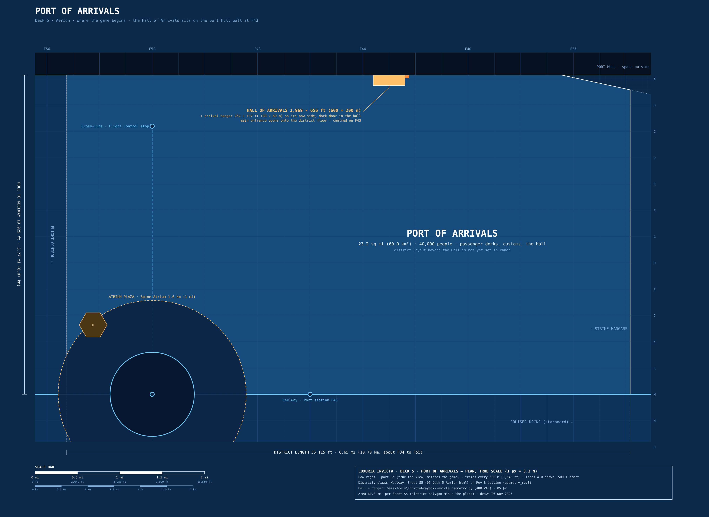

# Luxuria Invicta — Ship Reference (US and metric)

**Made 26 Nov 2026.** One page of the Invicta's key sizes, in US units first with metric in brackets, plus true-scale blueprints of Deck 5 (Aerion) and the Hall of Arrivals. Nothing here is new canon: every number is copied from the sources listed and converted (1 m = 3.28084 ft, 1 mi = 1.609344 km, 1 sq mi = 2.589988 km²). If a source changes, change it there first, then here.

The **Invicta is not the EX101.** The EX101 (4,000 × 1,504 × 708 m) is the website's ship; this page is game data only.

## 1. Overall ship

| Item | US | Metric | Source |
|---|---|---|---|
| Length overall | 21.13 mi (111,549 ft) | 34.0 km (69 frames F0–F68, 500 m apart) | Sheet S0 `00-Ship.html`; `hull_plan_km.csv` |
| Beam, maximum | 7.71 mi (40,682 ft) | 12.4 km (hull plan CSV: 12.39 km) | Sheet S0; `hull_plan_km.csv` |
| Hull height, keel to dorsal plating | 2.55 mi (13,451 ft) | 4.1 km | Sheet S0; `geometry_revB/hull_side_profile_km_revB.csv` |
| Height with Crown and stern fins | about 3.42 mi (18,045 ft) | about 5.5 km | Sheet S0; errata B9 (⏳ proposed) |
| Interior volume | — | 950 km³ | Sheet S0 |
| Mass | about 584 billion US tons | about 530 billion tonnes | Sheet S0; errata B3 (⏳ proposed) |
| Net city floor, all 8 decks | 752.6 sq mi | 1,949.1 km² (Rev B; canon 1,950) | `geometry_revB/README.txt` |

Revision B (C1) reshaped only the prow and stern side profile; the overall 34.0 × 12.4 × 4.1 km is unchanged.

## 2. Deck heights

| Deck | Floor to ceiling (clear) | Floor | Ceiling |
|---|---|---|---|
| 1 Solenne | 1,247 ft (380 m) | 11,614 ft (3,540 m) | 12,861 ft (3,920 m) |
| 2 Halcyon | 1,247 ft (380 m) | 10,171 ft (3,100 m) | 11,417 ft (3,480 m) |
| 3 Meridian | 1,247 ft (380 m) | 8,727 ft (2,660 m) | 9,974 ft (3,040 m) |
| 4 Bastion | 1,247 ft (380 m) | 7,283 ft (2,220 m) | 8,530 ft (2,600 m) |
| **5 Aerion** | **1,969 ft (600 m)** | 5,118 ft (1,560 m) | 7,087 ft (2,160 m) |
| 6 Machina | 1,247 ft (380 m) | 3,675 ft (1,120 m) | 4,921 ft (1,500 m) |
| 7 Claustra | 1,247 ft (380 m) | 2,231 ft (680 m) | 3,478 ft (1,060 m) |
| 8 Ferrum | 1,247 ft (380 m) | 787 ft (240 m) | 2,034 ft (620 m) |

Elevations are above the keel. A 197 ft (60 m) crew-only service layer sits under each deck, so each deck takes 1,444 ft (440 m) of hull height (Aerion 2,165 ft / 660 m). Sources: `Tools/InvictaGraybox/invicta_geometry.py` (`DECKS`), `05_World_and_Content.md` (service layers), Sheet S0.

## 3. Deck 5 — Aerion

- Gross length 20.5 mi (108,268 ft; 33.0 km, F1 to F67). Maximum width 7.55 mi (39,849 ft; 12.15 km).
- Net floor 117.4 sq mi (304.1 km², Rev B).

**Districts: 5, plus the Atrium Plaza** (bow to stern):

| District | Area | What is there | Centre address |
|---|---|---|---|
| Strike Hangars | 42.1 sq mi (109.1 km², Rev B C2; Sheet S5 says 110) | Racks for 3,600 craft, 32 launch shafts to the Forward Grids | D5-F19-M |
| Port of Arrivals (port side) | 23.2 sq mi (60.0 km²) | **Where the game begins.** Hall of Arrivals, passenger docks, customs | D5-F43-F |
| Cruiser Docks (starboard side) | 23.2 sq mi (60.0 km²) | Berths for the six 2 km escort cruisers | D5-F43-T |
| Flight Control | 7.7 sq mi (20.0 km²) | The Beacon tower, traffic control, briefing halls | D5-F57-M |
| Pilots' Quarter | 17.4 sq mi (45.0 km²) | Housing, simulators, flight school | D5-F63-M |
| Atrium Plaza (plaza) | 3.9 sq mi (10.0 km²) | Governor's Hall, pilots' guild, Atrium Central station | D5-F52-M |

Keelway stops: Strike Hangars F3, Port F46, Atrium Central F52, Pilots' Quarter F65. Cross-line at F52: Flight Control (3.2 mi / 5.1 km to port), Atrium Central, Dockside (3.2 mi / 5.1 km to starboard).

Blueprint sources: outline from `geometry_revB/deck5_Aerion_net_km_revB.csv` and `_gross_km_revB.csv`; district boundaries, plaza, Keelway and drone depot from the Sheet S5 plan (`1_Canon_Source/Invicta/datasheets/05-Deck-5-Aerion.html`), clipped to the Rev B outline.

## 4. Hall of Arrivals and arrival hangar

Where it sits in the Port of Arrivals (district 6.65 mi / 35,115 ft long, about F34 to F55, and 3.77 mi / 19,925 ft from the port hull to the Keelway). Canon sets no layout in the district beyond the Hall yet.

On the port hull wall of Deck 5, centred on frame F43 (21.5 km from the prow), in the Port of Arrivals.

| Item | US | Metric | Status |
|---|---|---|---|
| Hall of Arrivals | 1,969 × 656 ft, 98 ft high (29.7 acres) | 600 × 200 × 30 m | Canon (05; height Jordan 21 Nov) |
| Skyglass wall | 1,969 ft long, 98 ft tall, mullions every 39 ft | 600 m, 30 m, 12 m | Canon look (Jordan 21 Nov) |
| Arrival hangar (bow side of the Hall) | 262 × 197 ft, 49 ft high | 80 × 60 × 15 m | Canon (Jordan 21 Nov) |
| Dock door in the hull | 131 × 33 ft | 40 × 10 m | Canon (Jordan 21 Nov) |
| Shuttle pad | 131 ft square | 40 m | TUNE |
| Main entrance to the Port of Arrivals | 98 ft wide, 66 ft high | 30 × 20 m | TUNE (placeholder) |
| Hall-to-hangar door | 66 ft wide, 33 ft high | 20 × 10 m | TUNE (placeholder) |
| Arrival shuttle | about 98–131 ft | about 30–40 m | Canon size, model TBD |

Sources: `Tools/InvictaGraybox/invicta_geometry.py` (`ARRIVAL`), `05_World_and_Content.md` §2, `M2_Progress.md`.

## 5. Port of Arrivals precincts (⏳ proposed v2, 26 Nov 2026, awaiting Jordan)

Proposed term: **precinct**, an area inside a district. Order: deck (city) › district › precinct › block (500 × 500 m, one frame × one lane) › building. "Zone" is already the sealable pressure zone between frames; "Quarter" and "Ward" are used in district names.

**Design rule (Jordan, 26 Nov 2026):** Aerion's main purpose is the Hangar Deck, the hangar and transportation city for everyone on the ship, coming and going. Port of Arrivals is planned for traffic and travellers first. Its 40,000 people (Sheet S5) are treated as the workforce; the deck's housing, schools and family services sit in the Pilots' Quarter.

Edges sit on frame lines and lane edges (A–C, D–F, G–I, J–M). Total 60.0 km² (23.2 sq mi).

| # | Precinct | Frames | Lanes | Area | What is there |
|---|---|---|---|---|---|
| P1 | Bow Docks | F34–F41 | A–C | 4.5 km² (1.8 sq mi) | Flank berths for civilian and private ships |
| P2 | Arrivals | F41–F46 | A–C | 3.3 km² (1.3 sq mi) | Hall of Arrivals, arrival hangar, shuttle pads |
| P3 | Stern Docks | F46–F55 | A–C | 6.1 km² (2.4 sq mi) | Flank berths for civilian and private ships; cross-line Flight Control stop |
| P4 | Freight | F34–F39 | D–M | 12.3 km² (4.7 sq mi) | Cargo, baggage, ground-vehicle depots, warehouses |
| P5 | Terminals | F39–F48 | D–F | 6.8 km² (2.6 sq mi) | Departure and arrival halls, check-in, customs, security |
| P6 | Concourse | F39–F48 | G–I | 6.8 km² (2.6 sq mi) | Transit lounges, travellers' hotels, shops, greeters |
| P7 | Station | F39–F48 | J–M | 7.9 km² (3.0 sq mi) | Keelway Port station (F46), interchange, deck-transfer lifts |
| P8 | Shuttle Yards | F48–F55 | D–M (less the Atrium Plaza) | 12.3 km² (4.7 sq mi) | Public small-craft hangars, shuttle depot, maintenance, fuel |

Built from the canon roles in Sheet S5 (Hall of Arrivals, passenger docks, customs; customs officers, greeters, porters, guides, clerks) and 04 §7.3 (civilian ships dock at the Port of Arrivals flank docks). Deck-transfer lifts in P7 are an assumption: canon does not yet say how people move between decks.

Detailed plans of each precinct: `Port_of_Arrivals_Precincts.md`.

## 6. Small differences found while making this page

- **Plan orientation.** The canon sheets (S0, S5 and the rest) draw plans bow left, port up. Seen from above that is a mirror image: it is the ship viewed from below. The game is right (`invicta_geometry.py`: facing the bow, port is on your left; the arrival hangar is on the bow side of the Hall). All blueprints on this page are true top views: **bow right, port up**, matching the Unreal top view. Fixed 26 Nov 2026 after Jordan spotted the hangar on the wrong side.

- Sheet S5's plan draws the Strike Hangars Keelway stop at about 1.7 km from the prow ("1.2 km from deck bow"), while F3 is at 1.5 km. The game code uses F3. Not changed; worth settling.
- `Data/Canon/zone_reservations_km.csv` is still Revision A (Strike Hangars 110 km²); its README already says so.

## 7. Canal Gardens precincts, Deck 3 (⏳ proposed, 27 Nov 2026, Kylee)

District (Sheet S3): 5.8 sq mi (15.0 km²), starboard of the Keelway, about F53 to F59; edges read from the S3 plan at 26.658 to 29.638 km from the prow and 0 to 5.488 km to starboard (9,777 × 18,005 ft). Six precincts in three bands, bow to stern: P4 Garden Squares 2.0 km², P5 Lakeside Retreat 2.5 km², P6 Canal Village 2.0 km² (bow band, port to starboard); P1 Grand Canal 3.0 km², 1,795 ft (547 m) wide across the full district; P2 Waterfront Quarter 2.5 km² and P3 Botanical Gardens 3.0 km² (stern band, port to starboard). The canon Atrium Plaza cuts the corner of P4. Details: `Canal_Gardens_Precincts.md`.
