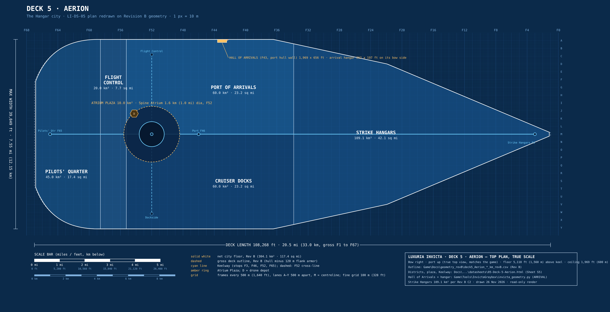
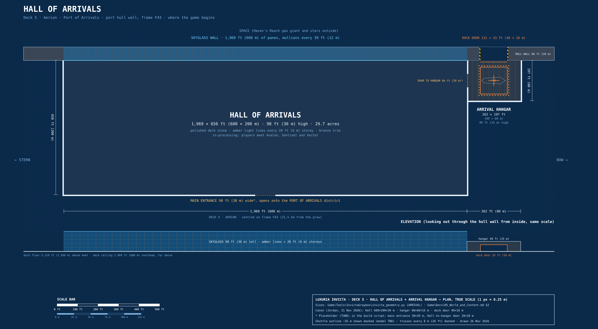
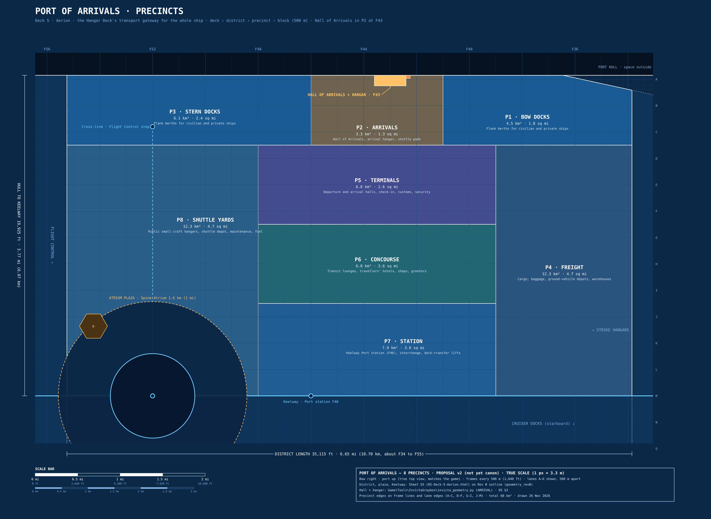

# Luxuria Invicta — Ship Reference (US and metric)

**Made 26 Nov 2026.** One page of the Invicta's key sizes, in US units first with metric in brackets, plus true-scale blueprints of Deck 5 (Aerion) and the Hall of Arrivals. Nothing here is new canon: every number is copied from the sources listed and converted (1 m = 3.28084 ft, 1 mi = 1.609344 km, 1 sq mi = 2.589988 km²). If a source changes, change it there first, then here.

The **Invicta is not the EX101.** The EX101 (4,000 × 1,504 × 708 m) is the website's ship; this page is game data only.

## 1. Overall ship

| Item | US | Metric | Source |
|---|---|---|---|
| Length overall | 21.13 mi (111,549 ft) | 34.0 km (69 frames F0–F68, 500 m apart) | Sheet S0 `00-Ship.html`; `hull_plan_km.csv` |
| Beam, maximum | 7.71 mi (40,682 ft) | 12.4 km (hull plan CSV: 12.39 km) | Sheet S0; `hull_plan_km.csv` |
| Hull height, keel to dorsal plating | 2.55 mi (13,451 ft) | 4.1 km | Sheet S0; `geometry_revB/hull_side_profile_km_revB.csv` |
| Height with Crown and stern fins | about 3.42 mi (18,045 ft) | about 5.5 km | Sheet S0; errata B9 (⏳ proposed) |
| Interior volume | — | 950 km³ | Sheet S0 |
| Mass | about 584 billion US tons | about 530 billion tonnes | Sheet S0; errata B3 (⏳ proposed) |
| Net city floor, all 8 decks | 704.4 sq mi | 1,824.4 km² (Rev C, errata C10; Rev B 1,949.1; canon 1,950) | `geometry_revC/README.txt` |

Revision B (C1) reshaped only the prow and stern side profile; the overall 34.0 × 12.4 × 4.1 km is unchanged.

**Concept hull (Rev C, ⏳ proposed 28 Nov 2026, errata C9) and trimmed decks (✅ errata C10).** Jordan's six-view concept sheet (`art/concept/invicta-concept-six-views.png`) is traced into a new hull outline (`geometry_revC/`): pointed bow, armoured side pods, a blunt stern with four engine nozzles, and the art's long thin nose and narrower stern. Length, beam and hull height stay 21.13 × 7.71 × 2.55 mi (34.0 × 12.4 × 4.1 km). The decks are cut back square across where the nose and stern can no longer hold them (C10). The Crown sits on top over the concept's windowed module, 6.65 to 11.62 mi (10.7 to 18.7 km) from the prow, and holds the Bridge Level: like Deck 1 but smaller, 1,247 ft (380 m) clear, floor 13,058 ft (3,980 m), 14.3 sq mi (37.1 km²), with the Crown Bridge at its front behind the windows.

## 2. Deck heights

| Deck | Floor to ceiling (clear) | Floor | Ceiling |
|---|---|---|---|
| 1 Solenne | 1,247 ft (380 m) | 11,614 ft (3,540 m) | 12,861 ft (3,920 m) |
| 2 Halcyon | 1,247 ft (380 m) | 10,171 ft (3,100 m) | 11,417 ft (3,480 m) |
| 3 Meridian | 1,247 ft (380 m) | 8,727 ft (2,660 m) | 9,974 ft (3,040 m) |
| 4 Bastion | 1,247 ft (380 m) | 7,283 ft (2,220 m) | 8,530 ft (2,600 m) |
| **5 Aerion** | **1,969 ft (600 m)** | 5,118 ft (1,560 m) | 7,087 ft (2,160 m) |
| 6 Machina | 1,247 ft (380 m) | 3,675 ft (1,120 m) | 4,921 ft (1,500 m) |
| 7 Claustra | 1,247 ft (380 m) | 2,231 ft (680 m) | 3,478 ft (1,060 m) |
| 8 Ferrum | 1,247 ft (380 m) | 787 ft (240 m) | 2,034 ft (620 m) |

No stairs between decks (Jordan, 28 Nov 2026): they would be far too big. People and vehicles go from deck to deck only by fast elevators and teleport pads. Stairs are only inside buildings, between a building's own floors.

Every deck has an Atrium and the Spine Atrium at its centre (Jordan, 28 Nov 2026). Deck-to-deck transport for people and ships, by teleporter or elevator, is in the Spine Atrium.

Elevations are above the keel. A 197 ft (60 m) crew-only service layer sits under each deck, so each deck takes 1,444 ft (440 m) of hull height (Aerion 2,165 ft / 660 m). Sources: `Tools/InvictaGraybox/invicta_geometry.py` (`DECKS`), `05_World_and_Content.md` (service layers), Sheet S0.

## 3. Deck 5 — Aerion

- Gross length 20.5 mi (108,268 ft; 33.0 km, F1 to F67). Maximum width 7.55 mi (39,849 ft; 12.15 km).
- Net floor 116.6 sq mi (301.9 km², Rev C errata C10; Rev B 304.1). Since C10 the deck starts 1.61 mi (2.59 km) from the prow, at F5.

**Districts: 5, plus the Atrium Plaza** (bow to stern):

| District | Area | What is there | Centre address |
|---|---|---|---|
| Strike Hangars | 41.2 sq mi (106.78 km², Rev C C10; Rev B C2 109.1; Sheet S5 says 110) | Racks for 3,600 craft, 32 launch shafts to the Forward Grids | D5-F19-M |
| Port of Arrivals (port side) | 23.2 sq mi (60.0 km²) | **Where the game begins.** Hall of Arrivals, passenger docks, customs | D5-F43-F |
| Cruiser Docks (starboard side) | 23.2 sq mi (60.0 km²) | Berths for the six 2 km escort cruisers | D5-F43-T |
| Flight Control | 7.7 sq mi (20.0 km²) | The Beacon tower, traffic control, briefing halls | D5-F57-M |
| Pilots' Quarter | 17.4 sq mi (45.0 km²) | Housing, simulators, flight school | D5-F63-M |
| Atrium Plaza (plaza) | 3.9 sq mi (10.0 km²) | Governor's Hall, pilots' guild, Atrium Central station | D5-F52-M |

Keelway stops: Strike Hangars F7 (F3 until errata C10), Port F46, Atrium Central F52, Pilots' Quarter F65. Cross-line at F52: Flight Control (3.2 mi / 5.1 km to port), Atrium Central, Dockside (3.2 mi / 5.1 km to starboard).

Blueprint sources: outline from `geometry_revB/deck5_Aerion_net_km_revB.csv` and `_gross_km_revB.csv`; district boundaries, plaza, Keelway and drone depot from the Sheet S5 plan (`1_Canon_Source/Invicta/datasheets/05-Deck-5-Aerion.html`), clipped to the Rev B outline.

## 4. Hall of Arrivals and arrival hangar

Where it sits in the Port of Arrivals (district 6.65 mi / 35,115 ft long, about F34 to F55, and 3.77 mi / 19,925 ft from the port hull to the Keelway). Canon sets no layout in the district beyond the Hall yet.

On the port hull wall of Deck 5, centred on frame F43 (21.5 km from the prow), in the Port of Arrivals.

| Item | US | Metric | Status |
|---|---|---|---|
| Hall of Arrivals | 1,969 × 656 ft, 98 ft high (29.7 acres) | 600 × 200 × 30 m | Canon (05; height Jordan 21 Nov) |
| Skyglass wall | 1,969 ft long, 98 ft tall, mullions every 39 ft | 600 m, 30 m, 12 m | Canon look (Jordan 21 Nov) |
| Arrival hangar (bow side of the Hall) | 262 × 197 ft, 49 ft high | 80 × 60 × 15 m | Canon (Jordan 21 Nov) |
| Dock door in the hull | 131 × 33 ft | 40 × 10 m | Canon (Jordan 21 Nov) |
| Shuttle pad | 131 ft square | 40 m | TUNE |
| Main entrance to the Port of Arrivals | 98 ft wide, 66 ft high | 30 × 20 m | TUNE (placeholder) |
| Hall-to-hangar door | 66 ft wide, 33 ft high | 20 × 10 m | TUNE (placeholder) |
| Arrival shuttle | about 98–131 ft | about 30–40 m | Canon size, model TBD |

Sources: `Tools/InvictaGraybox/invicta_geometry.py` (`ARRIVAL`), `05_World_and_Content.md` §2, `M2_Progress.md`.

## 5. Port of Arrivals precincts (⏳ proposed v2, 26 Nov 2026, awaiting Jordan)

Proposed term: **precinct**, an area inside a district. Order: deck (city) › district › precinct › block (500 × 500 m, one frame × one lane) › building. "Zone" is already the sealable pressure zone between frames; "Quarter" and "Ward" are used in district names.

**Design rule (Jordan, 26 Nov 2026):** Aerion's main purpose is the Hangar Deck, the hangar and transportation city for everyone on the ship, coming and going. Port of Arrivals is planned for traffic and travellers first. Its 40,000 people (Sheet S5) are treated as the workforce; the deck's housing, schools and family services sit in the Pilots' Quarter.

Edges sit on frame lines and lane edges (A–C, D–F, G–I, J–M). Total 60.0 km² (23.2 sq mi).

| # | Precinct | Frames | Lanes | Area | What is there |
|---|---|---|---|---|---|
| P1 | Bow Docks | F34–F41 | A–C | 4.5 km² (1.8 sq mi) | Flank berths for civilian and private ships |
| P2 | Arrivals | F41–F46 | A–C | 3.3 km² (1.3 sq mi) | Hall of Arrivals, arrival hangar, shuttle pads |
| P3 | Stern Docks | F46–F55 | A–C | 6.1 km² (2.4 sq mi) | Flank berths for civilian and private ships; cross-line Flight Control stop |
| P4 | Freight | F34–F39 | D–M | 12.3 km² (4.7 sq mi) | Cargo, baggage, ground-vehicle depots, warehouses |
| P5 | Terminals | F39–F48 | D–F | 6.8 km² (2.6 sq mi) | Departure and arrival halls, check-in, customs, security |
| P6 | Concourse | F39–F48 | G–I | 6.8 km² (2.6 sq mi) | Transit lounges, travellers' hotels, shops, greeters |
| P7 | Station | F39–F48 | J–M | 7.9 km² (3.0 sq mi) | Keelway Port station (F46), interchange, deck-transfer lifts |
| P8 | Shuttle Yards | F48–F55 | D–M (less the Atrium Plaza) | 12.3 km² (4.7 sq mi) | Public small-craft hangars, shuttle depot, maintenance, fuel |

Built from the canon roles in Sheet S5 (Hall of Arrivals, passenger docks, customs; customs officers, greeters, porters, guides, clerks) and 04 §7.3 (civilian ships dock at the Port of Arrivals flank docks). Deck-transfer lifts in P7 are an assumption: canon does not yet say how people move between decks.

Detailed plans of each precinct: `Port_of_Arrivals_Precincts.md`.

**City planner (⏳ proposed, 28 Nov 2026).** Jordan: the Port of Arrivals is the main way in and out of the whole ship, for military, commercial and community traffic, so its hull needs many doors, big and small, and high security. `Invicta/tools/city_planner.py` checks the district against that purpose (program in `Invicta/data/city_programs.json`) and added 12 proposed items in free land, moving nothing: a Bow and a Stern Guard Berth (394 × 262 ft (120 × 80 m), one 262 ft (80 m) hull door each) for the port guard, military transports and official craft; the Port Guard Station; two 131 ft (40 m) skiff locks for the Skiff Marina, which had no door to space; 20 crew airlocks, one in each 1,640 ft (500 m) pressure zone of the hull front, with 6 × 7 ft (1.83 × 2.13 m) outer doors; the Bow Docks Border Post; the Port Security Command, one room that sees and can lock every hull door; and fire and first aid posts. The port now has 50 ship-sized hull doors (it had 46) plus 20 crew airlocks. The Stern Docks had no free land near their far berths, so (Jordan, 28 Nov 2026) the Stern Harbourmaster got a two-bay fire appliance bay and a border post at its stern end. Every hull door is now within reach of fire, police, medical and border clearance. A freight gate of its own is left for Jordan. Report: `Port_of_Arrivals_Planner.md`.

## 6. Small differences found while making this page

- **Plan orientation.** The canon sheets (S0, S5 and the rest) draw plans bow left, port up. Seen from above that is a mirror image: it is the ship viewed from below. The game is right (`invicta_geometry.py`: facing the bow, port is on your left; the arrival hangar is on the bow side of the Hall). All blueprints on this page are true top views: **bow right, port up**, matching the Unreal top view. Fixed 26 Nov 2026 after Jordan spotted the hangar on the wrong side.

- Sheet S5's plan draws the Strike Hangars Keelway stop at about 1.7 km from the prow ("1.2 km from deck bow"), while F3 is at 1.5 km. The game code used F3. Settled 28 Nov 2026: errata C10 moved the stop to F7 and the game code now says F7.
- `Data/Canon/zone_reservations_km.csv` is still Revision A (Strike Hangars 110 km²); its README already says so.

## 7. Canal Gardens precincts, Deck 3 (⏳ proposed, 27 Nov 2026, Kylee)

District (Sheet S3): 5.8 sq mi (15.0 km²), starboard of the Keelway, about F53 to F59; edges read from the S3 plan at 26.658 to 29.638 km from the prow and 0 to 5.488 km to starboard (9,777 × 18,005 ft). Six precincts in three bands, bow to stern: P4 Garden Squares 2.0 km², P5 Lakeside Retreat 2.5 km², P6 Canal Village 2.0 km² (bow band, port to starboard); P1 Grand Canal 3.0 km², 1,795 ft (547 m) wide across the full district; P2 Waterfront Quarter 2.5 km² and P3 Botanical Gardens 3.0 km² (stern band, port to starboard). The canon Atrium Plaza cuts the corner of P4. Details: `Canal_Gardens_Precincts.md`.

## 8. Deck 5 precincts for the other districts (✅ canon, approved by Jordan 27 Nov 2026)

Jordan asked (27 Nov 2026) for every Deck 5 district to get its precincts. Each district now has a precinct plan in the Port of Arrivals pattern: precincts on frame and lane lines, named streets, and every block holding something, with names and codes. Jordan approved all five plans as canon (27 Nov 2026). Canon from the start: Strike Hangars' 32 launch shafts (errata C4, F16–F28, lanes D–F and T–V) and the Strike Hangars Keelway stop (F3); the three Cruiser Gates (C5, F38–F48) with two 2 km cruiser berths behind each; the cross-line Dockside stop (F52); the Beacon (F57); the Pilots' Quarter stop (F65); the Governor's Hall, pilots' guild and Atrium Central in the Atrium Plaza. Homes and family services are in the Pilots' Quarter (design rule above). Building heights, floors and interiors are not designed yet. Made by `Invicta/tools/seed_deck5_districts.py`.

**Strike Hangars** (9 precincts, 324 items, 42.23 sq mi (109.37 km²)). Details: `Strike_Hangars_Precincts.md`.

| # | Precinct | Frames | Lanes | Area | What is there |
|---|---|---|---|---|---|
| P1 | Keelway Gate | F1–F8 | K–O | 2.24 sq mi (5.79 km²) | Strike Hangars Keelway station (F3), crew check-in, lifts, clinic |
| P2 | Ordnance Yards | F8–F16 | G–S | 7.44 sq mi (19.28 km²) | Magazines, armorers, weapons assembly, fuel, drone racks |
| P3 | Port Launch Wing | F16–F28 | A–F | 2.57 sq mi (6.66 km²) | Launch shafts 1–16 to the port Forward Grid, launch control, arming aprons |
| P4 | Starboard Launch Wing | F16–F28 | T–Y | 2.57 sq mi (6.66 km²) | Launch shafts 17–32 to the starboard Forward Grid, recovery apron, damage triage |
| P5 | Port Rack Halls | F16–F28 | G–M | 7.53 sq mi (19.50 km²) | 1st and 2nd Strike Wings: rack halls 1–12 (1,800 craft) |
| P6 | Starboard Rack Halls | F16–F28 | M–S | 7.53 sq mi (19.50 km²) | 3rd and 4th Strike Wings: rack halls 13–24 (1,800 craft) |
| P7 | Port Repair Yards | F28–F34 | A–F | 2.51 sq mi (6.50 km²) | Heavy repairs, engines, airframes, coatings, salvage |
| P8 | Wing Command | F28–F34 | G–S | 7.33 sq mi (18.98 km²) | Strike wing headquarters, operations, briefings, duty lodges, mess, medical |
| P9 | Starboard Repair Yards | F28–F34 | T–Y | 2.51 sq mi (6.50 km²) | Battle-damage rebuilds, weapons fit, shields, drone repairs |

**Cruiser Docks** (6 precincts, 180 items, 23.13 sq mi (59.90 km²)). Details: `Cruiser_Docks_Precincts.md`.

| # | Precinct | Frames | Lanes | Area | What is there |
|---|---|---|---|---|---|
| P1 | Cruiser Gates | F38–F48 | T–Y | 5.45 sq mi (14.12 km²) | The three Cruiser Gates and six cruiser berths, supply quays |
| P2 | Fleet Stores | F34–F38 | T–Y | 2.20 sq mi (5.69 km²) | Cruiser fuel, munitions, stores and repair parts (with Ferrum) |
| P3 | Cruiser Repair Yards | F48–F55 | T–Y | 3.95 sq mi (10.23 km²) | Module repairs, turrets, engines, armour plate; cross-line Dockside stop |
| P4 | Dock Freight | F34–F42 | M–S | 5.12 sq mi (13.26 km²) | Cargo for the fleet: freight siding, container yard, bonded and cold stores |
| P5 | Fleet Quarter | F42–F48 | M–S | 3.76 sq mi (9.75 km²) | Fleet Admiral's office, captains' and crews' halls, clinic, Keelway Port entrance |
| P6 | Dockside | F48–F55 | M–S | 2.64 sq mi (6.85 km²) | Shops, inn, offices and gardens for the dock workforce; cross-line |

**Flight Control** (5 precincts, 105 items, 7.71 sq mi (19.96 km²)). Details: `Flight_Control_Precincts.md`.

| # | Precinct | Frames | Lanes | Area | What is there |
|---|---|---|---|---|---|
| P1 | Port Approach | F55–F59 | A–F | 1.81 sq mi (4.68 km²) | Approach control and sensors for the port docks and the Hall of Arrivals |
| P2 | Briefing Halls | F55–F59 | G–L | 1.60 sq mi (4.14 km²) | Main briefing hall, flight plans, space weather, investigations |
| P3 | Beacon | F55–F59 | L–N | 0.90 sq mi (2.32 km²) | The Beacon tower (canon), master traffic control room, Keelway |
| P4 | Dispatch | F55–F59 | O–S | 1.60 sq mi (4.14 km²) | Dispatch centre, schedules, analysts, controller training |
| P5 | Starboard Approach | F55–F59 | T–Y | 1.81 sq mi (4.68 km²) | Approach control for the Cruiser Gates, rescue coordination, evacuation craft |

**Pilots' Quarter** (6 precincts, 202 items, 17.36 sq mi (44.97 km²)). Details: `Pilots_Quarter_Precincts.md`.

| # | Precinct | Frames | Lanes | Area | What is there |
|---|---|---|---|---|---|
| P1 | Flight School | F59–F63 | A–H | 3.17 sq mi (8.22 km²) | Flight school, training hangar, trainee halls |
| P2 | Simulator Halls | F59–F63 | S–Y | 3.17 sq mi (8.22 km²) | Flight and bridge simulators, zero-g tank, centrifuge, public flight arcade |
| P3 | Pilots' Commons | F59–F63 | I–Q | 3.86 sq mi (9.99 km²) | Town centre: town hall, schools, hospital, market, park, museum |
| P4 | Port Homes | F63–F67 | A–L | 3.02 sq mi (7.83 km²) | Homes: family apartments, towers, terraces, courtyard homes |
| P5 | Quarter Station | F63–F67 | L–N | 1.11 sq mi (2.88 km²) | Pilots' Quarter Keelway station (F65), deck lifts, Keelway depot |
| P6 | Starboard Homes | F63–F67 | N–Y | 3.02 sq mi (7.83 km²) | Homes: garden apartments, lofts, towers, family courts |

**Atrium Plaza** (4 precincts, 35 items, 3.09 sq mi (8.00 km²)). Details: `Atrium_Plaza_Precincts.md`.

| # | Precinct | Frames | Lanes | Area | What is there |
|---|---|---|---|---|---|
| P1 | Governor's Quarter | F48–F52 | I–M | 0.77 sq mi (2.00 km²) | Governor's Hall (canon), City Council, Deck Chief, records |
| P2 | Station Quarter | F48–F52 | M–Q | 0.77 sq mi (2.00 km²) | Atrium Central station (canon), interchange, transit crews |
| P3 | Guild Quarter | F52–F56 | I–M | 0.77 sq mi (2.00 km²) | The pilots' guild (canon), licensing, guild archive |
| P4 | Rim Gardens | F52–F56 | M–Q | 0.77 sq mi (2.00 km²) | Gardens and overlook on the rim of the Spine Atrium, cafés |

Notes: the Strike Hangars precincts measure 42.23 sq mi (109.37 km²) on the Rev B outline against errata C2's 109.1 km²; Flight Control's and the Pilots' Quarter's shared edge (29.28 km) and the Atrium Plaza circle fall between frames; the Spine Atrium shaft (0.78 sq mi, 2.01 km²) is an opening and in no precinct. All four are logged as known in the app's rules (`Invicta/data/rules.json`).

Building shapes and map colours (Jordan, 27 Nov 2026): Deck 5 buildings follow their blocks, with curved edges along the Spine Atrium, the Atrium Plaza rim and the hull, and courtyards, L and U shapes, curved fronts and rounded corners where they fit. Port of Arrivals buildings that have a building plan show that plan's outline. Every building is coloured by use on the map and in 3D: roads and transit dark grey, the Keelway light blue, police and security blue, fire and emergency red, medical white with a red edge, homes warm tan, shops and food orange, offices and government purple, industry, hangars and docks steel grey, utilities and services yellow, parks and plazas green, schools and training teal.
