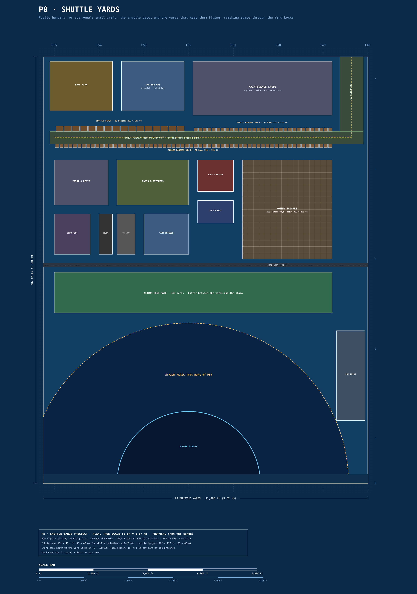

# Port of Arrivals — Precinct Plans (✅ canon, approved by Jordan 27 Nov 2026)

Started 26 Nov 2026. One true-scale blueprint per precinct of the Port of Arrivals (Deck 5, Aerion). The precinct split and the design rule (Aerion is the Hangar Deck first; the district's 40,000 people are its workforce) are in `Invicta_Ship_Reference.md` §5. Everything here is a proposal unless marked canon. All plans are true top views: **bow right, port up**, matching the game.

Common sizes (proposed): main roads 131 ft (40 m), streets 98 ft (30 m), Arrivals Boulevard 197 ft (60 m). Shuttle gates copy the canon arrival hangar: 262 × 197 × 49 ft (80 × 60 × 15 m) with a 131 × 33 ft (40 × 10 m) dock door.

Building shapes (27 Nov 2026, proposed): on the map and in 3D, a building that has a building plan is drawn with that plan's real outline (its wings, halls and towers, with yards and gardens left open), inside its lot. Buildings without a plan get a shape that suits their use (rounded corners for pavilions and squares). The sizes below are the lots and did not change. Map colours show what each building is used for (legend on the map).

Build order (walking order of a new arrival): P2 Arrivals › P5 Terminals › P6 Concourse › P7 Station › P1 Bow Docks › P3 Stern Docks › P4 Freight › P8 Shuttle Yards.

## P2 · Arrivals — F41 to F46, lanes A–C

8,202 × 4,341 ft (2.5 × 1.32 km). Where every arrival steps aboard.

| Item | Size | Notes | Code |
|---|---|---|---|
| Hall of Arrivals | 1,969 × 656 × 98 ft (600 × 200 × 30 m) | **Canon**, centred on F43 | D5F3P2B1A1 |
| Arrival hangar | 262 × 197 × 49 ft (80 × 60 × 15 m) | **Canon**, bow side of the Hall | D5F3P2B1A2 |
| Shuttle gates G1–G16 | 262 × 197 ft each, every 328 ft (100 m) | G1–G5 bow side, G6–G16 stern side, each with its own dock door | D5F3P2B1A3 |
| Gate Concourse | 98 ft (30 m) wide covered walkway | Behind the gates, links every gate to the Hall | D5F3P2B1A4 |
| Apron yards | between the concourse and Gate Road | Baggage, fuel, ground handling | D5F3P2B1A5 |
| Gate Road | 131 ft (40 m) | Service road behind the Hall, full length of the precinct | D5F3P2 |
| Arrivals Forecourt | 984 × 656 ft (300 × 200 m) | Plaza at the Hall's main entrance | D5F3P2B3A1 |
| Pickup lanes | two, 197 × 656 ft (60 × 200 m) | Pods and taxis, either side of the boulevard | D5F3P2B3A2 |
| Arrivals Boulevard | 197 ft (60 m) wide | From the forecourt inland along F43 to P5 Terminals | D5F3P2B3A3 |
| Streets | F42, F44, F45 Streets, 98 ft (30 m) | Gate Road to Dock Road | D5F3P2 |
| Dock Road | 131 ft (40 m) | Precinct edge (lanes C/D), arterial to Bow and Stern Docks | D5F3P2 |
| Port Health | 1,214 × 1,083 ft (370 × 330 m) | Screening and quarantine ward | D5F3P2B2A1 |
| Arrivals Fire Station | 886 × 984 ft (270 × 300 m) | Crash-fire-rescue station | D5F3P2B2A2 |
| Baggage Hall | 886 × 820 ft (270 × 250 m) | Reclaim, lost luggage | D5F3P2B3A4 |
| Visitor Centre | 1,115 × 722 ft (340 × 220 m) | Welcome, guides, maps | D5F3P2B3A5 |
| Arrivals Police Post | 656 × 591 ft (200 × 180 m) | Port security | D5F3P2B4A1 |
| Gate Operations | 1,378 × 984 ft (420 × 300 m) | Gate control, dispatch | D5F3P2B4A2 |
| Staff Centre | 1,378 × 886 ft (420 × 270 m) | Crew rest, canteen, lockers | D5F3P2B4A3 |
| Crew Lodge | 1,378 × 1,148 ft (420 × 350 m) | Rest for shuttle crews | D5F3P2B5A1 |
| Arrivals Utility Plant | 656 × 820 ft (200 × 250 m) | Substation, air, water | D5F3P2B5A2 |
| Service Shaft 1 | 328 × 1,476 ft (100 × 450 m) | Access to the 60 m service layer (bow shaft) | D5F3P2B2A3 |
| Service Shaft 2 | 591 × 1,640 ft (180 × 500 m) | Access to the 60 m service layer (stern shaft) | D5F3P2B5A3 |
| Bow Garden / Stern Garden | 56 and 44 acres | Forecourt parks | D5F3P2B3A6 |
| Arrivals Crew Airlocks | 5 airlocks, each 33 × 26 ft (10 × 8 m) | **Proposed** by the city planner · Planner, 28 Nov 2026: one per pressure zone; outer door 6 x 7 ft (1.83 x 2.13 m), the standard double door | D5F3P2B1A6 |
| Port Security Command | 820 × 656 ft (250 × 200 m) | **Proposed** by the city planner · Planner, 28 Nov 2026: one command room for every hull door of the port | D5F3P2B5A4 |

**Crew Lodge (P2-19) architecture, proposed 26 Nov 2026, canon 28 Nov 2026:** height 125 ft (38 m) at the tower tops and 79 ft (24 m) for the main block. Floors: Level −1 below deck, Levels 1–3 in the main block, Levels 4–5 in the towers. Capacity: 640 cabins (480 standard + 160 tower quarters), rated for 1,280 crew on rotating shifts. Entrances: Prow Entrance; Starboard Service Access; none on the stern side. Structure: steel frame on a 39 × 39 ft (12 × 12 m) grid, composite slabs, bearing on the deck plating. Main block (Levels 1–3) covers the full footprint at 26 ft (8 m) floor to floor. Four corner towers, each about 262 × 197 ft (80 × 60 m), add Levels 4–5 at 23 ft (7 m) to 125 ft (38 m). Stair and lift cores about every 328 ft (100 m), plus one core per tower from Level −1 to the roof. Level −1, the Crew Undercroft, is 20 ft (6 m) deep in the top of the 197 ft (60 m) service layer, clear of the gravity plates, with plant, laundry, stores and a crew-only tunnel door into the service-layer tunnels. Sits wholly within one pressure zone (F45–F46). Look, services and interior are not designed yet.

**Crew Lodge (P2-19) layout, proposed 27 Nov 2026, canon 28 Nov 2026** (from Jordan's review spec; full plan in `Invicta/data/models/D5-port-of-arrivals-P2-19.json`): look: graphite, titanium, smart glass, ice-blue exterior lighting, warm interiors. Level −1 laundry, plant, workshop, stores, receiving and crew tunnel; Level 1 Prow Entrance, reception, dining, lounges, medical, atrium and courtyard garden; Levels 2–3 eight cabin wings of 60 cabins (6 × 9 m each, 480 in total) with recreation on Level 2 and quiet lounges on Level 3; Levels 4–5 four 80 × 60 m towers with 20 quarters each per level (160). Eight stair and lift cores about every 100 m, plus one per tower.

<!-- designs P2 start -->

**Building designs (canon 28 Nov 2026, approved by Jordan; proposed 27 Nov 2026; full room plans in `Invicta/data/models/`):**

- **Port Health** (D5F3P2B2A1): 46 ft (14 m) tall, 3 above deck, 1 below. Concrete frame on a 9 m grid; the quarantine wing is sealed with its own air supply. A screening hall with booths and scan gates along the gates side; a clinic wing with treatment rooms, imaging, lab and wards; a sealed quarantine wing with negative-pressure rooms and quarantine suites; a healing garden between them. Capacity About 3,000 arrivals screened an hour; 60 ward beds and 46 quarantine suites..
- **Arrivals Fire Station** (D5F3P2B2A2): 43 ft (13 m) tall, 3 above deck. Steel appliance hall, 9 m (30 ft) clear; three-storey concrete crew block. A six-bay appliance hall, a crew block with watch room and medical store, bunk rooms and mess, and offices on top, and a drill yard behind. Capacity 6 appliances; 18 crew on watch..
- **Baggage Hall** (D5F3P2B3A4): 44 ft (13.5 m) tall, 2 above deck, 1 below. Steel roof on a 24 m grid over a column-free reclaim hall, 9 m (30 ft) clear; baggage tunnel in concrete below. Six reclaim belts in one hall, fed from a bag tunnel below, with lost luggage, oversize bags and the customs red and green channels on the way out. Capacity 6 reclaim belts; about 4,000 arrivals an hour..
- **Visitor Centre** (D5F3P2B3A5): 49 ft (15 m) tall, 3 above deck. Timber and steel roof on tree-like columns over a two-storey glass pavilion. Welcome desks, a ship map wall with a large model of the Invicta, travel shop and café on the ground floor; the Invicta exhibition, cinema and group rooms upstairs; a roof viewing deck. Capacity About 2,000 visitors at a time; 120 guides and staff..
- **Arrivals Police Post** (D5F3P2B4A1): 28 ft (8.4 m) tall, 2 above deck. Reinforced concrete frame with a hardened ground floor. Front desk, interview and holding rooms below, open office and briefing room above, and a garage wing round a secure yard. Capacity About 80 officers across three shifts..
- **Gate Operations** (D5F3P2B4A2): 66 ft (20 m) tall, 4 above deck. Concrete frame with a steel and glass top floor; steel equipment hall behind. Ground floor: gate crew room, ramp equipment store, lockers and canteen. Levels 2 and 3: dispatch, training and offices. Level 4: the gate control room overlooking every gate. A four-bay ground equipment hall behind. Capacity About 700 staff across shifts; the control floor runs all 16 gates..
- **Staff Centre** (D5F3P2B4A3): 43 ft (13 m) tall, 3 above deck. Concrete frame on an 8 m grid. A front block with staff entrance, canteen and shop, and training, HR and welfare rooms upstairs; a locker wing and a rest wing with quiet room, prayer rooms, nap pods, gym and rest rooms; a staff garden in the middle. Capacity Canteen seats 1,200; lockers for about 4,000 staff..
- **Arrivals Utility Plant** (D5F3P2B5A2): 46 ft (14 m) tall, 2 above deck. Concrete plant house; steel chiller enclosures. A plant house with transformer bays, switch room and water pumps below, air handling above, and three chillers alongside. Capacity Power, water and cooling for P2; about 20 staff per shift..
- **Service Shaft 1** (D5F3P2B2A3): 43 ft (13 m) tall, 2 above deck, 1 below. Concrete shaft walls down to the 60 m (197 ft) service layer; steel head house. A control house and a shaft hall with a vehicle lift and a goods lift down to the service layer. Capacity One vehicle lift and one goods lift..
- **Service Shaft 2** (D5F3P2B5A3): 43 ft (13 m) tall, 2 above deck, 1 below. Concrete shaft walls down to the 60 m (197 ft) service layer; steel head house with crane rails. A control house with shaft control and fans, and a shaft hall with two vehicle lifts and a goods lift down to the service layer. Capacity Two vehicle lifts and one goods lift..

<!-- designs P2 end -->

## P5 · Terminals — F39 to F48, lanes D–F

14,764 × 4,921 ft (4.5 × 1.5 km). Departures and arrivals for the whole ship. Arrivals Boulevard runs through the middle; people movers link both terminals to the P2 gate concourse.

| Item | Size | Notes | Code |
|---|---|---|---|
| Transfer Hall | 2,953 × 2,034 ft (900 × 620 m) | travellers from other decks · shuttle bookings | D5F3P5B1A1 |
| Arrivals Terminal | 2,887 × 2,100 ft (880 × 640 m) | passport and customs control · baggage claim | D5F3P5B3A1 |
| Departures Terminal | 2,887 × 2,100 ft (880 × 640 m) | check-in · security screening · lounges | D5F3P5B5A1 |
| Cargo Customs | 2,887 × 2,034 ft (880 × 620 m) | bonded inspection · declarations | D5F3P5B6A1 |
| Terminals Private Flights Lounge | 1,312 × 2,034 ft (400 × 620 m) | terminal for Stern Docks | D5F3P5B8A1 |
| Travel Office | 1,312 × 1,411 ft (400 × 430 m) | tickets · info | D5F3P5B2A1 |
| Terminals Pod Depot | 1,476 × 1,903 ft (450 × 580 m) | ground pods · taxis | D5F3P5B2A2 |
| Customs & Border Hq | 2,165 × 1,804 ft (660 × 550 m) | main police and border station | D5F3P5B4A1 |
| Terminal Plaza | 1,312 × 1,181 ft (400 × 360 m) |  | D5F3P5B4A2 |
| Licensing & Permits | 2,165 × 1,804 ft (660 × 550 m) | flight, cargo and travel permits | D5F3P5B4A3 |
| Terminal Admin | 1,444 × 1,575 ft (440 × 480 m) | port authority offices | D5F3P5B7A1 |
| Terminals Utility Plant | 656 × 1,083 ft (200 × 330 m) | substation · air | D5F3P5B7A2 |
| Terminals Service Shaft | 459 × 1,903 ft (140 × 580 m) |  | D5F3P5B7A3 |
| Medical Centre | 1,312 × 1,575 ft (400 × 480 m) | first aid · clinic | D5F3P5B9A1 |

<!-- designs P5 start -->

**Building designs (canon 28 Nov 2026, approved by Jordan; proposed 27 Nov 2026; full room plans in `Invicta/data/models/`):**

- **Transfer Hall** (D5F3P5B1A1): 105 ft (32 m) tall, 4 above deck, 1 below. A steel lattice dome, 32 m (105 ft) high and 300 m (984 ft) across, on a concrete ring; concrete arms around it. A domed great hall at the crossing of four arms: deck transfer desks, ticketing and lounges in the bow arm, shuttle booking and baggage transfer in the stern arm, the link to the gates on the port side and the kerb hall on the landside. Food court and business lounges upstairs; deck lifts and baggage belts below. Capacity About 12,000 transfer travellers an hour..
- **Arrivals Terminal** (D5F3P5B3A1): 49 ft (15 m) tall, 2 above deck, 1 below. Steel roof on tree columns on a 36 m grid, 15 m (49 ft) clear, over a concrete baggage level. Three halls in sequence from the gates to the kerb: immigration (passport control, automated gates, secondary checks), reclaim and customs, and the arrivals meeting hall with welcome desks, pod and taxi desks, shops and cafés, and an arrivals lounge upstairs. Capacity About 6,000 arrivals an hour; 8 reclaim belts..
- **Departures Terminal** (D5F3P5B5A1): 72 ft (22 m) tall, 3 above deck, 1 below. Long-span steel wave roof, 22 m (72 ft) high over the check-in hall, on a concrete departures deck. From the kerb to the gates: a check-in hall with six check-in islands and bag drop, a security and passport exit hall, and the departure lounges with gate lounges, a departures street of duty-free shops and restaurants, and first-class, business and quiet lounges on the top level. Capacity About 6,000 departing travellers an hour; 16 security lanes..
- **Cargo Customs** (D5F3P5B6A1): 62 ft (19 m) tall, 3 above deck. Steel portal frames, 10 m (33 ft) clear, over the inspection lanes; shielded concrete scanner hall. A truck queue, an eight-lane inspection shed, a scanner hall with a container X-ray and a radiation portal, and an office block with declarations hall, brokers' counters, sample lab, seized goods vault and customs offices. Capacity 8 inspection lanes and 2 scanners; about 400 trucks a day; 500 staff..
- **Terminals Private Flights Lounge** (D5F3P5B8A1): 48 ft (14.5 m) tall, 3 above deck. Steel frame with stone cladding; timber roof terrace. Private check-in and customs, main lounge and dining room on the ground floor, private suites and spa above, a roof bar on top, with a garden court on one side and a car court on the other. Capacity About 200 guests at a time..
- **Travel Office** (D5F3P5B2A1): 43 ft (13 m) tall, 3 above deck. Concrete frame with a glass arcade roof. A ticket hall with ticket counters, travel information and kiosks along an arcade, with booking offices and a call centre on the upper floors. Capacity About 3,000 visitors a day; 400 staff including the call centre..
- **Terminals Pod Depot** (D5F3P5B2A2): 54 ft (16.5 m) tall, 4 above deck. Post-tensioned concrete parking decks. Four decks of pod parking and charging and a dispatch strip with pod wash and battery swap. Capacity About 2,000 pods..
- **Customs & Border Hq** (D5F3P5B4A1): 82 ft (25 m) tall, 6 above deck. Concrete frame with blast-resistant facades on a 9 m grid. Two six-storey blocks joined by a link: border police station and custody suite in the bow block, customs intelligence and labs in the stern block, the entrance hall and public enquiries in the link, with the joint operations centre above it. Offices on the upper floors; a front court and a secure court. Capacity About 2,500 staff..
- **Licensing & Permits** (D5F3P5B4A3): 59 ft (18 m) tall, 4 above deck. Concrete frame round a courtyard; a long-span timber roof over the public service hall. A public service hall with queue area, 30 service counters, interview rooms and cashier; behind it a ring of offices round a courtyard, with the flight, cargo and travel permit offices on the ground floor and licensing offices above. Capacity About 5,000 visitors a day; 900 staff..
- **Terminal Admin** (D5F3P5B7A1): 171 ft (52 m) tall, 12 above deck. Concrete core and steel frame tower on a two-storey podium. A podium with the port authority reception, an exhibition hall and a conference hall, and a ten-storey office tower above with the board room and executive offices on top. Capacity About 1,300 port authority staff..
- **Terminals Utility Plant** (D5F3P5B7A2): 46 ft (14 m) tall, 2 above deck. Concrete plant house; steel chiller hall. A plant house with transformer bays, switch and control rooms and air handling, and a chiller and pump hall. Capacity Power, cooling and water for P5; about 25 staff per shift..
- **Terminals Service Shaft** (D5F3P5B7A3): 43 ft (13 m) tall, 2 above deck, 1 below. Concrete shaft walls down to the 60 m (197 ft) service layer; steel head house. A control house and a shaft hall with vehicle, goods and baggage lifts down to the service layer. Capacity A vehicle lift, a goods lift and a baggage lift..
- **Medical Centre** (D5F3P5B9A1): 84 ft (25.5 m) tall, 6 above deck, 1 below. Concrete frame on a 9 m grid with a four-storey ward slab on the clinic podium. A two-storey clinic podium with the emergency department, first aid, imaging and pharmacy below and operating theatres, outpatient clinics and lab above; a four-storey ward slab on top; stores, plant and morgue below deck; an ambulance court and a healing garden. Capacity About 120 beds and 4 operating theatres..

<!-- designs P5 end -->

## P6 · Concourse — F39 to F48, lanes G–I

14,764 × 4,921 ft (4.5 × 1.5 km). Where travellers wait, eat and sleep. The boulevard becomes the 394 ft (120 m) tree-lined Concourse Promenade. Hotel room counts are placeholders.

| Item | Size | Notes | Code |
|---|---|---|---|
| Greeters' Hall | 1,476 × 2,100 ft (450 × 640 m) | meeting point · welcome desks | D5F3P6B1A1 |
| Shop Arcade | 1,312 × 2,100 ft (400 × 640 m) | travel goods · duty-free | D5F3P6B1A2 |
| Transit Lounges | 2,756 × 2,100 ft (840 × 640 m) | waiting · rest pods · showers | D5F3P6B3A1 |
| Market Hall | 2,756 × 2,100 ft (840 × 640 m) | food court · daily shops | D5F3P6B5A1 |
| Restaurant Row | 2,887 × 2,100 ft (880 × 640 m) | dining for travellers | D5F3P6B7A1 |
| Travellers' Clinic | 1,312 × 1,312 ft (400 × 400 m) | clinic | D5F3P6B9A1 |
| Concourse Police Post | 1,312 × 623 ft (400 × 190 m) |  | D5F3P6B9A2 |
| Promenade Park | 2,953 × 1,444 ft (900 × 440 m) | 98 acres | D5F3P6B2A1 |
| Pod Stop | 2,953 × 525 ft (900 × 160 m) |  | D5F3P6B2A2 |
| Grand Port Hotel | 2,756 × 2,034 ft (840 × 620 m) | flagship hotel · 1,200 rooms | D5F3P6B4A1 |
| Harbour Hotel | 2,756 × 2,034 ft (840 × 620 m) | mid-range · 900 rooms | D5F3P6B6A1 |
| Crew Hotel | 1,444 × 2,034 ft (440 × 620 m) | shuttle and ship crews | D5F3P6B8A1 |
| Port Hostel | 1,280 × 2,034 ft (390 × 620 m) | budget · capsule rooms | D5F3P6B8A2 |
| Concourse Utility Plant | 656 × 2,034 ft (200 × 620 m) |  | D5F3P6B10A1 |
| Concourse Service Shaft | 525 × 2,034 ft (160 × 620 m) |  | D5F3P6B10A2 |

<!-- designs P6 start -->

**Building designs (canon 28 Nov 2026, approved by Jordan; proposed 27 Nov 2026; full room plans in `Invicta/data/models/`):**

- **Greeters' Hall** (D5F3P6B1A1): 69 ft (21 m) tall, 3 above deck. Steel space-frame roof, 21 m (69 ft) high, on eight tree columns; concrete service wing. One great greeting hall where people meet arriving travellers, with welcome desks, gift shops, cafés, lost and found and a family room in the service wing and a gallery lounge above, and a waiting garden behind. Capacity About 5,000 people waiting at a time..
- **Shop Arcade** (D5F3P6B1A2): 51 ft (15.5 m) tall, 3 above deck. Steel frame on a 10 m grid with glass barrel roofs over the two arcades. Two shop bars, each with its own glass-roofed arcade: duty-free, travel goods, pharmacy, grocery, books and banking on the ground floor, fashion and electronics above, restaurants, a food court and a cinema on top. Capacity About 90 shops; about 8,000 visitors at a time..
- **Transit Lounges** (D5F3P6B3A1): 43 ft (13 m) tall, 3 above deck. Concrete frame with stepped terraces, each floor set back over the one below. A long lounge building with the main transit lounge, showers, family lounge, prayer rooms and cafés on the ground floor, quiet and work lounges, sleep pods and a spa above, and a roof garden lounge; a pod hotel of sleep cabins behind it, and garden courts. Capacity About 6,000 travellers resting at a time; 360 sleep cabins..
- **Market Hall** (D5F3P6B5A1): 69 ft (21 m) tall, 3 above deck. Cast-steel arches spanning 320 m (1,050 ft) under a glass-and-timber vault, 21 m (69 ft) high. A vaulted market hall with fresh produce, bakers, butchers, spice, street food and flower stalls and a seating hall, two lines of shops with a cooking school and market offices above, open market squares at each end and a delivery yard. Capacity About 300 stalls and 48 shops; about 10,000 visitors at a time..
- **Restaurant Row** (D5F3P6B7A1): 44 ft (13.5 m) tall, 3 above deck. Concrete frame with timber floors; restaurants open onto the terrace with folding glass walls. Two rows of restaurants with private dining and bars upstairs, a music venue, and roof terrace bars, facing a waterside terrace and channel. Capacity About 60 restaurants and bars; about 9,000 diners at a time..
- **Travellers' Clinic** (D5F3P6B9A1): 46 ft (14 m) tall, 3 above deck. Concrete frame on a 9 m grid. A walk-in clinic with vaccination rooms, pharmacy, consulting rooms, a travel health lab and a short-stay ward, and a side wing with dental, eye, imaging and physio clinics round a garden. Capacity About 1,500 patients a day; 40 short-stay beds..
- **Concourse Police Post** (D5F3P6B9A2): 28 ft (8.4 m) tall, 2 above deck. Reinforced concrete frame with a hardened ground floor. Front desk, interview and holding rooms, lost property and garage below; open office, CCTV room and briefing room above. Capacity About 120 officers across three shifts..
- **Grand Port Hotel** (D5F3P6B4A1): 263 ft (80.2 m) tall, 20 above deck. Concrete core towers with flat slabs on a two-storey steel and stone podium. A two-storey podium with grand lobby, restaurants, bar, shops, ballroom, meeting rooms, spa and pool, and two guest towers of 17 floors each with a sky bar and sky restaurant on top; hotel gardens behind. Capacity About 1,200 guest rooms (from the brief), in two towers of 17 guest floors..
- **Harbour Hotel** (D5F3P6B6A1): 100 ft (30.5 m) tall, 8 above deck. Concrete flat-slab wings, eight storeys on the long sides and six on the short sides. Four wings round a garden and pool: lobby, restaurant and bar at the front, meeting rooms and gym at the back, guest rooms on every floor above. Capacity About 900 guest rooms (from the brief)..
- **Crew Hotel** (D5F3P6B8A1): 117 ft (35.6 m) tall, 10 above deck. Concrete flat-slab slabs, ten storeys, joined by a two-storey link. Two crew room slabs with reception, canteen, laundry, lounge and gym on the ground floors, joined by a link with a shuttle bus lounge. Capacity About 900 crew rooms..
- **Port Hostel** (D5F3P6B8A2): 69 ft (21 m) tall, 6 above deck. Modular steel-frame capsule floors on a concrete ground floor. Reception, common kitchen and common room below, four floors of capsule rooms, and a roof deck; a courtyard and a bike and pod stand behind. Capacity About 3,800 capsule beds..
- **Concourse Utility Plant** (D5F3P6B10A1): 46 ft (14 m) tall, 2 above deck. Concrete plant floors with blast walls; steel roof. A substation, a plant hall with chillers, air handling and water pumps, and a water tank. Capacity Power, cooling and water for P6; about 25 staff per shift..
- **Concourse Service Shaft** (D5F3P6B10A2): 43 ft (13 m) tall, 2 above deck, 1 below. Concrete shaft walls down to the 60 m (197 ft) service layer; steel head house. A control house and a shaft hall with three lifts down to the service layer. Capacity A vehicle lift, a goods lift and a hotel supplies lift..

<!-- designs P6 end -->

## P7 · Station — F39 to F48, lanes J–M

14,764 × 5,741 ft (4.5 × 1.75 km). The interchange. Keelway Port station (canon stop at F46) with its platforms, Keelway Square where the boulevard ends, pods and taxis. Deck-transfer lifts approved as canon by Jordan.

| Item | Size | Notes | Code |
|---|---|---|---|
| Porters' Hall | 1,476 × 2,100 ft (450 × 640 m) | porters · lost and found | D5F3P7B1A1 |
| Station Shops | 1,312 × 2,100 ft (400 × 640 m) | grocery · daily needs | D5F3P7B1A2 |
| Interchange Hall | 2,756 × 2,100 ft (840 × 640 m) | pods · taxis · ground transport | D5F3P7B4A1 |
| Station Clinic | 1,312 × 2,100 ft (400 × 640 m) |  | D5F3P7B6A1 |
| Station Offices | 1,280 × 2,100 ft (390 × 640 m) | transit control | D5F3P7B6A2 |
| Deck-Transfer Lifts | 2,887 × 2,100 ft (880 × 640 m) | lifts to the other decks | D5F3P7B7A1 |
| Station Pod Depot | 1,312 × 2,100 ft (400 × 640 m) |  | D5F3P7B8A1 |
| Pod & Taxi Rank | 2,953 × 2,526 ft (900 × 770 m) |  | D5F3P7B2A1 |
| Station Utility Plant | 1,115 × 1,411 ft (340 × 430 m) | substation · air | D5F3P7B3A1 |
| Station Service Shaft | 1,115 × 951 ft (340 × 290 m) |  | D5F3P7B3A2 |
| Keelway Square | 1,969 × 2,723 ft (600 × 830 m) |  | D5F3P7B5A1 |
| Station Walk | 1,312 × 197 ft (400 × 60 m) | covered moving walkway | D5F3P7B5A2 |
| Keelway Port Station | 5,249 × 2,723 ft (1600 × 830 m) | platforms on the Keelway · centred on F46 | D5F3P7B5A3 |

<!-- designs P7 start -->

**Building designs (canon 28 Nov 2026, approved by Jordan; proposed 27 Nov 2026; full room plans in `Invicta/data/models/`):**

- **Porters' Hall** (D5F3P7B1A1): 49 ft (15 m) tall, 3 above deck. Concrete frame with a steel automated luggage store. Porter booking desks, luggage storage, lost and found and the trolley store along a trolley street, porters' lockers, canteen and offices upstairs, an automated luggage tower behind, and a cart yard and drop-off. Capacity About 40,000 bags stored; 600 porters..
- **Station Shops** (D5F3P7B1A2): 31 ft (9.5 m) tall, 2 above deck. Steel frame on a 10 m grid with a rooflit shop street. A shop street with a supermarket, pharmacy, bakery, newsagent and small shops below, and a food court, post office, bank and shops above; a service yard and a shop square. Capacity About 30 shops and a supermarket; 4,000 shoppers at a time..
- **Interchange Hall** (D5F3P7B4A1): 66 ft (20 m) tall, 3 above deck. Steel trusses on a 60 m (197 ft) grid over twelve drive-through bays; concrete concourse. A concourse with ticket hall, travel information, waiting rooms and cafés, a departure board hall and transport control upstairs, and twelve drive-through pod and bus bays behind it, then the taxi rank. Capacity 12 bays; about 15,000 passengers an hour..
- **Station Clinic** (D5F3P7B6A1): 31 ft (9.5 m) tall, 2 above deck. Concrete frame on a 9 m grid. Walk-in clinic, first aid, pharmacy and waiting room below, consulting rooms above, a garden and an ambulance bay. Capacity About 800 patients a day..
- **Station Offices** (D5F3P7B6A2): 82 ft (25 m) tall, 6 above deck. Steel frame with concrete cores. An L-shaped office with the entrance hall and staff room below, the Keelway transit control room on level 2, and transit offices above. Capacity About 900 staff..
- **Station Pod Depot** (D5F3P7B8A1): 41 ft (12.5 m) tall, 3 above deck. Post-tensioned concrete parking decks. Three decks of pod parking and charging and a dispatch strip. Capacity About 1,200 pods..
- **Station Utility Plant** (D5F3P7B3A1): 46 ft (14 m) tall, 2 above deck. Concrete plant floors with blast walls; steel roof. A substation with transformer bays and a Keelway traction power room, and a plant hall with chillers, air handling and water pumps. Capacity Power for P7 and Keelway traction power; about 30 staff per shift..
- **Station Service Shaft** (D5F3P7B3A2): 43 ft (13 m) tall, 2 above deck, 1 below. Concrete shaft walls down to the 60 m (197 ft) service layer; steel head house. A control house and a shaft hall with two vehicle lifts and a goods lift down to the service layer. Capacity Two vehicle lifts and a goods lift..
- **Keelway Port Station** (D5F3P7B5A3): 85 ft (26 m) tall, 3 above deck, 1 below. A steel arched train shed, 26 m (85 ft) high and 420 m (1,378 ft) deep, over the Keelway platforms; concrete concourse. A forecourt, a two-level concourse with ticket hall, gate lines, waiting hall, shops, cafés, food hall and first-class lounge, and the train shed with twelve platforms, a freight through-line and a maintenance siding; platform access halls below. Capacity 12 platforms; about 40,000 passengers an hour..

<!-- designs P7 end -->

## P1 · Bow Docks — F34 to F41, lanes A–C

11,743 × 4,341 ft (3.58 × 1.32 km). Flank berths for civilian and private ships (04 §7.3). Medium berths M1–M15 along the straight hull; a 25-bay skiff marina steps along the hull where it tapers forward of F36.

| Item | Size | Notes | Code |
|---|---|---|---|
| Harbourmaster | 1,476 × 1,148 ft (450 × 350 m) | berth assignment · dock control | D5F3P1B4A1 |
| Bow Docks Fire Station | 1,312 × 984 ft (400 × 300 m) | crash-fire-rescue | D5F3P1B4A2 |
| Bow Docks Chandlery | 1,476 × 1,148 ft (450 × 350 m) | ship parts · supplies | D5F3P1B5A1 |
| Bow Docks Police Post | 1,312 × 820 ft (400 × 250 m) | dock security | D5F3P1B5A2 |
| Repair Yard | 2,953 × 1,837 ft (900 × 560 m) | dry bays for small ship repairs | D5F3P1B5A3 |
| Bow Docks Fuel Depot | 2,953 × 1,083 ft (900 × 330 m) | bunkering for berths | D5F3P1B4A3 |
| Pilot Lounge | 1,804 × 591 ft (550 × 180 m) | crew rest · canteen | D5F3P1B4A4 |
| Bow Docks Utility Plant | 492 × 591 ft (150 × 180 m) |  | D5F3P1B4A5 |
| Bow Docks Service Shaft | 394 × 591 ft (120 × 180 m) |  | D5F3P1B4A6 |
| Marina Park | 3,445 × 1,575 ft (1050 × 480 m) | pocket park · 125 acres | D5F3P1B2A1 |
| Medium Berths | 15 bays, each 394 × 262 ft (120 × 80 m) |  | D5F3P1B1A1 |
| Skiff Marina | 25 bays, each 131 × 131 ft (40 × 40 m) |  | D5F3P1B1A2 |
| Bow Guard Berth | 1 bay, 394 × 262 ft (120 × 80 m) | **Proposed** by the city planner · Planner, 28 Nov 2026: military and government door at the bow end of the port's hull front | D5F3P1B6A2 |
| Port Guard Station | 820 × 656 ft (250 × 200 m) | **Proposed** by the city planner · Planner, 28 Nov 2026: beside the Bow Guard Berth | D5F3P1B2A2 |
| Bow Docks Crew Airlocks | 5 airlocks, each 33 × 26 ft (10 × 8 m) | **Proposed** by the city planner · Planner, 28 Nov 2026: one per pressure zone; outer door 6 x 7 ft (1.83 x 2.13 m), the standard double door | D5F3P1B1A3 |
| Bow Docks Border Post | 984 × 656 ft (300 × 200 m) | **Proposed** by the city planner · Planner, 28 Nov 2026: border clearance for 7 hull doors more than 1.24 mi (2.00 km) from one | D5F3P1B2A3 |
| Bow Docks Fire Post | 656 × 492 ft (200 × 150 m) | **Proposed** by the city planner · Planner, 28 Nov 2026: 1 hull door was more than 0.99 mi (1.60 km) from fire and rescue | D5F3P1B2A4 |
| Bow Docks First Aid Post | 492 × 328 ft (150 × 100 m) | **Proposed** by the city planner · Planner, 28 Nov 2026: 2 hull doors were more than 1.55 mi (2.50 km) from medical | D5F3P1B2A5 |

<!-- designs P1 start -->

**Building designs (canon 28 Nov 2026, approved by Jordan; proposed 27 Nov 2026; full room plans in `Invicta/data/models/`):**

- **Harbourmaster** (D5F3P1B4A1): 154 ft (47 m) tall, 11 above deck. Concrete frame on an 8 m grid for the horseshoe; a slipformed concrete tower core with a steel and glass cab. A horseshoe of three wings round a harbour garden. Front wing: entrance hall, berth booking counters, pilot assignment and customs liaison on the ground floor, the berth control room on level 2, offices above. Side wings: dock operations, records, pilots' ready room and mess. The tower has radar and comms floors and the harbour control cab at the top. Capacity About 450 staff; the control cab holds 10 berth controllers..
- **Bow Docks Fire Station** (D5F3P1B4A2): 64 ft (19.5 m) tall, 4 above deck. Steel portal frame over the appliance hall, 9 m (30 ft) clear; three-storey concrete crew wing. A six-bay appliance hall facing the dock, and a crew wing with watch room, breathing apparatus, foam store and dive store on the ground floor, bunk rooms, mess and gym above, offices and training on top. Drill tower and yard behind. Capacity 6 appliances; 20 crew on watch..
- **Bow Docks Chandlery** (D5F3P1B5A1): 36 ft (11 m) tall, 2 above deck. Steel frame on a 12 m grid with a timber mezzanine; racked steel warehouse behind. A trade hall with counters for ship parts, rations and provisions, crew outfitting, tools and hardware and navigation charts along a central trade aisle, with account desks and the order office on the mezzanine; a three-part warehouse behind. Capacity About 2,000 customers a day; 150 staff..
- **Bow Docks Police Post** (D5F3P1B5A2): 28 ft (8.4 m) tall, 2 above deck. Reinforced concrete frame with hardened ground-floor walls. Front desk, customs search rooms, interview rooms and detained-crew rooms on the ground floor; dock security control, open office and briefing room above; a rear wing with evidence store, armoury, drone store and garage between a public garden and a secure yard. Capacity About 140 officers across three shifts..
- **Repair Yard** (D5F3P1B5A3): 98 ft (30 m) tall, 5 above deck. Two steel sheds, 30 m (98 ft) clear, with 100-tonne overhead cranes on rails; a two-storey concrete workshop row. Two repair sheds with two dry bays each, open repair cradles beside them, and a workshop row with machine, welding, hull plating, electrical and pipe shops; canteen and planning offices upstairs. Capacity 4 covered dry bays and 3 open cradles; about 700 workers per shift..
- **Bow Docks Fuel Depot** (D5F3P1B4A3): 59 ft (18 m) tall, 2 above deck. Ten welded steel tanks on ring foundations inside a concrete spill wall; blast-rated pump and control houses. Two rows of five bunker tanks inside a spill wall, with the pump house, control house and truck bay at the stern end and the bunker manifold along the dock side. Capacity 10 tanks of about 12,000 m³: 120,000 m³ (about 32 million US gallons) of ship fuel..
- **Pilot Lounge** (D5F3P1B4A4): 26 ft (7.9 m) tall, 2 above deck. Two-storey cross-laminated timber on a concrete ground floor. Ground floor: pilots' lounge, canteen, briefing rooms, showers, sleep pods, laundry and gym. Upstairs: a long row of rest rooms and a roof lounge. Capacity About 140 rest rooms; the lounge seats 300..
- **Bow Docks Utility Plant** (D5F3P1B4A5): 46 ft (14 m) tall, 2 above deck. Concrete plant house with heavy floors; steel cooling towers. A plant house with transformer bays, switch room, water pumps and control room below and air handling above; two cooling towers behind. Capacity Power, water and cooling for the front berths; about 15 staff per shift..
- **Bow Docks Service Shaft** (D5F3P1B4A6): 43 ft (13 m) tall, 2 above deck, 1 below. Concrete shaft walls down to the 60 m (197 ft) service layer; steel head house. A control house and a shaft hall with a vehicle lift and a goods lift down to the service layer. Capacity One vehicle lift and one goods lift to the service layer..

<!-- designs P1 end -->

## P3 · Stern Docks — F46 to F55, lanes A–C

15,169 × 4,341 ft (4.62 × 1.32 km). The big berths: corvettes C1–C8 and frigates F1–F5 (frigate berth rights, 04). The Yard Locks let P8's small craft out to space. The cross-line Flight Control stop at F52 is canon.

| Item | Size | Notes | Code |
|---|---|---|---|
| Cross-Line Stop | 984 × 984 ft (300 × 300 m) | canon F52, 5.1 km to port | D5F3P3B9A1 |
| Stern Docks Private Flights Lounge | 1,312 × 1,148 ft (400 × 350 m) | lounge · berth check-in | D5F3P3B2A1 |
| Stern Docks Fire Station | 1,312 × 1,837 ft (400 × 560 m) | crash-fire-rescue | D5F3P3B2A2 |
| Stern Docks Police Post | 1,476 × 1,148 ft (450 × 350 m) | dock security | D5F3P3B3A1 |
| Stern Docks Chandlery | 1,476 × 1,837 ft (450 × 560 m) | parts · supplies | D5F3P3B3A2 |
| Corvette Service | 1,936 × 1,640 ft (590 × 500 m) | repair and refit | D5F3P3B4A1 |
| Stern Docks Fuel Depot | 1,936 × 1,312 ft (590 × 400 m) | bunkering | D5F3P3B5A1 |
| Frigate Service Yard | 2,953 × 1,640 ft (900 × 500 m) | heavy repair · cranes | D5F3P3B7A1 |
| Company Berth Offices | 2,461 × 1,312 ft (750 × 400 m) | leases · frigate berth rights | D5F3P3B8A1 |
| Stern Harbourmaster | 2,461 × 1,476 ft (750 × 450 m) | berth control | D5F3P3B12A1 |
| Dock Park | 2,461 × 1,411 ft (750 × 430 m) | 62 acres | D5F3P3B13A1 |
| Stern Docks Utility Plant | 820 × 1,312 ft (250 × 400 m) |  | D5F3P3B15A1 |
| Stern Docks Service Shaft | 656 × 1,312 ft (200 × 400 m) |  | D5F3P3B15A2 |
| Stern Docks Crew Rest | 1,640 × 1,575 ft (500 × 480 m) | canteen · lockers | D5F3P3B15A3 |
| Corvette Berths | 8 bays, each 525 × 328 ft (160 × 100 m) |  | D5F3P3B1A1 |
| Frigate Berths | 5 bays, each 1,312 × 492 ft (400 × 150 m) |  | D5F3P3B6A2 |
| Yard Locks | 1,969 × 492 ft (600 × 150 m) |  | D5F3P3B1A2 |
| Yard Taxiway | 853 × 3,675 ft (260 × 1120 m) |  | D5F3P3 |
| Stern Guard Berth | 1 bay, 394 × 262 ft (120 × 80 m) | **Proposed** by the city planner · Planner, 28 Nov 2026: military and government door at the stern end of the port's hull front | D5F3P3B14A2 |
| Stern Docks Crew Airlocks | 10 airlocks, each 33 × 26 ft (10 × 8 m) | **Proposed** by the city planner · Planner, 28 Nov 2026: one per pressure zone; outer door 6 x 7 ft (1.83 x 2.13 m), the standard double door | D5F3P3B1A3 |

<!-- designs P3 start -->

**Building designs (canon 28 Nov 2026, approved by Jordan; proposed 27 Nov 2026; full room plans in `Invicta/data/models/`):**

- **Stern Docks Private Flights Lounge** (D5F3P3B2A1): 34 ft (10.5 m) tall, 2 above deck. A long-span steel roof on slender columns over a glass-walled pavilion. A glass gallery runs the length of the pavilion: owners' check-in and private customs at the front, a main lounge, dining room, private suites and spa along it, a roof bar and meeting suites on top, and a water garden behind. Capacity About 250 guests at a time; 80 staff..
- **Stern Docks Fire Station** (D5F3P3B2A2): 69 ft (21 m) tall, 5 above deck. Steel portal frame appliance hall, 9 m (30 ft) clear; a five-storey concrete crew tower. An eight-bay appliance hall on the road, a crew tower with watch room and breathing apparatus at ground level, bunk rooms and mess above and fire academy classrooms on top, and a training ground with a mock-corvette fire rig. Capacity 8 appliances; 30 crew on watch; the fire academy trains 120 a day..
- **Stern Docks Police Post** (D5F3P3B3A1): 41 ft (12.6 m) tall, 3 above deck. Concrete frame with hardened ground floor; steel launch and drone shed. Front desk, customs search, interview and holding rooms on the ground floor; marine unit room, open office and briefing room on level 2; port security control and intelligence office on top; a shed for patrol launches and drones beside it. Capacity About 200 officers across three shifts; 2 patrol launches, 12 drones..
- **Stern Docks Chandlery** (D5F3P3B3A2): 36 ft (11 m) tall, 2 above deck. Steel frame bonded store with secure walls; two-storey steel and timber trade building. A trade building on the road with trade, frigate supply, outfitting and provisions counters and contract and bond offices upstairs; a four-part bonded store behind, including a secure vault for controlled parts. Capacity About 1,500 customers a day; 180 staff..
- **Corvette Service** (D5F3P3B4A1): 105 ft (32 m) tall, 5 above deck. Steel shed, 32 m (105 ft) clear, with twin overhead cranes; concrete workshop wings. A two-bay corvette shed opening to the berths, a secure weapons and systems shop on its stern side, and a workshop row with engine, hull and electrical shops, canteen and planning offices. Capacity 2 corvettes under cover; about 500 workers per shift..
- **Stern Docks Fuel Depot** (D5F3P3B5A1): 59 ft (18 m) tall, 2 above deck. Nine welded steel tanks on ring foundations in a concrete spill wall; blast-rated pump and control house. A three-by-three grid of bunker tanks inside a spill wall, with the pump and control house and truck bay on the stern side. Capacity 9 tanks of about 15,000 m³: 135,000 m³ (about 36 million US gallons) of ship fuel..
- **Frigate Service Yard** (D5F3P3B7A1): 138 ft (42 m) tall, 6 above deck. One clear-span steel shed, 42 m (138 ft) high and 300 m (984 ft) deep, with two 200-tonne gantry cranes running out over the crane yard. A single frigate dock under one great shed, an open crane yard beside it, and a heavy-shops row with engine overhaul, hull plate, armour and shield, and pipe and power shops, with canteen, drawing office and training rooms above. Capacity 1 frigate under cover and 1 in the crane yard; about 1,200 workers per shift..
- **Company Berth Offices** (D5F3P3B8A1): 141 ft (43 m) tall, 10 above deck. Concrete podium with three steel-framed office towers stepping down from 10 to 6 storeys. A two-storey podium with a central arcade: shared reception, berth leasing hall, bank, insurers and brokers, restaurants and shops, and a conference centre, members' club and gym upstairs. Three office towers above for the shipping companies that lease the frigate berths. Capacity About 2,400 office staff for about 40 shipping companies..
- **Stern Harbourmaster** (D5F3P3B12A1): 167 ft (51 m) tall, 12 above deck. Concrete frame on an 8 m grid; a slipformed concrete tower with a steel and glass cab. A long building along the docks with entrance hall, booking counters, frigate berth office and pilot assignment on the ground floor, the berth control room, traffic planning and Yard Locks control on level 2, and offices on top; a pilots' wing with ready room, mess and rest rooms; the stern tower with radar floors and the control cab. Capacity About 600 staff; the control cab holds 12 berth and lock controllers..
- **Stern Docks Utility Plant** (D5F3P3B15A1): 46 ft (14 m) tall, 2 above deck. Concrete plant floors with blast walls between transformers; steel roof over the plant hall. A substation with six transformer bays, a three-bay plant hall for chillers, air handling and water pumps, and a water tank behind. Capacity Power, cooling and water for the Stern Docks; about 30 staff per shift..
- **Stern Docks Service Shaft** (D5F3P3B15A2): 43 ft (13 m) tall, 2 above deck, 1 below. Concrete shaft walls down to the 60 m (197 ft) service layer; steel head house with crane rails. A control house with shaft control and fans, and a shaft hall with a heavy vehicle lift, a goods lift and a vehicle lift down to the service layer. Capacity Two vehicle lifts (one for heavy loads) and one goods lift..
- **Stern Docks Crew Rest** (D5F3P3B15A3): 71 ft (21.5 m) tall, 6 above deck. Cross-laminated timber on a concrete ground floor, six storeys. A ring of four wings round a courtyard garden. Ground floor: reception, canteen, lounge, gym, laundry and kitchen in the long wings and rest rooms in the short ones; rest rooms on every floor above. Capacity About 2,200 beds in two-bed rest rooms for corvette and frigate crews..

<!-- designs P3 end -->

## P4 · Freight — F34 to F39, lanes D–M

8,463 × 15,584 ft (2.58 × 4.75 km). Cargo and baggage for the whole port, the district's waste, water and air plant, and a freight siding on the Keelway.

| Item | Size | Notes | Code |
|---|---|---|---|
| Bonded Warehouse A | 1,575 × 3,609 ft (480 × 1100 m) |  | D5F3P4B1A1 |
| Bonded Warehouse B | 1,575 × 3,445 ft (480 × 1050 m) |  | D5F3P4B1A2 |
| Cargo Sorting Hub | 2,953 × 3,281 ft (900 × 1000 m) | inbound and outbound freight | D5F3P4B4A1 |
| Baggage Logistics | 2,953 × 3,773 ft (900 × 1150 m) | all passenger luggage · links P2 and P5 | D5F3P4B4A2 |
| Freight Fire Station | 1,312 × 1,312 ft (400 × 400 m) |  | D5F3P4B6A1 |
| Tug Park | 1,476 × 1,969 ft (450 × 600 m) | tugs · haulers | D5F3P4B6A2 |
| Cold Store | 2,953 × 2,297 ft (900 × 700 m) | food · medical | D5F3P4B6A3 |
| Warehouse C | 2,953 × 2,461 ft (900 × 750 m) |  | D5F3P4B7A1 |
| Waste Transfer & Recycling | 1,575 × 3,445 ft (480 × 1050 m) | transfer · recycling | D5F3P4B2A1 |
| Freight Utility Plant | 755 × 1,969 ft (230 × 600 m) |  | D5F3P4B3A1 |
| Freight Service Shaft | 689 × 1,969 ft (210 × 600 m) |  | D5F3P4B3A2 |
| Service Plant | 2,953 × 3,773 ft (900 × 1150 m) | water pumping · air handling (service layer) | D5F3P4B5A1 |
| Ground Vehicle Depot | 2,953 × 2,887 ft (900 × 880 m) | port vehicles · pods · trucks | D5F3P4B5A2 |
| Forwarders | 2,953 × 1,476 ft (900 × 450 m) | freight offices | D5F3P4B8A1 |
| Vehicle Workshop | 2,953 × 2,297 ft (900 × 700 m) | maintenance | D5F3P4B8A2 |
| Container Yard | 2,953 × 2,559 ft (900 × 780 m) | on the Keelway siding | D5F3P4B8A3 |

<!-- designs P4 start -->

**Building designs (canon 28 Nov 2026, approved by Jordan; proposed 27 Nov 2026; full room plans in `Invicta/data/models/`):**

- **Bonded Warehouse A** (D5F3P4B1A1): 59 ft (18 m) tall, 3 above deck. Steel portal frames, 18 m (59 ft) clear, on a 30 m grid; customs block in concrete. A customs inspection block with inspection hall, X-ray tunnel, sample lab and seized goods store, then a 900 m bonded shed split into six halls with docks all along the street side. Capacity About 60,000 pallets held in bond; about 200 staff per shift..
- **Bonded Warehouse B** (D5F3P4B1A2): 52 ft (16 m) tall, 2 above deck. Post-tensioned concrete two-deck warehouse; trucks drive up a ramp to the upper deck. Two decks of bonded bays either side of a 24 m truck aisle, reached by a truck ramp, with a customs and tenant office at the end. Capacity 36 bonded bays on two decks for different importers; about 150 staff..
- **Cargo Sorting Hub** (D5F3P4B4A1): 66 ft (20 m) tall, 3 above deck. Steel frame on a 24 m grid, 20 m (66 ft) clear, with conveyor mezzanines hung from the roof trusses. One great sorting hall: inbound unloading, three sorting floors with conveyors overhead and outbound loading, with dock aprons on both sides and an office block with driver reception, customs, canteen, hub control room and planning. Capacity About 30,000 parcels and 2,000 pallets an hour; about 800 staff per shift..
- **Baggage Logistics** (D5F3P4B4A2): 62 ft (19 m) tall, 3 above deck. Steel frame on a 24 m grid with heavy conveyor supports; automated store in a rack-clad steel frame. A staff and control block, a sorter hall with four sorter loops, a screening hall and transfer bags, an automated early bag store, a hall for baggage tugs and carts, and tunnel portals to P2 and P5. Capacity About 18,000 bags an hour; the early bag store holds 40,000 bags..
- **Freight Fire Station** (D5F3P4B6A1): 44 ft (13.5 m) tall, 3 above deck. Steel appliance hall, 9 m (30 ft) clear; concrete crew and hazmat wings round a courtyard. A six-bay appliance hall at the front, a hazmat wing with suit store, decontamination suite and chemical lab on one side, a crew wing with bunk rooms, mess and offices on the other, and a drill courtyard between. Capacity 6 appliances; 22 crew on watch, trained for chemical and fuel spills..
- **Tug Park** (D5F3P4B6A2): 49 ft (15 m) tall, 2 above deck. Steel portal frames, 10 m (33 ft) clear, with charging gantries. A six-bay hangar for tugs and haulers with a tug workshop, a crew and control strip with dispatch, drivers' room and fleet control, and a hauler parking yard. Capacity About 60 tugs and 40 haulers..
- **Cold Store** (D5F3P4B6A3): 59 ft (18 m) tall, 3 above deck. Insulated sandwich-panel chambers inside a steel frame, with heated floors to stop frost heave. Three deep-freeze chambers and four chill rooms (chill, fresh produce, medical vault, ripening), a sealed chilled dock hall with quality inspection, and the refrigeration plant behind. Capacity About 35,000 pallets frozen and 15,000 chilled, including the port's medical cold vault..
- **Warehouse C** (D5F3P4B7A1): 39 ft (12 m) tall, 2 above deck. Steel portal frames, 12 m (39 ft) clear, with fire walls between the six units. Six rentable warehouse units side by side, each with its own reception and offices at the front and docks onto a shared yard. Capacity 6 rentable units, about 7,600 m² each; about 300 staff in all..
- **Waste Transfer & Recycling** (D5F3P4B2A1): 46 ft (14 m) tall, 2 above deck. Concrete push-walls in the tipping hall, steel frame elsewhere, sealed and kept under negative air pressure. A tipping hall, a recovery hall with sorting line and stores for metals, glass, plastics and paper, two organics digesters, a bale store and a weighbridge office. Capacity About 900 tonnes of the district's waste a day..
- **Freight Utility Plant** (D5F3P4B3A1): 46 ft (14 m) tall, 2 above deck. Concrete plant floors with blast walls; steel roof. A substation with eight transformer bays, a plant hall with chillers, air handling and boilers, and two water tanks. Capacity Power, cooling and heat for P4; about 30 staff per shift..
- **Freight Service Shaft** (D5F3P4B3A2): 43 ft (13 m) tall, 2 above deck, 1 below. Concrete shaft walls down to the 60 m (197 ft) service layer; steel head house with crane rails. A control house and a shaft hall with a heavy freight lift, a container lift and a vehicle lift down to the service layer, with a truck queue behind. Capacity A heavy freight lift, a container lift and a vehicle lift..
- **Service Plant** (D5F3P4B5A1): 79 ft (24 m) tall, 3 above deck, 1 below. Heavy concrete plant halls, 24 m (79 ft) high, over a 12 m deep pump level. Four air handling halls, a water treatment line (filtration, treatment tanks and clean water reservoir), a deep water pump station and a control building with the plant control room, water lab and workshop. Capacity Air and water for the Port of Arrivals service layer; about 120 staff per shift..
- **Ground Vehicle Depot** (D5F3P4B5A2): 66 ft (20 m) tall, 4 above deck. Steel truck hall, 8 m (26 ft) clear; concrete pod decks above the ground deck. A truck hall with four parking and charging bays, four pod decks beside it, a dispatch block with drivers' room, canteen and fleet control, and a wash and charge yard. Capacity About 400 trucks and 3,000 pods..
- **Forwarders** (D5F3P4B8A1): 54 ft (16.5 m) tall, 4 above deck. Steel frame with timber-concrete floors on a 7.5 m grid. Three office blocks along the front and a long back block round a shared garden: shared reception, customs broker desks, freight booking hall, bank, insurance and courier counters on the ground floors, forwarder offices above. Capacity About 1,500 staff for about 60 freight forwarders and brokers..
- **Vehicle Workshop** (D5F3P4B8A2): 39 ft (12 m) tall, 2 above deck. Steel portal frames, 12 m (39 ft) clear, with service pits and a 20-tonne crane in the heavy hall. A service hall with ten pit bays, a heavy truck hall with three bays, and a shops strip with tyre, battery, paint and body shops and parts store; canteen and offices above. Capacity 13 bays; about 250 mechanics per shift..
- **Container Yard** (D5F3P4B8A3): 82 ft (25 m) tall, 2 above deck. Heavy concrete pavement for container stacks five high; two rail-mounted gantry cranes, 25 m (82 ft) tall, over the Keelway siding. A gate house with gate control and customs check, four container stack rows and a refrigerated row, and a crane runway where two gantry cranes load the Keelway freight trains. Capacity About 6,000 containers (one row plugged in for refrigerated boxes)..

<!-- designs P4 end -->

## P8 · Shuttle Yards — F48 to F55, lanes D–M (less the Atrium Plaza)

11,888 × 15,584 ft (3.62 × 4.75 km). Public hangars for everyone's small craft and the shuttle depot. Craft taxi north along the Yard Taxiway to the Yard Locks in P3. The Atrium Plaza (canon) is not part of the precinct.

| Item | Size | Notes | Code |
|---|---|---|---|
| Maintenance Shops | 5,085 × 1,969 ft (1550 × 600 m) | engines · avionics · inspections | D5F3P8B8A1 |
| Shuttle Ops | 2,297 × 1,804 ft (700 × 550 m) | dispatch · schedules | D5F3P8B15A1 |
| Fuel Farm | 2,297 × 1,804 ft (700 × 550 m) |  | D5F3P8B15A2 |
| Owner Hangars | 3,281 × 3,609 ft (1000 × 1100 m) | 256 leased bays | D5F3P8B9A1 |
| Shuttle Yards Fire Station | 1,312 × 1,148 ft (400 × 350 m) |  | D5F3P8B12A1 |
| Shuttle Yards Police Post | 1,312 × 820 ft (400 × 250 m) |  | D5F3P8B13A1 |
| Parts & Avionics | 2,625 × 1,640 ft (800 × 500 m) |  | D5F3P8B16A1 |
| Paint & Refit | 1,969 × 1,640 ft (600 × 500 m) |  | D5F3P8B16A2 |
| Yard Offices | 1,640 × 1,476 ft (500 × 450 m) |  | D5F3P8B16A3 |
| Shuttle Yards Utility Plant | 656 × 1,476 ft (200 × 450 m) |  | D5F3P8B16A4 |
| Shuttle Yards Service Shaft | 492 × 1,476 ft (150 × 450 m) |  | D5F3P8B16A5 |
| Shuttle Yards Crew Rest | 1,312 × 1,476 ft (400 × 450 m) |  | D5F3P8B16A6 |
| Atrium Edge Park | 10,171 × 1,476 ft (3100 × 450 m) | 345 acres | D5F3P8B10A1 |
| Shuttle Yards Pod Depot | 1,050 × 3,281 ft (320 × 1000 m) | ends 1,969 ft (600 m) short of the Keelway to stay clear of the Atrium Plaza | D5F3P8B6A1 |
| Hangar Row A | 31 bays, each 131 × 131 ft (40 × 40 m) |  | D5F3P8B8A2 |
| Shuttle Depot | 16 bays, each 262 × 197 ft (80 × 60 m) |  | D5F3P8B15A3 |
| Hangar Row B | 62 bays, each 131 × 131 ft (40 × 40 m) |  | D5F3P8B9A2 |
| Shuttle Yards Training Centre | 919 × 1,640 ft (280 × 500 m) | pilot and ground-crew training · simulators | D5F3P8B3A1 |
| Engine Test Hall | 919 × 2,526 ft (280 × 770 m) | engine runs and test cells | D5F3P8B4A1 |
| Yard Stores | 919 × 2,067 ft (280 × 630 m) | spares and consumables for the yards | D5F3P8B5A1 |
| Stern Docks First Aid Post | 492 × 328 ft (150 × 100 m) | **Proposed** by the city planner · Planner, 28 Nov 2026: 7 hull doors were more than 1.55 mi (2.50 km) from medical | D5F3P8B15A4 |

<!-- designs P8 start -->

**Building designs (canon 28 Nov 2026, approved by Jordan; proposed 27 Nov 2026; full room plans in `Invicta/data/models/`):**

- **Maintenance Shops** (D5F3P8B8A1): 79 ft (24 m) tall, 4 above deck. Four steel barrel-vault halls, 24 m (79 ft) clear inside, each spanning 260 m (853 ft) with no columns; a two-storey concrete workshop spine behind them. Four halls side by side, each split into two craft bays. Behind them the workshop spine: engine, avionics, composites and wheel shops, test lab, tool cribs and parts cage on the ground floor; planning office, records, training rooms and canteen upstairs, all opening onto a 6 m workshop street. Capacity 4 halls, 8 craft bays; about 900 technicians per shift..
- **Shuttle Ops** (D5F3P8B15A1): 139 ft (42.5 m) tall, 9 above deck. Concrete frame on a 9 m grid for the courtyard ring; a slipformed concrete tower core with a steel-framed glass control cab on top. Four wings round a garden courtyard. Ground floor: lobby and café on the entrance side, crew check-in and lounge on the bow side, weather and flight planning on the stern side, briefing rooms and the crew gate on the airside. Upstairs: the dispatch floor, scheduling, training and offices. The tower holds planning floors and the yard control cab at the top. Capacity About 600 staff across three shifts; the control cab holds 12 controllers..
- **Fuel Farm** (D5F3P8B15A2): 52 ft (16 m) tall, 2 above deck. Twelve welded steel tanks on concrete ring foundations inside a 2 m (6.6 ft) concrete spill wall; pump and control houses in blast-rated concrete. Tank grid inside the spill wall, with the pump house, control and foam house and truck gantry along the stern side and the hydrant valve pits along the apron edge. Capacity 12 tanks of about 8,000 m³ each: 96,000 m³ (about 25 million US gallons) of shuttle fuel..
- **Owner Hangars** (D5F3P8B9A1): 56 ft (17 m) tall, 2 above deck. Eight rows of steel-framed hangar bays, 30 × 40 m (98 × 131 ft) each, built back to back in pairs; a two-storey timber-and-steel clubhouse. Four pairs of hangar rows with a taxilane between each pair, running from the taxiway to the back of the lot. The clubhouse on the stern side has the lounge, leasing office, pilot shop, café and flight planning on the ground floor and members' rooms and a function room upstairs. Capacity 256 leased bays (one small craft each), in 8 rows of 32..
- **Shuttle Yards Fire Station** (D5F3P8B12A1): 59 ft (18 m) tall, 4 above deck. Steel portal frame over a drive-through appliance hall, 9 m (30 ft) clear; concrete frame for the three-storey crew block and the watch tower. A drive-through appliance hall with 8 bays facing the taxiway. Behind it the crew block: watch room, breathing apparatus and decontamination on the ground floor, bunk rooms, kitchen, mess and gym on level 2, offices and training on level 3. Drill yard and a mock-craft training rig behind. Capacity 8 crash tenders; 24 crew on watch..
- **Shuttle Yards Police Post** (D5F3P8B13A1): 28 ft (8.4 m) tall, 2 above deck. Reinforced concrete frame on an 8 m grid with hardened ground-floor walls. Front desk, interview rooms, custody and holding cells on the ground floor; open office, control and briefing rooms upstairs; a garage wing with evidence store and armoury around a secure yard. Capacity About 120 officers across three shifts..
- **Parts & Avionics** (D5F3P8B16A1): 66 ft (20 m) tall, 4 above deck. A 20 m (66 ft) steel high-bay store with robot rack aisles; a three-storey concrete lab wing with vibration-isolated floors. An automated high-bay parts store with five robot aisles, airside dispatch on one side and truck docks on the other. The lab wing holds avionics test benches, a clean room, antenna and calibration labs and repair floors; the trade counter, goods-in inspection and purchasing sit beside it. Capacity About 300,000 stored parts in 5 robot aisles; about 350 staff..
- **Paint & Refit** (D5F3P8B16A2): 72 ft (22 m) tall, 4 above deck. Sealed steel-framed halls, 22 m (72 ft) clear, with pressurised air and fire-rated walls; a two-storey concrete support block. Two sealed paint halls and a two-bay refit hangar along the apron, four sanding and masking bays behind the paint halls, and a support block with paint mixing, solvent store, upholstery and interiors shop, livery design studio and canteen. Capacity 2 paint halls and 2 refit bays (4 craft at once); about 250 staff..
- **Yard Offices** (D5F3P8B16A3): 69 ft (21 m) tall, 5 above deck. Steel frame with timber-concrete composite floors on a 7.5 m grid. An L of two office wings round a garden. Ground floor: entrance hall, customs and permits desk, leasing and berth rights office, bank and insurance desk, café, conference hall and training rooms. Upper floors: open offices, meeting rooms, private offices, yard management and records. Capacity About 900 staff..
- **Shuttle Yards Utility Plant** (D5F3P8B16A4): 46 ft (14 m) tall, 2 above deck. Heavy concrete plant floors and blast walls between transformer bays; steel roof over the chiller hall. A substation with six transformer bays, switch, battery and control rooms; a three-bay chiller, air handling and heat exchanger hall; two water tanks at the back. Capacity Power, cooling and water for all of P8; about 30 staff per shift..
- **Shuttle Yards Service Shaft** (D5F3P8B16A5): 43 ft (13 m) tall, 2 above deck, 1 below. Concrete shaft walls down to the 60 m (197 ft) service layer; steel head house with crane rails over the lifts. Control house with shaft control and fans; the shaft hall holds two vehicle lifts and a goods lift that run down to the service layer; vehicles queue on the ramp behind. Capacity Two vehicle lifts and one goods lift to the service layer..
- **Shuttle Yards Crew Rest** (D5F3P8B16A6): 48 ft (14.7 m) tall, 4 above deck. Cross-laminated timber floors on a concrete ground floor, 3.4 m (11 ft) storeys. A road-side block with reception, canteen, lounge, gym and laundry on the ground floor and rest rooms above; three sleeping wings of single rest rooms on every floor, with gardens between the wings. Capacity About 1,400 beds in two-bed rest rooms for crews between shifts..
- **Shuttle Yards Pod Depot** (D5F3P8B6A1): 41 ft (12.5 m) tall, 3 above deck. Post-tensioned concrete parking decks with ramps at each end; steel canopy over the wash and service bays. Three parking and charging decks, a wash and service block with pod wash, battery swap and repair bays, and a dispatch office with booking hall and fleet control. Capacity About 2,400 ground pods on three decks..
- **Shuttle Yards Training Centre** (D5F3P8B3A1): 52 ft (16 m) tall, 3 above deck. Steel frame with isolated slabs under the simulators; concrete classroom block. Eight full-motion flight simulator bays, a classroom block with briefing rooms, classrooms, library and exam hall, a ground-school courtyard and a training hangar with practice craft. Capacity 8 full-motion simulators; about 400 trainees a day..
- **Engine Test Hall** (D5F3P8B4A1): 59 ft (18 m) tall, 3 above deck. Thick double concrete walls and roofs round each test cell, with acoustic baffles in the air intakes and exhaust stacks. Three sound-proof engine test cells in a row, then the engine prep shop and stores with three test control rooms, a data room and a viewing gallery above. Capacity 3 test cells (3 engines at once)..
- **Yard Stores** (D5F3P8B5A1): 59 ft (18 m) tall, 3 above deck. Steel portal frames, 18 m (59 ft) clear, with a flat heavy-duty floor for the racks. Six high-bay rack blocks, a bulk store for consumables and heavy spares, and a receiving block with dock, goods-in check, issue counter and stock control. Capacity About 40,000 pallet spaces; about 80 staff per shift..

<!-- designs P8 end -->

<!-- purposes:start -->
## What each building is for

Each building's purpose (Jordan asked for one for every building, 27 Nov 2026). These describe the use of each building as planned; they follow each building's own status.

### P2 Arrivals

- **P2-01 Hall of Arrivals**: The front door of the Invicta. Every shuttle passenger steps off into this great hall, is greeted, and is sent on to customs, the terminals or the Keelway. It is the landmark of Deck 5 and the first room most visitors ever see aboard.
- **P2-02 Arrival hangar**: A single covered bay on the bow side of the Hall where an arriving shuttle can be parked indoors, unloaded under cover and turned around without blocking the open gates.
- **P2-03 Shuttle gates G1–G16**: Sixteen gates along the hull where passenger shuttles dock. Each gate has its own door to the apron, so a shuttle can open up, let its passengers walk into the concourse and leave again while the next one waits.
- **P2-04 Gate Concourse**: A covered walkway running behind all sixteen gates. Passengers walk along it from their shuttle to the Hall of Arrivals, and staff use it to move between gates without crossing the aprons.
- **P2-05 Apron yards**: The working ground behind the gates where baggage carts, fuel trucks and ground crews serve each docked shuttle. Passengers never come here; it keeps the turnaround work off the concourse.
- **P2-06 Gate Road**: The service road behind the Hall of Arrivals. Trucks, fuel carts and baggage trains use it to reach every gate and apron along the precinct without mixing with passenger traffic.
- **P2-07 Arrivals Forecourt**: The open plaza at the Hall's main doors. Arriving travellers come out here to meet friends, find their pod or taxi, and get their first look down the boulevard into the port.
- **P2-08 Pickup lanes**: Drop-off and pickup lanes for pods and taxis on both sides of the boulevard, so travellers leaving the Hall can be collected straight from the forecourt.
- **P2-09 Arrivals Boulevard**: The main street out of the arrivals precinct. It carries travellers from the forecourt inland along F43 to the Terminals, with walkways, trees and the pickup lanes along it.
- **P2-10 Streets**: The cross streets that link Gate Road to Dock Road, giving staff, service vehicles and emergency crews short routes through the precinct blocks.
- **P2-11 Dock Road**: The arterial road along the precinct edge, linking Arrivals to the Bow and Stern Docks. Freight, service vehicles and through traffic use it so they stay out of the passenger streets.
- **P2-12 Port Health**: The port's health checkpoint. Arrivals who need it are screened here for disease and contamination, and anyone who must be kept apart is cared for in its quarantine ward before entering the ship.
- **P2-13 Arrivals Fire Station**: The fire and rescue station for the shuttle gates. Its crash crews stand ready for a fire, fuel spill or hard landing on the aprons and reach any gate within minutes.
- **P2-14 Baggage Hall**: Where arrivals collect their luggage from the reclaim belts. It also runs the lost-luggage desk and hands bags on to the baggage system in the Freight precinct.
- **P2-15 Visitor Centre**: The welcome desk for newcomers. Guides hand out maps, explain how the ship works, book tours and help visitors find where they are staying.
- **P2-16 Arrivals Police Post**: The police and security post for the arrivals area. Officers here patrol the Hall and gates, handle lost people and trouble on arrival, and work with customs and port health.
- **P2-17 Gate Operations**: The control room for the sixteen shuttle gates. Staff here assign gates, schedule docking and departures, and dispatch the ground crews that serve each shuttle.
- **P2-18 Staff Centre**: The staff building for everyone who works in Arrivals: canteen, locker rooms and rest areas where gate, baggage and hall staff take their breaks and change shifts.
- **P2-19 Crew Lodge**: Rooms for shuttle crews between flights. Pilots and cabin crew sleep and rest here close to the gates instead of travelling to homes elsewhere in the ship.
- **P2-20 Arrivals Utility Plant**: The local utility plant for the arrivals precinct. It steps down power, moves fresh air and supplies water and cooling to the Hall, the gates and the buildings around them.
- **P2-21 Service Shaft 1**: A lift shaft down to the service layer under the deck at the bow end of the precinct. Maintenance crews and goods move up and down here without using the streets.
- **P2-23 Service Shaft 2**: The stern-end shaft to the service layer under the precinct. Its vehicle and goods lifts let crews bring heavy equipment up to Arrivals and take waste down.
- **P2-22 Bow Garden / Stern Garden**: Two parks either side of the boulevard where travellers can sit in green space after their flight, wait for friends, or take a first walk before heading on.
- **P2-24 Arrivals Crew Airlocks**: Small airlocks in the hull, one in each pressure zone, so crews, inspectors and suited workers can step outside or come in without opening a ship-sized door. Each is a chamber with a door at each end.
- **P2-25 Port Security Command**: The one room that watches every hull door of the port. It sees every gate, berth, lock and airlock, can lock them all down at once, runs the port guard and works with Customs & Border Hq, the harbourmasters and Gate Operations.

### P5 Terminals

- **P5-01 Transfer Hall**: The hall for travellers changing between the shuttles and the rest of the ship. People arriving from other decks or going on to another shuttle check bookings and wait here.
- **P5-02 Arrivals Terminal**: Where arriving passengers go through passport and customs control and collect checked baggage before entering the ship proper.
- **P5-03 Departures Terminal**: Where travellers leaving the Invicta check in, pass security screening and wait in lounges until their shuttle is called at the gates.
- **P5-04 Cargo Customs**: The customs post for cargo. Incoming freight is inspected, scanned and held in bond here until its declarations are cleared and duties are paid.
- **P5-05 Terminals Private Flights Lounge**: A private lounge for passengers of private and charter flights docking at the Stern Docks, with its own quiet check-in away from the main terminals.
- **P5-06 Travel Office**: The ticket and information office for travel to, from and around the ship. Travellers book shuttles, change bookings and ask for help here.
- **P5-07 Terminals Pod Depot**: The depot where the terminals' ground pods and taxis are parked, charged and dispatched to pick up travellers.
- **P5-08 Customs & Border Hq**: Headquarters for customs and border control in the port and the main police station for the terminals. Officers who staff passport desks and cargo inspection are based here.
- **P5-09 Terminal Plaza**: The open square in front of the terminals where travellers meet, wait between connections and find their way to the halls around it.
- **P5-10 Licensing & Permits**: The permits office. Pilots, shipping firms and travellers come here to apply for flight licences, cargo permits and travel papers.
- **P5-11 Terminal Admin**: The port authority's offices. The people who run the Port of Arrivals, from planning to finance and staffing, work here.
- **P5-12 Terminals Utility Plant**: The terminals' own utility plant, supplying power, fresh air, cooling and water to the passenger halls around it.
- **P5-13 Terminals Service Shaft**: A service shaft from the terminals to the layer under the deck, with a lift for vehicles, one for goods and one dedicated to moving baggage.
- **P5-14 Medical Centre**: The main medical centre for the terminals, with a clinic, beds and operating theatres for travellers and port staff who fall ill or are hurt.

### P6 Concourse

- **P6-01 Greeters' Hall**: The meeting place where friends and family wait for arriving travellers, with welcome desks and a big arrivals board.
- **P6-02 Shop Arcade**: A covered shopping street for travellers selling travel goods, souvenirs and duty-free items between the terminals and the hotels.
- **P6-03 Transit Lounges**: Rest areas for travellers between connections, with seating, sleep pods and showers so long waits are comfortable.
- **P6-04 Market Hall**: The concourse's indoor market and food court, where travellers and port workers buy meals, groceries and everyday goods.
- **P6-05 Restaurant Row**: A street of restaurants and cafés serving travellers, hotel guests and port staff.
- **P6-06 Travellers' Clinic**: A clinic for travellers staying in the concourse hotels, treating illness and minor injuries without a trip to the terminals' medical centre.
- **P6-07 Concourse Police Post**: The police post for the hotels, shops and lounges of the concourse, keeping the busy public areas safe day and night.
- **P6-08 Promenade Park**: A large park running through the concourse where travellers walk, rest and stretch their legs between flights.
- **P6-09 Pod Stop**: The local pod stop serving the concourse's hotels and shops.
- **P6-10 Grand Port Hotel**: The port's flagship hotel, where important visitors, officials and wealthy travellers stay when they arrive aboard.
- **P6-11 Harbour Hotel**: A mid-range hotel for ordinary travellers staying a few nights near the port.
- **P6-12 Crew Hotel**: A large hotel for shuttle and ship crews on layover, close to the gates and docks.
- **P6-13 Port Hostel**: A budget hostel with capsule rooms for travellers on a tight budget or a short stopover.
- **P6-14 Concourse Utility Plant**: The utility plant for the concourse, supplying power, air, water and cooling to its hotels, shops and halls.
- **P6-15 Concourse Service Shaft**: The concourse's shaft down to the service layer, used to bring in supplies for the hotels and shops and take waste away.

### P7 Station

- **P7-01 Porters' Hall**: The porters' base at the Keelway station. Porters carry luggage for travellers between the station and the port, and the lost and found office is here.
- **P7-02 Station Shops**: Everyday shops at the station, such as a grocery and a pharmacy, for travellers and commuters passing through.
- **P7-03 Interchange Hall**: The hall where travellers change from the Keelway to pods, taxis and other ground transport across the port.
- **P7-04 Station Clinic**: A clinic at the station for travellers and commuters who are taken ill or hurt on their journey.
- **P7-05 Station Offices**: The station's offices and transit control room, which run the Keelway Port station, its platforms and lifts.
- **P7-06 Deck-Transfer Lifts**: Large lifts that carry people and goods between Deck 5 and the other decks of the ship.
- **P7-07 Station Pod Depot**: The depot where the station's ground pods are parked, charged and sent out to waiting travellers.
- **P7-08 Pod & Taxi Rank**: The rank where pods and taxis queue to pick up travellers leaving the station.
- **P7-09 Station Utility Plant**: The station's utility plant, supplying power, fresh air and cooling to the platforms and halls.
- **P7-10 Station Service Shaft**: The station's shaft to the service layer, used by maintenance crews and for deliveries.
- **P7-11 Keelway Square**: The open square outside Keelway Port station where travellers gather, meet and set off into the port.
- **P7-12 Station Walk**: A covered moving walkway linking the station to the port's terminals and concourse.
- **P7-13 Keelway Port Station**: The Port of Arrivals stop on the Keelway, the ship's main rail line. Trains from every part of the deck stop at its platforms on F46.

### P1 Bow Docks

- **P1-01 Harbourmaster**: The control office for the bow docks. Harbourmaster staff assign berths, guide ships in and out, and keep the docks running safely.
- **P1-02 Bow Docks Fire Station**: The fire and rescue station for the bow docks, ready for ship fires, fuel spills and accidents at the berths.
- **P1-03 Bow Docks Chandlery**: A ship supply store where crews of docked ships buy spare parts, tools and supplies.
- **P1-04 Bow Docks Police Post**: The security post for the bow docks, patrolling the berths and checking people and goods coming off the ships.
- **P1-05 Repair Yard**: A repair yard with covered dry bays and open cradles where small ships are lifted out of their berths for repairs.
- **P1-06 Bow Docks Fuel Depot**: The fuel depot that fills the tanks of ships berthed at the bow docks.
- **P1-07 Pilot Lounge**: A rest stop for ship pilots and crews at the bow docks, with rooms and a canteen.
- **P1-08 Bow Docks Utility Plant**: The utility plant for the bow docks, supplying power, water and cooling to the berths and buildings.
- **P1-09 Bow Docks Service Shaft**: The bow docks' shaft down to the service layer, used for vehicles and goods.
- **P1-10 Marina Park**: A small park beside the bow docks where dock workers and visiting crews can take a break outdoors.
- **P1-11 Medium Berths**: Berths for medium-sized civilian and private ships along the bow flank of the port.
- **P1-12 Skiff Marina**: A marina for small skiffs and private craft at the bow docks.
- **P1-13 Bow Guard Berth**: A secure berth in the hull for the port guard's patrol cutters, military transports and official arrivals. Ships here are met by the guard and cleared on the spot, away from the passenger gates.
- **P1-14 Port Guard Station**: Home of the port guard, the armed security force for the hull doors. Guard crews for the cutters, a ready room, an armoury and a holding area sit beside the guard berths, so the guard can close and hold any door in minutes.
- **P1-15 Bow Docks Crew Airlocks**: Small airlocks in the hull, one in each pressure zone, so crews, inspectors and suited workers can step outside or come in without opening a ship-sized door. Each is a chamber with a door at each end.
- **P1-16 Bow Docks Border Post**: A border post beside the docks. Crews and passengers of ships berthed here show their passports, declare goods and are health-checked before they walk into the port, and departing crews are checked out here.
- **P1-17 Bow Docks Fire Post**: A small crash-fire-rescue post close to the far berths, with two rescue appliances and a crew on watch, so a fire or accident at any hull door is reached within about three minutes.
- **P1-18 Bow Docks First Aid Post**: A first aid post close to the far berths, with paramedics, a treatment room and an ambulance bay, for injured crews and sick arrivals before they go on to a clinic.

### P3 Stern Docks

- **P3-01 Cross-Line Stop**: The cross-line stop at the stern docks, where the line across the deck to Flight Control picks up and drops off passengers.
- **P3-02 Stern Docks Private Flights Lounge**: A lounge with its own check-in for passengers of private flights berthed at the stern docks.
- **P3-03 Stern Docks Fire Station**: The main fire and rescue station for the stern docks, which also trains new port firefighters.
- **P3-04 Stern Docks Police Post**: The security post for the stern docks, with patrol teams covering the corvette and frigate berths.
- **P3-05 Stern Docks Chandlery**: A ship supply store at the stern docks selling parts and supplies to the crews of docked ships.
- **P3-06 Corvette Service**: A covered yard where corvettes are repaired and refitted.
- **P3-07 Stern Docks Fuel Depot**: The fuel depot that refuels ships berthed at the stern docks.
- **P3-08 Frigate Service Yard**: A heavy repair yard with cranes where frigates are worked on, one under cover and one in the open yard.
- **P3-09 Company Berth Offices**: Offices for the shipping companies that lease berths at the stern docks, where berth rights and contracts are handled.
- **P3-10 Stern Harbourmaster**: The control office for the stern docks, assigning berths and guiding ships in and out.
- **P3-11 Dock Park**: A park beside the stern docks for dock workers and visiting crews.
- **P3-12 Stern Docks Utility Plant**: The utility plant for the stern docks, supplying power, cooling and water to the berths and yards.
- **P3-13 Stern Docks Service Shaft**: The stern docks' shaft to the service layer, with one lift strong enough for heavy loads.
- **P3-14 Stern Docks Crew Rest**: Rest rooms, a canteen and lockers for corvette and frigate crews while their ships are berthed.
- **P3-15 Corvette Berths**: Berths for corvettes along the stern flank of the port.
- **P3-16 Frigate Berths**: Berths for frigates, the largest civilian ships the stern docks take.
- **P3-17 Yard Locks**: Locks where ships pass between the berths and the repair yards.
- **P3-18 Yard Taxiway**: The taxiway that ships use to move between the berths and the yards.
- **P3-19 Stern Guard Berth**: A secure berth in the hull for the port guard's patrol cutters, military transports and official arrivals. Ships here are met by the guard and cleared on the spot, away from the passenger gates.
- **P3-20 Stern Docks Crew Airlocks**: Small airlocks in the hull, one in each pressure zone, so crews, inspectors and suited workers can step outside or come in without opening a ship-sized door. Each is a chamber with a door at each end.

### P4 Freight

- **P4-01 Bonded Warehouse A**: A secure warehouse where imported goods are stored in bond until customs clears them.
- **P4-02 Bonded Warehouse B**: A second bonded warehouse split into many bays, rented to different importers to store their goods until they are cleared.
- **P4-03 Cargo Sorting Hub**: The hub where all incoming and outgoing freight is sorted and sent on to its destination.
- **P4-04 Baggage Logistics**: The baggage system behind the terminals. It moves, sorts and stores every passenger's luggage between the shuttles, Arrivals and the Terminals.
- **P4-05 Freight Fire Station**: The fire station for the freight precinct, with crews trained to deal with chemical and hazardous cargo fires.
- **P4-06 Tug Park**: The yard where tugs and haulers are parked between jobs moving cargo around the port.
- **P4-07 Cold Store**: A refrigerated warehouse for food and medical supplies that must be kept frozen or chilled.
- **P4-08 Warehouse C**: A general warehouse split into units rented by businesses that need storage near the port.
- **P4-09 Waste Transfer & Recycling**: Where the district's waste is collected, sorted and recycled before being sent on.
- **P4-10 Freight Utility Plant**: The utility plant for the freight precinct, supplying power, cooling and heat.
- **P4-11 Freight Service Shaft**: The freight precinct's shaft to the service layer, with lifts big enough for containers and heavy freight.
- **P4-12 Service Plant**: A plant that pumps water and handles air for the service layer under the whole Port of Arrivals.
- **P4-13 Ground Vehicle Depot**: The depot for the port's own vehicles: trucks, ground pods and service vehicles are parked and dispatched from here.
- **P4-14 Forwarders**: Offices for freight forwarding firms that book and arrange cargo shipments through the port.
- **P4-15 Vehicle Workshop**: A workshop where the port's trucks, pods and service vehicles are maintained and repaired.
- **P4-16 Container Yard**: A container yard beside the Keelway freight siding, where containers are stacked and loaded on and off trains.

### P8 Shuttle Yards

- **P8-01 Maintenance Shops**: Workshops where shuttles and small craft have their engines, avionics and safety inspections done.
- **P8-02 Shuttle Ops**: The operations centre for the shuttle service, setting schedules and dispatching shuttles.
- **P8-03 Fuel Farm**: The fuel depot for the shuttle yards, refuelling shuttles and small craft.
- **P8-04 Owner Hangars**: Rows of hangar bays leased to private owners who keep their small craft aboard.
- **P8-05 Shuttle Yards Fire Station**: The fire and rescue station for the shuttle yards, with crash tenders ready for craft accidents.
- **P8-06 Shuttle Yards Police Post**: The security post for the shuttle yards, guarding the hangars and checking who comes and goes.
- **P8-07 Parts & Avionics**: A store for craft spare parts and avionics, kept in robot-served aisles for the yard's workshops.
- **P8-08 Paint & Refit**: Halls where small craft are repainted and refitted.
- **P8-09 Yard Offices**: Offices for the staff who run the shuttle yards.
- **P8-10 Shuttle Yards Utility Plant**: The utility plant for the shuttle yards, supplying power, cooling and water.
- **P8-11 Shuttle Yards Service Shaft**: The shuttle yards' shaft to the service layer for vehicles and goods.
- **P8-12 Shuttle Yards Crew Rest**: Rest rooms for yard crews between shifts.
- **P8-13 Atrium Edge Park**: A large park at the edge of the Atrium Plaza, separating the busy shuttle yards from the plaza and giving yard workers green space.
- **P8-14 Shuttle Yards Pod Depot**: The depot where the yards' ground pods are parked and charged.
- **P8-15 Hangar Row A**: A row of public hangar bays for small craft, one craft to a bay.
- **P8-16 Shuttle Depot**: The depot where the port's own passenger shuttles are kept and readied between flights.
- **P8-17 Hangar Row B**: A long row of public hangar bays for small craft.
- **P8-18 Shuttle Yards Training Centre**: A training centre for shuttle pilots and ground crews, with simulators and classrooms.
- **P8-19 Engine Test Hall**: A hall with test cells where repaired engines are run and checked before going back into a craft.
- **P8-20 Yard Stores**: The stores building that keeps the yards supplied with spares and consumables.
- **P8-21 Stern Docks First Aid Post**: A first aid post close to the far berths, with paramedics, a treatment room and an ambulance bay, for injured crews and sick arrivals before they go on to a clinic.

<!-- purposes:end -->
