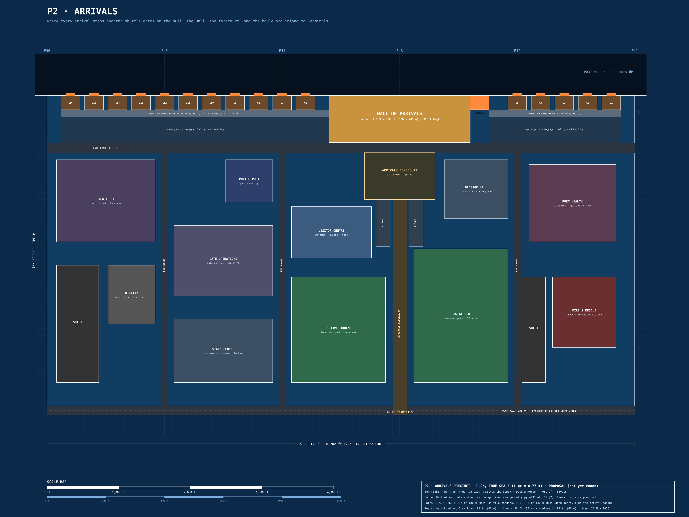
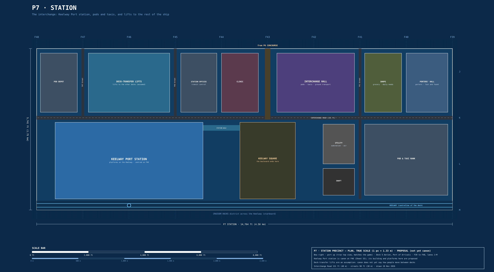
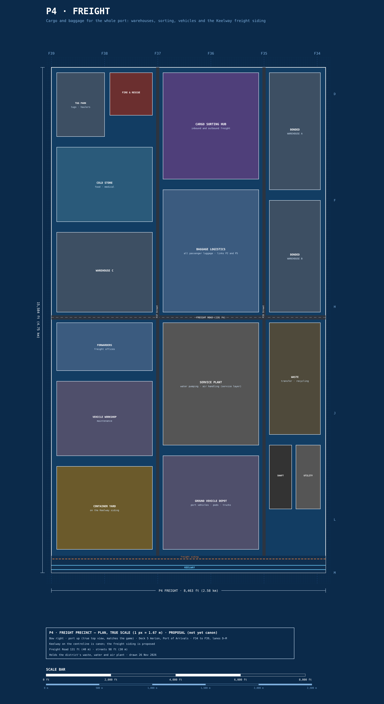

# Port of Arrivals — Precinct Plans (✅ canon, approved by Jordan 27 Nov 2026)

Started 26 Nov 2026. One true-scale blueprint per precinct of the Port of Arrivals (Deck 5, Aerion). The precinct split and the design rule (Aerion is the Hangar Deck first; the district's 40,000 people are its workforce) are in `Invicta_Ship_Reference.md` §5. Everything here is a proposal unless marked canon. All plans are true top views: **bow right, port up**, matching the game.

Common sizes (proposed): main roads 131 ft (40 m), streets 98 ft (30 m), Arrivals Boulevard 197 ft (60 m). Shuttle gates copy the canon arrival hangar: 262 × 197 × 49 ft (80 × 60 × 15 m) with a 131 × 33 ft (40 × 10 m) dock door.

Build order (walking order of a new arrival): P2 Arrivals › P5 Terminals › P6 Concourse › P7 Station › P1 Bow Docks › P3 Stern Docks › P4 Freight › P8 Shuttle Yards.

## P2 · Arrivals — F41 to F46, lanes A–C

8,202 × 4,341 ft (2.5 × 1.32 km). Where every arrival steps aboard.

| Item | Size | Notes | Code |
|---|---|---|---|
| Hall of Arrivals | 1,969 × 656 × 98 ft (600 × 200 × 30 m) | **Canon**, centred on F43 | D5F3P2B1A1 |
| Arrival hangar | 262 × 197 × 49 ft (80 × 60 × 15 m) | **Canon**, bow side of the Hall | D5F3P2B1A2 |
| Shuttle gates G1–G16 | 262 × 197 ft each, every 328 ft (100 m) | G1–G5 bow side, G6–G16 stern side, each with its own dock door | D5F3P2B1A3 |
| Gate Concourse | 98 ft (30 m) wide covered walkway | Behind the gates, links every gate to the Hall | D5F3P2B1A4 |
| Apron yards | between the concourse and Gate Road | Baggage, fuel, ground handling | D5F3P2B1A5 |
| Gate Road | 131 ft (40 m) | Service road behind the Hall, full length of the precinct | D5F3P2 |
| Arrivals Forecourt | 984 × 656 ft (300 × 200 m) | Plaza at the Hall's main entrance | D5F3P2B3A1 |
| Pickup lanes | two, 197 × 656 ft (60 × 200 m) | Pods and taxis, either side of the boulevard | D5F3P2B3A2 |
| Arrivals Boulevard | 197 ft (60 m) wide | From the forecourt inland along F43 to P5 Terminals | D5F3P2B3A3 |
| Streets | F42, F44, F45 Streets, 98 ft (30 m) | Gate Road to Dock Road | D5F3P2 |
| Dock Road | 131 ft (40 m) | Precinct edge (lanes C/D), arterial to Bow and Stern Docks | D5F3P2 |
| Port Health | 1,214 × 1,083 ft (370 × 330 m) | Screening and quarantine ward | D5F3P2B2A1 |
| Arrivals Fire Station | 886 × 984 ft (270 × 300 m) | Crash-fire-rescue station | D5F3P2B2A2 |
| Baggage Hall | 886 × 820 ft (270 × 250 m) | Reclaim, lost luggage | D5F3P2B3A4 |
| Visitor Centre | 1,115 × 722 ft (340 × 220 m) | Welcome, guides, maps | D5F3P2B3A5 |
| Arrivals Police Post | 656 × 591 ft (200 × 180 m) | Port security | D5F3P2B4A1 |
| Gate Operations | 1,378 × 984 ft (420 × 300 m) | Gate control, dispatch | D5F3P2B4A2 |
| Staff Centre | 1,378 × 886 ft (420 × 270 m) | Crew rest, canteen, lockers | D5F3P2B4A3 |
| Crew Lodge | 1,378 × 1,148 ft (420 × 350 m) | Rest for shuttle crews | D5F3P2B5A1 |
| Arrivals Utility Plant | 656 × 820 ft (200 × 250 m) | Substation, air, water | D5F3P2B5A2 |
| Service Shaft 1 | 328 × 1,476 ft (100 × 450 m) | Access to the 60 m service layer (bow shaft) | D5F3P2B2A3 |
| Service Shaft 2 | 591 × 1,640 ft (180 × 500 m) | Access to the 60 m service layer (stern shaft) | D5F3P2B5A3 |
| Bow Garden / Stern Garden | 56 and 44 acres | Forecourt parks | D5F3P2B3A6 |

**Crew Lodge (P2-19) architecture, proposed 26 Nov 2026:** height 125 ft (38 m) at the tower tops and 79 ft (24 m) for the main block. Floors: Level −1 below deck, Levels 1–3 in the main block, Levels 4–5 in the towers. Capacity: 640 cabins (480 standard + 160 tower quarters), rated for 1,280 crew on rotating shifts. Entrances: Prow Entrance; Starboard Service Access; none on the stern side. Structure: steel frame on a 39 × 39 ft (12 × 12 m) grid, composite slabs, bearing on the deck plating. Main block (Levels 1–3) covers the full footprint at 26 ft (8 m) floor to floor. Four corner towers, each about 262 × 197 ft (80 × 60 m), add Levels 4–5 at 23 ft (7 m) to 125 ft (38 m). Stair and lift cores about every 328 ft (100 m), plus one core per tower from Level −1 to the roof. Level −1, the Crew Undercroft, is 20 ft (6 m) deep in the top of the 197 ft (60 m) service layer, clear of the gravity plates, with plant, laundry, stores and a crew-only tunnel door into the service-layer tunnels. Sits wholly within one pressure zone (F45–F46). Look, services and interior are not designed yet.

**Crew Lodge (P2-19) layout, proposed 27 Nov 2026** (from Jordan's review spec; full plan in `Invicta/data/models/D5-port-of-arrivals-P2-19.json`): look: graphite, titanium, smart glass, ice-blue exterior lighting, warm interiors. Level −1 laundry, plant, workshop, stores, receiving and crew tunnel; Level 1 Prow Entrance, reception, dining, lounges, medical, atrium and courtyard garden; Levels 2–3 eight cabin wings of 60 cabins (6 × 9 m each, 480 in total) with recreation on Level 2 and quiet lounges on Level 3; Levels 4–5 four 80 × 60 m towers with 20 quarters each per level (160). Eight stair and lift cores about every 100 m, plus one per tower.

<!-- designs P2 start -->

**Building designs (proposed 27 Nov 2026, drafted from each footprint; full room plans in `Invicta/data/models/`):**

- **Port Health** (D5F3P2B2A1): 44 ft (13.5 m) tall, 3 above deck, 1 below. Concrete frame on a 9 m grid, wide corridors for beds. Level 1: Entrance and waiting, Emergency and treatment, Screening rooms, Imaging, Pharmacy, Staff rooms, Stores. Levels 2–3: Wards, Consulting rooms, Isolation rooms, Offices, Plant rooms. Above level 1 the building splits into 4 wings with open courtyards between them. Below deck: Stores, Plant rooms, Morgue. Capacity about 1,300 beds.
- **Arrivals Fire Station** (D5F3P2B2A2): 39 ft (12 m) tall, 2 above deck. Steel portal frames over the vehicle bays, concrete frame for crew quarters. Level 1: Vehicle bays, Equipment and hose stores, Workshop, Watch room, Training yard store. Level 2: Crew bunk rooms, Kitchen and mess, Gym, Offices, Training rooms. Capacity about 220 crew on watch.
- **Baggage Hall** (D5F3P2B3A4): 61 ft (18.5 m) tall, 2 above deck. Steel portal frames on a 30 m grid, heavy-duty concrete floor. Level 1: Storage halls, Sorting floor, Loading docks, Inspection rooms, Staff rooms. Level 2: Offices, Control room, Staff rooms. Capacity about 130 staff per shift.
- **Visitor Centre** (D5F3P2B3A5): 55 ft (16.8 m) tall, 4 above deck. Concrete core with steel frame on a 9 m grid. Level 1: Lobby, Public counters, Meeting rooms, Café, Mail and stores, Security, Offices. Levels 2–4: Open offices, Meeting rooms, Private offices, Break rooms, Plant rooms. Above level 1 the building splits into 4 wings with open courtyards between them. Capacity about 4,510 staff.
- **Arrivals Police Post** (D5F3P2B4A1): 39 ft (12 m) tall, 3 above deck. Reinforced concrete frame on a 9 m grid. Level 1: Front desk and waiting, Interview rooms, Holding cells, Vehicle garage, Evidence and stores, Duty office. Levels 2–3: Offices, Briefing rooms, Control room, Lockers and showers, Canteen. Above level 1 the building splits into 4 wings with open courtyards between them. Capacity about 620 officers.
- **Gate Operations** (D5F3P2B4A2): 55 ft (16.8 m) tall, 4 above deck. Concrete core with steel frame on a 9 m grid. Level 1: Lobby, Public counters, Meeting rooms, Café, Mail and stores, Security, Offices. Levels 2–4: Open offices, Meeting rooms, Private offices, Break rooms, Plant rooms. Above level 1 the building splits into 4 wings with open courtyards between them. Capacity about 7,850 staff.
- **Staff Centre** (D5F3P2B4A3): 55 ft (16.8 m) tall, 4 above deck. Concrete frame on a 8 m grid with flat slabs. Level 1: Entrance and front desk, Canteen, Lounges, Gym, Lockers and showers, Kitchen and stores. Levels 2–4: Rest rooms (sleeping), Laundry, Lift lobbies. Above level 1 the building splits into 4 wings with open courtyards between them. Capacity about 6,760 beds.
- **Arrivals Utility Plant** (D5F3P2B5A2): 52 ft (16 m) tall, 2 above deck, 1 below. Concrete frame with heavy plant floors, steel roof. Level 1: Substation, Air handling, Water pumps and tanks, Control room, Workshop and stores. Level 2: Air handling, Switch rooms, Offices. Below deck: Pipe and cable galleries, Tanks. Capacity about 40 staff per shift.
- **Service Shaft 1** (D5F3P2B2A3): 39 ft (12 m) tall, 2 above deck, 1 below. Heavy concrete shaft walls, steel frame head house. Level 1: Vehicle lift lobby, Goods lifts, Stair and ladders, Control room, Stores. Level 2: Lift machine rooms, Ventilation plant. Below deck: Shaft opening, Lift pits. Capacity about 50 staff.
- **Service Shaft 2** (D5F3P2B5A3): 39 ft (12 m) tall, 2 above deck, 1 below. Heavy concrete shaft walls, steel frame head house. Level 1: Vehicle lift lobby, Goods lifts, Stair and ladders, Control room, Stores. Level 2: Lift machine rooms, Ventilation plant. Below deck: Shaft opening, Lift pits. Capacity about 100 staff.

<!-- designs P2 end -->

## P5 · Terminals — F39 to F48, lanes D–F

14,764 × 4,921 ft (4.5 × 1.5 km). Departures and arrivals for the whole ship. Arrivals Boulevard runs through the middle; people movers link both terminals to the P2 gate concourse.

| Item | Size | Notes | Code |
|---|---|---|---|
| Transfer Hall | 2,953 × 2,034 ft (900 × 620 m) | travellers from other decks · shuttle bookings | D5F3P5B1A1 |
| Arrivals Terminal | 2,887 × 2,100 ft (880 × 640 m) | passport and customs control · baggage claim | D5F3P5B3A1 |
| Departures Terminal | 2,887 × 2,100 ft (880 × 640 m) | check-in · security screening · lounges | D5F3P5B5A1 |
| Cargo Customs | 2,887 × 2,034 ft (880 × 620 m) | bonded inspection · declarations | D5F3P5B6A1 |
| Terminals Private Flights Lounge | 1,312 × 2,034 ft (400 × 620 m) | terminal for Stern Docks | D5F3P5B8A1 |
| Travel Office | 1,312 × 1,411 ft (400 × 430 m) | tickets · info | D5F3P5B2A1 |
| Terminals Pod Depot | 1,476 × 1,903 ft (450 × 580 m) | ground pods · taxis | D5F3P5B2A2 |
| Customs & Border Hq | 2,165 × 1,804 ft (660 × 550 m) | main police and border station | D5F3P5B4A1 |
| Terminal Plaza | 1,312 × 1,181 ft (400 × 360 m) |  | D5F3P5B4A2 |
| Licensing & Permits | 2,165 × 1,804 ft (660 × 550 m) | flight, cargo and travel permits | D5F3P5B4A3 |
| Terminal Admin | 1,444 × 1,575 ft (440 × 480 m) | port authority offices | D5F3P5B7A1 |
| Terminals Utility Plant | 656 × 1,083 ft (200 × 330 m) | substation · air | D5F3P5B7A2 |
| Terminals Service Shaft | 459 × 1,903 ft (140 × 580 m) |  | D5F3P5B7A3 |
| Medical Centre | 1,312 × 1,575 ft (400 × 480 m) | first aid · clinic | D5F3P5B9A1 |

## P6 · Concourse — F39 to F48, lanes G–I

14,764 × 4,921 ft (4.5 × 1.5 km). Where travellers wait, eat and sleep. The boulevard becomes the 394 ft (120 m) tree-lined Concourse Promenade. Hotel room counts are placeholders.

| Item | Size | Notes | Code |
|---|---|---|---|
| Greeters' Hall | 1,476 × 2,100 ft (450 × 640 m) | meeting point · welcome desks | D5F3P6B1A1 |
| Shop Arcade | 1,312 × 2,100 ft (400 × 640 m) | travel goods · duty-free | D5F3P6B1A2 |
| Transit Lounges | 2,756 × 2,100 ft (840 × 640 m) | waiting · rest pods · showers | D5F3P6B3A1 |
| Market Hall | 2,756 × 2,100 ft (840 × 640 m) | food court · daily shops | D5F3P6B5A1 |
| Restaurant Row | 2,887 × 2,100 ft (880 × 640 m) | dining for travellers | D5F3P6B7A1 |
| Travellers' Clinic | 1,312 × 1,312 ft (400 × 400 m) | clinic | D5F3P6B9A1 |
| Concourse Police Post | 1,312 × 623 ft (400 × 190 m) |  | D5F3P6B9A2 |
| Promenade Park | 2,953 × 1,444 ft (900 × 440 m) | 98 acres | D5F3P6B2A1 |
| Pod Stop | 2,953 × 525 ft (900 × 160 m) |  | D5F3P6B2A2 |
| Grand Port Hotel | 2,756 × 2,034 ft (840 × 620 m) | flagship hotel · 1,200 rooms | D5F3P6B4A1 |
| Harbour Hotel | 2,756 × 2,034 ft (840 × 620 m) | mid-range · 900 rooms | D5F3P6B6A1 |
| Crew Hotel | 1,444 × 2,034 ft (440 × 620 m) | shuttle and ship crews | D5F3P6B8A1 |
| Port Hostel | 1,280 × 2,034 ft (390 × 620 m) | budget · capsule rooms | D5F3P6B8A2 |
| Concourse Utility Plant | 656 × 2,034 ft (200 × 620 m) |  | D5F3P6B10A1 |
| Concourse Service Shaft | 525 × 2,034 ft (160 × 620 m) |  | D5F3P6B10A2 |

## P7 · Station — F39 to F48, lanes J–M

14,764 × 5,741 ft (4.5 × 1.75 km). The interchange. Keelway Port station (canon stop at F46) with its platforms, Keelway Square where the boulevard ends, pods and taxis. Deck-transfer lifts approved as canon by Jordan.

| Item | Size | Notes | Code |
|---|---|---|---|
| Porters' Hall | 1,476 × 2,100 ft (450 × 640 m) | porters · lost and found | D5F3P7B1A1 |
| Station Shops | 1,312 × 2,100 ft (400 × 640 m) | grocery · daily needs | D5F3P7B1A2 |
| Interchange Hall | 2,756 × 2,100 ft (840 × 640 m) | pods · taxis · ground transport | D5F3P7B4A1 |
| Station Clinic | 1,312 × 2,100 ft (400 × 640 m) |  | D5F3P7B6A1 |
| Station Offices | 1,280 × 2,100 ft (390 × 640 m) | transit control | D5F3P7B6A2 |
| Deck-Transfer Lifts | 2,887 × 2,100 ft (880 × 640 m) | lifts to the other decks | D5F3P7B7A1 |
| Station Pod Depot | 1,312 × 2,100 ft (400 × 640 m) |  | D5F3P7B8A1 |
| Pod & Taxi Rank | 2,953 × 2,526 ft (900 × 770 m) |  | D5F3P7B2A1 |
| Station Utility Plant | 1,115 × 1,411 ft (340 × 430 m) | substation · air | D5F3P7B3A1 |
| Station Service Shaft | 1,115 × 951 ft (340 × 290 m) |  | D5F3P7B3A2 |
| Keelway Square | 1,969 × 2,723 ft (600 × 830 m) |  | D5F3P7B5A1 |
| Station Walk | 1,312 × 197 ft (400 × 60 m) | covered moving walkway | D5F3P7B5A2 |
| Keelway Port Station | 5,249 × 2,723 ft (1600 × 830 m) | platforms on the Keelway · centred on F46 | D5F3P7B5A3 |

## P1 · Bow Docks — F34 to F41, lanes A–C

11,743 × 4,341 ft (3.58 × 1.32 km). Flank berths for civilian and private ships (04 §7.3). Medium berths M1–M15 along the straight hull; a 25-bay skiff marina steps along the hull where it tapers forward of F36.

| Item | Size | Notes | Code |
|---|---|---|---|
| Harbourmaster | 1,476 × 1,148 ft (450 × 350 m) | berth assignment · dock control | D5F3P1B4A1 |
| Bow Docks Fire Station | 1,312 × 984 ft (400 × 300 m) | crash-fire-rescue | D5F3P1B4A2 |
| Bow Docks Chandlery | 1,476 × 1,148 ft (450 × 350 m) | ship parts · supplies | D5F3P1B5A1 |
| Bow Docks Police Post | 1,312 × 820 ft (400 × 250 m) | dock security | D5F3P1B5A2 |
| Repair Yard | 2,953 × 1,837 ft (900 × 560 m) | dry bays for small ship repairs | D5F3P1B5A3 |
| Bow Docks Fuel Depot | 2,953 × 1,083 ft (900 × 330 m) | bunkering for berths | D5F3P1B4A3 |
| Pilot Lounge | 1,804 × 591 ft (550 × 180 m) | crew rest · canteen | D5F3P1B4A4 |
| Bow Docks Utility Plant | 492 × 591 ft (150 × 180 m) |  | D5F3P1B4A5 |
| Bow Docks Service Shaft | 394 × 591 ft (120 × 180 m) |  | D5F3P1B4A6 |
| Marina Park | 3,445 × 1,575 ft (1050 × 480 m) | pocket park · 125 acres | D5F3P1B2A1 |
| Medium Berths | 15 bays, each 394 × 262 ft (120 × 80 m) |  | D5F3P1B1A1 |
| Skiff Marina | 25 bays, each 131 × 131 ft (40 × 40 m) |  | D5F3P1B1A2 |

## P3 · Stern Docks — F46 to F55, lanes A–C

15,169 × 4,341 ft (4.62 × 1.32 km). The big berths: corvettes C1–C8 and frigates F1–F5 (frigate berth rights, 04). The Yard Locks let P8's small craft out to space. The cross-line Flight Control stop at F52 is canon.

| Item | Size | Notes | Code |
|---|---|---|---|
| Cross-Line Stop | 984 × 984 ft (300 × 300 m) | canon F52, 5.1 km to port | D5F3P3B9A1 |
| Stern Docks Private Flights Lounge | 1,312 × 1,148 ft (400 × 350 m) | lounge · berth check-in | D5F3P3B2A1 |
| Stern Docks Fire Station | 1,312 × 1,837 ft (400 × 560 m) | crash-fire-rescue | D5F3P3B2A2 |
| Stern Docks Police Post | 1,476 × 1,148 ft (450 × 350 m) | dock security | D5F3P3B3A1 |
| Stern Docks Chandlery | 1,476 × 1,837 ft (450 × 560 m) | parts · supplies | D5F3P3B3A2 |
| Corvette Service | 1,936 × 1,640 ft (590 × 500 m) | repair and refit | D5F3P3B4A1 |
| Stern Docks Fuel Depot | 1,936 × 1,312 ft (590 × 400 m) | bunkering | D5F3P3B5A1 |
| Frigate Service Yard | 2,953 × 1,640 ft (900 × 500 m) | heavy repair · cranes | D5F3P3B7A1 |
| Company Berth Offices | 2,461 × 1,312 ft (750 × 400 m) | leases · frigate berth rights | D5F3P3B8A1 |
| Stern Harbourmaster | 2,461 × 1,476 ft (750 × 450 m) | berth control | D5F3P3B12A1 |
| Dock Park | 2,461 × 1,411 ft (750 × 430 m) | 62 acres | D5F3P3B13A1 |
| Stern Docks Utility Plant | 820 × 1,312 ft (250 × 400 m) |  | D5F3P3B15A1 |
| Stern Docks Service Shaft | 656 × 1,312 ft (200 × 400 m) |  | D5F3P3B15A2 |
| Stern Docks Crew Rest | 1,640 × 1,575 ft (500 × 480 m) | canteen · lockers | D5F3P3B15A3 |
| Corvette Berths | 8 bays, each 525 × 328 ft (160 × 100 m) |  | D5F3P3B1A1 |
| Frigate Berths | 5 bays, each 1,312 × 492 ft (400 × 150 m) |  | D5F3P3B6A2 |
| Yard Locks | 1,969 × 492 ft (600 × 150 m) |  | D5F3P3B1A2 |
| Yard Taxiway | 853 × 3,675 ft (260 × 1120 m) |  | D5F3P3 |

## P4 · Freight — F34 to F39, lanes D–M

8,463 × 15,584 ft (2.58 × 4.75 km). Cargo and baggage for the whole port, the district's waste, water and air plant, and a freight siding on the Keelway.

| Item | Size | Notes | Code |
|---|---|---|---|
| Bonded Warehouse A | 1,575 × 3,609 ft (480 × 1100 m) |  | D5F3P4B1A1 |
| Bonded Warehouse B | 1,575 × 3,445 ft (480 × 1050 m) |  | D5F3P4B1A2 |
| Cargo Sorting Hub | 2,953 × 3,281 ft (900 × 1000 m) | inbound and outbound freight | D5F3P4B4A1 |
| Baggage Logistics | 2,953 × 3,773 ft (900 × 1150 m) | all passenger luggage · links P2 and P5 | D5F3P4B4A2 |
| Freight Fire Station | 1,312 × 1,312 ft (400 × 400 m) |  | D5F3P4B6A1 |
| Tug Park | 1,476 × 1,969 ft (450 × 600 m) | tugs · haulers | D5F3P4B6A2 |
| Cold Store | 2,953 × 2,297 ft (900 × 700 m) | food · medical | D5F3P4B6A3 |
| Warehouse C | 2,953 × 2,461 ft (900 × 750 m) |  | D5F3P4B7A1 |
| Waste | 1,575 × 3,445 ft (480 × 1050 m) | transfer · recycling | D5F3P4B2A1 |
| Freight Utility Plant | 755 × 1,969 ft (230 × 600 m) |  | D5F3P4B3A1 |
| Freight Service Shaft | 689 × 1,969 ft (210 × 600 m) |  | D5F3P4B3A2 |
| Service Plant | 2,953 × 3,773 ft (900 × 1150 m) | water pumping · air handling (service layer) | D5F3P4B5A1 |
| Ground Vehicle Depot | 2,953 × 2,887 ft (900 × 880 m) | port vehicles · pods · trucks | D5F3P4B5A2 |
| Forwarders | 2,953 × 1,476 ft (900 × 450 m) | freight offices | D5F3P4B8A1 |
| Vehicle Workshop | 2,953 × 2,297 ft (900 × 700 m) | maintenance | D5F3P4B8A2 |
| Container Yard | 2,953 × 2,559 ft (900 × 780 m) | on the Keelway siding | D5F3P4B8A3 |

## P8 · Shuttle Yards — F48 to F55, lanes D–M (less the Atrium Plaza)

11,888 × 15,584 ft (3.62 × 4.75 km). Public hangars for everyone's small craft and the shuttle depot. Craft taxi north along the Yard Taxiway to the Yard Locks in P3. The Atrium Plaza (canon) is not part of the precinct.

| Item | Size | Notes | Code |
|---|---|---|---|
| Maintenance Shops | 5,085 × 1,969 ft (1550 × 600 m) | engines · avionics · inspections | D5F3P8B8A1 |
| Shuttle Ops | 2,297 × 1,804 ft (700 × 550 m) | dispatch · schedules | D5F3P8B15A1 |
| Fuel Farm | 2,297 × 1,804 ft (700 × 550 m) |  | D5F3P8B15A2 |
| Owner Hangars | 3,281 × 3,609 ft (1000 × 1100 m) | 256 leased bays | D5F3P8B9A1 |
| Shuttle Yards Fire Station | 1,312 × 1,148 ft (400 × 350 m) |  | D5F3P8B12A1 |
| Shuttle Yards Police Post | 1,312 × 820 ft (400 × 250 m) |  | D5F3P8B13A1 |
| Parts & Avionics | 2,625 × 1,640 ft (800 × 500 m) |  | D5F3P8B16A1 |
| Paint & Refit | 1,969 × 1,640 ft (600 × 500 m) |  | D5F3P8B16A2 |
| Yard Offices | 1,640 × 1,476 ft (500 × 450 m) |  | D5F3P8B16A3 |
| Shuttle Yards Utility Plant | 656 × 1,476 ft (200 × 450 m) |  | D5F3P8B16A4 |
| Shuttle Yards Service Shaft | 492 × 1,476 ft (150 × 450 m) |  | D5F3P8B16A5 |
| Shuttle Yards Crew Rest | 1,312 × 1,476 ft (400 × 450 m) |  | D5F3P8B16A6 |
| Atrium Edge Park | 10,171 × 1,476 ft (3100 × 450 m) | 345 acres | D5F3P8B10A1 |
| Shuttle Yards Pod Depot | 1,050 × 3,281 ft (320 × 1000 m) | ends 1,969 ft (600 m) short of the Keelway to stay clear of the Atrium Plaza | D5F3P8B6A1 |
| Hangar Row A | 31 bays, each 131 × 131 ft (40 × 40 m) |  | D5F3P8B8A2 |
| Shuttle Depot | 16 bays, each 262 × 197 ft (80 × 60 m) |  | D5F3P8B15A3 |
| Hangar Row B | 62 bays, each 131 × 131 ft (40 × 40 m) |  | D5F3P8B9A2 |
