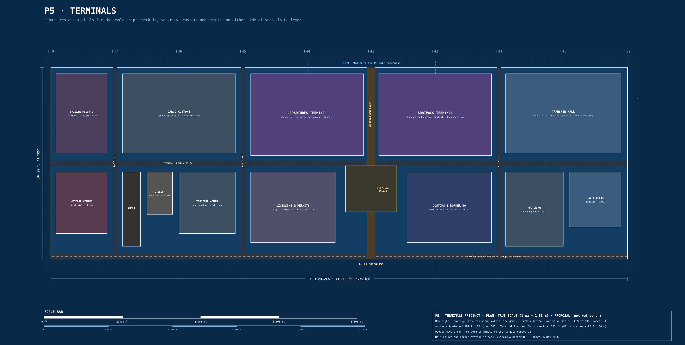
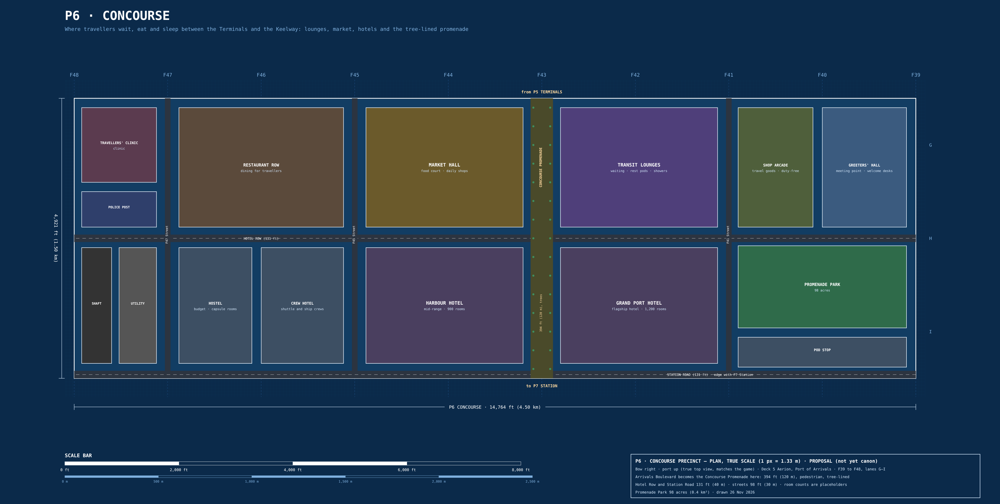
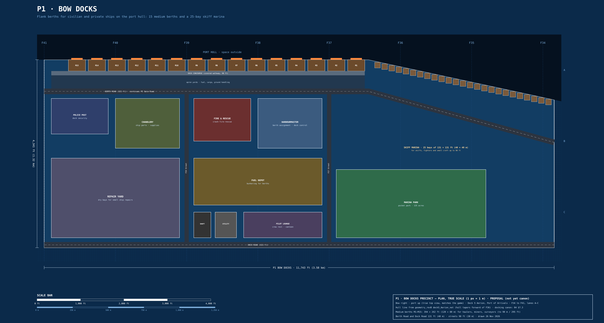
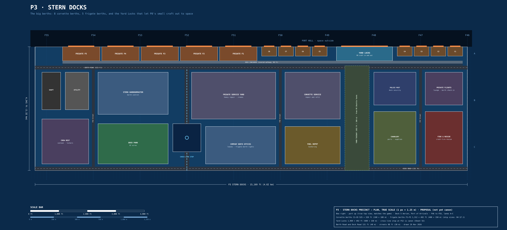

# Port of Arrivals — Precinct Plans (⏳ proposed, awaiting Jordan)

Started 26 Nov 2026. One true-scale blueprint per precinct of the Port of Arrivals (Deck 5, Aerion). The precinct split and the design rule (Aerion is the Hangar Deck first; the district's 40,000 people are its workforce) are in `Invicta_Ship_Reference.md` §5. Everything here is a proposal unless marked canon. All plans are true top views: **bow right, port up**, matching the game.

Common sizes (proposed): main roads 131 ft (40 m), streets 98 ft (30 m), Arrivals Boulevard 197 ft (60 m). Shuttle gates copy the canon arrival hangar: 262 × 197 × 49 ft (80 × 60 × 15 m) with a 131 × 33 ft (40 × 10 m) dock door.

Build order (walking order of a new arrival): P2 Arrivals › P5 Terminals › P6 Concourse › P7 Station › P1 Bow Docks › P3 Stern Docks › P4 Freight › P8 Shuttle Yards.

## P2 · Arrivals — F41 to F46, lanes A–C

8,202 × 4,341 ft (2.5 × 1.32 km). Where every arrival steps aboard.

| Item | Size | Notes |
|---|---|---|
| Hall of Arrivals | 1,969 × 656 × 98 ft (600 × 200 × 30 m) | **Canon**, centred on F43 |
| Arrival hangar | 262 × 197 × 49 ft (80 × 60 × 15 m) | **Canon**, bow side of the Hall |
| Shuttle gates G1–G16 | 262 × 197 ft each, every 328 ft (100 m) | G1–G5 bow side, G6–G16 stern side, each with its own dock door |
| Gate Concourse | 98 ft (30 m) wide covered walkway | Behind the gates, links every gate to the Hall |
| Apron yards | between the concourse and Gate Road | Baggage, fuel, ground handling |
| Gate Road | 131 ft (40 m) | Service road behind the Hall, full length of the precinct |
| Arrivals Forecourt | 984 × 656 ft (300 × 200 m) | Plaza at the Hall's main entrance |
| Pickup lanes | two, 197 × 656 ft (60 × 200 m) | Pods and taxis, either side of the boulevard |
| Arrivals Boulevard | 197 ft (60 m) wide | From the forecourt inland along F43 to P5 Terminals |
| Streets | F42, F44, F45 Streets, 98 ft (30 m) | Gate Road to Dock Road |
| Dock Road | 131 ft (40 m) | Precinct edge (lanes C/D), arterial to Bow and Stern Docks |
| Port Health | 1,214 × 1,083 ft (370 × 330 m) | Screening and quarantine ward |
| Fire & Rescue | 886 × 984 ft (270 × 300 m) | Crash-fire-rescue station |
| Baggage Hall | 886 × 820 ft (270 × 250 m) | Reclaim, lost luggage |
| Visitor Centre | 1,115 × 722 ft (340 × 220 m) | Welcome, guides, maps |
| Police Post | 656 × 591 ft (200 × 180 m) | Port security |
| Gate Operations | 1,378 × 984 ft (420 × 300 m) | Gate control, dispatch |
| Staff Centre | 1,378 × 886 ft (420 × 270 m) | Crew rest, canteen, lockers |
| Crew Lodge | 1,378 × 1,148 ft (420 × 350 m) | Rest for shuttle crews |
| Utility | 656 × 820 ft (200 × 250 m) | Substation, air, water |
| Service Shaft 1 | 328 × 1,476 ft (100 × 450 m) | Access to the 60 m service layer (bow shaft) |
| Service Shaft 2 | 591 × 1,640 ft (180 × 500 m) | Access to the 60 m service layer (stern shaft) |
| Bow Garden / Stern Garden | 56 and 44 acres | Forecourt parks |

## P5 · Terminals — F39 to F48, lanes D–F

14,764 × 4,921 ft (4.5 × 1.5 km). Departures and arrivals for the whole ship. Arrivals Boulevard runs through the middle; people movers link both terminals to the P2 gate concourse.

| Item | Size | Notes |
|---|---|---|
| Transfer Hall | 2,953 × 2,034 ft (900 × 620 m) | travellers from other decks · shuttle bookings |
| Arrivals Terminal | 2,887 × 2,100 ft (880 × 640 m) | passport and customs control · baggage claim |
| Departures Terminal | 2,887 × 2,100 ft (880 × 640 m) | check-in · security screening · lounges |
| Cargo Customs | 2,887 × 2,034 ft (880 × 620 m) | bonded inspection · declarations |
| Private Flights | 1,312 × 2,034 ft (400 × 620 m) | terminal for Stern Docks |
| Travel Office | 1,312 × 1,411 ft (400 × 430 m) | tickets · info |
| Pod Depot | 1,476 × 1,903 ft (450 × 580 m) | ground pods · taxis |
| Customs & Border Hq | 2,165 × 1,804 ft (660 × 550 m) | main police and border station |
| Terminal Plaza | 1,312 × 1,181 ft (400 × 360 m) |  |
| Licensing & Permits | 2,165 × 1,804 ft (660 × 550 m) | flight, cargo and travel permits |
| Terminal Admin | 1,444 × 1,575 ft (440 × 480 m) | port authority offices |
| Utility | 656 × 1,083 ft (200 × 330 m) | substation · air |
| Service shaft site | 459 × 1,903 ft (140 × 580 m) |  |
| Medical Centre | 1,312 × 1,575 ft (400 × 480 m) | first aid · clinic |

## P6 · Concourse — F39 to F48, lanes G–I

14,764 × 4,921 ft (4.5 × 1.5 km). Where travellers wait, eat and sleep. The boulevard becomes the 394 ft (120 m) tree-lined Concourse Promenade. Hotel room counts are placeholders.

| Item | Size | Notes |
|---|---|---|
| Greeters' Hall | 1,476 × 2,100 ft (450 × 640 m) | meeting point · welcome desks |
| Shop Arcade | 1,312 × 2,100 ft (400 × 640 m) | travel goods · duty-free |
| Transit Lounges | 2,756 × 2,100 ft (840 × 640 m) | waiting · rest pods · showers |
| Market Hall | 2,756 × 2,100 ft (840 × 640 m) | food court · daily shops |
| Restaurant Row | 2,887 × 2,100 ft (880 × 640 m) | dining for travellers |
| Travellers' Clinic | 1,312 × 1,312 ft (400 × 400 m) | clinic |
| Police Post | 1,312 × 623 ft (400 × 190 m) |  |
| Promenade Park | 2,953 × 1,444 ft (900 × 440 m) | 98 acres |
| Pod Stop | 2,953 × 525 ft (900 × 160 m) |  |
| Grand Port Hotel | 2,756 × 2,034 ft (840 × 620 m) | flagship hotel · 1,200 rooms |
| Harbour Hotel | 2,756 × 2,034 ft (840 × 620 m) | mid-range · 900 rooms |
| Crew Hotel | 1,444 × 2,034 ft (440 × 620 m) | shuttle and ship crews |
| Hostel | 1,280 × 2,034 ft (390 × 620 m) | budget · capsule rooms |
| Utility | 656 × 2,034 ft (200 × 620 m) |  |
| Service shaft site | 525 × 2,034 ft (160 × 620 m) |  |

## P7 · Station — F39 to F48, lanes J–M

14,764 × 5,741 ft (4.5 × 1.75 km). The interchange. Keelway Port station (canon stop at F46) with its platforms, Keelway Square where the boulevard ends, pods and taxis. Deck-transfer lifts are an assumption.

| Item | Size | Notes |
|---|---|---|
| Porters' Hall | 1,476 × 2,100 ft (450 × 640 m) | porters · lost and found |
| Shops | 1,312 × 2,100 ft (400 × 640 m) | grocery · daily needs |
| Interchange Hall | 2,756 × 2,100 ft (840 × 640 m) | pods · taxis · ground transport |
| Clinic | 1,312 × 2,100 ft (400 × 640 m) |  |
| Station Offices | 1,280 × 2,100 ft (390 × 640 m) | transit control |
| Deck-Transfer Lifts | 2,887 × 2,100 ft (880 × 640 m) | lifts to the other decks (assumed) |
| Pod Depot | 1,312 × 2,100 ft (400 × 640 m) |  |
| Pod & Taxi Rank | 2,953 × 2,526 ft (900 × 770 m) |  |
| Utility | 1,115 × 1,411 ft (340 × 430 m) | substation · air |
| Service shaft site | 1,115 × 951 ft (340 × 290 m) |  |
| Keelway Square | 1,969 × 2,723 ft (600 × 830 m) |  |
| Station Walk | 1,312 × 197 ft (400 × 60 m) | covered moving walkway |
| Keelway Port Station | 5,249 × 2,723 ft (1600 × 830 m) | platforms on the Keelway · centred on F46 |

## P1 · Bow Docks — F34 to F41, lanes A–C

11,743 × 4,341 ft (3.58 × 1.32 km). Flank berths for civilian and private ships (04 §7.3). Medium berths M1–M15 along the straight hull; a 25-bay skiff marina steps along the hull where it tapers forward of F36.

| Item | Size | Notes |
|---|---|---|
| Harbourmaster | 1,476 × 1,148 ft (450 × 350 m) | berth assignment · dock control |
| Fire & Rescue | 1,312 × 984 ft (400 × 300 m) | crash-fire-rescue |
| Chandlery | 1,476 × 1,148 ft (450 × 350 m) | ship parts · supplies |
| Police Post | 1,312 × 820 ft (400 × 250 m) | dock security |
| Repair Yard | 2,953 × 1,837 ft (900 × 560 m) | dry bays for small ship repairs |
| Fuel Depot | 2,953 × 1,083 ft (900 × 330 m) | bunkering for berths |
| Pilot Lounge | 1,804 × 591 ft (550 × 180 m) | crew rest · canteen |
| Utility | 492 × 591 ft (150 × 180 m) |  |
| Service shaft site | 394 × 591 ft (120 × 180 m) |  |
| Marina Park | 3,445 × 1,575 ft (1050 × 480 m) | pocket park · 125 acres |
| Medium Berths | 15 bays, each 394 × 262 ft (120 × 80 m) | |
| Skiff Marina | 25 bays, each 131 × 131 ft (40 × 40 m) | |

## P3 · Stern Docks — F46 to F55, lanes A–C

15,169 × 4,341 ft (4.62 × 1.32 km). The big berths: corvettes C1–C8 and frigates F1–F5 (frigate berth rights, 04). The Yard Locks let P8's small craft out to space. The cross-line Flight Control stop at F52 is canon.

| Item | Size | Notes |
|---|---|---|
| Cross-Line Stop | 984 × 984 ft (300 × 300 m) | canon F52, 5.1 km to port |
| Private Flights | 1,312 × 1,148 ft (400 × 350 m) | lounge · berth check-in |
| Fire & Rescue | 1,312 × 1,837 ft (400 × 560 m) | crash-fire-rescue |
| Police Post | 1,476 × 1,148 ft (450 × 350 m) | dock security |
| Chandlery | 1,476 × 1,837 ft (450 × 560 m) | parts · supplies |
| Corvette Service | 1,936 × 1,640 ft (590 × 500 m) | repair and refit |
| Fuel Depot | 1,936 × 1,312 ft (590 × 400 m) | bunkering |
| Frigate Service Yard | 2,953 × 1,640 ft (900 × 500 m) | heavy repair · cranes |
| Company Berth Offices | 2,461 × 1,312 ft (750 × 400 m) | leases · frigate berth rights |
| Stern Harbourmaster | 2,461 × 1,476 ft (750 × 450 m) | berth control |
| Dock Park | 2,461 × 1,411 ft (750 × 430 m) | 62 acres |
| Utility | 820 × 1,312 ft (250 × 400 m) |  |
| Service shaft site | 656 × 1,312 ft (200 × 400 m) |  |
| Crew Rest | 1,640 × 1,575 ft (500 × 480 m) | canteen · lockers |
| Corvette Berths | 8 bays, each 525 × 328 ft (160 × 100 m) | |
| Frigate Berths | 5 bays, each 1,312 × 492 ft (400 × 150 m) | |
| Yard Locks | 1,969 × 492 ft (600 × 150 m) |  |
| Yard Taxiway | 853 × 3,675 ft (260 × 1120 m) |  |

## P4 · Freight — F34 to F39, lanes D–M

8,463 × 15,584 ft (2.58 × 4.75 km). Cargo and baggage for the whole port, the district's waste, water and air plant, and a freight siding on the Keelway.

| Item | Size | Notes |
|---|---|---|
| Bonded Warehouse A | 1,575 × 3,609 ft (480 × 1100 m) |  |
| Bonded Warehouse B | 1,575 × 3,445 ft (480 × 1050 m) |  |
| Cargo Sorting Hub | 2,953 × 3,281 ft (900 × 1000 m) | inbound and outbound freight |
| Baggage Logistics | 2,953 × 3,773 ft (900 × 1150 m) | all passenger luggage · links P2 and P5 |
| Fire & Rescue | 1,312 × 1,312 ft (400 × 400 m) |  |
| Tug Park | 1,476 × 1,969 ft (450 × 600 m) | tugs · haulers |
| Cold Store | 2,953 × 2,297 ft (900 × 700 m) | food · medical |
| Warehouse C | 2,953 × 2,461 ft (900 × 750 m) |  |
| Waste | 1,575 × 3,445 ft (480 × 1050 m) | transfer · recycling |
| Utility | 755 × 1,969 ft (230 × 600 m) |  |
| Service shaft site | 689 × 1,969 ft (210 × 600 m) |  |
| Service Plant | 2,953 × 3,773 ft (900 × 1150 m) | water pumping · air handling (service layer) |
| Ground Vehicle Depot | 2,953 × 2,887 ft (900 × 880 m) | port vehicles · pods · trucks |
| Forwarders | 2,953 × 1,476 ft (900 × 450 m) | freight offices |
| Vehicle Workshop | 2,953 × 2,297 ft (900 × 700 m) | maintenance |
| Container Yard | 2,953 × 2,559 ft (900 × 780 m) | on the Keelway siding |

## P8 · Shuttle Yards — F48 to F55, lanes D–M (less the Atrium Plaza)

11,888 × 15,584 ft (3.62 × 4.75 km). Public hangars for everyone's small craft and the shuttle depot. Craft taxi north along the Yard Taxiway to the Yard Locks in P3. The Atrium Plaza (canon) is not part of the precinct.

| Item | Size | Notes |
|---|---|---|
| Maintenance Shops | 5,085 × 1,969 ft (1550 × 600 m) | engines · avionics · inspections |
| Shuttle Ops | 2,297 × 1,804 ft (700 × 550 m) | dispatch · schedules |
| Fuel Farm | 2,297 × 1,804 ft (700 × 550 m) |  |
| Owner Hangars | 3,281 × 3,609 ft (1000 × 1100 m) | 256 leased bays |
| Fire & Rescue | 1,312 × 1,148 ft (400 × 350 m) |  |
| Police Post | 1,312 × 820 ft (400 × 250 m) |  |
| Parts & Avionics | 2,625 × 1,640 ft (800 × 500 m) |  |
| Paint & Refit | 1,969 × 1,640 ft (600 × 500 m) |  |
| Yard Offices | 1,640 × 1,476 ft (500 × 450 m) |  |
| Utility | 656 × 1,476 ft (200 × 450 m) |  |
| Service shaft site | 492 × 1,476 ft (150 × 450 m) |  |
| Crew Rest | 1,312 × 1,476 ft (400 × 450 m) |  |
| Atrium Edge Park | 10,171 × 1,476 ft (3100 × 450 m) | 345 acres |
| Pod Depot | 1,050 × 3,281 ft (320 × 1000 m) | ends 1,969 ft (600 m) short of the Keelway to stay clear of the Atrium Plaza |
| Hangar Row A | 31 bays, each 131 × 131 ft (40 × 40 m) | |
| Shuttle Depot | 16 bays, each 262 × 197 ft (80 × 60 m) | |
| Hangar Row B | 62 bays, each 131 × 131 ft (40 × 40 m) | |
