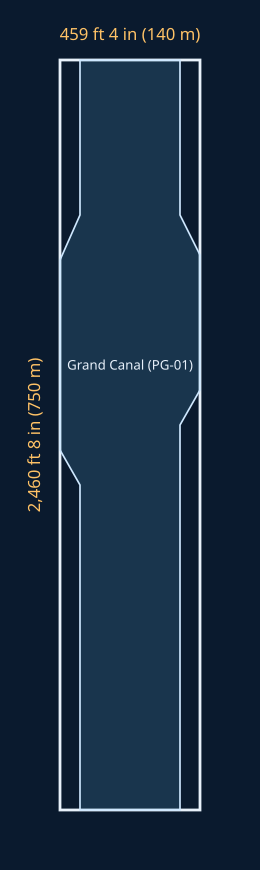

# P1-01 Grand Canal: plan

Footprint 459 ft 4 in (140 m) × 2,460 ft 8 in (750 m)

## Levels

| Level | Floor above deck | Height | Floor area |
|---|---|---|---|
| Ground | 0 ft (0 mm) | 0 ft (0 mm) | 893,943 sq ft (83,050 m²) |

## Elements

| ID | Designation | Type | Name | Level(s) | Size / length | Area | Status |
|---|---|---|---|---|---|---|---|
| canal-outline | D3F6P1B8A1R1 | room | Grand Canal (PG-01) | G | 459 ft 4 in (140 m) × 2,460 ft 8 in (750 m) | 893,943 sq ft (83,050 m²) | proposed |

## Drawings

### Ground

