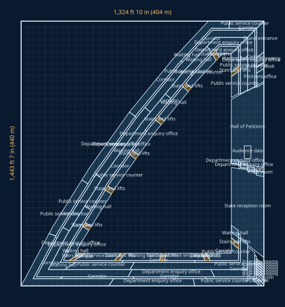
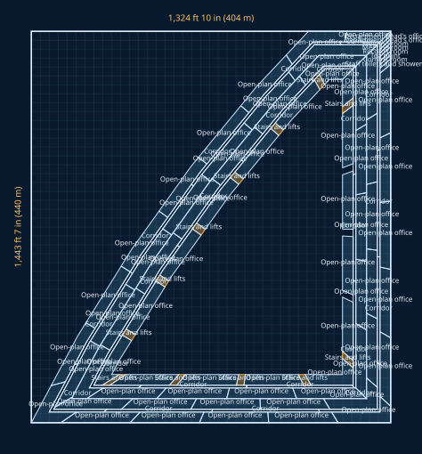
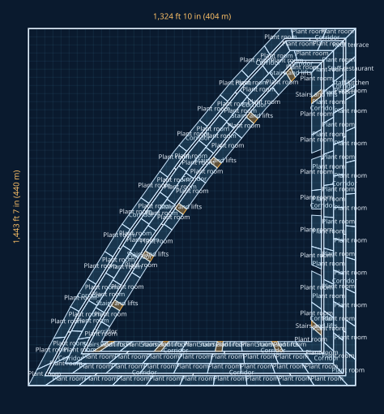

# P1-01 Governor's Hall: plan

Footprint 1,324 ft 10 in (404 m) × 1,443 ft 7 in (440 m) · structural grid 32 ft 10 in (10 m)

## Levels

| Level | Floor above deck | Height | Floor area |
|---|---|---|---|
| Level 1 · State floor | 0 ft (0 mm) | 24 ft 7 in (7,500 mm) | 650,269 sq ft (60,412 m²) |
| Level 2 · Governor's floor | 24 ft 7 in (7,500 mm) | 16 ft 5 in (5,000 mm) | 650,107 sq ft (60,397 m²) |
| Level 3 · Ministry floor 1 | 41 ft (12 m) | 14 ft 5 in (4,400 mm) | 631,059 sq ft (58,627 m²) |
| Level 4 · Ministry floor 2 | 55 ft 5 in (17 m) | 14 ft 5 in (4,400 mm) | 631,059 sq ft (58,627 m²) |
| Level 5 · Ministry floor 3 | 69 ft 11 in (21 m) | 14 ft 5 in (4,400 mm) | 631,059 sq ft (58,627 m²) |
| Level 6 · Roof terrace floor | 84 ft 4 in (26 m) | 14 ft 5 in (4,400 mm) | 631,042 sq ft (58,626 m²) |

## Elements

| ID | Designation | Type | Name | Level(s) | Size / length | Area | Status |
|---|---|---|---|---|---|---|---|
| E001 | D5F1P1B2A1L1R1, D5F1P1B2A1L2R1 | room | Hall of Petitions | L1, L2 | 177 ft 6 in (54 m) × 466 ft 10 in (142 m) | 72,674 sq ft (6,752 m²) | proposed |
| E002 |  | fixture | Audience dais | L1 | 35 ft 9 in (11 m) × 70 ft 3 in (21 m) | 2,511 sq ft (233 m²) | proposed |
| E003 | D5F1P1B2A1L1R2, D5F1P1B2A1L2R2 | room | State reception room | L1, L2 | 177 ft 6 in (54 m) × 491 ft 10 in (150 m) | 72,674 sq ft (6,752 m²) | proposed |
| E004 | D5F1P1B2A1L1R3 | zone | Corridor | L1 | 9 ft 10 in (3,000 mm) × 323 ft 2 in (98 m) | 3,106 sq ft (289 m²) | proposed |
| E005 | D5F1P1B2A1L1R4 | zone | Corridor | L1 | 9 ft 10 in (3,000 mm) × 26 ft 7 in (8,100 mm) | 247 sq ft (23 m²) | proposed |
| E006 | D5F1P1B2A1L1R5 | zone | Corridor | L1 | 280 ft 10 in (86 m) × 128 ft 11 in (39 m) | 3,877 sq ft (360 m²) | proposed |
| E007 | D5F1P1B2A1L1R6 | zone | Corridor | L1 | 398 ft (121 m) × 9 ft 10 in (3,000 mm) | 3,875 sq ft (360 m²) | proposed |
| E008 | D5F1P1B2A1L1R7 | zone | Corridor | L1 | 402 ft 7 in (123 m) × 9 ft 10 in (3,000 mm) | 3,875 sq ft (360 m²) | proposed |
| E009 | D5F1P1B2A1L1R8 | zone | Corridor | L1 | 159 ft 9 in (49 m) × 225 ft 9 in (69 m) | 3,902 sq ft (363 m²) | proposed |
| E010 | D5F1P1B2A1L1R9 | zone | Corridor | L1 | 214 ft 11 in (66 m) × 339 ft 11 in (104 m) | 3,893 sq ft (362 m²) | proposed |
| E011 | D5F1P1B2A1L1R10 | zone | Corridor | L1 | 236 ft 3 in (72 m) × 326 ft 5 in (100 m) | 3,875 sq ft (360 m²) | proposed |
| E012 | D5F1P1B2A1L1R11 | zone | Corridor | L1 | 258 ft 6 in (79 m) × 309 ft 9 in (94 m) | 3,855 sq ft (358 m²) | proposed |
| E013 | D5F1P1B2A1L1R12 | zone | Corridor | L1 | 323 ft 6 in (99 m) × 184 ft 5 in (56 m) | 3,892 sq ft (362 m²) | proposed |
| E014 | D5F1P1B2A1L1R13 | zone | Corridor | L1 | 94 ft 2 in (29 m) × 9 ft 10 in (3,000 mm) | 854 sq ft (79 m²) | proposed |
| E015 | D5F1P1B2A1L1R14 | zone | Corridor | L1 | 9 ft 10 in (3,000 mm) × 270 ft 4 in (82 m) | 2,585 sq ft (240 m²) | proposed |
| E016 | D5F1P1B2A1L1R15 | zone | Corridor | L1 | 9 ft 10 in (3,000 mm) × 21 ft 8 in (6,600 mm) | 205 sq ft (19 m²) | proposed |
| E017 | D5F1P1B2A1L1R16 | zone | Corridor | L1 | 250 ft 4 in (76 m) × 158 ft 6 in (48 m) | 3,875 sq ft (360 m²) | proposed |
| E018 | D5F1P1B2A1L1R17 | zone | Corridor | L1 | 399 ft 3 in (122 m) × 9 ft 10 in (3,000 mm) | 3,877 sq ft (360 m²) | proposed |
| E019 | D5F1P1B2A1L1R18 | zone | Corridor | L1 | 343 ft 10 in (105 m) × 61 ft (19 m) | 3,876 sq ft (360 m²) | proposed |
| E020 | D5F1P1B2A1L1R19 | zone | Corridor | L1 | 214 ft 3 in (65 m) × 340 ft 11 in (104 m) | 3,887 sq ft (361 m²) | proposed |
| E021 | D5F1P1B2A1L1R20 | zone | Corridor | L1 | 234 ft 7 in (72 m) × 327 ft 9 in (100 m) | 3,923 sq ft (364 m²) | proposed |
| E022 | D5F1P1B2A1L1R21 | zone | Corridor | L1 | 256 ft 7 in (78 m) × 311 ft 4 in (95 m) | 3,905 sq ft (363 m²) | proposed |
| E023 | D5F1P1B2A1L1R22 | zone | Corridor | L1 | 269 ft 8 in (82 m) × 167 ft (51 m) | 3,239 sq ft (301 m²) | proposed |
| E024 | D5F1P1B2A1L1R23, D5F1P1B2A1L2R3, D5F1P1B2A1L3R1, D5F1P1B2A1L4R1, D5F1P1B2A1L5R1, D5F1P1B2A1L6R1 | core | Stairs and lifts | L1, L2, L3, L4, L5, L6 | 39 ft 4 in (12 m) × 57 ft 5 in (18 m) | 1,033 sq ft (96 m²) | proposed |
| E025 | D5F1P1B2A1L1R24, D5F1P1B2A1L2R4, D5F1P1B2A1L3R2, D5F1P1B2A1L4R2, D5F1P1B2A1L5R2, D5F1P1B2A1L6R2 | core | Stairs and lifts | L1, L2, L3, L4, L5, L6 | 39 ft 4 in (12 m) × 60 ft 8 in (18 m) | 1,040 sq ft (97 m²) | proposed |
| E026 | D5F1P1B2A1L1R25, D5F1P1B2A1L2R5, D5F1P1B2A1L3R3, D5F1P1B2A1L4R3, D5F1P1B2A1L5R3, D5F1P1B2A1L6R3 | core | Stairs and lifts | L1, L2, L3, L4, L5, L6 | 47 ft 3 in (14 m) × 39 ft 4 in (12 m) | 1,040 sq ft (97 m²) | proposed |
| E027 | D5F1P1B2A1L1R26, D5F1P1B2A1L2R6, D5F1P1B2A1L3R4, D5F1P1B2A1L4R4, D5F1P1B2A1L5R4, D5F1P1B2A1L6R4 | core | Stairs and lifts | L1, L2, L3, L4, L5, L6 | 32 ft 10 in (10 m) × 39 ft 4 in (12 m) | 1,033 sq ft (96 m²) | proposed |
| E028 | D5F1P1B2A1L1R27, D5F1P1B2A1L2R7, D5F1P1B2A1L3R5, D5F1P1B2A1L4R5, D5F1P1B2A1L5R5, D5F1P1B2A1L6R5 | core | Stairs and lifts | L1, L2, L3, L4, L5, L6 | 59 ft 9 in (18 m) × 39 ft 4 in (12 m) | 1,027 sq ft (95 m²) | proposed |
| E029 | D5F1P1B2A1L1R28, D5F1P1B2A1L2R8, D5F1P1B2A1L3R6, D5F1P1B2A1L4R6, D5F1P1B2A1L5R6, D5F1P1B2A1L6R6 | core | Stairs and lifts | L1, L2, L3, L4, L5, L6 | 86 ft 11 in (26 m) × 39 ft 4 in (12 m) | 1,027 sq ft (95 m²) | proposed |
| E030 | D5F1P1B2A1L1R29, D5F1P1B2A1L2R9, D5F1P1B2A1L3R7, D5F1P1B2A1L4R7, D5F1P1B2A1L5R7, D5F1P1B2A1L6R7 | core | Stairs and lifts | L1, L2, L3, L4, L5, L6 | 47 ft 7 in (14 m) × 42 ft 8 in (13 m) | 1,031 sq ft (96 m²) | proposed |
| E031 | D5F1P1B2A1L1R30, D5F1P1B2A1L2R10, D5F1P1B2A1L3R8, D5F1P1B2A1L4R8, D5F1P1B2A1L5R8, D5F1P1B2A1L6R8 | core | Stairs and lifts | L1, L2, L3, L4, L5, L6 | 46 ft 11 in (14 m) × 44 ft (13 m) | 1,038 sq ft (96 m²) | proposed |
| E032 | D5F1P1B2A1L1R31, D5F1P1B2A1L2R11, D5F1P1B2A1L3R9, D5F1P1B2A1L4R9, D5F1P1B2A1L5R9, D5F1P1B2A1L6R9 | core | Stairs and lifts | L1, L2, L3, L4, L5, L6 | 47 ft 3 in (14 m) × 44 ft 7 in (14 m) | 1,040 sq ft (97 m²) | proposed |
| E033 | D5F1P1B2A1L1R32, D5F1P1B2A1L2R12, D5F1P1B2A1L3R10, D5F1P1B2A1L4R10, D5F1P1B2A1L5R10, D5F1P1B2A1L6R10 | core | Stairs and lifts | L1, L2, L3, L4, L5, L6 | 47 ft 7 in (14 m) × 44 ft 7 in (14 m) | 1,031 sq ft (96 m²) | proposed |
| E034 | D5F1P1B2A1L1R33, D5F1P1B2A1L2R13, D5F1P1B2A1L3R11, D5F1P1B2A1L4R11, D5F1P1B2A1L5R11, D5F1P1B2A1L6R11 | core | Stairs and lifts | L1, L2, L3, L4, L5, L6 | 46 ft 7 in (14 m) × 45 ft 11 in (14 m) | 1,035 sq ft (96 m²) | proposed |
| E035 | D5F1P1B2A1L1R34, D5F1P1B2A1L2R14, D5F1P1B2A1L3R12, D5F1P1B2A1L4R12, D5F1P1B2A1L5R12, D5F1P1B2A1L6R12 | core | Stairs and lifts | L1, L2, L3, L4, L5, L6 | 37 ft 5 in (11 m) × 56 ft 1 in (17 m) | 1,035 sq ft (96 m²) | proposed |
| E036 | D5F1P1B2A1L1R35 | room | Grand entrance | L1 | 39 ft 4 in (12 m) × 198 ft 6 in (60 m) | 6,445 sq ft (599 m²) | proposed |
| E037 | D5F1P1B2A1L1R36 | room | Security screening | L1 | 39 ft 4 in (12 m) × 83 ft (25 m) | 2,138 sq ft (199 m²) | proposed |
| E038 | D5F1P1B2A1L1R37 | room | Visitors' desk | L1 | 39 ft 4 in (12 m) × 59 ft 1 in (18 m) | 1,292 sq ft (120 m²) | proposed |
| E039 | D5F1P1B2A1L1R38 | room | Petitions office | L1 | 39 ft 4 in (12 m) × 102 ft 8 in (31 m) | 3,132 sq ft (291 m²) | proposed |
| E040 | D5F1P1B2A1L1R39 | room | Press room | L1 | 39 ft 4 in (12 m) × 32 ft 6 in (9,900 mm) | 1,033 sq ft (96 m²) | proposed |
| E041 | D5F1P1B2A1L1R40 | room | Interview rooms | L1 | 39 ft 4 in (12 m) × 47 ft 7 in (14 m) | 543 sq ft (50 m²) | proposed |
| E042 | D5F1P1B2A1L1R41 | room | Interview rooms | L1 | 39 ft 4 in (12 m) × 48 ft 3 in (15 m) | 543 sq ft (50 m²) | proposed |
| E043 | D5F1P1B2A1L1R42 | room | Interview rooms | L1 | 39 ft 4 in (12 m) × 48 ft 11 in (15 m) | 543 sq ft (50 m²) | proposed |
| E044 | D5F1P1B2A1L1R43 | room | Interview rooms | L1 | 39 ft 4 in (12 m) × 49 ft 10 in (15 m) | 549 sq ft (51 m²) | proposed |
| E045 | D5F1P1B2A1L1R44 | room | Interview rooms | L1 | 39 ft 4 in (12 m) × 50 ft 6 in (15 m) | 543 sq ft (50 m²) | proposed |
| E046 | D5F1P1B2A1L1R45 | room | Interview rooms | L1 | 39 ft 4 in (12 m) × 51 ft 2 in (16 m) | 543 sq ft (50 m²) | proposed |
| E047 | D5F1P1B2A1L1R46 | room | Guard room | L1 | 39 ft 4 in (12 m) × 60 ft 4 in (18 m) | 865 sq ft (80 m²) | proposed |
| E048 | D5F1P1B2A1L1R47 | room | Toilets | L1 | 48 ft 7 in (15 m) × 45 ft 11 in (14 m) | 639 sq ft (59 m²) | proposed |
| E049 | D5F1P1B2A1L1R48 | room | Post room | L1 | 52 ft 2 in (16 m) × 39 ft 4 in (12 m) | 549 sq ft (51 m²) | proposed |
| E050 | D5F1P1B2A1L1R49 | room | Public service counter | L1 | 108 ft 3 in (33 m) × 39 ft 4 in (12 m) | 2,900 sq ft (269 m²) | proposed |
| E051 | D5F1P1B2A1L1R50 | room | Department enquiry office | L1 | 125 ft 4 in (38 m) × 39 ft 4 in (12 m) | 3,856 sq ft (358 m²) | proposed |
| E052 | D5F1P1B2A1L1R51 | room | Waiting hall | L1 | 180 ft 1 in (55 m) × 39 ft 4 in (12 m) | 6,439 sq ft (598 m²) | proposed |
| E053 | D5F1P1B2A1L1R52 | room | Public service counter | L1 | 80 ft 5 in (24 m) × 39 ft 4 in (12 m) | 2,900 sq ft (269 m²) | proposed |
| E054 | D5F1P1B2A1L1R53 | room | Department enquiry office | L1 | 102 ft 4 in (31 m) × 39 ft 4 in (12 m) | 3,869 sq ft (359 m²) | proposed |
| E055 | D5F1P1B2A1L1R54 | room | Waiting hall | L1 | 174 ft 10 in (53 m) × 39 ft 4 in (12 m) | 6,439 sq ft (598 m²) | proposed |
| E056 | D5F1P1B2A1L1R55 | room | Public service counter | L1 | 94 ft 6 in (29 m) × 39 ft 4 in (12 m) | 2,893 sq ft (269 m²) | proposed |
| E057 | D5F1P1B2A1L1R56 | room | Department enquiry office | L1 | 126 ft 4 in (38 m) × 39 ft 4 in (12 m) | 3,869 sq ft (359 m²) | proposed |
| E058 | D5F1P1B2A1L1R57 | room | Waiting hall | L1 | 202 ft 5 in (62 m) × 39 ft 4 in (12 m) | 6,439 sq ft (598 m²) | proposed |
| E059 | D5F1P1B2A1L1R58 | room | Public service counter | L1 | 122 ft 5 in (37 m) × 39 ft 4 in (12 m) | 2,900 sq ft (269 m²) | proposed |
| E060 | D5F1P1B2A1L1R59 | room | Department enquiry office | L1 | 153 ft 10 in (47 m) × 39 ft 4 in (12 m) | 3,856 sq ft (358 m²) | proposed |
| E061 | D5F1P1B2A1L1R60 | room | Waiting hall | L1 | 134 ft 2 in (41 m) × 112 ft 6 in (34 m) | 6,470 sq ft (601 m²) | proposed |
| E062 | D5F1P1B2A1L1R61 | room | Public service counter | L1 | 88 ft 3 in (27 m) × 81 ft (25 m) | 2,915 sq ft (271 m²) | proposed |
| E063 | D5F1P1B2A1L1R62 | room | Department enquiry office | L1 | 91 ft 6 in (28 m) × 95 ft 6 in (29 m) | 3,891 sq ft (362 m²) | proposed |
| E064 | D5F1P1B2A1L1R63 | room | Waiting hall | L1 | 120 ft 1 in (37 m) × 155 ft 2 in (47 m) | 6,465 sq ft (601 m²) | proposed |
| E065 | D5F1P1B2A1L1R64 | room | Public service counter | L1 | 72 ft 10 in (22 m) × 83 ft (25 m) | 2,919 sq ft (271 m²) | proposed |
| E066 | D5F1P1B2A1L1R65 | room | Department enquiry office | L1 | 85 ft 4 in (26 m) × 104 ft 4 in (32 m) | 3,877 sq ft (360 m²) | proposed |
| E067 | D5F1P1B2A1L1R66 | room | Waiting hall | L1 | 122 ft 5 in (37 m) × 158 ft 6 in (48 m) | 6,446 sq ft (599 m²) | proposed |
| E068 | D5F1P1B2A1L1R67 | room | Public service counter | L1 | 75 ft 6 in (23 m) × 82 ft 4 in (25 m) | 2,911 sq ft (270 m²) | proposed |
| E069 | D5F1P1B2A1L1R68 | room | Department enquiry office | L1 | 89 ft 3 in (27 m) × 102 ft 8 in (31 m) | 3,874 sq ft (360 m²) | proposed |
| E070 | D5F1P1B2A1L1R69 | room | Waiting hall | L1 | 127 ft 7 in (39 m) × 156 ft 2 in (48 m) | 6,463 sq ft (600 m²) | proposed |
| E071 | D5F1P1B2A1L1R70 | room | Public service counter | L1 | 77 ft 9 in (24 m) × 81 ft 4 in (25 m) | 2,908 sq ft (270 m²) | proposed |
| E072 | D5F1P1B2A1L1R71 | room | Department enquiry office | L1 | 92 ft 10 in (28 m) × 100 ft 9 in (31 m) | 3,875 sq ft (360 m²) | proposed |
| E073 | D5F1P1B2A1L1R72 | room | Waiting hall | L1 | 133 ft 10 in (41 m) × 151 ft 11 in (46 m) | 6,449 sq ft (599 m²) | proposed |
| E074 | D5F1P1B2A1L1R73 | room | Public service counter | L1 | 77 ft 9 in (24 m) × 82 ft (25 m) | 2,911 sq ft (270 m²) | proposed |
| E075 | D5F1P1B2A1L1R74 | room | Department enquiry office | L1 | 92 ft 2 in (28 m) × 102 ft 8 in (31 m) | 3,879 sq ft (360 m²) | proposed |
| E076 | D5F1P1B2A1L1R75 | room | Waiting hall | L1 | 140 ft 1 in (43 m) × 126 ft 8 in (39 m) | 6,437 sq ft (598 m²) | proposed |
| E077 | D5F1P1B2A1L1R76 | room | Public service counter | L1 | 81 ft 4 in (25 m) × 39 ft 4 in (12 m) | 2,906 sq ft (270 m²) | proposed |
| E078 | D5F1P1B2A1L1R77 | room | Department enquiry office | L1 | 184 ft 1 in (56 m) × 39 ft 4 in (12 m) | 6,349 sq ft (590 m²) | proposed |
| E079 | D5F1P1B2A1L1R78 | room | Waiting hall | L1 | 39 ft 8 in (12 m) × 198 ft 2 in (60 m) | 6,493 sq ft (603 m²) | proposed |
| E080 | D5F1P1B2A1L1R79 | room | Public service counter | L1 | 39 ft 8 in (12 m) × 101 ft 1 in (31 m) | 2,924 sq ft (272 m²) | proposed |
| E081 | D5F1P1B2A1L1R80 | room | Department enquiry office | L1 | 39 ft 8 in (12 m) × 86 ft 11 in (26 m) | 2,527 sq ft (235 m²) | proposed |
| E082 | D5F1P1B2A1L1R81 | room | Waiting hall | L1 | 39 ft 8 in (12 m) × 29 ft 2 in (8,900 mm) | 944 sq ft (88 m²) | proposed |
| E083 | D5F1P1B2A1L1R82 | room | Public service counter | L1 | 39 ft 8 in (12 m) × 107 ft 7 in (33 m) | 2,924 sq ft (272 m²) | proposed |
| E084 | D5F1P1B2A1L1R83 | room | Department enquiry office | L1 | 81 ft (25 m) × 92 ft 6 in (28 m) | 3,894 sq ft (362 m²) | proposed |
| E085 | D5F1P1B2A1L1R84 | room | Waiting hall | L1 | 191 ft 7 in (58 m) × 39 ft 8 in (12 m) | 6,499 sq ft (604 m²) | proposed |
| E086 | D5F1P1B2A1L1R85 | room | Public service counter | L1 | 90 ft 7 in (28 m) × 39 ft 8 in (12 m) | 2,917 sq ft (271 m²) | proposed |
| E087 | D5F1P1B2A1L1R86 | room | Department enquiry office | L1 | 107 ft 3 in (33 m) × 39 ft 8 in (12 m) | 3,894 sq ft (362 m²) | proposed |
| E088 | D5F1P1B2A1L1R87 | room | Waiting hall | L1 | 171 ft 3 in (52 m) × 39 ft 8 in (12 m) | 6,499 sq ft (604 m²) | proposed |
| E089 | D5F1P1B2A1L1R88 | room | Public service counter | L1 | 87 ft 7 in (27 m) × 39 ft 8 in (12 m) | 2,917 sq ft (271 m²) | proposed |
| E090 | D5F1P1B2A1L1R89 | room | Department enquiry office | L1 | 120 ft 5 in (37 m) × 39 ft 8 in (12 m) | 3,901 sq ft (362 m²) | proposed |
| E091 | D5F1P1B2A1L1R90 | room | Waiting hall | L1 | 197 ft 6 in (60 m) × 39 ft 8 in (12 m) | 6,486 sq ft (603 m²) | proposed |
| E092 | D5F1P1B2A1L1R91 | room | Public service counter | L1 | 118 ft 9 in (36 m) × 39 ft 8 in (12 m) | 2,924 sq ft (272 m²) | proposed |
| E093 | D5F1P1B2A1L1R92 | room | Department enquiry office | L1 | 151 ft 3 in (46 m) × 39 ft 8 in (12 m) | 3,901 sq ft (362 m²) | proposed |
| E094 | D5F1P1B2A1L1R93 | room | Waiting hall | L1 | 152 ft 7 in (46 m) × 94 ft 10 in (29 m) | 6,475 sq ft (602 m²) | proposed |
| E095 | D5F1P1B2A1L1R94 | room | Public service counter | L1 | 86 ft 7 in (26 m) × 78 ft 1 in (24 m) | 2,911 sq ft (270 m²) | proposed |
| E096 | D5F1P1B2A1L1R95 | room | Department enquiry office | L1 | 86 ft 11 in (27 m) × 98 ft 5 in (30 m) | 3,874 sq ft (360 m²) | proposed |
| E097 | D5F1P1B2A1L1R96 | room | Waiting hall | L1 | 120 ft 5 in (37 m) × 159 ft 1 in (48 m) | 6,485 sq ft (602 m²) | proposed |
| E098 | D5F1P1B2A1L1R97 | room | Public service counter | L1 | 72 ft 6 in (22 m) × 83 ft 4 in (25 m) | 2,913 sq ft (271 m²) | proposed |
| E099 | D5F1P1B2A1L1R98 | room | Department enquiry office | L1 | 85 ft (26 m) × 105 ft (32 m) | 3,881 sq ft (361 m²) | proposed |
| E100 | D5F1P1B2A1L1R99 | room | Waiting hall | L1 | 125 ft 8 in (38 m) × 156 ft 6 in (48 m) | 6,443 sq ft (599 m²) | proposed |
| E101 | D5F1P1B2A1L1R100 | room | Public service counter | L1 | 74 ft 10 in (23 m) × 82 ft 8 in (25 m) | 2,893 sq ft (269 m²) | proposed |
| E102 | D5F1P1B2A1L1R101 | room | Department enquiry office | L1 | 88 ft 11 in (27 m) × 103 ft 4 in (32 m) | 3,872 sq ft (360 m²) | proposed |
| E103 | D5F1P1B2A1L1R102 | room | Waiting hall | L1 | 130 ft 11 in (40 m) × 153 ft 7 in (47 m) | 6,454 sq ft (600 m²) | proposed |
| E104 | D5F1P1B2A1L1R103 | room | Public service counter | L1 | 77 ft 5 in (24 m) × 81 ft 8 in (25 m) | 2,904 sq ft (270 m²) | proposed |
| E105 | D5F1P1B2A1L1R104 | room | Department enquiry office | L1 | 92 ft 6 in (28 m) × 101 ft 1 in (31 m) | 3,871 sq ft (360 m²) | proposed |
| E106 | D5F1P1B2A1L1R105 | room | Waiting hall | L1 | 135 ft 2 in (41 m) × 151 ft 3 in (46 m) | 6,485 sq ft (602 m²) | proposed |
| E107 | D5F1P1B2A1L1R106 | room | Public service counter | L1 | 75 ft 6 in (23 m) × 84 ft 8 in (26 m) | 2,907 sq ft (270 m²) | proposed |
| E108 | D5F1P1B2A1L1R107 | room | Department enquiry office | L1 | 87 ft 11 in (27 m) × 106 ft 11 in (33 m) | 3,867 sq ft (359 m²) | proposed |
| E109 | D5F1P1B2A1L1R108 | room | Waiting hall | L1 | 174 ft 6 in (53 m) × 58 ft 9 in (18 m) | 6,491 sq ft (603 m²) | proposed |
| E110 | D5F1P1B2A1L1R109 | room | Public service counter | L1 | 97 ft 9 in (30 m) × 39 ft 8 in (12 m) | 2,683 sq ft (249 m²) | proposed |
| E111 | D5F1P1B2A1L1R110 | room | Department enquiry office | L1 | 39 ft 4 in (12 m) × 134 ft 6 in (41 m) | 3,862 sq ft (359 m²) | proposed |
| E112 | D5F1P1B2A1L1R111 | room | Waiting hall | L1 | 39 ft 4 in (12 m) × 206 ft 8 in (63 m) | 7,053 sq ft (655 m²) | proposed |
| E113 | D5F1P1B2A1L1R112 | room | Public service counter | L1 | 39 ft 4 in (12 m) × 26 ft 3 in (8,000 mm) | 865 sq ft (80 m²) | proposed |
| E114 | D5F1P1B2A1L1R113 | room | Department enquiry office | L1 | 39 ft 4 in (12 m) × 131 ft 11 in (40 m) | 3,869 sq ft (359 m²) | proposed |
| E115 | D5F1P1B2A1L1R114 | room | Waiting hall | L1 | 153 ft 7 in (47 m) × 81 ft 4 in (25 m) | 6,439 sq ft (598 m²) | proposed |
| E116 | D5F1P1B2A1L1R115 | room | Public service counter | L1 | 97 ft 1 in (30 m) × 39 ft 4 in (12 m) | 2,893 sq ft (269 m²) | proposed |
| E117 | D5F1P1B2A1L1R116 | room | Department enquiry office | L1 | 112 ft 10 in (34 m) × 39 ft 4 in (12 m) | 3,862 sq ft (359 m²) | proposed |
| E118 | D5F1P1B2A1L1R117 | room | Waiting hall | L1 | 171 ft 11 in (52 m) × 39 ft 4 in (12 m) | 6,445 sq ft (599 m²) | proposed |
| E119 | D5F1P1B2A1L1R118 | room | Public service counter | L1 | 84 ft (26 m) × 39 ft 4 in (12 m) | 2,887 sq ft (268 m²) | proposed |
| E120 | D5F1P1B2A1L1R119 | room | Department enquiry office | L1 | 117 ft 9 in (36 m) × 39 ft 4 in (12 m) | 3,869 sq ft (359 m²) | proposed |
| E121 | D5F1P1B2A1L1R120 | room | Waiting hall | L1 | 196 ft 2 in (60 m) × 39 ft 4 in (12 m) | 6,439 sq ft (598 m²) | proposed |
| E122 | D5F1P1B2A1L1R121 | room | Public service counter | L1 | 118 ft 1 in (36 m) × 39 ft 4 in (12 m) | 2,893 sq ft (269 m²) | proposed |
| E123 | D5F1P1B2A1L1R122 | room | Department enquiry office | L1 | 151 ft 11 in (46 m) × 39 ft 4 in (12 m) | 3,869 sq ft (359 m²) | proposed |
| E124 | D5F1P1B2A1L1R123 | room | Waiting hall | L1 | 134 ft 10 in (41 m) × 104 ft 4 in (32 m) | 6,431 sq ft (597 m²) | proposed |
| E125 | D5F1P1B2A1L1R124 | room | Public service counter | L1 | 77 ft 9 in (24 m) × 77 ft 1 in (24 m) | 2,905 sq ft (270 m²) | proposed |
| E126 | D5F1P1B2A1L1R125 | room | Department enquiry office | L1 | 86 ft 7 in (26 m) × 101 ft 5 in (31 m) | 3,886 sq ft (361 m²) | proposed |
| E127 | D5F1P1B2A1L1R126 | room | Waiting hall | L1 | 120 ft 1 in (37 m) × 159 ft 9 in (49 m) | 6,474 sq ft (601 m²) | proposed |
| E128 | D5F1P1B2A1L1R127 | room | Public service counter | L1 | 71 ft 10 in (22 m) × 84 ft (26 m) | 2,896 sq ft (269 m²) | proposed |
| E129 | D5F1P1B2A1L1R128 | room | Department enquiry office | L1 | 87 ft 3 in (27 m) × 103 ft 4 in (32 m) | 3,855 sq ft (358 m²) | proposed |
| E130 | D5F1P1B2A1L1R129 | room | Waiting hall | L1 | 127 ft 4 in (39 m) × 155 ft 10 in (48 m) | 6,447 sq ft (599 m²) | proposed |
| E131 | D5F1P1B2A1L1R130 | room | Public service counter | L1 | 74 ft 10 in (23 m) × 83 ft 4 in (25 m) | 2,914 sq ft (271 m²) | proposed |
| E132 | D5F1P1B2A1L1R131 | room | Department enquiry office | L1 | 89 ft 7 in (27 m) × 103 ft (31 m) | 3,873 sq ft (360 m²) | proposed |
| E133 | D5F1P1B2A1L1R132 | room | Waiting hall | L1 | 134 ft 10 in (41 m) × 150 ft 11 in (46 m) | 6,459 sq ft (600 m²) | proposed |
| E134 | D5F1P1B2A1L1R133 | room | Public service counter | L1 | 77 ft 1 in (24 m) × 82 ft (25 m) | 2,909 sq ft (270 m²) | proposed |
| E135 | D5F1P1B2A1L1R134 | room | Department enquiry office | L1 | 92 ft 6 in (28 m) × 101 ft 8 in (31 m) | 3,898 sq ft (362 m²) | proposed |
| E136 | D5F1P1B2A1L1R135 | room | Waiting hall | L1 | 136 ft 10 in (42 m) × 150 ft 3 in (46 m) | 6,446 sq ft (599 m²) | proposed |
| E137 | D5F1P1B2A1L1R136 | room | Public service counter | L1 | 70 ft 3 in (21 m) × 90 ft 3 in (28 m) | 2,910 sq ft (270 m²) | proposed |
| E138 | D5F1P1B2A1L1R137 | room | Department enquiry office | L1 | 185 ft 4 in (56 m) × 48 ft 11 in (15 m) | 6,339 sq ft (589 m²) | proposed |
| E139 | D5F1P1B2A1L1R138 | room | Waiting hall | L1 | 39 ft 4 in (12 m) × 139 ft 9 in (43 m) | 4,095 sq ft (380 m²) | proposed |
| E140 | D5F1P1B2A1L1R139 | room | Public service counter | L1 | 39 ft 4 in (12 m) × 143 ft 8 in (44 m) | 4,631 sq ft (430 m²) | proposed |
| E141 | D5F1P1B2A1L1R140 | room | Department enquiry office | L1 | 39 ft 4 in (12 m) × 22 ft 8 in (6,900 mm) | 775 sq ft (72 m²) | proposed |
| E142 | D5F1P1B2A1L1R141 | room | Waiting hall | L1 | 39 ft 4 in (12 m) × 101 ft 5 in (31 m) | 2,771 sq ft (257 m²) | proposed |
| E143 | D5F1P1B2A1L1R142 | room | Public service counter | L1 | 50 ft 10 in (16 m) × 98 ft 9 in (30 m) | 2,900 sq ft (269 m²) | proposed |
| E144 | D5F1P1B2A1L1R143 | room | Department enquiry office | L1 | 164 ft 4 in (50 m) × 39 ft 4 in (12 m) | 5,283 sq ft (491 m²) | proposed |
| E145 | D5F1P1B2A1L1R144 | room | Waiting hall | L1 | 173 ft 3 in (53 m) × 39 ft 4 in (12 m) | 6,433 sq ft (598 m²) | proposed |
| E146 | D5F1P1B2A1L1R145 | room | Public service counter | L1 | 46 ft 11 in (14 m) × 39 ft 4 in (12 m) | 1,744 sq ft (162 m²) | proposed |
| E147 | D5F1P1B2A1L1R146 | room | Department enquiry office | L1 | 111 ft 11 in (34 m) × 39 ft 4 in (12 m) | 3,862 sq ft (359 m²) | proposed |
| E148 | D5F1P1B2A1L1R147 | room | Waiting hall | L1 | 135 ft 6 in (41 m) × 39 ft 4 in (12 m) | 4,321 sq ft (401 m²) | proposed |
| E149 | D5F1P1B2A1L1R148 | room | Public service counter | L1 | 113 ft 2 in (34 m) × 39 ft 4 in (12 m) | 2,900 sq ft (269 m²) | proposed |
| E150 | D5F1P1B2A1L1R149 | room | Department enquiry office | L1 | 186 ft (57 m) × 39 ft 4 in (12 m) | 5,289 sq ft (491 m²) | proposed |
| E151 | D5F1P1B2A1L1R150 | room | Waiting hall | L1 | 115 ft 10 in (35 m) × 147 ft 4 in (45 m) | 6,463 sq ft (600 m²) | proposed |
| E152 | D5F1P1B2A1L1R151 | room | Public service counter | L1 | 57 ft 5 in (18 m) × 57 ft 9 in (18 m) | 1,749 sq ft (162 m²) | proposed |
| E153 | D5F1P1B2A1L1R152 | room | Department enquiry office | L1 | 85 ft 8 in (26 m) × 104 ft (32 m) | 3,880 sq ft (360 m²) | proposed |
| E154 | D5F1P1B2A1L1R153 | room | Waiting hall | L1 | 91 ft 2 in (28 m) × 114 ft 6 in (35 m) | 4,338 sq ft (403 m²) | proposed |
| E155 | D5F1P1B2A1L1R154 | room | Public service counter | L1 | 74 ft 6 in (23 m) × 82 ft 8 in (25 m) | 2,910 sq ft (270 m²) | proposed |
| E156 | D5F1P1B2A1L1R155 | room | Department enquiry office | L1 | 110 ft 7 in (34 m) × 131 ft 7 in (40 m) | 5,306 sq ft (493 m²) | proposed |
| E157 | D5F1P1B2A1L1R156 | room | Waiting hall | L1 | 127 ft 4 in (39 m) × 156 ft 2 in (48 m) | 6,475 sq ft (602 m²) | proposed |
| E158 | D5F1P1B2A1L1R157 | room | Public service counter | L1 | 59 ft 5 in (18 m) × 58 ft 5 in (18 m) | 1,749 sq ft (162 m²) | proposed |
| E159 | D5F1P1B2A1L1R158 | room | Department enquiry office | L1 | 92 ft 10 in (28 m) × 100 ft 9 in (31 m) | 3,870 sq ft (360 m²) | proposed |
| E160 | D5F1P1B2A1L1R159 | room | Waiting hall | L1 | 99 ft 9 in (30 m) × 109 ft 11 in (33 m) | 4,312 sq ft (401 m²) | proposed |
| E161 | D5F1P1B2A1L1R160 | room | Public service counter | L1 | 76 ft 9 in (23 m) × 82 ft 4 in (25 m) | 2,890 sq ft (268 m²) | proposed |
| E162 | D5F1P1B2A1L1R161 | room | Department enquiry office | L1 | 116 ft 2 in (35 m) × 129 ft 7 in (40 m) | 5,286 sq ft (491 m²) | proposed |
| E163 | D5F1P1B2A1L1R162 | room | Waiting hall | L1 | 124 ft 4 in (38 m) × 58 ft 5 in (18 m) | 4,092 sq ft (380 m²) | proposed |
| E164 | D5F1P1B2A1L2R15 | zone | Corridor | L2 | 9 ft 10 in (3,000 mm) × 323 ft 2 in (98 m) | 3,106 sq ft (289 m²) | proposed |
| E165 | D5F1P1B2A1L2R16 | zone | Corridor | L2 | 9 ft 10 in (3,000 mm) × 26 ft 7 in (8,100 mm) | 247 sq ft (23 m²) | proposed |
| E166 | D5F1P1B2A1L2R17 | zone | Corridor | L2 | 280 ft 10 in (86 m) × 128 ft 11 in (39 m) | 3,877 sq ft (360 m²) | proposed |
| E167 | D5F1P1B2A1L2R18 | zone | Corridor | L2 | 398 ft (121 m) × 9 ft 10 in (3,000 mm) | 3,875 sq ft (360 m²) | proposed |
| E168 | D5F1P1B2A1L2R19 | zone | Corridor | L2 | 402 ft 7 in (123 m) × 9 ft 10 in (3,000 mm) | 3,875 sq ft (360 m²) | proposed |
| E169 | D5F1P1B2A1L2R20 | zone | Corridor | L2 | 159 ft 9 in (49 m) × 225 ft 9 in (69 m) | 3,902 sq ft (363 m²) | proposed |
| E170 | D5F1P1B2A1L2R21 | zone | Corridor | L2 | 214 ft 11 in (66 m) × 339 ft 11 in (104 m) | 3,893 sq ft (362 m²) | proposed |
| E171 | D5F1P1B2A1L2R22 | zone | Corridor | L2 | 236 ft 3 in (72 m) × 326 ft 5 in (100 m) | 3,875 sq ft (360 m²) | proposed |
| E172 | D5F1P1B2A1L2R23 | zone | Corridor | L2 | 258 ft 6 in (79 m) × 309 ft 9 in (94 m) | 3,855 sq ft (358 m²) | proposed |
| E173 | D5F1P1B2A1L2R24 | zone | Corridor | L2 | 323 ft 6 in (99 m) × 184 ft 5 in (56 m) | 3,892 sq ft (362 m²) | proposed |
| E174 | D5F1P1B2A1L2R25 | zone | Corridor | L2 | 94 ft 2 in (29 m) × 9 ft 10 in (3,000 mm) | 854 sq ft (79 m²) | proposed |
| E175 | D5F1P1B2A1L2R26 | zone | Corridor | L2 | 9 ft 10 in (3,000 mm) × 270 ft 4 in (82 m) | 2,585 sq ft (240 m²) | proposed |
| E176 | D5F1P1B2A1L2R27 | zone | Corridor | L2 | 9 ft 10 in (3,000 mm) × 21 ft 8 in (6,600 mm) | 205 sq ft (19 m²) | proposed |
| E177 | D5F1P1B2A1L2R28 | zone | Corridor | L2 | 250 ft 4 in (76 m) × 158 ft 6 in (48 m) | 3,875 sq ft (360 m²) | proposed |
| E178 | D5F1P1B2A1L2R29 | zone | Corridor | L2 | 399 ft 3 in (122 m) × 9 ft 10 in (3,000 mm) | 3,877 sq ft (360 m²) | proposed |
| E179 | D5F1P1B2A1L2R30 | zone | Corridor | L2 | 343 ft 10 in (105 m) × 61 ft (19 m) | 3,876 sq ft (360 m²) | proposed |
| E180 | D5F1P1B2A1L2R31 | zone | Corridor | L2 | 214 ft 3 in (65 m) × 340 ft 11 in (104 m) | 3,887 sq ft (361 m²) | proposed |
| E181 | D5F1P1B2A1L2R32 | zone | Corridor | L2 | 234 ft 7 in (72 m) × 327 ft 9 in (100 m) | 3,923 sq ft (364 m²) | proposed |
| E182 | D5F1P1B2A1L2R33 | zone | Corridor | L2 | 256 ft 7 in (78 m) × 311 ft 4 in (95 m) | 3,905 sq ft (363 m²) | proposed |
| E183 | D5F1P1B2A1L2R34 | zone | Corridor | L2 | 269 ft 8 in (82 m) × 167 ft (51 m) | 3,239 sq ft (301 m²) | proposed |
| E184 | D5F1P1B2A1L2R35 | room | Governor's office | L2 | 39 ft 4 in (12 m) × 71 ft 2 in (22 m) | 1,292 sq ft (120 m²) | proposed |
| E185 | D5F1P1B2A1L2R36 | room | Governor's private study | L2 | 39 ft 4 in (12 m) × 50 ft 10 in (16 m) | 543 sq ft (50 m²) | proposed |
| E186 | D5F1P1B2A1L2R37 | room | Chief of staff's office | L2 | 39 ft 4 in (12 m) × 50 ft 2 in (15 m) | 543 sq ft (50 m²) | proposed |
| E187 | D5F1P1B2A1L2R38 | room | Cabinet room | L2 | 39 ft 4 in (12 m) × 78 ft 5 in (24 m) | 1,718 sq ft (160 m²) | proposed |
| E188 | D5F1P1B2A1L2R39 | room | Situation room | L2 | 39 ft 4 in (12 m) × 65 ft 3 in (20 m) | 1,285 sq ft (119 m²) | proposed |
| E189 | D5F1P1B2A1L2R40 | room | Private secretaries' office | L2 | 39 ft 4 in (12 m) × 63 ft 8 in (19 m) | 1,292 sq ft (120 m²) | proposed |
| E190 | D5F1P1B2A1L2R41 | room | Guest waiting room | L2 | 39 ft 4 in (12 m) × 43 ft 4 in (13 m) | 543 sq ft (50 m²) | proposed |
| E191 | D5F1P1B2A1L2R42 | room | Tea point | L2 | 39 ft 4 in (12 m) × 42 ft 8 in (13 m) | 543 sq ft (50 m²) | proposed |
| E192 | D5F1P1B2A1L2R43 | room | Staff toilets and showers | L2 | 39 ft 4 in (12 m) × 47 ft 3 in (14 m) | 756 sq ft (70 m²) | proposed |
| E193 | D5F1P1B2A1L2R44 | room | Advisers' office | L2 | 39 ft 4 in (12 m) × 59 ft 1 in (18 m) | 1,285 sq ft (119 m²) | proposed |
| E194 | D5F1P1B2A1L2R45 | room | Policy unit | L2 | 39 ft 4 in (12 m) × 104 ft 8 in (32 m) | 3,210 sq ft (298 m²) | proposed |
| E195 | D5F1P1B2A1L2R46 | room | Advisers' office | L2 | 39 ft 4 in (12 m) × 32 ft 6 in (9,900 mm) | 1,033 sq ft (96 m²) | proposed |
| E196 | D5F1P1B2A1L2R47 | room | Policy unit | L2 | 50 ft 2 in (15 m) × 148 ft (45 m) | 4,831 sq ft (449 m²) | proposed |
| E197 | D5F1P1B2A1L2R48 | room | Advisers' office | L2 | 69 ft 11 in (21 m) × 39 ft 4 in (12 m) | 1,285 sq ft (119 m²) | proposed |
| E198 | D5F1P1B2A1L2R49 | room | Policy unit | L2 | 153 ft 7 in (47 m) × 39 ft 4 in (12 m) | 4,837 sq ft (449 m²) | proposed |
| E199 | D5F1P1B2A1L2R50 | room | Advisers' office | L2 | 56 ft 9 in (17 m) × 39 ft 4 in (12 m) | 1,279 sq ft (119 m²) | proposed |
| E200 | D5F1P1B2A1L2R51 | room | Policy unit | L2 | 140 ft 9 in (43 m) × 39 ft 4 in (12 m) | 4,837 sq ft (449 m²) | proposed |
| E201 | D5F1P1B2A1L2R52 | room | Advisers' office | L2 | 44 ft (13 m) × 39 ft 4 in (12 m) | 1,285 sq ft (119 m²) | proposed |
| E202 | D5F1P1B2A1L2R53 | room | Policy unit | L2 | 127 ft 7 in (39 m) × 39 ft 4 in (12 m) | 4,831 sq ft (449 m²) | proposed |
| E203 | D5F1P1B2A1L2R54 | room | Advisers' office | L2 | 34 ft 1 in (10 m) × 39 ft 4 in (12 m) | 1,285 sq ft (119 m²) | proposed |
| E204 | D5F1P1B2A1L2R55 | room | Policy unit | L2 | 130 ft 7 in (40 m) × 39 ft 4 in (12 m) | 4,831 sq ft (449 m²) | proposed |
| E205 | D5F1P1B2A1L2R56 | room | Advisers' office | L2 | 46 ft 11 in (14 m) × 39 ft 4 in (12 m) | 1,285 sq ft (119 m²) | proposed |
| E206 | D5F1P1B2A1L2R57 | room | Policy unit | L2 | 143 ft 4 in (44 m) × 39 ft 4 in (12 m) | 4,831 sq ft (449 m²) | proposed |
| E207 | D5F1P1B2A1L2R58 | room | Advisers' office | L2 | 59 ft 9 in (18 m) × 39 ft 4 in (12 m) | 1,285 sq ft (119 m²) | proposed |
| E208 | D5F1P1B2A1L2R59 | room | Policy unit | L2 | 156 ft 6 in (48 m) × 39 ft 4 in (12 m) | 4,837 sq ft (449 m²) | proposed |
| E209 | D5F1P1B2A1L2R60 | room | Advisers' office | L2 | 72 ft 6 in (22 m) × 39 ft 4 in (12 m) | 1,279 sq ft (119 m²) | proposed |
| E210 | D5F1P1B2A1L2R61 | room | Policy unit | L2 | 169 ft 3 in (52 m) × 39 ft 4 in (12 m) | 4,837 sq ft (449 m²) | proposed |
| E211 | D5F1P1B2A1L2R62 | room | Advisers' office | L2 | 85 ft 8 in (26 m) × 39 ft 4 in (12 m) | 1,285 sq ft (119 m²) | proposed |
| E212 | D5F1P1B2A1L2R63 | room | Policy unit | L2 | 182 ft 1 in (56 m) × 39 ft 4 in (12 m) | 4,831 sq ft (449 m²) | proposed |
| E213 | D5F1P1B2A1L2R64 | room | Advisers' office | L2 | 83 ft (25 m) × 51 ft 2 in (16 m) | 1,299 sq ft (121 m²) | proposed |
| E214 | D5F1P1B2A1L2R65 | room | Policy unit | L2 | 116 ft 6 in (36 m) × 133 ft 10 in (41 m) | 4,840 sq ft (450 m²) | proposed |
| E215 | D5F1P1B2A1L2R66 | room | Advisers' office | L2 | 66 ft 3 in (20 m) × 40 ft 8 in (12 m) | 1,293 sq ft (120 m²) | proposed |
| E216 | D5F1P1B2A1L2R67 | room | Policy unit | L2 | 101 ft 5 in (31 m) × 119 ft 1 in (36 m) | 4,823 sq ft (448 m²) | proposed |
| E217 | D5F1P1B2A1L2R68 | room | Advisers' office | L2 | 51 ft 6 in (16 m) × 44 ft 11 in (14 m) | 1,290 sq ft (120 m²) | proposed |
| E218 | D5F1P1B2A1L2R69 | room | Policy unit | L2 | 98 ft 9 in (30 m) × 124 ft (38 m) | 4,833 sq ft (449 m²) | proposed |
| E219 | D5F1P1B2A1L2R70 | room | Advisers' office | L2 | 51 ft 2 in (16 m) × 48 ft 3 in (15 m) | 1,293 sq ft (120 m²) | proposed |
| E220 | D5F1P1B2A1L2R71 | room | Policy unit | L2 | 98 ft 5 in (30 m) × 125 ft 4 in (38 m) | 4,861 sq ft (452 m²) | proposed |
| E221 | D5F1P1B2A1L2R72 | room | Advisers' office | L2 | 50 ft 2 in (15 m) × 49 ft 6 in (15 m) | 1,292 sq ft (120 m²) | proposed |
| E222 | D5F1P1B2A1L2R73 | room | Policy unit | L2 | 100 ft 5 in (31 m) × 124 ft (38 m) | 4,829 sq ft (449 m²) | proposed |
| E223 | D5F1P1B2A1L2R74 | room | Advisers' office | L2 | 51 ft 6 in (16 m) × 48 ft 11 in (15 m) | 1,288 sq ft (120 m²) | proposed |
| E224 | D5F1P1B2A1L2R75 | room | Policy unit | L2 | 103 ft 8 in (32 m) × 122 ft 5 in (37 m) | 4,839 sq ft (450 m²) | proposed |
| E225 | D5F1P1B2A1L2R76 | room | Advisers' office | L2 | 51 ft 2 in (16 m) × 49 ft 10 in (15 m) | 1,299 sq ft (121 m²) | proposed |
| E226 | D5F1P1B2A1L2R77 | room | Policy unit | L2 | 103 ft (31 m) × 123 ft 4 in (38 m) | 4,843 sq ft (450 m²) | proposed |
| E227 | D5F1P1B2A1L2R78 | room | Advisers' office | L2 | 51 ft 6 in (16 m) × 49 ft 6 in (15 m) | 1,286 sq ft (120 m²) | proposed |
| E228 | D5F1P1B2A1L2R79 | room | Policy unit | L2 | 108 ft 11 in (33 m) × 119 ft 1 in (36 m) | 4,831 sq ft (449 m²) | proposed |
| E229 | D5F1P1B2A1L2R80 | room | Advisers' office | L2 | 51 ft 6 in (16 m) × 50 ft 2 in (15 m) | 1,296 sq ft (120 m²) | proposed |
| E230 | D5F1P1B2A1L2R81 | room | Policy unit | L2 | 108 ft 3 in (33 m) × 120 ft 1 in (37 m) | 4,857 sq ft (451 m²) | proposed |
| E231 | D5F1P1B2A1L2R82 | room | Advisers' office | L2 | 50 ft 10 in (16 m) × 50 ft 10 in (16 m) | 1,290 sq ft (120 m²) | proposed |
| E232 | D5F1P1B2A1L2R83 | room | Policy unit | L2 | 109 ft 7 in (33 m) × 119 ft 5 in (36 m) | 4,847 sq ft (450 m²) | proposed |
| E233 | D5F1P1B2A1L2R84 | room | Advisers' office | L2 | 47 ft 7 in (14 m) × 54 ft 9 in (17 m) | 1,294 sq ft (120 m²) | proposed |
| E234 | D5F1P1B2A1L2R85 | room | Policy unit | L2 | 105 ft 4 in (32 m) × 124 ft (38 m) | 4,823 sq ft (448 m²) | proposed |
| E235 | D5F1P1B2A1L2R86 | room | Advisers' office | L2 | 40 ft 4 in (12 m) × 62 ft 4 in (19 m) | 1,289 sq ft (120 m²) | proposed |
| E236 | D5F1P1B2A1L2R87 | room | Policy unit | L2 | 133 ft 2 in (41 m) × 43 ft (13 m) | 4,831 sq ft (449 m²) | proposed |
| E237 | D5F1P1B2A1L2R88 | room | Advisers' office | L2 | 43 ft (13 m) × 39 ft 4 in (12 m) | 1,285 sq ft (119 m²) | proposed |
| E238 | D5F1P1B2A1L2R89 | room | Policy unit | L2 | 151 ft 3 in (46 m) × 39 ft 4 in (12 m) | 4,908 sq ft (456 m²) | proposed |
| E239 | D5F1P1B2A1L2R90 | room | Advisers' office | L2 | 39 ft 8 in (12 m) × 71 ft 2 in (22 m) | 1,296 sq ft (120 m²) | proposed |
| E240 | D5F1P1B2A1L2R91 | room | Policy unit | L2 | 39 ft 8 in (12 m) × 156 ft 6 in (48 m) | 4,871 sq ft (453 m²) | proposed |
| E241 | D5F1P1B2A1L2R92 | room | Advisers' office | L2 | 39 ft 8 in (12 m) × 62 ft (19 m) | 1,302 sq ft (121 m²) | proposed |
| E242 | D5F1P1B2A1L2R93 | room | Policy unit | L2 | 39 ft 8 in (12 m) × 137 ft 6 in (42 m) | 4,474 sq ft (416 m²) | proposed |
| E243 | D5F1P1B2A1L2R94 | room | Advisers' office | L2 | 39 ft 8 in (12 m) × 29 ft 2 in (8,900 mm) | 944 sq ft (88 m²) | proposed |
| E244 | D5F1P1B2A1L2R95 | room | Policy unit | L2 | 39 ft 8 in (12 m) × 158 ft 2 in (48 m) | 4,871 sq ft (453 m²) | proposed |
| E245 | D5F1P1B2A1L2R96 | room | Advisers' office | L2 | 65 ft 7 in (20 m) × 44 ft 11 in (14 m) | 1,302 sq ft (121 m²) | proposed |
| E246 | D5F1P1B2A1L2R97 | room | Policy unit | L2 | 153 ft 10 in (47 m) × 39 ft 8 in (12 m) | 4,865 sq ft (452 m²) | proposed |
| E247 | D5F1P1B2A1L2R98 | room | Advisers' office | L2 | 56 ft 9 in (17 m) × 39 ft 8 in (12 m) | 1,296 sq ft (120 m²) | proposed |
| E248 | D5F1P1B2A1L2R99 | room | Policy unit | L2 | 139 ft 9 in (43 m) × 39 ft 8 in (12 m) | 4,878 sq ft (453 m²) | proposed |
| E249 | D5F1P1B2A1L2R100 | room | Advisers' office | L2 | 42 ft 4 in (13 m) × 39 ft 8 in (12 m) | 1,296 sq ft (120 m²) | proposed |
| E250 | D5F1P1B2A1L2R101 | room | Policy unit | L2 | 128 ft 3 in (39 m) × 39 ft 8 in (12 m) | 4,871 sq ft (453 m²) | proposed |
| E251 | D5F1P1B2A1L2R102 | room | Advisers' office | L2 | 37 ft 1 in (11 m) × 39 ft 8 in (12 m) | 1,296 sq ft (120 m²) | proposed |
| E252 | D5F1P1B2A1L2R103 | room | Policy unit | L2 | 134 ft 6 in (41 m) × 39 ft 8 in (12 m) | 4,871 sq ft (453 m²) | proposed |
| E253 | D5F1P1B2A1L2R104 | room | Advisers' office | L2 | 51 ft 10 in (16 m) × 39 ft 8 in (12 m) | 1,302 sq ft (121 m²) | proposed |
| E254 | D5F1P1B2A1L2R105 | room | Policy unit | L2 | 148 ft 7 in (45 m) × 39 ft 8 in (12 m) | 4,865 sq ft (452 m²) | proposed |
| E255 | D5F1P1B2A1L2R106 | room | Advisers' office | L2 | 65 ft 11 in (20 m) × 39 ft 8 in (12 m) | 1,296 sq ft (120 m²) | proposed |
| E256 | D5F1P1B2A1L2R107 | room | Policy unit | L2 | 163 ft 5 in (50 m) × 39 ft 8 in (12 m) | 4,878 sq ft (453 m²) | proposed |
| E257 | D5F1P1B2A1L2R108 | room | Advisers' office | L2 | 80 ft 5 in (24 m) × 39 ft 8 in (12 m) | 1,296 sq ft (120 m²) | proposed |
| E258 | D5F1P1B2A1L2R109 | room | Policy unit | L2 | 177 ft 6 in (54 m) × 39 ft 8 in (12 m) | 4,871 sq ft (453 m²) | proposed |
| E259 | D5F1P1B2A1L2R110 | room | Advisers' office | L2 | 94 ft 6 in (29 m) × 39 ft 8 in (12 m) | 1,296 sq ft (120 m²) | proposed |
| E260 | D5F1P1B2A1L2R111 | room | Policy unit | L2 | 105 ft 4 in (32 m) × 113 ft 6 in (35 m) | 4,857 sq ft (451 m²) | proposed |
| E261 | D5F1P1B2A1L2R112 | room | Advisers' office | L2 | 66 ft 7 in (20 m) × 41 ft (12 m) | 1,290 sq ft (120 m²) | proposed |
| E262 | D5F1P1B2A1L2R113 | room | Policy unit | L2 | 99 ft 9 in (30 m) × 121 ft 9 in (37 m) | 4,834 sq ft (449 m²) | proposed |
| E263 | D5F1P1B2A1L2R114 | room | Advisers' office | L2 | 51 ft 6 in (16 m) × 47 ft 7 in (14 m) | 1,291 sq ft (120 m²) | proposed |
| E264 | D5F1P1B2A1L2R115 | room | Policy unit | L2 | 98 ft 9 in (30 m) × 124 ft 8 in (38 m) | 4,861 sq ft (452 m²) | proposed |
| E265 | D5F1P1B2A1L2R116 | room | Advisers' office | L2 | 50 ft 10 in (16 m) × 48 ft 7 in (15 m) | 1,291 sq ft (120 m²) | proposed |
| E266 | D5F1P1B2A1L2R117 | room | Policy unit | L2 | 98 ft 1 in (30 m) × 125 ft 4 in (38 m) | 4,845 sq ft (450 m²) | proposed |
| E267 | D5F1P1B2A1L2R118 | room | Advisers' office | L2 | 50 ft 2 in (15 m) × 49 ft 6 in (15 m) | 1,292 sq ft (120 m²) | proposed |
| E268 | D5F1P1B2A1L2R119 | room | Policy unit | L2 | 103 ft (31 m) × 122 ft 8 in (37 m) | 4,850 sq ft (451 m²) | proposed |
| E269 | D5F1P1B2A1L2R120 | room | Advisers' office | L2 | 51 ft 6 in (16 m) × 49 ft 3 in (15 m) | 1,294 sq ft (120 m²) | proposed |
| E270 | D5F1P1B2A1L2R121 | room | Policy unit | L2 | 103 ft 8 in (32 m) × 122 ft 8 in (37 m) | 4,849 sq ft (451 m²) | proposed |
| E271 | D5F1P1B2A1L2R122 | room | Advisers' office | L2 | 50 ft 10 in (16 m) × 49 ft 10 in (15 m) | 1,287 sq ft (120 m²) | proposed |
| E272 | D5F1P1B2A1L2R123 | room | Policy unit | L2 | 105 ft (32 m) × 122 ft 5 in (37 m) | 4,862 sq ft (452 m²) | proposed |
| E273 | D5F1P1B2A1L2R124 | room | Advisers' office | L2 | 51 ft 10 in (16 m) × 49 ft 6 in (15 m) | 1,287 sq ft (120 m²) | proposed |
| E274 | D5F1P1B2A1L2R125 | room | Policy unit | L2 | 108 ft 7 in (33 m) × 119 ft 9 in (36 m) | 4,863 sq ft (452 m²) | proposed |
| E275 | D5F1P1B2A1L2R126 | room | Advisers' office | L2 | 51 ft 2 in (16 m) × 50 ft 6 in (15 m) | 1,293 sq ft (120 m²) | proposed |
| E276 | D5F1P1B2A1L2R127 | room | Policy unit | L2 | 107 ft 11 in (33 m) × 120 ft 5 in (37 m) | 4,840 sq ft (450 m²) | proposed |
| E277 | D5F1P1B2A1L2R128 | room | Advisers' office | L2 | 50 ft 6 in (15 m) × 51 ft 2 in (16 m) | 1,295 sq ft (120 m²) | proposed |
| E278 | D5F1P1B2A1L2R129 | room | Policy unit | L2 | 109 ft 11 in (34 m) × 119 ft 5 in (36 m) | 4,829 sq ft (449 m²) | proposed |
| E279 | D5F1P1B2A1L2R130 | room | Advisers' office | L2 | 44 ft 3 in (14 m) × 57 ft 9 in (18 m) | 1,279 sq ft (119 m²) | proposed |
| E280 | D5F1P1B2A1L2R131 | room | Policy unit | L2 | 109 ft 11 in (34 m) × 98 ft 9 in (30 m) | 4,855 sq ft (451 m²) | proposed |
| E281 | D5F1P1B2A1L2R132 | room | Advisers' office | L2 | 37 ft 1 in (11 m) × 39 ft 8 in (12 m) | 1,296 sq ft (120 m²) | proposed |
| E282 | D5F1P1B2A1L2R133 | room | Policy unit | L2 | 154 ft 2 in (47 m) × 39 ft 8 in (12 m) | 5,281 sq ft (491 m²) | proposed |
| E283 | D5F1P1B2A1L2R134 | room | Advisers' office | L2 | 39 ft 4 in (12 m) × 71 ft 2 in (22 m) | 1,292 sq ft (120 m²) | proposed |
| E284 | D5F1P1B2A1L2R135 | room | Policy unit | L2 | 39 ft 4 in (12 m) × 155 ft 10 in (48 m) | 4,824 sq ft (448 m²) | proposed |
| E285 | D5F1P1B2A1L2R136 | room | Advisers' office | L2 | 39 ft 4 in (12 m) × 61 ft (19 m) | 1,285 sq ft (119 m²) | proposed |
| E286 | D5F1P1B2A1L2R137 | room | Policy unit | L2 | 39 ft 4 in (12 m) × 113 ft 10 in (35 m) | 3,513 sq ft (326 m²) | proposed |
| E287 | D5F1P1B2A1L2R138 | room | Advisers' office | L2 | 39 ft 4 in (12 m) × 26 ft 3 in (8,000 mm) | 865 sq ft (80 m²) | proposed |
| E288 | D5F1P1B2A1L2R139 | room | Policy unit | L2 | 39 ft 4 in (12 m) × 157 ft 2 in (48 m) | 4,831 sq ft (449 m²) | proposed |
| E289 | D5F1P1B2A1L2R140 | room | Advisers' office | L2 | 52 ft 6 in (16 m) × 57 ft 9 in (18 m) | 1,285 sq ft (119 m²) | proposed |
| E290 | D5F1P1B2A1L2R141 | room | Policy unit | L2 | 154 ft 6 in (47 m) × 39 ft 4 in (12 m) | 4,831 sq ft (449 m²) | proposed |
| E291 | D5F1P1B2A1L2R142 | room | Advisers' office | L2 | 56 ft 9 in (17 m) × 39 ft 4 in (12 m) | 1,292 sq ft (120 m²) | proposed |
| E292 | D5F1P1B2A1L2R143 | room | Policy unit | L2 | 138 ft 5 in (42 m) × 39 ft 4 in (12 m) | 4,824 sq ft (448 m²) | proposed |
| E293 | D5F1P1B2A1L2R144 | room | Advisers' office | L2 | 40 ft 8 in (12 m) × 39 ft 4 in (12 m) | 1,285 sq ft (119 m²) | proposed |
| E294 | D5F1P1B2A1L2R145 | room | Policy unit | L2 | 128 ft 11 in (39 m) × 39 ft 4 in (12 m) | 4,831 sq ft (449 m²) | proposed |
| E295 | D5F1P1B2A1L2R146 | room | Advisers' office | L2 | 40 ft 4 in (12 m) × 39 ft 4 in (12 m) | 1,292 sq ft (120 m²) | proposed |
| E296 | D5F1P1B2A1L2R147 | room | Policy unit | L2 | 138 ft 1 in (42 m) × 39 ft 4 in (12 m) | 4,824 sq ft (448 m²) | proposed |
| E297 | D5F1P1B2A1L2R148 | room | Advisers' office | L2 | 56 ft 5 in (17 m) × 39 ft 4 in (12 m) | 1,292 sq ft (120 m²) | proposed |
| E298 | D5F1P1B2A1L2R149 | room | Policy unit | L2 | 154 ft 2 in (47 m) × 39 ft 4 in (12 m) | 4,831 sq ft (449 m²) | proposed |
| E299 | D5F1P1B2A1L2R150 | room | Advisers' office | L2 | 71 ft 10 in (22 m) × 39 ft 4 in (12 m) | 1,285 sq ft (119 m²) | proposed |
| E300 | D5F1P1B2A1L2R151 | room | Policy unit | L2 | 169 ft 7 in (52 m) × 39 ft 4 in (12 m) | 4,824 sq ft (448 m²) | proposed |
| E301 | D5F1P1B2A1L2R152 | room | Advisers' office | L2 | 87 ft 11 in (27 m) × 39 ft 4 in (12 m) | 1,292 sq ft (120 m²) | proposed |
| E302 | D5F1P1B2A1L2R153 | room | Policy unit | L2 | 150 ft 3 in (46 m) × 63 ft 4 in (19 m) | 4,824 sq ft (448 m²) | proposed |
| E303 | D5F1P1B2A1L2R154 | room | Advisers' office | L2 | 72 ft 6 in (22 m) × 51 ft 10 in (16 m) | 1,306 sq ft (121 m²) | proposed |
| E304 | D5F1P1B2A1L2R155 | room | Policy unit | L2 | 102 ft 4 in (31 m) × 126 ft 4 in (38 m) | 4,842 sq ft (450 m²) | proposed |
| E305 | D5F1P1B2A1L2R156 | room | Advisers' office | L2 | 51 ft 6 in (16 m) × 47 ft 7 in (14 m) | 1,291 sq ft (120 m²) | proposed |
| E306 | D5F1P1B2A1L2R157 | room | Policy unit | L2 | 98 ft 9 in (30 m) × 124 ft 8 in (38 m) | 4,866 sq ft (452 m²) | proposed |
| E307 | D5F1P1B2A1L2R158 | room | Advisers' office | L2 | 50 ft 10 in (16 m) × 48 ft 7 in (15 m) | 1,291 sq ft (120 m²) | proposed |
| E308 | D5F1P1B2A1L2R159 | room | Policy unit | L2 | 98 ft 1 in (30 m) × 125 ft 4 in (38 m) | 4,826 sq ft (448 m²) | proposed |
| E309 | D5F1P1B2A1L2R160 | room | Advisers' office | L2 | 50 ft 2 in (15 m) × 49 ft 6 in (15 m) | 1,289 sq ft (120 m²) | proposed |
| E310 | D5F1P1B2A1L2R161 | room | Policy unit | L2 | 103 ft (31 m) × 122 ft 8 in (37 m) | 4,825 sq ft (448 m²) | proposed |
| E311 | D5F1P1B2A1L2R162 | room | Advisers' office | L2 | 51 ft 2 in (16 m) × 49 ft 3 in (15 m) | 1,285 sq ft (119 m²) | proposed |
| E312 | D5F1P1B2A1L2R163 | room | Policy unit | L2 | 103 ft 4 in (32 m) × 122 ft 8 in (37 m) | 4,829 sq ft (449 m²) | proposed |
| E313 | D5F1P1B2A1L2R164 | room | Advisers' office | L2 | 50 ft 10 in (16 m) × 49 ft 10 in (15 m) | 1,286 sq ft (120 m²) | proposed |
| E314 | D5F1P1B2A1L2R165 | room | Policy unit | L2 | 105 ft 4 in (32 m) × 121 ft 9 in (37 m) | 4,827 sq ft (448 m²) | proposed |
| E315 | D5F1P1B2A1L2R166 | room | Advisers' office | L2 | 51 ft 10 in (16 m) × 49 ft 10 in (15 m) | 1,298 sq ft (121 m²) | proposed |
| E316 | D5F1P1B2A1L2R167 | room | Policy unit | L2 | 108 ft 7 in (33 m) × 119 ft 9 in (36 m) | 4,863 sq ft (452 m²) | proposed |
| E317 | D5F1P1B2A1L2R168 | room | Advisers' office | L2 | 51 ft 2 in (16 m) × 50 ft 6 in (15 m) | 1,293 sq ft (120 m²) | proposed |
| E318 | D5F1P1B2A1L2R169 | room | Policy unit | L2 | 107 ft 7 in (33 m) × 120 ft 5 in (37 m) | 4,821 sq ft (448 m²) | proposed |
| E319 | D5F1P1B2A1L2R170 | room | Advisers' office | L2 | 50 ft 10 in (16 m) × 50 ft 10 in (16 m) | 1,284 sq ft (119 m²) | proposed |
| E320 | D5F1P1B2A1L2R171 | room | Policy unit | L2 | 109 ft 3 in (33 m) × 120 ft 5 in (37 m) | 4,853 sq ft (451 m²) | proposed |
| E321 | D5F1P1B2A1L2R172 | room | Advisers' office | L2 | 43 ft 4 in (13 m) × 59 ft 5 in (18 m) | 1,293 sq ft (120 m²) | proposed |
| E322 | D5F1P1B2A1L2R173 | room | Policy unit | L2 | 120 ft 1 in (37 m) × 77 ft 5 in (24 m) | 4,837 sq ft (449 m²) | proposed |
| E323 | D5F1P1B2A1L2R174 | room | Advisers' office | L2 | 103 ft 4 in (32 m) × 39 ft 4 in (12 m) | 3,113 sq ft (289 m²) | proposed |
| E324 | D5F1P1B2A1L2R175 | room | Policy unit | L2 | 39 ft 4 in (12 m) × 139 ft 9 in (43 m) | 4,095 sq ft (380 m²) | proposed |
| E325 | D5F1P1B2A1L2R176 | room | Advisers' office | L2 | 39 ft 4 in (12 m) × 61 ft 8 in (19 m) | 1,285 sq ft (119 m²) | proposed |
| E326 | D5F1P1B2A1L2R177 | room | Policy unit | L2 | 39 ft 4 in (12 m) × 109 ft 11 in (34 m) | 3,345 sq ft (311 m²) | proposed |
| E327 | D5F1P1B2A1L2R178 | room | Advisers' office | L2 | 39 ft 4 in (12 m) × 22 ft 8 in (6,900 mm) | 775 sq ft (72 m²) | proposed |
| E328 | D5F1P1B2A1L2R179 | room | Policy unit | L2 | 39 ft 4 in (12 m) × 101 ft 5 in (31 m) | 2,771 sq ft (257 m²) | proposed |
| E329 | D5F1P1B2A1L2R180 | room | Advisers' office | L2 | 39 ft 4 in (12 m) × 68 ft 11 in (21 m) | 1,285 sq ft (119 m²) | proposed |
| E330 | D5F1P1B2A1L2R181 | room | Policy unit | L2 | 127 ft 11 in (39 m) × 67 ft 3 in (20 m) | 4,837 sq ft (449 m²) | proposed |
| E331 | D5F1P1B2A1L2R182 | room | Advisers' office | L2 | 77 ft 9 in (24 m) × 39 ft 4 in (12 m) | 2,060 sq ft (191 m²) | proposed |
| E332 | D5F1P1B2A1L2R183 | room | Policy unit | L2 | 134 ft 10 in (41 m) × 39 ft 4 in (12 m) | 4,824 sq ft (448 m²) | proposed |
| E333 | D5F1P1B2A1L2R184 | room | Advisers' office | L2 | 90 ft 3 in (28 m) × 39 ft 4 in (12 m) | 3,352 sq ft (311 m²) | proposed |
| E334 | D5F1P1B2A1L2R185 | room | Policy unit | L2 | 137 ft 10 in (42 m) × 39 ft 4 in (12 m) | 4,824 sq ft (448 m²) | proposed |
| E335 | D5F1P1B2A1L2R186 | room | Advisers' office | L2 | 112 ft 6 in (34 m) × 39 ft 4 in (12 m) | 3,358 sq ft (312 m²) | proposed |
| E336 | D5F1P1B2A1L2R187 | room | Policy unit | L2 | 165 ft (50 m) × 39 ft 4 in (12 m) | 4,831 sq ft (449 m²) | proposed |
| E337 | D5F1P1B2A1L2R188 | room | Advisers' office | L2 | 139 ft 9 in (43 m) × 39 ft 4 in (12 m) | 3,358 sq ft (312 m²) | proposed |
| E338 | D5F1P1B2A1L2R189 | room | Policy unit | L2 | 94 ft 6 in (29 m) × 112 ft 2 in (34 m) | 4,858 sq ft (451 m²) | proposed |
| E339 | D5F1P1B2A1L2R190 | room | Advisers' office | L2 | 79 ft 1 in (24 m) × 92 ft 2 in (28 m) | 3,356 sq ft (312 m²) | proposed |
| E340 | D5F1P1B2A1L2R191 | room | Policy unit | L2 | 98 ft 5 in (30 m) × 125 ft (38 m) | 4,839 sq ft (450 m²) | proposed |
| E341 | D5F1P1B2A1L2R192 | room | Advisers' office | L2 | 78 ft 1 in (24 m) × 93 ft 6 in (28 m) | 3,350 sq ft (311 m²) | proposed |
| E342 | D5F1P1B2A1L2R193 | room | Policy unit | L2 | 103 ft (31 m) × 122 ft 8 in (37 m) | 4,850 sq ft (451 m²) | proposed |
| E343 | D5F1P1B2A1L2R194 | room | Advisers' office | L2 | 81 ft 8 in (25 m) × 91 ft 10 in (28 m) | 3,358 sq ft (312 m²) | proposed |
| E344 | D5F1P1B2A1L2R195 | room | Policy unit | L2 | 103 ft (31 m) × 123 ft 4 in (38 m) | 4,831 sq ft (449 m²) | proposed |
| E345 | D5F1P1B2A1L2R196 | room | Advisers' office | L2 | 83 ft 8 in (26 m) × 91 ft 2 in (28 m) | 3,374 sq ft (313 m²) | proposed |
| E346 | D5F1P1B2A1L2R197 | room | Policy unit | L2 | 108 ft 3 in (33 m) × 119 ft 9 in (36 m) | 4,832 sq ft (449 m²) | proposed |
| E347 | D5F1P1B2A1L2R198 | room | Advisers' office | L2 | 84 ft (26 m) × 91 ft 2 in (28 m) | 3,347 sq ft (311 m²) | proposed |
| E348 | D5F1P1B2A1L2R199 | room | Policy unit | L2 | 108 ft 11 in (33 m) × 119 ft 9 in (36 m) | 4,823 sq ft (448 m²) | proposed |
| E349 | D5F1P1B2A1L2R200 | room | Advisers' office | L2 | 81 ft 4 in (25 m) × 95 ft 6 in (29 m) | 3,373 sq ft (313 m²) | proposed |
| E350 | D5F1P1B2A1L2R201 | room | Policy unit | L2 | 124 ft 4 in (38 m) × 58 ft 5 in (18 m) | 4,092 sq ft (380 m²) | proposed |
| E351 | D5F1P1B2A1L3R13, D5F1P1B2A1L4R13, D5F1P1B2A1L5R13 | zone | Corridor | L3, L4, L5 | 9 ft 10 in (3,000 mm) × 400 ft 11 in (122 m) | 3,877 sq ft (360 m²) | proposed |
| E352 | D5F1P1B2A1L3R14, D5F1P1B2A1L4R14, D5F1P1B2A1L5R14 | zone | Corridor | L3, L4, L5 | 9 ft 10 in (3,000 mm) × 396 ft 8 in (121 m) | 3,875 sq ft (360 m²) | proposed |
| E353 | D5F1P1B2A1L3R15, D5F1P1B2A1L4R15, D5F1P1B2A1L5R15 | zone | Corridor | L3, L4, L5 | 9 ft 10 in (3,000 mm) × 398 ft 4 in (121 m) | 3,875 sq ft (360 m²) | proposed |
| E354 | D5F1P1B2A1L3R16, D5F1P1B2A1L4R16, D5F1P1B2A1L5R16 | zone | Corridor | L3, L4, L5 | 227 ft 8 in (69 m) × 182 ft 5 in (56 m) | 3,877 sq ft (360 m²) | proposed |
| E355 | D5F1P1B2A1L3R17, D5F1P1B2A1L4R17, D5F1P1B2A1L5R17 | zone | Corridor | L3, L4, L5 | 398 ft (121 m) × 9 ft 10 in (3,000 mm) | 3,875 sq ft (360 m²) | proposed |
| E356 | D5F1P1B2A1L3R18, D5F1P1B2A1L4R18, D5F1P1B2A1L5R18 | zone | Corridor | L3, L4, L5 | 401 ft 3 in (122 m) × 9 ft 10 in (3,000 mm) | 3,875 sq ft (360 m²) | proposed |
| E357 | D5F1P1B2A1L3R19, D5F1P1B2A1L4R19, D5F1P1B2A1L5R19 | zone | Corridor | L3, L4, L5 | 212 ft 11 in (65 m) × 176 ft 10 in (54 m) | 3,874 sq ft (360 m²) | proposed |
| E358 | D5F1P1B2A1L3R20, D5F1P1B2A1L4R20, D5F1P1B2A1L5R20 | zone | Corridor | L3, L4, L5 | 212 ft 3 in (65 m) × 339 ft 11 in (104 m) | 3,859 sq ft (358 m²) | proposed |
| E359 | D5F1P1B2A1L3R21, D5F1P1B2A1L4R21, D5F1P1B2A1L5R21 | zone | Corridor | L3, L4, L5 | 233 ft 7 in (71 m) × 328 ft 5 in (100 m) | 3,887 sq ft (361 m²) | proposed |
| E360 | D5F1P1B2A1L3R22, D5F1P1B2A1L4R22, D5F1P1B2A1L5R22 | zone | Corridor | L3, L4, L5 | 254 ft 7 in (78 m) × 312 ft 8 in (95 m) | 3,889 sq ft (361 m²) | proposed |
| E361 | D5F1P1B2A1L3R23, D5F1P1B2A1L4R23, D5F1P1B2A1L5R23 | zone | Corridor | L3, L4, L5 | 303 ft 6 in (92 m) × 224 ft 9 in (68 m) | 3,865 sq ft (359 m²) | proposed |
| E362 | D5F1P1B2A1L3R24, D5F1P1B2A1L4R24, D5F1P1B2A1L5R24 | zone | Corridor | L3, L4, L5 | 146 ft 4 in (45 m) × 9 ft 10 in (3,000 mm) | 1,384 sq ft (129 m²) | proposed |
| E363 | D5F1P1B2A1L3R25, D5F1P1B2A1L4R25, D5F1P1B2A1L5R25 | zone | Corridor | L3, L4, L5 | 9 ft 10 in (3,000 mm) × 400 ft 3 in (122 m) | 3,875 sq ft (360 m²) | proposed |
| E364 | D5F1P1B2A1L3R26, D5F1P1B2A1L4R26, D5F1P1B2A1L5R26 | zone | Corridor | L3, L4, L5 | 9 ft 10 in (3,000 mm) × 397 ft (121 m) | 3,875 sq ft (360 m²) | proposed |
| E365 | D5F1P1B2A1L3R27, D5F1P1B2A1L4R27, D5F1P1B2A1L5R27 | zone | Corridor | L3, L4, L5 | 13 ft 9 in (4,200 mm) × 396 ft 4 in (121 m) | 3,875 sq ft (360 m²) | proposed |
| E366 | D5F1P1B2A1L3R28, D5F1P1B2A1L4R28, D5F1P1B2A1L5R28 | zone | Corridor | L3, L4, L5 | 399 ft 3 in (122 m) × 9 ft 10 in (3,000 mm) | 3,877 sq ft (360 m²) | proposed |
| E367 | D5F1P1B2A1L3R29, D5F1P1B2A1L4R29, D5F1P1B2A1L5R29 | zone | Corridor | L3, L4, L5 | 399 ft 11 in (122 m) × 9 ft 10 in (3,000 mm) | 3,875 sq ft (360 m²) | proposed |
| E368 | D5F1P1B2A1L3R30, D5F1P1B2A1L4R30, D5F1P1B2A1L5R30 | zone | Corridor | L3, L4, L5 | 191 ft 11 in (58 m) × 195 ft 3 in (60 m) | 3,880 sq ft (360 m²) | proposed |
| E369 | D5F1P1B2A1L3R31, D5F1P1B2A1L4R31, D5F1P1B2A1L5R31 | zone | Corridor | L3, L4, L5 | 222 ft 1 in (68 m) × 335 ft 11 in (102 m) | 3,918 sq ft (364 m²) | proposed |
| E370 | D5F1P1B2A1L3R32, D5F1P1B2A1L4R32, D5F1P1B2A1L5R32 | zone | Corridor | L3, L4, L5 | 244 ft 1 in (74 m) × 320 ft 6 in (98 m) | 3,879 sq ft (360 m²) | proposed |
| E371 | D5F1P1B2A1L3R33, D5F1P1B2A1L4R33, D5F1P1B2A1L5R33 | zone | Corridor | L3, L4, L5 | 263 ft 9 in (80 m) × 305 ft 1 in (93 m) | 3,901 sq ft (362 m²) | proposed |
| E372 | D5F1P1B2A1L3R34, D5F1P1B2A1L4R34, D5F1P1B2A1L5R34 | zone | Corridor | L3, L4, L5 | 163 ft 5 in (50 m) × 56 ft 1 in (17 m) | 1,735 sq ft (161 m²) | proposed |
| E373 | D5F1P1B2A1L3R35, D5F1P1B2A1L4R35, D5F1P1B2A1L5R35 | room | Department head's office | L3, L4, L5 | 39 ft 4 in (12 m) × 52 ft 10 in (16 m) | 543 sq ft (50 m²) | proposed |
| E374 | D5F1P1B2A1L3R36, D5F1P1B2A1L4R36, D5F1P1B2A1L5R36 | room | Department head's office | L3, L4, L5 | 39 ft 4 in (12 m) × 52 ft 2 in (16 m) | 549 sq ft (51 m²) | proposed |
| E375 | D5F1P1B2A1L3R37, D5F1P1B2A1L4R37, D5F1P1B2A1L5R37 | room | Meeting room | L3, L4, L5 | 39 ft 4 in (12 m) × 51 ft 2 in (16 m) | 543 sq ft (50 m²) | proposed |
| E376 | D5F1P1B2A1L3R38, D5F1P1B2A1L4R38, D5F1P1B2A1L5R38 | room | Meeting room | L3, L4, L5 | 39 ft 4 in (12 m) × 50 ft 6 in (15 m) | 543 sq ft (50 m²) | proposed |
| E377 | D5F1P1B2A1L3R39, D5F1P1B2A1L4R39, D5F1P1B2A1L5R39 | room | Records room | L3, L4, L5 | 39 ft 4 in (12 m) × 52 ft 6 in (16 m) | 646 sq ft (60 m²) | proposed |
| E378 | D5F1P1B2A1L3R40, D5F1P1B2A1L4R40, D5F1P1B2A1L5R40 | room | Tea point | L3, L4, L5 | 39 ft 4 in (12 m) × 49 ft 3 in (15 m) | 549 sq ft (51 m²) | proposed |
| E379 | D5F1P1B2A1L3R41, D5F1P1B2A1L4R41, D5F1P1B2A1L5R41 | room | Comms room | L3, L4, L5 | 39 ft 4 in (12 m) × 47 ft 11 in (15 m) | 536 sq ft (50 m²) | proposed |
| E380 | D5F1P1B2A1L3R42, D5F1P1B2A1L4R42, D5F1P1B2A1L5R42 | room | Staff toilets and showers | L3, L4, L5 | 39 ft 4 in (12 m) × 52 ft 6 in (16 m) | 756 sq ft (70 m²) | proposed |
| E381 | D5F1P1B2A1L3R43, D5F1P1B2A1L4R43, D5F1P1B2A1L5R43 | room | Open-plan office | L3, L4, L5 | 39 ft 4 in (12 m) × 271 ft 4 in (83 m) | 9,662 sq ft (898 m²) | proposed |
| E382 | D5F1P1B2A1L3R44, D5F1P1B2A1L4R44, D5F1P1B2A1L5R44 | room | Open-plan office | L3, L4, L5 | 39 ft 4 in (12 m) × 257 ft 3 in (78 m) | 9,655 sq ft (897 m²) | proposed |
| E383 | D5F1P1B2A1L3R45, D5F1P1B2A1L4R45, D5F1P1B2A1L5R45 | room | Open-plan office | L3, L4, L5 | 39 ft 4 in (12 m) × 252 ft (77 m) | 9,655 sq ft (897 m²) | proposed |
| E384 | D5F1P1B2A1L3R46, D5F1P1B2A1L4R46, D5F1P1B2A1L5R46 | room | Open-plan office | L3, L4, L5 | 39 ft 4 in (12 m) × 260 ft 10 in (80 m) | 9,662 sq ft (898 m²) | proposed |
| E385 | D5F1P1B2A1L3R47, D5F1P1B2A1L4R47, D5F1P1B2A1L5R47 | room | Open-plan office | L3, L4, L5 | 39 ft 4 in (12 m) × 274 ft 7 in (84 m) | 9,662 sq ft (898 m²) | proposed |
| E386 | D5F1P1B2A1L3R48, D5F1P1B2A1L4R48, D5F1P1B2A1L5R48 | room | Open-plan office | L3, L4, L5 | 218 ft 2 in (66 m) × 96 ft 9 in (30 m) | 9,662 sq ft (898 m²) | proposed |
| E387 | D5F1P1B2A1L3R49, D5F1P1B2A1L4R49, D5F1P1B2A1L5R49 | room | Open-plan office | L3, L4, L5 | 259 ft 2 in (79 m) × 39 ft 4 in (12 m) | 9,655 sq ft (897 m²) | proposed |
| E388 | D5F1P1B2A1L3R50, D5F1P1B2A1L4R50, D5F1P1B2A1L5R50 | room | Open-plan office | L3, L4, L5 | 255 ft 7 in (78 m) × 39 ft 4 in (12 m) | 9,662 sq ft (898 m²) | proposed |
| E389 | D5F1P1B2A1L3R51, D5F1P1B2A1L4R51, D5F1P1B2A1L5R51 | room | Open-plan office | L3, L4, L5 | 272 ft 4 in (83 m) × 39 ft 4 in (12 m) | 9,662 sq ft (898 m²) | proposed |
| E390 | D5F1P1B2A1L3R52, D5F1P1B2A1L4R52, D5F1P1B2A1L5R52 | room | Open-plan office | L3, L4, L5 | 292 ft 4 in (89 m) × 39 ft 4 in (12 m) | 9,655 sq ft (897 m²) | proposed |
| E391 | D5F1P1B2A1L3R53, D5F1P1B2A1L4R53, D5F1P1B2A1L5R53 | room | Open-plan office | L3, L4, L5 | 166 ft (51 m) × 150 ft 11 in (46 m) | 9,675 sq ft (899 m²) | proposed |
| E392 | D5F1P1B2A1L3R54, D5F1P1B2A1L4R54, D5F1P1B2A1L5R54 | room | Open-plan office | L3, L4, L5 | 162 ft 1 in (49 m) × 231 ft 8 in (71 m) | 9,667 sq ft (898 m²) | proposed |
| E393 | D5F1P1B2A1L3R55, D5F1P1B2A1L4R55, D5F1P1B2A1L5R55 | room | Open-plan office | L3, L4, L5 | 163 ft 5 in (50 m) × 229 ft (70 m) | 9,688 sq ft (900 m²) | proposed |
| E394 | D5F1P1B2A1L3R56, D5F1P1B2A1L4R56, D5F1P1B2A1L5R56 | room | Open-plan office | L3, L4, L5 | 171 ft 7 in (52 m) × 224 ft 1 in (68 m) | 9,680 sq ft (899 m²) | proposed |
| E395 | D5F1P1B2A1L3R57, D5F1P1B2A1L4R57, D5F1P1B2A1L5R57 | room | Open-plan office | L3, L4, L5 | 176 ft 6 in (54 m) × 221 ft 5 in (68 m) | 9,695 sq ft (901 m²) | proposed |
| E396 | D5F1P1B2A1L3R58, D5F1P1B2A1L4R58, D5F1P1B2A1L5R58 | room | Open-plan office | L3, L4, L5 | 186 ft 4 in (57 m) × 214 ft 7 in (65 m) | 9,699 sq ft (901 m²) | proposed |
| E397 | D5F1P1B2A1L3R59, D5F1P1B2A1L4R59, D5F1P1B2A1L5R59 | room | Open-plan office | L3, L4, L5 | 189 ft 8 in (58 m) × 212 ft 7 in (65 m) | 9,687 sq ft (900 m²) | proposed |
| E398 | D5F1P1B2A1L3R60, D5F1P1B2A1L4R60, D5F1P1B2A1L5R60 | room | Open-plan office | L3, L4, L5 | 224 ft 5 in (68 m) × 121 ft 5 in (37 m) | 9,657 sq ft (897 m²) | proposed |
| E399 | D5F1P1B2A1L3R61, D5F1P1B2A1L4R61, D5F1P1B2A1L5R61 | room | Open-plan office | L3, L4, L5 | 170 ft 3 in (52 m) × 39 ft 4 in (12 m) | 5,741 sq ft (533 m²) | proposed |
| E400 | D5F1P1B2A1L3R62, D5F1P1B2A1L4R62, D5F1P1B2A1L5R62 | room | Open-plan office | L3, L4, L5 | 39 ft 8 in (12 m) × 277 ft 7 in (85 m) | 9,742 sq ft (905 m²) | proposed |
| E401 | D5F1P1B2A1L3R63, D5F1P1B2A1L4R63, D5F1P1B2A1L5R63 | room | Open-plan office | L3, L4, L5 | 39 ft 8 in (12 m) × 262 ft 6 in (80 m) | 9,736 sq ft (904 m²) | proposed |
| E402 | D5F1P1B2A1L3R64, D5F1P1B2A1L4R64, D5F1P1B2A1L5R64 | room | Open-plan office | L3, L4, L5 | 39 ft 8 in (12 m) × 252 ft 11 in (77 m) | 9,742 sq ft (905 m²) | proposed |
| E403 | D5F1P1B2A1L3R65, D5F1P1B2A1L4R65, D5F1P1B2A1L5R65 | room | Open-plan office | L3, L4, L5 | 39 ft 8 in (12 m) × 257 ft 10 in (79 m) | 9,736 sq ft (904 m²) | proposed |
| E404 | D5F1P1B2A1L3R66, D5F1P1B2A1L4R66, D5F1P1B2A1L5R66 | room | Open-plan office | L3, L4, L5 | 39 ft 8 in (12 m) × 272 ft 8 in (83 m) | 9,742 sq ft (905 m²) | proposed |
| E405 | D5F1P1B2A1L3R67, D5F1P1B2A1L4R67, D5F1P1B2A1L5R67 | room | Open-plan office | L3, L4, L5 | 198 ft 6 in (60 m) × 115 ft 10 in (35 m) | 9,742 sq ft (905 m²) | proposed |
| E406 | D5F1P1B2A1L3R68, D5F1P1B2A1L4R68, D5F1P1B2A1L5R68 | room | Open-plan office | L3, L4, L5 | 257 ft 10 in (79 m) × 39 ft 8 in (12 m) | 9,736 sq ft (904 m²) | proposed |
| E407 | D5F1P1B2A1L3R69, D5F1P1B2A1L4R69, D5F1P1B2A1L5R69 | room | Open-plan office | L3, L4, L5 | 256 ft 7 in (78 m) × 39 ft 8 in (12 m) | 9,736 sq ft (904 m²) | proposed |
| E408 | D5F1P1B2A1L3R70, D5F1P1B2A1L4R70, D5F1P1B2A1L5R70 | room | Open-plan office | L3, L4, L5 | 278 ft 3 in (85 m) × 39 ft 8 in (12 m) | 9,749 sq ft (906 m²) | proposed |
| E409 | D5F1P1B2A1L3R71, D5F1P1B2A1L4R71, D5F1P1B2A1L5R71 | room | Open-plan office | L3, L4, L5 | 292 ft 8 in (89 m) × 45 ft 3 in (14 m) | 9,732 sq ft (904 m²) | proposed |
| E410 | D5F1P1B2A1L3R72, D5F1P1B2A1L4R72, D5F1P1B2A1L5R72 | room | Open-plan office | L3, L4, L5 | 165 ft 8 in (50 m) × 244 ft 9 in (75 m) | 9,712 sq ft (902 m²) | proposed |
| E411 | D5F1P1B2A1L3R73, D5F1P1B2A1L4R73, D5F1P1B2A1L5R73 | room | Open-plan office | L3, L4, L5 | 163 ft 5 in (50 m) × 228 ft 8 in (70 m) | 9,676 sq ft (899 m²) | proposed |
| E412 | D5F1P1B2A1L3R74, D5F1P1B2A1L4R74, D5F1P1B2A1L5R74 | room | Open-plan office | L3, L4, L5 | 169 ft 3 in (52 m) × 225 ft 9 in (69 m) | 9,696 sq ft (901 m²) | proposed |
| E413 | D5F1P1B2A1L3R75, D5F1P1B2A1L4R75, D5F1P1B2A1L5R75 | room | Open-plan office | L3, L4, L5 | 174 ft 10 in (53 m) × 222 ft 9 in (68 m) | 9,727 sq ft (904 m²) | proposed |
| E414 | D5F1P1B2A1L3R76, D5F1P1B2A1L4R76, D5F1P1B2A1L5R76 | room | Open-plan office | L3, L4, L5 | 186 ft 4 in (57 m) × 214 ft 7 in (65 m) | 9,700 sq ft (901 m²) | proposed |
| E415 | D5F1P1B2A1L3R77, D5F1P1B2A1L4R77, D5F1P1B2A1L5R77 | room | Open-plan office | L3, L4, L5 | 188 ft 8 in (58 m) × 213 ft 7 in (65 m) | 9,738 sq ft (905 m²) | proposed |
| E416 | D5F1P1B2A1L3R78, D5F1P1B2A1L4R78, D5F1P1B2A1L5R78 | room | Open-plan office | L3, L4, L5 | 326 ft 9 in (100 m) × 133 ft 2 in (41 m) | 13,373 sq ft (1,242 m²) | proposed |
| E417 | D5F1P1B2A1L3R79, D5F1P1B2A1L4R79, D5F1P1B2A1L5R79 | room | Open-plan office | L3, L4, L5 | 39 ft 4 in (12 m) × 276 ft 11 in (84 m) | 9,662 sq ft (898 m²) | proposed |
| E418 | D5F1P1B2A1L3R80, D5F1P1B2A1L4R80, D5F1P1B2A1L5R80 | room | Open-plan office | L3, L4, L5 | 39 ft 4 in (12 m) × 260 ft 10 in (80 m) | 9,649 sq ft (896 m²) | proposed |
| E419 | D5F1P1B2A1L3R81, D5F1P1B2A1L4R81, D5F1P1B2A1L5R81 | room | Open-plan office | L3, L4, L5 | 39 ft 4 in (12 m) × 253 ft 3 in (77 m) | 9,662 sq ft (898 m²) | proposed |
| E420 | D5F1P1B2A1L3R82, D5F1P1B2A1L4R82, D5F1P1B2A1L5R82 | room | Open-plan office | L3, L4, L5 | 39 ft 4 in (12 m) × 261 ft 2 in (80 m) | 9,662 sq ft (898 m²) | proposed |
| E421 | D5F1P1B2A1L3R83, D5F1P1B2A1L4R83, D5F1P1B2A1L5R83 | room | Open-plan office | L3, L4, L5 | 39 ft 8 in (12 m) × 276 ft 7 in (84 m) | 9,655 sq ft (897 m²) | proposed |
| E422 | D5F1P1B2A1L3R84, D5F1P1B2A1L4R84, D5F1P1B2A1L5R84 | room | Open-plan office | L3, L4, L5 | 272 ft 4 in (83 m) × 39 ft 4 in (12 m) | 9,655 sq ft (897 m²) | proposed |
| E423 | D5F1P1B2A1L3R85, D5F1P1B2A1L4R85, D5F1P1B2A1L5R85 | room | Open-plan office | L3, L4, L5 | 257 ft 10 in (79 m) × 39 ft 4 in (12 m) | 9,662 sq ft (898 m²) | proposed |
| E424 | D5F1P1B2A1L3R86, D5F1P1B2A1L4R86, D5F1P1B2A1L5R86 | room | Open-plan office | L3, L4, L5 | 268 ft 4 in (82 m) × 39 ft 4 in (12 m) | 9,662 sq ft (898 m²) | proposed |
| E425 | D5F1P1B2A1L3R87, D5F1P1B2A1L4R87, D5F1P1B2A1L5R87 | room | Open-plan office | L3, L4, L5 | 293 ft 4 in (89 m) × 39 ft 4 in (12 m) | 9,662 sq ft (898 m²) | proposed |
| E426 | D5F1P1B2A1L3R88, D5F1P1B2A1L4R88, D5F1P1B2A1L5R88 | room | Open-plan office | L3, L4, L5 | 141 ft 1 in (43 m) × 198 ft 2 in (60 m) | 9,662 sq ft (898 m²) | proposed |
| E427 | D5F1P1B2A1L3R89, D5F1P1B2A1L4R89, D5F1P1B2A1L5R89 | room | Open-plan office | L3, L4, L5 | 163 ft 5 in (50 m) × 228 ft 8 in (70 m) | 9,692 sq ft (900 m²) | proposed |
| E428 | D5F1P1B2A1L3R90, D5F1P1B2A1L4R90, D5F1P1B2A1L5R90 | room | Open-plan office | L3, L4, L5 | 169 ft 11 in (52 m) × 225 ft 5 in (69 m) | 9,682 sq ft (899 m²) | proposed |
| E429 | D5F1P1B2A1L3R91, D5F1P1B2A1L4R91, D5F1P1B2A1L5R91 | room | Open-plan office | L3, L4, L5 | 175 ft 2 in (53 m) × 222 ft 5 in (68 m) | 9,677 sq ft (899 m²) | proposed |
| E430 | D5F1P1B2A1L3R92, D5F1P1B2A1L4R92, D5F1P1B2A1L5R92 | room | Open-plan office | L3, L4, L5 | 186 ft 4 in (57 m) × 214 ft 3 in (65 m) | 9,648 sq ft (896 m²) | proposed |
| E431 | D5F1P1B2A1L3R93, D5F1P1B2A1L4R93, D5F1P1B2A1L5R93 | room | Open-plan office | L3, L4, L5 | 188 ft 4 in (57 m) × 213 ft 7 in (65 m) | 9,658 sq ft (897 m²) | proposed |
| E432 | D5F1P1B2A1L3R94, D5F1P1B2A1L4R94, D5F1P1B2A1L5R94 | room | Open-plan office | L3, L4, L5 | 247 ft 5 in (75 m) × 109 ft 11 in (34 m) | 9,794 sq ft (910 m²) | proposed |
| E433 | D5F1P1B2A1L3R95, D5F1P1B2A1L4R95, D5F1P1B2A1L5R95 | room | Open-plan office | L3, L4, L5 | 39 ft 4 in (12 m) × 139 ft 9 in (43 m) | 4,095 sq ft (380 m²) | proposed |
| E434 | D5F1P1B2A1L3R96, D5F1P1B2A1L4R96, D5F1P1B2A1L5R96 | room | Open-plan office | L3, L4, L5 | 39 ft 4 in (12 m) × 230 ft 8 in (70 m) | 8,176 sq ft (760 m²) | proposed |
| E435 | D5F1P1B2A1L3R97, D5F1P1B2A1L4R97, D5F1P1B2A1L5R97 | room | Open-plan office | L3, L4, L5 | 39 ft 4 in (12 m) × 214 ft 11 in (66 m) | 8,176 sq ft (760 m²) | proposed |
| E436 | D5F1P1B2A1L3R98, D5F1P1B2A1L4R98, D5F1P1B2A1L5R98 | room | Open-plan office | L3, L4, L5 | 39 ft 4 in (12 m) × 217 ft 6 in (66 m) | 8,183 sq ft (760 m²) | proposed |
| E437 | D5F1P1B2A1L3R99, D5F1P1B2A1L4R99, D5F1P1B2A1L5R99 | room | Open-plan office | L3, L4, L5 | 39 ft 4 in (12 m) × 233 ft 11 in (71 m) | 8,176 sq ft (760 m²) | proposed |
| E438 | D5F1P1B2A1L3R100, D5F1P1B2A1L4R100, D5F1P1B2A1L5R100 | room | Open-plan office | L3, L4, L5 | 177 ft 2 in (54 m) × 98 ft 9 in (30 m) | 8,183 sq ft (760 m²) | proposed |
| E439 | D5F1P1B2A1L3R101, D5F1P1B2A1L4R101, D5F1P1B2A1L5R101 | room | Open-plan office | L3, L4, L5 | 219 ft 10 in (67 m) × 39 ft 4 in (12 m) | 8,176 sq ft (760 m²) | proposed |
| E440 | D5F1P1B2A1L3R102, D5F1P1B2A1L4R102, D5F1P1B2A1L5R102 | room | Open-plan office | L3, L4, L5 | 228 ft (70 m) × 39 ft 4 in (12 m) | 8,183 sq ft (760 m²) | proposed |
| E441 | D5F1P1B2A1L3R103, D5F1P1B2A1L4R103, D5F1P1B2A1L5R103 | room | Open-plan office | L3, L4, L5 | 255 ft 3 in (78 m) × 39 ft 4 in (12 m) | 8,189 sq ft (761 m²) | proposed |
| E442 | D5F1P1B2A1L3R104, D5F1P1B2A1L4R104, D5F1P1B2A1L5R104 | room | Open-plan office | L3, L4, L5 | 139 ft 1 in (42 m) × 185 ft (56 m) | 8,206 sq ft (762 m²) | proposed |
| E443 | D5F1P1B2A1L3R105, D5F1P1B2A1L4R105, D5F1P1B2A1L5R105 | room | Open-plan office | L3, L4, L5 | 143 ft 4 in (44 m) × 197 ft 6 in (60 m) | 8,227 sq ft (764 m²) | proposed |
| E444 | D5F1P1B2A1L3R106, D5F1P1B2A1L4R106, D5F1P1B2A1L5R106 | room | Open-plan office | L3, L4, L5 | 152 ft 3 in (46 m) × 191 ft 11 in (59 m) | 8,199 sq ft (762 m²) | proposed |
| E445 | D5F1P1B2A1L3R107, D5F1P1B2A1L4R107, D5F1P1B2A1L5R107 | room | Open-plan office | L3, L4, L5 | 155 ft 6 in (47 m) × 190 ft 7 in (58 m) | 8,235 sq ft (765 m²) | proposed |
| E446 | D5F1P1B2A1L3R108, D5F1P1B2A1L4R108, D5F1P1B2A1L5R108 | room | Open-plan office | L3, L4, L5 | 162 ft 1 in (49 m) × 185 ft 8 in (57 m) | 8,180 sq ft (760 m²) | proposed |
| E447 | D5F1P1B2A1L3R109, D5F1P1B2A1L4R109, D5F1P1B2A1L5R109 | room | Open-plan office | L3, L4, L5 | 164 ft 8 in (50 m) × 184 ft 9 in (56 m) | 8,183 sq ft (760 m²) | proposed |
| E448 | D5F1P1B2A1L3R110, D5F1P1B2A1L4R110, D5F1P1B2A1L5R110 | room | Open-plan office | L3, L4, L5 | 124 ft 4 in (38 m) × 58 ft 5 in (18 m) | 4,092 sq ft (380 m²) | proposed |
| E449 | D5F1P1B2A1L6R13 | zone | Corridor | L6 | 9 ft 10 in (3,000 mm) × 400 ft 11 in (122 m) | 3,877 sq ft (360 m²) | proposed |
| E450 | D5F1P1B2A1L6R14 | zone | Corridor | L6 | 9 ft 10 in (3,000 mm) × 396 ft 8 in (121 m) | 3,875 sq ft (360 m²) | proposed |
| E451 | D5F1P1B2A1L6R15 | zone | Corridor | L6 | 9 ft 10 in (3,000 mm) × 398 ft 4 in (121 m) | 3,875 sq ft (360 m²) | proposed |
| E452 | D5F1P1B2A1L6R16 | zone | Corridor | L6 | 227 ft 8 in (69 m) × 182 ft 5 in (56 m) | 3,877 sq ft (360 m²) | proposed |
| E453 | D5F1P1B2A1L6R17 | zone | Corridor | L6 | 398 ft (121 m) × 9 ft 10 in (3,000 mm) | 3,875 sq ft (360 m²) | proposed |
| E454 | D5F1P1B2A1L6R18 | zone | Corridor | L6 | 401 ft 3 in (122 m) × 9 ft 10 in (3,000 mm) | 3,875 sq ft (360 m²) | proposed |
| E455 | D5F1P1B2A1L6R19 | zone | Corridor | L6 | 212 ft 11 in (65 m) × 176 ft 10 in (54 m) | 3,874 sq ft (360 m²) | proposed |
| E456 | D5F1P1B2A1L6R20 | zone | Corridor | L6 | 212 ft 3 in (65 m) × 339 ft 11 in (104 m) | 3,859 sq ft (358 m²) | proposed |
| E457 | D5F1P1B2A1L6R21 | zone | Corridor | L6 | 233 ft 7 in (71 m) × 328 ft 5 in (100 m) | 3,887 sq ft (361 m²) | proposed |
| E458 | D5F1P1B2A1L6R22 | zone | Corridor | L6 | 254 ft 7 in (78 m) × 312 ft 8 in (95 m) | 3,889 sq ft (361 m²) | proposed |
| E459 | D5F1P1B2A1L6R23 | zone | Corridor | L6 | 303 ft 6 in (92 m) × 224 ft 9 in (68 m) | 3,865 sq ft (359 m²) | proposed |
| E460 | D5F1P1B2A1L6R24 | zone | Corridor | L6 | 146 ft 4 in (45 m) × 9 ft 10 in (3,000 mm) | 1,384 sq ft (129 m²) | proposed |
| E461 | D5F1P1B2A1L6R25 | zone | Corridor | L6 | 9 ft 10 in (3,000 mm) × 400 ft 3 in (122 m) | 3,875 sq ft (360 m²) | proposed |
| E462 | D5F1P1B2A1L6R26 | zone | Corridor | L6 | 9 ft 10 in (3,000 mm) × 397 ft (121 m) | 3,875 sq ft (360 m²) | proposed |
| E463 | D5F1P1B2A1L6R27 | zone | Corridor | L6 | 13 ft 9 in (4,200 mm) × 396 ft 4 in (121 m) | 3,875 sq ft (360 m²) | proposed |
| E464 | D5F1P1B2A1L6R28 | zone | Corridor | L6 | 399 ft 3 in (122 m) × 9 ft 10 in (3,000 mm) | 3,877 sq ft (360 m²) | proposed |
| E465 | D5F1P1B2A1L6R29 | zone | Corridor | L6 | 399 ft 11 in (122 m) × 9 ft 10 in (3,000 mm) | 3,875 sq ft (360 m²) | proposed |
| E466 | D5F1P1B2A1L6R30 | zone | Corridor | L6 | 191 ft 11 in (58 m) × 195 ft 3 in (60 m) | 3,880 sq ft (360 m²) | proposed |
| E467 | D5F1P1B2A1L6R31 | zone | Corridor | L6 | 222 ft 1 in (68 m) × 335 ft 11 in (102 m) | 3,918 sq ft (364 m²) | proposed |
| E468 | D5F1P1B2A1L6R32 | zone | Corridor | L6 | 244 ft 1 in (74 m) × 320 ft 6 in (98 m) | 3,879 sq ft (360 m²) | proposed |
| E469 | D5F1P1B2A1L6R33 | zone | Corridor | L6 | 263 ft 9 in (80 m) × 305 ft 1 in (93 m) | 3,901 sq ft (362 m²) | proposed |
| E470 | D5F1P1B2A1L6R34 | zone | Corridor | L6 | 163 ft 5 in (50 m) × 56 ft 1 in (17 m) | 1,735 sq ft (161 m²) | proposed |
| E471 | D5F1P1B2A1L6R35 | room | Roof terrace | L6 | 39 ft 4 in (12 m) × 145 ft 4 in (44 m) | 4,295 sq ft (399 m²) | proposed |
| E472 | D5F1P1B2A1L6R36 | room | Staff restaurant | L6 | 39 ft 4 in (12 m) × 112 ft 10 in (34 m) | 3,223 sq ft (299 m²) | proposed |
| E473 | D5F1P1B2A1L6R37 | room | Staff kitchen | L6 | 39 ft 4 in (12 m) × 60 ft 8 in (18 m) | 1,285 sq ft (119 m²) | proposed |
| E474 | D5F1P1B2A1L6R38 | room | Plant room | L6 | 39 ft 4 in (12 m) × 58 ft 9 in (18 m) | 1,285 sq ft (119 m²) | proposed |
| E475 | D5F1P1B2A1L6R39 | room | Plant room | L6 | 39 ft 4 in (12 m) × 152 ft 3 in (46 m) | 5,154 sq ft (479 m²) | proposed |
| E476 | D5F1P1B2A1L6R40 | room | Plant room | L6 | 39 ft 4 in (12 m) × 145 ft (44 m) | 5,154 sq ft (479 m²) | proposed |
| E477 | D5F1P1B2A1L6R41 | room | Plant room | L6 | 39 ft 4 in (12 m) × 137 ft 6 in (42 m) | 5,147 sq ft (478 m²) | proposed |
| E478 | D5F1P1B2A1L6R42 | room | Plant room | L6 | 39 ft 4 in (12 m) × 134 ft 6 in (41 m) | 5,154 sq ft (479 m²) | proposed |
| E479 | D5F1P1B2A1L6R43 | room | Plant room | L6 | 39 ft 4 in (12 m) × 138 ft 9 in (42 m) | 5,147 sq ft (478 m²) | proposed |
| E480 | D5F1P1B2A1L6R44 | room | Plant room | L6 | 39 ft 4 in (12 m) × 146 ft 4 in (45 m) | 5,154 sq ft (479 m²) | proposed |
| E481 | D5F1P1B2A1L6R45 | room | Plant room | L6 | 39 ft 4 in (12 m) × 153 ft 7 in (47 m) | 5,154 sq ft (479 m²) | proposed |
| E482 | D5F1P1B2A1L6R46 | room | Plant room | L6 | 39 ft 4 in (12 m) × 160 ft 9 in (49 m) | 5,147 sq ft (478 m²) | proposed |
| E483 | D5F1P1B2A1L6R47 | room | Plant room | L6 | 67 ft 11 in (21 m) × 137 ft 10 in (42 m) | 5,154 sq ft (479 m²) | proposed |
| E484 | D5F1P1B2A1L6R48 | room | Plant room | L6 | 162 ft 9 in (50 m) × 39 ft 4 in (12 m) | 5,160 sq ft (479 m²) | proposed |
| E485 | D5F1P1B2A1L6R49 | room | Plant room | L6 | 151 ft 7 in (46 m) × 39 ft 4 in (12 m) | 5,147 sq ft (478 m²) | proposed |
| E486 | D5F1P1B2A1L6R50 | room | Plant room | L6 | 140 ft 9 in (43 m) × 39 ft 4 in (12 m) | 5,147 sq ft (478 m²) | proposed |
| E487 | D5F1P1B2A1L6R51 | room | Plant room | L6 | 136 ft 6 in (42 m) × 39 ft 4 in (12 m) | 5,160 sq ft (479 m²) | proposed |
| E488 | D5F1P1B2A1L6R52 | room | Plant room | L6 | 142 ft 5 in (43 m) × 39 ft 4 in (12 m) | 5,147 sq ft (478 m²) | proposed |
| E489 | D5F1P1B2A1L6R53 | room | Plant room | L6 | 153 ft 3 in (47 m) × 39 ft 4 in (12 m) | 5,147 sq ft (478 m²) | proposed |
| E490 | D5F1P1B2A1L6R54 | room | Plant room | L6 | 164 ft 4 in (50 m) × 39 ft 4 in (12 m) | 5,154 sq ft (479 m²) | proposed |
| E491 | D5F1P1B2A1L6R55 | room | Plant room | L6 | 175 ft 2 in (53 m) × 39 ft 4 in (12 m) | 5,154 sq ft (479 m²) | proposed |
| E492 | D5F1P1B2A1L6R56 | room | Plant room | L6 | 185 ft 8 in (57 m) × 39 ft 4 in (12 m) | 5,147 sq ft (478 m²) | proposed |
| E493 | D5F1P1B2A1L6R57 | room | Plant room | L6 | 127 ft 11 in (39 m) × 91 ft 10 in (28 m) | 5,168 sq ft (480 m²) | proposed |
| E494 | D5F1P1B2A1L6R58 | room | Plant room | L6 | 114 ft 10 in (35 m) × 131 ft 3 in (40 m) | 5,148 sq ft (478 m²) | proposed |
| E495 | D5F1P1B2A1L6R59 | room | Plant room | L6 | 102 ft 4 in (31 m) × 127 ft 4 in (39 m) | 5,164 sq ft (480 m²) | proposed |
| E496 | D5F1P1B2A1L6R60 | room | Plant room | L6 | 103 ft (31 m) × 130 ft 11 in (40 m) | 5,150 sq ft (478 m²) | proposed |
| E497 | D5F1P1B2A1L6R61 | room | Plant room | L6 | 102 ft 8 in (31 m) × 131 ft 11 in (40 m) | 5,159 sq ft (479 m²) | proposed |
| E498 | D5F1P1B2A1L6R62 | room | Plant room | L6 | 103 ft (31 m) × 132 ft 3 in (40 m) | 5,163 sq ft (480 m²) | proposed |
| E499 | D5F1P1B2A1L6R63 | room | Plant room | L6 | 108 ft 7 in (33 m) × 128 ft 7 in (39 m) | 5,151 sq ft (479 m²) | proposed |
| E500 | D5F1P1B2A1L6R64 | room | Plant room | L6 | 108 ft 3 in (33 m) × 129 ft 7 in (40 m) | 5,170 sq ft (480 m²) | proposed |
| E501 | D5F1P1B2A1L6R65 | room | Plant room | L6 | 109 ft 3 in (33 m) × 128 ft 11 in (39 m) | 5,172 sq ft (480 m²) | proposed |
| E502 | D5F1P1B2A1L6R66 | room | Plant room | L6 | 113 ft 10 in (35 m) × 125 ft 8 in (38 m) | 5,159 sq ft (479 m²) | proposed |
| E503 | D5F1P1B2A1L6R67 | room | Plant room | L6 | 113 ft 6 in (35 m) × 126 ft 8 in (39 m) | 5,178 sq ft (481 m²) | proposed |
| E504 | D5F1P1B2A1L6R68 | room | Plant room | L6 | 114 ft 2 in (35 m) × 126 ft (38 m) | 5,167 sq ft (480 m²) | proposed |
| E505 | D5F1P1B2A1L6R69 | room | Plant room | L6 | 113 ft 10 in (35 m) × 127 ft 4 in (39 m) | 5,179 sq ft (481 m²) | proposed |
| E506 | D5F1P1B2A1L6R70 | room | Plant room | L6 | 116 ft 10 in (36 m) × 105 ft (32 m) | 5,168 sq ft (480 m²) | proposed |
| E507 | D5F1P1B2A1L6R71 | room | Plant room | L6 | 144 ft 4 in (44 m) × 39 ft 4 in (12 m) | 5,154 sq ft (479 m²) | proposed |
| E508 | D5F1P1B2A1L6R72 | room | Plant room | L6 | 134 ft 6 in (41 m) × 39 ft 4 in (12 m) | 4,172 sq ft (388 m²) | proposed |
| E509 | D5F1P1B2A1L6R73 | room | Plant room | L6 | 39 ft 8 in (12 m) × 166 ft 4 in (51 m) | 5,190 sq ft (482 m²) | proposed |
| E510 | D5F1P1B2A1L6R74 | room | Plant room | L6 | 39 ft 8 in (12 m) × 158 ft 6 in (48 m) | 5,197 sq ft (483 m²) | proposed |
| E511 | D5F1P1B2A1L6R75 | room | Plant room | L6 | 39 ft 8 in (12 m) × 150 ft 7 in (46 m) | 5,197 sq ft (483 m²) | proposed |
| E512 | D5F1P1B2A1L6R76 | room | Plant room | L6 | 39 ft 8 in (12 m) × 142 ft 9 in (44 m) | 5,197 sq ft (483 m²) | proposed |
| E513 | D5F1P1B2A1L6R77 | room | Plant room | L6 | 39 ft 8 in (12 m) × 134 ft 10 in (41 m) | 5,190 sq ft (482 m²) | proposed |
| E514 | D5F1P1B2A1L6R78 | room | Plant room | L6 | 39 ft 8 in (12 m) × 135 ft 2 in (41 m) | 5,197 sq ft (483 m²) | proposed |
| E515 | D5F1P1B2A1L6R79 | room | Plant room | L6 | 39 ft 8 in (12 m) × 143 ft 1 in (44 m) | 5,197 sq ft (483 m²) | proposed |
| E516 | D5F1P1B2A1L6R80 | room | Plant room | L6 | 39 ft 8 in (12 m) × 150 ft 7 in (46 m) | 5,190 sq ft (482 m²) | proposed |
| E517 | D5F1P1B2A1L6R81 | room | Plant room | L6 | 39 ft 8 in (12 m) × 158 ft 6 in (48 m) | 5,190 sq ft (482 m²) | proposed |
| E518 | D5F1P1B2A1L6R82 | room | Plant room | L6 | 42 ft 8 in (13 m) × 163 ft 9 in (50 m) | 5,203 sq ft (483 m²) | proposed |
| E519 | D5F1P1B2A1L6R83 | room | Plant room | L6 | 164 ft 1 in (50 m) × 39 ft 8 in (12 m) | 5,190 sq ft (482 m²) | proposed |
| E520 | D5F1P1B2A1L6R84 | room | Plant room | L6 | 151 ft 11 in (46 m) × 39 ft 8 in (12 m) | 5,190 sq ft (482 m²) | proposed |
| E521 | D5F1P1B2A1L6R85 | room | Plant room | L6 | 140 ft 1 in (43 m) × 39 ft 8 in (12 m) | 5,203 sq ft (483 m²) | proposed |
| E522 | D5F1P1B2A1L6R86 | room | Plant room | L6 | 136 ft 10 in (42 m) × 39 ft 8 in (12 m) | 5,190 sq ft (482 m²) | proposed |
| E523 | D5F1P1B2A1L6R87 | room | Plant room | L6 | 146 ft (44 m) × 39 ft 8 in (12 m) | 5,190 sq ft (482 m²) | proposed |
| E524 | D5F1P1B2A1L6R88 | room | Plant room | L6 | 158 ft 2 in (48 m) × 39 ft 8 in (12 m) | 5,197 sq ft (483 m²) | proposed |
| E525 | D5F1P1B2A1L6R89 | room | Plant room | L6 | 170 ft 3 in (52 m) × 39 ft 8 in (12 m) | 5,197 sq ft (483 m²) | proposed |
| E526 | D5F1P1B2A1L6R90 | room | Plant room | L6 | 182 ft 5 in (56 m) × 39 ft 8 in (12 m) | 5,197 sq ft (483 m²) | proposed |
| E527 | D5F1P1B2A1L6R91 | room | Plant room | L6 | 152 ft 3 in (46 m) × 70 ft 3 in (21 m) | 5,188 sq ft (482 m²) | proposed |
| E528 | D5F1P1B2A1L6R92 | room | Plant room | L6 | 114 ft 2 in (35 m) × 131 ft 3 in (40 m) | 5,172 sq ft (481 m²) | proposed |
| E529 | D5F1P1B2A1L6R93 | room | Plant room | L6 | 103 ft 8 in (32 m) × 124 ft 8 in (38 m) | 5,183 sq ft (482 m²) | proposed |
| E530 | D5F1P1B2A1L6R94 | room | Plant room | L6 | 103 ft (31 m) × 131 ft 7 in (40 m) | 5,172 sq ft (481 m²) | proposed |
| E531 | D5F1P1B2A1L6R95 | room | Plant room | L6 | 102 ft 8 in (31 m) × 132 ft 3 in (40 m) | 5,187 sq ft (482 m²) | proposed |
| E532 | D5F1P1B2A1L6R96 | room | Plant room | L6 | 106 ft (32 m) × 130 ft 7 in (40 m) | 5,173 sq ft (481 m²) | proposed |
| E533 | D5F1P1B2A1L6R97 | room | Plant room | L6 | 108 ft 7 in (33 m) × 129 ft 3 in (39 m) | 5,187 sq ft (482 m²) | proposed |
| E534 | D5F1P1B2A1L6R98 | room | Plant room | L6 | 107 ft 11 in (33 m) × 129 ft 11 in (40 m) | 5,174 sq ft (481 m²) | proposed |
| E535 | D5F1P1B2A1L6R99 | room | Plant room | L6 | 112 ft 6 in (34 m) × 126 ft 8 in (39 m) | 5,170 sq ft (480 m²) | proposed |
| E536 | D5F1P1B2A1L6R100 | room | Plant room | L6 | 113 ft 6 in (35 m) × 126 ft (38 m) | 5,165 sq ft (480 m²) | proposed |
| E537 | D5F1P1B2A1L6R101 | room | Plant room | L6 | 113 ft 2 in (34 m) × 126 ft 8 in (39 m) | 5,174 sq ft (481 m²) | proposed |
| E538 | D5F1P1B2A1L6R102 | room | Plant room | L6 | 115 ft 10 in (35 m) × 125 ft 4 in (38 m) | 5,199 sq ft (483 m²) | proposed |
| E539 | D5F1P1B2A1L6R103 | room | Plant room | L6 | 109 ft 11 in (34 m) × 131 ft 7 in (40 m) | 5,173 sq ft (481 m²) | proposed |
| E540 | D5F1P1B2A1L6R104 | room | Plant room | L6 | 148 ft (45 m) × 41 ft (12 m) | 5,189 sq ft (482 m²) | proposed |
| E541 | D5F1P1B2A1L6R105 | room | Plant room | L6 | 104 ft 8 in (32 m) × 39 ft 8 in (12 m) | 2,996 sq ft (278 m²) | proposed |
| E542 | D5F1P1B2A1L6R106 | room | Plant room | L6 | 39 ft 4 in (12 m) × 166 ft (51 m) | 5,147 sq ft (478 m²) | proposed |
| E543 | D5F1P1B2A1L6R107 | room | Plant room | L6 | 39 ft 4 in (12 m) × 157 ft 10 in (48 m) | 5,154 sq ft (479 m²) | proposed |
| E544 | D5F1P1B2A1L6R108 | room | Plant room | L6 | 39 ft 4 in (12 m) × 149 ft 3 in (46 m) | 5,154 sq ft (479 m²) | proposed |
| E545 | D5F1P1B2A1L6R109 | room | Plant room | L6 | 39 ft 4 in (12 m) × 140 ft 9 in (43 m) | 5,147 sq ft (478 m²) | proposed |
| E546 | D5F1P1B2A1L6R110 | room | Plant room | L6 | 39 ft 4 in (12 m) × 135 ft 2 in (41 m) | 5,154 sq ft (479 m²) | proposed |
| E547 | D5F1P1B2A1L6R111 | room | Plant room | L6 | 39 ft 4 in (12 m) × 137 ft 10 in (42 m) | 5,154 sq ft (479 m²) | proposed |
| E548 | D5F1P1B2A1L6R112 | room | Plant room | L6 | 39 ft 4 in (12 m) × 146 ft (44 m) | 5,147 sq ft (478 m²) | proposed |
| E549 | D5F1P1B2A1L6R113 | room | Plant room | L6 | 39 ft 4 in (12 m) × 154 ft 6 in (47 m) | 5,154 sq ft (479 m²) | proposed |
| E550 | D5F1P1B2A1L6R114 | room | Plant room | L6 | 39 ft 4 in (12 m) × 163 ft 1 in (50 m) | 5,154 sq ft (479 m²) | proposed |
| E551 | D5F1P1B2A1L6R115 | room | Plant room | L6 | 117 ft 2 in (36 m) × 86 ft 7 in (26 m) | 5,141 sq ft (478 m²) | proposed |
| E552 | D5F1P1B2A1L6R116 | room | Plant room | L6 | 155 ft 6 in (47 m) × 39 ft 4 in (12 m) | 5,154 sq ft (479 m²) | proposed |
| E553 | D5F1P1B2A1L6R117 | room | Plant room | L6 | 142 ft 1 in (43 m) × 39 ft 4 in (12 m) | 5,154 sq ft (479 m²) | proposed |
| E554 | D5F1P1B2A1L6R118 | room | Plant room | L6 | 137 ft 6 in (42 m) × 39 ft 4 in (12 m) | 5,154 sq ft (479 m²) | proposed |
| E555 | D5F1P1B2A1L6R119 | room | Plant room | L6 | 146 ft 4 in (45 m) × 39 ft 4 in (12 m) | 5,147 sq ft (478 m²) | proposed |
| E556 | D5F1P1B2A1L6R120 | room | Plant room | L6 | 159 ft 9 in (49 m) × 39 ft 4 in (12 m) | 5,154 sq ft (479 m²) | proposed |
| E557 | D5F1P1B2A1L6R121 | room | Plant room | L6 | 172 ft 11 in (53 m) × 39 ft 4 in (12 m) | 5,147 sq ft (478 m²) | proposed |
| E558 | D5F1P1B2A1L6R122 | room | Plant room | L6 | 186 ft 4 in (57 m) × 39 ft 4 in (12 m) | 5,154 sq ft (479 m²) | proposed |
| E559 | D5F1P1B2A1L6R123 | room | Plant room | L6 | 101 ft 5 in (31 m) × 106 ft 4 in (32 m) | 5,158 sq ft (479 m²) | proposed |
| E560 | D5F1P1B2A1L6R124 | room | Plant room | L6 | 106 ft (32 m) × 127 ft 11 in (39 m) | 5,166 sq ft (480 m²) | proposed |
| E561 | D5F1P1B2A1L6R125 | room | Plant room | L6 | 102 ft 8 in (31 m) × 131 ft 7 in (40 m) | 5,151 sq ft (479 m²) | proposed |
| E562 | D5F1P1B2A1L6R126 | room | Plant room | L6 | 102 ft 4 in (31 m) × 132 ft 7 in (40 m) | 5,162 sq ft (480 m²) | proposed |
| E563 | D5F1P1B2A1L6R127 | room | Plant room | L6 | 105 ft 8 in (32 m) × 130 ft 7 in (40 m) | 5,148 sq ft (478 m²) | proposed |
| E564 | D5F1P1B2A1L6R128 | room | Plant room | L6 | 108 ft 3 in (33 m) × 128 ft 11 in (39 m) | 5,141 sq ft (478 m²) | proposed |
| E565 | D5F1P1B2A1L6R129 | room | Plant room | L6 | 107 ft 11 in (33 m) × 129 ft 7 in (40 m) | 5,142 sq ft (478 m²) | proposed |
| E566 | D5F1P1B2A1L6R130 | room | Plant room | L6 | 112 ft 2 in (34 m) × 127 ft (39 m) | 5,163 sq ft (480 m²) | proposed |
| E567 | D5F1P1B2A1L6R131 | room | Plant room | L6 | 113 ft 10 in (35 m) × 126 ft (38 m) | 5,186 sq ft (482 m²) | proposed |
| E568 | D5F1P1B2A1L6R132 | room | Plant room | L6 | 113 ft 2 in (34 m) × 126 ft 8 in (39 m) | 5,174 sq ft (481 m²) | proposed |
| E569 | D5F1P1B2A1L6R133 | room | Plant room | L6 | 115 ft 6 in (35 m) × 125 ft 8 in (38 m) | 5,168 sq ft (480 m²) | proposed |
| E570 | D5F1P1B2A1L6R134 | room | Plant room | L6 | 111 ft 7 in (34 m) × 121 ft 5 in (37 m) | 5,181 sq ft (481 m²) | proposed |
| E571 | D5F1P1B2A1L6R135 | room | Plant room | L6 | 159 ft 1 in (48 m) × 39 ft 4 in (12 m) | 5,257 sq ft (488 m²) | proposed |
| E572 | D5F1P1B2A1L6R136 | room | Plant room | L6 | 39 ft 4 in (12 m) × 139 ft 9 in (43 m) | 4,095 sq ft (380 m²) | proposed |
| E573 | D5F1P1B2A1L6R137 | room | Plant room | L6 | 39 ft 4 in (12 m) × 156 ft 6 in (48 m) | 5,147 sq ft (478 m²) | proposed |
| E574 | D5F1P1B2A1L6R138 | room | Plant room | L6 | 39 ft 4 in (12 m) × 95 ft 6 in (29 m) | 3,029 sq ft (281 m²) | proposed |
| E575 | D5F1P1B2A1L6R139 | room | Plant room | L6 | 39 ft 4 in (12 m) × 140 ft 1 in (43 m) | 5,147 sq ft (478 m²) | proposed |
| E576 | D5F1P1B2A1L6R140 | room | Plant room | L6 | 39 ft 4 in (12 m) × 79 ft 5 in (24 m) | 3,029 sq ft (281 m²) | proposed |
| E577 | D5F1P1B2A1L6R141 | room | Plant room | L6 | 39 ft 4 in (12 m) × 137 ft 10 in (42 m) | 5,154 sq ft (479 m²) | proposed |
| E578 | D5F1P1B2A1L6R142 | room | Plant room | L6 | 39 ft 4 in (12 m) × 91 ft 2 in (28 m) | 3,029 sq ft (281 m²) | proposed |
| E579 | D5F1P1B2A1L6R143 | room | Plant room | L6 | 39 ft 4 in (12 m) × 154 ft 2 in (47 m) | 5,147 sq ft (478 m²) | proposed |
| E580 | D5F1P1B2A1L6R144 | room | Plant room | L6 | 39 ft 4 in (12 m) × 107 ft 7 in (33 m) | 3,029 sq ft (281 m²) | proposed |
| E581 | D5F1P1B2A1L6R145 | room | Plant room | L6 | 104 ft 8 in (32 m) × 98 ft 9 in (30 m) | 5,154 sq ft (479 m²) | proposed |
| E582 | D5F1P1B2A1L6R146 | room | Plant room | L6 | 103 ft 8 in (32 m) × 39 ft 4 in (12 m) | 3,029 sq ft (281 m²) | proposed |
| E583 | D5F1P1B2A1L6R147 | room | Plant room | L6 | 142 ft 5 in (43 m) × 39 ft 4 in (12 m) | 5,147 sq ft (478 m²) | proposed |
| E584 | D5F1P1B2A1L6R148 | room | Plant room | L6 | 81 ft 4 in (25 m) × 39 ft 4 in (12 m) | 3,029 sq ft (281 m²) | proposed |
| E585 | D5F1P1B2A1L6R149 | room | Plant room | L6 | 146 ft 8 in (45 m) × 39 ft 4 in (12 m) | 5,154 sq ft (479 m²) | proposed |
| E586 | D5F1P1B2A1L6R150 | room | Plant room | L6 | 104 ft 8 in (32 m) × 39 ft 4 in (12 m) | 3,029 sq ft (281 m²) | proposed |
| E587 | D5F1P1B2A1L6R151 | room | Plant room | L6 | 173 ft 11 in (53 m) × 39 ft 4 in (12 m) | 5,160 sq ft (479 m²) | proposed |
| E588 | D5F1P1B2A1L6R152 | room | Plant room | L6 | 131 ft 11 in (40 m) × 39 ft 4 in (12 m) | 3,029 sq ft (281 m²) | proposed |
| E589 | D5F1P1B2A1L6R153 | room | Plant room | L6 | 98 ft 9 in (30 m) × 119 ft 5 in (36 m) | 5,173 sq ft (481 m²) | proposed |
| E590 | D5F1P1B2A1L6R154 | room | Plant room | L6 | 74 ft 6 in (23 m) × 85 ft 8 in (26 m) | 3,040 sq ft (282 m²) | proposed |
| E591 | D5F1P1B2A1L6R155 | room | Plant room | L6 | 102 ft 8 in (31 m) × 131 ft 11 in (40 m) | 5,159 sq ft (479 m²) | proposed |
| E592 | D5F1P1B2A1L6R156 | room | Plant room | L6 | 73 ft 10 in (22 m) × 86 ft 7 in (26 m) | 3,031 sq ft (282 m²) | proposed |
| E593 | D5F1P1B2A1L6R157 | room | Plant room | L6 | 107 ft 7 in (33 m) × 129 ft 3 in (39 m) | 5,167 sq ft (480 m²) | proposed |
| E594 | D5F1P1B2A1L6R158 | room | Plant room | L6 | 77 ft 1 in (24 m) × 85 ft 4 in (26 m) | 3,041 sq ft (283 m²) | proposed |
| E595 | D5F1P1B2A1L6R159 | room | Plant room | L6 | 107 ft 11 in (33 m) × 129 ft 11 in (40 m) | 5,167 sq ft (480 m²) | proposed |
| E596 | D5F1P1B2A1L6R160 | room | Plant room | L6 | 79 ft 1 in (24 m) × 84 ft 8 in (26 m) | 3,056 sq ft (284 m²) | proposed |
| E597 | D5F1P1B2A1L6R161 | room | Plant room | L6 | 113 ft 6 in (35 m) × 126 ft (38 m) | 5,153 sq ft (479 m²) | proposed |
| E598 | D5F1P1B2A1L6R162 | room | Plant room | L6 | 78 ft 9 in (24 m) × 85 ft (26 m) | 3,026 sq ft (281 m²) | proposed |
| E599 | D5F1P1B2A1L6R163 | room | Plant room | L6 | 114 ft 2 in (35 m) × 126 ft (38 m) | 5,142 sq ft (478 m²) | proposed |
| E600 | D5F1P1B2A1L6R164 | room | Plant room | L6 | 75 ft 6 in (23 m) × 89 ft 11 in (27 m) | 3,050 sq ft (283 m²) | proposed |
| E601 | D5F1P1B2A1L6R165 | room | Plant room | L6 | 124 ft 4 in (38 m) × 58 ft 5 in (18 m) | 4,092 sq ft (380 m²) | proposed |

## Drawings

### Level 1 · State floor

### Level 2 · Governor's floor

### Level 3 · Ministry floor 1

### Level 4 · Ministry floor 2

### Level 5 · Ministry floor 3

### Level 6 · Roof terrace floor

