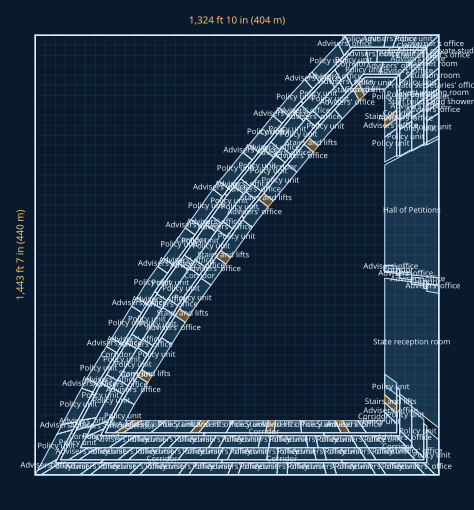

# P1-01 Governor's Hall: plan

Footprint 1,324 ft 10 in (404 m) × 1,443 ft 7 in (440 m) · structural grid 32 ft 10 in (10 m)

## Levels

| Level | Floor above deck | Height | Floor area |
|---|---|---|---|
| Level 1 · State floor | 0 ft (0 mm) | 24 ft 7 in (7,500 mm) | 649,966 sq ft (60,384 m²) |
| Level 2 · Governor's floor | 24 ft 7 in (7,500 mm) | 16 ft 5 in (5,000 mm) | 650,128 sq ft (60,399 m²) |
| Level 3 · Ministry floor 1 | 41 ft (12 m) | 14 ft 5 in (4,400 mm) | 630,948 sq ft (58,617 m²) |
| Level 4 · Ministry floor 2 | 55 ft 5 in (17 m) | 14 ft 5 in (4,400 mm) | 630,948 sq ft (58,617 m²) |
| Level 5 · Ministry floor 3 | 69 ft 11 in (21 m) | 14 ft 5 in (4,400 mm) | 630,948 sq ft (58,617 m²) |
| Level 6 · Roof terrace floor | 84 ft 4 in (26 m) | 14 ft 5 in (4,400 mm) | 630,993 sq ft (58,621 m²) |

## Elements

| ID | Designation | Type | Name | Level(s) | Size / length | Area | Status |
|---|---|---|---|---|---|---|---|
| E001 | D5F1P1B2A1L1R1, D5F1P1B2A1L2R1 | room | Hall of Petitions | L1, L2 | 177 ft 6 in (54 m) × 466 ft 10 in (142 m) | 72,674 sq ft (6,752 m²) | proposed |
| E002 |  | fixture | Audience dais | L1 | 35 ft 9 in (11 m) × 70 ft 3 in (21 m) | 2,511 sq ft (233 m²) | proposed |
| E003 | D5F1P1B2A1L1R2, D5F1P1B2A1L2R2 | room | State reception room | L1, L2 | 177 ft 6 in (54 m) × 491 ft 10 in (150 m) | 72,674 sq ft (6,752 m²) | proposed |
| E004 | D5F1P1B2A1L1R3 | zone | Corridor | L1 | 9 ft 10 in (3,000 mm) × 323 ft 2 in (98 m) | 3,106 sq ft (289 m²) | proposed |
| E005 | D5F1P1B2A1L1R4 | zone | Corridor | L1 | 9 ft 10 in (3,000 mm) × 26 ft 7 in (8,100 mm) | 247 sq ft (23 m²) | proposed |
| E006 | D5F1P1B2A1L1R5 | zone | Corridor | L1 | 280 ft 10 in (86 m) × 128 ft 11 in (39 m) | 3,877 sq ft (360 m²) | proposed |
| E007 | D5F1P1B2A1L1R6 | zone | Corridor | L1 | 398 ft (121 m) × 9 ft 10 in (3,000 mm) | 3,875 sq ft (360 m²) | proposed |
| E008 | D5F1P1B2A1L1R7 | zone | Corridor | L1 | 402 ft 7 in (123 m) × 9 ft 10 in (3,000 mm) | 3,875 sq ft (360 m²) | proposed |
| E009 | D5F1P1B2A1L1R8 | zone | Corridor | L1 | 159 ft 9 in (49 m) × 225 ft 9 in (69 m) | 3,902 sq ft (363 m²) | proposed |
| E010 | D5F1P1B2A1L1R9 | zone | Corridor | L1 | 214 ft 11 in (66 m) × 339 ft 11 in (104 m) | 3,893 sq ft (362 m²) | proposed |
| E011 | D5F1P1B2A1L1R10 | zone | Corridor | L1 | 236 ft 3 in (72 m) × 326 ft 5 in (100 m) | 3,875 sq ft (360 m²) | proposed |
| E012 | D5F1P1B2A1L1R11 | zone | Corridor | L1 | 258 ft 6 in (79 m) × 309 ft 9 in (94 m) | 3,855 sq ft (358 m²) | proposed |
| E013 | D5F1P1B2A1L1R12 | zone | Corridor | L1 | 323 ft 6 in (99 m) × 184 ft 5 in (56 m) | 3,892 sq ft (362 m²) | proposed |
| E014 | D5F1P1B2A1L1R13 | zone | Corridor | L1 | 94 ft 2 in (29 m) × 9 ft 10 in (3,000 mm) | 854 sq ft (79 m²) | proposed |
| E015 | D5F1P1B2A1L1R14 | zone | Corridor | L1 | 9 ft 10 in (3,000 mm) × 270 ft 4 in (82 m) | 2,585 sq ft (240 m²) | proposed |
| E016 | D5F1P1B2A1L1R15 | zone | Corridor | L1 | 9 ft 10 in (3,000 mm) × 21 ft 8 in (6,600 mm) | 205 sq ft (19 m²) | proposed |
| E017 | D5F1P1B2A1L1R16 | zone | Corridor | L1 | 250 ft 4 in (76 m) × 158 ft 6 in (48 m) | 3,875 sq ft (360 m²) | proposed |
| E018 | D5F1P1B2A1L1R17 | zone | Corridor | L1 | 399 ft 3 in (122 m) × 9 ft 10 in (3,000 mm) | 3,877 sq ft (360 m²) | proposed |
| E019 | D5F1P1B2A1L1R18 | zone | Corridor | L1 | 343 ft 10 in (105 m) × 61 ft (19 m) | 3,876 sq ft (360 m²) | proposed |
| E020 | D5F1P1B2A1L1R19 | zone | Corridor | L1 | 214 ft 3 in (65 m) × 340 ft 11 in (104 m) | 3,887 sq ft (361 m²) | proposed |
| E021 | D5F1P1B2A1L1R20 | zone | Corridor | L1 | 234 ft 7 in (72 m) × 327 ft 9 in (100 m) | 3,923 sq ft (364 m²) | proposed |
| E022 | D5F1P1B2A1L1R21 | zone | Corridor | L1 | 256 ft 7 in (78 m) × 311 ft 4 in (95 m) | 3,905 sq ft (363 m²) | proposed |
| E023 | D5F1P1B2A1L1R22 | zone | Corridor | L1 | 269 ft 8 in (82 m) × 167 ft (51 m) | 3,239 sq ft (301 m²) | proposed |
| E024 | D5F1P1B2A1L1R23, D5F1P1B2A1L2R3, D5F1P1B2A1L3R1, D5F1P1B2A1L4R1, D5F1P1B2A1L5R1, D5F1P1B2A1L6R1 | core | Stairs and lifts | L1, L2, L3, L4, L5, L6 | 39 ft 4 in (12 m) × 57 ft 5 in (18 m) | 1,033 sq ft (96 m²) | proposed |
| E025 | D5F1P1B2A1L1R24, D5F1P1B2A1L2R4, D5F1P1B2A1L3R2, D5F1P1B2A1L4R2, D5F1P1B2A1L5R2, D5F1P1B2A1L6R2 | core | Stairs and lifts | L1, L2, L3, L4, L5, L6 | 39 ft 4 in (12 m) × 60 ft 8 in (18 m) | 1,040 sq ft (97 m²) | proposed |
| E026 | D5F1P1B2A1L1R25, D5F1P1B2A1L2R5, D5F1P1B2A1L3R3, D5F1P1B2A1L4R3, D5F1P1B2A1L5R3, D5F1P1B2A1L6R3 | core | Stairs and lifts | L1, L2, L3, L4, L5, L6 | 47 ft 3 in (14 m) × 39 ft 4 in (12 m) | 1,040 sq ft (97 m²) | proposed |
| E027 | D5F1P1B2A1L1R26, D5F1P1B2A1L2R6, D5F1P1B2A1L3R4, D5F1P1B2A1L4R4, D5F1P1B2A1L5R4, D5F1P1B2A1L6R4 | core | Stairs and lifts | L1, L2, L3, L4, L5, L6 | 32 ft 10 in (10 m) × 39 ft 4 in (12 m) | 1,033 sq ft (96 m²) | proposed |
| E028 | D5F1P1B2A1L1R27, D5F1P1B2A1L2R7, D5F1P1B2A1L3R5, D5F1P1B2A1L4R5, D5F1P1B2A1L5R5, D5F1P1B2A1L6R5 | core | Stairs and lifts | L1, L2, L3, L4, L5, L6 | 59 ft 9 in (18 m) × 39 ft 4 in (12 m) | 1,027 sq ft (95 m²) | proposed |
| E029 | D5F1P1B2A1L1R28, D5F1P1B2A1L2R8, D5F1P1B2A1L3R6, D5F1P1B2A1L4R6, D5F1P1B2A1L5R6, D5F1P1B2A1L6R6 | core | Stairs and lifts | L1, L2, L3, L4, L5, L6 | 86 ft 11 in (26 m) × 39 ft 4 in (12 m) | 1,027 sq ft (95 m²) | proposed |
| E030 | D5F1P1B2A1L1R29, D5F1P1B2A1L2R9, D5F1P1B2A1L3R7, D5F1P1B2A1L4R7, D5F1P1B2A1L5R7, D5F1P1B2A1L6R7 | core | Stairs and lifts | L1, L2, L3, L4, L5, L6 | 47 ft 7 in (14 m) × 42 ft 8 in (13 m) | 1,031 sq ft (96 m²) | proposed |
| E031 | D5F1P1B2A1L1R30, D5F1P1B2A1L2R10, D5F1P1B2A1L3R8, D5F1P1B2A1L4R8, D5F1P1B2A1L5R8, D5F1P1B2A1L6R8 | core | Stairs and lifts | L1, L2, L3, L4, L5, L6 | 46 ft 11 in (14 m) × 44 ft (13 m) | 1,038 sq ft (96 m²) | proposed |
| E032 | D5F1P1B2A1L1R31, D5F1P1B2A1L2R11, D5F1P1B2A1L3R9, D5F1P1B2A1L4R9, D5F1P1B2A1L5R9, D5F1P1B2A1L6R9 | core | Stairs and lifts | L1, L2, L3, L4, L5, L6 | 47 ft 3 in (14 m) × 44 ft 7 in (14 m) | 1,040 sq ft (97 m²) | proposed |
| E033 | D5F1P1B2A1L1R32, D5F1P1B2A1L2R12, D5F1P1B2A1L3R10, D5F1P1B2A1L4R10, D5F1P1B2A1L5R10, D5F1P1B2A1L6R10 | core | Stairs and lifts | L1, L2, L3, L4, L5, L6 | 47 ft 7 in (14 m) × 44 ft 7 in (14 m) | 1,031 sq ft (96 m²) | proposed |
| E034 | D5F1P1B2A1L1R33, D5F1P1B2A1L2R13, D5F1P1B2A1L3R11, D5F1P1B2A1L4R11, D5F1P1B2A1L5R11, D5F1P1B2A1L6R11 | core | Stairs and lifts | L1, L2, L3, L4, L5, L6 | 46 ft 7 in (14 m) × 45 ft 11 in (14 m) | 1,035 sq ft (96 m²) | proposed |
| E035 | D5F1P1B2A1L1R34, D5F1P1B2A1L2R14, D5F1P1B2A1L3R12, D5F1P1B2A1L4R12, D5F1P1B2A1L5R12, D5F1P1B2A1L6R12 | core | Stairs and lifts | L1, L2, L3, L4, L5, L6 | 37 ft 5 in (11 m) × 56 ft 1 in (17 m) | 1,035 sq ft (96 m²) | proposed |
| E036 | D5F1P1B2A1L1R35 | room | Grand entrance | L1 | 39 ft 4 in (12 m) × 198 ft 6 in (60 m) | 6,445 sq ft (599 m²) | proposed |
| E037 | D5F1P1B2A1L1R36 | room | Security screening | L1 | 39 ft 4 in (12 m) × 83 ft (25 m) | 2,138 sq ft (199 m²) | proposed |
| E038 | D5F1P1B2A1L1R37 | room | Visitors' desk | L1 | 39 ft 4 in (12 m) × 59 ft 1 in (18 m) | 1,292 sq ft (120 m²) | proposed |
| E039 | D5F1P1B2A1L1R38 | room | Petitions office | L1 | 39 ft 4 in (12 m) × 102 ft 8 in (31 m) | 3,132 sq ft (291 m²) | proposed |
| E040 | D5F1P1B2A1L1R39 | room | Press room | L1 | 39 ft 4 in (12 m) × 32 ft 6 in (9,900 mm) | 1,033 sq ft (96 m²) | proposed |
| E041 | D5F1P1B2A1L1R40 | room | Interview rooms | L1 | 39 ft 4 in (12 m) × 47 ft 7 in (14 m) | 543 sq ft (50 m²) | proposed |
| E042 | D5F1P1B2A1L1R41 | room | Interview rooms | L1 | 39 ft 4 in (12 m) × 48 ft 3 in (15 m) | 543 sq ft (50 m²) | proposed |
| E043 | D5F1P1B2A1L1R42 | room | Interview rooms | L1 | 39 ft 4 in (12 m) × 48 ft 11 in (15 m) | 543 sq ft (50 m²) | proposed |
| E044 | D5F1P1B2A1L1R43 | room | Interview rooms | L1 | 39 ft 4 in (12 m) × 49 ft 10 in (15 m) | 549 sq ft (51 m²) | proposed |
| E045 | D5F1P1B2A1L1R44 | room | Interview rooms | L1 | 39 ft 4 in (12 m) × 50 ft 6 in (15 m) | 543 sq ft (50 m²) | proposed |
| E046 | D5F1P1B2A1L1R45 | room | Interview rooms | L1 | 39 ft 4 in (12 m) × 51 ft 2 in (16 m) | 543 sq ft (50 m²) | proposed |
| E047 | D5F1P1B2A1L1R46 | room | Guard room | L1 | 39 ft 4 in (12 m) × 60 ft 4 in (18 m) | 865 sq ft (80 m²) | proposed |
| E048 | D5F1P1B2A1L1R47 | room | Toilets | L1 | 48 ft 7 in (15 m) × 45 ft 11 in (14 m) | 639 sq ft (59 m²) | proposed |
| E049 | D5F1P1B2A1L1R48 | room | Post room | L1 | 52 ft 2 in (16 m) × 39 ft 4 in (12 m) | 549 sq ft (51 m²) | proposed |
| E050 | D5F1P1B2A1L1R49 | room | Public service counter | L1 | 362 ft 2 in (110 m) × 39 ft 4 in (12 m) | 13,330 sq ft (1,238 m²) | proposed |
| E051 | D5F1P1B2A1L1R50 | room | Department enquiry office | L1 | 469 ft 10 in (143 m) × 39 ft 4 in (12 m) | 17,760 sq ft (1,650 m²) | proposed |
| E052 | D5F1P1B2A1L1R51 | room | Waiting hall | L1 | 505 ft 11 in (154 m) × 284 ft 9 in (87 m) | 29,659 sq ft (2,755 m²) | proposed |
| E053 | D5F1P1B2A1L1R52 | room | Public service counter | L1 | 212 ft 3 in (65 m) × 305 ft 9 in (93 m) | 13,333 sq ft (1,239 m²) | proposed |
| E054 | D5F1P1B2A1L1R53 | room | Department enquiry office | L1 | 291 ft (89 m) × 392 ft 1 in (120 m) | 17,823 sq ft (1,656 m²) | proposed |
| E055 | D5F1P1B2A1L1R54 | room | Waiting hall | L1 | 547 ft 3 in (167 m) × 519 ft 4 in (158 m) | 29,642 sq ft (2,754 m²) | proposed |
| E056 | D5F1P1B2A1L1R55 | room | Public service counter | L1 | 190 ft 11 in (58 m) × 39 ft 4 in (12 m) | 6,652 sq ft (618 m²) | proposed |
| E057 | D5F1P1B2A1L1R56 | room | Department enquiry office | L1 | 39 ft 8 in (12 m) × 331 ft 4 in (101 m) | 11,943 sq ft (1,110 m²) | proposed |
| E058 | D5F1P1B2A1L1R57 | room | Waiting hall | L1 | 39 ft 8 in (12 m) × 29 ft 2 in (8,900 mm) | 944 sq ft (88 m²) | proposed |
| E059 | D5F1P1B2A1L1R58 | room | Public service counter | L1 | 240 ft 2 in (73 m) × 164 ft 1 in (50 m) | 13,441 sq ft (1,249 m²) | proposed |
| E060 | D5F1P1B2A1L1R59 | room | Department enquiry office | L1 | 472 ft 1 in (144 m) × 39 ft 8 in (12 m) | 17,915 sq ft (1,664 m²) | proposed |
| E061 | D5F1P1B2A1L1R60 | room | Waiting hall | L1 | 522 ft 8 in (159 m) × 269 ft 8 in (82 m) | 29,812 sq ft (2,770 m²) | proposed |
| E062 | D5F1P1B2A1L1R61 | room | Public service counter | L1 | 212 ft 7 in (65 m) × 308 ft 1 in (94 m) | 13,344 sq ft (1,240 m²) | proposed |
| E063 | D5F1P1B2A1L1R62 | room | Department enquiry office | L1 | 297 ft 11 in (91 m) × 387 ft 6 in (118 m) | 17,825 sq ft (1,656 m²) | proposed |
| E064 | D5F1P1B2A1L1R63 | room | Waiting hall | L1 | 598 ft 5 in (182 m) × 446 ft 2 in (136 m) | 29,815 sq ft (2,770 m²) | proposed |
| E065 | D5F1P1B2A1L1R64 | room | Public service counter | L1 | 39 ft 4 in (12 m) × 307 ft 9 in (94 m) | 10,915 sq ft (1,014 m²) | proposed |
| E066 | D5F1P1B2A1L1R65 | room | Department enquiry office | L1 | 39 ft 4 in (12 m) × 26 ft 3 in (8,000 mm) | 865 sq ft (80 m²) | proposed |
| E067 | D5F1P1B2A1L1R66 | room | Waiting hall | L1 | 641 ft 5 in (196 m) × 176 ft 6 in (54 m) | 29,605 sq ft (2,750 m²) | proposed |
| E068 | D5F1P1B2A1L1R67 | room | Public service counter | L1 | 378 ft 7 in (115 m) × 39 ft 4 in (12 m) | 13,330 sq ft (1,238 m²) | proposed |
| E069 | D5F1P1B2A1L1R68 | room | Department enquiry office | L1 | 232 ft 3 in (71 m) × 345 ft 10 in (105 m) | 17,781 sq ft (1,652 m²) | proposed |
| E070 | D5F1P1B2A1L1R69 | room | Waiting hall | L1 | 470 ft 6 in (143 m) × 632 ft 10 in (193 m) | 29,564 sq ft (2,747 m²) | proposed |
| E071 | D5F1P1B2A1L1R70 | room | Public service counter | L1 | 248 ft 8 in (76 m) × 284 ft 9 in (87 m) | 13,328 sq ft (1,238 m²) | proposed |
| E072 | D5F1P1B2A1L1R71 | room | Department enquiry office | L1 | 220 ft 10 in (67 m) × 83 ft 8 in (26 m) | 8,310 sq ft (772 m²) | proposed |
| E073 | D5F1P1B2A1L1R72 | room | Waiting hall | L1 | 39 ft 4 in (12 m) × 139 ft 9 in (43 m) | 4,095 sq ft (380 m²) | proposed |
| E074 | D5F1P1B2A1L1R73 | room | Public service counter | L1 | 39 ft 4 in (12 m) × 143 ft 8 in (44 m) | 4,631 sq ft (430 m²) | proposed |
| E075 | D5F1P1B2A1L1R74 | room | Department enquiry office | L1 | 39 ft 4 in (12 m) × 22 ft 8 in (6,900 mm) | 775 sq ft (72 m²) | proposed |
| E076 | D5F1P1B2A1L1R75 | room | Waiting hall | L1 | 39 ft 4 in (12 m) × 101 ft 5 in (31 m) | 2,771 sq ft (257 m²) | proposed |
| E077 | D5F1P1B2A1L1R76 | room | Public service counter | L1 | 177 ft 2 in (54 m) × 98 ft 9 in (30 m) | 8,183 sq ft (760 m²) | proposed |
| E078 | D5F1P1B2A1L1R77 | room | Department enquiry office | L1 | 219 ft 10 in (67 m) × 39 ft 4 in (12 m) | 8,176 sq ft (760 m²) | proposed |
| E079 | D5F1P1B2A1L1R78 | room | Waiting hall | L1 | 228 ft (70 m) × 39 ft 4 in (12 m) | 8,183 sq ft (760 m²) | proposed |
| E080 | D5F1P1B2A1L1R79 | room | Public service counter | L1 | 255 ft 3 in (78 m) × 39 ft 4 in (12 m) | 8,189 sq ft (761 m²) | proposed |
| E081 | D5F1P1B2A1L1R80 | room | Department enquiry office | L1 | 139 ft 1 in (42 m) × 185 ft (56 m) | 8,206 sq ft (762 m²) | proposed |
| E082 | D5F1P1B2A1L1R81 | room | Waiting hall | L1 | 143 ft 4 in (44 m) × 197 ft 6 in (60 m) | 8,227 sq ft (764 m²) | proposed |
| E083 | D5F1P1B2A1L1R82 | room | Public service counter | L1 | 152 ft 3 in (46 m) × 191 ft 11 in (59 m) | 8,199 sq ft (762 m²) | proposed |
| E084 | D5F1P1B2A1L1R83 | room | Department enquiry office | L1 | 155 ft 6 in (47 m) × 190 ft 7 in (58 m) | 8,235 sq ft (765 m²) | proposed |
| E085 | D5F1P1B2A1L1R84 | room | Waiting hall | L1 | 162 ft 1 in (49 m) × 185 ft 8 in (57 m) | 8,180 sq ft (760 m²) | proposed |
| E086 | D5F1P1B2A1L1R85 | room | Public service counter | L1 | 164 ft 8 in (50 m) × 184 ft 9 in (56 m) | 8,183 sq ft (760 m²) | proposed |
| E087 | D5F1P1B2A1L1R86 | room | Department enquiry office | L1 | 124 ft 4 in (38 m) × 58 ft 5 in (18 m) | 4,092 sq ft (380 m²) | proposed |
| E088 | D5F1P1B2A1L2R15 | zone | Corridor | L2 | 9 ft 10 in (3,000 mm) × 323 ft 2 in (98 m) | 3,106 sq ft (289 m²) | proposed |
| E089 | D5F1P1B2A1L2R16 | zone | Corridor | L2 | 9 ft 10 in (3,000 mm) × 26 ft 7 in (8,100 mm) | 247 sq ft (23 m²) | proposed |
| E090 | D5F1P1B2A1L2R17 | zone | Corridor | L2 | 280 ft 10 in (86 m) × 128 ft 11 in (39 m) | 3,877 sq ft (360 m²) | proposed |
| E091 | D5F1P1B2A1L2R18 | zone | Corridor | L2 | 398 ft (121 m) × 9 ft 10 in (3,000 mm) | 3,875 sq ft (360 m²) | proposed |
| E092 | D5F1P1B2A1L2R19 | zone | Corridor | L2 | 402 ft 7 in (123 m) × 9 ft 10 in (3,000 mm) | 3,875 sq ft (360 m²) | proposed |
| E093 | D5F1P1B2A1L2R20 | zone | Corridor | L2 | 159 ft 9 in (49 m) × 225 ft 9 in (69 m) | 3,902 sq ft (363 m²) | proposed |
| E094 | D5F1P1B2A1L2R21 | zone | Corridor | L2 | 214 ft 11 in (66 m) × 339 ft 11 in (104 m) | 3,893 sq ft (362 m²) | proposed |
| E095 | D5F1P1B2A1L2R22 | zone | Corridor | L2 | 236 ft 3 in (72 m) × 326 ft 5 in (100 m) | 3,875 sq ft (360 m²) | proposed |
| E096 | D5F1P1B2A1L2R23 | zone | Corridor | L2 | 258 ft 6 in (79 m) × 309 ft 9 in (94 m) | 3,855 sq ft (358 m²) | proposed |
| E097 | D5F1P1B2A1L2R24 | zone | Corridor | L2 | 323 ft 6 in (99 m) × 184 ft 5 in (56 m) | 3,892 sq ft (362 m²) | proposed |
| E098 | D5F1P1B2A1L2R25 | zone | Corridor | L2 | 94 ft 2 in (29 m) × 9 ft 10 in (3,000 mm) | 854 sq ft (79 m²) | proposed |
| E099 | D5F1P1B2A1L2R26 | zone | Corridor | L2 | 9 ft 10 in (3,000 mm) × 270 ft 4 in (82 m) | 2,585 sq ft (240 m²) | proposed |
| E100 | D5F1P1B2A1L2R27 | zone | Corridor | L2 | 9 ft 10 in (3,000 mm) × 21 ft 8 in (6,600 mm) | 205 sq ft (19 m²) | proposed |
| E101 | D5F1P1B2A1L2R28 | zone | Corridor | L2 | 250 ft 4 in (76 m) × 158 ft 6 in (48 m) | 3,875 sq ft (360 m²) | proposed |
| E102 | D5F1P1B2A1L2R29 | zone | Corridor | L2 | 399 ft 3 in (122 m) × 9 ft 10 in (3,000 mm) | 3,877 sq ft (360 m²) | proposed |
| E103 | D5F1P1B2A1L2R30 | zone | Corridor | L2 | 343 ft 10 in (105 m) × 61 ft (19 m) | 3,876 sq ft (360 m²) | proposed |
| E104 | D5F1P1B2A1L2R31 | zone | Corridor | L2 | 214 ft 3 in (65 m) × 340 ft 11 in (104 m) | 3,887 sq ft (361 m²) | proposed |
| E105 | D5F1P1B2A1L2R32 | zone | Corridor | L2 | 234 ft 7 in (72 m) × 327 ft 9 in (100 m) | 3,923 sq ft (364 m²) | proposed |
| E106 | D5F1P1B2A1L2R33 | zone | Corridor | L2 | 256 ft 7 in (78 m) × 311 ft 4 in (95 m) | 3,905 sq ft (363 m²) | proposed |
| E107 | D5F1P1B2A1L2R34 | zone | Corridor | L2 | 269 ft 8 in (82 m) × 167 ft (51 m) | 3,239 sq ft (301 m²) | proposed |
| E108 | D5F1P1B2A1L2R35 | room | Governor's office | L2 | 39 ft 4 in (12 m) × 71 ft 2 in (22 m) | 1,292 sq ft (120 m²) | proposed |
| E109 | D5F1P1B2A1L2R36 | room | Governor's private study | L2 | 39 ft 4 in (12 m) × 50 ft 10 in (16 m) | 543 sq ft (50 m²) | proposed |
| E110 | D5F1P1B2A1L2R37 | room | Chief of staff's office | L2 | 39 ft 4 in (12 m) × 50 ft 2 in (15 m) | 543 sq ft (50 m²) | proposed |
| E111 | D5F1P1B2A1L2R38 | room | Cabinet room | L2 | 39 ft 4 in (12 m) × 78 ft 5 in (24 m) | 1,718 sq ft (160 m²) | proposed |
| E112 | D5F1P1B2A1L2R39 | room | Situation room | L2 | 39 ft 4 in (12 m) × 65 ft 3 in (20 m) | 1,285 sq ft (119 m²) | proposed |
| E113 | D5F1P1B2A1L2R40 | room | Private secretaries' office | L2 | 39 ft 4 in (12 m) × 63 ft 8 in (19 m) | 1,292 sq ft (120 m²) | proposed |
| E114 | D5F1P1B2A1L2R41 | room | Guest waiting room | L2 | 39 ft 4 in (12 m) × 43 ft 4 in (13 m) | 543 sq ft (50 m²) | proposed |
| E115 | D5F1P1B2A1L2R42 | room | Tea point | L2 | 39 ft 4 in (12 m) × 42 ft 8 in (13 m) | 543 sq ft (50 m²) | proposed |
| E116 | D5F1P1B2A1L2R43 | room | Staff toilets and showers | L2 | 39 ft 4 in (12 m) × 47 ft 3 in (14 m) | 756 sq ft (70 m²) | proposed |
| E117 | D5F1P1B2A1L2R44 | room | Advisers' office | L2 | 39 ft 4 in (12 m) × 138 ft 5 in (42 m) | 4,495 sq ft (418 m²) | proposed |
| E118 | D5F1P1B2A1L2R45 | room | Policy unit | L2 | 39 ft 4 in (12 m) × 32 ft 6 in (9,900 mm) | 1,033 sq ft (96 m²) | proposed |
| E119 | D5F1P1B2A1L2R46 | room | Advisers' office | L2 | 144 ft 4 in (44 m) × 148 ft (45 m) | 8,699 sq ft (808 m²) | proposed |
| E120 | D5F1P1B2A1L2R47 | room | Policy unit | L2 | 862 ft 2 in (263 m) × 39 ft 4 in (12 m) | 32,595 sq ft (3,028 m²) | proposed |
| E121 | D5F1P1B2A1L2R48 | room | Advisers' office | L2 | 268 ft 1 in (82 m) × 39 ft 4 in (12 m) | 8,693 sq ft (808 m²) | proposed |
| E122 | D5F1P1B2A1L2R49 | room | Policy unit | L2 | 408 ft 6 in (124 m) × 647 ft 4 in (197 m) | 32,662 sq ft (3,034 m²) | proposed |
| E123 | D5F1P1B2A1L2R50 | room | Advisers' office | L2 | 160 ft 9 in (49 m) × 202 ft 1 in (62 m) | 8,707 sq ft (809 m²) | proposed |
| E124 | D5F1P1B2A1L2R51 | room | Policy unit | L2 | 564 ft 8 in (172 m) × 639 ft 5 in (195 m) | 32,704 sq ft (3,038 m²) | proposed |
| E125 | D5F1P1B2A1L2R52 | room | Advisers' office | L2 | 265 ft 9 in (81 m) × 39 ft 4 in (12 m) | 9,487 sq ft (881 m²) | proposed |
| E126 | D5F1P1B2A1L2R53 | room | Policy unit | L2 | 39 ft 8 in (12 m) × 331 ft 4 in (101 m) | 11,943 sq ft (1,110 m²) | proposed |
| E127 | D5F1P1B2A1L2R54 | room | Advisers' office | L2 | 39 ft 8 in (12 m) × 29 ft 2 in (8,900 mm) | 944 sq ft (88 m²) | proposed |
| E128 | D5F1P1B2A1L2R55 | room | Policy unit | L2 | 732 ft 3 in (223 m) × 164 ft 1 in (50 m) | 32,873 sq ft (3,054 m²) | proposed |
| E129 | D5F1P1B2A1L2R56 | room | Advisers' office | L2 | 256 ft 3 in (78 m) × 39 ft 8 in (12 m) | 8,765 sq ft (814 m²) | proposed |
| E130 | D5F1P1B2A1L2R57 | room | Policy unit | L2 | 356 ft 8 in (109 m) × 555 ft 1 in (169 m) | 32,781 sq ft (3,045 m²) | proposed |
| E131 | D5F1P1B2A1L2R58 | room | Advisers' office | L2 | 160 ft 5 in (49 m) × 202 ft 5 in (62 m) | 8,696 sq ft (808 m²) | proposed |
| E132 | D5F1P1B2A1L2R59 | room | Policy unit | L2 | 563 ft 8 in (172 m) × 632 ft 7 in (193 m) | 32,786 sq ft (3,046 m²) | proposed |
| E133 | D5F1P1B2A1L2R60 | room | Advisers' office | L2 | 181 ft 9 in (55 m) × 39 ft 8 in (12 m) | 6,336 sq ft (589 m²) | proposed |
| E134 | D5F1P1B2A1L2R61 | room | Policy unit | L2 | 39 ft 4 in (12 m) × 307 ft 9 in (94 m) | 10,915 sq ft (1,014 m²) | proposed |
| E135 | D5F1P1B2A1L2R62 | room | Advisers' office | L2 | 39 ft 4 in (12 m) × 26 ft 3 in (8,000 mm) | 865 sq ft (80 m²) | proposed |
| E136 | D5F1P1B2A1L2R63 | room | Policy unit | L2 | 721 ft 2 in (220 m) × 176 ft 6 in (54 m) | 32,595 sq ft (3,028 m²) | proposed |
| E137 | D5F1P1B2A1L2R64 | room | Advisers' office | L2 | 262 ft 6 in (80 m) × 39 ft 4 in (12 m) | 8,699 sq ft (808 m²) | proposed |
| E138 | D5F1P1B2A1L2R65 | room | Policy unit | L2 | 417 ft (127 m) × 625 ft 8 in (191 m) | 32,607 sq ft (3,029 m²) | proposed |
| E139 | D5F1P1B2A1L2R66 | room | Advisers' office | L2 | 160 ft 5 in (49 m) × 202 ft 9 in (62 m) | 8,678 sq ft (806 m²) | proposed |
| E140 | D5F1P1B2A1L2R67 | room | Policy unit | L2 | 573 ft 10 in (175 m) × 483 ft 11 in (148 m) | 29,380 sq ft (2,730 m²) | proposed |
| E141 | D5F1P1B2A1L2R68 | room | Advisers' office | L2 | 39 ft 4 in (12 m) × 139 ft 9 in (43 m) | 4,095 sq ft (380 m²) | proposed |
| E142 | D5F1P1B2A1L2R69 | room | Policy unit | L2 | 39 ft 4 in (12 m) × 143 ft 8 in (44 m) | 4,631 sq ft (430 m²) | proposed |
| E143 | D5F1P1B2A1L2R70 | room | Advisers' office | L2 | 39 ft 4 in (12 m) × 22 ft 8 in (6,900 mm) | 775 sq ft (72 m²) | proposed |
| E144 | D5F1P1B2A1L2R71 | room | Policy unit | L2 | 39 ft 4 in (12 m) × 101 ft 5 in (31 m) | 2,771 sq ft (257 m²) | proposed |
| E145 | D5F1P1B2A1L2R72 | room | Advisers' office | L2 | 177 ft 2 in (54 m) × 98 ft 9 in (30 m) | 8,183 sq ft (760 m²) | proposed |
| E146 | D5F1P1B2A1L2R73 | room | Policy unit | L2 | 219 ft 10 in (67 m) × 39 ft 4 in (12 m) | 8,176 sq ft (760 m²) | proposed |
| E147 | D5F1P1B2A1L2R74 | room | Advisers' office | L2 | 228 ft (70 m) × 39 ft 4 in (12 m) | 8,183 sq ft (760 m²) | proposed |
| E148 | D5F1P1B2A1L2R75 | room | Policy unit | L2 | 255 ft 3 in (78 m) × 39 ft 4 in (12 m) | 8,189 sq ft (761 m²) | proposed |
| E149 | D5F1P1B2A1L2R76 | room | Advisers' office | L2 | 139 ft 1 in (42 m) × 185 ft (56 m) | 8,206 sq ft (762 m²) | proposed |
| E150 | D5F1P1B2A1L2R77 | room | Policy unit | L2 | 143 ft 4 in (44 m) × 197 ft 6 in (60 m) | 8,227 sq ft (764 m²) | proposed |
| E151 | D5F1P1B2A1L2R78 | room | Advisers' office | L2 | 152 ft 3 in (46 m) × 191 ft 11 in (59 m) | 8,199 sq ft (762 m²) | proposed |
| E152 | D5F1P1B2A1L2R79 | room | Policy unit | L2 | 155 ft 6 in (47 m) × 190 ft 7 in (58 m) | 8,235 sq ft (765 m²) | proposed |
| E153 | D5F1P1B2A1L2R80 | room | Advisers' office | L2 | 162 ft 1 in (49 m) × 185 ft 8 in (57 m) | 8,180 sq ft (760 m²) | proposed |
| E154 | D5F1P1B2A1L2R81 | room | Policy unit | L2 | 164 ft 8 in (50 m) × 184 ft 9 in (56 m) | 8,183 sq ft (760 m²) | proposed |
| E155 | D5F1P1B2A1L2R82 | room | Advisers' office | L2 | 124 ft 4 in (38 m) × 58 ft 5 in (18 m) | 4,092 sq ft (380 m²) | proposed |
| E156 | D5F1P1B2A1L3R13, D5F1P1B2A1L4R13, D5F1P1B2A1L5R13 | zone | Corridor | L3, L4, L5 | 9 ft 10 in (3,000 mm) × 400 ft 11 in (122 m) | 3,877 sq ft (360 m²) | proposed |
| E157 | D5F1P1B2A1L3R14, D5F1P1B2A1L4R14, D5F1P1B2A1L5R14 | zone | Corridor | L3, L4, L5 | 9 ft 10 in (3,000 mm) × 396 ft 8 in (121 m) | 3,875 sq ft (360 m²) | proposed |
| E158 | D5F1P1B2A1L3R15, D5F1P1B2A1L4R15, D5F1P1B2A1L5R15 | zone | Corridor | L3, L4, L5 | 9 ft 10 in (3,000 mm) × 398 ft 4 in (121 m) | 3,875 sq ft (360 m²) | proposed |
| E159 | D5F1P1B2A1L3R16, D5F1P1B2A1L4R16, D5F1P1B2A1L5R16 | zone | Corridor | L3, L4, L5 | 227 ft 8 in (69 m) × 182 ft 5 in (56 m) | 3,877 sq ft (360 m²) | proposed |
| E160 | D5F1P1B2A1L3R17, D5F1P1B2A1L4R17, D5F1P1B2A1L5R17 | zone | Corridor | L3, L4, L5 | 398 ft (121 m) × 9 ft 10 in (3,000 mm) | 3,875 sq ft (360 m²) | proposed |
| E161 | D5F1P1B2A1L3R18, D5F1P1B2A1L4R18, D5F1P1B2A1L5R18 | zone | Corridor | L3, L4, L5 | 401 ft 3 in (122 m) × 9 ft 10 in (3,000 mm) | 3,875 sq ft (360 m²) | proposed |
| E162 | D5F1P1B2A1L3R19, D5F1P1B2A1L4R19, D5F1P1B2A1L5R19 | zone | Corridor | L3, L4, L5 | 212 ft 11 in (65 m) × 176 ft 10 in (54 m) | 3,874 sq ft (360 m²) | proposed |
| E163 | D5F1P1B2A1L3R20, D5F1P1B2A1L4R20, D5F1P1B2A1L5R20 | zone | Corridor | L3, L4, L5 | 212 ft 3 in (65 m) × 339 ft 11 in (104 m) | 3,859 sq ft (358 m²) | proposed |
| E164 | D5F1P1B2A1L3R21, D5F1P1B2A1L4R21, D5F1P1B2A1L5R21 | zone | Corridor | L3, L4, L5 | 233 ft 7 in (71 m) × 328 ft 5 in (100 m) | 3,887 sq ft (361 m²) | proposed |
| E165 | D5F1P1B2A1L3R22, D5F1P1B2A1L4R22, D5F1P1B2A1L5R22 | zone | Corridor | L3, L4, L5 | 254 ft 7 in (78 m) × 312 ft 8 in (95 m) | 3,889 sq ft (361 m²) | proposed |
| E166 | D5F1P1B2A1L3R23, D5F1P1B2A1L4R23, D5F1P1B2A1L5R23 | zone | Corridor | L3, L4, L5 | 303 ft 6 in (92 m) × 224 ft 9 in (68 m) | 3,865 sq ft (359 m²) | proposed |
| E167 | D5F1P1B2A1L3R24, D5F1P1B2A1L4R24, D5F1P1B2A1L5R24 | zone | Corridor | L3, L4, L5 | 146 ft 4 in (45 m) × 9 ft 10 in (3,000 mm) | 1,384 sq ft (129 m²) | proposed |
| E168 | D5F1P1B2A1L3R25, D5F1P1B2A1L4R25, D5F1P1B2A1L5R25 | zone | Corridor | L3, L4, L5 | 9 ft 10 in (3,000 mm) × 400 ft 3 in (122 m) | 3,875 sq ft (360 m²) | proposed |
| E169 | D5F1P1B2A1L3R26, D5F1P1B2A1L4R26, D5F1P1B2A1L5R26 | zone | Corridor | L3, L4, L5 | 9 ft 10 in (3,000 mm) × 397 ft (121 m) | 3,875 sq ft (360 m²) | proposed |
| E170 | D5F1P1B2A1L3R27, D5F1P1B2A1L4R27, D5F1P1B2A1L5R27 | zone | Corridor | L3, L4, L5 | 13 ft 9 in (4,200 mm) × 396 ft 4 in (121 m) | 3,875 sq ft (360 m²) | proposed |
| E171 | D5F1P1B2A1L3R28, D5F1P1B2A1L4R28, D5F1P1B2A1L5R28 | zone | Corridor | L3, L4, L5 | 399 ft 3 in (122 m) × 9 ft 10 in (3,000 mm) | 3,877 sq ft (360 m²) | proposed |
| E172 | D5F1P1B2A1L3R29, D5F1P1B2A1L4R29, D5F1P1B2A1L5R29 | zone | Corridor | L3, L4, L5 | 399 ft 11 in (122 m) × 9 ft 10 in (3,000 mm) | 3,875 sq ft (360 m²) | proposed |
| E173 | D5F1P1B2A1L3R30, D5F1P1B2A1L4R30, D5F1P1B2A1L5R30 | zone | Corridor | L3, L4, L5 | 191 ft 11 in (58 m) × 195 ft 3 in (60 m) | 3,880 sq ft (360 m²) | proposed |
| E174 | D5F1P1B2A1L3R31, D5F1P1B2A1L4R31, D5F1P1B2A1L5R31 | zone | Corridor | L3, L4, L5 | 222 ft 1 in (68 m) × 335 ft 11 in (102 m) | 3,918 sq ft (364 m²) | proposed |
| E175 | D5F1P1B2A1L3R32, D5F1P1B2A1L4R32, D5F1P1B2A1L5R32 | zone | Corridor | L3, L4, L5 | 244 ft 1 in (74 m) × 320 ft 6 in (98 m) | 3,879 sq ft (360 m²) | proposed |
| E176 | D5F1P1B2A1L3R33, D5F1P1B2A1L4R33, D5F1P1B2A1L5R33 | zone | Corridor | L3, L4, L5 | 263 ft 9 in (80 m) × 305 ft 1 in (93 m) | 3,901 sq ft (362 m²) | proposed |
| E177 | D5F1P1B2A1L3R34, D5F1P1B2A1L4R34, D5F1P1B2A1L5R34 | zone | Corridor | L3, L4, L5 | 163 ft 5 in (50 m) × 56 ft 1 in (17 m) | 1,735 sq ft (161 m²) | proposed |
| E178 | D5F1P1B2A1L3R35, D5F1P1B2A1L4R35, D5F1P1B2A1L5R35 | room | Department head's office | L3, L4, L5 | 39 ft 4 in (12 m) × 52 ft 10 in (16 m) | 543 sq ft (50 m²) | proposed |
| E179 | D5F1P1B2A1L3R36, D5F1P1B2A1L4R36, D5F1P1B2A1L5R36 | room | Department head's office | L3, L4, L5 | 39 ft 4 in (12 m) × 52 ft 2 in (16 m) | 549 sq ft (51 m²) | proposed |
| E180 | D5F1P1B2A1L3R37, D5F1P1B2A1L4R37, D5F1P1B2A1L5R37 | room | Meeting room | L3, L4, L5 | 39 ft 4 in (12 m) × 51 ft 2 in (16 m) | 543 sq ft (50 m²) | proposed |
| E181 | D5F1P1B2A1L3R38, D5F1P1B2A1L4R38, D5F1P1B2A1L5R38 | room | Meeting room | L3, L4, L5 | 39 ft 4 in (12 m) × 50 ft 6 in (15 m) | 543 sq ft (50 m²) | proposed |
| E182 | D5F1P1B2A1L3R39, D5F1P1B2A1L4R39, D5F1P1B2A1L5R39 | room | Records room | L3, L4, L5 | 39 ft 4 in (12 m) × 52 ft 6 in (16 m) | 646 sq ft (60 m²) | proposed |
| E183 | D5F1P1B2A1L3R40, D5F1P1B2A1L4R40, D5F1P1B2A1L5R40 | room | Tea point | L3, L4, L5 | 39 ft 4 in (12 m) × 49 ft 3 in (15 m) | 549 sq ft (51 m²) | proposed |
| E184 | D5F1P1B2A1L3R41, D5F1P1B2A1L4R41, D5F1P1B2A1L5R41 | room | Comms room | L3, L4, L5 | 39 ft 4 in (12 m) × 47 ft 11 in (15 m) | 536 sq ft (50 m²) | proposed |
| E185 | D5F1P1B2A1L3R42, D5F1P1B2A1L4R42, D5F1P1B2A1L5R42 | room | Staff toilets and showers | L3, L4, L5 | 39 ft 4 in (12 m) × 52 ft 6 in (16 m) | 756 sq ft (70 m²) | proposed |
| E186 | D5F1P1B2A1L3R43, D5F1P1B2A1L4R43, D5F1P1B2A1L5R43 | room | Open-plan office | L3, L4, L5 | 39 ft 4 in (12 m) × 681 ft 1 in (208 m) | 26,079 sq ft (2,423 m²) | proposed |
| E187 | D5F1P1B2A1L3R44, D5F1P1B2A1L4R44, D5F1P1B2A1L5R44 | room | Open-plan office | L3, L4, L5 | 76 ft 9 in (23 m) × 645 ft 4 in (197 m) | 26,079 sq ft (2,423 m²) | proposed |
| E188 | D5F1P1B2A1L3R45, D5F1P1B2A1L4R45, D5F1P1B2A1L5R45 | room | Open-plan office | L3, L4, L5 | 689 ft 8 in (210 m) × 39 ft 4 in (12 m) | 26,072 sq ft (2,422 m²) | proposed |
| E189 | D5F1P1B2A1L3R46, D5F1P1B2A1L4R46, D5F1P1B2A1L5R46 | room | Open-plan office | L3, L4, L5 | 613 ft 2 in (187 m) × 111 ft 11 in (34 m) | 26,095 sq ft (2,424 m²) | proposed |
| E190 | D5F1P1B2A1L3R47, D5F1P1B2A1L4R47, D5F1P1B2A1L5R47 | room | Open-plan office | L3, L4, L5 | 383 ft 10 in (117 m) × 591 ft 2 in (180 m) | 26,126 sq ft (2,427 m²) | proposed |
| E191 | D5F1P1B2A1L3R48, D5F1P1B2A1L4R48, D5F1P1B2A1L5R48 | room | Open-plan office | L3, L4, L5 | 434 ft 5 in (132 m) × 548 ft 11 in (167 m) | 26,127 sq ft (2,427 m²) | proposed |
| E192 | D5F1P1B2A1L3R49, D5F1P1B2A1L4R49, D5F1P1B2A1L5R49 | room | Open-plan office | L3, L4, L5 | 521 ft 4 in (159 m) × 262 ft 6 in (80 m) | 23,155 sq ft (2,151 m²) | proposed |
| E193 | D5F1P1B2A1L3R50, D5F1P1B2A1L4R50, D5F1P1B2A1L5R50 | room | Open-plan office | L3, L4, L5 | 39 ft 8 in (12 m) × 682 ft 5 in (208 m) | 26,290 sq ft (2,442 m²) | proposed |
| E194 | D5F1P1B2A1L3R51, D5F1P1B2A1L4R51, D5F1P1B2A1L5R51 | room | Open-plan office | L3, L4, L5 | 58 ft 1 in (18 m) × 663 ft 5 in (202 m) | 26,303 sq ft (2,444 m²) | proposed |
| E195 | D5F1P1B2A1L3R52, D5F1P1B2A1L4R52, D5F1P1B2A1L5R52 | room | Open-plan office | L3, L4, L5 | 692 ft 11 in (211 m) × 39 ft 8 in (12 m) | 26,290 sq ft (2,442 m²) | proposed |
| E196 | D5F1P1B2A1L3R53, D5F1P1B2A1L4R53, D5F1P1B2A1L5R53 | room | Open-plan office | L3, L4, L5 | 503 ft 7 in (154 m) × 204 ft 1 in (62 m) | 26,248 sq ft (2,439 m²) | proposed |
| E197 | D5F1P1B2A1L3R54, D5F1P1B2A1L4R54, D5F1P1B2A1L5R54 | room | Open-plan office | L3, L4, L5 | 396 ft 8 in (121 m) × 571 ft 2 in (174 m) | 26,175 sq ft (2,432 m²) | proposed |
| E198 | D5F1P1B2A1L3R55, D5F1P1B2A1L4R55, D5F1P1B2A1L5R55 | room | Open-plan office | L3, L4, L5 | 719 ft 6 in (219 m) × 602 ft 8 in (184 m) | 37,683 sq ft (3,501 m²) | proposed |
| E199 | D5F1P1B2A1L3R56, D5F1P1B2A1L4R56, D5F1P1B2A1L5R56 | room | Open-plan office | L3, L4, L5 | 39 ft 4 in (12 m) × 683 ft 9 in (208 m) | 26,079 sq ft (2,423 m²) | proposed |
| E200 | D5F1P1B2A1L3R57, D5F1P1B2A1L4R57, D5F1P1B2A1L5R57 | room | Open-plan office | L3, L4, L5 | 132 ft 7 in (40 m) × 585 ft 4 in (178 m) | 26,066 sq ft (2,422 m²) | proposed |
| E201 | D5F1P1B2A1L3R58, D5F1P1B2A1L4R58, D5F1P1B2A1L5R58 | room | Open-plan office | L3, L4, L5 | 696 ft 2 in (212 m) × 39 ft 4 in (12 m) | 26,079 sq ft (2,423 m²) | proposed |
| E202 | D5F1P1B2A1L3R59, D5F1P1B2A1L4R59, D5F1P1B2A1L5R59 | room | Open-plan office | L3, L4, L5 | 326 ft 5 in (99 m) × 365 ft 2 in (111 m) | 26,116 sq ft (2,426 m²) | proposed |
| E203 | D5F1P1B2A1L3R60, D5F1P1B2A1L4R60, D5F1P1B2A1L5R60 | room | Open-plan office | L3, L4, L5 | 416 ft (127 m) × 562 ft (171 m) | 26,064 sq ft (2,421 m²) | proposed |
| E204 | D5F1P1B2A1L3R61, D5F1P1B2A1L4R61, D5F1P1B2A1L5R61 | room | Open-plan office | L3, L4, L5 | 491 ft 6 in (150 m) × 384 ft 6 in (117 m) | 24,301 sq ft (2,258 m²) | proposed |
| E205 | D5F1P1B2A1L3R62, D5F1P1B2A1L4R62, D5F1P1B2A1L5R62 | room | Open-plan office | L3, L4, L5 | 39 ft 4 in (12 m) × 139 ft 9 in (43 m) | 4,095 sq ft (380 m²) | proposed |
| E206 | D5F1P1B2A1L3R63, D5F1P1B2A1L4R63, D5F1P1B2A1L5R63 | room | Open-plan office | L3, L4, L5 | 39 ft 4 in (12 m) × 230 ft 8 in (70 m) | 8,176 sq ft (760 m²) | proposed |
| E207 | D5F1P1B2A1L3R64, D5F1P1B2A1L4R64, D5F1P1B2A1L5R64 | room | Open-plan office | L3, L4, L5 | 39 ft 4 in (12 m) × 214 ft 11 in (66 m) | 8,176 sq ft (760 m²) | proposed |
| E208 | D5F1P1B2A1L3R65, D5F1P1B2A1L4R65, D5F1P1B2A1L5R65 | room | Open-plan office | L3, L4, L5 | 39 ft 4 in (12 m) × 217 ft 6 in (66 m) | 8,183 sq ft (760 m²) | proposed |
| E209 | D5F1P1B2A1L3R66, D5F1P1B2A1L4R66, D5F1P1B2A1L5R66 | room | Open-plan office | L3, L4, L5 | 39 ft 4 in (12 m) × 233 ft 11 in (71 m) | 8,176 sq ft (760 m²) | proposed |
| E210 | D5F1P1B2A1L3R67, D5F1P1B2A1L4R67, D5F1P1B2A1L5R67 | room | Open-plan office | L3, L4, L5 | 177 ft 2 in (54 m) × 98 ft 9 in (30 m) | 8,183 sq ft (760 m²) | proposed |
| E211 | D5F1P1B2A1L3R68, D5F1P1B2A1L4R68, D5F1P1B2A1L5R68 | room | Open-plan office | L3, L4, L5 | 219 ft 10 in (67 m) × 39 ft 4 in (12 m) | 8,176 sq ft (760 m²) | proposed |
| E212 | D5F1P1B2A1L3R69, D5F1P1B2A1L4R69, D5F1P1B2A1L5R69 | room | Open-plan office | L3, L4, L5 | 228 ft (70 m) × 39 ft 4 in (12 m) | 8,183 sq ft (760 m²) | proposed |
| E213 | D5F1P1B2A1L3R70, D5F1P1B2A1L4R70, D5F1P1B2A1L5R70 | room | Open-plan office | L3, L4, L5 | 255 ft 3 in (78 m) × 39 ft 4 in (12 m) | 8,189 sq ft (761 m²) | proposed |
| E214 | D5F1P1B2A1L3R71, D5F1P1B2A1L4R71, D5F1P1B2A1L5R71 | room | Open-plan office | L3, L4, L5 | 139 ft 1 in (42 m) × 185 ft (56 m) | 8,206 sq ft (762 m²) | proposed |
| E215 | D5F1P1B2A1L3R72, D5F1P1B2A1L4R72, D5F1P1B2A1L5R72 | room | Open-plan office | L3, L4, L5 | 143 ft 4 in (44 m) × 197 ft 6 in (60 m) | 8,227 sq ft (764 m²) | proposed |
| E216 | D5F1P1B2A1L3R73, D5F1P1B2A1L4R73, D5F1P1B2A1L5R73 | room | Open-plan office | L3, L4, L5 | 152 ft 3 in (46 m) × 191 ft 11 in (59 m) | 8,199 sq ft (762 m²) | proposed |
| E217 | D5F1P1B2A1L3R74, D5F1P1B2A1L4R74, D5F1P1B2A1L5R74 | room | Open-plan office | L3, L4, L5 | 155 ft 6 in (47 m) × 190 ft 7 in (58 m) | 8,235 sq ft (765 m²) | proposed |
| E218 | D5F1P1B2A1L3R75, D5F1P1B2A1L4R75, D5F1P1B2A1L5R75 | room | Open-plan office | L3, L4, L5 | 162 ft 1 in (49 m) × 185 ft 8 in (57 m) | 8,180 sq ft (760 m²) | proposed |
| E219 | D5F1P1B2A1L3R76, D5F1P1B2A1L4R76, D5F1P1B2A1L5R76 | room | Open-plan office | L3, L4, L5 | 164 ft 8 in (50 m) × 184 ft 9 in (56 m) | 8,183 sq ft (760 m²) | proposed |
| E220 | D5F1P1B2A1L3R77, D5F1P1B2A1L4R77, D5F1P1B2A1L5R77 | room | Open-plan office | L3, L4, L5 | 124 ft 4 in (38 m) × 58 ft 5 in (18 m) | 4,092 sq ft (380 m²) | proposed |
| E221 | D5F1P1B2A1L6R13 | zone | Corridor | L6 | 9 ft 10 in (3,000 mm) × 400 ft 11 in (122 m) | 3,877 sq ft (360 m²) | proposed |
| E222 | D5F1P1B2A1L6R14 | zone | Corridor | L6 | 9 ft 10 in (3,000 mm) × 396 ft 8 in (121 m) | 3,875 sq ft (360 m²) | proposed |
| E223 | D5F1P1B2A1L6R15 | zone | Corridor | L6 | 9 ft 10 in (3,000 mm) × 398 ft 4 in (121 m) | 3,875 sq ft (360 m²) | proposed |
| E224 | D5F1P1B2A1L6R16 | zone | Corridor | L6 | 227 ft 8 in (69 m) × 182 ft 5 in (56 m) | 3,877 sq ft (360 m²) | proposed |
| E225 | D5F1P1B2A1L6R17 | zone | Corridor | L6 | 398 ft (121 m) × 9 ft 10 in (3,000 mm) | 3,875 sq ft (360 m²) | proposed |
| E226 | D5F1P1B2A1L6R18 | zone | Corridor | L6 | 401 ft 3 in (122 m) × 9 ft 10 in (3,000 mm) | 3,875 sq ft (360 m²) | proposed |
| E227 | D5F1P1B2A1L6R19 | zone | Corridor | L6 | 212 ft 11 in (65 m) × 176 ft 10 in (54 m) | 3,874 sq ft (360 m²) | proposed |
| E228 | D5F1P1B2A1L6R20 | zone | Corridor | L6 | 212 ft 3 in (65 m) × 339 ft 11 in (104 m) | 3,859 sq ft (358 m²) | proposed |
| E229 | D5F1P1B2A1L6R21 | zone | Corridor | L6 | 233 ft 7 in (71 m) × 328 ft 5 in (100 m) | 3,887 sq ft (361 m²) | proposed |
| E230 | D5F1P1B2A1L6R22 | zone | Corridor | L6 | 254 ft 7 in (78 m) × 312 ft 8 in (95 m) | 3,889 sq ft (361 m²) | proposed |
| E231 | D5F1P1B2A1L6R23 | zone | Corridor | L6 | 303 ft 6 in (92 m) × 224 ft 9 in (68 m) | 3,865 sq ft (359 m²) | proposed |
| E232 | D5F1P1B2A1L6R24 | zone | Corridor | L6 | 146 ft 4 in (45 m) × 9 ft 10 in (3,000 mm) | 1,384 sq ft (129 m²) | proposed |
| E233 | D5F1P1B2A1L6R25 | zone | Corridor | L6 | 9 ft 10 in (3,000 mm) × 400 ft 3 in (122 m) | 3,875 sq ft (360 m²) | proposed |
| E234 | D5F1P1B2A1L6R26 | zone | Corridor | L6 | 9 ft 10 in (3,000 mm) × 397 ft (121 m) | 3,875 sq ft (360 m²) | proposed |
| E235 | D5F1P1B2A1L6R27 | zone | Corridor | L6 | 13 ft 9 in (4,200 mm) × 396 ft 4 in (121 m) | 3,875 sq ft (360 m²) | proposed |
| E236 | D5F1P1B2A1L6R28 | zone | Corridor | L6 | 399 ft 3 in (122 m) × 9 ft 10 in (3,000 mm) | 3,877 sq ft (360 m²) | proposed |
| E237 | D5F1P1B2A1L6R29 | zone | Corridor | L6 | 399 ft 11 in (122 m) × 9 ft 10 in (3,000 mm) | 3,875 sq ft (360 m²) | proposed |
| E238 | D5F1P1B2A1L6R30 | zone | Corridor | L6 | 191 ft 11 in (58 m) × 195 ft 3 in (60 m) | 3,880 sq ft (360 m²) | proposed |
| E239 | D5F1P1B2A1L6R31 | zone | Corridor | L6 | 222 ft 1 in (68 m) × 335 ft 11 in (102 m) | 3,918 sq ft (364 m²) | proposed |
| E240 | D5F1P1B2A1L6R32 | zone | Corridor | L6 | 244 ft 1 in (74 m) × 320 ft 6 in (98 m) | 3,879 sq ft (360 m²) | proposed |
| E241 | D5F1P1B2A1L6R33 | zone | Corridor | L6 | 263 ft 9 in (80 m) × 305 ft 1 in (93 m) | 3,901 sq ft (362 m²) | proposed |
| E242 | D5F1P1B2A1L6R34 | zone | Corridor | L6 | 163 ft 5 in (50 m) × 56 ft 1 in (17 m) | 1,735 sq ft (161 m²) | proposed |
| E243 | D5F1P1B2A1L6R35 | room | Roof terrace | L6 | 39 ft 4 in (12 m) × 145 ft 4 in (44 m) | 4,295 sq ft (399 m²) | proposed |
| E244 | D5F1P1B2A1L6R36 | room | Staff restaurant | L6 | 39 ft 4 in (12 m) × 112 ft 10 in (34 m) | 3,223 sq ft (299 m²) | proposed |
| E245 | D5F1P1B2A1L6R37 | room | Staff kitchen | L6 | 39 ft 4 in (12 m) × 60 ft 8 in (18 m) | 1,285 sq ft (119 m²) | proposed |
| E246 | D5F1P1B2A1L6R38 | room | Plant room | L6 | 39 ft 4 in (12 m) × 58 ft 9 in (18 m) | 1,285 sq ft (119 m²) | proposed |
| E247 | D5F1P1B2A1L6R39 | room | Plant room | L6 | 39 ft 4 in (12 m) × 673 ft 11 in (205 m) | 25,808 sq ft (2,398 m²) | proposed |
| E248 | D5F1P1B2A1L6R40 | room | Plant room | L6 | 195 ft 10 in (60 m) × 518 ft 1 in (158 m) | 25,814 sq ft (2,398 m²) | proposed |
| E249 | D5F1P1B2A1L6R41 | room | Plant room | L6 | 682 ft 5 in (208 m) × 39 ft 4 in (12 m) | 25,801 sq ft (2,397 m²) | proposed |
| E250 | D5F1P1B2A1L6R42 | room | Plant room | L6 | 500 ft 8 in (153 m) × 199 ft 6 in (61 m) | 25,823 sq ft (2,399 m²) | proposed |
| E251 | D5F1P1B2A1L6R43 | room | Plant room | L6 | 386 ft 6 in (118 m) × 568 ft 3 in (173 m) | 25,834 sq ft (2,400 m²) | proposed |
| E252 | D5F1P1B2A1L6R44 | room | Plant room | L6 | 436 ft 8 in (133 m) × 539 ft 1 in (164 m) | 25,909 sq ft (2,407 m²) | proposed |
| E253 | D5F1P1B2A1L6R45 | room | Plant room | L6 | 455 ft 9 in (139 m) × 191 ft 11 in (58 m) | 19,331 sq ft (1,796 m²) | proposed |
| E254 | D5F1P1B2A1L6R46 | room | Plant room | L6 | 39 ft 8 in (12 m) × 675 ft 6 in (206 m) | 26,023 sq ft (2,418 m²) | proposed |
| E255 | D5F1P1B2A1L6R47 | room | Plant room | L6 | 44 ft 11 in (14 m) × 669 ft 11 in (204 m) | 26,023 sq ft (2,418 m²) | proposed |
| E256 | D5F1P1B2A1L6R48 | room | Plant room | L6 | 685 ft 8 in (209 m) × 39 ft 8 in (12 m) | 26,016 sq ft (2,417 m²) | proposed |
| E257 | D5F1P1B2A1L6R49 | room | Plant room | L6 | 523 ft 4 in (160 m) × 176 ft 6 in (54 m) | 25,990 sq ft (2,415 m²) | proposed |
| E258 | D5F1P1B2A1L6R50 | room | Plant room | L6 | 391 ft 9 in (119 m) × 564 ft (172 m) | 25,920 sq ft (2,408 m²) | proposed |
| E259 | D5F1P1B2A1L6R51 | room | Plant room | L6 | 441 ft 7 in (135 m) × 535 ft 5 in (163 m) | 25,969 sq ft (2,413 m²) | proposed |
| E260 | D5F1P1B2A1L6R52 | room | Plant room | L6 | 321 ft 6 in (98 m) × 127 ft 11 in (39 m) | 13,077 sq ft (1,215 m²) | proposed |
| E261 | D5F1P1B2A1L6R53 | room | Plant room | L6 | 39 ft 4 in (12 m) × 676 ft 6 in (206 m) | 25,808 sq ft (2,398 m²) | proposed |
| E262 | D5F1P1B2A1L6R54 | room | Plant room | L6 | 119 ft 5 in (36 m) × 591 ft 10 in (180 m) | 25,795 sq ft (2,396 m²) | proposed |
| E263 | D5F1P1B2A1L6R55 | room | Plant room | L6 | 689 ft (210 m) × 39 ft 4 in (12 m) | 25,814 sq ft (2,398 m²) | proposed |
| E264 | D5F1P1B2A1L6R56 | room | Plant room | L6 | 345 ft 10 in (105 m) × 341 ft 10 in (104 m) | 25,833 sq ft (2,400 m²) | proposed |
| E265 | D5F1P1B2A1L6R57 | room | Plant room | L6 | 409 ft 1 in (125 m) × 558 ft 5 in (170 m) | 25,791 sq ft (2,396 m²) | proposed |
| E266 | D5F1P1B2A1L6R58 | room | Plant room | L6 | 513 ft 5 in (156 m) × 411 ft 1 in (125 m) | 25,669 sq ft (2,385 m²) | proposed |
| E267 | D5F1P1B2A1L6R59 | room | Plant room | L6 | 39 ft 4 in (12 m) × 139 ft 9 in (43 m) | 4,095 sq ft (380 m²) | proposed |
| E268 | D5F1P1B2A1L6R60 | room | Plant room | L6 | 39 ft 4 in (12 m) × 230 ft 8 in (70 m) | 8,176 sq ft (760 m²) | proposed |
| E269 | D5F1P1B2A1L6R61 | room | Plant room | L6 | 39 ft 4 in (12 m) × 214 ft 11 in (66 m) | 8,176 sq ft (760 m²) | proposed |
| E270 | D5F1P1B2A1L6R62 | room | Plant room | L6 | 39 ft 4 in (12 m) × 217 ft 6 in (66 m) | 8,183 sq ft (760 m²) | proposed |
| E271 | D5F1P1B2A1L6R63 | room | Plant room | L6 | 39 ft 4 in (12 m) × 233 ft 11 in (71 m) | 8,176 sq ft (760 m²) | proposed |
| E272 | D5F1P1B2A1L6R64 | room | Plant room | L6 | 177 ft 2 in (54 m) × 98 ft 9 in (30 m) | 8,183 sq ft (760 m²) | proposed |
| E273 | D5F1P1B2A1L6R65 | room | Plant room | L6 | 219 ft 10 in (67 m) × 39 ft 4 in (12 m) | 8,176 sq ft (760 m²) | proposed |
| E274 | D5F1P1B2A1L6R66 | room | Plant room | L6 | 228 ft (70 m) × 39 ft 4 in (12 m) | 8,183 sq ft (760 m²) | proposed |
| E275 | D5F1P1B2A1L6R67 | room | Plant room | L6 | 255 ft 3 in (78 m) × 39 ft 4 in (12 m) | 8,189 sq ft (761 m²) | proposed |
| E276 | D5F1P1B2A1L6R68 | room | Plant room | L6 | 139 ft 1 in (42 m) × 185 ft (56 m) | 8,206 sq ft (762 m²) | proposed |
| E277 | D5F1P1B2A1L6R69 | room | Plant room | L6 | 143 ft 4 in (44 m) × 197 ft 6 in (60 m) | 8,227 sq ft (764 m²) | proposed |
| E278 | D5F1P1B2A1L6R70 | room | Plant room | L6 | 152 ft 3 in (46 m) × 191 ft 11 in (59 m) | 8,199 sq ft (762 m²) | proposed |
| E279 | D5F1P1B2A1L6R71 | room | Plant room | L6 | 155 ft 6 in (47 m) × 190 ft 7 in (58 m) | 8,235 sq ft (765 m²) | proposed |
| E280 | D5F1P1B2A1L6R72 | room | Plant room | L6 | 162 ft 1 in (49 m) × 185 ft 8 in (57 m) | 8,180 sq ft (760 m²) | proposed |
| E281 | D5F1P1B2A1L6R73 | room | Plant room | L6 | 164 ft 8 in (50 m) × 184 ft 9 in (56 m) | 8,183 sq ft (760 m²) | proposed |
| E282 | D5F1P1B2A1L6R74 | room | Plant room | L6 | 124 ft 4 in (38 m) × 58 ft 5 in (18 m) | 4,092 sq ft (380 m²) | proposed |

## Drawings

### Level 1 · State floor

### Level 2 · Governor's floor

### Level 3 · Ministry floor 1

### Level 4 · Ministry floor 2

### Level 5 · Ministry floor 3

### Level 6 · Roof terrace floor

