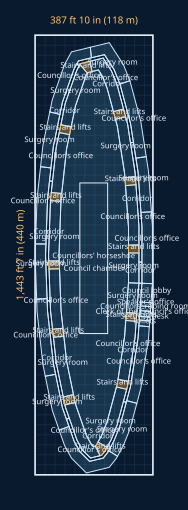
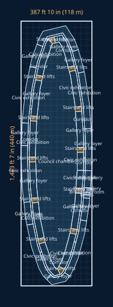
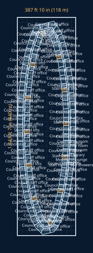

# P1-02 Aerion City Council Chamber: plan

Footprint 387 ft 10 in (118 m) × 1,443 ft 7 in (440 m) · structural grid 32 ft 10 in (10 m)

## Levels

| Level | Floor above deck | Height | Floor area |
|---|---|---|---|
| Level 1 · Chamber floor | 0 ft (0 mm) | 26 ft 3 in (8,000 mm) | 393,539 sq ft (36,561 m²) |
| Level 2 · Gallery floor | 26 ft 3 in (8,000 mm) | 16 ft 5 in (5,000 mm) | 393,588 sq ft (36,565 m²) |
| Level 3 · Committee floor | 42 ft 8 in (13 m) | 14 ft 5 in (4,400 mm) | 183,958 sq ft (17,090 m²) |

## Elements

| ID | Designation | Type | Name | Level(s) | Size / length | Area | Status |
|---|---|---|---|---|---|---|---|
| E001 | D5F1P1B2A2L1R1, D5F1P1B2A2L2R1 | room | Council chamber | L1, L2 | 228 ft 8 in (70 m) × 1,236 ft 3 in (377 m) | 209,610 sq ft (19,473 m²) | proposed |
| E002 |  | fixture | Councillors' horseshoe | L1 | 91 ft 6 in (28 m) × 494 ft 5 in (151 m) | 45,257 sq ft (4,205 m²) | proposed |
| E003 | D5F1P1B2A2L1R2 | zone | Corridor | L1 | 61 ft (19 m) × 391 ft 1 in (119 m) | 3,868 sq ft (359 m²) | proposed |
| E004 | D5F1P1B2A2L1R3 | zone | Corridor | L1 | 196 ft 10 in (60 m) × 196 ft 6 in (60 m) | 3,865 sq ft (359 m²) | proposed |
| E005 | D5F1P1B2A2L1R4 | zone | Corridor | L1 | 72 ft 10 in (22 m) × 389 ft 1 in (119 m) | 3,843 sq ft (357 m²) | proposed |
| E006 | D5F1P1B2A2L1R5 | zone | Corridor | L1 | 23 ft (7,000 mm) × 393 ft 8 in (120 m) | 3,877 sq ft (360 m²) | proposed |
| E007 | D5F1P1B2A2L1R6 | zone | Corridor | L1 | 97 ft 5 in (30 m) × 385 ft 6 in (117 m) | 3,864 sq ft (359 m²) | proposed |
| E008 | D5F1P1B2A2L1R7 | zone | Corridor | L1 | 186 ft 4 in (57 m) × 289 ft 8 in (88 m) | 3,827 sq ft (356 m²) | proposed |
| E009 | D5F1P1B2A2L1R8 | zone | Corridor | L1 | 37 ft 9 in (12 m) × 393 ft 1 in (120 m) | 3,889 sq ft (361 m²) | proposed |
| E010 | D5F1P1B2A2L1R9 | zone | Corridor | L1 | 9 ft 10 in (3,000 mm) × 69 ft 7 in (21 m) | 683 sq ft (63 m²) | proposed |
| E011 | D5F1P1B2A2L1R10, D5F1P1B2A2L2R2, D5F1P1B2A2L3R1 | core | Stairs and lifts | L1, L2, L3 | 36 ft 1 in (11 m) × 29 ft 2 in (8,900 mm) | 901 sq ft (84 m²) | proposed |
| E012 | D5F1P1B2A2L1R11, D5F1P1B2A2L2R3, D5F1P1B2A2L3R2 | core | Stairs and lifts | L1, L2, L3 | 39 ft 1 in (12 m) × 32 ft 10 in (10 m) | 908 sq ft (84 m²) | proposed |
| E013 | D5F1P1B2A2L1R12, D5F1P1B2A2L2R4, D5F1P1B2A2L3R3 | core | Stairs and lifts | L1, L2, L3 | 38 ft 1 in (12 m) × 44 ft 7 in (14 m) | 901 sq ft (84 m²) | proposed |
| E014 | D5F1P1B2A2L1R13, D5F1P1B2A2L2R5, D5F1P1B2A2L3R4 | core | Stairs and lifts | L1, L2, L3 | 38 ft 9 in (12 m) × 34 ft 5 in (10 m) | 905 sq ft (84 m²) | proposed |
| E015 | D5F1P1B2A2L1R14, D5F1P1B2A2L2R6, D5F1P1B2A2L3R5 | core | Stairs and lifts | L1, L2, L3 | 37 ft 1 in (11 m) × 29 ft 10 in (9,100 mm) | 905 sq ft (84 m²) | proposed |
| E016 | D5F1P1B2A2L1R15, D5F1P1B2A2L2R7, D5F1P1B2A2L3R6 | core | Stairs and lifts | L1, L2, L3 | 35 ft 5 in (11 m) × 26 ft 7 in (8,100 mm) | 899 sq ft (84 m²) | proposed |
| E017 | D5F1P1B2A2L1R16, D5F1P1B2A2L2R8, D5F1P1B2A2L3R7 | core | Stairs and lifts | L1, L2, L3 | 37 ft 1 in (11 m) × 28 ft 10 in (8,800 mm) | 911 sq ft (85 m²) | proposed |
| E018 | D5F1P1B2A2L1R17, D5F1P1B2A2L2R9, D5F1P1B2A2L3R8 | core | Stairs and lifts | L1, L2, L3 | 39 ft 1 in (12 m) × 32 ft 6 in (9,900 mm) | 901 sq ft (84 m²) | proposed |
| E019 | D5F1P1B2A2L1R18, D5F1P1B2A2L2R10, D5F1P1B2A2L3R9 | core | Stairs and lifts | L1, L2, L3 | 39 ft 8 in (12 m) × 38 ft 5 in (12 m) | 903 sq ft (84 m²) | proposed |
| E020 | D5F1P1B2A2L1R19, D5F1P1B2A2L2R11, D5F1P1B2A2L3R10 | core | Stairs and lifts | L1, L2, L3 | 40 ft (12 m) × 33 ft 6 in (10 m) | 896 sq ft (83 m²) | proposed |
| E021 | D5F1P1B2A2L1R20, D5F1P1B2A2L2R12, D5F1P1B2A2L3R11 | core | Stairs and lifts | L1, L2, L3 | 36 ft 5 in (11 m) × 29 ft 6 in (9,000 mm) | 905 sq ft (84 m²) | proposed |
| E022 | D5F1P1B2A2L1R21, D5F1P1B2A2L2R13, D5F1P1B2A2L3R12 | core | Stairs and lifts | L1, L2, L3 | 34 ft 5 in (10 m) × 26 ft 7 in (8,100 mm) | 904 sq ft (84 m²) | proposed |
| E023 | D5F1P1B2A2L1R22 | room | Council lobby | L1 | 39 ft 1 in (12 m) × 64 ft (20 m) | 2,155 sq ft (200 m²) | proposed |
| E024 | D5F1P1B2A2L1R23 | room | Speaker's office | L1 | 35 ft 1 in (11 m) × 14 ft 9 in (4,500 mm) | 435 sq ft (40 m²) | proposed |
| E025 | D5F1P1B2A2L1R24 | room | Councillors' robing room | L1 | 35 ft 5 in (11 m) × 17 ft 9 in (5,400 mm) | 531 sq ft (49 m²) | proposed |
| E026 | D5F1P1B2A2L1R25 | room | Clerk of the Council's office | L1 | 35 ft 9 in (11 m) × 21 ft 4 in (6,500 mm) | 648 sq ft (60 m²) | proposed |
| E027 | D5F1P1B2A2L1R26 | room | Security desk | L1 | 35 ft 5 in (11 m) × 15 ft 5 in (4,700 mm) | 432 sq ft (40 m²) | proposed |
| E028 | D5F1P1B2A2L1R27 | room | Toilets | L1 | 35 ft 9 in (11 m) × 22 ft (6,700 mm) | 654 sq ft (61 m²) | proposed |
| E029 | D5F1P1B2A2L1R28 | room | Councillor's office | L1 | 74 ft 6 in (23 m) × 254 ft 7 in (78 m) | 8,692 sq ft (808 m²) | proposed |
| E030 | D5F1P1B2A2L1R29 | room | Surgery room | L1 | 92 ft 10 in (28 m) × 182 ft 5 in (56 m) | 6,233 sq ft (579 m²) | proposed |
| E031 | D5F1P1B2A2L1R30 | room | Councillor's office | L1 | 191 ft 11 in (58 m) × 152 ft 7 in (46 m) | 8,690 sq ft (807 m²) | proposed |
| E032 | D5F1P1B2A2L1R31 | room | Surgery room | L1 | 78 ft 1 in (24 m) × 183 ft 5 in (56 m) | 6,208 sq ft (577 m²) | proposed |
| E033 | D5F1P1B2A2L1R32 | room | Councillor's office | L1 | 62 ft 4 in (19 m) × 254 ft 11 in (78 m) | 8,716 sq ft (810 m²) | proposed |
| E034 | D5F1P1B2A2L1R33 | room | Surgery room | L1 | 39 ft 4 in (12 m) × 181 ft 5 in (55 m) | 6,192 sq ft (575 m²) | proposed |
| E035 | D5F1P1B2A2L1R34 | room | Councillor's office | L1 | 50 ft 10 in (16 m) × 253 ft 11 in (77 m) | 8,699 sq ft (808 m²) | proposed |
| E036 | D5F1P1B2A2L1R35 | room | Surgery room | L1 | 63 ft 8 in (19 m) × 184 ft 1 in (56 m) | 6,217 sq ft (578 m²) | proposed |
| E037 | D5F1P1B2A2L1R36 | room | Councillor's office | L1 | 137 ft 2 in (42 m) × 220 ft 6 in (67 m) | 8,681 sq ft (807 m²) | proposed |
| E038 | D5F1P1B2A2L1R37 | room | Surgery room | L1 | 130 ft 3 in (40 m) × 135 ft 10 in (41 m) | 6,234 sq ft (579 m²) | proposed |
| E039 | D5F1P1B2A2L1R38 | room | Councillor's office | L1 | 86 ft 7 in (26 m) × 254 ft 3 in (78 m) | 8,707 sq ft (809 m²) | proposed |
| E040 | D5F1P1B2A2L1R39 | room | Surgery room | L1 | 51 ft 2 in (16 m) × 183 ft 1 in (56 m) | 6,211 sq ft (577 m²) | proposed |
| E041 | D5F1P1B2A2L1R40 | room | Councillor's office | L1 | 37 ft 9 in (12 m) × 235 ft 11 in (72 m) | 8,075 sq ft (750 m²) | proposed |
| E042 | D5F1P1B2A2L1R41 | room | Surgery room | L1 | 41 ft 4 in (13 m) × 100 ft 5 in (31 m) | 3,384 sq ft (314 m²) | proposed |
| E043 | D5F1P1B2A2L1R42 | room | Councillor's office | L1 | 59 ft 9 in (18 m) × 199 ft 10 in (61 m) | 6,792 sq ft (631 m²) | proposed |
| E044 | D5F1P1B2A2L1R43 | room | Surgery room | L1 | 94 ft 6 in (29 m) × 198 ft 6 in (60 m) | 6,798 sq ft (632 m²) | proposed |
| E045 | D5F1P1B2A2L1R44 | room | Councillor's office | L1 | 115 ft 6 in (35 m) × 183 ft 1 in (56 m) | 6,788 sq ft (631 m²) | proposed |
| E046 | D5F1P1B2A2L1R45 | room | Surgery room | L1 | 65 ft 11 in (20 m) × 200 ft 6 in (61 m) | 6,792 sq ft (631 m²) | proposed |
| E047 | D5F1P1B2A2L1R46 | room | Councillor's office | L1 | 45 ft 11 in (14 m) × 198 ft 6 in (60 m) | 6,796 sq ft (631 m²) | proposed |
| E048 | D5F1P1B2A2L1R47 | room | Surgery room | L1 | 40 ft 8 in (12 m) × 198 ft 2 in (60 m) | 6,789 sq ft (631 m²) | proposed |
| E049 | D5F1P1B2A2L1R48 | room | Councillor's office | L1 | 60 ft 4 in (18 m) × 199 ft 10 in (61 m) | 6,802 sq ft (632 m²) | proposed |
| E050 | D5F1P1B2A2L1R49 | room | Surgery room | L1 | 86 ft 7 in (26 m) × 205 ft 1 in (62 m) | 6,797 sq ft (631 m²) | proposed |
| E051 | D5F1P1B2A2L1R50 | room | Councillor's office | L1 | 110 ft 3 in (34 m) × 175 ft 10 in (54 m) | 6,784 sq ft (630 m²) | proposed |
| E052 | D5F1P1B2A2L1R51 | room | Surgery room | L1 | 65 ft 7 in (20 m) × 200 ft 2 in (61 m) | 6,813 sq ft (633 m²) | proposed |
| E053 | D5F1P1B2A2L1R52 | room | Councillor's office | L1 | 44 ft 3 in (14 m) × 198 ft 6 in (60 m) | 6,793 sq ft (631 m²) | proposed |
| E054 | D5F1P1B2A2L1R53 | room | Surgery room | L1 | 34 ft 5 in (10 m) × 99 ft 1 in (30 m) | 3,391 sq ft (315 m²) | proposed |
| E055 | D5F1P1B2A2L2R14 | zone | Corridor | L2 | 61 ft (19 m) × 391 ft 1 in (119 m) | 3,868 sq ft (359 m²) | proposed |
| E056 | D5F1P1B2A2L2R15 | zone | Corridor | L2 | 196 ft 10 in (60 m) × 196 ft 6 in (60 m) | 3,865 sq ft (359 m²) | proposed |
| E057 | D5F1P1B2A2L2R16 | zone | Corridor | L2 | 72 ft 10 in (22 m) × 389 ft 1 in (119 m) | 3,843 sq ft (357 m²) | proposed |
| E058 | D5F1P1B2A2L2R17 | zone | Corridor | L2 | 23 ft (7,000 mm) × 393 ft 8 in (120 m) | 3,877 sq ft (360 m²) | proposed |
| E059 | D5F1P1B2A2L2R18 | zone | Corridor | L2 | 97 ft 5 in (30 m) × 385 ft 6 in (117 m) | 3,864 sq ft (359 m²) | proposed |
| E060 | D5F1P1B2A2L2R19 | zone | Corridor | L2 | 186 ft 4 in (57 m) × 289 ft 8 in (88 m) | 3,827 sq ft (356 m²) | proposed |
| E061 | D5F1P1B2A2L2R20 | zone | Corridor | L2 | 37 ft 9 in (12 m) × 393 ft 1 in (120 m) | 3,889 sq ft (361 m²) | proposed |
| E062 | D5F1P1B2A2L2R21 | zone | Corridor | L2 | 9 ft 10 in (3,000 mm) × 69 ft 7 in (21 m) | 683 sq ft (63 m²) | proposed |
| E063 | D5F1P1B2A2L2R22 | room | Public gallery | L2 | 41 ft (12 m) × 95 ft 6 in (29 m) | 3,219 sq ft (299 m²) | proposed |
| E064 | D5F1P1B2A2L2R23 | room | Press gallery | L2 | 36 ft 1 in (11 m) × 27 ft 11 in (8,500 mm) | 866 sq ft (80 m²) | proposed |
| E065 | D5F1P1B2A2L2R24 | room | Broadcast room | L2 | 35 ft 5 in (11 m) × 15 ft 5 in (4,700 mm) | 427 sq ft (40 m²) | proposed |
| E066 | D5F1P1B2A2L2R25 | room | Toilets | L2 | 35 ft 9 in (11 m) × 22 ft (6,700 mm) | 649 sq ft (60 m²) | proposed |
| E067 | D5F1P1B2A2L2R26 | room | Gallery foyer | L2 | 50 ft 6 in (15 m) × 127 ft (39 m) | 4,258 sq ft (396 m²) | proposed |
| E068 | D5F1P1B2A2L2R27 | room | Civic exhibition | L2 | 120 ft 9 in (37 m) × 306 ft 1 in (93 m) | 10,657 sq ft (990 m²) | proposed |
| E069 | D5F1P1B2A2L2R28 | room | Gallery foyer | L2 | 125 ft 8 in (38 m) × 66 ft 7 in (20 m) | 4,252 sq ft (395 m²) | proposed |
| E070 | D5F1P1B2A2L2R29 | room | Civic exhibition | L2 | 129 ft 7 in (40 m) × 304 ft 2 in (93 m) | 10,630 sq ft (988 m²) | proposed |
| E071 | D5F1P1B2A2L2R30 | room | Gallery foyer | L2 | 50 ft 6 in (15 m) × 127 ft 4 in (39 m) | 4,257 sq ft (395 m²) | proposed |
| E072 | D5F1P1B2A2L2R31 | room | Civic exhibition | L2 | 49 ft 6 in (15 m) × 310 ft 4 in (95 m) | 10,637 sq ft (988 m²) | proposed |
| E073 | D5F1P1B2A2L2R32 | room | Gallery foyer | L2 | 38 ft 9 in (12 m) × 124 ft 8 in (38 m) | 4,250 sq ft (395 m²) | proposed |
| E074 | D5F1P1B2A2L2R33 | room | Civic exhibition | L2 | 77 ft 1 in (24 m) × 310 ft 8 in (95 m) | 10,651 sq ft (990 m²) | proposed |
| E075 | D5F1P1B2A2L2R34 | room | Gallery foyer | L2 | 69 ft 3 in (21 m) × 128 ft 7 in (39 m) | 4,258 sq ft (396 m²) | proposed |
| E076 | D5F1P1B2A2L2R35 | room | Civic exhibition | L2 | 227 ft (69 m) × 141 ft 1 in (43 m) | 10,653 sq ft (990 m²) | proposed |
| E077 | D5F1P1B2A2L2R36 | room | Gallery foyer | L2 | 65 ft 3 in (20 m) × 128 ft 3 in (39 m) | 4,260 sq ft (396 m²) | proposed |
| E078 | D5F1P1B2A2L2R37 | room | Civic exhibition | L2 | 70 ft 10 in (22 m) × 310 ft 8 in (95 m) | 10,620 sq ft (987 m²) | proposed |
| E079 | D5F1P1B2A2L2R38 | room | Gallery foyer | L2 | 37 ft 5 in (11 m) × 231 ft 4 in (70 m) | 7,916 sq ft (735 m²) | proposed |
| E080 | D5F1P1B2A2L2R39 | room | Civic exhibition | L2 | 41 ft 4 in (13 m) × 100 ft 5 in (31 m) | 3,384 sq ft (314 m²) | proposed |
| E081 | D5F1P1B2A2L2R40 | room | Gallery foyer | L2 | 59 ft 9 in (18 m) × 199 ft 10 in (61 m) | 6,792 sq ft (631 m²) | proposed |
| E082 | D5F1P1B2A2L2R41 | room | Civic exhibition | L2 | 94 ft 6 in (29 m) × 198 ft 6 in (60 m) | 6,798 sq ft (632 m²) | proposed |
| E083 | D5F1P1B2A2L2R42 | room | Gallery foyer | L2 | 115 ft 6 in (35 m) × 183 ft 1 in (56 m) | 6,788 sq ft (631 m²) | proposed |
| E084 | D5F1P1B2A2L2R43 | room | Civic exhibition | L2 | 65 ft 11 in (20 m) × 200 ft 6 in (61 m) | 6,792 sq ft (631 m²) | proposed |
| E085 | D5F1P1B2A2L2R44 | room | Gallery foyer | L2 | 45 ft 11 in (14 m) × 198 ft 6 in (60 m) | 6,796 sq ft (631 m²) | proposed |
| E086 | D5F1P1B2A2L2R45 | room | Civic exhibition | L2 | 40 ft 8 in (12 m) × 198 ft 2 in (60 m) | 6,789 sq ft (631 m²) | proposed |
| E087 | D5F1P1B2A2L2R46 | room | Gallery foyer | L2 | 60 ft 4 in (18 m) × 199 ft 10 in (61 m) | 6,802 sq ft (632 m²) | proposed |
| E088 | D5F1P1B2A2L2R47 | room | Civic exhibition | L2 | 86 ft 7 in (26 m) × 205 ft 1 in (62 m) | 6,797 sq ft (631 m²) | proposed |
| E089 | D5F1P1B2A2L2R48 | room | Gallery foyer | L2 | 110 ft 3 in (34 m) × 175 ft 10 in (54 m) | 6,784 sq ft (630 m²) | proposed |
| E090 | D5F1P1B2A2L2R49 | room | Civic exhibition | L2 | 65 ft 7 in (20 m) × 200 ft 2 in (61 m) | 6,813 sq ft (633 m²) | proposed |
| E091 | D5F1P1B2A2L2R50 | room | Gallery foyer | L2 | 44 ft 3 in (14 m) × 198 ft 6 in (60 m) | 6,793 sq ft (631 m²) | proposed |
| E092 | D5F1P1B2A2L2R51 | room | Civic exhibition | L2 | 34 ft 5 in (10 m) × 99 ft 1 in (30 m) | 3,391 sq ft (315 m²) | proposed |
| E093 | D5F1P1B2A2L3R13 | zone | Corridor | L3 | 61 ft (19 m) × 391 ft 1 in (119 m) | 3,868 sq ft (359 m²) | proposed |
| E094 | D5F1P1B2A2L3R14 | zone | Corridor | L3 | 196 ft 10 in (60 m) × 196 ft 6 in (60 m) | 3,865 sq ft (359 m²) | proposed |
| E095 | D5F1P1B2A2L3R15 | zone | Corridor | L3 | 72 ft 10 in (22 m) × 389 ft 1 in (119 m) | 3,843 sq ft (357 m²) | proposed |
| E096 | D5F1P1B2A2L3R16 | zone | Corridor | L3 | 23 ft (7,000 mm) × 393 ft 8 in (120 m) | 3,877 sq ft (360 m²) | proposed |
| E097 | D5F1P1B2A2L3R17 | zone | Corridor | L3 | 97 ft 5 in (30 m) × 385 ft 6 in (117 m) | 3,864 sq ft (359 m²) | proposed |
| E098 | D5F1P1B2A2L3R18 | zone | Corridor | L3 | 186 ft 4 in (57 m) × 289 ft 8 in (88 m) | 3,827 sq ft (356 m²) | proposed |
| E099 | D5F1P1B2A2L3R19 | zone | Corridor | L3 | 37 ft 9 in (12 m) × 393 ft 1 in (120 m) | 3,889 sq ft (361 m²) | proposed |
| E100 | D5F1P1B2A2L3R20 | zone | Corridor | L3 | 9 ft 10 in (3,000 mm) × 69 ft 7 in (21 m) | 683 sq ft (63 m²) | proposed |
| E101 | D5F1P1B2A2L3R21 | room | Committee room | L3 | 36 ft 5 in (11 m) × 29 ft 6 in (9,000 mm) | 969 sq ft (90 m²) | proposed |
| E102 | D5F1P1B2A2L3R22 | room | Committee room | L3 | 36 ft 5 in (11 m) × 29 ft 10 in (9,100 mm) | 970 sq ft (90 m²) | proposed |
| E103 | D5F1P1B2A2L3R23 | room | Committee room | L3 | 36 ft 5 in (11 m) × 30 ft 2 in (9,200 mm) | 966 sq ft (90 m²) | proposed |
| E104 | D5F1P1B2A2L3R24 | room | Council library | L3 | 37 ft 1 in (11 m) × 40 ft (12 m) | 1,290 sq ft (120 m²) | proposed |
| E105 | D5F1P1B2A2L3R25 | room | Members' lounge | L3 | 36 ft 1 in (11 m) × 28 ft 3 in (8,600 mm) | 864 sq ft (80 m²) | proposed |
| E106 | D5F1P1B2A2L3R26 | room | Tea point | L3 | 35 ft 5 in (11 m) × 15 ft 9 in (4,800 mm) | 422 sq ft (39 m²) | proposed |
| E107 | D5F1P1B2A2L3R27 | room | Staff toilets and showers | L3 | 35 ft 9 in (11 m) × 25 ft 7 in (7,800 mm) | 754 sq ft (70 m²) | proposed |
| E108 | D5F1P1B2A2L3R28 | room | Council staff office | L3 | 72 ft 2 in (22 m) × 217 ft 6 in (66 m) | 7,403 sq ft (688 m²) | proposed |
| E109 | D5F1P1B2A2L3R29 | room | Council staff office | L3 | 109 ft 7 in (33 m) × 215 ft 7 in (66 m) | 7,419 sq ft (689 m²) | proposed |
| E110 | D5F1P1B2A2L3R30 | room | Council staff office | L3 | 165 ft 4 in (50 m) × 152 ft 3 in (46 m) | 7,413 sq ft (689 m²) | proposed |
| E111 | D5F1P1B2A2L3R31 | room | Council staff office | L3 | 85 ft 4 in (26 m) × 216 ft 10 in (66 m) | 7,402 sq ft (688 m²) | proposed |
| E112 | D5F1P1B2A2L3R32 | room | Council staff office | L3 | 55 ft 5 in (17 m) × 217 ft 6 in (66 m) | 7,416 sq ft (689 m²) | proposed |
| E113 | D5F1P1B2A2L3R33 | room | Council staff office | L3 | 39 ft 8 in (12 m) × 216 ft 6 in (66 m) | 7,415 sq ft (689 m²) | proposed |
| E114 | D5F1P1B2A2L3R34 | room | Council staff office | L3 | 49 ft 3 in (15 m) × 216 ft 10 in (66 m) | 7,413 sq ft (689 m²) | proposed |
| E115 | D5F1P1B2A2L3R35 | room | Council staff office | L3 | 70 ft 3 in (21 m) × 218 ft 2 in (66 m) | 7,417 sq ft (689 m²) | proposed |
| E116 | D5F1P1B2A2L3R36 | room | Council staff office | L3 | 124 ft 4 in (38 m) × 190 ft (58 m) | 7,389 sq ft (686 m²) | proposed |
| E117 | D5F1P1B2A2L3R37 | room | Council staff office | L3 | 147 ft 4 in (45 m) × 160 ft 5 in (49 m) | 7,431 sq ft (690 m²) | proposed |
| E118 | D5F1P1B2A2L3R38 | room | Council staff office | L3 | 78 ft 1 in (24 m) × 217 ft 6 in (66 m) | 7,406 sq ft (688 m²) | proposed |
| E119 | D5F1P1B2A2L3R39 | room | Council staff office | L3 | 54 ft 6 in (17 m) × 217 ft 2 in (66 m) | 7,395 sq ft (687 m²) | proposed |
| E120 | D5F1P1B2A2L3R40 | room | Council staff office | L3 | 36 ft 1 in (11 m) × 212 ft 11 in (65 m) | 7,287 sq ft (677 m²) | proposed |
| E121 | D5F1P1B2A2L3R41 | room | Council staff office | L3 | 41 ft 4 in (13 m) × 100 ft 5 in (31 m) | 3,384 sq ft (314 m²) | proposed |
| E122 | D5F1P1B2A2L3R42 | room | Council staff office | L3 | 59 ft 9 in (18 m) × 199 ft 10 in (61 m) | 6,792 sq ft (631 m²) | proposed |
| E123 | D5F1P1B2A2L3R43 | room | Council staff office | L3 | 94 ft 6 in (29 m) × 198 ft 6 in (60 m) | 6,798 sq ft (632 m²) | proposed |
| E124 | D5F1P1B2A2L3R44 | room | Council staff office | L3 | 115 ft 6 in (35 m) × 183 ft 1 in (56 m) | 6,788 sq ft (631 m²) | proposed |
| E125 | D5F1P1B2A2L3R45 | room | Council staff office | L3 | 65 ft 11 in (20 m) × 200 ft 6 in (61 m) | 6,792 sq ft (631 m²) | proposed |
| E126 | D5F1P1B2A2L3R46 | room | Council staff office | L3 | 45 ft 11 in (14 m) × 198 ft 6 in (60 m) | 6,796 sq ft (631 m²) | proposed |
| E127 | D5F1P1B2A2L3R47 | room | Council staff office | L3 | 40 ft 8 in (12 m) × 198 ft 2 in (60 m) | 6,789 sq ft (631 m²) | proposed |
| E128 | D5F1P1B2A2L3R48 | room | Council staff office | L3 | 60 ft 4 in (18 m) × 199 ft 10 in (61 m) | 6,802 sq ft (632 m²) | proposed |
| E129 | D5F1P1B2A2L3R49 | room | Council staff office | L3 | 86 ft 7 in (26 m) × 205 ft 1 in (62 m) | 6,797 sq ft (631 m²) | proposed |
| E130 | D5F1P1B2A2L3R50 | room | Council staff office | L3 | 110 ft 3 in (34 m) × 175 ft 10 in (54 m) | 6,784 sq ft (630 m²) | proposed |
| E131 | D5F1P1B2A2L3R51 | room | Council staff office | L3 | 65 ft 7 in (20 m) × 200 ft 2 in (61 m) | 6,813 sq ft (633 m²) | proposed |
| E132 | D5F1P1B2A2L3R52 | room | Council staff office | L3 | 44 ft 3 in (14 m) × 198 ft 6 in (60 m) | 6,793 sq ft (631 m²) | proposed |
| E133 | D5F1P1B2A2L3R53 | room | Council staff office | L3 | 34 ft 5 in (10 m) × 99 ft 1 in (30 m) | 3,391 sq ft (315 m²) | proposed |

## Drawings

### Level 1 · Chamber floor

### Level 2 · Gallery floor

### Level 3 · Committee floor

