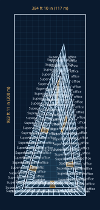
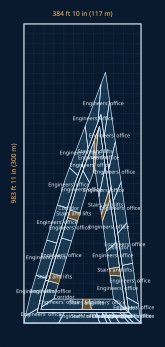

# P1-03 Deck Chief's Office: plan

Footprint 384 ft 10 in (117 m) × 983 ft 11 in (300 m) · structural grid 32 ft 10 in (10 m)

## Levels

| Level | Floor above deck | Height | Floor area |
|---|---|---|---|
| Level 1 · Operations floor | 0 ft (0 mm) | 19 ft 8 in (6,000 mm) | 146,628 sq ft (13,622 m²) |
| Level 2 · Office floor 1 | 19 ft 8 in (6,000 mm) | 14 ft 5 in (4,400 mm) | 146,719 sq ft (13,631 m²) |
| Level 3 · Office floor 2 | 34 ft 1 in (10 m) | 14 ft 5 in (4,400 mm) | 103,700 sq ft (9,634 m²) |
| Level 4 · Office floor 3 | 48 ft 7 in (15 m) | 14 ft 5 in (4,400 mm) | 103,700 sq ft (9,634 m²) |

## Elements

| ID | Designation | Type | Name | Level(s) | Size / length | Area | Status |
|---|---|---|---|---|---|---|---|
| E001 | D5F1P1B3A1L1R1, D5F1P1B3A1L2R1 | room | Deck operations room | L1, L2 | 195 ft 3 in (60 m) × 430 ft 1 in (131 m) | 43,018 sq ft (3,997 m²) | proposed |
| E002 | D5F1P1B3A1L1R2 | zone | Corridor | L1 | 301 ft 10 in (92 m) × 106 ft 8 in (32 m) | 3,881 sq ft (361 m²) | proposed |
| E003 | D5F1P1B3A1L1R3 | zone | Corridor | L1 | 125 ft 8 in (38 m) × 383 ft 2 in (117 m) | 3,900 sq ft (362 m²) | proposed |
| E004 | D5F1P1B3A1L1R4 | zone | Corridor | L1 | 95 ft 6 in (29 m) × 259 ft 10 in (79 m) | 3,862 sq ft (359 m²) | proposed |
| E005 | D5F1P1B3A1L1R5 | zone | Corridor | L1 | 64 ft 4 in (20 m) × 405 ft 2 in (124 m) | 3,861 sq ft (359 m²) | proposed |
| E006 | D5F1P1B3A1L1R6 | zone | Corridor | L1 | 12 ft 6 in (3,800 mm) × 18 ft 1 in (5,500 mm) | 83 sq ft (8 m²) | proposed |
| E007 | D5F1P1B3A1L1R7, D5F1P1B3A1L2R2, D5F1P1B3A1L3R1, D5F1P1B3A1L4R1 | core | Stairs and lifts | L1, L2, L3, L4 | 30 ft 10 in (9,400 mm) × 34 ft 5 in (10 m) | 904 sq ft (84 m²) | proposed |
| E008 | D5F1P1B3A1L1R8, D5F1P1B3A1L2R3, D5F1P1B3A1L3R2, D5F1P1B3A1L4R2 | core | Stairs and lifts | L1, L2, L3, L4 | 41 ft (12 m) × 34 ft 5 in (10 m) | 912 sq ft (85 m²) | proposed |
| E009 | D5F1P1B3A1L1R9, D5F1P1B3A1L2R4, D5F1P1B3A1L3R3, D5F1P1B3A1L4R3 | core | Stairs and lifts | L1, L2, L3, L4 | 40 ft 4 in (12 m) × 35 ft 9 in (11 m) | 908 sq ft (84 m²) | proposed |
| E010 | D5F1P1B3A1L1R10, D5F1P1B3A1L2R5, D5F1P1B3A1L3R4, D5F1P1B3A1L4R4 | core | Stairs and lifts | L1, L2, L3, L4 | 17 ft 1 in (5,200 mm) × 143 ft 8 in (44 m) | 880 sq ft (82 m²) | proposed |
| E011 | D5F1P1B3A1L1R11, D5F1P1B3A1L2R6, D5F1P1B3A1L3R5, D5F1P1B3A1L4R5 | core | Stairs and lifts | L1, L2, L3, L4 | 28 ft 3 in (8,600 mm) × 99 ft 1 in (30 m) | 910 sq ft (84 m²) | proposed |
| E012 | D5F1P1B3A1L1R12, D5F1P1B3A1L2R7, D5F1P1B3A1L3R6, D5F1P1B3A1L4R6 | core | Stairs and lifts | L1, L2, L3, L4 | 38 ft 5 in (12 m) × 30 ft 2 in (9,200 mm) | 903 sq ft (84 m²) | proposed |
| E013 | D5F1P1B3A1L1R13 | room | Front office | L1 | 61 ft 8 in (19 m) × 34 ft 5 in (10 m) | 859 sq ft (80 m²) | proposed |
| E014 | D5F1P1B3A1L1R14 | room | Crew dispatch desk | L1 | 50 ft 2 in (15 m) × 34 ft 5 in (10 m) | 644 sq ft (60 m²) | proposed |
| E015 | D5F1P1B3A1L1R15 | room | Briefing room | L1 | 48 ft 7 in (15 m) × 34 ft 5 in (10 m) | 757 sq ft (70 m²) | proposed |
| E016 | D5F1P1B3A1L1R16 | room | Radio room | L1 | 34 ft 9 in (11 m) × 34 ft 5 in (10 m) | 429 sq ft (40 m²) | proposed |
| E017 | D5F1P1B3A1L1R17 | room | Toilets | L1 | 37 ft 1 in (11 m) × 34 ft 5 in (10 m) | 644 sq ft (60 m²) | proposed |
| E018 | D5F1P1B3A1L1R18 | room | Supervisors' office | L1 | 41 ft (12 m) × 34 ft 5 in (10 m) | 972 sq ft (90 m²) | proposed |
| E019 | D5F1P1B3A1L1R19 | room | Supervisors' office | L1 | 34 ft 1 in (10 m) × 34 ft 5 in (10 m) | 966 sq ft (90 m²) | proposed |
| E020 | D5F1P1B3A1L1R20 | room | Supervisors' office | L1 | 31 ft 6 in (9,600 mm) × 34 ft 5 in (10 m) | 972 sq ft (90 m²) | proposed |
| E021 | D5F1P1B3A1L1R21 | room | Supervisors' office | L1 | 35 ft 5 in (11 m) × 34 ft 5 in (10 m) | 966 sq ft (90 m²) | proposed |
| E022 | D5F1P1B3A1L1R22 | room | Supervisors' office | L1 | 42 ft 4 in (13 m) × 34 ft 5 in (10 m) | 966 sq ft (90 m²) | proposed |
| E023 | D5F1P1B3A1L1R23 | room | Supervisors' office | L1 | 49 ft 3 in (15 m) × 34 ft 5 in (10 m) | 972 sq ft (90 m²) | proposed |
| E024 | D5F1P1B3A1L1R24 | room | Supervisors' office | L1 | 55 ft 9 in (17 m) × 34 ft 5 in (10 m) | 966 sq ft (90 m²) | proposed |
| E025 | D5F1P1B3A1L1R25 | room | Supervisors' office | L1 | 63 ft (19 m) × 34 ft 5 in (10 m) | 972 sq ft (90 m²) | proposed |
| E026 | D5F1P1B3A1L1R26 | room | Supervisors' office | L1 | 62 ft 4 in (19 m) × 39 ft 4 in (12 m) | 961 sq ft (89 m²) | proposed |
| E027 | D5F1P1B3A1L1R27 | room | Supervisors' office | L1 | 47 ft 3 in (14 m) × 52 ft 2 in (16 m) | 969 sq ft (90 m²) | proposed |
| E028 | D5F1P1B3A1L1R28 | room | Supervisors' office | L1 | 44 ft 3 in (14 m) × 39 ft 1 in (12 m) | 971 sq ft (90 m²) | proposed |
| E029 | D5F1P1B3A1L1R29 | room | Supervisors' office | L1 | 41 ft 4 in (13 m) × 33 ft 10 in (10 m) | 962 sq ft (89 m²) | proposed |
| E030 | D5F1P1B3A1L1R30 | room | Supervisors' office | L1 | 41 ft 4 in (13 m) × 35 ft 9 in (11 m) | 970 sq ft (90 m²) | proposed |
| E031 | D5F1P1B3A1L1R31 | room | Supervisors' office | L1 | 41 ft 4 in (13 m) × 36 ft 1 in (11 m) | 967 sq ft (90 m²) | proposed |
| E032 | D5F1P1B3A1L1R32 | room | Supervisors' office | L1 | 41 ft 4 in (13 m) × 36 ft 1 in (11 m) | 963 sq ft (89 m²) | proposed |
| E033 | D5F1P1B3A1L1R33 | room | Supervisors' office | L1 | 41 ft (12 m) × 36 ft 5 in (11 m) | 964 sq ft (90 m²) | proposed |
| E034 | D5F1P1B3A1L1R34 | room | Supervisors' office | L1 | 41 ft (12 m) × 36 ft 9 in (11 m) | 967 sq ft (90 m²) | proposed |
| E035 | D5F1P1B3A1L1R35 | room | Supervisors' office | L1 | 41 ft (12 m) × 36 ft 9 in (11 m) | 963 sq ft (90 m²) | proposed |
| E036 | D5F1P1B3A1L1R36 | room | Supervisors' office | L1 | 41 ft (12 m) × 36 ft 9 in (11 m) | 963 sq ft (90 m²) | proposed |
| E037 | D5F1P1B3A1L1R37 | room | Supervisors' office | L1 | 41 ft (12 m) × 36 ft 9 in (11 m) | 959 sq ft (89 m²) | proposed |
| E038 | D5F1P1B3A1L1R38 | room | Supervisors' office | L1 | 41 ft (12 m) × 37 ft 5 in (11 m) | 973 sq ft (90 m²) | proposed |
| E039 | D5F1P1B3A1L1R39 | room | Supervisors' office | L1 | 41 ft (12 m) × 37 ft 5 in (11 m) | 969 sq ft (90 m²) | proposed |
| E040 | D5F1P1B3A1L1R40 | room | Supervisors' office | L1 | 40 ft 8 in (12 m) × 37 ft 5 in (11 m) | 963 sq ft (89 m²) | proposed |
| E041 | D5F1P1B3A1L1R41 | room | Supervisors' office | L1 | 40 ft 8 in (12 m) × 37 ft 5 in (11 m) | 956 sq ft (89 m²) | proposed |
| E042 | D5F1P1B3A1L1R42 | room | Supervisors' office | L1 | 40 ft 8 in (12 m) × 38 ft 1 in (12 m) | 969 sq ft (90 m²) | proposed |
| E043 | D5F1P1B3A1L1R43 | room | Supervisors' office | L1 | 40 ft 4 in (12 m) × 41 ft (12 m) | 965 sq ft (90 m²) | proposed |
| E044 | D5F1P1B3A1L1R44 | room | Supervisors' office | L1 | 38 ft 1 in (12 m) × 49 ft 10 in (15 m) | 973 sq ft (90 m²) | proposed |
| E045 | D5F1P1B3A1L1R45 | room | Supervisors' office | L1 | 33 ft 6 in (10 m) × 61 ft 8 in (19 m) | 971 sq ft (90 m²) | proposed |
| E046 | D5F1P1B3A1L1R46 | room | Supervisors' office | L1 | 29 ft 2 in (8,900 mm) × 73 ft 2 in (22 m) | 973 sq ft (90 m²) | proposed |
| E047 | D5F1P1B3A1L1R47 | room | Supervisors' office | L1 | 24 ft 7 in (7,500 mm) × 85 ft (26 m) | 966 sq ft (90 m²) | proposed |
| E048 | D5F1P1B3A1L1R48 | room | Supervisors' office | L1 | 20 ft 4 in (6,200 mm) × 96 ft 5 in (29 m) | 967 sq ft (90 m²) | proposed |
| E049 | D5F1P1B3A1L1R49 | room | Supervisors' office | L1 | 16 ft 1 in (4,900 mm) × 107 ft 7 in (33 m) | 965 sq ft (90 m²) | proposed |
| E050 | D5F1P1B3A1L1R50 | room | Supervisors' office | L1 | 12 ft 2 in (3,700 mm) × 119 ft 5 in (36 m) | 978 sq ft (91 m²) | proposed |
| E051 | D5F1P1B3A1L1R51 | room | Supervisors' office | L1 | 12 ft 6 in (3,800 mm) × 130 ft 11 in (40 m) | 961 sq ft (89 m²) | proposed |
| E052 | D5F1P1B3A1L1R52 | room | Supervisors' office | L1 | 17 ft 1 in (5,200 mm) × 142 ft 9 in (43 m) | 978 sq ft (91 m²) | proposed |
| E053 | D5F1P1B3A1L1R53 | room | Supervisors' office | L1 | 21 ft (6,400 mm) × 154 ft 2 in (47 m) | 941 sq ft (87 m²) | proposed |
| E054 | D5F1P1B3A1L1R54 | room | Supervisors' office | L1 | 21 ft (6,400 mm) × 153 ft 3 in (47 m) | 980 sq ft (91 m²) | proposed |
| E055 | D5F1P1B3A1L1R55 | room | Supervisors' office | L1 | 20 ft 4 in (6,200 mm) × 159 ft 1 in (48 m) | 991 sq ft (92 m²) | proposed |
| E056 | D5F1P1B3A1L1R56 | room | Supervisors' office | L1 | 21 ft (6,400 mm) × 152 ft 7 in (46 m) | 951 sq ft (88 m²) | proposed |
| E057 | D5F1P1B3A1L1R57 | room | Supervisors' office | L1 | 22 ft (6,700 mm) × 146 ft (44 m) | 968 sq ft (90 m²) | proposed |
| E058 | D5F1P1B3A1L1R58 | room | Supervisors' office | L1 | 23 ft (7,000 mm) × 139 ft 5 in (42 m) | 967 sq ft (90 m²) | proposed |
| E059 | D5F1P1B3A1L1R59 | room | Supervisors' office | L1 | 23 ft 11 in (7,300 mm) × 133 ft 2 in (41 m) | 973 sq ft (90 m²) | proposed |
| E060 | D5F1P1B3A1L1R60 | room | Supervisors' office | L1 | 24 ft 11 in (7,600 mm) × 126 ft 8 in (39 m) | 986 sq ft (92 m²) | proposed |
| E061 | D5F1P1B3A1L1R61 | room | Supervisors' office | L1 | 25 ft 7 in (7,800 mm) × 120 ft 1 in (37 m) | 956 sq ft (89 m²) | proposed |
| E062 | D5F1P1B3A1L1R62 | room | Supervisors' office | L1 | 26 ft 7 in (8,100 mm) × 113 ft 2 in (34 m) | 961 sq ft (89 m²) | proposed |
| E063 | D5F1P1B3A1L1R63 | room | Supervisors' office | L1 | 27 ft 7 in (8,400 mm) × 106 ft 11 in (33 m) | 978 sq ft (91 m²) | proposed |
| E064 | D5F1P1B3A1L1R64 | room | Supervisors' office | L1 | 28 ft 3 in (8,600 mm) × 100 ft 5 in (31 m) | 955 sq ft (89 m²) | proposed |
| E065 | D5F1P1B3A1L1R65 | room | Supervisors' office | L1 | 29 ft 6 in (9,000 mm) × 93 ft 10 in (29 m) | 980 sq ft (91 m²) | proposed |
| E066 | D5F1P1B3A1L1R66 | room | Supervisors' office | L1 | 30 ft 2 in (9,200 mm) × 87 ft 3 in (27 m) | 961 sq ft (89 m²) | proposed |
| E067 | D5F1P1B3A1L1R67 | room | Supervisors' office | L1 | 31 ft 6 in (9,600 mm) × 80 ft 9 in (25 m) | 977 sq ft (91 m²) | proposed |
| E068 | D5F1P1B3A1L1R68 | room | Supervisors' office | L1 | 32 ft 2 in (9,800 mm) × 74 ft 6 in (23 m) | 970 sq ft (90 m²) | proposed |
| E069 | D5F1P1B3A1L1R69 | room | Supervisors' office | L1 | 32 ft 10 in (10 m) × 67 ft 11 in (21 m) | 961 sq ft (89 m²) | proposed |
| E070 | D5F1P1B3A1L1R70 | room | Supervisors' office | L1 | 34 ft 1 in (10 m) × 61 ft 4 in (19 m) | 974 sq ft (91 m²) | proposed |
| E071 | D5F1P1B3A1L1R71 | room | Supervisors' office | L1 | 34 ft 9 in (11 m) × 54 ft 9 in (17 m) | 966 sq ft (90 m²) | proposed |
| E072 | D5F1P1B3A1L1R72 | room | Supervisors' office | L1 | 36 ft 1 in (11 m) × 48 ft 3 in (15 m) | 971 sq ft (90 m²) | proposed |
| E073 | D5F1P1B3A1L1R73 | room | Supervisors' office | L1 | 36 ft 9 in (11 m) × 42 ft (13 m) | 970 sq ft (90 m²) | proposed |
| E074 | D5F1P1B3A1L1R74 | room | Supervisors' office | L1 | 37 ft 5 in (11 m) × 35 ft 5 in (11 m) | 966 sq ft (90 m²) | proposed |
| E075 | D5F1P1B3A1L1R75 | room | Supervisors' office | L1 | 38 ft 9 in (12 m) × 31 ft 2 in (9,500 mm) | 969 sq ft (90 m²) | proposed |
| E076 | D5F1P1B3A1L1R76 | room | Supervisors' office | L1 | 39 ft 4 in (12 m) × 33 ft 6 in (10 m) | 972 sq ft (90 m²) | proposed |
| E077 | D5F1P1B3A1L1R77 | room | Supervisors' office | L1 | 40 ft 8 in (12 m) × 39 ft 8 in (12 m) | 965 sq ft (90 m²) | proposed |
| E078 | D5F1P1B3A1L1R78 | room | Supervisors' office | L1 | 41 ft 4 in (13 m) × 46 ft 3 in (14 m) | 971 sq ft (90 m²) | proposed |
| E079 | D5F1P1B3A1L1R79 | room | Supervisors' office | L1 | 42 ft 4 in (13 m) × 52 ft 10 in (16 m) | 965 sq ft (90 m²) | proposed |
| E080 | D5F1P1B3A1L1R80 | room | Supervisors' office | L1 | 43 ft (13 m) × 57 ft 5 in (18 m) | 907 sq ft (84 m²) | proposed |
| E081 | D5F1P1B3A1L1R81 | room | Supervisors' office | L1 | 63 ft (19 m) × 34 ft 5 in (10 m) | 972 sq ft (90 m²) | proposed |
| E082 | D5F1P1B3A1L1R82 | room | Supervisors' office | L1 | 53 ft 2 in (16 m) × 34 ft 5 in (10 m) | 972 sq ft (90 m²) | proposed |
| E083 | D5F1P1B3A1L1R83 | room | Supervisors' office | L1 | 52 ft 2 in (16 m) × 34 ft 5 in (10 m) | 1,345 sq ft (125 m²) | proposed |
| E084 | D5F1P1B3A1L1R84 | room | Supervisors' office | L1 | 35 ft 9 in (11 m) × 34 ft 5 in (10 m) | 961 sq ft (89 m²) | proposed |
| E085 | D5F1P1B3A1L1R85 | room | Supervisors' office | L1 | 45 ft 11 in (14 m) × 34 ft 5 in (10 m) | 972 sq ft (90 m²) | proposed |
| E086 | D5F1P1B3A1L1R86 | room | Supervisors' office | L1 | 55 ft 9 in (17 m) × 34 ft 5 in (10 m) | 972 sq ft (90 m²) | proposed |
| E087 | D5F1P1B3A1L1R87 | room | Supervisors' office | L1 | 65 ft 7 in (20 m) × 34 ft 5 in (10 m) | 966 sq ft (90 m²) | proposed |
| E088 | D5F1P1B3A1L1R88 | room | Supervisors' office | L1 | 45 ft 7 in (14 m) × 43 ft 8 in (13 m) | 969 sq ft (90 m²) | proposed |
| E089 | D5F1P1B3A1L1R89 | room | Supervisors' office | L1 | 42 ft 4 in (13 m) × 33 ft 2 in (10 m) | 970 sq ft (90 m²) | proposed |
| E090 | D5F1P1B3A1L1R90 | room | Supervisors' office | L1 | 39 ft 4 in (12 m) × 29 ft 10 in (9,100 mm) | 747 sq ft (69 m²) | proposed |
| E091 | D5F1P1B3A1L1R91 | room | Supervisors' office | L1 | 41 ft 4 in (13 m) × 36 ft 1 in (11 m) | 966 sq ft (90 m²) | proposed |
| E092 | D5F1P1B3A1L1R92 | room | Supervisors' office | L1 | 41 ft 4 in (13 m) × 36 ft 5 in (11 m) | 970 sq ft (90 m²) | proposed |
| E093 | D5F1P1B3A1L1R93 | room | Supervisors' office | L1 | 41 ft 4 in (13 m) × 36 ft 9 in (11 m) | 976 sq ft (91 m²) | proposed |
| E094 | D5F1P1B3A1L1R94 | room | Supervisors' office | L1 | 41 ft 4 in (13 m) × 36 ft 9 in (11 m) | 972 sq ft (90 m²) | proposed |
| E095 | D5F1P1B3A1L1R95 | room | Supervisors' office | L1 | 41 ft 4 in (13 m) × 36 ft 9 in (11 m) | 968 sq ft (90 m²) | proposed |
| E096 | D5F1P1B3A1L1R96 | room | Supervisors' office | L1 | 41 ft 4 in (13 m) × 37 ft 1 in (11 m) | 975 sq ft (91 m²) | proposed |
| E097 | D5F1P1B3A1L1R97 | room | Supervisors' office | L1 | 39 ft 4 in (12 m) × 31 ft 2 in (9,500 mm) | 753 sq ft (70 m²) | proposed |
| E098 | D5F1P1B3A1L1R98 | room | Supervisors' office | L1 | 41 ft (12 m) × 37 ft 5 in (11 m) | 965 sq ft (90 m²) | proposed |
| E099 | D5F1P1B3A1L1R99 | room | Supervisors' office | L1 | 41 ft (12 m) × 37 ft 9 in (12 m) | 971 sq ft (90 m²) | proposed |
| E100 | D5F1P1B3A1L1R100 | room | Supervisors' office | L1 | 41 ft (12 m) × 38 ft 1 in (12 m) | 978 sq ft (91 m²) | proposed |
| E101 | D5F1P1B3A1L1R101 | room | Supervisors' office | L1 | 38 ft 1 in (12 m) × 48 ft 3 in (15 m) | 964 sq ft (90 m²) | proposed |
| E102 | D5F1P1B3A1L1R102 | room | Supervisors' office | L1 | 29 ft 2 in (8,900 mm) × 72 ft 2 in (22 m) | 960 sq ft (89 m²) | proposed |
| E103 | D5F1P1B3A1L1R103 | room | Supervisors' office | L1 | 19 ft 4 in (5,900 mm) × 99 ft 1 in (30 m) | 967 sq ft (90 m²) | proposed |
| E104 | D5F1P1B3A1L1R104 | room | Supervisors' office | L1 | 11 ft 10 in (3,600 mm) × 116 ft 10 in (36 m) | 773 sq ft (72 m²) | proposed |
| E105 | D5F1P1B3A1L1R105 | room | Supervisors' office | L1 | 20 ft (6,100 mm) × 155 ft 10 in (48 m) | 986 sq ft (92 m²) | proposed |
| E106 | D5F1P1B3A1L1R106 | room | Supervisors' office | L1 | 20 ft 8 in (6,300 mm) × 154 ft 6 in (47 m) | 965 sq ft (90 m²) | proposed |
| E107 | D5F1P1B3A1L1R107 | room | Supervisors' office | L1 | 22 ft (6,700 mm) × 145 ft (44 m) | 962 sq ft (89 m²) | proposed |
| E108 | D5F1P1B3A1L1R108 | room | Supervisors' office | L1 | 23 ft 4 in (7,100 mm) × 135 ft 10 in (41 m) | 965 sq ft (90 m²) | proposed |
| E109 | D5F1P1B3A1L1R109 | room | Supervisors' office | L1 | 24 ft 7 in (7,500 mm) × 126 ft 8 in (39 m) | 965 sq ft (90 m²) | proposed |
| E110 | D5F1P1B3A1L1R110 | room | Supervisors' office | L1 | 25 ft 11 in (7,900 mm) × 117 ft 2 in (36 m) | 961 sq ft (89 m²) | proposed |
| E111 | D5F1P1B3A1L1R111 | room | Supervisors' office | L1 | 26 ft 3 in (8,000 mm) × 102 ft 8 in (31 m) | 744 sq ft (69 m²) | proposed |
| E112 | D5F1P1B3A1L1R112 | room | Supervisors' office | L1 | 29 ft 6 in (9,000 mm) × 92 ft 2 in (28 m) | 967 sq ft (90 m²) | proposed |
| E113 | D5F1P1B3A1L1R113 | room | Supervisors' office | L1 | 30 ft 10 in (9,400 mm) × 82 ft 8 in (25 m) | 962 sq ft (89 m²) | proposed |
| E114 | D5F1P1B3A1L1R114 | room | Supervisors' office | L1 | 32 ft 2 in (9,800 mm) × 73 ft 6 in (22 m) | 966 sq ft (90 m²) | proposed |
| E115 | D5F1P1B3A1L1R115 | room | Supervisors' office | L1 | 33 ft 6 in (10 m) × 64 ft 4 in (20 m) | 967 sq ft (90 m²) | proposed |
| E116 | D5F1P1B3A1L1R116 | room | Supervisors' office | L1 | 34 ft 9 in (11 m) × 54 ft 9 in (17 m) | 962 sq ft (89 m²) | proposed |
| E117 | D5F1P1B3A1L1R117 | room | Supervisors' office | L1 | 36 ft 1 in (11 m) × 45 ft 7 in (14 m) | 966 sq ft (90 m²) | proposed |
| E118 | D5F1P1B3A1L1R118 | room | Supervisors' office | L1 | 36 ft 5 in (11 m) × 31 ft 2 in (9,500 mm) | 753 sq ft (70 m²) | proposed |
| E119 | D5F1P1B3A1L1R119 | room | Supervisors' office | L1 | 39 ft 8 in (12 m) × 35 ft 5 in (11 m) | 968 sq ft (90 m²) | proposed |
| E120 | D5F1P1B3A1L1R120 | room | Supervisors' office | L1 | 41 ft (12 m) × 44 ft 11 in (14 m) | 967 sq ft (90 m²) | proposed |
| E121 | D5F1P1B3A1L1R121 | room | Supervisors' office | L1 | 44 ft 3 in (14 m) × 66 ft 7 in (20 m) | 1,336 sq ft (124 m²) | proposed |
| E122 | D5F1P1B3A1L2R8 | zone | Corridor | L2 | 301 ft 10 in (92 m) × 106 ft 8 in (32 m) | 3,881 sq ft (361 m²) | proposed |
| E123 | D5F1P1B3A1L2R9 | zone | Corridor | L2 | 125 ft 8 in (38 m) × 383 ft 2 in (117 m) | 3,900 sq ft (362 m²) | proposed |
| E124 | D5F1P1B3A1L2R10 | zone | Corridor | L2 | 95 ft 6 in (29 m) × 259 ft 10 in (79 m) | 3,862 sq ft (359 m²) | proposed |
| E125 | D5F1P1B3A1L2R11 | zone | Corridor | L2 | 64 ft 4 in (20 m) × 405 ft 2 in (124 m) | 3,861 sq ft (359 m²) | proposed |
| E126 | D5F1P1B3A1L2R12 | zone | Corridor | L2 | 12 ft 6 in (3,800 mm) × 18 ft 1 in (5,500 mm) | 83 sq ft (8 m²) | proposed |
| E127 | D5F1P1B3A1L2R13 | room | Deck Chief's office | L2 | 59 ft 1 in (18 m) × 34 ft 5 in (10 m) | 757 sq ft (70 m²) | proposed |
| E128 | D5F1P1B3A1L2R14 | room | Deputy chief's office | L2 | 45 ft 3 in (14 m) × 34 ft 5 in (10 m) | 424 sq ft (39 m²) | proposed |
| E129 | D5F1P1B3A1L2R15 | room | Planning room | L2 | 56 ft 1 in (17 m) × 34 ft 5 in (10 m) | 972 sq ft (90 m²) | proposed |
| E130 | D5F1P1B3A1L2R16 | room | Drawing archive | L2 | 46 ft 3 in (14 m) × 34 ft 5 in (10 m) | 859 sq ft (80 m²) | proposed |
| E131 | D5F1P1B3A1L2R17 | room | Tea point | L2 | 29 ft 2 in (8,900 mm) × 34 ft 5 in (10 m) | 418 sq ft (39 m²) | proposed |
| E132 | D5F1P1B3A1L2R18 | room | Staff toilets and showers | L2 | 34 ft 9 in (11 m) × 34 ft 5 in (10 m) | 752 sq ft (70 m²) | proposed |
| E133 | D5F1P1B3A1L2R19 | room | Engineers' office | L2 | 126 ft (38 m) × 34 ft 5 in (10 m) | 3,877 sq ft (360 m²) | proposed |
| E134 | D5F1P1B3A1L2R20 | room | Engineers' office | L2 | 139 ft 5 in (42 m) × 36 ft 9 in (11 m) | 3,869 sq ft (359 m²) | proposed |
| E135 | D5F1P1B3A1L2R21 | room | Engineers' office | L2 | 65 ft (20 m) × 130 ft 3 in (40 m) | 3,870 sq ft (360 m²) | proposed |
| E136 | D5F1P1B3A1L2R22 | room | Engineers' office | L2 | 65 ft 11 in (20 m) × 116 ft 10 in (36 m) | 3,883 sq ft (361 m²) | proposed |
| E137 | D5F1P1B3A1L2R23 | room | Engineers' office | L2 | 65 ft 11 in (20 m) × 117 ft 5 in (36 m) | 3,889 sq ft (361 m²) | proposed |
| E138 | D5F1P1B3A1L2R24 | room | Engineers' office | L2 | 65 ft 7 in (20 m) × 118 ft 1 in (36 m) | 3,891 sq ft (361 m²) | proposed |
| E139 | D5F1P1B3A1L2R25 | room | Engineers' office | L2 | 64 ft (20 m) × 136 ft 6 in (42 m) | 3,875 sq ft (360 m²) | proposed |
| E140 | D5F1P1B3A1L2R26 | room | Engineers' office | L2 | 48 ft 7 in (15 m) × 179 ft 9 in (55 m) | 3,889 sq ft (361 m²) | proposed |
| E141 | D5F1P1B3A1L2R27 | room | Engineers' office | L2 | 44 ft 7 in (14 m) × 210 ft 8 in (64 m) | 3,884 sq ft (361 m²) | proposed |
| E142 | D5F1P1B3A1L2R28 | room | Engineers' office | L2 | 33 ft 2 in (10 m) × 233 ft 7 in (71 m) | 3,861 sq ft (359 m²) | proposed |
| E143 | D5F1P1B3A1L2R29 | room | Engineers' office | L2 | 37 ft 1 in (11 m) × 207 ft 8 in (63 m) | 3,889 sq ft (361 m²) | proposed |
| E144 | D5F1P1B3A1L2R30 | room | Engineers' office | L2 | 40 ft 4 in (12 m) × 181 ft 9 in (55 m) | 3,857 sq ft (358 m²) | proposed |
| E145 | D5F1P1B3A1L2R31 | room | Engineers' office | L2 | 44 ft 3 in (14 m) × 155 ft 2 in (47 m) | 3,867 sq ft (359 m²) | proposed |
| E146 | D5F1P1B3A1L2R32 | room | Engineers' office | L2 | 48 ft 3 in (15 m) × 129 ft 3 in (39 m) | 3,884 sq ft (361 m²) | proposed |
| E147 | D5F1P1B3A1L2R33 | room | Engineers' office | L2 | 51 ft 6 in (16 m) × 124 ft 4 in (38 m) | 3,876 sq ft (360 m²) | proposed |
| E148 | D5F1P1B3A1L2R34 | room | Engineers' office | L2 | 46 ft 11 in (14 m) × 85 ft (26 m) | 1,989 sq ft (185 m²) | proposed |
| E149 | D5F1P1B3A1L2R35 | room | Engineers' office | L2 | 118 ft 5 in (36 m) × 34 ft 5 in (10 m) | 3,289 sq ft (306 m²) | proposed |
| E150 | D5F1P1B3A1L2R36 | room | Engineers' office | L2 | 135 ft 2 in (41 m) × 34 ft 5 in (10 m) | 3,871 sq ft (360 m²) | proposed |
| E151 | D5F1P1B3A1L2R37 | room | Engineers' office | L2 | 57 ft 9 in (18 m) × 94 ft 6 in (29 m) | 2,690 sq ft (250 m²) | proposed |
| E152 | D5F1P1B3A1L2R38 | room | Engineers' office | L2 | 65 ft 11 in (20 m) × 117 ft 2 in (36 m) | 3,894 sq ft (362 m²) | proposed |
| E153 | D5F1P1B3A1L2R39 | room | Engineers' office | L2 | 55 ft 9 in (17 m) × 84 ft 8 in (26 m) | 2,688 sq ft (250 m²) | proposed |
| E154 | D5F1P1B3A1L2R40 | room | Engineers' office | L2 | 62 ft 8 in (19 m) × 128 ft 7 in (39 m) | 3,864 sq ft (359 m²) | proposed |
| E155 | D5F1P1B3A1L2R41 | room | Engineers' office | L2 | 41 ft 4 in (13 m) × 142 ft 9 in (44 m) | 2,688 sq ft (250 m²) | proposed |
| E156 | D5F1P1B3A1L2R42 | room | Engineers' office | L2 | 33 ft 10 in (10 m) × 225 ft 5 in (69 m) | 3,877 sq ft (360 m²) | proposed |
| E157 | D5F1P1B3A1L2R43 | room | Engineers' office | L2 | 32 ft 10 in (10 m) × 167 ft 8 in (51 m) | 2,677 sq ft (249 m²) | proposed |
| E158 | D5F1P1B3A1L2R44 | room | Engineers' office | L2 | 43 ft 4 in (13 m) × 161 ft 9 in (49 m) | 3,863 sq ft (359 m²) | proposed |
| E159 | D5F1P1B3A1L2R45 | room | Engineers' office | L2 | 43 ft (13 m) × 96 ft 2 in (29 m) | 2,688 sq ft (250 m²) | proposed |
| E160 | D5F1P1B3A1L2R46 | room | Engineers' office | L2 | 50 ft 10 in (16 m) × 112 ft 10 in (34 m) | 3,279 sq ft (305 m²) | proposed |
| E161 | D5F1P1B3A1L3R7, D5F1P1B3A1L4R7 | zone | Corridor | L3, L4 | 301 ft 10 in (92 m) × 106 ft 8 in (32 m) | 3,881 sq ft (361 m²) | proposed |
| E162 | D5F1P1B3A1L3R8, D5F1P1B3A1L4R8 | zone | Corridor | L3, L4 | 125 ft 8 in (38 m) × 383 ft 2 in (117 m) | 3,900 sq ft (362 m²) | proposed |
| E163 | D5F1P1B3A1L3R9, D5F1P1B3A1L4R9 | zone | Corridor | L3, L4 | 95 ft 6 in (29 m) × 259 ft 10 in (79 m) | 3,862 sq ft (359 m²) | proposed |
| E164 | D5F1P1B3A1L3R10, D5F1P1B3A1L4R10 | zone | Corridor | L3, L4 | 64 ft 4 in (20 m) × 405 ft 2 in (124 m) | 3,861 sq ft (359 m²) | proposed |
| E165 | D5F1P1B3A1L3R11, D5F1P1B3A1L4R11 | zone | Corridor | L3, L4 | 12 ft 6 in (3,800 mm) × 18 ft 1 in (5,500 mm) | 83 sq ft (8 m²) | proposed |
| E166 | D5F1P1B3A1L3R12, D5F1P1B3A1L4R12 | room | Deck Chief's office | L3, L4 | 59 ft 1 in (18 m) × 34 ft 5 in (10 m) | 757 sq ft (70 m²) | proposed |
| E167 | D5F1P1B3A1L3R13, D5F1P1B3A1L4R13 | room | Deputy chief's office | L3, L4 | 45 ft 3 in (14 m) × 34 ft 5 in (10 m) | 424 sq ft (39 m²) | proposed |
| E168 | D5F1P1B3A1L3R14, D5F1P1B3A1L4R14 | room | Planning room | L3, L4 | 56 ft 1 in (17 m) × 34 ft 5 in (10 m) | 972 sq ft (90 m²) | proposed |
| E169 | D5F1P1B3A1L3R15, D5F1P1B3A1L4R15 | room | Drawing archive | L3, L4 | 46 ft 3 in (14 m) × 34 ft 5 in (10 m) | 859 sq ft (80 m²) | proposed |
| E170 | D5F1P1B3A1L3R16, D5F1P1B3A1L4R16 | room | Tea point | L3, L4 | 29 ft 2 in (8,900 mm) × 34 ft 5 in (10 m) | 418 sq ft (39 m²) | proposed |
| E171 | D5F1P1B3A1L3R17, D5F1P1B3A1L4R17 | room | Staff toilets and showers | L3, L4 | 34 ft 9 in (11 m) × 34 ft 5 in (10 m) | 752 sq ft (70 m²) | proposed |
| E172 | D5F1P1B3A1L3R18, D5F1P1B3A1L4R18 | room | Engineers' office | L3, L4 | 126 ft (38 m) × 34 ft 5 in (10 m) | 3,877 sq ft (360 m²) | proposed |
| E173 | D5F1P1B3A1L3R19, D5F1P1B3A1L4R19 | room | Engineers' office | L3, L4 | 139 ft 5 in (42 m) × 36 ft 9 in (11 m) | 3,869 sq ft (359 m²) | proposed |
| E174 | D5F1P1B3A1L3R20, D5F1P1B3A1L4R20 | room | Engineers' office | L3, L4 | 65 ft (20 m) × 130 ft 3 in (40 m) | 3,870 sq ft (360 m²) | proposed |
| E175 | D5F1P1B3A1L3R21, D5F1P1B3A1L4R21 | room | Engineers' office | L3, L4 | 65 ft 11 in (20 m) × 116 ft 10 in (36 m) | 3,883 sq ft (361 m²) | proposed |
| E176 | D5F1P1B3A1L3R22, D5F1P1B3A1L4R22 | room | Engineers' office | L3, L4 | 65 ft 11 in (20 m) × 117 ft 5 in (36 m) | 3,889 sq ft (361 m²) | proposed |
| E177 | D5F1P1B3A1L3R23, D5F1P1B3A1L4R23 | room | Engineers' office | L3, L4 | 65 ft 7 in (20 m) × 118 ft 1 in (36 m) | 3,891 sq ft (361 m²) | proposed |
| E178 | D5F1P1B3A1L3R24, D5F1P1B3A1L4R24 | room | Engineers' office | L3, L4 | 64 ft (20 m) × 136 ft 6 in (42 m) | 3,875 sq ft (360 m²) | proposed |
| E179 | D5F1P1B3A1L3R25, D5F1P1B3A1L4R25 | room | Engineers' office | L3, L4 | 48 ft 7 in (15 m) × 179 ft 9 in (55 m) | 3,889 sq ft (361 m²) | proposed |
| E180 | D5F1P1B3A1L3R26, D5F1P1B3A1L4R26 | room | Engineers' office | L3, L4 | 44 ft 7 in (14 m) × 210 ft 8 in (64 m) | 3,884 sq ft (361 m²) | proposed |
| E181 | D5F1P1B3A1L3R27, D5F1P1B3A1L4R27 | room | Engineers' office | L3, L4 | 33 ft 2 in (10 m) × 233 ft 7 in (71 m) | 3,861 sq ft (359 m²) | proposed |
| E182 | D5F1P1B3A1L3R28, D5F1P1B3A1L4R28 | room | Engineers' office | L3, L4 | 37 ft 1 in (11 m) × 207 ft 8 in (63 m) | 3,889 sq ft (361 m²) | proposed |
| E183 | D5F1P1B3A1L3R29, D5F1P1B3A1L4R29 | room | Engineers' office | L3, L4 | 40 ft 4 in (12 m) × 181 ft 9 in (55 m) | 3,857 sq ft (358 m²) | proposed |
| E184 | D5F1P1B3A1L3R30, D5F1P1B3A1L4R30 | room | Engineers' office | L3, L4 | 44 ft 3 in (14 m) × 155 ft 2 in (47 m) | 3,867 sq ft (359 m²) | proposed |
| E185 | D5F1P1B3A1L3R31, D5F1P1B3A1L4R31 | room | Engineers' office | L3, L4 | 48 ft 3 in (15 m) × 129 ft 3 in (39 m) | 3,884 sq ft (361 m²) | proposed |
| E186 | D5F1P1B3A1L3R32, D5F1P1B3A1L4R32 | room | Engineers' office | L3, L4 | 51 ft 6 in (16 m) × 124 ft 4 in (38 m) | 3,876 sq ft (360 m²) | proposed |
| E187 | D5F1P1B3A1L3R33, D5F1P1B3A1L4R33 | room | Engineers' office | L3, L4 | 46 ft 11 in (14 m) × 85 ft (26 m) | 1,989 sq ft (185 m²) | proposed |
| E188 | D5F1P1B3A1L3R34, D5F1P1B3A1L4R34 | room | Engineers' office | L3, L4 | 118 ft 5 in (36 m) × 34 ft 5 in (10 m) | 3,289 sq ft (306 m²) | proposed |
| E189 | D5F1P1B3A1L3R35, D5F1P1B3A1L4R35 | room | Engineers' office | L3, L4 | 135 ft 2 in (41 m) × 34 ft 5 in (10 m) | 3,871 sq ft (360 m²) | proposed |
| E190 | D5F1P1B3A1L3R36, D5F1P1B3A1L4R36 | room | Engineers' office | L3, L4 | 57 ft 9 in (18 m) × 94 ft 6 in (29 m) | 2,690 sq ft (250 m²) | proposed |
| E191 | D5F1P1B3A1L3R37, D5F1P1B3A1L4R37 | room | Engineers' office | L3, L4 | 65 ft 11 in (20 m) × 117 ft 2 in (36 m) | 3,894 sq ft (362 m²) | proposed |
| E192 | D5F1P1B3A1L3R38, D5F1P1B3A1L4R38 | room | Engineers' office | L3, L4 | 55 ft 9 in (17 m) × 84 ft 8 in (26 m) | 2,688 sq ft (250 m²) | proposed |
| E193 | D5F1P1B3A1L3R39, D5F1P1B3A1L4R39 | room | Engineers' office | L3, L4 | 62 ft 8 in (19 m) × 128 ft 7 in (39 m) | 3,864 sq ft (359 m²) | proposed |
| E194 | D5F1P1B3A1L3R40, D5F1P1B3A1L4R40 | room | Engineers' office | L3, L4 | 41 ft 4 in (13 m) × 142 ft 9 in (44 m) | 2,688 sq ft (250 m²) | proposed |
| E195 | D5F1P1B3A1L3R41, D5F1P1B3A1L4R41 | room | Engineers' office | L3, L4 | 33 ft 10 in (10 m) × 225 ft 5 in (69 m) | 3,877 sq ft (360 m²) | proposed |
| E196 | D5F1P1B3A1L3R42, D5F1P1B3A1L4R42 | room | Engineers' office | L3, L4 | 32 ft 10 in (10 m) × 167 ft 8 in (51 m) | 2,677 sq ft (249 m²) | proposed |
| E197 | D5F1P1B3A1L3R43, D5F1P1B3A1L4R43 | room | Engineers' office | L3, L4 | 43 ft 4 in (13 m) × 161 ft 9 in (49 m) | 3,863 sq ft (359 m²) | proposed |
| E198 | D5F1P1B3A1L3R44, D5F1P1B3A1L4R44 | room | Engineers' office | L3, L4 | 43 ft (13 m) × 96 ft 2 in (29 m) | 2,688 sq ft (250 m²) | proposed |
| E199 | D5F1P1B3A1L3R45, D5F1P1B3A1L4R45 | room | Engineers' office | L3, L4 | 50 ft 10 in (16 m) × 112 ft 10 in (34 m) | 3,279 sq ft (305 m²) | proposed |

## Drawings

### Level 1 · Operations floor

### Level 2 · Office floor 1

### Level 3 · Office floor 2

### Level 4 · Office floor 3

