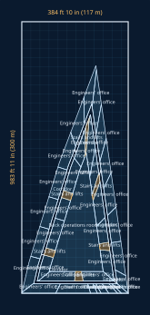

# P1-03 Deck Chief's Office: plan

Footprint 384 ft 10 in (117 m) × 983 ft 11 in (300 m) · structural grid 32 ft 10 in (10 m)

## Levels

| Level | Floor above deck | Height | Floor area |
|---|---|---|---|
| Level 1 · Operations floor | 0 ft (0 mm) | 19 ft 8 in (6,000 mm) | 146,697 sq ft (13,629 m²) |
| Level 2 · Office floor 1 | 19 ft 8 in (6,000 mm) | 14 ft 5 in (4,400 mm) | 146,688 sq ft (13,628 m²) |
| Level 3 · Office floor 2 | 34 ft 1 in (10 m) | 14 ft 5 in (4,400 mm) | 103,670 sq ft (9,631 m²) |
| Level 4 · Office floor 3 | 48 ft 7 in (15 m) | 14 ft 5 in (4,400 mm) | 103,670 sq ft (9,631 m²) |

## Elements

| ID | Designation | Type | Name | Level(s) | Size / length | Area | Status |
|---|---|---|---|---|---|---|---|
| E001 | D5F1P1B3A1L1R1, D5F1P1B3A1L2R1 | room | Deck operations room | L1, L2 | 195 ft 3 in (60 m) × 430 ft 1 in (131 m) | 43,018 sq ft (3,997 m²) | proposed |
| E002 | D5F1P1B3A1L1R2 | zone | Corridor | L1 | 301 ft 10 in (92 m) × 106 ft 8 in (32 m) | 3,881 sq ft (361 m²) | proposed |
| E003 | D5F1P1B3A1L1R3 | zone | Corridor | L1 | 125 ft 8 in (38 m) × 383 ft 2 in (117 m) | 3,900 sq ft (362 m²) | proposed |
| E004 | D5F1P1B3A1L1R4 | zone | Corridor | L1 | 95 ft 6 in (29 m) × 259 ft 10 in (79 m) | 3,862 sq ft (359 m²) | proposed |
| E005 | D5F1P1B3A1L1R5 | zone | Corridor | L1 | 64 ft 4 in (20 m) × 405 ft 2 in (124 m) | 3,861 sq ft (359 m²) | proposed |
| E006 | D5F1P1B3A1L1R6 | zone | Corridor | L1 | 12 ft 6 in (3,800 mm) × 18 ft 1 in (5,500 mm) | 83 sq ft (8 m²) | proposed |
| E007 | D5F1P1B3A1L1R7, D5F1P1B3A1L2R2, D5F1P1B3A1L3R1, D5F1P1B3A1L4R1 | core | Stairs and lifts | L1, L2, L3, L4 | 30 ft 10 in (9,400 mm) × 34 ft 5 in (10 m) | 904 sq ft (84 m²) | proposed |
| E008 | D5F1P1B3A1L1R8, D5F1P1B3A1L2R3, D5F1P1B3A1L3R2, D5F1P1B3A1L4R2 | core | Stairs and lifts | L1, L2, L3, L4 | 41 ft (12 m) × 34 ft 5 in (10 m) | 912 sq ft (85 m²) | proposed |
| E009 | D5F1P1B3A1L1R9, D5F1P1B3A1L2R4, D5F1P1B3A1L3R3, D5F1P1B3A1L4R3 | core | Stairs and lifts | L1, L2, L3, L4 | 40 ft 4 in (12 m) × 35 ft 9 in (11 m) | 908 sq ft (84 m²) | proposed |
| E010 | D5F1P1B3A1L1R10, D5F1P1B3A1L2R5, D5F1P1B3A1L3R4, D5F1P1B3A1L4R4 | core | Stairs and lifts | L1, L2, L3, L4 | 17 ft 1 in (5,200 mm) × 143 ft 8 in (44 m) | 880 sq ft (82 m²) | proposed |
| E011 | D5F1P1B3A1L1R11, D5F1P1B3A1L2R6, D5F1P1B3A1L3R5, D5F1P1B3A1L4R5 | core | Stairs and lifts | L1, L2, L3, L4 | 28 ft 3 in (8,600 mm) × 99 ft 1 in (30 m) | 910 sq ft (84 m²) | proposed |
| E012 | D5F1P1B3A1L1R12, D5F1P1B3A1L2R7, D5F1P1B3A1L3R6, D5F1P1B3A1L4R6 | core | Stairs and lifts | L1, L2, L3, L4 | 38 ft 5 in (12 m) × 30 ft 2 in (9,200 mm) | 903 sq ft (84 m²) | proposed |
| E013 | D5F1P1B3A1L1R13 | room | Front office | L1 | 61 ft 8 in (19 m) × 34 ft 5 in (10 m) | 859 sq ft (80 m²) | proposed |
| E014 | D5F1P1B3A1L1R14 | room | Crew dispatch desk | L1 | 50 ft 2 in (15 m) × 34 ft 5 in (10 m) | 644 sq ft (60 m²) | proposed |
| E015 | D5F1P1B3A1L1R15 | room | Briefing room | L1 | 48 ft 7 in (15 m) × 34 ft 5 in (10 m) | 757 sq ft (70 m²) | proposed |
| E016 | D5F1P1B3A1L1R16 | room | Radio room | L1 | 34 ft 9 in (11 m) × 34 ft 5 in (10 m) | 429 sq ft (40 m²) | proposed |
| E017 | D5F1P1B3A1L1R17 | room | Toilets | L1 | 37 ft 1 in (11 m) × 34 ft 5 in (10 m) | 644 sq ft (60 m²) | proposed |
| E018 | D5F1P1B3A1L1R18 | room | Supervisors' office | L1 | 136 ft 2 in (42 m) × 34 ft 5 in (10 m) | 4,187 sq ft (389 m²) | proposed |
| E019 | D5F1P1B3A1L1R19 | room | Supervisors' office | L1 | 148 ft 11 in (45 m) × 34 ft 5 in (10 m) | 4,176 sq ft (388 m²) | proposed |
| E020 | D5F1P1B3A1L1R20 | room | Supervisors' office | L1 | 66 ft 7 in (20 m) × 135 ft 10 in (41 m) | 4,175 sq ft (388 m²) | proposed |
| E021 | D5F1P1B3A1L1R21 | room | Supervisors' office | L1 | 68 ft 7 in (21 m) × 125 ft 4 in (38 m) | 4,192 sq ft (389 m²) | proposed |
| E022 | D5F1P1B3A1L1R22 | room | Supervisors' office | L1 | 68 ft 3 in (21 m) × 126 ft 4 in (38 m) | 4,188 sq ft (389 m²) | proposed |
| E023 | D5F1P1B3A1L1R23 | room | Supervisors' office | L1 | 67 ft 11 in (21 m) × 129 ft 3 in (39 m) | 4,173 sq ft (388 m²) | proposed |
| E024 | D5F1P1B3A1L1R24 | room | Supervisors' office | L1 | 64 ft (20 m) × 155 ft 2 in (47 m) | 4,194 sq ft (390 m²) | proposed |
| E025 | D5F1P1B3A1L1R25 | room | Supervisors' office | L1 | 52 ft 2 in (16 m) × 205 ft 1 in (63 m) | 4,198 sq ft (390 m²) | proposed |
| E026 | D5F1P1B3A1L1R26 | room | Supervisors' office | L1 | 40 ft 4 in (12 m) × 198 ft 6 in (61 m) | 4,187 sq ft (389 m²) | proposed |
| E027 | D5F1P1B3A1L1R27 | room | Supervisors' office | L1 | 36 ft 5 in (11 m) × 228 ft 8 in (70 m) | 4,179 sq ft (388 m²) | proposed |
| E028 | D5F1P1B3A1L1R28 | room | Supervisors' office | L1 | 40 ft 8 in (12 m) × 200 ft 6 in (61 m) | 4,209 sq ft (391 m²) | proposed |
| E029 | D5F1P1B3A1L1R29 | room | Supervisors' office | L1 | 44 ft 3 in (14 m) × 172 ft 3 in (52 m) | 4,173 sq ft (388 m²) | proposed |
| E030 | D5F1P1B3A1L1R30 | room | Supervisors' office | L1 | 48 ft 3 in (15 m) × 144 ft (44 m) | 4,151 sq ft (386 m²) | proposed |
| E031 | D5F1P1B3A1L1R31 | room | Supervisors' office | L1 | 52 ft 2 in (16 m) × 134 ft 2 in (41 m) | 4,172 sq ft (388 m²) | proposed |
| E032 | D5F1P1B3A1L1R32 | room | Supervisors' office | L1 | 48 ft 7 in (15 m) × 96 ft 2 in (29 m) | 2,431 sq ft (226 m²) | proposed |
| E033 | D5F1P1B3A1L1R33 | room | Supervisors' office | L1 | 118 ft 5 in (36 m) × 34 ft 5 in (10 m) | 3,289 sq ft (306 m²) | proposed |
| E034 | D5F1P1B3A1L1R34 | room | Supervisors' office | L1 | 138 ft 1 in (42 m) × 36 ft 9 in (11 m) | 4,174 sq ft (388 m²) | proposed |
| E035 | D5F1P1B3A1L1R35 | room | Supervisors' office | L1 | 55 ft 5 in (17 m) × 84 ft 8 in (26 m) | 2,386 sq ft (222 m²) | proposed |
| E036 | D5F1P1B3A1L1R36 | room | Supervisors' office | L1 | 68 ft 7 in (21 m) × 125 ft 8 in (38 m) | 4,203 sq ft (391 m²) | proposed |
| E037 | D5F1P1B3A1L1R37 | room | Supervisors' office | L1 | 53 ft 2 in (16 m) × 76 ft 5 in (23 m) | 2,388 sq ft (222 m²) | proposed |
| E038 | D5F1P1B3A1L1R38 | room | Supervisors' office | L1 | 64 ft 4 in (20 m) × 141 ft 1 in (43 m) | 4,169 sq ft (387 m²) | proposed |
| E039 | D5F1P1B3A1L1R39 | room | Supervisors' office | L1 | 36 ft 9 in (11 m) × 138 ft 9 in (42 m) | 2,393 sq ft (222 m²) | proposed |
| E040 | D5F1P1B3A1L1R40 | room | Supervisors' office | L1 | 35 ft 1 in (11 m) × 232 ft 7 in (71 m) | 4,164 sq ft (387 m²) | proposed |
| E041 | D5F1P1B3A1L1R41 | room | Supervisors' office | L1 | 31 ft 10 in (9,700 mm) × 157 ft 6 in (48 m) | 2,379 sq ft (221 m²) | proposed |
| E042 | D5F1P1B3A1L1R42 | room | Supervisors' office | L1 | 44 ft 7 in (14 m) × 169 ft (52 m) | 4,157 sq ft (386 m²) | proposed |
| E043 | D5F1P1B3A1L1R43 | room | Supervisors' office | L1 | 42 ft (13 m) × 85 ft 8 in (26 m) | 2,377 sq ft (221 m²) | proposed |
| E044 | D5F1P1B3A1L1R44 | room | Supervisors' office | L1 | 50 ft 10 in (16 m) × 112 ft 10 in (34 m) | 3,279 sq ft (305 m²) | proposed |
| E045 | D5F1P1B3A1L2R8 | zone | Corridor | L2 | 301 ft 10 in (92 m) × 106 ft 8 in (32 m) | 3,881 sq ft (361 m²) | proposed |
| E046 | D5F1P1B3A1L2R9 | zone | Corridor | L2 | 125 ft 8 in (38 m) × 383 ft 2 in (117 m) | 3,900 sq ft (362 m²) | proposed |
| E047 | D5F1P1B3A1L2R10 | zone | Corridor | L2 | 95 ft 6 in (29 m) × 259 ft 10 in (79 m) | 3,862 sq ft (359 m²) | proposed |
| E048 | D5F1P1B3A1L2R11 | zone | Corridor | L2 | 64 ft 4 in (20 m) × 405 ft 2 in (124 m) | 3,861 sq ft (359 m²) | proposed |
| E049 | D5F1P1B3A1L2R12 | zone | Corridor | L2 | 12 ft 6 in (3,800 mm) × 18 ft 1 in (5,500 mm) | 83 sq ft (8 m²) | proposed |
| E050 | D5F1P1B3A1L2R13 | room | Deck Chief's office | L2 | 59 ft 1 in (18 m) × 34 ft 5 in (10 m) | 757 sq ft (70 m²) | proposed |
| E051 | D5F1P1B3A1L2R14 | room | Deputy chief's office | L2 | 45 ft 3 in (14 m) × 34 ft 5 in (10 m) | 424 sq ft (39 m²) | proposed |
| E052 | D5F1P1B3A1L2R15 | room | Planning room | L2 | 56 ft 1 in (17 m) × 34 ft 5 in (10 m) | 972 sq ft (90 m²) | proposed |
| E053 | D5F1P1B3A1L2R16 | room | Drawing archive | L2 | 46 ft 3 in (14 m) × 34 ft 5 in (10 m) | 859 sq ft (80 m²) | proposed |
| E054 | D5F1P1B3A1L2R17 | room | Tea point | L2 | 29 ft 2 in (8,900 mm) × 34 ft 5 in (10 m) | 418 sq ft (39 m²) | proposed |
| E055 | D5F1P1B3A1L2R18 | room | Staff toilets and showers | L2 | 34 ft 9 in (11 m) × 34 ft 5 in (10 m) | 752 sq ft (70 m²) | proposed |
| E056 | D5F1P1B3A1L2R19 | room | Engineers' office | L2 | 135 ft 2 in (41 m) × 34 ft 5 in (10 m) | 4,154 sq ft (386 m²) | proposed |
| E057 | D5F1P1B3A1L2R20 | room | Engineers' office | L2 | 132 ft 7 in (40 m) × 48 ft 7 in (15 m) | 4,156 sq ft (386 m²) | proposed |
| E058 | D5F1P1B3A1L2R21 | room | Engineers' office | L2 | 67 ft 7 in (21 m) × 133 ft 10 in (41 m) | 4,147 sq ft (385 m²) | proposed |
| E059 | D5F1P1B3A1L2R22 | room | Engineers' office | L2 | 68 ft 3 in (21 m) × 125 ft (38 m) | 4,161 sq ft (387 m²) | proposed |
| E060 | D5F1P1B3A1L2R23 | room | Engineers' office | L2 | 67 ft 11 in (21 m) × 125 ft 4 in (38 m) | 4,152 sq ft (386 m²) | proposed |
| E061 | D5F1P1B3A1L2R24 | room | Engineers' office | L2 | 67 ft 3 in (20 m) × 132 ft 7 in (40 m) | 4,152 sq ft (386 m²) | proposed |
| E062 | D5F1P1B3A1L2R25 | room | Engineers' office | L2 | 60 ft 8 in (18 m) × 162 ft 5 in (50 m) | 4,164 sq ft (387 m²) | proposed |
| E063 | D5F1P1B3A1L2R26 | room | Engineers' office | L2 | 51 ft 10 in (16 m) × 212 ft 3 in (65 m) | 4,161 sq ft (387 m²) | proposed |
| E064 | D5F1P1B3A1L2R27 | room | Engineers' office | L2 | 38 ft 1 in (12 m) × 213 ft 7 in (65 m) | 4,141 sq ft (385 m²) | proposed |
| E065 | D5F1P1B3A1L2R28 | room | Engineers' office | L2 | 37 ft 1 in (11 m) × 224 ft 1 in (68 m) | 4,176 sq ft (388 m²) | proposed |
| E066 | D5F1P1B3A1L2R29 | room | Engineers' office | L2 | 40 ft 8 in (12 m) × 195 ft 10 in (60 m) | 4,138 sq ft (384 m²) | proposed |
| E067 | D5F1P1B3A1L2R30 | room | Engineers' office | L2 | 44 ft 11 in (14 m) × 168 ft (51 m) | 4,159 sq ft (386 m²) | proposed |
| E068 | D5F1P1B3A1L2R31 | room | Engineers' office | L2 | 48 ft 7 in (15 m) × 140 ft 1 in (43 m) | 4,146 sq ft (385 m²) | proposed |
| E069 | D5F1P1B3A1L2R32 | room | Engineers' office | L2 | 52 ft 10 in (16 m) × 133 ft 6 in (41 m) | 4,148 sq ft (385 m²) | proposed |
| E070 | D5F1P1B3A1L2R33 | room | Engineers' office | L2 | 46 ft 7 in (14 m) × 84 ft 4 in (26 m) | 1,965 sq ft (183 m²) | proposed |
| E071 | D5F1P1B3A1L2R34 | room | Engineers' office | L2 | 118 ft 5 in (36 m) × 34 ft 5 in (10 m) | 3,289 sq ft (306 m²) | proposed |
| E072 | D5F1P1B3A1L2R35 | room | Engineers' office | L2 | 138 ft 1 in (42 m) × 36 ft 5 in (11 m) | 4,149 sq ft (385 m²) | proposed |
| E073 | D5F1P1B3A1L2R36 | room | Engineers' office | L2 | 55 ft 9 in (17 m) × 85 ft 11 in (26 m) | 2,411 sq ft (224 m²) | proposed |
| E074 | D5F1P1B3A1L2R37 | room | Engineers' office | L2 | 68 ft 3 in (21 m) × 125 ft (38 m) | 4,161 sq ft (387 m²) | proposed |
| E075 | D5F1P1B3A1L2R38 | room | Engineers' office | L2 | 53 ft 2 in (16 m) × 77 ft 1 in (24 m) | 2,401 sq ft (223 m²) | proposed |
| E076 | D5F1P1B3A1L2R39 | room | Engineers' office | L2 | 64 ft 4 in (20 m) × 140 ft 1 in (43 m) | 4,149 sq ft (385 m²) | proposed |
| E077 | D5F1P1B3A1L2R40 | room | Engineers' office | L2 | 37 ft 1 in (11 m) × 139 ft 1 in (42 m) | 2,414 sq ft (224 m²) | proposed |
| E078 | D5F1P1B3A1L2R41 | room | Engineers' office | L2 | 35 ft 1 in (11 m) × 231 ft 11 in (71 m) | 4,151 sq ft (386 m²) | proposed |
| E079 | D5F1P1B3A1L2R42 | room | Engineers' office | L2 | 32 ft 2 in (9,800 mm) × 158 ft 6 in (48 m) | 2,425 sq ft (225 m²) | proposed |
| E080 | D5F1P1B3A1L2R43 | room | Engineers' office | L2 | 44 ft 7 in (14 m) × 168 ft 4 in (51 m) | 4,137 sq ft (384 m²) | proposed |
| E081 | D5F1P1B3A1L2R44 | room | Engineers' office | L2 | 42 ft (13 m) × 86 ft 7 in (26 m) | 2,405 sq ft (223 m²) | proposed |
| E082 | D5F1P1B3A1L2R45 | room | Engineers' office | L2 | 50 ft 10 in (16 m) × 112 ft 10 in (34 m) | 3,279 sq ft (305 m²) | proposed |
| E083 | D5F1P1B3A1L3R7, D5F1P1B3A1L4R7 | zone | Corridor | L3, L4 | 301 ft 10 in (92 m) × 106 ft 8 in (32 m) | 3,881 sq ft (361 m²) | proposed |
| E084 | D5F1P1B3A1L3R8, D5F1P1B3A1L4R8 | zone | Corridor | L3, L4 | 125 ft 8 in (38 m) × 383 ft 2 in (117 m) | 3,900 sq ft (362 m²) | proposed |
| E085 | D5F1P1B3A1L3R9, D5F1P1B3A1L4R9 | zone | Corridor | L3, L4 | 95 ft 6 in (29 m) × 259 ft 10 in (79 m) | 3,862 sq ft (359 m²) | proposed |
| E086 | D5F1P1B3A1L3R10, D5F1P1B3A1L4R10 | zone | Corridor | L3, L4 | 64 ft 4 in (20 m) × 405 ft 2 in (124 m) | 3,861 sq ft (359 m²) | proposed |
| E087 | D5F1P1B3A1L3R11, D5F1P1B3A1L4R11 | zone | Corridor | L3, L4 | 12 ft 6 in (3,800 mm) × 18 ft 1 in (5,500 mm) | 83 sq ft (8 m²) | proposed |
| E088 | D5F1P1B3A1L3R12, D5F1P1B3A1L4R12 | room | Deck Chief's office | L3, L4 | 59 ft 1 in (18 m) × 34 ft 5 in (10 m) | 757 sq ft (70 m²) | proposed |
| E089 | D5F1P1B3A1L3R13, D5F1P1B3A1L4R13 | room | Deputy chief's office | L3, L4 | 45 ft 3 in (14 m) × 34 ft 5 in (10 m) | 424 sq ft (39 m²) | proposed |
| E090 | D5F1P1B3A1L3R14, D5F1P1B3A1L4R14 | room | Planning room | L3, L4 | 56 ft 1 in (17 m) × 34 ft 5 in (10 m) | 972 sq ft (90 m²) | proposed |
| E091 | D5F1P1B3A1L3R15, D5F1P1B3A1L4R15 | room | Drawing archive | L3, L4 | 46 ft 3 in (14 m) × 34 ft 5 in (10 m) | 859 sq ft (80 m²) | proposed |
| E092 | D5F1P1B3A1L3R16, D5F1P1B3A1L4R16 | room | Tea point | L3, L4 | 29 ft 2 in (8,900 mm) × 34 ft 5 in (10 m) | 418 sq ft (39 m²) | proposed |
| E093 | D5F1P1B3A1L3R17, D5F1P1B3A1L4R17 | room | Staff toilets and showers | L3, L4 | 34 ft 9 in (11 m) × 34 ft 5 in (10 m) | 752 sq ft (70 m²) | proposed |
| E094 | D5F1P1B3A1L3R18, D5F1P1B3A1L4R18 | room | Engineers' office | L3, L4 | 135 ft 2 in (41 m) × 34 ft 5 in (10 m) | 4,154 sq ft (386 m²) | proposed |
| E095 | D5F1P1B3A1L3R19, D5F1P1B3A1L4R19 | room | Engineers' office | L3, L4 | 132 ft 7 in (40 m) × 48 ft 7 in (15 m) | 4,156 sq ft (386 m²) | proposed |
| E096 | D5F1P1B3A1L3R20, D5F1P1B3A1L4R20 | room | Engineers' office | L3, L4 | 67 ft 7 in (21 m) × 133 ft 10 in (41 m) | 4,147 sq ft (385 m²) | proposed |
| E097 | D5F1P1B3A1L3R21, D5F1P1B3A1L4R21 | room | Engineers' office | L3, L4 | 68 ft 3 in (21 m) × 125 ft (38 m) | 4,161 sq ft (387 m²) | proposed |
| E098 | D5F1P1B3A1L3R22, D5F1P1B3A1L4R22 | room | Engineers' office | L3, L4 | 67 ft 11 in (21 m) × 125 ft 4 in (38 m) | 4,152 sq ft (386 m²) | proposed |
| E099 | D5F1P1B3A1L3R23, D5F1P1B3A1L4R23 | room | Engineers' office | L3, L4 | 67 ft 3 in (20 m) × 132 ft 7 in (40 m) | 4,152 sq ft (386 m²) | proposed |
| E100 | D5F1P1B3A1L3R24, D5F1P1B3A1L4R24 | room | Engineers' office | L3, L4 | 60 ft 8 in (18 m) × 162 ft 5 in (50 m) | 4,164 sq ft (387 m²) | proposed |
| E101 | D5F1P1B3A1L3R25, D5F1P1B3A1L4R25 | room | Engineers' office | L3, L4 | 51 ft 10 in (16 m) × 212 ft 3 in (65 m) | 4,161 sq ft (387 m²) | proposed |
| E102 | D5F1P1B3A1L3R26, D5F1P1B3A1L4R26 | room | Engineers' office | L3, L4 | 38 ft 1 in (12 m) × 213 ft 7 in (65 m) | 4,141 sq ft (385 m²) | proposed |
| E103 | D5F1P1B3A1L3R27, D5F1P1B3A1L4R27 | room | Engineers' office | L3, L4 | 37 ft 1 in (11 m) × 224 ft 1 in (68 m) | 4,176 sq ft (388 m²) | proposed |
| E104 | D5F1P1B3A1L3R28, D5F1P1B3A1L4R28 | room | Engineers' office | L3, L4 | 40 ft 8 in (12 m) × 195 ft 10 in (60 m) | 4,138 sq ft (384 m²) | proposed |
| E105 | D5F1P1B3A1L3R29, D5F1P1B3A1L4R29 | room | Engineers' office | L3, L4 | 44 ft 11 in (14 m) × 168 ft (51 m) | 4,159 sq ft (386 m²) | proposed |
| E106 | D5F1P1B3A1L3R30, D5F1P1B3A1L4R30 | room | Engineers' office | L3, L4 | 48 ft 7 in (15 m) × 140 ft 1 in (43 m) | 4,146 sq ft (385 m²) | proposed |
| E107 | D5F1P1B3A1L3R31, D5F1P1B3A1L4R31 | room | Engineers' office | L3, L4 | 52 ft 10 in (16 m) × 133 ft 6 in (41 m) | 4,148 sq ft (385 m²) | proposed |
| E108 | D5F1P1B3A1L3R32, D5F1P1B3A1L4R32 | room | Engineers' office | L3, L4 | 46 ft 7 in (14 m) × 84 ft 4 in (26 m) | 1,965 sq ft (183 m²) | proposed |
| E109 | D5F1P1B3A1L3R33, D5F1P1B3A1L4R33 | room | Engineers' office | L3, L4 | 118 ft 5 in (36 m) × 34 ft 5 in (10 m) | 3,289 sq ft (306 m²) | proposed |
| E110 | D5F1P1B3A1L3R34, D5F1P1B3A1L4R34 | room | Engineers' office | L3, L4 | 138 ft 1 in (42 m) × 36 ft 5 in (11 m) | 4,149 sq ft (385 m²) | proposed |
| E111 | D5F1P1B3A1L3R35, D5F1P1B3A1L4R35 | room | Engineers' office | L3, L4 | 55 ft 9 in (17 m) × 85 ft 11 in (26 m) | 2,411 sq ft (224 m²) | proposed |
| E112 | D5F1P1B3A1L3R36, D5F1P1B3A1L4R36 | room | Engineers' office | L3, L4 | 68 ft 3 in (21 m) × 125 ft (38 m) | 4,161 sq ft (387 m²) | proposed |
| E113 | D5F1P1B3A1L3R37, D5F1P1B3A1L4R37 | room | Engineers' office | L3, L4 | 53 ft 2 in (16 m) × 77 ft 1 in (24 m) | 2,401 sq ft (223 m²) | proposed |
| E114 | D5F1P1B3A1L3R38, D5F1P1B3A1L4R38 | room | Engineers' office | L3, L4 | 64 ft 4 in (20 m) × 140 ft 1 in (43 m) | 4,149 sq ft (385 m²) | proposed |
| E115 | D5F1P1B3A1L3R39, D5F1P1B3A1L4R39 | room | Engineers' office | L3, L4 | 37 ft 1 in (11 m) × 139 ft 1 in (42 m) | 2,414 sq ft (224 m²) | proposed |
| E116 | D5F1P1B3A1L3R40, D5F1P1B3A1L4R40 | room | Engineers' office | L3, L4 | 35 ft 1 in (11 m) × 231 ft 11 in (71 m) | 4,151 sq ft (386 m²) | proposed |
| E117 | D5F1P1B3A1L3R41, D5F1P1B3A1L4R41 | room | Engineers' office | L3, L4 | 32 ft 2 in (9,800 mm) × 158 ft 6 in (48 m) | 2,425 sq ft (225 m²) | proposed |
| E118 | D5F1P1B3A1L3R42, D5F1P1B3A1L4R42 | room | Engineers' office | L3, L4 | 44 ft 7 in (14 m) × 168 ft 4 in (51 m) | 4,137 sq ft (384 m²) | proposed |
| E119 | D5F1P1B3A1L3R43, D5F1P1B3A1L4R43 | room | Engineers' office | L3, L4 | 42 ft (13 m) × 86 ft 7 in (26 m) | 2,405 sq ft (223 m²) | proposed |
| E120 | D5F1P1B3A1L3R44, D5F1P1B3A1L4R44 | room | Engineers' office | L3, L4 | 50 ft 10 in (16 m) × 112 ft 10 in (34 m) | 3,279 sq ft (305 m²) | proposed |

## Drawings

### Level 1 · Operations floor

### Level 2 · Office floor 1

### Level 3 · Office floor 2

### Level 4 · Office floor 3

