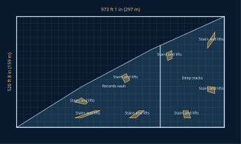
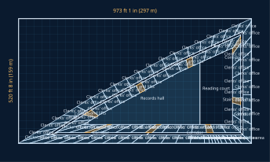
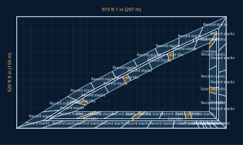

# P1-04 Hall of Records: plan

Footprint 973 ft 1 in (297 m) × 520 ft 8 in (159 m) · structural grid 32 ft 10 in (10 m)

## Levels

| Level | Floor above deck | Height | Floor area |
|---|---|---|---|
| Level B1 · Vault | −14 ft 9 in (4,500 mm) | 14 ft 9 in (4,500 mm) | 271,636 sq ft (25,236 m²) |
| Level 1 · Public floor | 0 ft (0 mm) | 19 ft 8 in (6,000 mm) | 204,288 sq ft (18,979 m²) |
| Level 2 · Archive floor 1 | 19 ft 8 in (6,000 mm) | 14 ft 5 in (4,400 mm) | 138,859 sq ft (12,900 m²) |
| Level 3 · Archive floor 2 | 34 ft 1 in (10 m) | 14 ft 5 in (4,400 mm) | 138,859 sq ft (12,900 m²) |

## Elements

| ID | Designation | Type | Name | Level(s) | Size / length | Area | Status |
|---|---|---|---|---|---|---|---|
| E001 | D5F1P1B4A1L1R1 | room | Records hall | L1 | 485 ft 3 in (148 m) × 258 ft 2 in (79 m) | 65,466 sq ft (6,082 m²) | proposed |
| E002 | D5F1P1B4A1L1R2 | zone | Reading court | L1 | 135 ft 10 in (41 m) × 319 ft 11 in (97 m) | 39,260 sq ft (3,647 m²) | proposed |
| E003 | D5F1P1B4A1L1R3 | zone | Corridor | L1 | 404 ft 6 in (123 m) × 9 ft 10 in (3,000 mm) | 3,875 sq ft (360 m²) | proposed |
| E004 | D5F1P1B4A1L1R4 | zone | Corridor | L1 | 416 ft 4 in (127 m) × 9 ft 10 in (3,000 mm) | 3,875 sq ft (360 m²) | proposed |
| E005 | D5F1P1B4A1L1R5 | zone | Corridor | L1 | 350 ft 5 in (107 m) × 203 ft 5 in (62 m) | 3,859 sq ft (359 m²) | proposed |
| E006 | D5F1P1B4A1L1R6 | zone | Corridor | L1 | 356 ft 11 in (109 m) × 185 ft 4 in (56 m) | 3,903 sq ft (363 m²) | proposed |
| E007 | D5F1P1B4A1L1R7 | zone | Corridor | L1 | 120 ft 5 in (37 m) × 276 ft 11 in (84 m) | 3,877 sq ft (360 m²) | proposed |
| E008 | D5F1P1B4A1L1R8 | zone | Corridor | L1 | 9 ft 10 in (3,000 mm) × 156 ft 6 in (48 m) | 1,489 sq ft (138 m²) | proposed |
| E009 | D5F1P1B4A1LB1R1, D5F1P1B4A1L1R9, D5F1P1B4A1L2R1, D5F1P1B4A1L3R1 | core | Stairs and lifts | LB1, L1, L2, L3 | 35 ft 1 in (11 m) × 34 ft 5 in (10 m) | 904 sq ft (84 m²) | proposed |
| E010 | D5F1P1B4A1LB1R2, D5F1P1B4A1L1R10, D5F1P1B4A1L2R2, D5F1P1B4A1L3R2 | core | Stairs and lifts | LB1, L1, L2, L3 | 68 ft 3 in (21 m) × 34 ft 5 in (10 m) | 904 sq ft (84 m²) | proposed |
| E011 | D5F1P1B4A1LB1R3, D5F1P1B4A1L1R11, D5F1P1B4A1L2R3, D5F1P1B4A1L3R3 | core | Stairs and lifts | LB1, L1, L2, L3 | 119 ft 5 in (36 m) × 34 ft 5 in (10 m) | 904 sq ft (84 m²) | proposed |
| E012 | D5F1P1B4A1LB1R4, D5F1P1B4A1L1R12, D5F1P1B4A1L2R4, D5F1P1B4A1L3R4 | core | Stairs and lifts | LB1, L1, L2, L3 | 60 ft 4 in (18 m) × 30 ft 6 in (9,300 mm) | 900 sq ft (84 m²) | proposed |
| E013 | D5F1P1B4A1LB1R5, D5F1P1B4A1L1R13, D5F1P1B4A1L2R5, D5F1P1B4A1L3R5 | core | Stairs and lifts | LB1, L1, L2, L3 | 39 ft 4 in (12 m) × 43 ft (13 m) | 908 sq ft (84 m²) | proposed |
| E014 | D5F1P1B4A1LB1R6, D5F1P1B4A1L1R14, D5F1P1B4A1L2R6, D5F1P1B4A1L3R6 | core | Stairs and lifts | LB1, L1, L2, L3 | 28 ft 3 in (8,600 mm) × 46 ft 11 in (14 m) | 907 sq ft (84 m²) | proposed |
| E015 | D5F1P1B4A1LB1R7, D5F1P1B4A1L1R15, D5F1P1B4A1L2R7, D5F1P1B4A1L3R7 | core | Stairs and lifts | LB1, L1, L2, L3 | 34 ft 5 in (10 m) × 75 ft 9 in (23 m) | 910 sq ft (85 m²) | proposed |
| E016 | D5F1P1B4A1LB1R8, D5F1P1B4A1L1R16, D5F1P1B4A1L2R8, D5F1P1B4A1L3R8 | core | Stairs and lifts | LB1, L1, L2, L3 | 34 ft 5 in (10 m) × 32 ft 10 in (10 m) | 904 sq ft (84 m²) | proposed |
| E017 | D5F1P1B4A1L1R17 | room | Ticket and queue area | L1 | 68 ft 7 in (21 m) × 34 ft 5 in (10 m) | 1,288 sq ft (120 m²) | proposed |
| E018 | D5F1P1B4A1L1R18 | room | Permits desk | L1 | 45 ft 3 in (14 m) × 34 ft 5 in (10 m) | 650 sq ft (60 m²) | proposed |
| E019 | D5F1P1B4A1L1R19 | room | Citizenship desk | L1 | 42 ft (13 m) × 34 ft 5 in (10 m) | 644 sq ft (60 m²) | proposed |
| E020 | D5F1P1B4A1L1R20 | room | Housing desk | L1 | 38 ft 9 in (12 m) × 34 ft 5 in (10 m) | 644 sq ft (60 m²) | proposed |
| E021 | D5F1P1B4A1L1R21 | room | Births, marriages and deaths office | L1 | 35 ft 5 in (11 m) × 34 ft 5 in (10 m) | 644 sq ft (60 m²) | proposed |
| E022 | D5F1P1B4A1L1R22 | room | Private interview room | L1 | 26 ft 3 in (8,000 mm) × 34 ft 5 in (10 m) | 418 sq ft (39 m²) | proposed |
| E023 | D5F1P1B4A1L1R23 | room | Private interview room | L1 | 24 ft 3 in (7,400 mm) × 34 ft 5 in (10 m) | 418 sq ft (39 m²) | proposed |
| E024 | D5F1P1B4A1L1R24 | room | Private interview room | L1 | 22 ft (6,700 mm) × 34 ft 5 in (10 m) | 413 sq ft (38 m²) | proposed |
| E025 | D5F1P1B4A1L1R25 | room | Private interview room | L1 | 20 ft (6,100 mm) × 34 ft 5 in (10 m) | 418 sq ft (39 m²) | proposed |
| E026 | D5F1P1B4A1L1R26 | room | Toilets | L1 | 23 ft 11 in (7,300 mm) × 34 ft 5 in (10 m) | 644 sq ft (60 m²) | proposed |
| E027 | D5F1P1B4A1L1R27 | room | Clerks' office | L1 | 175 ft 6 in (54 m) × 34 ft 5 in (10 m) | 5,566 sq ft (517 m²) | proposed |
| E028 | D5F1P1B4A1L1R28 | room | Clerks' office | L1 | 199 ft 10 in (61 m) × 34 ft 5 in (10 m) | 5,572 sq ft (518 m²) | proposed |
| E029 | D5F1P1B4A1L1R29 | room | Clerks' office | L1 | 227 ft 4 in (69 m) × 34 ft 5 in (10 m) | 5,566 sq ft (517 m²) | proposed |
| E030 | D5F1P1B4A1L1R30 | room | Clerks' office | L1 | 255 ft 3 in (78 m) × 34 ft 5 in (10 m) | 5,566 sq ft (517 m²) | proposed |
| E031 | D5F1P1B4A1L1R31 | room | Clerks' office | L1 | 183 ft 9 in (56 m) × 73 ft 2 in (22 m) | 5,565 sq ft (517 m²) | proposed |
| E032 | D5F1P1B4A1L1R32 | room | Clerks' office | L1 | 196 ft 6 in (60 m) × 103 ft 8 in (32 m) | 5,569 sq ft (517 m²) | proposed |
| E033 | D5F1P1B4A1L1R33 | room | Clerks' office | L1 | 165 ft 4 in (50 m) × 104 ft (32 m) | 5,574 sq ft (518 m²) | proposed |
| E034 | D5F1P1B4A1L1R34 | room | Clerks' office | L1 | 158 ft 10 in (48 m) × 106 ft 8 in (32 m) | 5,565 sq ft (517 m²) | proposed |
| E035 | D5F1P1B4A1L1R35 | room | Clerks' office | L1 | 155 ft 2 in (47 m) × 105 ft (32 m) | 5,547 sq ft (515 m²) | proposed |
| E036 | D5F1P1B4A1L1R36 | room | Clerks' office | L1 | 158 ft 10 in (48 m) × 107 ft 3 in (33 m) | 5,557 sq ft (516 m²) | proposed |
| E037 | D5F1P1B4A1L1R37 | room | Clerks' office | L1 | 132 ft 7 in (40 m) × 97 ft 9 in (30 m) | 5,586 sq ft (519 m²) | proposed |
| E038 | D5F1P1B4A1L1R38 | room | Clerks' office | L1 | 34 ft 5 in (10 m) × 191 ft 7 in (58 m) | 5,566 sq ft (517 m²) | proposed |
| E039 | D5F1P1B4A1L1R39 | room | Clerks' office | L1 | 34 ft 5 in (10 m) × 176 ft 6 in (54 m) | 5,572 sq ft (518 m²) | proposed |
| E040 | D5F1P1B4A1L1R40 | room | Clerks' office | L1 | 34 ft 5 in (10 m) × 132 ft 10 in (40 m) | 3,735 sq ft (347 m²) | proposed |
| E041 | D5F1P1B4A1L1R41 | room | Clerks' office | L1 | 125 ft 8 in (38 m) × 34 ft 5 in (10 m) | 3,532 sq ft (328 m²) | proposed |
| E042 | D5F1P1B4A1L1R42 | room | Clerks' office | L1 | 227 ft 4 in (69 m) × 34 ft 5 in (10 m) | 7,058 sq ft (656 m²) | proposed |
| E043 | D5F1P1B4A1L1R43 | room | Clerks' office | L1 | 272 ft 8 in (83 m) × 34 ft 5 in (10 m) | 7,064 sq ft (656 m²) | proposed |
| E044 | D5F1P1B4A1L1R44 | room | Clerks' office | L1 | 214 ft 11 in (66 m) × 74 ft 10 in (23 m) | 7,075 sq ft (657 m²) | proposed |
| E045 | D5F1P1B4A1L1R45 | room | Clerks' office | L1 | 202 ft 9 in (62 m) × 124 ft (38 m) | 7,085 sq ft (658 m²) | proposed |
| E046 | D5F1P1B4A1L1R46 | room | Clerks' office | L1 | 193 ft 7 in (59 m) × 126 ft 4 in (39 m) | 7,051 sq ft (655 m²) | proposed |
| E047 | D5F1P1B4A1L1R47 | room | Clerks' office | L1 | 201 ft 5 in (61 m) × 128 ft 3 in (39 m) | 7,078 sq ft (658 m²) | proposed |
| E048 | D5F1P1B4A1L1R48 | room | Clerks' office | L1 | 34 ft 5 in (10 m) × 229 ft 8 in (70 m) | 7,058 sq ft (656 m²) | proposed |
| E049 | D5F1P1B4A1L1R49 | room | Clerks' office | L1 | 34 ft 5 in (10 m) × 124 ft 8 in (38 m) | 3,532 sq ft (328 m²) | proposed |
| E050 | D5F1P1B4A1L2R9, D5F1P1B4A1L3R9 | zone | Corridor | L2, L3 | 404 ft 6 in (123 m) × 9 ft 10 in (3,000 mm) | 3,875 sq ft (360 m²) | proposed |
| E051 | D5F1P1B4A1L2R10, D5F1P1B4A1L3R10 | zone | Corridor | L2, L3 | 416 ft 4 in (127 m) × 9 ft 10 in (3,000 mm) | 3,875 sq ft (360 m²) | proposed |
| E052 | D5F1P1B4A1L2R11, D5F1P1B4A1L3R11 | zone | Corridor | L2, L3 | 350 ft 5 in (107 m) × 203 ft 5 in (62 m) | 3,859 sq ft (359 m²) | proposed |
| E053 | D5F1P1B4A1L2R12, D5F1P1B4A1L3R12 | zone | Corridor | L2, L3 | 356 ft 11 in (109 m) × 185 ft 4 in (56 m) | 3,903 sq ft (363 m²) | proposed |
| E054 | D5F1P1B4A1L2R13, D5F1P1B4A1L3R13 | zone | Corridor | L2, L3 | 120 ft 5 in (37 m) × 276 ft 11 in (84 m) | 3,877 sq ft (360 m²) | proposed |
| E055 | D5F1P1B4A1L2R14, D5F1P1B4A1L3R14 | zone | Corridor | L2, L3 | 9 ft 10 in (3,000 mm) × 156 ft 6 in (48 m) | 1,489 sq ft (138 m²) | proposed |
| E056 | D5F1P1B4A1L2R15, D5F1P1B4A1L3R15 | room | Search room | L2, L3 | 68 ft 7 in (21 m) × 34 ft 5 in (10 m) | 1,288 sq ft (120 m²) | proposed |
| E057 | D5F1P1B4A1L2R16, D5F1P1B4A1L3R16 | room | Scanning room | L2, L3 | 50 ft 10 in (16 m) × 34 ft 5 in (10 m) | 865 sq ft (80 m²) | proposed |
| E058 | D5F1P1B4A1L2R17, D5F1P1B4A1L3R17 | room | Archivists' office | L2, L3 | 40 ft 8 in (12 m) × 34 ft 5 in (10 m) | 644 sq ft (60 m²) | proposed |
| E059 | D5F1P1B4A1L2R18, D5F1P1B4A1L3R18 | room | Tea point | L2, L3 | 31 ft 6 in (9,600 mm) × 34 ft 5 in (10 m) | 418 sq ft (39 m²) | proposed |
| E060 | D5F1P1B4A1L2R19, D5F1P1B4A1L3R19 | room | Staff toilets and showers | L2, L3 | 38 ft 5 in (12 m) × 34 ft 5 in (10 m) | 752 sq ft (70 m²) | proposed |
| E061 | D5F1P1B4A1L2R20, D5F1P1B4A1L3R20 | room | Record stacks | L2, L3 | 177 ft 6 in (54 m) × 34 ft 5 in (10 m) | 5,628 sq ft (523 m²) | proposed |
| E062 | D5F1P1B4A1L2R21, D5F1P1B4A1L3R21 | room | Record stacks | L2, L3 | 190 ft 7 in (58 m) × 34 ft 5 in (10 m) | 5,623 sq ft (522 m²) | proposed |
| E063 | D5F1P1B4A1L2R22, D5F1P1B4A1L3R22 | room | Record stacks | L2, L3 | 218 ft 10 in (67 m) × 34 ft 5 in (10 m) | 5,628 sq ft (523 m²) | proposed |
| E064 | D5F1P1B4A1L2R23, D5F1P1B4A1L3R23 | room | Record stacks | L2, L3 | 247 ft 1 in (75 m) × 34 ft 5 in (10 m) | 5,628 sq ft (523 m²) | proposed |
| E065 | D5F1P1B4A1L2R24, D5F1P1B4A1L3R24 | room | Record stacks | L2, L3 | 236 ft 3 in (72 m) × 49 ft 6 in (15 m) | 5,628 sq ft (523 m²) | proposed |
| E066 | D5F1P1B4A1L2R25, D5F1P1B4A1L3R25 | room | Record stacks | L2, L3 | 217 ft 2 in (66 m) × 104 ft 8 in (32 m) | 5,635 sq ft (524 m²) | proposed |
| E067 | D5F1P1B4A1L2R26, D5F1P1B4A1L3R26 | room | Record stacks | L2, L3 | 174 ft 3 in (53 m) × 102 ft 4 in (31 m) | 5,629 sq ft (523 m²) | proposed |
| E068 | D5F1P1B4A1L2R27, D5F1P1B4A1L3R27 | room | Record stacks | L2, L3 | 160 ft 5 in (49 m) × 107 ft 3 in (33 m) | 5,633 sq ft (523 m²) | proposed |
| E069 | D5F1P1B4A1L2R28, D5F1P1B4A1L3R28 | room | Record stacks | L2, L3 | 159 ft 1 in (48 m) × 107 ft 3 in (33 m) | 5,623 sq ft (522 m²) | proposed |
| E070 | D5F1P1B4A1L2R29, D5F1P1B4A1L3R29 | room | Record stacks | L2, L3 | 160 ft 5 in (49 m) × 104 ft 8 in (32 m) | 5,625 sq ft (523 m²) | proposed |
| E071 | D5F1P1B4A1L2R30, D5F1P1B4A1L3R30 | room | Record stacks | L2, L3 | 171 ft 7 in (52 m) × 115 ft 6 in (35 m) | 5,633 sq ft (523 m²) | proposed |
| E072 | D5F1P1B4A1L2R31, D5F1P1B4A1L3R31 | room | Record stacks | L2, L3 | 35 ft 1 in (11 m) × 201 ft 1 in (61 m) | 5,624 sq ft (522 m²) | proposed |
| E073 | D5F1P1B4A1L2R32, D5F1P1B4A1L3R32 | room | Record stacks | L2, L3 | 34 ft 5 in (10 m) × 178 ft 6 in (54 m) | 5,628 sq ft (523 m²) | proposed |
| E074 | D5F1P1B4A1L2R33, D5F1P1B4A1L3R33 | room | Record stacks | L2, L3 | 34 ft 5 in (10 m) × 171 ft 3 in (52 m) | 5,193 sq ft (482 m²) | proposed |
| E075 | D5F1P1B4A1L2R34, D5F1P1B4A1L3R34 | room | Record stacks | L2, L3 | 125 ft 8 in (38 m) × 34 ft 5 in (10 m) | 3,532 sq ft (328 m²) | proposed |
| E076 | D5F1P1B4A1L2R35, D5F1P1B4A1L3R35 | room | Record stacks | L2, L3 | 227 ft 4 in (69 m) × 34 ft 5 in (10 m) | 7,058 sq ft (656 m²) | proposed |
| E077 | D5F1P1B4A1L2R36, D5F1P1B4A1L3R36 | room | Record stacks | L2, L3 | 272 ft 8 in (83 m) × 34 ft 5 in (10 m) | 7,064 sq ft (656 m²) | proposed |
| E078 | D5F1P1B4A1L2R37, D5F1P1B4A1L3R37 | room | Record stacks | L2, L3 | 214 ft 11 in (66 m) × 74 ft 10 in (23 m) | 7,075 sq ft (657 m²) | proposed |
| E079 | D5F1P1B4A1L2R38, D5F1P1B4A1L3R38 | room | Record stacks | L2, L3 | 202 ft 9 in (62 m) × 124 ft (38 m) | 7,085 sq ft (658 m²) | proposed |
| E080 | D5F1P1B4A1L2R39, D5F1P1B4A1L3R39 | room | Record stacks | L2, L3 | 193 ft 7 in (59 m) × 126 ft 4 in (39 m) | 7,051 sq ft (655 m²) | proposed |
| E081 | D5F1P1B4A1L2R40, D5F1P1B4A1L3R40 | room | Record stacks | L2, L3 | 201 ft 5 in (61 m) × 128 ft 3 in (39 m) | 7,078 sq ft (658 m²) | proposed |
| E082 | D5F1P1B4A1L2R41, D5F1P1B4A1L3R41 | room | Record stacks | L2, L3 | 34 ft 5 in (10 m) × 229 ft 8 in (70 m) | 7,058 sq ft (656 m²) | proposed |
| E083 | D5F1P1B4A1L2R42, D5F1P1B4A1L3R42 | room | Record stacks | L2, L3 | 34 ft 5 in (10 m) × 124 ft 8 in (38 m) | 3,532 sq ft (328 m²) | proposed |
| E084 | D5F1P1B4A1LB1R9 | room | Records vault | LB1 | 673 ft 3 in (205 m) × 384 ft 10 in (117 m) | 135,869 sq ft (12,623 m²) | proposed |
| E085 | D5F1P1B4A1LB1R10 | room | Deep stacks | LB1 | 299 ft 10 in (91 m) × 520 ft 8 in (159 m) | 135,767 sq ft (12,613 m²) | proposed |

## Drawings

### Level B1 · Vault

### Level 1 · Public floor

### Level 2 · Archive floor 1

### Level 3 · Archive floor 2

