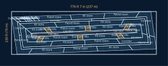
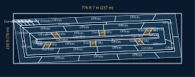

# P1-05 Governor's Guard Post: plan

Footprint 776 ft 7 in (237 m) × 230 ft (70 m) · structural grid 32 ft 10 in (10 m)

## Levels

| Level | Floor above deck | Height | Floor area |
|---|---|---|---|
| Level 1 · Ground floor | 0 ft (0 mm) | 14 ft 9 in (4,500 mm) | 118,570 sq ft (11,016 m²) |
| Level 2 · Upper floor | 14 ft 9 in (4,500 mm) | 13 ft 1 in (4,000 mm) | 118,523 sq ft (11,011 m²) |

## Elements

| ID | Designation | Type | Name | Level(s) | Size / length | Area | Status |
|---|---|---|---|---|---|---|---|
| E001 | D5F1P1B5A1L1R1 | zone | Corridor | L1 | 399 ft 3 in (122 m) × 24 ft 11 in (7,600 mm) | 3,892 sq ft (362 m²) | proposed |
| E002 | D5F1P1B5A1L1R2 | zone | Corridor | L1 | 310 ft (94 m) × 110 ft 3 in (34 m) | 3,884 sq ft (361 m²) | proposed |
| E003 | D5F1P1B5A1L1R3 | zone | Corridor | L1 | 365 ft 6 in (111 m) × 55 ft 1 in (17 m) | 3,908 sq ft (363 m²) | proposed |
| E004 | D5F1P1B5A1L1R4 | zone | Corridor | L1 | 339 ft 3 in (103 m) × 74 ft 6 in (23 m) | 3,891 sq ft (361 m²) | proposed |
| E005 | D5F1P1B5A1L1R5 | zone | Corridor | L1 | 20 ft 8 in (6,300 mm) × 72 ft 6 in (22 m) | 687 sq ft (64 m²) | proposed |
| E006 | D5F1P1B5A1L1R6, D5F1P1B5A1L2R1 | core | Stairs and lifts | L1, L2 | 47 ft 3 in (14 m) × 27 ft 3 in (8,300 mm) | 705 sq ft (65 m²) | proposed |
| E007 | D5F1P1B5A1L1R7, D5F1P1B5A1L2R2 | core | Stairs and lifts | L1, L2 | 27 ft 11 in (8,500 mm) × 27 ft 11 in (8,500 mm) | 703 sq ft (65 m²) | proposed |
| E008 | D5F1P1B5A1L1R8, D5F1P1B5A1L2R3 | core | Stairs and lifts | L1, L2 | 44 ft (13 m) × 28 ft 10 in (8,800 mm) | 703 sq ft (65 m²) | proposed |
| E009 | D5F1P1B5A1L1R9, D5F1P1B5A1L2R4 | core | Stairs and lifts | L1, L2 | 47 ft 3 in (14 m) × 27 ft 3 in (8,300 mm) | 705 sq ft (65 m²) | proposed |
| E010 | D5F1P1B5A1L1R10, D5F1P1B5A1L2R5 | core | Stairs and lifts | L1, L2 | 27 ft 11 in (8,500 mm) × 27 ft 11 in (8,500 mm) | 703 sq ft (65 m²) | proposed |
| E011 | D5F1P1B5A1L1R11, D5F1P1B5A1L2R6 | core | Stairs and lifts | L1, L2 | 44 ft (13 m) × 28 ft 10 in (8,800 mm) | 703 sq ft (65 m²) | proposed |
| E012 | D5F1P1B5A1L1R12 | zone | Corridor | L1 | 397 ft (121 m) × 20 ft 4 in (6,200 mm) | 1,971 sq ft (183 m²) | proposed |
| E013 | D5F1P1B5A1L1R13 | zone | Corridor | L1 | 215 ft 7 in (66 m) × 28 ft 7 in (8,700 mm) | 1,973 sq ft (183 m²) | proposed |
| E014 | D5F1P1B5A1L1R14 | zone | Corridor | L1 | 354 ft 4 in (108 m) × 20 ft (6,100 mm) | 1,833 sq ft (170 m²) | proposed |
| E015 | D5F1P1B5A1L1R15 | room | Front counter | L1 | 50 ft 2 in (15 m) × 26 ft 3 in (8,000 mm) | 532 sq ft (49 m²) | proposed |
| E016 | D5F1P1B5A1L1R16 | room | Guard room | L1 | 60 ft 4 in (18 m) × 26 ft 11 in (8,200 mm) | 856 sq ft (80 m²) | proposed |
| E017 | D5F1P1B5A1L1R17 | room | Armoury | L1 | 38 ft 9 in (12 m) × 26 ft 3 in (8,000 mm) | 322 sq ft (30 m²) | proposed |
| E018 | D5F1P1B5A1L1R18 | room | Holding room | L1 | 35 ft 9 in (11 m) × 26 ft 3 in (8,000 mm) | 264 sq ft (24 m²) | proposed |
| E019 | D5F1P1B5A1L1R19 | room | Holding room | L1 | 35 ft 1 in (11 m) × 26 ft 3 in (8,000 mm) | 268 sq ft (25 m²) | proposed |
| E020 | D5F1P1B5A1L1R20 | room | Camera room | L1 | 40 ft (12 m) × 26 ft 7 in (8,100 mm) | 428 sq ft (40 m²) | proposed |
| E021 | D5F1P1B5A1L1R21 | room | Toilets | L1 | 46 ft 7 in (14 m) × 26 ft 11 in (8,200 mm) | 643 sq ft (60 m²) | proposed |
| E022 | D5F1P1B5A1L1R22 | room | Patrol room | L1 | 193 ft 11 in (59 m) × 33 ft 2 in (10 m) | 4,797 sq ft (446 m²) | proposed |
| E023 | D5F1P1B5A1L1R23 | room | Kit store | L1 | 185 ft 8 in (57 m) × 34 ft 1 in (10 m) | 4,822 sq ft (448 m²) | proposed |
| E024 | D5F1P1B5A1L1R24 | room | Patrol room | L1 | 190 ft 7 in (58 m) × 34 ft 5 in (10 m) | 4,841 sq ft (450 m²) | proposed |
| E025 | D5F1P1B5A1L1R25 | room | Kit store | L1 | 100 ft 9 in (31 m) × 136 ft 2 in (42 m) | 4,826 sq ft (448 m²) | proposed |
| E026 | D5F1P1B5A1L1R26 | room | Patrol room | L1 | 149 ft 3 in (46 m) × 77 ft 5 in (24 m) | 4,799 sq ft (446 m²) | proposed |
| E027 | D5F1P1B5A1L1R27 | room | Kit store | L1 | 193 ft 11 in (59 m) × 33 ft 2 in (10 m) | 4,797 sq ft (446 m²) | proposed |
| E028 | D5F1P1B5A1L1R28 | room | Patrol room | L1 | 185 ft 4 in (56 m) × 33 ft 10 in (10 m) | 4,793 sq ft (445 m²) | proposed |
| E029 | D5F1P1B5A1L1R29 | room | Kit store | L1 | 190 ft 7 in (58 m) × 34 ft 5 in (10 m) | 4,815 sq ft (447 m²) | proposed |
| E030 | D5F1P1B5A1L1R30 | room | Patrol room | L1 | 110 ft 7 in (34 m) × 200 ft 2 in (61 m) | 6,334 sq ft (588 m²) | proposed |
| E031 | D5F1P1B5A1L1R31 | room | Kit store | L1 | 202 ft 1 in (62 m) × 32 ft 10 in (10 m) | 4,795 sq ft (445 m²) | proposed |
| E032 | D5F1P1B5A1L1R32 | room | Patrol room | L1 | 187 ft (57 m) × 33 ft 6 in (10 m) | 4,805 sq ft (446 m²) | proposed |
| E033 | D5F1P1B5A1L1R33 | room | Kit store | L1 | 186 ft 4 in (57 m) × 34 ft 5 in (10 m) | 4,822 sq ft (448 m²) | proposed |
| E034 | D5F1P1B5A1L1R34 | room | Patrol room | L1 | 140 ft 9 in (43 m) × 86 ft 11 in (27 m) | 4,822 sq ft (448 m²) | proposed |
| E035 | D5F1P1B5A1L1R35 | room | Kit store | L1 | 171 ft 7 in (52 m) × 54 ft 9 in (17 m) | 4,799 sq ft (446 m²) | proposed |
| E036 | D5F1P1B5A1L1R36 | room | Patrol room | L1 | 190 ft (58 m) × 33 ft 6 in (10 m) | 4,801 sq ft (446 m²) | proposed |
| E037 | D5F1P1B5A1L1R37 | room | Kit store | L1 | 186 ft (57 m) × 34 ft 1 in (10 m) | 4,809 sq ft (447 m²) | proposed |
| E038 | D5F1P1B5A1L1R38 | room | Patrol room | L1 | 177 ft 2 in (54 m) × 127 ft (39 m) | 6,561 sq ft (610 m²) | proposed |
| E039 | D5F1P1B5A1L1R39 | room | Kit store | L1 | 120 ft 1 in (37 m) × 29 ft 6 in (9,000 mm) | 2,519 sq ft (234 m²) | proposed |
| E040 | D5F1P1B5A1L1R40 | room | Patrol room | L1 | 198 ft 6 in (60 m) × 33 ft 10 in (10 m) | 5,053 sq ft (469 m²) | proposed |
| E041 | D5F1P1B5A1L1R41 | room | Kit store | L1 | 195 ft 6 in (60 m) × 34 ft 5 in (10 m) | 5,030 sq ft (467 m²) | proposed |
| E042 | D5F1P1B5A1L1R42 | room | Patrol room | L1 | 120 ft 1 in (37 m) × 77 ft 1 in (24 m) | 5,027 sq ft (467 m²) | proposed |
| E043 | D5F1P1B5A1L1R43 | room | Kit store | L1 | 198 ft 6 in (60 m) × 33 ft 10 in (10 m) | 5,053 sq ft (469 m²) | proposed |
| E044 | D5F1P1B5A1L1R44 | room | Patrol room | L1 | 195 ft 6 in (60 m) × 34 ft 5 in (10 m) | 5,030 sq ft (467 m²) | proposed |
| E045 | D5F1P1B5A1L1R45 | room | Kit store | L1 | 78 ft 1 in (24 m) × 73 ft 6 in (22 m) | 2,508 sq ft (233 m²) | proposed |
| E046 | D5F1P1B5A1L2R7 | zone | Corridor | L2 | 399 ft 3 in (122 m) × 24 ft 11 in (7,600 mm) | 3,892 sq ft (362 m²) | proposed |
| E047 | D5F1P1B5A1L2R8 | zone | Corridor | L2 | 310 ft (94 m) × 110 ft 3 in (34 m) | 3,884 sq ft (361 m²) | proposed |
| E048 | D5F1P1B5A1L2R9 | zone | Corridor | L2 | 365 ft 6 in (111 m) × 55 ft 1 in (17 m) | 3,908 sq ft (363 m²) | proposed |
| E049 | D5F1P1B5A1L2R10 | zone | Corridor | L2 | 339 ft 3 in (103 m) × 74 ft 6 in (23 m) | 3,891 sq ft (361 m²) | proposed |
| E050 | D5F1P1B5A1L2R11 | zone | Corridor | L2 | 20 ft 8 in (6,300 mm) × 72 ft 6 in (22 m) | 687 sq ft (64 m²) | proposed |
| E051 | D5F1P1B5A1L2R12 | zone | Corridor | L2 | 397 ft (121 m) × 20 ft 4 in (6,200 mm) | 1,971 sq ft (183 m²) | proposed |
| E052 | D5F1P1B5A1L2R13 | zone | Corridor | L2 | 215 ft 7 in (66 m) × 28 ft 7 in (8,700 mm) | 1,973 sq ft (183 m²) | proposed |
| E053 | D5F1P1B5A1L2R14 | zone | Corridor | L2 | 354 ft 4 in (108 m) × 20 ft (6,100 mm) | 1,833 sq ft (170 m²) | proposed |
| E054 | D5F1P1B5A1L2R15 | room | Commander's office | L2 | 42 ft 4 in (13 m) × 25 ft 11 in (7,900 mm) | 316 sq ft (29 m²) | proposed |
| E055 | D5F1P1B5A1L2R16 | room | Briefing room | L2 | 49 ft 3 in (15 m) × 26 ft 7 in (8,100 mm) | 539 sq ft (50 m²) | proposed |
| E056 | D5F1P1B5A1L2R17 | room | Rest room | L2 | 44 ft (13 m) × 26 ft 7 in (8,100 mm) | 435 sq ft (40 m²) | proposed |
| E057 | D5F1P1B5A1L2R18 | room | Locker room | L2 | 46 ft 7 in (14 m) × 26 ft 7 in (8,100 mm) | 536 sq ft (50 m²) | proposed |
| E058 | D5F1P1B5A1L2R19 | room | Staff toilets and showers | L2 | 52 ft 10 in (16 m) × 27 ft 3 in (8,300 mm) | 760 sq ft (71 m²) | proposed |
| E059 | D5F1P1B5A1L2R20 | room | Offices | L2 | 196 ft 6 in (60 m) × 33 ft 2 in (10 m) | 4,828 sq ft (449 m²) | proposed |
| E060 | D5F1P1B5A1L2R21 | room | Offices | L2 | 186 ft 4 in (57 m) × 33 ft 10 in (10 m) | 4,824 sq ft (448 m²) | proposed |
| E061 | D5F1P1B5A1L2R22 | room | Offices | L2 | 189 ft 8 in (58 m) × 34 ft 1 in (10 m) | 4,822 sq ft (448 m²) | proposed |
| E062 | D5F1P1B5A1L2R23 | room | Offices | L2 | 120 ft 9 in (37 m) × 107 ft 11 in (33 m) | 4,822 sq ft (448 m²) | proposed |
| E063 | D5F1P1B5A1L2R24 | room | Offices | L2 | 126 ft (38 m) × 97 ft 1 in (30 m) | 4,815 sq ft (447 m²) | proposed |
| E064 | D5F1P1B5A1L2R25 | room | Offices | L2 | 196 ft 2 in (60 m) × 33 ft 2 in (10 m) | 4,799 sq ft (446 m²) | proposed |
| E065 | D5F1P1B5A1L2R26 | room | Offices | L2 | 186 ft 4 in (57 m) × 33 ft 10 in (10 m) | 4,822 sq ft (448 m²) | proposed |
| E066 | D5F1P1B5A1L2R27 | room | Offices | L2 | 190 ft (58 m) × 34 ft 5 in (10 m) | 4,848 sq ft (450 m²) | proposed |
| E067 | D5F1P1B5A1L2R28 | room | Offices | L2 | 131 ft 7 in (40 m) × 200 ft 2 in (61 m) | 6,914 sq ft (642 m²) | proposed |
| E068 | D5F1P1B5A1L2R29 | room | Offices | L2 | 202 ft 9 in (62 m) × 32 ft 10 in (10 m) | 4,812 sq ft (447 m²) | proposed |
| E069 | D5F1P1B5A1L2R30 | room | Offices | L2 | 188 ft (57 m) × 33 ft 10 in (10 m) | 4,834 sq ft (449 m²) | proposed |
| E070 | D5F1P1B5A1L2R31 | room | Offices | L2 | 187 ft (57 m) × 34 ft 1 in (10 m) | 4,842 sq ft (450 m²) | proposed |
| E071 | D5F1P1B5A1L2R32 | room | Offices | L2 | 139 ft 1 in (42 m) × 90 ft 7 in (28 m) | 4,838 sq ft (449 m²) | proposed |
| E072 | D5F1P1B5A1L2R33 | room | Offices | L2 | 175 ft 2 in (53 m) × 53 ft 2 in (16 m) | 4,832 sq ft (449 m²) | proposed |
| E073 | D5F1P1B5A1L2R34 | room | Offices | L2 | 190 ft 3 in (58 m) × 33 ft 6 in (10 m) | 4,844 sq ft (450 m²) | proposed |
| E074 | D5F1P1B5A1L2R35 | room | Offices | L2 | 187 ft (57 m) × 34 ft 1 in (10 m) | 4,827 sq ft (448 m²) | proposed |
| E075 | D5F1P1B5A1L2R36 | room | Offices | L2 | 172 ft 3 in (52 m) × 127 ft (39 m) | 6,394 sq ft (594 m²) | proposed |
| E076 | D5F1P1B5A1L2R37 | room | Offices | L2 | 120 ft 1 in (37 m) × 29 ft 6 in (9,000 mm) | 2,519 sq ft (234 m²) | proposed |
| E077 | D5F1P1B5A1L2R38 | room | Offices | L2 | 198 ft 6 in (60 m) × 33 ft 10 in (10 m) | 5,053 sq ft (469 m²) | proposed |
| E078 | D5F1P1B5A1L2R39 | room | Offices | L2 | 195 ft 6 in (60 m) × 34 ft 5 in (10 m) | 5,030 sq ft (467 m²) | proposed |
| E079 | D5F1P1B5A1L2R40 | room | Offices | L2 | 120 ft 1 in (37 m) × 77 ft 1 in (24 m) | 5,027 sq ft (467 m²) | proposed |
| E080 | D5F1P1B5A1L2R41 | room | Offices | L2 | 198 ft 6 in (60 m) × 33 ft 10 in (10 m) | 5,053 sq ft (469 m²) | proposed |
| E081 | D5F1P1B5A1L2R42 | room | Offices | L2 | 195 ft 6 in (60 m) × 34 ft 5 in (10 m) | 5,030 sq ft (467 m²) | proposed |
| E082 | D5F1P1B5A1L2R43 | room | Offices | L2 | 78 ft 1 in (24 m) × 73 ft 6 in (22 m) | 2,508 sq ft (233 m²) | proposed |

## Drawings

### Level 1 · Ground floor

### Level 2 · Upper floor

