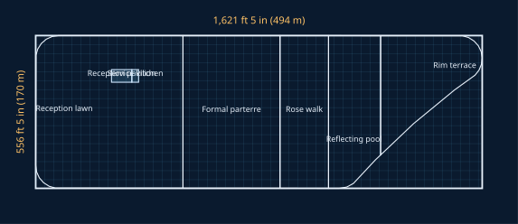

# P1-06 Governor's Garden: plan

Footprint 1,621 ft 5 in (494 m) × 556 ft 5 in (170 m) · structural grid 32 ft 10 in (10 m)

## Levels

| Level | Floor above deck | Height | Floor area |
|---|---|---|---|
| Level 1 · Ground | 0 ft (0 mm) | 13 ft 1 in (4,000 mm) | 4,521 sq ft (420 m²) |

## Elements

| ID | Designation | Type | Name | Level(s) | Size / length | Area | Status |
|---|---|---|---|---|---|---|---|
| E001 | D5F1P1B6A1R1 | zone | Reception lawn | L1 | 534 ft 9 in (163 m) × 555 ft 9 in (169 m) | 293,799 sq ft (27,295 m²) | proposed |
| E002 | D5F1P1B6A1R2 | room | Reception pavilion | L1 | 73 ft 10 in (22 m) × 45 ft 11 in (14 m) | 3,391 sq ft (315 m²) | proposed |
| E003 | D5F1P1B6A1R3 | room | Service kitchen | L1 | 24 ft 7 in (7,500 mm) × 45 ft 11 in (14 m) | 1,130 sq ft (105 m²) | proposed |
| E004 | D5F1P1B6A1R4 | zone | Formal parterre | L1 | 352 ft 4 in (107 m) × 555 ft 9 in (169 m) | 195,776 sq ft (18,188 m²) | proposed |
| E005 | D5F1P1B6A1R5 | zone | Rose walk | L1 | 176 ft 2 in (54 m) × 556 ft 1 in (170 m) | 97,946 sq ft (9,099 m²) | proposed |
| E006 | D5F1P1B6A1R6 | zone | Reflecting pool | L1 | 189 ft 4 in (58 m) × 556 ft 1 in (170 m) | 97,904 sq ft (9,096 m²) | proposed |
| E007 | D5F1P1B6A1R7 | zone | Rim terrace | L1 | 368 ft 9 in (112 m) × 434 ft 1 in (132 m) | 97,934 sq ft (9,098 m²) | proposed |

## Drawings

### Level 1 · Ground

