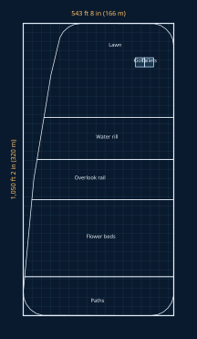

# P1-07 Rim Garden 1: plan

Footprint 543 ft 8 in (166 m) × 1,050 ft 2 in (320 m) · structural grid 32 ft 10 in (10 m)

## Levels

| Level | Floor above deck | Height | Floor area |
|---|---|---|---|
| Level 1 · Ground | 0 ft (0 mm) | 13 ft 1 in (4,000 mm) | 2,153 sq ft (200 m²) |

## Elements

| ID | Designation | Type | Name | Level(s) | Size / length | Area | Status |
|---|---|---|---|---|---|---|---|
| E001 | D5F1P1B3A2R1 | zone | Lawn | L1 | 468 ft 10 in (143 m) × 338 ft 3 in (103 m) | 145,414 sq ft (13,509 m²) | proposed |
| E002 | D5F1P1B3A2R2 | room | Kiosk | L1 | 32 ft 10 in (10 m) × 32 ft 10 in (10 m) | 1,076 sq ft (100 m²) | proposed |
| E003 | D5F1P1B3A2R3 | room | Toilets | L1 | 32 ft 10 in (10 m) × 32 ft 10 in (10 m) | 1,076 sq ft (100 m²) | proposed |
| E004 | D5F1P1B3A2R4 | zone | Water rill | L1 | 493 ft 5 in (150 m) × 150 ft 11 in (46 m) | 72,588 sq ft (6,744 m²) | proposed |
| E005 | D5F1P1B3A2R5 | zone | Overlook rail | L1 | 512 ft 2 in (156 m) × 144 ft 4 in (44 m) | 72,763 sq ft (6,760 m²) | proposed |
| E006 | D5F1P1B3A2R6 | zone | Flower beds | L1 | 538 ft 1 in (164 m) × 276 ft 11 in (84 m) | 145,356 sq ft (13,504 m²) | proposed |
| E007 | D5F1P1B3A2R7 | zone | Paths | L1 | 542 ft 8 in (165 m) × 139 ft 9 in (43 m) | 72,601 sq ft (6,745 m²) | proposed |

## Drawings

### Level 1 · Ground

