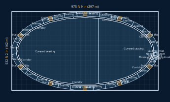

# P1-08 Plaza Pavilion 1: plan

Footprint 975 ft 9 in (297 m) × 532 ft 2 in (162 m) · structural grid 32 ft 10 in (10 m)

## Levels

| Level | Floor above deck | Height | Floor area |
|---|---|---|---|
| Level 1 · Pavilion floor | 0 ft (0 mm) | 19 ft 8 in (6,000 mm) | 375,583 sq ft (34,893 m²) |

## Elements

| ID | Designation | Type | Name | Level(s) | Size / length | Area | Status |
|---|---|---|---|---|---|---|---|
| E001 | D5F1P1B4A2R1 | room | Covered seating | L1 | 536 ft 1 in (163 m) × 451 ft 1 in (138 m) | 196,681 sq ft (18,272 m²) | proposed |
| E002 | D5F1P1B4A2R2 | room | Covered seating | L1 | 360 ft 3 in (110 m) × 440 ft 7 in (134 m) | 118,103 sq ft (10,972 m²) | proposed |
| E003 | D5F1P1B4A2R3 | core | Stairs and lifts | L1 | 40 ft (12 m) × 38 ft 9 in (12 m) | 776 sq ft (72 m²) | proposed |
| E004 | D5F1P1B4A2R4 | core | Stairs and lifts | L1 | 33 ft 6 in (10 m) × 36 ft 5 in (11 m) | 780 sq ft (72 m²) | proposed |
| E005 | D5F1P1B4A2R5 | core | Stairs and lifts | L1 | 26 ft 11 in (8,200 mm) × 29 ft 6 in (9,000 mm) | 775 sq ft (72 m²) | proposed |
| E006 | D5F1P1B4A2R6 | core | Stairs and lifts | L1 | 33 ft 2 in (10 m) × 36 ft 5 in (11 m) | 770 sq ft (72 m²) | proposed |
| E007 | D5F1P1B4A2R7 | core | Stairs and lifts | L1 | 40 ft (12 m) × 38 ft 9 in (12 m) | 776 sq ft (72 m²) | proposed |
| E008 | D5F1P1B4A2R8 | core | Stairs and lifts | L1 | 40 ft (12 m) × 38 ft 9 in (12 m) | 776 sq ft (72 m²) | proposed |
| E009 | D5F1P1B4A2R9 | core | Stairs and lifts | L1 | 34 ft 1 in (10 m) × 34 ft 5 in (10 m) | 773 sq ft (72 m²) | proposed |
| E010 | D5F1P1B4A2R10 | core | Stairs and lifts | L1 | 26 ft 11 in (8,200 mm) × 30 ft 6 in (9,300 mm) | 776 sq ft (72 m²) | proposed |
| E011 | D5F1P1B4A2R11 | core | Stairs and lifts | L1 | 33 ft 6 in (10 m) × 34 ft 5 in (10 m) | 774 sq ft (72 m²) | proposed |
| E012 | D5F1P1B4A2R12 | core | Stairs and lifts | L1 | 39 ft 8 in (12 m) × 38 ft 9 in (12 m) | 769 sq ft (71 m²) | proposed |
| E013 | D5F1P1B4A2R13 | zone | Corridor | L1 | 303 ft 10 in (93 m) × 220 ft 6 in (67 m) | 3,886 sq ft (361 m²) | proposed |
| E014 | D5F1P1B4A2R14 | zone | Corridor | L1 | 391 ft 1 in (119 m) × 44 ft (13 m) | 3,868 sq ft (359 m²) | proposed |
| E015 | D5F1P1B4A2R15 | zone | Corridor | L1 | 226 ft 1 in (69 m) × 277 ft 7 in (85 m) | 3,879 sq ft (360 m²) | proposed |
| E016 | D5F1P1B4A2R16 | zone | Corridor | L1 | 356 ft 4 in (109 m) × 158 ft 6 in (48 m) | 3,927 sq ft (365 m²) | proposed |
| E017 | D5F1P1B4A2R17 | zone | Corridor | L1 | 387 ft 2 in (118 m) × 74 ft 2 in (23 m) | 3,876 sq ft (360 m²) | proposed |
| E018 | D5F1P1B4A2R18 | zone | Corridor | L1 | 150 ft 11 in (46 m) × 171 ft 3 in (52 m) | 2,286 sq ft (212 m²) | proposed |
| E019 | D5F1P1B4A2R19 | room | Souvenir stall | L1 | 30 ft 10 in (9,400 mm) × 12 ft 2 in (3,700 mm) | 321 sq ft (30 m²) | proposed |
| E020 | D5F1P1B4A2R20 | room | Noodle counter | L1 | 31 ft 10 in (9,700 mm) × 26 ft 7 in (8,100 mm) | 643 sq ft (60 m²) | proposed |
| E021 | D5F1P1B4A2R21 | room | Newsstand | L1 | 32 ft 2 in (9,800 mm) × 18 ft 1 in (5,500 mm) | 311 sq ft (29 m²) | proposed |
| E022 | D5F1P1B4A2R22 | room | Phone and charging kiosk | L1 | 31 ft 6 in (9,600 mm) × 19 ft 8 in (6,000 mm) | 302 sq ft (28 m²) | proposed |
| E023 | D5F1P1B4A2R23 | room | Ticket kiosk | L1 | 30 ft 10 in (9,400 mm) × 22 ft (6,700 mm) | 312 sq ft (29 m²) | proposed |
| E024 | D5F1P1B4A2R24 | room | Toilets | L1 | 46 ft 3 in (14 m) × 48 ft 7 in (15 m) | 1,153 sq ft (107 m²) | proposed |
| E025 | D5F1P1B4A2R25 | room | Seating | L1 | 83 ft 4 in (25 m) × 73 ft 2 in (22 m) | 2,427 sq ft (225 m²) | proposed |
| E026 | D5F1P1B4A2R26 | room | Seating | L1 | 86 ft 11 in (27 m) × 62 ft 4 in (19 m) | 2,436 sq ft (226 m²) | proposed |
| E027 | D5F1P1B4A2R27 | room | Seating | L1 | 48 ft 7 in (15 m) × 40 ft (12 m) | 1,204 sq ft (112 m²) | proposed |
| E028 | D5F1P1B4A2R28 | room | Seating | L1 | 86 ft 7 in (26 m) × 46 ft 3 in (14 m) | 2,437 sq ft (226 m²) | proposed |
| E029 | D5F1P1B4A2R29 | room | Seating | L1 | 85 ft (26 m) × 40 ft (12 m) | 2,442 sq ft (227 m²) | proposed |
| E030 | D5F1P1B4A2R30 | room | Seating | L1 | 42 ft (13 m) × 29 ft 6 in (9,000 mm) | 1,206 sq ft (112 m²) | proposed |
| E031 | D5F1P1B4A2R31 | room | Seating | L1 | 84 ft 4 in (26 m) × 34 ft 1 in (10 m) | 2,439 sq ft (227 m²) | proposed |
| E032 | D5F1P1B4A2R32 | room | Seating | L1 | 86 ft 7 in (26 m) × 41 ft (12 m) | 2,431 sq ft (226 m²) | proposed |
| E033 | D5F1P1B4A2R33 | room | Seating | L1 | 46 ft 7 in (14 m) × 40 ft (12 m) | 1,212 sq ft (113 m²) | proposed |
| E034 | D5F1P1B4A2R34 | room | Seating | L1 | 88 ft 3 in (27 m) × 56 ft 1 in (17 m) | 2,445 sq ft (227 m²) | proposed |
| E035 | D5F1P1B4A2R35 | room | Seating | L1 | 85 ft 11 in (26 m) × 67 ft 7 in (21 m) | 2,430 sq ft (226 m²) | proposed |
| E036 | D5F1P1B4A2R36 | room | Seating | L1 | 50 ft 6 in (15 m) × 49 ft 3 in (15 m) | 1,212 sq ft (113 m²) | proposed |
| E037 | D5F1P1B4A2R37 | room | Seating | L1 | 59 ft 9 in (18 m) × 85 ft 8 in (26 m) | 2,435 sq ft (226 m²) | proposed |
| E038 | D5F1P1B4A2R38 | room | Seating | L1 | 42 ft 8 in (13 m) × 88 ft 11 in (27 m) | 2,441 sq ft (227 m²) | proposed |
| E039 | D5F1P1B4A2R39 | room | Seating | L1 | 46 ft 7 in (14 m) × 49 ft 10 in (15 m) | 1,203 sq ft (112 m²) | proposed |
| E040 | D5F1P1B4A2R40 | room | Seating | L1 | 83 ft (25 m) × 73 ft 6 in (22 m) | 2,429 sq ft (226 m²) | proposed |
| E041 | D5F1P1B4A2R41 | room | Seating | L1 | 87 ft 11 in (27 m) × 61 ft (19 m) | 2,433 sq ft (226 m²) | proposed |
| E042 | D5F1P1B4A2R42 | room | Seating | L1 | 47 ft 7 in (14 m) × 43 ft 8 in (13 m) | 1,201 sq ft (112 m²) | proposed |
| E043 | D5F1P1B4A2R43 | room | Seating | L1 | 87 ft 3 in (27 m) × 47 ft 3 in (14 m) | 2,451 sq ft (228 m²) | proposed |
| E044 | D5F1P1B4A2R44 | room | Seating | L1 | 85 ft 8 in (26 m) × 37 ft 1 in (11 m) | 2,439 sq ft (227 m²) | proposed |
| E045 | D5F1P1B4A2R45 | room | Seating | L1 | 42 ft (13 m) × 32 ft 6 in (9,900 mm) | 1,205 sq ft (112 m²) | proposed |
| E046 | D5F1P1B4A2R46 | room | Seating | L1 | 84 ft 4 in (26 m) × 35 ft 5 in (11 m) | 2,430 sq ft (226 m²) | proposed |
| E047 | D5F1P1B4A2R47 | room | Seating | L1 | 85 ft 11 in (26 m) × 43 ft (13 m) | 2,433 sq ft (226 m²) | proposed |
| E048 | D5F1P1B4A2R48 | room | Seating | L1 | 46 ft 11 in (14 m) × 37 ft 9 in (12 m) | 1,211 sq ft (113 m²) | proposed |
| E049 | D5F1P1B4A2R49 | room | Seating | L1 | 87 ft 3 in (27 m) × 58 ft 5 in (18 m) | 2,437 sq ft (226 m²) | proposed |
| E050 | D5F1P1B4A2R50 | room | Seating | L1 | 85 ft 11 in (26 m) × 67 ft 11 in (21 m) | 2,433 sq ft (226 m²) | proposed |
| E051 | D5F1P1B4A2R51 | room | Seating | L1 | 50 ft 6 in (15 m) × 48 ft 11 in (15 m) | 1,209 sq ft (112 m²) | proposed |
| E052 | D5F1P1B4A2R52 | room | Seating | L1 | 62 ft 8 in (19 m) × 103 ft 8 in (32 m) | 3,045 sq ft (283 m²) | proposed |

## Drawings

### Level 1 · Pavilion floor

