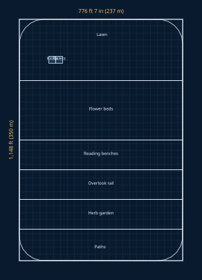

# P1-09 Rim Garden 2: plan

Footprint 776 ft 7 in (237 m) × 1,148 ft (350 m) · structural grid 32 ft 10 in (10 m)

## Levels

| Level | Floor above deck | Height | Floor area |
|---|---|---|---|
| Level 1 · Ground | 0 ft (0 mm) | 13 ft 1 in (4,000 mm) | 2,153 sq ft (200 m²) |

## Elements

| ID | Designation | Type | Name | Level(s) | Size / length | Area | Status |
|---|---|---|---|---|---|---|---|
| E001 | D5F1P1B5A2R1 | zone | Lawn | L1 | 775 ft 7 in (236 m) × 291 ft (89 m) | 219,313 sq ft (20,375 m²) | proposed |
| E002 | D5F1P1B5A2R2 | room | Kiosk | L1 | 32 ft 10 in (10 m) × 32 ft 10 in (10 m) | 1,076 sq ft (100 m²) | proposed |
| E003 | D5F1P1B5A2R3 | room | Toilets | L1 | 32 ft 10 in (10 m) × 32 ft 10 in (10 m) | 1,076 sq ft (100 m²) | proposed |
| E004 | D5F1P1B5A2R4 | zone | Flower beds | L1 | 775 ft 7 in (236 m) × 283 ft 2 in (86 m) | 219,552 sq ft (20,397 m²) | proposed |
| E005 | D5F1P1B5A2R5 | zone | Reading benches | L1 | 775 ft 11 in (236 m) × 141 ft 5 in (43 m) | 109,672 sq ft (10,189 m²) | proposed |
| E006 | D5F1P1B5A2R6 | zone | Overlook rail | L1 | 775 ft 7 in (236 m) × 141 ft 5 in (43 m) | 109,672 sq ft (10,189 m²) | proposed |
| E007 | D5F1P1B5A2R7 | zone | Herb garden | L1 | 775 ft 11 in (236 m) × 141 ft 5 in (43 m) | 109,672 sq ft (10,189 m²) | proposed |
| E008 | D5F1P1B5A2R8 | zone | Paths | L1 | 775 ft 7 in (236 m) × 149 ft 7 in (46 m) | 109,701 sq ft (10,192 m²) | proposed |

## Drawings

### Level 1 · Ground

