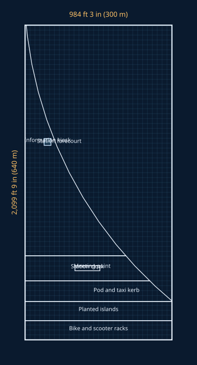

# P2-03 Station Plaza: plan

Footprint 984 ft 3 in (300 m) × 2,099 ft 9 in (640 m) · structural grid 32 ft 10 in (10 m)

## Levels

| Level | Floor above deck | Height | Floor area |
|---|---|---|---|
| Level 1 · Ground | 0 ft (0 mm) | 13 ft 1 in (4,000 mm) | 2,110 sq ft (196 m²) |

## Elements

| ID | Designation | Type | Name | Level(s) | Size / length | Area | Status |
|---|---|---|---|---|---|---|---|
| E001 | D5F1P2B3A2R1 | zone | Station forecourt | L1 | 675 ft 10 in (206 m) × 1,538 ft 9 in (469 m) | 377,606 sq ft (35,081 m²) | proposed |
| E002 | D5F1P2B3A2R2 | room | Information kiosk | L1 | 45 ft 11 in (14 m) × 45 ft 11 in (14 m) | 2,110 sq ft (196 m²) | proposed |
| E003 | D5F1P2B3A2R3 | zone | Meeting point | L1 | 835 ft 8 in (255 m) × 167 ft (51 m) | 125,769 sq ft (11,684 m²) | proposed |
| E004 |  | fixture | Station clock | L1 | 167 ft (51 m) × 33 ft 2 in (10 m) | 5,534 sq ft (514 m²) | proposed |
| E005 | D5F1P2B3A2R4 | zone | Pod and taxi kerb | L1 | 984 ft 3 in (300 m) × 138 ft 5 in (42 m) | 126,040 sq ft (11,710 m²) | proposed |
| E006 | D5F1P2B3A2R5 | zone | Planted islands | L1 | 984 ft 3 in (300 m) × 127 ft 7 in (39 m) | 125,615 sq ft (11,670 m²) | proposed |
| E007 | D5F1P2B3A2R6 | zone | Bike and scooter racks | L1 | 984 ft 3 in (300 m) × 127 ft 11 in (39 m) | 125,938 sq ft (11,700 m²) | proposed |

## Drawings

### Level 1 · Ground

