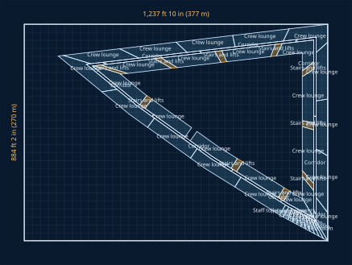

# P2-04 Transit Crews' Hall: plan

Footprint 1,237 ft 10 in (377 m) × 884 ft 2 in (270 m) · structural grid 32 ft 10 in (10 m)

## Levels

| Level | Floor above deck | Height | Floor area |
|---|---|---|---|
| Level 1 · Ground floor | 0 ft (0 mm) | 16 ft 5 in (5,000 mm) | 251,810 sq ft (23,394 m²) |
| Level 2 · Crew floor 1 | 16 ft 5 in (5,000 mm) | 13 ft 9 in (4,200 mm) | 247,690 sq ft (23,011 m²) |
| Level 3 · Crew floor 2 | 30 ft 2 in (9,200 mm) | 13 ft 9 in (4,200 mm) | 247,690 sq ft (23,011 m²) |

## Elements

| ID | Designation | Type | Name | Level(s) | Size / length | Area | Status |
|---|---|---|---|---|---|---|---|
| E001 | D5F1P2B5A1L1R1 | room | Crew mustering hall | L1 | 286 ft 1 in (87 m) × 246 ft 9 in (75 m) | 28,840 sq ft (2,679 m²) | proposed |
| E002 | D5F1P2B5A1L1R2 | zone | Corridor | L1 | 345 ft 10 in (105 m) × 213 ft 7 in (65 m) | 3,860 sq ft (359 m²) | proposed |
| E003 | D5F1P2B5A1L1R3 | zone | Corridor | L1 | 98 ft 1 in (30 m) × 66 ft 11 in (20 m) | 1,070 sq ft (99 m²) | proposed |
| E004 | D5F1P2B5A1L1R4 | zone | Corridor | L1 | 278 ft 3 in (85 m) × 223 ft 1 in (68 m) | 3,852 sq ft (358 m²) | proposed |
| E005 | D5F1P2B5A1L1R5 | zone | Corridor | L1 | 405 ft 10 in (124 m) × 54 ft 2 in (16 m) | 3,824 sq ft (355 m²) | proposed |
| E006 | D5F1P2B5A1L1R6 | zone | Corridor | L1 | 398 ft 4 in (121 m) × 55 ft 9 in (17 m) | 3,800 sq ft (353 m²) | proposed |
| E007 | D5F1P2B5A1L1R7 | zone | Corridor | L1 | 89 ft 7 in (27 m) × 317 ft 7 in (97 m) | 3,869 sq ft (359 m²) | proposed |
| E008 | D5F1P2B5A1L1R8 | zone | Corridor | L1 | 9 ft 10 in (3,000 mm) × 401 ft 3 in (122 m) | 3,873 sq ft (360 m²) | proposed |
| E009 | D5F1P2B5A1L1R9 | zone | Corridor | L1 | 9 ft 10 in (3,000 mm) × 49 ft 10 in (15 m) | 336 sq ft (31 m²) | proposed |
| E010 | D5F1P2B5A1L1R10, D5F1P2B5A1L2R1, D5F1P2B5A1L3R1 | core | Stairs and lifts | L1, L2, L3 | 45 ft 11 in (14 m) × 54 ft 6 in (17 m) | 1,233 sq ft (115 m²) | proposed |
| E011 | D5F1P2B5A1L1R11, D5F1P2B5A1L2R2, D5F1P2B5A1L3R2 | core | Stairs and lifts | L1, L2, L3 | 47 ft 7 in (14 m) × 53 ft 6 in (16 m) | 1,230 sq ft (114 m²) | proposed |
| E012 | D5F1P2B5A1L1R12, D5F1P2B5A1L2R3, D5F1P2B5A1L3R3 | core | Stairs and lifts | L1, L2, L3 | 49 ft 10 in (15 m) × 52 ft 6 in (16 m) | 1,230 sq ft (114 m²) | proposed |
| E013 | D5F1P2B5A1L1R13, D5F1P2B5A1L2R4, D5F1P2B5A1L3R4 | core | Stairs and lifts | L1, L2, L3 | 137 ft 6 in (42 m) × 37 ft 1 in (11 m) | 1,224 sq ft (114 m²) | proposed |
| E014 | D5F1P2B5A1L1R14, D5F1P2B5A1L2R5, D5F1P2B5A1L3R5 | core | Stairs and lifts | L1, L2, L3 | 93 ft 2 in (28 m) × 42 ft 4 in (13 m) | 1,225 sq ft (114 m²) | proposed |
| E015 | D5F1P2B5A1L1R15, D5F1P2B5A1L2R6, D5F1P2B5A1L3R6 | core | Stairs and lifts | L1, L2, L3 | 48 ft 11 in (15 m) × 47 ft 11 in (15 m) | 1,239 sq ft (115 m²) | proposed |
| E016 | D5F1P2B5A1L1R16, D5F1P2B5A1L2R7, D5F1P2B5A1L3R7 | core | Stairs and lifts | L1, L2, L3 | 47 ft 7 in (14 m) × 52 ft 10 in (16 m) | 1,229 sq ft (114 m²) | proposed |
| E017 | D5F1P2B5A1L1R17, D5F1P2B5A1L2R8, D5F1P2B5A1L3R8 | core | Stairs and lifts | L1, L2, L3 | 46 ft 11 in (14 m) × 60 ft (18 m) | 1,231 sq ft (114 m²) | proposed |
| E018 | D5F1P2B5A1L1R18, D5F1P2B5A1L2R9, D5F1P2B5A1L3R9 | core | Stairs and lifts | L1, L2, L3 | 46 ft 11 in (14 m) × 37 ft 1 in (11 m) | 1,231 sq ft (114 m²) | proposed |
| E019 | D5F1P2B5A1L1R19, D5F1P2B5A1L2R10, D5F1P2B5A1L3R10 | core | Stairs and lifts | L1, L2, L3 | 46 ft 11 in (14 m) × 82 ft (25 m) | 1,231 sq ft (114 m²) | proposed |
| E020 | D5F1P2B5A1L1R20 | room | Duty office | L1 | 59 ft 5 in (18 m) × 84 ft 8 in (26 m) | 858 sq ft (80 m²) | proposed |
| E021 | D5F1P2B5A1L1R21 | room | Signing-on room | L1 | 50 ft 2 in (15 m) × 79 ft 9 in (24 m) | 764 sq ft (71 m²) | proposed |
| E022 | D5F1P2B5A1L1R22 | room | Line control link | L1 | 43 ft 4 in (13 m) × 76 ft 1 in (23 m) | 777 sq ft (72 m²) | proposed |
| E023 | D5F1P2B5A1L1R23 | room | Kit store | L1 | 37 ft 5 in (11 m) × 73 ft 2 in (22 m) | 851 sq ft (79 m²) | proposed |
| E024 | D5F1P2B5A1L1R24 | room | Locker room | L1 | 31 ft 2 in (9,500 mm) × 69 ft 11 in (21 m) | 971 sq ft (90 m²) | proposed |
| E025 | D5F1P2B5A1L1R25 | room | Staff toilets and showers | L1 | 19 ft 8 in (6,000 mm) × 64 ft (20 m) | 769 sq ft (71 m²) | proposed |
| E026 | D5F1P2B5A1L1R26 | room | Supervisors' office | L1 | 124 ft 8 in (38 m) × 111 ft 11 in (34 m) | 6,064 sq ft (563 m²) | proposed |
| E027 | D5F1P2B5A1L1R27 | room | Crew room | L1 | 244 ft 1 in (74 m) × 176 ft 6 in (54 m) | 12,128 sq ft (1,127 m²) | proposed |
| E028 | D5F1P2B5A1L1R28 | room | Supervisors' office | L1 | 79 ft 1 in (24 m) × 73 ft 6 in (22 m) | 2,973 sq ft (276 m²) | proposed |
| E029 | D5F1P2B5A1L1R29 | room | Crew room | L1 | 258 ft 2 in (79 m) × 184 ft 5 in (56 m) | 12,159 sq ft (1,130 m²) | proposed |
| E030 | D5F1P2B5A1L1R30 | room | Supervisors' office | L1 | 187 ft 8 in (57 m) × 95 ft 2 in (29 m) | 6,056 sq ft (563 m²) | proposed |
| E031 | D5F1P2B5A1L1R31 | room | Crew room | L1 | 348 ft 9 in (106 m) × 66 ft 11 in (20 m) | 12,183 sq ft (1,132 m²) | proposed |
| E032 | D5F1P2B5A1L1R32 | room | Supervisors' office | L1 | 190 ft (58 m) × 55 ft 1 in (17 m) | 6,065 sq ft (564 m²) | proposed |
| E033 | D5F1P2B5A1L1R33 | room | Crew room | L1 | 287 ft 9 in (88 m) × 73 ft 10 in (22 m) | 12,101 sq ft (1,124 m²) | proposed |
| E034 | D5F1P2B5A1L1R34 | room | Supervisors' office | L1 | 138 ft 5 in (42 m) × 62 ft 4 in (19 m) | 6,065 sq ft (564 m²) | proposed |
| E035 | D5F1P2B5A1L1R35 | room | Crew room | L1 | 261 ft 6 in (80 m) × 78 ft 1 in (24 m) | 12,147 sq ft (1,128 m²) | proposed |
| E036 | D5F1P2B5A1L1R36 | room | Supervisors' office | L1 | 46 ft 11 in (14 m) × 167 ft 8 in (51 m) | 6,057 sq ft (563 m²) | proposed |
| E037 | D5F1P2B5A1L1R37 | room | Crew room | L1 | 46 ft 11 in (14 m) × 278 ft 10 in (85 m) | 12,122 sq ft (1,126 m²) | proposed |
| E038 | D5F1P2B5A1L1R38 | room | Supervisors' office | L1 | 46 ft 11 in (14 m) × 152 ft 7 in (46 m) | 6,065 sq ft (563 m²) | proposed |
| E039 | D5F1P2B5A1L1R39 | room | Crew room | L1 | 46 ft 11 in (14 m) × 334 ft 4 in (102 m) | 13,060 sq ft (1,213 m²) | proposed |
| E040 | D5F1P2B5A1L1R40 | room | Supervisors' office | L1 | 122 ft 5 in (37 m) × 108 ft 3 in (33 m) | 4,687 sq ft (435 m²) | proposed |
| E041 | D5F1P2B5A1L1R41 | room | Crew room | L1 | 194 ft 3 in (59 m) × 145 ft 8 in (44 m) | 9,378 sq ft (871 m²) | proposed |
| E042 | D5F1P2B5A1L1R42 | room | Supervisors' office | L1 | 108 ft 7 in (33 m) × 91 ft 2 in (28 m) | 4,590 sq ft (426 m²) | proposed |
| E043 | D5F1P2B5A1L1R43 | room | Crew room | L1 | 92 ft 10 in (28 m) × 84 ft (26 m) | 3,736 sq ft (347 m²) | proposed |
| E044 | D5F1P2B5A1L1R44 | room | Supervisors' office | L1 | 222 ft 1 in (68 m) × 158 ft 10 in (48 m) | 9,387 sq ft (872 m²) | proposed |
| E045 | D5F1P2B5A1L1R45 | room | Crew room | L1 | 287 ft 5 in (88 m) × 60 ft 4 in (18 m) | 9,392 sq ft (873 m²) | proposed |
| E046 | D5F1P2B5A1L1R46 | room | Supervisors' office | L1 | 243 ft 5 in (74 m) × 65 ft 3 in (20 m) | 9,383 sq ft (872 m²) | proposed |
| E047 | D5F1P2B5A1L1R47 | room | Crew room | L1 | 218 ft 2 in (67 m) × 70 ft 6 in (22 m) | 9,393 sq ft (873 m²) | proposed |
| E048 | D5F1P2B5A1L1R48 | room | Supervisors' office | L1 | 152 ft 7 in (46 m) × 126 ft 4 in (38 m) | 9,347 sq ft (868 m²) | proposed |
| E049 | D5F1P2B5A1L1R49 | room | Crew room | L1 | 46 ft 11 in (14 m) × 219 ft 6 in (67 m) | 9,374 sq ft (871 m²) | proposed |
| E050 | D5F1P2B5A1L1R50 | room | Supervisors' office | L1 | 46 ft 11 in (14 m) × 233 ft 3 in (71 m) | 9,382 sq ft (872 m²) | proposed |
| E051 | D5F1P2B5A1L1R51 | room | Crew room | L1 | 46 ft 11 in (14 m) × 168 ft 4 in (51 m) | 4,687 sq ft (435 m²) | proposed |
| E052 | D5F1P2B5A1L2R11, D5F1P2B5A1L3R11 | zone | Corridor | L2, L3 | 345 ft 10 in (105 m) × 213 ft 7 in (65 m) | 3,860 sq ft (359 m²) | proposed |
| E053 | D5F1P2B5A1L2R12, D5F1P2B5A1L3R12 | zone | Corridor | L2, L3 | 329 ft 1 in (100 m) × 231 ft 11 in (71 m) | 3,846 sq ft (357 m²) | proposed |
| E054 | D5F1P2B5A1L2R13, D5F1P2B5A1L3R13 | zone | Corridor | L2, L3 | 273 ft 11 in (83 m) × 220 ft 10 in (67 m) | 3,853 sq ft (358 m²) | proposed |
| E055 | D5F1P2B5A1L2R14, D5F1P2B5A1L3R14 | zone | Corridor | L2, L3 | 405 ft 6 in (124 m) × 54 ft 2 in (16 m) | 3,815 sq ft (354 m²) | proposed |
| E056 | D5F1P2B5A1L2R15, D5F1P2B5A1L3R15 | zone | Corridor | L2, L3 | 398 ft 4 in (121 m) × 55 ft 9 in (17 m) | 3,800 sq ft (353 m²) | proposed |
| E057 | D5F1P2B5A1L2R16, D5F1P2B5A1L3R16 | zone | Corridor | L2, L3 | 84 ft 4 in (26 m) × 323 ft 2 in (98 m) | 3,869 sq ft (359 m²) | proposed |
| E058 | D5F1P2B5A1L2R17, D5F1P2B5A1L3R17 | zone | Corridor | L2, L3 | 9 ft 10 in (3,000 mm) × 401 ft 11 in (123 m) | 3,875 sq ft (360 m²) | proposed |
| E059 | D5F1P2B5A1L2R18, D5F1P2B5A1L3R18 | zone | Corridor | L2, L3 | 9 ft 10 in (3,000 mm) × 44 ft 7 in (14 m) | 283 sq ft (26 m²) | proposed |
| E060 | D5F1P2B5A1L2R19, D5F1P2B5A1L3R19 | room | Rest room | L2, L3 | 58 ft 1 in (18 m) × 84 ft (26 m) | 778 sq ft (72 m²) | proposed |
| E061 | D5F1P2B5A1L2R20, D5F1P2B5A1L3R20 | room | Rest room | L2, L3 | 50 ft 10 in (16 m) × 80 ft 5 in (25 m) | 755 sq ft (70 m²) | proposed |
| E062 | D5F1P2B5A1L2R21, D5F1P2B5A1L3R21 | room | Rest room | L2, L3 | 44 ft 3 in (14 m) × 76 ft 9 in (23 m) | 772 sq ft (72 m²) | proposed |
| E063 | D5F1P2B5A1L2R22, D5F1P2B5A1L3R22 | room | Rest room | L2, L3 | 37 ft 1 in (11 m) × 72 ft 10 in (22 m) | 766 sq ft (71 m²) | proposed |
| E064 | D5F1P2B5A1L2R23, D5F1P2B5A1L3R23 | room | Rest room | L2, L3 | 30 ft 2 in (9,200 mm) × 69 ft 3 in (21 m) | 778 sq ft (72 m²) | proposed |
| E065 | D5F1P2B5A1L2R24, D5F1P2B5A1L3R24 | room | Rest room | L2, L3 | 23 ft (7,000 mm) × 65 ft 7 in (20 m) | 759 sq ft (71 m²) | proposed |
| E066 | D5F1P2B5A1L2R25, D5F1P2B5A1L3R25 | room | Rest room | L2, L3 | 18 ft 1 in (5,500 mm) × 62 ft (19 m) | 779 sq ft (72 m²) | proposed |
| E067 | D5F1P2B5A1L2R26, D5F1P2B5A1L3R26 | room | Crew kitchen | L2, L3 | 19 ft 8 in (6,000 mm) × 58 ft 5 in (18 m) | 778 sq ft (72 m²) | proposed |
| E068 | D5F1P2B5A1L2R27, D5F1P2B5A1L3R27 | room | Showers | L2, L3 | 26 ft 7 in (8,100 mm) × 54 ft 6 in (17 m) | 768 sq ft (71 m²) | proposed |
| E069 | D5F1P2B5A1L2R28, D5F1P2B5A1L3R28 | room | Training room | L2, L3 | 35 ft 9 in (11 m) × 51 ft 6 in (16 m) | 865 sq ft (80 m²) | proposed |
| E070 | D5F1P2B5A1L2R29, D5F1P2B5A1L3R29 | room | Staff toilets and showers | L2, L3 | 37 ft 5 in (11 m) × 49 ft 6 in (15 m) | 773 sq ft (72 m²) | proposed |
| E071 | D5F1P2B5A1L2R30, D5F1P2B5A1L3R30 | room | Crew lounge | L2, L3 | 206 ft 8 in (63 m) × 153 ft 7 in (47 m) | 10,057 sq ft (934 m²) | proposed |
| E072 | D5F1P2B5A1L2R31, D5F1P2B5A1L3R31 | room | Crew lounge | L2, L3 | 205 ft 5 in (63 m) × 156 ft 6 in (48 m) | 10,063 sq ft (935 m²) | proposed |
| E073 | D5F1P2B5A1L2R32, D5F1P2B5A1L3R32 | room | Crew lounge | L2, L3 | 202 ft 1 in (62 m) × 163 ft 1 in (50 m) | 10,059 sq ft (935 m²) | proposed |
| E074 | D5F1P2B5A1L2R33, D5F1P2B5A1L3R33 | room | Crew lounge | L2, L3 | 214 ft 7 in (65 m) × 155 ft 2 in (47 m) | 10,076 sq ft (936 m²) | proposed |
| E075 | D5F1P2B5A1L2R34, D5F1P2B5A1L3R34 | room | Crew lounge | L2, L3 | 239 ft 10 in (73 m) × 148 ft 4 in (45 m) | 10,070 sq ft (936 m²) | proposed |
| E076 | D5F1P2B5A1L2R35, D5F1P2B5A1L3R35 | room | Crew lounge | L2, L3 | 308 ft 5 in (94 m) × 61 ft (19 m) | 10,049 sq ft (934 m²) | proposed |
| E077 | D5F1P2B5A1L2R36, D5F1P2B5A1L3R36 | room | Crew lounge | L2, L3 | 274 ft 7 in (84 m) × 65 ft 3 in (20 m) | 10,088 sq ft (937 m²) | proposed |
| E078 | D5F1P2B5A1L2R37, D5F1P2B5A1L3R37 | room | Crew lounge | L2, L3 | 240 ft 10 in (73 m) × 69 ft 3 in (21 m) | 10,108 sq ft (939 m²) | proposed |
| E079 | D5F1P2B5A1L2R38, D5F1P2B5A1L3R38 | room | Crew lounge | L2, L3 | 230 ft 4 in (70 m) × 73 ft 2 in (22 m) | 10,077 sq ft (936 m²) | proposed |
| E080 | D5F1P2B5A1L2R39, D5F1P2B5A1L3R39 | room | Crew lounge | L2, L3 | 181 ft 5 in (55 m) × 115 ft 2 in (35 m) | 10,064 sq ft (935 m²) | proposed |
| E081 | D5F1P2B5A1L2R40, D5F1P2B5A1L3R40 | room | Crew lounge | L2, L3 | 46 ft 11 in (14 m) × 239 ft 10 in (73 m) | 10,090 sq ft (937 m²) | proposed |
| E082 | D5F1P2B5A1L2R41, D5F1P2B5A1L3R41 | room | Crew lounge | L2, L3 | 46 ft 11 in (14 m) × 231 ft 11 in (71 m) | 10,074 sq ft (936 m²) | proposed |
| E083 | D5F1P2B5A1L2R42, D5F1P2B5A1L3R42 | room | Crew lounge | L2, L3 | 46 ft 11 in (14 m) × 258 ft 10 in (79 m) | 10,082 sq ft (937 m²) | proposed |
| E084 | D5F1P2B5A1L2R43, D5F1P2B5A1L3R43 | room | Crew lounge | L2, L3 | 46 ft 11 in (14 m) × 175 ft 10 in (54 m) | 4,987 sq ft (463 m²) | proposed |
| E085 | D5F1P2B5A1L2R44, D5F1P2B5A1L3R44 | room | Crew lounge | L2, L3 | 122 ft 5 in (37 m) × 108 ft 3 in (33 m) | 4,687 sq ft (435 m²) | proposed |
| E086 | D5F1P2B5A1L2R45, D5F1P2B5A1L3R45 | room | Crew lounge | L2, L3 | 194 ft 3 in (59 m) × 145 ft 8 in (44 m) | 9,378 sq ft (871 m²) | proposed |
| E087 | D5F1P2B5A1L2R46, D5F1P2B5A1L3R46 | room | Crew lounge | L2, L3 | 191 ft 11 in (58 m) × 150 ft 3 in (46 m) | 9,381 sq ft (871 m²) | proposed |
| E088 | D5F1P2B5A1L2R47, D5F1P2B5A1L3R47 | room | Crew lounge | L2, L3 | 190 ft 3 in (58 m) × 154 ft 2 in (47 m) | 9,385 sq ft (872 m²) | proposed |
| E089 | D5F1P2B5A1L2R48, D5F1P2B5A1L3R48 | room | Crew lounge | L2, L3 | 222 ft 1 in (68 m) × 158 ft 10 in (48 m) | 9,387 sq ft (872 m²) | proposed |
| E090 | D5F1P2B5A1L2R49, D5F1P2B5A1L3R49 | room | Crew lounge | L2, L3 | 287 ft 5 in (88 m) × 60 ft 4 in (18 m) | 9,392 sq ft (873 m²) | proposed |
| E091 | D5F1P2B5A1L2R50, D5F1P2B5A1L3R50 | room | Crew lounge | L2, L3 | 243 ft 5 in (74 m) × 65 ft 3 in (20 m) | 9,383 sq ft (872 m²) | proposed |
| E092 | D5F1P2B5A1L2R51, D5F1P2B5A1L3R51 | room | Crew lounge | L2, L3 | 218 ft 2 in (67 m) × 70 ft 6 in (22 m) | 9,393 sq ft (873 m²) | proposed |
| E093 | D5F1P2B5A1L2R52, D5F1P2B5A1L3R52 | room | Crew lounge | L2, L3 | 152 ft 7 in (46 m) × 126 ft 4 in (38 m) | 9,347 sq ft (868 m²) | proposed |
| E094 | D5F1P2B5A1L2R53, D5F1P2B5A1L3R53 | room | Crew lounge | L2, L3 | 46 ft 11 in (14 m) × 219 ft 6 in (67 m) | 9,374 sq ft (871 m²) | proposed |
| E095 | D5F1P2B5A1L2R54, D5F1P2B5A1L3R54 | room | Crew lounge | L2, L3 | 46 ft 11 in (14 m) × 233 ft 3 in (71 m) | 9,382 sq ft (872 m²) | proposed |
| E096 | D5F1P2B5A1L2R55, D5F1P2B5A1L3R55 | room | Crew lounge | L2, L3 | 46 ft 11 in (14 m) × 168 ft 4 in (51 m) | 4,687 sq ft (435 m²) | proposed |

## Drawings

### Level 1 · Ground floor

### Level 2 · Crew floor 1

### Level 3 · Crew floor 2

