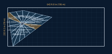

# P2-05 Help Desk Pavilion: plan

Footprint 643 ft 8 in (196 m) × 255 ft 3 in (78 m) · structural grid 32 ft 10 in (10 m)

## Levels

| Level | Floor above deck | Height | Floor area |
|---|---|---|---|
| Level 1 · Pavilion floor | 0 ft (0 mm) | 16 ft 5 in (5,000 mm) | 31,363 sq ft (2,914 m²) |

## Elements

| ID | Designation | Type | Name | Level(s) | Size / length | Area | Status |
|---|---|---|---|---|---|---|---|
| E001 | D5F1P2B7A1R1 | core | Stairs and lifts | L1 | 85 ft 11 in (26 m) × 67 ft 7 in (21 m) | 1,932 sq ft (180 m²) | proposed |
| E002 | D5F1P2B7A1R2 | core | Stairs and lifts | L1 | 114 ft 2 in (35 m) × 38 ft 1 in (12 m) | 1,924 sq ft (179 m²) | proposed |
| E003 | D5F1P2B7A1R3 | zone | Corridor | L1 | 39 ft 1 in (12 m) × 30 ft 6 in (9,300 mm) | 420 sq ft (39 m²) | proposed |
| E004 | D5F1P2B7A1R4 | room | Help desk | L1 | 61 ft (19 m) × 137 ft 2 in (42 m) | 1,891 sq ft (176 m²) | proposed |
| E005 | D5F1P2B7A1R5 | room | Lost property counter | L1 | 67 ft 3 in (20 m) × 97 ft 5 in (30 m) | 1,884 sq ft (175 m²) | proposed |
| E006 | D5F1P2B7A1R6 | room | Lost property store | L1 | 73 ft 6 in (22 m) × 58 ft 5 in (18 m) | 1,910 sq ft (177 m²) | proposed |
| E007 | D5F1P2B7A1R7 | room | Lost children's room | L1 | 80 ft 5 in (24 m) × 51 ft 6 in (16 m) | 2,151 sq ft (200 m²) | proposed |
| E008 | D5F1P2B7A1R8 | room | Map wall | L1 | 81 ft 4 in (25 m) × 69 ft 7 in (21 m) | 1,889 sq ft (175 m²) | proposed |
| E009 | D5F1P2B7A1R9 | room | Toilets | L1 | 45 ft 7 in (14 m) × 75 ft 2 in (23 m) | 1,890 sq ft (176 m²) | proposed |
| E010 | D5F1P2B7A1R10 | room | Waiting lounge | L1 | 44 ft 11 in (14 m) × 75 ft 9 in (23 m) | 1,891 sq ft (176 m²) | proposed |
| E011 | D5F1P2B7A1R11 | room | Luggage lockers | L1 | 82 ft 4 in (25 m) × 67 ft 11 in (21 m) | 1,885 sq ft (175 m²) | proposed |
| E012 | D5F1P2B7A1R12 | room | Waiting lounge | L1 | 122 ft 8 in (37 m) × 58 ft 5 in (18 m) | 1,902 sq ft (177 m²) | proposed |
| E013 | D5F1P2B7A1R13 | room | Luggage lockers | L1 | 162 ft 5 in (49 m) × 48 ft 11 in (15 m) | 1,883 sq ft (175 m²) | proposed |
| E014 | D5F1P2B7A1R14 | room | Waiting lounge | L1 | 174 ft 3 in (53 m) × 41 ft 4 in (13 m) | 1,911 sq ft (178 m²) | proposed |
| E015 | D5F1P2B7A1R15 | room | Luggage lockers | L1 | 156 ft 2 in (48 m) × 34 ft 9 in (11 m) | 2,429 sq ft (226 m²) | proposed |
| E016 | D5F1P2B7A1R16 | room | Waiting lounge | L1 | 82 ft (25 m) × 61 ft 4 in (19 m) | 1,894 sq ft (176 m²) | proposed |
| E017 | D5F1P2B7A1R17 | room | Luggage lockers | L1 | 50 ft 2 in (15 m) × 85 ft (26 m) | 1,893 sq ft (176 m²) | proposed |
| E018 | D5F1P2B7A1R18 | room | Waiting lounge | L1 | 36 ft 5 in (11 m) × 108 ft 3 in (33 m) | 1,892 sq ft (176 m²) | proposed |
| E019 | D5F1P2B7A1R19 | room | Luggage lockers | L1 | 59 ft 5 in (18 m) × 135 ft 6 in (41 m) | 2,168 sq ft (201 m²) | proposed |

## Drawings

### Level 1 · Pavilion floor

