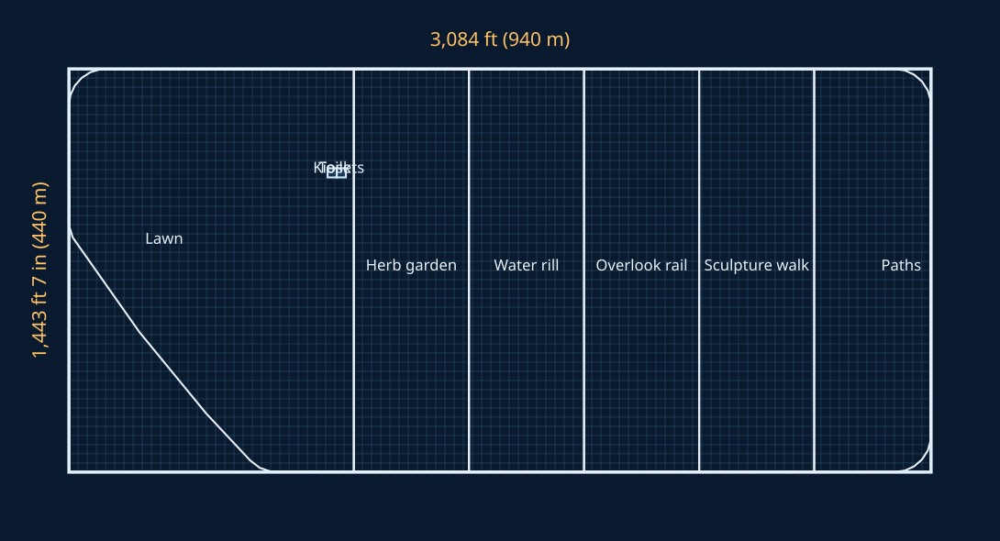

# P2-06 Rim Garden 1: plan

Footprint 3,084 ft (940 m) × 1,443 ft 7 in (440 m) · structural grid 32 ft 10 in (10 m)

## Levels

| Level | Floor above deck | Height | Floor area |
|---|---|---|---|
| Level 1 · Ground | 0 ft (0 mm) | 13 ft 1 in (4,000 mm) | 2,153 sq ft (200 m²) |

## Elements

| ID | Designation | Type | Name | Level(s) | Size / length | Area | Status |
|---|---|---|---|---|---|---|---|
| E001 | D5F1P2B4A1R1 | zone | Lawn | L1 | 1,019 ft (311 m) × 1,441 ft 3 in (439 m) | 1,187,723 sq ft (110,343 m²) | proposed |
| E002 | D5F1P2B4A1R2 | room | Kiosk | L1 | 32 ft 10 in (10 m) × 32 ft 10 in (10 m) | 1,076 sq ft (100 m²) | proposed |
| E003 | D5F1P2B4A1R3 | room | Toilets | L1 | 32 ft 10 in (10 m) × 32 ft 10 in (10 m) | 1,076 sq ft (100 m²) | proposed |
| E004 | D5F1P2B4A1R4 | zone | Herb garden | L1 | 412 ft 1 in (126 m) × 1,441 ft 11 in (440 m) | 594,046 sq ft (55,189 m²) | proposed |
| E005 | D5F1P2B4A1R5 | zone | Water rill | L1 | 411 ft 9 in (126 m) × 1,442 ft 3 in (440 m) | 593,775 sq ft (55,164 m²) | proposed |
| E006 | D5F1P2B4A1R6 | zone | Overlook rail | L1 | 411 ft 9 in (126 m) × 1,442 ft 7 in (440 m) | 593,910 sq ft (55,176 m²) | proposed |
| E007 | D5F1P2B4A1R7 | zone | Sculpture walk | L1 | 411 ft 5 in (125 m) × 1,443 ft 3 in (440 m) | 593,640 sq ft (55,151 m²) | proposed |
| E008 | D5F1P2B4A1R8 | zone | Paths | L1 | 416 ft 8 in (127 m) × 1,443 ft 7 in (440 m) | 594,039 sq ft (55,188 m²) | proposed |

## Drawings

### Level 1 · Ground

