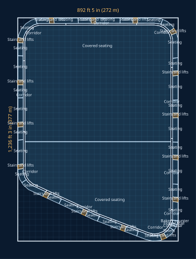

# P2-07 Plaza Pavilion 1: plan

Footprint 892 ft 5 in (272 m) × 1,236 ft 3 in (377 m) · structural grid 32 ft 10 in (10 m)

## Levels

| Level | Floor above deck | Height | Floor area |
|---|---|---|---|
| Level 1 · Pavilion floor | 0 ft (0 mm) | 19 ft 8 in (6,000 mm) | 930,558 sq ft (86,452 m²) |

## Elements

| ID | Designation | Type | Name | Level(s) | Size / length | Area | Status |
|---|---|---|---|---|---|---|---|
| E001 | D5F1P2B5A2R1 | room | Covered seating | L1 | 812 ft 4 in (248 m) × 646 ft 4 in (197 m) | 520,580 sq ft (48,364 m²) | proposed |
| E002 | D5F1P2B5A2R2 | room | Covered seating | L1 | 811 ft 4 in (247 m) × 510 ft 10 in (156 m) | 312,364 sq ft (29,020 m²) | proposed |
| E003 | D5F1P2B5A2R3 | core | Stairs and lifts | L1 | 36 ft 5 in (11 m) × 36 ft 9 in (11 m) | 777 sq ft (72 m²) | proposed |
| E004 | D5F1P2B5A2R4 | core | Stairs and lifts | L1 | 34 ft 1 in (10 m) × 37 ft 1 in (11 m) | 771 sq ft (72 m²) | proposed |
| E005 | D5F1P2B5A2R5 | core | Stairs and lifts | L1 | 36 ft 1 in (11 m) × 37 ft 9 in (12 m) | 774 sq ft (72 m²) | proposed |
| E006 | D5F1P2B5A2R6 | core | Stairs and lifts | L1 | 39 ft 1 in (12 m) × 36 ft 9 in (11 m) | 780 sq ft (72 m²) | proposed |
| E007 | D5F1P2B5A2R7 | core | Stairs and lifts | L1 | 29 ft 6 in (9,000 mm) × 30 ft 2 in (9,200 mm) | 775 sq ft (72 m²) | proposed |
| E008 | D5F1P2B5A2R8 | core | Stairs and lifts | L1 | 29 ft 10 in (9,100 mm) × 27 ft 11 in (8,500 mm) | 771 sq ft (72 m²) | proposed |
| E009 | D5F1P2B5A2R9 | core | Stairs and lifts | L1 | 29 ft 6 in (9,000 mm) × 26 ft 7 in (8,100 mm) | 780 sq ft (72 m²) | proposed |
| E010 | D5F1P2B5A2R10 | core | Stairs and lifts | L1 | 32 ft 2 in (9,800 mm) × 29 ft 10 in (9,100 mm) | 775 sq ft (72 m²) | proposed |
| E011 | D5F1P2B5A2R11 | core | Stairs and lifts | L1 | 29 ft 10 in (9,100 mm) × 29 ft 10 in (9,100 mm) | 776 sq ft (72 m²) | proposed |
| E012 | D5F1P2B5A2R12 | core | Stairs and lifts | L1 | 27 ft 7 in (8,400 mm) × 29 ft 6 in (9,000 mm) | 780 sq ft (72 m²) | proposed |
| E013 | D5F1P2B5A2R13 | core | Stairs and lifts | L1 | 27 ft 3 in (8,300 mm) × 29 ft 6 in (9,000 mm) | 775 sq ft (72 m²) | proposed |
| E014 | D5F1P2B5A2R14 | core | Stairs and lifts | L1 | 38 ft 9 in (12 m) × 36 ft 5 in (11 m) | 774 sq ft (72 m²) | proposed |
| E015 | D5F1P2B5A2R15 | core | Stairs and lifts | L1 | 29 ft 6 in (9,000 mm) × 28 ft 10 in (8,800 mm) | 775 sq ft (72 m²) | proposed |
| E016 | D5F1P2B5A2R16 | core | Stairs and lifts | L1 | 29 ft 6 in (9,000 mm) × 26 ft 11 in (8,200 mm) | 775 sq ft (72 m²) | proposed |
| E017 | D5F1P2B5A2R17 | core | Stairs and lifts | L1 | 29 ft 6 in (9,000 mm) × 27 ft 7 in (8,400 mm) | 770 sq ft (72 m²) | proposed |
| E018 | D5F1P2B5A2R18 | core | Stairs and lifts | L1 | 29 ft 6 in (9,000 mm) × 29 ft 10 in (9,100 mm) | 780 sq ft (72 m²) | proposed |
| E019 | D5F1P2B5A2R19 | zone | Corridor | L1 | 344 ft 2 in (105 m) × 93 ft 6 in (28 m) | 3,831 sq ft (356 m²) | proposed |
| E020 | D5F1P2B5A2R20 | zone | Corridor | L1 | 364 ft 2 in (111 m) × 167 ft 8 in (51 m) | 3,868 sq ft (359 m²) | proposed |
| E021 | D5F1P2B5A2R21 | zone | Corridor | L1 | 130 ft 11 in (40 m) × 332 ft 4 in (101 m) | 3,880 sq ft (360 m²) | proposed |
| E022 | D5F1P2B5A2R22 | zone | Corridor | L1 | 10 ft 6 in (3,200 mm) × 394 ft (120 m) | 3,874 sq ft (360 m²) | proposed |
| E023 | D5F1P2B5A2R23 | zone | Corridor | L1 | 238 ft 10 in (73 m) × 207 ft (63 m) | 3,876 sq ft (360 m²) | proposed |
| E024 | D5F1P2B5A2R24 | zone | Corridor | L1 | 394 ft 4 in (120 m) × 10 ft 6 in (3,200 mm) | 3,875 sq ft (360 m²) | proposed |
| E025 | D5F1P2B5A2R25 | zone | Corridor | L1 | 200 ft 2 in (61 m) × 245 ft 5 in (75 m) | 3,875 sq ft (360 m²) | proposed |
| E026 | D5F1P2B5A2R26 | zone | Corridor | L1 | 9 ft 10 in (3,000 mm) × 394 ft (120 m) | 3,873 sq ft (360 m²) | proposed |
| E027 | D5F1P2B5A2R27 | zone | Corridor | L1 | 9 ft 10 in (3,000 mm) × 394 ft 4 in (120 m) | 3,875 sq ft (360 m²) | proposed |
| E028 | D5F1P2B5A2R28 | zone | Corridor | L1 | 9 ft 10 in (3,000 mm) × 59 ft 1 in (18 m) | 568 sq ft (53 m²) | proposed |
| E029 | D5F1P2B5A2R29 | room | Bakery counter | L1 | 34 ft 1 in (10 m) × 24 ft 3 in (7,400 mm) | 540 sq ft (50 m²) | proposed |
| E030 | D5F1P2B5A2R30 | room | Flower stall | L1 | 30 ft 10 in (9,400 mm) × 20 ft 8 in (6,300 mm) | 319 sq ft (30 m²) | proposed |
| E031 | D5F1P2B5A2R31 | room | Coffee bar | L1 | 36 ft 9 in (11 m) × 32 ft 10 in (10 m) | 643 sq ft (60 m²) | proposed |
| E032 | D5F1P2B5A2R32 | room | Toilets | L1 | 56 ft 5 in (17 m) × 57 ft 9 in (18 m) | 1,541 sq ft (143 m²) | proposed |
| E033 | D5F1P2B5A2R33 | room | Seating | L1 | 138 ft 5 in (42 m) × 56 ft 5 in (17 m) | 3,992 sq ft (371 m²) | proposed |
| E034 | D5F1P2B5A2R34 | room | Seating | L1 | 76 ft 5 in (23 m) × 53 ft 6 in (16 m) | 2,120 sq ft (197 m²) | proposed |
| E035 | D5F1P2B5A2R35 | room | Seating | L1 | 136 ft 6 in (42 m) × 75 ft 2 in (23 m) | 3,971 sq ft (369 m²) | proposed |
| E036 | D5F1P2B5A2R36 | room | Seating | L1 | 77 ft 5 in (24 m) × 55 ft 9 in (17 m) | 2,120 sq ft (197 m²) | proposed |
| E037 | D5F1P2B5A2R37 | room | Seating | L1 | 135 ft 6 in (41 m) × 82 ft 8 in (25 m) | 3,975 sq ft (369 m²) | proposed |
| E038 | D5F1P2B5A2R38 | room | Seating | L1 | 80 ft 1 in (24 m) × 56 ft 1 in (17 m) | 2,145 sq ft (199 m²) | proposed |
| E039 | D5F1P2B5A2R39 | room | Seating | L1 | 131 ft 11 in (40 m) × 91 ft 6 in (28 m) | 3,982 sq ft (370 m²) | proposed |
| E040 | D5F1P2B5A2R40 | room | Seating | L1 | 46 ft 3 in (14 m) × 77 ft 9 in (24 m) | 2,125 sq ft (197 m²) | proposed |
| E041 | D5F1P2B5A2R41 | room | Seating | L1 | 29 ft 10 in (9,100 mm) × 138 ft 1 in (42 m) | 3,978 sq ft (370 m²) | proposed |
| E042 | D5F1P2B5A2R42 | room | Seating | L1 | 29 ft 6 in (9,000 mm) × 74 ft 6 in (23 m) | 2,126 sq ft (198 m²) | proposed |
| E043 | D5F1P2B5A2R43 | room | Seating | L1 | 29 ft 6 in (9,000 mm) × 135 ft 10 in (41 m) | 3,977 sq ft (369 m²) | proposed |
| E044 | D5F1P2B5A2R44 | room | Seating | L1 | 29 ft 10 in (9,100 mm) × 72 ft 2 in (22 m) | 2,122 sq ft (197 m²) | proposed |
| E045 | D5F1P2B5A2R45 | room | Seating | L1 | 29 ft 10 in (9,100 mm) × 135 ft 6 in (41 m) | 3,976 sq ft (369 m²) | proposed |
| E046 | D5F1P2B5A2R46 | room | Seating | L1 | 29 ft 6 in (9,000 mm) × 73 ft 6 in (22 m) | 2,122 sq ft (197 m²) | proposed |
| E047 | D5F1P2B5A2R47 | room | Seating | L1 | 104 ft (32 m) × 109 ft 11 in (34 m) | 3,974 sq ft (369 m²) | proposed |
| E048 | D5F1P2B5A2R48 | room | Seating | L1 | 76 ft 9 in (23 m) × 32 ft 6 in (9,900 mm) | 2,122 sq ft (197 m²) | proposed |
| E049 | D5F1P2B5A2R49 | room | Seating | L1 | 137 ft 6 in (42 m) × 29 ft 6 in (9,000 mm) | 3,977 sq ft (369 m²) | proposed |
| E050 | D5F1P2B5A2R50 | room | Seating | L1 | 73 ft 6 in (22 m) × 29 ft 10 in (9,100 mm) | 2,122 sq ft (197 m²) | proposed |
| E051 | D5F1P2B5A2R51 | room | Seating | L1 | 135 ft 2 in (41 m) × 29 ft 10 in (9,100 mm) | 3,977 sq ft (369 m²) | proposed |
| E052 | D5F1P2B5A2R52 | room | Seating | L1 | 72 ft 2 in (22 m) × 29 ft 6 in (9,000 mm) | 2,122 sq ft (197 m²) | proposed |
| E053 | D5F1P2B5A2R53 | room | Seating | L1 | 139 ft 5 in (42 m) × 36 ft 5 in (11 m) | 3,974 sq ft (369 m²) | proposed |
| E054 | D5F1P2B5A2R54 | room | Seating | L1 | 72 ft 6 in (22 m) × 65 ft 11 in (20 m) | 2,119 sq ft (197 m²) | proposed |
| E055 | D5F1P2B5A2R55 | room | Seating | L1 | 36 ft 1 in (11 m) × 140 ft 9 in (43 m) | 3,979 sq ft (370 m²) | proposed |
| E056 | D5F1P2B5A2R56 | room | Seating | L1 | 29 ft 6 in (9,000 mm) × 74 ft 10 in (23 m) | 2,122 sq ft (197 m²) | proposed |
| E057 | D5F1P2B5A2R57 | room | Seating | L1 | 29 ft 6 in (9,000 mm) × 136 ft 10 in (42 m) | 3,982 sq ft (370 m²) | proposed |
| E058 | D5F1P2B5A2R58 | room | Seating | L1 | 29 ft 6 in (9,000 mm) × 72 ft 10 in (22 m) | 2,122 sq ft (197 m²) | proposed |
| E059 | D5F1P2B5A2R59 | room | Seating | L1 | 29 ft 6 in (9,000 mm) × 135 ft 6 in (41 m) | 3,977 sq ft (369 m²) | proposed |
| E060 | D5F1P2B5A2R60 | room | Seating | L1 | 29 ft 6 in (9,000 mm) × 73 ft 2 in (22 m) | 2,126 sq ft (198 m²) | proposed |
| E061 | D5F1P2B5A2R61 | room | Seating | L1 | 29 ft 6 in (9,000 mm) × 136 ft 10 in (42 m) | 3,977 sq ft (369 m²) | proposed |
| E062 | D5F1P2B5A2R62 | room | Seating | L1 | 29 ft 6 in (9,000 mm) × 74 ft 10 in (23 m) | 2,122 sq ft (197 m²) | proposed |
| E063 | D5F1P2B5A2R63 | room | Seating | L1 | 29 ft 6 in (9,000 mm) × 107 ft 3 in (33 m) | 3,047 sq ft (283 m²) | proposed |

## Drawings

### Level 1 · Pavilion floor

