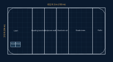

# P2-08 Rim Garden 2: plan

Footprint 652 ft 3 in (199 m) × 310 ft (94 m) · structural grid 32 ft 10 in (10 m)

## Levels

| Level | Floor above deck | Height | Floor area |
|---|---|---|---|
| Level 1 · Ground | 0 ft (0 mm) | 13 ft 1 in (4,000 mm) | 2,153 sq ft (200 m²) |

## Elements

| ID | Designation | Type | Name | Level(s) | Size / length | Area | Status |
|---|---|---|---|---|---|---|---|
| E001 | D5F1P2B7A2R1 | zone | Lawn | L1 | 164 ft 4 in (50 m) × 308 ft 1 in (94 m) | 49,451 sq ft (4,594 m²) | proposed |
| E002 | D5F1P2B7A2R2 | room | Kiosk | L1 | 32 ft 10 in (10 m) × 32 ft 10 in (10 m) | 1,076 sq ft (100 m²) | proposed |
| E003 | D5F1P2B7A2R3 | room | Toilets | L1 | 32 ft 10 in (10,000 mm) × 32 ft 10 in (10 m) | 1,076 sq ft (100 m²) | proposed |
| E004 | D5F1P2B7A2R4 | zone | Reading benches | L1 | 80 ft 5 in (24 m) × 307 ft 9 in (94 m) | 24,723 sq ft (2,297 m²) | proposed |
| E005 | D5F1P2B7A2R5 | zone | Sculpture walk | L1 | 80 ft 9 in (25 m) × 307 ft 9 in (94 m) | 24,824 sq ft (2,306 m²) | proposed |
| E006 | D5F1P2B7A2R6 | zone | Overlook rail | L1 | 80 ft 5 in (24 m) × 307 ft 9 in (94 m) | 24,723 sq ft (2,297 m²) | proposed |
| E007 | D5F1P2B7A2R7 | zone | Shade trees | L1 | 160 ft 9 in (49 m) × 307 ft 9 in (94 m) | 49,394 sq ft (4,589 m²) | proposed |
| E008 | D5F1P2B7A2R8 | zone | Paths | L1 | 84 ft 8 in (26 m) × 307 ft 1 in (94 m) | 24,778 sq ft (2,302 m²) | proposed |

## Drawings

### Level 1 · Ground

