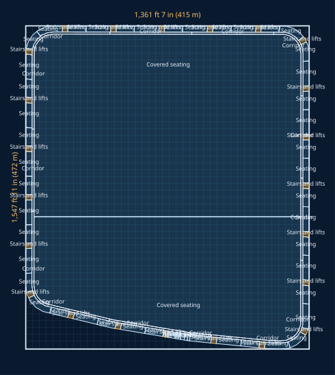

# P2-09 Plaza Pavilion 2: plan

Footprint 1,361 ft 7 in (415 m) × 1,547 ft 11 in (472 m) · structural grid 32 ft 10 in (10 m)

## Levels

| Level | Floor above deck | Height | Floor area |
|---|---|---|---|
| Level 1 · Pavilion floor | 0 ft (0 mm) | 19 ft 8 in (6,000 mm) | 1,926,086 sq ft (178,939 m²) |

## Elements

| ID | Designation | Type | Name | Level(s) | Size / length | Area | Status |
|---|---|---|---|---|---|---|---|
| E001 | D5F1P2B8A1R1 | room | Covered seating | L1 | 1,282 ft 6 in (391 m) × 874 ft 8 in (267 m) | 1,116,535 sq ft (103,730 m²) | proposed |
| E002 | D5F1P2B8A1R2 | room | Covered seating | L1 | 1,282 ft 2 in (391 m) × 594 ft 6 in (181 m) | 669,643 sq ft (62,212 m²) | proposed |
| E003 | D5F1P2B8A1R3 | core | Stairs and lifts | L1 | 30 ft 6 in (9,300 mm) × 33 ft 6 in (10 m) | 776 sq ft (72 m²) | proposed |
| E004 | D5F1P2B8A1R4 | core | Stairs and lifts | L1 | 31 ft 6 in (9,600 mm) × 33 ft 2 in (10 m) | 768 sq ft (71 m²) | proposed |
| E005 | D5F1P2B8A1R5 | core | Stairs and lifts | L1 | 34 ft 5 in (10 m) × 34 ft 1 in (10 m) | 771 sq ft (72 m²) | proposed |
| E006 | D5F1P2B8A1R6 | core | Stairs and lifts | L1 | 36 ft 5 in (11 m) × 34 ft 5 in (10 m) | 774 sq ft (72 m²) | proposed |
| E007 | D5F1P2B8A1R7 | core | Stairs and lifts | L1 | 29 ft 6 in (9,000 mm) × 27 ft 3 in (8,300 mm) | 770 sq ft (72 m²) | proposed |
| E008 | D5F1P2B8A1R8 | core | Stairs and lifts | L1 | 29 ft 10 in (9,100 mm) × 26 ft 7 in (8,100 mm) | 775 sq ft (72 m²) | proposed |
| E009 | D5F1P2B8A1R9 | core | Stairs and lifts | L1 | 29 ft 6 in (9,000 mm) × 27 ft 11 in (8,500 mm) | 775 sq ft (72 m²) | proposed |
| E010 | D5F1P2B8A1R10 | core | Stairs and lifts | L1 | 29 ft 6 in (9,000 mm) × 29 ft 2 in (8,900 mm) | 775 sq ft (72 m²) | proposed |
| E011 | D5F1P2B8A1R11 | core | Stairs and lifts | L1 | 30 ft 6 in (9,300 mm) × 30 ft 10 in (9,400 mm) | 775 sq ft (72 m²) | proposed |
| E012 | D5F1P2B8A1R12 | core | Stairs and lifts | L1 | 28 ft 3 in (8,600 mm) × 29 ft 6 in (9,000 mm) | 780 sq ft (72 m²) | proposed |
| E013 | D5F1P2B8A1R13 | core | Stairs and lifts | L1 | 26 ft 11 in (8,200 mm) × 29 ft 6 in (9,000 mm) | 775 sq ft (72 m²) | proposed |
| E014 | D5F1P2B8A1R14 | core | Stairs and lifts | L1 | 26 ft 11 in (8,200 mm) × 29 ft 6 in (9,000 mm) | 770 sq ft (72 m²) | proposed |
| E015 | D5F1P2B8A1R15 | core | Stairs and lifts | L1 | 28 ft 3 in (8,600 mm) × 29 ft 6 in (9,000 mm) | 770 sq ft (72 m²) | proposed |
| E016 | D5F1P2B8A1R16 | core | Stairs and lifts | L1 | 29 ft 6 in (9,000 mm) × 29 ft 10 in (9,100 mm) | 771 sq ft (72 m²) | proposed |
| E017 | D5F1P2B8A1R17 | core | Stairs and lifts | L1 | 38 ft 5 in (12 m) × 37 ft 9 in (11 m) | 777 sq ft (72 m²) | proposed |
| E018 | D5F1P2B8A1R18 | core | Stairs and lifts | L1 | 29 ft 10 in (9,100 mm) × 27 ft 7 in (8,400 mm) | 779 sq ft (72 m²) | proposed |
| E019 | D5F1P2B8A1R19 | core | Stairs and lifts | L1 | 29 ft 6 in (9,000 mm) × 26 ft 3 in (8,000 mm) | 770 sq ft (72 m²) | proposed |
| E020 | D5F1P2B8A1R20 | core | Stairs and lifts | L1 | 29 ft 6 in (9,000 mm) × 27 ft 3 in (8,300 mm) | 775 sq ft (72 m²) | proposed |
| E021 | D5F1P2B8A1R21 | core | Stairs and lifts | L1 | 29 ft 6 in (9,000 mm) × 28 ft 7 in (8,700 mm) | 775 sq ft (72 m²) | proposed |
| E022 | D5F1P2B8A1R22 | core | Stairs and lifts | L1 | 29 ft 6 in (9,000 mm) × 29 ft 6 in (9,000 mm) | 775 sq ft (72 m²) | proposed |
| E023 | D5F1P2B8A1R23 | core | Stairs and lifts | L1 | 37 ft 1 in (11 m) × 35 ft 9 in (11 m) | 786 sq ft (73 m²) | proposed |
| E024 | D5F1P2B8A1R24 | core | Stairs and lifts | L1 | 28 ft 3 in (8,600 mm) × 32 ft 2 in (9,800 mm) | 776 sq ft (72 m²) | proposed |
| E025 | D5F1P2B8A1R25 | core | Stairs and lifts | L1 | 29 ft 6 in (9,000 mm) × 31 ft 10 in (9,700 mm) | 779 sq ft (72 m²) | proposed |
| E026 | D5F1P2B8A1R26 | zone | Corridor | L1 | 389 ft 9 in (119 m) × 75 ft 6 in (23 m) | 3,926 sq ft (365 m²) | proposed |
| E027 | D5F1P2B8A1R27 | zone | Corridor | L1 | 365 ft 10 in (112 m) × 134 ft 2 in (41 m) | 3,907 sq ft (363 m²) | proposed |
| E028 | D5F1P2B8A1R28 | zone | Corridor | L1 | 17 ft 5 in (5,300 mm) × 394 ft 4 in (120 m) | 3,874 sq ft (360 m²) | proposed |
| E029 | D5F1P2B8A1R29 | zone | Corridor | L1 | 10 ft 6 in (3,200 mm) × 394 ft (120 m) | 3,875 sq ft (360 m²) | proposed |
| E030 | D5F1P2B8A1R30 | zone | Corridor | L1 | 14 ft 5 in (4,400 mm) × 395 ft (120 m) | 3,874 sq ft (360 m²) | proposed |
| E031 | D5F1P2B8A1R31 | zone | Corridor | L1 | 368 ft 5 in (112 m) × 73 ft 10 in (22 m) | 3,875 sq ft (360 m²) | proposed |
| E032 | D5F1P2B8A1R32 | zone | Corridor | L1 | 394 ft (120 m) × 10 ft 2 in (3,100 mm) | 3,875 sq ft (360 m²) | proposed |
| E033 | D5F1P2B8A1R33 | zone | Corridor | L1 | 394 ft 8 in (120 m) × 10 ft 6 in (3,200 mm) | 3,877 sq ft (360 m²) | proposed |
| E034 | D5F1P2B8A1R34 | zone | Corridor | L1 | 141 ft 1 in (43 m) × 304 ft 6 in (93 m) | 3,874 sq ft (360 m²) | proposed |
| E035 | D5F1P2B8A1R35 | zone | Corridor | L1 | 10 ft 2 in (3,100 mm) × 394 ft (120 m) | 3,875 sq ft (360 m²) | proposed |
| E036 | D5F1P2B8A1R36 | zone | Corridor | L1 | 10 ft 2 in (3,100 mm) × 394 ft 4 in (120 m) | 3,875 sq ft (360 m²) | proposed |
| E037 | D5F1P2B8A1R37 | zone | Corridor | L1 | 54 ft 2 in (16 m) × 381 ft 7 in (116 m) | 3,868 sq ft (359 m²) | proposed |
| E038 | D5F1P2B8A1R38 | zone | Corridor | L1 | 393 ft 1 in (120 m) × 39 ft 1 in (12 m) | 3,885 sq ft (361 m²) | proposed |
| E039 | D5F1P2B8A1R39 | zone | Corridor | L1 | 100 ft 1 in (30 m) × 19 ft 8 in (6,000 mm) | 985 sq ft (91 m²) | proposed |
| E040 | D5F1P2B8A1R40 | room | Ice cream counter | L1 | 14 ft 9 in (4,500 mm) × 31 ft 2 in (9,500 mm) | 325 sq ft (30 m²) | proposed |
| E041 | D5F1P2B8A1R41 | room | Juice bar | L1 | 18 ft 4 in (5,600 mm) × 31 ft 10 in (9,700 mm) | 434 sq ft (40 m²) | proposed |
| E042 | D5F1P2B8A1R42 | room | Bakery counter | L1 | 22 ft (6,700 mm) × 32 ft 2 in (9,800 mm) | 534 sq ft (50 m²) | proposed |
| E043 | D5F1P2B8A1R43 | room | Flower stall | L1 | 15 ft 1 in (4,600 mm) × 30 ft 10 in (9,400 mm) | 323 sq ft (30 m²) | proposed |
| E044 | D5F1P2B8A1R44 | room | Ticket kiosk | L1 | 14 ft 5 in (4,400 mm) × 31 ft 2 in (9,500 mm) | 305 sq ft (28 m²) | proposed |
| E045 | D5F1P2B8A1R45 | room | Toilets | L1 | 42 ft (13 m) × 35 ft 5 in (11 m) | 1,125 sq ft (104 m²) | proposed |
| E046 | D5F1P2B8A1R46 | room | Seating | L1 | 208 ft 4 in (64 m) × 62 ft 8 in (19 m) | 6,072 sq ft (564 m²) | proposed |
| E047 | D5F1P2B8A1R47 | room | Seating | L1 | 208 ft (63 m) × 75 ft 6 in (23 m) | 6,074 sq ft (564 m²) | proposed |
| E048 | D5F1P2B8A1R48 | room | Seating | L1 | 195 ft 6 in (60 m) × 106 ft 4 in (32 m) | 6,082 sq ft (565 m²) | proposed |
| E049 | D5F1P2B8A1R49 | room | Seating | L1 | 33 ft 2 in (10 m) × 210 ft (64 m) | 6,080 sq ft (565 m²) | proposed |
| E050 | D5F1P2B8A1R50 | room | Seating | L1 | 29 ft 6 in (9,000 mm) × 206 ft 8 in (63 m) | 6,084 sq ft (565 m²) | proposed |
| E051 | D5F1P2B8A1R51 | room | Seating | L1 | 29 ft 6 in (9,000 mm) × 207 ft (63 m) | 6,084 sq ft (565 m²) | proposed |
| E052 | D5F1P2B8A1R52 | room | Seating | L1 | 29 ft 10 in (9,100 mm) × 208 ft 4 in (64 m) | 6,085 sq ft (565 m²) | proposed |
| E053 | D5F1P2B8A1R53 | room | Seating | L1 | 29 ft 10 in (9,100 mm) × 209 ft 8 in (64 m) | 6,085 sq ft (565 m²) | proposed |
| E054 | D5F1P2B8A1R54 | room | Seating | L1 | 173 ft 11 in (53 m) × 113 ft 6 in (35 m) | 6,076 sq ft (564 m²) | proposed |
| E055 | D5F1P2B8A1R55 | room | Seating | L1 | 207 ft (63 m) × 29 ft 10 in (9,100 mm) | 6,079 sq ft (565 m²) | proposed |
| E056 | D5F1P2B8A1R56 | room | Seating | L1 | 206 ft 8 in (63 m) × 29 ft 10 in (9,100 mm) | 6,084 sq ft (565 m²) | proposed |
| E057 | D5F1P2B8A1R57 | room | Seating | L1 | 207 ft 8 in (63 m) × 29 ft 10 in (9,100 mm) | 6,089 sq ft (566 m²) | proposed |
| E058 | D5F1P2B8A1R58 | room | Seating | L1 | 209 ft (64 m) × 29 ft 6 in (9,000 mm) | 6,089 sq ft (566 m²) | proposed |
| E059 | D5F1P2B8A1R59 | room | Seating | L1 | 204 ft 9 in (62 m) × 68 ft 11 in (21 m) | 6,084 sq ft (565 m²) | proposed |
| E060 | D5F1P2B8A1R60 | room | Seating | L1 | 39 ft 8 in (12 m) × 210 ft 11 in (64 m) | 6,078 sq ft (565 m²) | proposed |
| E061 | D5F1P2B8A1R61 | room | Seating | L1 | 29 ft 6 in (9,000 mm) × 206 ft 8 in (63 m) | 6,084 sq ft (565 m²) | proposed |
| E062 | D5F1P2B8A1R62 | room | Seating | L1 | 29 ft 10 in (9,100 mm) × 206 ft 8 in (63 m) | 6,089 sq ft (566 m²) | proposed |
| E063 | D5F1P2B8A1R63 | room | Seating | L1 | 29 ft 10 in (9,100 mm) × 207 ft 8 in (63 m) | 6,084 sq ft (565 m²) | proposed |
| E064 | D5F1P2B8A1R64 | room | Seating | L1 | 29 ft 6 in (9,000 mm) × 208 ft 8 in (64 m) | 6,079 sq ft (565 m²) | proposed |
| E065 | D5F1P2B8A1R65 | room | Seating | L1 | 33 ft 10 in (10 m) × 210 ft 11 in (64 m) | 6,082 sq ft (565 m²) | proposed |
| E066 | D5F1P2B8A1R66 | room | Seating | L1 | 197 ft 6 in (60 m) × 82 ft 4 in (25 m) | 6,087 sq ft (566 m²) | proposed |
| E067 | D5F1P2B8A1R67 | room | Seating | L1 | 207 ft 8 in (63 m) × 49 ft 10 in (15 m) | 6,108 sq ft (567 m²) | proposed |
| E068 | D5F1P2B8A1R68 | room | Seating | L1 | 106 ft (32 m) × 39 ft 4 in (12 m) | 3,026 sq ft (281 m²) | proposed |

## Drawings

### Level 1 · Pavilion floor

