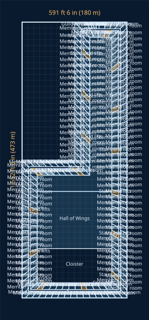
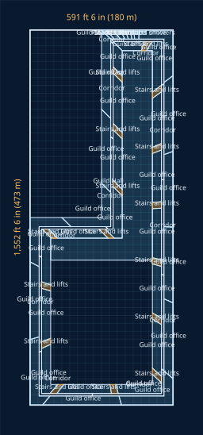

# P3-01 Pilots' Guild: plan

Footprint 591 ft 6 in (180 m) × 1,552 ft 6 in (473 m) · structural grid 32 ft 10 in (10 m)

## Levels

| Level | Floor above deck | Height | Floor area |
|---|---|---|---|
| Level 1 · Hall floor | 0 ft (0 mm) | 23 ft (7,000 mm) | 552,750 sq ft (51,352 m²) |
| Level 2 · Guild floor 1 | 23 ft (7,000 mm) | 14 ft 5 in (4,400 mm) | 417,411 sq ft (38,779 m²) |
| Level 3 · Guild floor 2 | 37 ft 5 in (11 m) | 14 ft 5 in (4,400 mm) | 281,988 sq ft (26,198 m²) |
| Level 4 · Guild floor 3 | 51 ft 10 in (16 m) | 14 ft 5 in (4,400 mm) | 281,988 sq ft (26,198 m²) |

## Elements

| ID | Designation | Type | Name | Level(s) | Size / length | Area | Status |
|---|---|---|---|---|---|---|---|
| E001 | D5F1P3B1A1L1R1, D5F1P3B1A1L2R1 | room | Guild Hall | L1, L2 | 420 ft 11 in (128 m) × 867 ft 5 in (264 m) | 135,423 sq ft (12,581 m²) | proposed |
| E002 | D5F1P3B1A1L1R2 | room | Hall of Wings | L1 | 420 ft 11 in (128 m) × 321 ft 6 in (98 m) | 135,339 sq ft (12,573 m²) | proposed |
| E003 | D5F1P3B1A1L1R3 | zone | Cloister | L1 | 420 ft 11 in (128 m) × 192 ft 11 in (59 m) | 81,203 sq ft (7,544 m²) | proposed |
| E004 | D5F1P3B1A1L1R4 | zone | Corridor | L1 | 220 ft 2 in (67 m) × 191 ft 11 in (58 m) | 3,875 sq ft (360 m²) | proposed |
| E005 | D5F1P3B1A1L1R5 | zone | Corridor | L1 | 9 ft 10 in (3,000 mm) × 398 ft 4 in (121 m) | 3,875 sq ft (360 m²) | proposed |
| E006 | D5F1P3B1A1L1R6 | zone | Corridor | L1 | 9 ft 10 in (3,000 mm) × 396 ft 4 in (121 m) | 3,875 sq ft (360 m²) | proposed |
| E007 | D5F1P3B1A1L1R7 | zone | Corridor | L1 | 9 ft 10 in (3,000 mm) × 399 ft 7 in (122 m) | 3,875 sq ft (360 m²) | proposed |
| E008 | D5F1P3B1A1L1R8 | zone | Corridor | L1 | 296 ft 7 in (90 m) × 111 ft 11 in (34 m) | 3,875 sq ft (360 m²) | proposed |
| E009 | D5F1P3B1A1L1R9 | zone | Corridor | L1 | 220 ft 10 in (67 m) × 185 ft 8 in (57 m) | 3,875 sq ft (360 m²) | proposed |
| E010 | D5F1P3B1A1L1R10 | zone | Corridor | L1 | 9 ft 10 in (3,000 mm) × 399 ft 3 in (122 m) | 3,875 sq ft (360 m²) | proposed |
| E011 | D5F1P3B1A1L1R11 | zone | Corridor | L1 | 284 ft 9 in (87 m) × 127 ft (39 m) | 3,875 sq ft (360 m²) | proposed |
| E012 | D5F1P3B1A1L1R12 | zone | Corridor | L1 | 30 ft 10 in (9,400 mm) × 382 ft 7 in (117 m) | 3,875 sq ft (360 m²) | proposed |
| E013 | D5F1P3B1A1L1R13 | zone | Corridor | L1 | 9 ft 10 in (3,000 mm) × 403 ft 7 in (123 m) | 3,875 sq ft (360 m²) | proposed |
| E014 | D5F1P3B1A1L1R14 | zone | Corridor | L1 | 9 ft 10 in (3,000 mm) × 19 ft 8 in (6,000 mm) | 97 sq ft (9 m²) | proposed |
| E015 | D5F1P3B1A1L1R15, D5F1P3B1A1L2R2, D5F1P3B1A1L3R1, D5F1P3B1A1L4R1 | core | Stairs and lifts | L1, L2, L3, L4 | 43 ft (13 m) × 37 ft 9 in (12 m) | 996 sq ft (93 m²) | proposed |
| E016 | D5F1P3B1A1L1R16, D5F1P3B1A1L2R3, D5F1P3B1A1L3R2, D5F1P3B1A1L4R2 | core | Stairs and lifts | L1, L2, L3, L4 | 37 ft 9 in (12 m) × 53 ft 10 in (16 m) | 990 sq ft (92 m²) | proposed |
| E017 | D5F1P3B1A1L1R17, D5F1P3B1A1L2R4, D5F1P3B1A1L3R3, D5F1P3B1A1L4R3 | core | Stairs and lifts | L1, L2, L3, L4 | 37 ft 9 in (12 m) × 41 ft 8 in (13 m) | 990 sq ft (92 m²) | proposed |
| E018 | D5F1P3B1A1L1R18, D5F1P3B1A1L2R5, D5F1P3B1A1L3R4, D5F1P3B1A1L4R4 | core | Stairs and lifts | L1, L2, L3, L4 | 37 ft 9 in (12 m) × 28 ft 10 in (8,800 mm) | 990 sq ft (92 m²) | proposed |
| E019 | D5F1P3B1A1L1R19, D5F1P3B1A1L2R6, D5F1P3B1A1L3R5, D5F1P3B1A1L4R5 | core | Stairs and lifts | L1, L2, L3, L4 | 37 ft 9 in (12 m) × 36 ft 1 in (11 m) | 990 sq ft (92 m²) | proposed |
| E020 | D5F1P3B1A1L1R20, D5F1P3B1A1L2R7, D5F1P3B1A1L3R6, D5F1P3B1A1L4R6 | core | Stairs and lifts | L1, L2, L3, L4 | 37 ft 9 in (12 m) × 48 ft 3 in (15 m) | 984 sq ft (91 m²) | proposed |
| E021 | D5F1P3B1A1L1R21, D5F1P3B1A1L2R8, D5F1P3B1A1L3R7, D5F1P3B1A1L4R7 | core | Stairs and lifts | L1, L2, L3, L4 | 37 ft 9 in (12 m) × 61 ft (19 m) | 990 sq ft (92 m²) | proposed |
| E022 | D5F1P3B1A1L1R22, D5F1P3B1A1L2R9, D5F1P3B1A1L3R8, D5F1P3B1A1L4R8 | core | Stairs and lifts | L1, L2, L3, L4 | 34 ft 5 in (10 m) × 37 ft 9 in (12 m) | 984 sq ft (91 m²) | proposed |
| E023 | D5F1P3B1A1L1R23, D5F1P3B1A1L2R10, D5F1P3B1A1L3R9, D5F1P3B1A1L4R9 | core | Stairs and lifts | L1, L2, L3, L4 | 56 ft 9 in (17 m) × 37 ft 9 in (12 m) | 996 sq ft (93 m²) | proposed |
| E024 | D5F1P3B1A1L1R24, D5F1P3B1A1L2R11, D5F1P3B1A1L3R10, D5F1P3B1A1L4R10 | core | Stairs and lifts | L1, L2, L3, L4 | 37 ft 9 in (12 m) × 41 ft 8 in (13 m) | 990 sq ft (92 m²) | proposed |
| E025 | D5F1P3B1A1L1R25, D5F1P3B1A1L2R12, D5F1P3B1A1L3R11, D5F1P3B1A1L4R11 | core | Stairs and lifts | L1, L2, L3, L4 | 37 ft 9 in (12 m) × 38 ft 1 in (12 m) | 984 sq ft (91 m²) | proposed |
| E026 | D5F1P3B1A1L1R26, D5F1P3B1A1L2R13, D5F1P3B1A1L3R12, D5F1P3B1A1L4R12 | core | Stairs and lifts | L1, L2, L3, L4 | 64 ft (19 m) × 37 ft 9 in (12 m) | 990 sq ft (92 m²) | proposed |
| E027 | D5F1P3B1A1L1R27, D5F1P3B1A1L2R14, D5F1P3B1A1L3R13, D5F1P3B1A1L4R13 | core | Stairs and lifts | L1, L2, L3, L4 | 64 ft (20 m) × 37 ft 9 in (12 m) | 990 sq ft (92 m²) | proposed |
| E028 | D5F1P3B1A1L1R28, D5F1P3B1A1L2R15, D5F1P3B1A1L3R14, D5F1P3B1A1L4R14 | core | Stairs and lifts | L1, L2, L3, L4 | 37 ft 9 in (12 m) × 64 ft (20 m) | 990 sq ft (92 m²) | proposed |
| E029 | D5F1P3B1A1L1R29, D5F1P3B1A1L2R16, D5F1P3B1A1L3R15, D5F1P3B1A1L4R15 | core | Stairs and lifts | L1, L2, L3, L4 | 37 ft 9 in (12 m) × 64 ft (20 m) | 990 sq ft (92 m²) | proposed |
| E030 | D5F1P3B1A1L1R30, D5F1P3B1A1L2R17, D5F1P3B1A1L3R16, D5F1P3B1A1L4R16 | core | Stairs and lifts | L1, L2, L3, L4 | 37 ft 9 in (12 m) × 64 ft (20 m) | 990 sq ft (92 m²) | proposed |
| E031 | D5F1P3B1A1L1R31 | room | Guild entrance hall | L1 | 86 ft 3 in (26 m) × 37 ft 9 in (12 m) | 2,148 sq ft (200 m²) | proposed |
| E032 | D5F1P3B1A1L1R32 | room | Members' desk | L1 | 35 ft 9 in (11 m) × 37 ft 9 in (12 m) | 650 sq ft (60 m²) | proposed |
| E033 | D5F1P3B1A1L1R33 | room | Welfare office | L1 | 27 ft 3 in (8,300 mm) × 37 ft 9 in (12 m) | 495 sq ft (46 m²) | proposed |
| E034 | D5F1P3B1A1L1R34 | room | Guild shop | L1 | 24 ft 3 in (7,400 mm) × 37 ft 9 in (12 m) | 538 sq ft (50 m²) | proposed |
| E035 | D5F1P3B1A1L1R35 | room | Toilets | L1 | 22 ft 8 in (6,900 mm) × 37 ft 9 in (12 m) | 650 sq ft (60 m²) | proposed |
| E036 | D5F1P3B1A1L1R36 | room | Members' room | L1 | 159 ft 5 in (49 m) × 201 ft 1 in (61 m) | 11,568 sq ft (1,075 m²) | proposed |
| E037 | D5F1P3B1A1L1R37 | room | Members' room | L1 | 37 ft 9 in (12 m) × 328 ft 5 in (100 m) | 11,568 sq ft (1,075 m²) | proposed |
| E038 | D5F1P3B1A1L1R38 | room | Members' room | L1 | 37 ft 9 in (12 m) × 314 ft (96 m) | 11,562 sq ft (1,074 m²) | proposed |
| E039 | D5F1P3B1A1L1R39 | room | Members' room | L1 | 37 ft 9 in (12 m) × 315 ft 3 in (96 m) | 11,568 sq ft (1,075 m²) | proposed |
| E040 | D5F1P3B1A1L1R40 | room | Members' room | L1 | 37 ft 9 in (12 m) × 330 ft 5 in (101 m) | 11,562 sq ft (1,074 m²) | proposed |
| E041 | D5F1P3B1A1L1R41 | room | Members' room | L1 | 210 ft 4 in (64 m) × 155 ft 10 in (48 m) | 11,562 sq ft (1,074 m²) | proposed |
| E042 | D5F1P3B1A1L1R42 | room | Members' room | L1 | 327 ft 5 in (100 m) × 37 ft 9 in (12 m) | 11,568 sq ft (1,075 m²) | proposed |
| E043 | D5F1P3B1A1L1R43 | room | Members' room | L1 | 95 ft 6 in (29 m) × 269 ft 8 in (82 m) | 11,568 sq ft (1,075 m²) | proposed |
| E044 | D5F1P3B1A1L1R44 | room | Members' room | L1 | 37 ft 9 in (12 m) × 322 ft 2 in (98 m) | 11,568 sq ft (1,075 m²) | proposed |
| E045 | D5F1P3B1A1L1R45 | room | Members' room | L1 | 156 ft 10 in (48 m) × 215 ft 7 in (66 m) | 11,562 sq ft (1,074 m²) | proposed |
| E046 | D5F1P3B1A1L1R46 | room | Members' room | L1 | 214 ft 7 in (65 m) × 167 ft 4 in (51 m) | 11,562 sq ft (1,074 m²) | proposed |
| E047 | D5F1P3B1A1L1R47 | room | Members' room | L1 | 37 ft 9 in (12 m) × 344 ft 6 in (105 m) | 11,574 sq ft (1,075 m²) | proposed |
| E048 | D5F1P3B1A1L1R48 | room | Members' room | L1 | 37 ft 9 in (12 m) × 377 ft 7 in (115 m) | 12,824 sq ft (1,191 m²) | proposed |
| E049 | D5F1P3B1A1L1R49 | room | Members' room | L1 | 128 ft 3 in (39 m) × 37 ft 9 in (12 m) | 3,930 sq ft (365 m²) | proposed |
| E050 | D5F1P3B1A1L1R50 | room | Members' room | L1 | 62 ft 4 in (19 m) × 209 ft 4 in (64 m) | 7,867 sq ft (731 m²) | proposed |
| E051 | D5F1P3B1A1L1R51 | room | Members' room | L1 | 37 ft 9 in (12 m) × 230 ft (70 m) | 7,867 sq ft (731 m²) | proposed |
| E052 | D5F1P3B1A1L1R52 | room | Members' room | L1 | 37 ft 9 in (12 m) × 217 ft 6 in (66 m) | 7,867 sq ft (731 m²) | proposed |
| E053 | D5F1P3B1A1L1R53 | room | Members' room | L1 | 37 ft 9 in (12 m) × 214 ft 3 in (65 m) | 7,873 sq ft (731 m²) | proposed |
| E054 | D5F1P3B1A1L1R54 | room | Members' room | L1 | 37 ft 9 in (12 m) × 224 ft 5 in (68 m) | 7,867 sq ft (731 m²) | proposed |
| E055 | D5F1P3B1A1L1R55 | room | Members' room | L1 | 37 ft 9 in (12 m) × 237 ft 2 in (72 m) | 7,873 sq ft (731 m²) | proposed |
| E056 | D5F1P3B1A1L1R56 | room | Members' room | L1 | 189 ft 8 in (58 m) × 79 ft 9 in (24 m) | 7,873 sq ft (731 m²) | proposed |
| E057 | D5F1P3B1A1L1R57 | room | Members' room | L1 | 225 ft 9 in (69 m) × 37 ft 9 in (12 m) | 7,867 sq ft (731 m²) | proposed |
| E058 | D5F1P3B1A1L1R58 | room | Members' room | L1 | 67 ft 3 in (20 m) × 203 ft 9 in (62 m) | 7,867 sq ft (731 m²) | proposed |
| E059 | D5F1P3B1A1L1R59 | room | Members' room | L1 | 37 ft 9 in (12 m) × 220 ft 10 in (67 m) | 7,873 sq ft (731 m²) | proposed |
| E060 | D5F1P3B1A1L1R60 | room | Members' room | L1 | 40 ft 4 in (12 m) × 231 ft 8 in (71 m) | 7,873 sq ft (731 m²) | proposed |
| E061 | D5F1P3B1A1L1R61 | room | Members' room | L1 | 246 ft 1 in (75 m) × 37 ft 9 in (12 m) | 7,860 sq ft (730 m²) | proposed |
| E062 | D5F1P3B1A1L1R62 | room | Members' room | L1 | 70 ft 3 in (21 m) × 213 ft 11 in (65 m) | 7,873 sq ft (731 m²) | proposed |
| E063 | D5F1P3B1A1L1R63 | room | Members' room | L1 | 37 ft 9 in (12 m) × 246 ft 5 in (75 m) | 7,873 sq ft (731 m²) | proposed |
| E064 | D5F1P3B1A1L1R64 | room | Members' room | L1 | 37 ft 9 in (12 m) × 246 ft 1 in (75 m) | 7,860 sq ft (730 m²) | proposed |
| E065 | D5F1P3B1A1L1R65 | room | Members' room | L1 | 37 ft 9 in (12 m) × 142 ft 1 in (43 m) | 3,936 sq ft (366 m²) | proposed |
| E066 | D5F1P3B1A1L2R18 | zone | Corridor | L2 | 220 ft 2 in (67 m) × 191 ft 11 in (58 m) | 3,875 sq ft (360 m²) | proposed |
| E067 | D5F1P3B1A1L2R19 | zone | Corridor | L2 | 9 ft 10 in (3,000 mm) × 398 ft 4 in (121 m) | 3,875 sq ft (360 m²) | proposed |
| E068 | D5F1P3B1A1L2R20 | zone | Corridor | L2 | 9 ft 10 in (3,000 mm) × 396 ft 4 in (121 m) | 3,875 sq ft (360 m²) | proposed |
| E069 | D5F1P3B1A1L2R21 | zone | Corridor | L2 | 9 ft 10 in (3,000 mm) × 399 ft 7 in (122 m) | 3,875 sq ft (360 m²) | proposed |
| E070 | D5F1P3B1A1L2R22 | zone | Corridor | L2 | 296 ft 7 in (90 m) × 111 ft 11 in (34 m) | 3,875 sq ft (360 m²) | proposed |
| E071 | D5F1P3B1A1L2R23 | zone | Corridor | L2 | 220 ft 10 in (67 m) × 185 ft 8 in (57 m) | 3,875 sq ft (360 m²) | proposed |
| E072 | D5F1P3B1A1L2R24 | zone | Corridor | L2 | 9 ft 10 in (3,000 mm) × 399 ft 3 in (122 m) | 3,875 sq ft (360 m²) | proposed |
| E073 | D5F1P3B1A1L2R25 | zone | Corridor | L2 | 284 ft 9 in (87 m) × 127 ft (39 m) | 3,875 sq ft (360 m²) | proposed |
| E074 | D5F1P3B1A1L2R26 | zone | Corridor | L2 | 30 ft 10 in (9,400 mm) × 382 ft 7 in (117 m) | 3,875 sq ft (360 m²) | proposed |
| E075 | D5F1P3B1A1L2R27 | zone | Corridor | L2 | 9 ft 10 in (3,000 mm) × 403 ft 7 in (123 m) | 3,875 sq ft (360 m²) | proposed |
| E076 | D5F1P3B1A1L2R28 | zone | Corridor | L2 | 9 ft 10 in (3,000 mm) × 19 ft 8 in (6,000 mm) | 97 sq ft (9 m²) | proposed |
| E077 | D5F1P3B1A1L2R29 | room | Guild Master's office | L2 | 52 ft 6 in (16 m) × 37 ft 9 in (12 m) | 650 sq ft (60 m²) | proposed |
| E078 | D5F1P3B1A1L2R30 | room | Council room | L2 | 57 ft 1 in (17 m) × 37 ft 9 in (12 m) | 1,071 sq ft (99 m²) | proposed |
| E079 | D5F1P3B1A1L2R31 | room | Standards office | L2 | 44 ft (13 m) × 37 ft 9 in (12 m) | 860 sq ft (80 m²) | proposed |
| E080 | D5F1P3B1A1L2R32 | room | Legal office | L2 | 32 ft 6 in (9,900 mm) × 37 ft 9 in (12 m) | 650 sq ft (60 m²) | proposed |
| E081 | D5F1P3B1A1L2R33 | room | Pay and contracts office | L2 | 27 ft 3 in (8,300 mm) × 37 ft 9 in (12 m) | 644 sq ft (60 m²) | proposed |
| E082 | D5F1P3B1A1L2R34 | room | Tea point | L2 | 19 ft (5,800 mm) × 37 ft 9 in (12 m) | 501 sq ft (47 m²) | proposed |
| E083 | D5F1P3B1A1L2R35 | room | Staff toilets and showers | L2 | 23 ft (7,000 mm) × 37 ft 9 in (12 m) | 755 sq ft (70 m²) | proposed |
| E084 | D5F1P3B1A1L2R36 | room | Guild office | L2 | 141 ft 9 in (43 m) × 217 ft 2 in (66 m) | 11,543 sq ft (1,072 m²) | proposed |
| E085 | D5F1P3B1A1L2R37 | room | Guild office | L2 | 37 ft 9 in (12 m) × 327 ft 1 in (100 m) | 11,549 sq ft (1,073 m²) | proposed |
| E086 | D5F1P3B1A1L2R38 | room | Guild office | L2 | 37 ft 9 in (12 m) × 313 ft 8 in (96 m) | 11,543 sq ft (1,072 m²) | proposed |
| E087 | D5F1P3B1A1L2R39 | room | Guild office | L2 | 37 ft 9 in (12 m) × 315 ft 7 in (96 m) | 11,549 sq ft (1,073 m²) | proposed |
| E088 | D5F1P3B1A1L2R40 | room | Guild office | L2 | 37 ft 9 in (12 m) × 330 ft 9 in (101 m) | 11,549 sq ft (1,073 m²) | proposed |
| E089 | D5F1P3B1A1L2R41 | room | Guild office | L2 | 223 ft 9 in (68 m) × 141 ft 5 in (43 m) | 11,549 sq ft (1,073 m²) | proposed |
| E090 | D5F1P3B1A1L2R42 | room | Guild office | L2 | 326 ft 9 in (100 m) × 37 ft 9 in (12 m) | 11,543 sq ft (1,072 m²) | proposed |
| E091 | D5F1P3B1A1L2R43 | room | Guild office | L2 | 82 ft 8 in (25 m) × 282 ft 6 in (86 m) | 11,549 sq ft (1,073 m²) | proposed |
| E092 | D5F1P3B1A1L2R44 | room | Guild office | L2 | 37 ft 9 in (12 m) × 321 ft 10 in (98 m) | 11,549 sq ft (1,073 m²) | proposed |
| E093 | D5F1P3B1A1L2R45 | room | Guild office | L2 | 169 ft 3 in (52 m) × 203 ft 5 in (62 m) | 11,549 sq ft (1,073 m²) | proposed |
| E094 | D5F1P3B1A1L2R46 | room | Guild office | L2 | 202 ft 1 in (62 m) × 179 ft 6 in (55 m) | 11,549 sq ft (1,073 m²) | proposed |
| E095 | D5F1P3B1A1L2R47 | room | Guild office | L2 | 37 ft 9 in (12 m) × 343 ft 10 in (105 m) | 11,549 sq ft (1,073 m²) | proposed |
| E096 | D5F1P3B1A1L2R48 | room | Guild office | L2 | 37 ft 9 in (12 m) × 366 ft 2 in (112 m) | 12,391 sq ft (1,151 m²) | proposed |
| E097 | D5F1P3B1A1L2R49 | room | Guild office | L2 | 128 ft 3 in (39 m) × 37 ft 9 in (12 m) | 3,930 sq ft (365 m²) | proposed |
| E098 | D5F1P3B1A1L2R50 | room | Guild office | L2 | 62 ft 4 in (19 m) × 209 ft 4 in (64 m) | 7,867 sq ft (731 m²) | proposed |
| E099 | D5F1P3B1A1L2R51 | room | Guild office | L2 | 37 ft 9 in (12 m) × 230 ft (70 m) | 7,867 sq ft (731 m²) | proposed |
| E100 | D5F1P3B1A1L2R52 | room | Guild office | L2 | 37 ft 9 in (12 m) × 217 ft 6 in (66 m) | 7,867 sq ft (731 m²) | proposed |
| E101 | D5F1P3B1A1L2R53 | room | Guild office | L2 | 37 ft 9 in (12 m) × 214 ft 3 in (65 m) | 7,873 sq ft (731 m²) | proposed |
| E102 | D5F1P3B1A1L2R54 | room | Guild office | L2 | 37 ft 9 in (12 m) × 224 ft 5 in (68 m) | 7,867 sq ft (731 m²) | proposed |
| E103 | D5F1P3B1A1L2R55 | room | Guild office | L2 | 37 ft 9 in (12 m) × 237 ft 2 in (72 m) | 7,873 sq ft (731 m²) | proposed |
| E104 | D5F1P3B1A1L2R56 | room | Guild office | L2 | 189 ft 8 in (58 m) × 79 ft 9 in (24 m) | 7,873 sq ft (731 m²) | proposed |
| E105 | D5F1P3B1A1L2R57 | room | Guild office | L2 | 225 ft 9 in (69 m) × 37 ft 9 in (12 m) | 7,867 sq ft (731 m²) | proposed |
| E106 | D5F1P3B1A1L2R58 | room | Guild office | L2 | 67 ft 3 in (20 m) × 203 ft 9 in (62 m) | 7,867 sq ft (731 m²) | proposed |
| E107 | D5F1P3B1A1L2R59 | room | Guild office | L2 | 37 ft 9 in (12 m) × 220 ft 10 in (67 m) | 7,873 sq ft (731 m²) | proposed |
| E108 | D5F1P3B1A1L2R60 | room | Guild office | L2 | 40 ft 4 in (12 m) × 231 ft 8 in (71 m) | 7,873 sq ft (731 m²) | proposed |
| E109 | D5F1P3B1A1L2R61 | room | Guild office | L2 | 246 ft 1 in (75 m) × 37 ft 9 in (12 m) | 7,860 sq ft (730 m²) | proposed |
| E110 | D5F1P3B1A1L2R62 | room | Guild office | L2 | 70 ft 3 in (21 m) × 213 ft 11 in (65 m) | 7,873 sq ft (731 m²) | proposed |
| E111 | D5F1P3B1A1L2R63 | room | Guild office | L2 | 37 ft 9 in (12 m) × 246 ft 5 in (75 m) | 7,873 sq ft (731 m²) | proposed |
| E112 | D5F1P3B1A1L2R64 | room | Guild office | L2 | 37 ft 9 in (12 m) × 246 ft 1 in (75 m) | 7,860 sq ft (730 m²) | proposed |
| E113 | D5F1P3B1A1L2R65 | room | Guild office | L2 | 37 ft 9 in (12 m) × 142 ft 1 in (43 m) | 3,936 sq ft (366 m²) | proposed |
| E114 | D5F1P3B1A1L3R17, D5F1P3B1A1L4R17 | zone | Corridor | L3, L4 | 220 ft 2 in (67 m) × 191 ft 11 in (58 m) | 3,875 sq ft (360 m²) | proposed |
| E115 | D5F1P3B1A1L3R18, D5F1P3B1A1L4R18 | zone | Corridor | L3, L4 | 9 ft 10 in (3,000 mm) × 398 ft 4 in (121 m) | 3,875 sq ft (360 m²) | proposed |
| E116 | D5F1P3B1A1L3R19, D5F1P3B1A1L4R19 | zone | Corridor | L3, L4 | 9 ft 10 in (3,000 mm) × 396 ft 4 in (121 m) | 3,875 sq ft (360 m²) | proposed |
| E117 | D5F1P3B1A1L3R20, D5F1P3B1A1L4R20 | zone | Corridor | L3, L4 | 9 ft 10 in (3,000 mm) × 399 ft 7 in (122 m) | 3,875 sq ft (360 m²) | proposed |
| E118 | D5F1P3B1A1L3R21, D5F1P3B1A1L4R21 | zone | Corridor | L3, L4 | 296 ft 7 in (90 m) × 111 ft 11 in (34 m) | 3,875 sq ft (360 m²) | proposed |
| E119 | D5F1P3B1A1L3R22, D5F1P3B1A1L4R22 | zone | Corridor | L3, L4 | 220 ft 10 in (67 m) × 185 ft 8 in (57 m) | 3,875 sq ft (360 m²) | proposed |
| E120 | D5F1P3B1A1L3R23, D5F1P3B1A1L4R23 | zone | Corridor | L3, L4 | 9 ft 10 in (3,000 mm) × 399 ft 3 in (122 m) | 3,875 sq ft (360 m²) | proposed |
| E121 | D5F1P3B1A1L3R24, D5F1P3B1A1L4R24 | zone | Corridor | L3, L4 | 284 ft 9 in (87 m) × 127 ft (39 m) | 3,875 sq ft (360 m²) | proposed |
| E122 | D5F1P3B1A1L3R25, D5F1P3B1A1L4R25 | zone | Corridor | L3, L4 | 30 ft 10 in (9,400 mm) × 382 ft 7 in (117 m) | 3,875 sq ft (360 m²) | proposed |
| E123 | D5F1P3B1A1L3R26, D5F1P3B1A1L4R26 | zone | Corridor | L3, L4 | 9 ft 10 in (3,000 mm) × 403 ft 7 in (123 m) | 3,875 sq ft (360 m²) | proposed |
| E124 | D5F1P3B1A1L3R27, D5F1P3B1A1L4R27 | zone | Corridor | L3, L4 | 9 ft 10 in (3,000 mm) × 19 ft 8 in (6,000 mm) | 97 sq ft (9 m²) | proposed |
| E125 | D5F1P3B1A1L3R28, D5F1P3B1A1L4R28 | room | Guild Master's office | L3, L4 | 52 ft 6 in (16 m) × 37 ft 9 in (12 m) | 650 sq ft (60 m²) | proposed |
| E126 | D5F1P3B1A1L3R29, D5F1P3B1A1L4R29 | room | Council room | L3, L4 | 57 ft 1 in (17 m) × 37 ft 9 in (12 m) | 1,071 sq ft (99 m²) | proposed |
| E127 | D5F1P3B1A1L3R30, D5F1P3B1A1L4R30 | room | Standards office | L3, L4 | 44 ft (13 m) × 37 ft 9 in (12 m) | 860 sq ft (80 m²) | proposed |
| E128 | D5F1P3B1A1L3R31, D5F1P3B1A1L4R31 | room | Legal office | L3, L4 | 32 ft 6 in (9,900 mm) × 37 ft 9 in (12 m) | 650 sq ft (60 m²) | proposed |
| E129 | D5F1P3B1A1L3R32, D5F1P3B1A1L4R32 | room | Pay and contracts office | L3, L4 | 27 ft 3 in (8,300 mm) × 37 ft 9 in (12 m) | 644 sq ft (60 m²) | proposed |
| E130 | D5F1P3B1A1L3R33, D5F1P3B1A1L4R33 | room | Tea point | L3, L4 | 19 ft (5,800 mm) × 37 ft 9 in (12 m) | 501 sq ft (47 m²) | proposed |
| E131 | D5F1P3B1A1L3R34, D5F1P3B1A1L4R34 | room | Staff toilets and showers | L3, L4 | 23 ft (7,000 mm) × 37 ft 9 in (12 m) | 755 sq ft (70 m²) | proposed |
| E132 | D5F1P3B1A1L3R35, D5F1P3B1A1L4R35 | room | Guild office | L3, L4 | 141 ft 9 in (43 m) × 217 ft 2 in (66 m) | 11,543 sq ft (1,072 m²) | proposed |
| E133 | D5F1P3B1A1L3R36, D5F1P3B1A1L4R36 | room | Guild office | L3, L4 | 37 ft 9 in (12 m) × 327 ft 1 in (100 m) | 11,549 sq ft (1,073 m²) | proposed |
| E134 | D5F1P3B1A1L3R37, D5F1P3B1A1L4R37 | room | Guild office | L3, L4 | 37 ft 9 in (12 m) × 313 ft 8 in (96 m) | 11,543 sq ft (1,072 m²) | proposed |
| E135 | D5F1P3B1A1L3R38, D5F1P3B1A1L4R38 | room | Guild office | L3, L4 | 37 ft 9 in (12 m) × 315 ft 7 in (96 m) | 11,549 sq ft (1,073 m²) | proposed |
| E136 | D5F1P3B1A1L3R39, D5F1P3B1A1L4R39 | room | Guild office | L3, L4 | 37 ft 9 in (12 m) × 330 ft 9 in (101 m) | 11,549 sq ft (1,073 m²) | proposed |
| E137 | D5F1P3B1A1L3R40, D5F1P3B1A1L4R40 | room | Guild office | L3, L4 | 223 ft 9 in (68 m) × 141 ft 5 in (43 m) | 11,549 sq ft (1,073 m²) | proposed |
| E138 | D5F1P3B1A1L3R41, D5F1P3B1A1L4R41 | room | Guild office | L3, L4 | 326 ft 9 in (100 m) × 37 ft 9 in (12 m) | 11,543 sq ft (1,072 m²) | proposed |
| E139 | D5F1P3B1A1L3R42, D5F1P3B1A1L4R42 | room | Guild office | L3, L4 | 82 ft 8 in (25 m) × 282 ft 6 in (86 m) | 11,549 sq ft (1,073 m²) | proposed |
| E140 | D5F1P3B1A1L3R43, D5F1P3B1A1L4R43 | room | Guild office | L3, L4 | 37 ft 9 in (12 m) × 321 ft 10 in (98 m) | 11,549 sq ft (1,073 m²) | proposed |
| E141 | D5F1P3B1A1L3R44, D5F1P3B1A1L4R44 | room | Guild office | L3, L4 | 169 ft 3 in (52 m) × 203 ft 5 in (62 m) | 11,549 sq ft (1,073 m²) | proposed |
| E142 | D5F1P3B1A1L3R45, D5F1P3B1A1L4R45 | room | Guild office | L3, L4 | 202 ft 1 in (62 m) × 179 ft 6 in (55 m) | 11,549 sq ft (1,073 m²) | proposed |
| E143 | D5F1P3B1A1L3R46, D5F1P3B1A1L4R46 | room | Guild office | L3, L4 | 37 ft 9 in (12 m) × 343 ft 10 in (105 m) | 11,549 sq ft (1,073 m²) | proposed |
| E144 | D5F1P3B1A1L3R47, D5F1P3B1A1L4R47 | room | Guild office | L3, L4 | 37 ft 9 in (12 m) × 366 ft 2 in (112 m) | 12,391 sq ft (1,151 m²) | proposed |
| E145 | D5F1P3B1A1L3R48, D5F1P3B1A1L4R48 | room | Guild office | L3, L4 | 128 ft 3 in (39 m) × 37 ft 9 in (12 m) | 3,930 sq ft (365 m²) | proposed |
| E146 | D5F1P3B1A1L3R49, D5F1P3B1A1L4R49 | room | Guild office | L3, L4 | 62 ft 4 in (19 m) × 209 ft 4 in (64 m) | 7,867 sq ft (731 m²) | proposed |
| E147 | D5F1P3B1A1L3R50, D5F1P3B1A1L4R50 | room | Guild office | L3, L4 | 37 ft 9 in (12 m) × 230 ft (70 m) | 7,867 sq ft (731 m²) | proposed |
| E148 | D5F1P3B1A1L3R51, D5F1P3B1A1L4R51 | room | Guild office | L3, L4 | 37 ft 9 in (12 m) × 217 ft 6 in (66 m) | 7,867 sq ft (731 m²) | proposed |
| E149 | D5F1P3B1A1L3R52, D5F1P3B1A1L4R52 | room | Guild office | L3, L4 | 37 ft 9 in (12 m) × 214 ft 3 in (65 m) | 7,873 sq ft (731 m²) | proposed |
| E150 | D5F1P3B1A1L3R53, D5F1P3B1A1L4R53 | room | Guild office | L3, L4 | 37 ft 9 in (12 m) × 224 ft 5 in (68 m) | 7,867 sq ft (731 m²) | proposed |
| E151 | D5F1P3B1A1L3R54, D5F1P3B1A1L4R54 | room | Guild office | L3, L4 | 37 ft 9 in (12 m) × 237 ft 2 in (72 m) | 7,873 sq ft (731 m²) | proposed |
| E152 | D5F1P3B1A1L3R55, D5F1P3B1A1L4R55 | room | Guild office | L3, L4 | 189 ft 8 in (58 m) × 79 ft 9 in (24 m) | 7,873 sq ft (731 m²) | proposed |
| E153 | D5F1P3B1A1L3R56, D5F1P3B1A1L4R56 | room | Guild office | L3, L4 | 225 ft 9 in (69 m) × 37 ft 9 in (12 m) | 7,867 sq ft (731 m²) | proposed |
| E154 | D5F1P3B1A1L3R57, D5F1P3B1A1L4R57 | room | Guild office | L3, L4 | 67 ft 3 in (20 m) × 203 ft 9 in (62 m) | 7,867 sq ft (731 m²) | proposed |
| E155 | D5F1P3B1A1L3R58, D5F1P3B1A1L4R58 | room | Guild office | L3, L4 | 37 ft 9 in (12 m) × 220 ft 10 in (67 m) | 7,873 sq ft (731 m²) | proposed |
| E156 | D5F1P3B1A1L3R59, D5F1P3B1A1L4R59 | room | Guild office | L3, L4 | 40 ft 4 in (12 m) × 231 ft 8 in (71 m) | 7,873 sq ft (731 m²) | proposed |
| E157 | D5F1P3B1A1L3R60, D5F1P3B1A1L4R60 | room | Guild office | L3, L4 | 246 ft 1 in (75 m) × 37 ft 9 in (12 m) | 7,860 sq ft (730 m²) | proposed |
| E158 | D5F1P3B1A1L3R61, D5F1P3B1A1L4R61 | room | Guild office | L3, L4 | 70 ft 3 in (21 m) × 213 ft 11 in (65 m) | 7,873 sq ft (731 m²) | proposed |
| E159 | D5F1P3B1A1L3R62, D5F1P3B1A1L4R62 | room | Guild office | L3, L4 | 37 ft 9 in (12 m) × 246 ft 5 in (75 m) | 7,873 sq ft (731 m²) | proposed |
| E160 | D5F1P3B1A1L3R63, D5F1P3B1A1L4R63 | room | Guild office | L3, L4 | 37 ft 9 in (12 m) × 246 ft 1 in (75 m) | 7,860 sq ft (730 m²) | proposed |
| E161 | D5F1P3B1A1L3R64, D5F1P3B1A1L4R64 | room | Guild office | L3, L4 | 37 ft 9 in (12 m) × 142 ft 1 in (43 m) | 3,936 sq ft (366 m²) | proposed |

## Drawings

### Level 1 · Hall floor

### Level 2 · Guild floor 1

### Level 3 · Guild floor 2

### Level 4 · Guild floor 3

