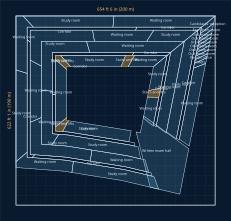
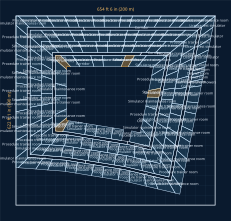

# P3-02 Licensing Hall: plan

Footprint 654 ft 6 in (200 m) × 622 ft 1 in (190 m) · structural grid 32 ft 10 in (10 m)

## Levels

| Level | Floor above deck | Height | Floor area |
|---|---|---|---|
| Level 1 · Exam floor | 0 ft (0 mm) | 18 ft 1 in (5,500 mm) | 235,931 sq ft (21,919 m²) |
| Level 2 · Simulator floor | 18 ft 1 in (5,500 mm) | 19 ft 8 in (6,000 mm) | 231,804 sq ft (21,535 m²) |

## Elements

| ID | Designation | Type | Name | Level(s) | Size / length | Area | Status |
|---|---|---|---|---|---|---|---|
| E001 | D5F1P3B2A1L1R1 | room | Written exam hall | L1 | 172 ft 11 in (53 m) × 257 ft 3 in (78 m) | 26,845 sq ft (2,494 m²) | proposed |
| E002 | D5F1P3B2A1L1R2 | zone | Corridor | L1 | 82 ft 4 in (25 m) × 370 ft 9 in (113 m) | 3,668 sq ft (341 m²) | proposed |
| E003 | D5F1P3B2A1L1R3 | zone | Corridor | L1 | 394 ft 8 in (120 m) × 70 ft 6 in (22 m) | 3,876 sq ft (360 m²) | proposed |
| E004 | D5F1P3B2A1L1R4 | zone | Corridor | L1 | 24 ft 11 in (7,600 mm) × 387 ft 6 in (118 m) | 3,872 sq ft (360 m²) | proposed |
| E005 | D5F1P3B2A1L1R5 | zone | Corridor | L1 | 360 ft 3 in (110 m) × 49 ft 3 in (15 m) | 3,875 sq ft (360 m²) | proposed |
| E006 | D5F1P3B2A1L1R6 | zone | Corridor | L1 | 216 ft 10 in (66 m) × 9 ft 10 in (3,000 mm) | 2,055 sq ft (191 m²) | proposed |
| E007 | D5F1P3B2A1L1R7 | zone | Corridor | L1 | 57 ft 1 in (17 m) × 244 ft 9 in (75 m) | 2,374 sq ft (221 m²) | proposed |
| E008 | D5F1P3B2A1L1R8 | zone | Corridor | L1 | 271 ft (83 m) × 169 ft 11 in (52 m) | 3,911 sq ft (363 m²) | proposed |
| E009 | D5F1P3B2A1L1R9 | zone | Corridor | L1 | 267 ft 9 in (82 m) × 138 ft 5 in (42 m) | 3,875 sq ft (360 m²) | proposed |
| E010 | D5F1P3B2A1L1R10 | zone | Corridor | L1 | 126 ft 4 in (38 m) × 9 ft 10 in (3,000 mm) | 1,159 sq ft (108 m²) | proposed |
| E011 | D5F1P3B2A1L1R11, D5F1P3B2A1L2R1 | core | Stairs and lifts | L1, L2 | 43 ft 4 in (13 m) × 29 ft 10 in (9,100 mm) | 967 sq ft (90 m²) | proposed |
| E012 | D5F1P3B2A1L1R12, D5F1P3B2A1L2R2 | core | Stairs and lifts | L1, L2 | 42 ft 8 in (13 m) × 45 ft 7 in (14 m) | 966 sq ft (90 m²) | proposed |
| E013 | D5F1P3B2A1L1R13, D5F1P3B2A1L2R3 | core | Stairs and lifts | L1, L2 | 49 ft 6 in (15 m) × 46 ft 3 in (14 m) | 964 sq ft (90 m²) | proposed |
| E014 | D5F1P3B2A1L1R14, D5F1P3B2A1L2R4 | core | Stairs and lifts | L1, L2 | 44 ft (13 m) × 36 ft 9 in (11 m) | 964 sq ft (90 m²) | proposed |
| E015 | D5F1P3B2A1L1R15 | room | Candidates' reception | L1 | 48 ft 11 in (15 m) × 58 ft 1 in (18 m) | 856 sq ft (80 m²) | proposed |
| E016 | D5F1P3B2A1L1R16 | room | Examiners' room | L1 | 47 ft 3 in (14 m) × 49 ft 6 in (15 m) | 651 sq ft (60 m²) | proposed |
| E017 | D5F1P3B2A1L1R17 | room | Oral exam room | L1 | 45 ft 11 in (14 m) × 42 ft 4 in (13 m) | 468 sq ft (44 m²) | proposed |
| E018 | D5F1P3B2A1L1R18 | room | Oral exam room | L1 | 45 ft 7 in (14 m) × 40 ft 8 in (12 m) | 469 sq ft (44 m²) | proposed |
| E019 | D5F1P3B2A1L1R19 | room | Oral exam room | L1 | 44 ft 11 in (14 m) × 38 ft 9 in (12 m) | 472 sq ft (44 m²) | proposed |
| E020 | D5F1P3B2A1L1R20 | room | Oral exam room | L1 | 44 ft 7 in (14 m) × 36 ft 9 in (11 m) | 473 sq ft (44 m²) | proposed |
| E021 | D5F1P3B2A1L1R21 | room | Oral exam room | L1 | 44 ft 3 in (14 m) × 34 ft 9 in (11 m) | 467 sq ft (43 m²) | proposed |
| E022 | D5F1P3B2A1L1R22 | room | Oral exam room | L1 | 44 ft (13 m) × 32 ft 10 in (10 m) | 467 sq ft (43 m²) | proposed |
| E023 | D5F1P3B2A1L1R23 | room | Results office | L1 | 43 ft 8 in (13 m) × 31 ft 2 in (9,500 mm) | 474 sq ft (44 m²) | proposed |
| E024 | D5F1P3B2A1L1R24 | room | Toilets | L1 | 44 ft (13 m) × 33 ft 10 in (10 m) | 648 sq ft (60 m²) | proposed |
| E025 | D5F1P3B2A1L1R25 | room | Waiting room | L1 | 86 ft 7 in (26 m) × 271 ft 4 in (83 m) | 9,381 sq ft (872 m²) | proposed |
| E026 | D5F1P3B2A1L1R26 | room | Study room | L1 | 285 ft 1 in (87 m) × 91 ft 2 in (28 m) | 10,291 sq ft (956 m²) | proposed |
| E027 | D5F1P3B2A1L1R27 | room | Waiting room | L1 | 188 ft 8 in (58 m) × 66 ft 11 in (20 m) | 6,831 sq ft (635 m²) | proposed |
| E028 | D5F1P3B2A1L1R28 | room | Study room | L1 | 36 ft 9 in (11 m) × 301 ft 6 in (92 m) | 10,295 sq ft (956 m²) | proposed |
| E029 | D5F1P3B2A1L1R29 | room | Waiting room | L1 | 57 ft 1 in (17 m) × 189 ft (58 m) | 6,860 sq ft (637 m²) | proposed |
| E030 | D5F1P3B2A1L1R30 | room | Study room | L1 | 298 ft 7 in (91 m) × 36 ft 9 in (11 m) | 10,289 sq ft (956 m²) | proposed |
| E031 | D5F1P3B2A1L1R31 | room | Waiting room | L1 | 335 ft 11 in (102 m) × 36 ft 9 in (11 m) | 11,465 sq ft (1,065 m²) | proposed |
| E032 | D5F1P3B2A1L1R32 | room | Study room | L1 | 103 ft 4 in (32 m) × 357 ft 3 in (109 m) | 12,197 sq ft (1,133 m²) | proposed |
| E033 | D5F1P3B2A1L1R33 | room | Waiting room | L1 | 192 ft 3 in (59 m) × 72 ft 10 in (22 m) | 6,848 sq ft (636 m²) | proposed |
| E034 | D5F1P3B2A1L1R34 | room | Study room | L1 | 203 ft 1 in (62 m) × 143 ft 4 in (44 m) | 10,237 sq ft (951 m²) | proposed |
| E035 | D5F1P3B2A1L1R35 | room | Waiting room | L1 | 36 ft 5 in (11 m) × 204 ft 5 in (62 m) | 6,804 sq ft (632 m²) | proposed |
| E036 | D5F1P3B2A1L1R36 | room | Study room | L1 | 211 ft 3 in (64 m) × 118 ft 1 in (36 m) | 10,204 sq ft (948 m²) | proposed |
| E037 | D5F1P3B2A1L1R37 | room | Waiting room | L1 | 201 ft 5 in (61 m) × 36 ft 5 in (11 m) | 6,798 sq ft (632 m²) | proposed |
| E038 | D5F1P3B2A1L1R38 | room | Study room | L1 | 168 ft (51 m) × 36 ft 5 in (11 m) | 4,881 sq ft (453 m²) | proposed |
| E039 | D5F1P3B2A1L1R39 | room | Waiting room | L1 | 92 ft 2 in (28 m) × 302 ft 2 in (92 m) | 10,138 sq ft (942 m²) | proposed |
| E040 | D5F1P3B2A1L1R40 | room | Study room | L1 | 292 ft (89 m) × 81 ft (25 m) | 10,247 sq ft (952 m²) | proposed |
| E041 | D5F1P3B2A1L1R41 | room | Waiting room | L1 | 58 ft 1 in (18 m) × 179 ft 9 in (55 m) | 6,858 sq ft (637 m²) | proposed |
| E042 | D5F1P3B2A1L1R42 | room | Study room | L1 | 159 ft 5 in (49 m) × 164 ft 4 in (50 m) | 10,295 sq ft (956 m²) | proposed |
| E043 | D5F1P3B2A1L1R43 | room | Waiting room | L1 | 321 ft 6 in (98 m) × 36 ft 9 in (11 m) | 10,796 sq ft (1,003 m²) | proposed |
| E044 | D5F1P3B2A1L1R44 | room | Study room | L1 | 60 ft 4 in (18 m) × 115 ft 6 in (35 m) | 3,494 sq ft (325 m²) | proposed |
| E045 | D5F1P3B2A1L1R45 | room | Waiting room | L1 | 50 ft 10 in (16 m) × 95 ft 2 in (29 m) | 3,057 sq ft (284 m²) | proposed |
| E046 | D5F1P3B2A1L1R46 | room | Study room | L1 | 225 ft 9 in (69 m) × 68 ft 11 in (21 m) | 7,893 sq ft (733 m²) | proposed |
| E047 | D5F1P3B2A1L1R47 | room | Waiting room | L1 | 36 ft 9 in (11 m) × 221 ft 9 in (68 m) | 6,992 sq ft (650 m²) | proposed |
| E048 | D5F1P3B2A1L1R48 | room | Study room | L1 | 213 ft 11 in (65 m) × 36 ft 9 in (11 m) | 6,992 sq ft (650 m²) | proposed |
| E049 | D5F1P3B2A1L1R49 | room | Waiting room | L1 | 127 ft 11 in (39 m) × 36 ft 9 in (11 m) | 3,496 sq ft (325 m²) | proposed |
| E050 | D5F1P3B2A1L2R5 | zone | Corridor | L2 | 86 ft 11 in (26 m) × 394 ft 8 in (120 m) | 3,954 sq ft (367 m²) | proposed |
| E051 | D5F1P3B2A1L2R6 | zone | Corridor | L2 | 304 ft 6 in (93 m) × 117 ft 5 in (36 m) | 3,888 sq ft (361 m²) | proposed |
| E052 | D5F1P3B2A1L2R7 | zone | Corridor | L2 | 191 ft 11 in (58 m) × 231 ft (70 m) | 3,889 sq ft (361 m²) | proposed |
| E053 | D5F1P3B2A1L2R8 | zone | Corridor | L2 | 187 ft 8 in (57 m) × 217 ft 2 in (66 m) | 3,873 sq ft (360 m²) | proposed |
| E054 | D5F1P3B2A1L2R9 | zone | Corridor | L2 | 388 ft 1 in (118 m) × 9 ft 10 in (3,000 mm) | 3,747 sq ft (348 m²) | proposed |
| E055 | D5F1P3B2A1L2R10 | zone | Corridor | L2 | 143 ft 8 in (44 m) × 321 ft 2 in (98 m) | 3,851 sq ft (358 m²) | proposed |
| E056 | D5F1P3B2A1L2R11 | zone | Corridor | L2 | 246 ft 9 in (75 m) × 190 ft 7 in (58 m) | 3,898 sq ft (362 m²) | proposed |
| E057 | D5F1P3B2A1L2R12 | zone | Corridor | L2 | 294 ft (90 m) × 114 ft 2 in (35 m) | 3,877 sq ft (360 m²) | proposed |
| E058 | D5F1P3B2A1L2R13 | zone | Corridor | L2 | 101 ft 8 in (31 m) × 9 ft 10 in (3,000 mm) | 909 sq ft (84 m²) | proposed |
| E059 | D5F1P3B2A1L2R14 | room | Licence test simulator | L2 | 50 ft 10 in (16 m) × 68 ft 7 in (21 m) | 1,291 sq ft (120 m²) | proposed |
| E060 | D5F1P3B2A1L2R15 | room | Licence test simulator | L2 | 50 ft 2 in (15 m) × 63 ft 8 in (19 m) | 1,288 sq ft (120 m²) | proposed |
| E061 | D5F1P3B2A1L2R16 | room | Licence test simulator | L2 | 48 ft 11 in (15 m) × 58 ft 5 in (18 m) | 1,299 sq ft (121 m²) | proposed |
| E062 | D5F1P3B2A1L2R17 | room | Licence test simulator | L2 | 47 ft 11 in (15 m) × 53 ft 2 in (16 m) | 1,292 sq ft (120 m²) | proposed |
| E063 | D5F1P3B2A1L2R18 | room | Simulator control room | L2 | 43 ft 8 in (13 m) × 32 ft 2 in (9,800 mm) | 641 sq ft (60 m²) | proposed |
| E064 | D5F1P3B2A1L2R19 | room | Debrief room | L2 | 42 ft 4 in (13 m) × 25 ft 3 in (7,700 mm) | 472 sq ft (44 m²) | proposed |
| E065 | D5F1P3B2A1L2R20 | room | Debrief room | L2 | 42 ft (13 m) × 23 ft 4 in (7,100 mm) | 473 sq ft (44 m²) | proposed |
| E066 | D5F1P3B2A1L2R21 | room | Debrief room | L2 | 41 ft 8 in (13 m) × 21 ft 4 in (6,500 mm) | 467 sq ft (43 m²) | proposed |
| E067 | D5F1P3B2A1L2R22 | room | Staff toilets and showers | L2 | 42 ft 8 in (13 m) × 26 ft 7 in (8,100 mm) | 752 sq ft (70 m²) | proposed |
| E068 | D5F1P3B2A1L2R23 | room | Procedure trainer room | L2 | 93 ft 2 in (28 m) × 322 ft 10 in (98 m) | 11,142 sq ft (1,035 m²) | proposed |
| E069 | D5F1P3B2A1L2R24 | room | Simulator maintenance room | L2 | 191 ft 7 in (58 m) × 79 ft 9 in (24 m) | 7,468 sq ft (694 m²) | proposed |
| E070 | D5F1P3B2A1L2R25 | room | Procedure trainer room | L2 | 321 ft 2 in (98 m) × 75 ft 6 in (23 m) | 11,235 sq ft (1,044 m²) | proposed |
| E071 | D5F1P3B2A1L2R26 | room | Simulator maintenance room | L2 | 67 ft 7 in (21 m) × 193 ft 3 in (59 m) | 7,493 sq ft (696 m²) | proposed |
| E072 | D5F1P3B2A1L2R27 | room | Procedure trainer room | L2 | 48 ft 3 in (15 m) × 316 ft 3 in (96 m) | 11,248 sq ft (1,045 m²) | proposed |
| E073 | D5F1P3B2A1L2R28 | room | Simulator maintenance room | L2 | 225 ft 9 in (69 m) × 36 ft 9 in (11 m) | 7,505 sq ft (697 m²) | proposed |
| E074 | D5F1P3B2A1L2R29 | room | Procedure trainer room | L2 | 423 ft 7 in (129 m) × 36 ft 9 in (11 m) | 14,599 sq ft (1,356 m²) | proposed |
| E075 | D5F1P3B2A1L2R30 | room | Simulator maintenance room | L2 | 80 ft 5 in (24 m) × 218 ft 6 in (67 m) | 7,461 sq ft (693 m²) | proposed |
| E076 | D5F1P3B2A1L2R31 | room | Procedure trainer room | L2 | 130 ft 3 in (40 m) × 264 ft 5 in (81 m) | 11,186 sq ft (1,039 m²) | proposed |
| E077 | D5F1P3B2A1L2R32 | room | Simulator maintenance room | L2 | 209 ft 4 in (64 m) × 75 ft 9 in (23 m) | 7,505 sq ft (697 m²) | proposed |
| E078 | D5F1P3B2A1L2R33 | room | Procedure trainer room | L2 | 185 ft 8 in (57 m) × 180 ft 5 in (55 m) | 11,209 sq ft (1,041 m²) | proposed |
| E079 | D5F1P3B2A1L2R34 | room | Simulator maintenance room | L2 | 36 ft 5 in (11 m) × 223 ft 5 in (68 m) | 7,438 sq ft (691 m²) | proposed |
| E080 | D5F1P3B2A1L2R35 | room | Procedure trainer room | L2 | 299 ft 3 in (91 m) × 62 ft 8 in (19 m) | 11,147 sq ft (1,036 m²) | proposed |
| E081 | D5F1P3B2A1L2R36 | room | Simulator maintenance room | L2 | 259 ft 6 in (79 m) × 36 ft 5 in (11 m) | 8,501 sq ft (790 m²) | proposed |
| E082 | D5F1P3B2A1L2R37 | room | Procedure trainer room | L2 | 97 ft 5 in (30 m) × 334 ft 4 in (102 m) | 11,262 sq ft (1,046 m²) | proposed |
| E083 | D5F1P3B2A1L2R38 | room | Simulator maintenance room | L2 | 169 ft 11 in (52 m) × 98 ft 9 in (30 m) | 7,481 sq ft (695 m²) | proposed |
| E084 | D5F1P3B2A1L2R39 | room | Procedure trainer room | L2 | 240 ft 10 in (73 m) × 139 ft 9 in (43 m) | 11,229 sq ft (1,043 m²) | proposed |
| E085 | D5F1P3B2A1L2R40 | room | Simulator maintenance room | L2 | 36 ft 9 in (11 m) × 228 ft (70 m) | 7,505 sq ft (697 m²) | proposed |
| E086 | D5F1P3B2A1L2R41 | room | Procedure trainer room | L2 | 320 ft 6 in (98 m) × 48 ft 11 in (15 m) | 11,260 sq ft (1,046 m²) | proposed |
| E087 | D5F1P3B2A1L2R42 | room | Simulator maintenance room | L2 | 168 ft 8 in (51 m) × 36 ft 9 in (11 m) | 5,027 sq ft (467 m²) | proposed |
| E088 | D5F1P3B2A1L2R43 | room | Procedure trainer room | L2 | 60 ft 4 in (18 m) × 115 ft 6 in (35 m) | 3,494 sq ft (325 m²) | proposed |
| E089 | D5F1P3B2A1L2R44 | room | Simulator maintenance room | L2 | 96 ft 5 in (29 m) × 162 ft 1 in (49 m) | 6,973 sq ft (648 m²) | proposed |
| E090 | D5F1P3B2A1L2R45 | room | Procedure trainer room | L2 | 201 ft 1 in (61 m) × 65 ft (20 m) | 6,979 sq ft (648 m²) | proposed |
| E091 | D5F1P3B2A1L2R46 | room | Simulator maintenance room | L2 | 36 ft 9 in (11 m) × 221 ft 9 in (68 m) | 6,992 sq ft (650 m²) | proposed |
| E092 | D5F1P3B2A1L2R47 | room | Procedure trainer room | L2 | 213 ft 11 in (65 m) × 36 ft 9 in (11 m) | 6,992 sq ft (650 m²) | proposed |
| E093 | D5F1P3B2A1L2R48 | room | Simulator maintenance room | L2 | 127 ft 11 in (39 m) × 36 ft 9 in (11 m) | 3,496 sq ft (325 m²) | proposed |

## Drawings

### Level 1 · Exam floor

### Level 2 · Simulator floor

