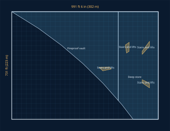

# P3-03 Guild Archive: plan

Footprint 991 ft 6 in (302 m) × 731 ft (223 m) · structural grid 32 ft 10 in (10 m)

## Levels

| Level | Floor above deck | Height | Floor area |
|---|---|---|---|
| Level B1 · Vault | −14 ft 9 in (4,500 mm) | 14 ft 9 in (4,500 mm) | 383,515 sq ft (35,630 m²) |
| Level 1 · Reading floor | 0 ft (0 mm) | 16 ft 5 in (5,000 mm) | 142,431 sq ft (13,232 m²) |
| Level 2 · Stacks 1 | 16 ft 5 in (5,000 mm) | 13 ft 1 in (4,000 mm) | 139,570 sq ft (12,967 m²) |
| Level 3 · Stacks 2 | 29 ft 6 in (9,000 mm) | 13 ft 1 in (4,000 mm) | 139,570 sq ft (12,967 m²) |

## Elements

| ID | Designation | Type | Name | Level(s) | Size / length | Area | Status |
|---|---|---|---|---|---|---|---|
| E001 | D5F1P3B3A1L1R1 | room | Reading room | L1 | 163 ft 5 in (50 m) × 185 ft (56 m) | 16,086 sq ft (1,494 m²) | proposed |
| E002 | D5F1P3B3A1L1R2 | zone | Corridor | L1 | 89 ft 3 in (27 m) × 46 ft 7 in (14 m) | 889 sq ft (83 m²) | proposed |
| E003 | D5F1P3B3A1L1R3 | zone | Corridor | L1 | 178 ft 6 in (54 m) × 269 ft 4 in (82 m) | 3,871 sq ft (360 m²) | proposed |
| E004 | D5F1P3B3A1L1R4 | zone | Corridor | L1 | 255 ft 7 in (78 m) × 184 ft 1 in (56 m) | 3,896 sq ft (362 m²) | proposed |
| E005 | D5F1P3B3A1L1R5 | zone | Corridor | L1 | 9 ft 10 in (3,000 mm) × 405 ft 6 in (124 m) | 3,873 sq ft (360 m²) | proposed |
| E006 | D5F1P3B3A1L1R6 | zone | Corridor | L1 | 9 ft 10 in (3,000 mm) × 72 ft 10 in (22 m) | 591 sq ft (55 m²) | proposed |
| E007 | D5F1P3B3A1LB1R1, D5F1P3B3A1L1R7, D5F1P3B3A1L2R1, D5F1P3B3A1L3R1 | core | Stairs and lifts | LB1, L1, L2, L3 | 82 ft (25 m) × 25 ft 3 in (7,700 mm) | 1,292 sq ft (120 m²) | proposed |
| E008 | D5F1P3B3A1LB1R2, D5F1P3B3A1L1R8, D5F1P3B3A1L2R2, D5F1P3B3A1L3R2 | core | Stairs and lifts | LB1, L1, L2, L3 | 26 ft 3 in (8,000 mm) × 72 ft 2 in (22 m) | 1,298 sq ft (121 m²) | proposed |
| E009 | D5F1P3B3A1LB1R3, D5F1P3B3A1L1R9, D5F1P3B3A1L2R3, D5F1P3B3A1L3R3 | core | Stairs and lifts | LB1, L1, L2, L3 | 49 ft 3 in (15 m) × 87 ft 3 in (27 m) | 1,292 sq ft (120 m²) | proposed |
| E010 | D5F1P3B3A1LB1R4, D5F1P3B3A1L1R10, D5F1P3B3A1L2R4, D5F1P3B3A1L3R4 | core | Stairs and lifts | LB1, L1, L2, L3 | 49 ft 3 in (15 m) × 54 ft 9 in (17 m) | 1,292 sq ft (120 m²) | proposed |
| E011 | D5F1P3B3A1L1R11 | room | Enquiry desk | L1 | 62 ft 4 in (19 m) × 78 ft 5 in (24 m) | 849 sq ft (79 m²) | proposed |
| E012 | D5F1P3B3A1L1R12 | room | Data room | L1 | 56 ft 5 in (17 m) × 76 ft 1 in (23 m) | 866 sq ft (80 m²) | proposed |
| E013 | D5F1P3B3A1L1R13 | room | Conservation lab | L1 | 50 ft 2 in (15 m) × 73 ft 6 in (22 m) | 852 sq ft (79 m²) | proposed |
| E014 | D5F1P3B3A1L1R14 | room | Toilets | L1 | 72 ft 6 in (22 m) × 82 ft 4 in (25 m) | 2,716 sq ft (252 m²) | proposed |
| E015 | D5F1P3B3A1L1R15 | room | Archivists' office | L1 | 102 ft 4 in (31 m) × 115 ft 2 in (35 m) | 5,161 sq ft (479 m²) | proposed |
| E016 | D5F1P3B3A1L1R16 | room | Archivists' office | L1 | 119 ft 1 in (36 m) × 98 ft 5 in (30 m) | 5,147 sq ft (478 m²) | proposed |
| E017 | D5F1P3B3A1L1R17 | room | Archivists' office | L1 | 124 ft 8 in (38 m) × 82 ft (25 m) | 5,148 sq ft (478 m²) | proposed |
| E018 | D5F1P3B3A1L1R18 | room | Archivists' office | L1 | 145 ft 4 in (44 m) × 78 ft 1 in (24 m) | 5,151 sq ft (479 m²) | proposed |
| E019 | D5F1P3B3A1L1R19 | room | Archivists' office | L1 | 121 ft 1 in (37 m) × 94 ft 10 in (29 m) | 5,143 sq ft (478 m²) | proposed |
| E020 | D5F1P3B3A1L1R20 | room | Archivists' office | L1 | 97 ft 9 in (30 m) × 111 ft 11 in (34 m) | 5,156 sq ft (479 m²) | proposed |
| E021 | D5F1P3B3A1L1R21 | room | Archivists' office | L1 | 98 ft 9 in (30 m) × 128 ft 7 in (39 m) | 5,165 sq ft (480 m²) | proposed |
| E022 | D5F1P3B3A1L1R22 | room | Archivists' office | L1 | 122 ft 1 in (37 m) × 144 ft 8 in (44 m) | 5,136 sq ft (477 m²) | proposed |
| E023 | D5F1P3B3A1L1R23 | room | Archivists' office | L1 | 49 ft 6 in (15 m) × 184 ft 9 in (56 m) | 5,160 sq ft (479 m²) | proposed |
| E024 | D5F1P3B3A1L1R24 | room | Archivists' office | L1 | 49 ft 6 in (15 m) × 157 ft 10 in (48 m) | 5,160 sq ft (479 m²) | proposed |
| E025 | D5F1P3B3A1L1R25 | room | Archivists' office | L1 | 49 ft 6 in (15 m) × 130 ft 11 in (40 m) | 5,169 sq ft (480 m²) | proposed |
| E026 | D5F1P3B3A1L1R26 | room | Archivists' office | L1 | 49 ft 6 in (15 m) × 117 ft 5 in (36 m) | 5,152 sq ft (479 m²) | proposed |
| E027 | D5F1P3B3A1L1R27 | room | Archivists' office | L1 | 49 ft 6 in (15 m) × 131 ft 7 in (40 m) | 5,169 sq ft (480 m²) | proposed |
| E028 | D5F1P3B3A1L1R28 | room | Archivists' office | L1 | 49 ft 6 in (15 m) × 182 ft 1 in (56 m) | 6,201 sq ft (576 m²) | proposed |
| E029 | D5F1P3B3A1L1R29 | room | Archivists' office | L1 | 92 ft 10 in (28 m) × 90 ft 7 in (28 m) | 3,577 sq ft (332 m²) | proposed |
| E030 | D5F1P3B3A1L1R30 | room | Archivists' office | L1 | 103 ft (31 m) × 114 ft 2 in (35 m) | 5,162 sq ft (480 m²) | proposed |
| E031 | D5F1P3B3A1L1R31 | room | Archivists' office | L1 | 81 ft 8 in (25 m) × 57 ft 5 in (18 m) | 2,413 sq ft (224 m²) | proposed |
| E032 | D5F1P3B3A1L1R32 | room | Archivists' office | L1 | 132 ft 10 in (40 m) × 76 ft 1 in (23 m) | 5,158 sq ft (479 m²) | proposed |
| E033 | D5F1P3B3A1L1R33 | room | Archivists' office | L1 | 116 ft 10 in (36 m) × 102 ft 8 in (31 m) | 5,353 sq ft (497 m²) | proposed |
| E034 | D5F1P3B3A1L1R34 | room | Archivists' office | L1 | 104 ft 8 in (32 m) × 132 ft 7 in (40 m) | 5,135 sq ft (477 m²) | proposed |
| E035 | D5F1P3B3A1L1R35 | room | Archivists' office | L1 | 70 ft 10 in (22 m) × 155 ft 2 in (47 m) | 5,352 sq ft (497 m²) | proposed |
| E036 | D5F1P3B3A1L1R36 | room | Archivists' office | L1 | 49 ft 3 in (15 m) × 140 ft 9 in (43 m) | 5,126 sq ft (476 m²) | proposed |
| E037 | D5F1P3B3A1L1R37 | room | Archivists' office | L1 | 49 ft 3 in (15 m) × 128 ft 11 in (39 m) | 5,344 sq ft (496 m²) | proposed |
| E038 | D5F1P3B3A1L1R38 | room | Archivists' office | L1 | 49 ft 3 in (15 m) × 159 ft 5 in (49 m) | 5,223 sq ft (485 m²) | proposed |
| E039 | D5F1P3B3A1L2R5, D5F1P3B3A1L3R5 | zone | Corridor | L2, L3 | 317 ft 7 in (97 m) × 238 ft 2 in (73 m) | 3,875 sq ft (360 m²) | proposed |
| E040 | D5F1P3B3A1L2R6, D5F1P3B3A1L3R6 | zone | Corridor | L2, L3 | 260 ft 2 in (79 m) × 244 ft 1 in (74 m) | 3,876 sq ft (360 m²) | proposed |
| E041 | D5F1P3B3A1L2R7, D5F1P3B3A1L3R7 | zone | Corridor | L2, L3 | 124 ft 8 in (38 m) × 260 ft 2 in (79 m) | 3,870 sq ft (360 m²) | proposed |
| E042 | D5F1P3B3A1L2R8, D5F1P3B3A1L3R8 | zone | Corridor | L2, L3 | 9 ft 10 in (3,000 mm) × 307 ft 1 in (94 m) | 2,932 sq ft (272 m²) | proposed |
| E043 | D5F1P3B3A1L2R9, D5F1P3B3A1L3R9 | room | Logbook stacks | L2, L3 | 98 ft 5 in (30 m) × 92 ft 10 in (28 m) | 3,214 sq ft (299 m²) | proposed |
| E044 | D5F1P3B3A1L2R10, D5F1P3B3A1L3R10 | room | Map and chart store | L2, L3 | 45 ft 11 in (14 m) × 71 ft 6 in (22 m) | 1,292 sq ft (120 m²) | proposed |
| E045 | D5F1P3B3A1L2R11, D5F1P3B3A1L3R11 | room | Record stacks | L2, L3 | 126 ft (38 m) × 94 ft 10 in (29 m) | 5,636 sq ft (524 m²) | proposed |
| E046 | D5F1P3B3A1L2R12, D5F1P3B3A1L3R12 | room | Record stacks | L2, L3 | 107 ft 7 in (33 m) × 119 ft 9 in (36 m) | 5,600 sq ft (520 m²) | proposed |
| E047 | D5F1P3B3A1L2R13, D5F1P3B3A1L3R13 | room | Record stacks | L2, L3 | 113 ft 10 in (35 m) × 117 ft 2 in (36 m) | 5,617 sq ft (522 m²) | proposed |
| E048 | D5F1P3B3A1L2R14, D5F1P3B3A1L3R14 | room | Record stacks | L2, L3 | 137 ft 6 in (42 m) × 94 ft 2 in (29 m) | 5,627 sq ft (523 m²) | proposed |
| E049 | D5F1P3B3A1L2R15, D5F1P3B3A1L3R15 | room | Record stacks | L2, L3 | 139 ft 5 in (42 m) × 79 ft 1 in (24 m) | 5,634 sq ft (523 m²) | proposed |
| E050 | D5F1P3B3A1L2R16, D5F1P3B3A1L3R16 | room | Record stacks | L2, L3 | 136 ft 10 in (42 m) × 94 ft 10 in (29 m) | 5,607 sq ft (521 m²) | proposed |
| E051 | D5F1P3B3A1L2R17, D5F1P3B3A1L3R17 | room | Record stacks | L2, L3 | 110 ft 7 in (34 m) × 113 ft 2 in (35 m) | 5,625 sq ft (523 m²) | proposed |
| E052 | D5F1P3B3A1L2R18, D5F1P3B3A1L3R18 | room | Record stacks | L2, L3 | 106 ft 11 in (33 m) × 131 ft 11 in (40 m) | 5,640 sq ft (524 m²) | proposed |
| E053 | D5F1P3B3A1L2R19, D5F1P3B3A1L3R19 | room | Record stacks | L2, L3 | 128 ft 11 in (39 m) × 149 ft 3 in (46 m) | 5,622 sq ft (522 m²) | proposed |
| E054 | D5F1P3B3A1L2R20, D5F1P3B3A1L3R20 | room | Record stacks | L2, L3 | 49 ft 6 in (15 m) × 193 ft 3 in (59 m) | 5,648 sq ft (525 m²) | proposed |
| E055 | D5F1P3B3A1L2R21, D5F1P3B3A1L3R21 | room | Record stacks | L2, L3 | 49 ft 6 in (15 m) × 163 ft 9 in (50 m) | 5,648 sq ft (525 m²) | proposed |
| E056 | D5F1P3B3A1L2R22, D5F1P3B3A1L3R22 | room | Record stacks | L2, L3 | 49 ft 6 in (15 m) × 134 ft 2 in (41 m) | 5,648 sq ft (525 m²) | proposed |
| E057 | D5F1P3B3A1L2R23, D5F1P3B3A1L3R23 | room | Record stacks | L2, L3 | 49 ft 6 in (15 m) × 128 ft 7 in (39 m) | 5,640 sq ft (524 m²) | proposed |
| E058 | D5F1P3B3A1L2R24, D5F1P3B3A1L3R24 | room | Record stacks | L2, L3 | 49 ft 6 in (15 m) × 152 ft 11 in (47 m) | 5,656 sq ft (525 m²) | proposed |
| E059 | D5F1P3B3A1L2R25, D5F1P3B3A1L3R25 | room | Record stacks | L2, L3 | 49 ft 6 in (15 m) × 139 ft 5 in (42 m) | 3,771 sq ft (350 m²) | proposed |
| E060 | D5F1P3B3A1L2R26, D5F1P3B3A1L3R26 | room | Record stacks | L2, L3 | 133 ft 2 in (41 m) × 98 ft 9 in (30 m) | 5,261 sq ft (489 m²) | proposed |
| E061 | D5F1P3B3A1L2R27, D5F1P3B3A1L3R27 | room | Record stacks | L2, L3 | 106 ft 11 in (33 m) × 124 ft 4 in (38 m) | 5,619 sq ft (522 m²) | proposed |
| E062 | D5F1P3B3A1L2R28, D5F1P3B3A1L3R28 | room | Record stacks | L2, L3 | 113 ft 6 in (35 m) × 95 ft 10 in (29 m) | 4,875 sq ft (453 m²) | proposed |
| E063 | D5F1P3B3A1L2R29, D5F1P3B3A1L3R29 | room | Record stacks | L2, L3 | 139 ft 1 in (42 m) × 83 ft (25 m) | 5,652 sq ft (525 m²) | proposed |
| E064 | D5F1P3B3A1L2R30, D5F1P3B3A1L3R30 | room | Record stacks | L2, L3 | 107 ft 3 in (33 m) × 98 ft 1 in (30 m) | 4,873 sq ft (453 m²) | proposed |
| E065 | D5F1P3B3A1L2R31, D5F1P3B3A1L3R31 | room | Record stacks | L2, L3 | 114 ft 6 in (35 m) × 139 ft 1 in (42 m) | 5,611 sq ft (521 m²) | proposed |
| E066 | D5F1P3B3A1L2R32, D5F1P3B3A1L3R32 | room | Record stacks | L2, L3 | 64 ft 8 in (20 m) × 155 ft 2 in (47 m) | 4,859 sq ft (451 m²) | proposed |
| E067 | D5F1P3B3A1L2R33, D5F1P3B3A1L3R33 | room | Record stacks | L2, L3 | 49 ft 3 in (15 m) × 148 ft 11 in (45 m) | 5,611 sq ft (521 m²) | proposed |
| E068 | D5F1P3B3A1L2R34, D5F1P3B3A1L3R34 | room | Record stacks | L2, L3 | 49 ft 3 in (15 m) × 117 ft 5 in (36 m) | 4,860 sq ft (452 m²) | proposed |
| E069 | D5F1P3B3A1L2R35, D5F1P3B3A1L3R35 | room | Record stacks | L2, L3 | 49 ft 3 in (15 m) × 159 ft 5 in (49 m) | 5,223 sq ft (485 m²) | proposed |
| E070 | D5F1P3B3A1LB1R5 | room | Fireproof vault | LB1 | 720 ft 2 in (220 m) × 602 ft 8 in (184 m) | 191,848 sq ft (17,823 m²) | proposed |
| E071 | D5F1P3B3A1LB1R6 | room | Deep store | LB1 | 271 ft 4 in (83 m) × 731 ft (223 m) | 191,667 sq ft (17,806 m²) | proposed |

## Drawings

### Level B1 · Vault

### Level 1 · Reading floor

### Level 2 · Stacks 1

### Level 3 · Stacks 2

