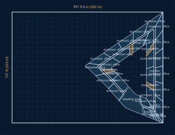
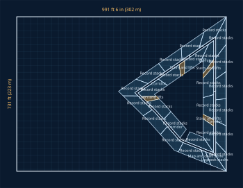

# P3-03 Guild Archive: plan

Footprint 991 ft 6 in (302 m) × 731 ft (223 m) · structural grid 32 ft 10 in (10 m)

## Levels

| Level | Floor above deck | Height | Floor area |
|---|---|---|---|
| Level B1 · Vault | −14 ft 9 in (4,500 mm) | 14 ft 9 in (4,500 mm) | 383,515 sq ft (35,630 m²) |
| Level 1 · Reading floor | 0 ft (0 mm) | 16 ft 5 in (5,000 mm) | 142,384 sq ft (13,228 m²) |
| Level 2 · Stacks 1 | 16 ft 5 in (5,000 mm) | 13 ft 1 in (4,000 mm) | 139,570 sq ft (12,967 m²) |
| Level 3 · Stacks 2 | 29 ft 6 in (9,000 mm) | 13 ft 1 in (4,000 mm) | 139,570 sq ft (12,967 m²) |

## Elements

| ID | Designation | Type | Name | Level(s) | Size / length | Area | Status |
|---|---|---|---|---|---|---|---|
| E001 | D5F1P3B3A1L1R1 | room | Reading room | L1 | 163 ft 5 in (50 m) × 185 ft (56 m) | 16,086 sq ft (1,494 m²) | proposed |
| E002 | D5F1P3B3A1L1R2 | zone | Corridor | L1 | 89 ft 3 in (27 m) × 46 ft 7 in (14 m) | 889 sq ft (83 m²) | proposed |
| E003 | D5F1P3B3A1L1R3 | zone | Corridor | L1 | 178 ft 6 in (54 m) × 269 ft 4 in (82 m) | 3,871 sq ft (360 m²) | proposed |
| E004 | D5F1P3B3A1L1R4 | zone | Corridor | L1 | 255 ft 7 in (78 m) × 184 ft 1 in (56 m) | 3,896 sq ft (362 m²) | proposed |
| E005 | D5F1P3B3A1L1R5 | zone | Corridor | L1 | 9 ft 10 in (3,000 mm) × 405 ft 6 in (124 m) | 3,873 sq ft (360 m²) | proposed |
| E006 | D5F1P3B3A1L1R6 | zone | Corridor | L1 | 9 ft 10 in (3,000 mm) × 72 ft 10 in (22 m) | 591 sq ft (55 m²) | proposed |
| E007 | D5F1P3B3A1LB1R1, D5F1P3B3A1L1R7, D5F1P3B3A1L2R1, D5F1P3B3A1L3R1 | core | Stairs and lifts | LB1, L1, L2, L3 | 82 ft (25 m) × 25 ft 3 in (7,700 mm) | 1,292 sq ft (120 m²) | proposed |
| E008 | D5F1P3B3A1LB1R2, D5F1P3B3A1L1R8, D5F1P3B3A1L2R2, D5F1P3B3A1L3R2 | core | Stairs and lifts | LB1, L1, L2, L3 | 26 ft 3 in (8,000 mm) × 72 ft 2 in (22 m) | 1,298 sq ft (121 m²) | proposed |
| E009 | D5F1P3B3A1LB1R3, D5F1P3B3A1L1R9, D5F1P3B3A1L2R3, D5F1P3B3A1L3R3 | core | Stairs and lifts | LB1, L1, L2, L3 | 49 ft 3 in (15 m) × 87 ft 3 in (27 m) | 1,292 sq ft (120 m²) | proposed |
| E010 | D5F1P3B3A1LB1R4, D5F1P3B3A1L1R10, D5F1P3B3A1L2R4, D5F1P3B3A1L3R4 | core | Stairs and lifts | LB1, L1, L2, L3 | 49 ft 3 in (15 m) × 54 ft 9 in (17 m) | 1,292 sq ft (120 m²) | proposed |
| E011 | D5F1P3B3A1L1R11 | room | Enquiry desk | L1 | 62 ft 4 in (19 m) × 78 ft 5 in (24 m) | 849 sq ft (79 m²) | proposed |
| E012 | D5F1P3B3A1L1R12 | room | Data room | L1 | 56 ft 5 in (17 m) × 76 ft 1 in (23 m) | 866 sq ft (80 m²) | proposed |
| E013 | D5F1P3B3A1L1R13 | room | Conservation lab | L1 | 50 ft 2 in (15 m) × 73 ft 6 in (22 m) | 852 sq ft (79 m²) | proposed |
| E014 | D5F1P3B3A1L1R14 | room | Toilets | L1 | 44 ft (13 m) × 70 ft 10 in (22 m) | 846 sq ft (79 m²) | proposed |
| E015 | D5F1P3B3A1L1R15 | room | Archivists' office | L1 | 39 ft 8 in (12 m) × 69 ft 3 in (21 m) | 967 sq ft (90 m²) | proposed |
| E016 | D5F1P3B3A1L1R16 | room | Archivists' office | L1 | 31 ft 10 in (9,700 mm) × 65 ft 11 in (20 m) | 906 sq ft (84 m²) | proposed |
| E017 | D5F1P3B3A1L1R17 | room | Archivists' office | L1 | 44 ft 11 in (14 m) × 53 ft 2 in (16 m) | 971 sq ft (90 m²) | proposed |
| E018 | D5F1P3B3A1L1R18 | room | Archivists' office | L1 | 45 ft 3 in (14 m) × 52 ft 6 in (16 m) | 962 sq ft (89 m²) | proposed |
| E019 | D5F1P3B3A1L1R19 | room | Archivists' office | L1 | 46 ft 3 in (14 m) × 51 ft 10 in (16 m) | 976 sq ft (91 m²) | proposed |
| E020 | D5F1P3B3A1L1R20 | room | Archivists' office | L1 | 46 ft 7 in (14 m) × 50 ft 10 in (16 m) | 957 sq ft (89 m²) | proposed |
| E021 | D5F1P3B3A1L1R21 | room | Archivists' office | L1 | 47 ft 7 in (14 m) × 50 ft 2 in (15 m) | 974 sq ft (90 m²) | proposed |
| E022 | D5F1P3B3A1L1R22 | room | Archivists' office | L1 | 48 ft 3 in (15 m) × 49 ft 6 in (15 m) | 971 sq ft (90 m²) | proposed |
| E023 | D5F1P3B3A1L1R23 | room | Archivists' office | L1 | 50 ft 10 in (16 m) × 46 ft 11 in (14 m) | 965 sq ft (90 m²) | proposed |
| E024 | D5F1P3B3A1L1R24 | room | Archivists' office | L1 | 55 ft 5 in (17 m) × 42 ft 8 in (13 m) | 977 sq ft (91 m²) | proposed |
| E025 | D5F1P3B3A1L1R25 | room | Archivists' office | L1 | 60 ft (18 m) × 37 ft 9 in (12 m) | 969 sq ft (90 m²) | proposed |
| E026 | D5F1P3B3A1L1R26 | room | Archivists' office | L1 | 65 ft (20 m) × 32 ft 10 in (10 m) | 968 sq ft (90 m²) | proposed |
| E027 | D5F1P3B3A1L1R27 | room | Archivists' office | L1 | 69 ft 11 in (21 m) × 27 ft 11 in (8,500 mm) | 961 sq ft (89 m²) | proposed |
| E028 | D5F1P3B3A1L1R28 | room | Archivists' office | L1 | 74 ft 10 in (23 m) × 23 ft 4 in (7,100 mm) | 979 sq ft (91 m²) | proposed |
| E029 | D5F1P3B3A1L1R29 | room | Archivists' office | L1 | 80 ft 1 in (24 m) × 18 ft 1 in (5,500 mm) | 960 sq ft (89 m²) | proposed |
| E030 | D5F1P3B3A1L1R30 | room | Archivists' office | L1 | 85 ft (26 m) × 16 ft 1 in (4,900 mm) | 960 sq ft (89 m²) | proposed |
| E031 | D5F1P3B3A1L1R31 | room | Archivists' office | L1 | 85 ft 11 in (26 m) × 18 ft 4 in (5,600 mm) | 979 sq ft (91 m²) | proposed |
| E032 | D5F1P3B3A1L1R32 | room | Archivists' office | L1 | 90 ft 3 in (28 m) × 20 ft (6,100 mm) | 969 sq ft (90 m²) | proposed |
| E033 | D5F1P3B3A1L1R33 | room | Archivists' office | L1 | 85 ft 4 in (26 m) × 23 ft 4 in (7,100 mm) | 967 sq ft (90 m²) | proposed |
| E034 | D5F1P3B3A1L1R34 | room | Archivists' office | L1 | 80 ft 9 in (25 m) × 26 ft 7 in (8,100 mm) | 969 sq ft (90 m²) | proposed |
| E035 | D5F1P3B3A1L1R35 | room | Archivists' office | L1 | 76 ft 1 in (23 m) × 29 ft 10 in (9,100 mm) | 970 sq ft (90 m²) | proposed |
| E036 | D5F1P3B3A1L1R36 | room | Archivists' office | L1 | 71 ft 6 in (22 m) × 32 ft 10 in (10 m) | 967 sq ft (90 m²) | proposed |
| E037 | D5F1P3B3A1L1R37 | room | Archivists' office | L1 | 67 ft 3 in (20 m) × 35 ft 9 in (11 m) | 969 sq ft (90 m²) | proposed |
| E038 | D5F1P3B3A1L1R38 | room | Archivists' office | L1 | 62 ft 8 in (19 m) × 39 ft 1 in (12 m) | 968 sq ft (90 m²) | proposed |
| E039 | D5F1P3B3A1L1R39 | room | Archivists' office | L1 | 58 ft 1 in (18 m) × 42 ft 4 in (13 m) | 970 sq ft (90 m²) | proposed |
| E040 | D5F1P3B3A1L1R40 | room | Archivists' office | L1 | 53 ft 6 in (16 m) × 45 ft 7 in (14 m) | 975 sq ft (91 m²) | proposed |
| E041 | D5F1P3B3A1L1R41 | room | Archivists' office | L1 | 48 ft 7 in (15 m) × 48 ft 11 in (15 m) | 972 sq ft (90 m²) | proposed |
| E042 | D5F1P3B3A1L1R42 | room | Archivists' office | L1 | 44 ft 3 in (14 m) × 51 ft 6 in (16 m) | 966 sq ft (90 m²) | proposed |
| E043 | D5F1P3B3A1L1R43 | room | Archivists' office | L1 | 39 ft 8 in (12 m) × 54 ft 9 in (17 m) | 965 sq ft (90 m²) | proposed |
| E044 | D5F1P3B3A1L1R44 | room | Archivists' office | L1 | 35 ft 1 in (11 m) × 58 ft 1 in (18 m) | 966 sq ft (90 m²) | proposed |
| E045 | D5F1P3B3A1L1R45 | room | Archivists' office | L1 | 30 ft 6 in (9,300 mm) × 61 ft 4 in (19 m) | 968 sq ft (90 m²) | proposed |
| E046 | D5F1P3B3A1L1R46 | room | Archivists' office | L1 | 25 ft 11 in (7,900 mm) × 64 ft 8 in (20 m) | 970 sq ft (90 m²) | proposed |
| E047 | D5F1P3B3A1L1R47 | room | Archivists' office | L1 | 21 ft 4 in (6,500 mm) × 67 ft 7 in (21 m) | 966 sq ft (90 m²) | proposed |
| E048 | D5F1P3B3A1L1R48 | room | Archivists' office | L1 | 18 ft 8 in (5,700 mm) × 70 ft 6 in (22 m) | 981 sq ft (91 m²) | proposed |
| E049 | D5F1P3B3A1L1R49 | room | Archivists' office | L1 | 20 ft (6,100 mm) × 73 ft 10 in (22 m) | 963 sq ft (90 m²) | proposed |
| E050 | D5F1P3B3A1L1R50 | room | Archivists' office | L1 | 24 ft 7 in (7,500 mm) × 77 ft 1 in (24 m) | 965 sq ft (90 m²) | proposed |
| E051 | D5F1P3B3A1L1R51 | room | Archivists' office | L1 | 29 ft 2 in (8,900 mm) × 80 ft 5 in (24 m) | 966 sq ft (90 m²) | proposed |
| E052 | D5F1P3B3A1L1R52 | room | Archivists' office | L1 | 33 ft 10 in (10 m) × 83 ft 8 in (26 m) | 962 sq ft (89 m²) | proposed |
| E053 | D5F1P3B3A1L1R53 | room | Archivists' office | L1 | 38 ft 5 in (12 m) × 86 ft 3 in (26 m) | 979 sq ft (91 m²) | proposed |
| E054 | D5F1P3B3A1L1R54 | room | Archivists' office | L1 | 42 ft 8 in (13 m) × 89 ft 7 in (27 m) | 964 sq ft (90 m²) | proposed |
| E055 | D5F1P3B3A1L1R55 | room | Archivists' office | L1 | 47 ft 3 in (14 m) × 92 ft 10 in (28 m) | 966 sq ft (90 m²) | proposed |
| E056 | D5F1P3B3A1L1R56 | room | Archivists' office | L1 | 52 ft 2 in (16 m) × 96 ft 2 in (29 m) | 979 sq ft (91 m²) | proposed |
| E057 | D5F1P3B3A1L1R57 | room | Archivists' office | L1 | 56 ft 9 in (17 m) × 99 ft 5 in (30 m) | 965 sq ft (90 m²) | proposed |
| E058 | D5F1P3B3A1L1R58 | room | Archivists' office | L1 | 61 ft 4 in (19 m) × 102 ft 8 in (31 m) | 973 sq ft (90 m²) | proposed |
| E059 | D5F1P3B3A1L1R59 | room | Archivists' office | L1 | 55 ft 5 in (17 m) × 103 ft 8 in (32 m) | 958 sq ft (89 m²) | proposed |
| E060 | D5F1P3B3A1L1R60 | room | Archivists' office | L1 | 49 ft 6 in (15 m) × 108 ft 7 in (33 m) | 975 sq ft (91 m²) | proposed |
| E061 | D5F1P3B3A1L1R61 | room | Archivists' office | L1 | 49 ft 6 in (15 m) × 103 ft 4 in (32 m) | 967 sq ft (90 m²) | proposed |
| E062 | D5F1P3B3A1L1R62 | room | Archivists' office | L1 | 49 ft 6 in (15 m) × 98 ft 5 in (30 m) | 975 sq ft (91 m²) | proposed |
| E063 | D5F1P3B3A1L1R63 | room | Archivists' office | L1 | 49 ft 6 in (15 m) × 93 ft 2 in (28 m) | 967 sq ft (90 m²) | proposed |
| E064 | D5F1P3B3A1L1R64 | room | Archivists' office | L1 | 49 ft 6 in (15 m) × 88 ft 3 in (27 m) | 975 sq ft (91 m²) | proposed |
| E065 | D5F1P3B3A1L1R65 | room | Archivists' office | L1 | 49 ft 6 in (15 m) × 83 ft (25 m) | 967 sq ft (90 m²) | proposed |
| E066 | D5F1P3B3A1L1R66 | room | Archivists' office | L1 | 49 ft 6 in (15 m) × 78 ft 1 in (24 m) | 975 sq ft (91 m²) | proposed |
| E067 | D5F1P3B3A1L1R67 | room | Archivists' office | L1 | 49 ft 6 in (15 m) × 72 ft 10 in (22 m) | 967 sq ft (90 m²) | proposed |
| E068 | D5F1P3B3A1L1R68 | room | Archivists' office | L1 | 49 ft 6 in (15 m) × 67 ft 11 in (21 m) | 975 sq ft (91 m²) | proposed |
| E069 | D5F1P3B3A1L1R69 | room | Archivists' office | L1 | 49 ft 6 in (15 m) × 62 ft 8 in (19 m) | 967 sq ft (90 m²) | proposed |
| E070 | D5F1P3B3A1L1R70 | room | Archivists' office | L1 | 49 ft 6 in (15 m) × 57 ft 9 in (18 m) | 975 sq ft (91 m²) | proposed |
| E071 | D5F1P3B3A1L1R71 | room | Archivists' office | L1 | 49 ft 6 in (15 m) × 52 ft 6 in (16 m) | 967 sq ft (90 m²) | proposed |
| E072 | D5F1P3B3A1L1R72 | room | Archivists' office | L1 | 49 ft 6 in (15 m) × 47 ft 7 in (14 m) | 975 sq ft (91 m²) | proposed |
| E073 | D5F1P3B3A1L1R73 | room | Archivists' office | L1 | 49 ft 6 in (15 m) × 42 ft 8 in (13 m) | 975 sq ft (91 m²) | proposed |
| E074 | D5F1P3B3A1L1R74 | room | Archivists' office | L1 | 49 ft 6 in (15 m) × 37 ft 9 in (12 m) | 975 sq ft (91 m²) | proposed |
| E075 | D5F1P3B3A1L1R75 | room | Archivists' office | L1 | 49 ft 6 in (15 m) × 32 ft 6 in (9,900 mm) | 967 sq ft (90 m²) | proposed |
| E076 | D5F1P3B3A1L1R76 | room | Archivists' office | L1 | 49 ft 6 in (15 m) × 27 ft 7 in (8,400 mm) | 975 sq ft (91 m²) | proposed |
| E077 | D5F1P3B3A1L1R77 | room | Archivists' office | L1 | 49 ft 6 in (15 m) × 22 ft 4 in (6,800 mm) | 967 sq ft (90 m²) | proposed |
| E078 | D5F1P3B3A1L1R78 | room | Archivists' office | L1 | 49 ft 6 in (15 m) × 22 ft 4 in (6,800 mm) | 975 sq ft (91 m²) | proposed |
| E079 | D5F1P3B3A1L1R79 | room | Archivists' office | L1 | 49 ft 6 in (15 m) × 26 ft 11 in (8,200 mm) | 967 sq ft (90 m²) | proposed |
| E080 | D5F1P3B3A1L1R80 | room | Archivists' office | L1 | 49 ft 6 in (15 m) × 32 ft 2 in (9,800 mm) | 975 sq ft (91 m²) | proposed |
| E081 | D5F1P3B3A1L1R81 | room | Archivists' office | L1 | 49 ft 6 in (15 m) × 37 ft 1 in (11 m) | 967 sq ft (90 m²) | proposed |
| E082 | D5F1P3B3A1L1R82 | room | Archivists' office | L1 | 49 ft 6 in (15 m) × 42 ft 4 in (13 m) | 975 sq ft (91 m²) | proposed |
| E083 | D5F1P3B3A1L1R83 | room | Archivists' office | L1 | 49 ft 6 in (15 m) × 47 ft 3 in (14 m) | 967 sq ft (90 m²) | proposed |
| E084 | D5F1P3B3A1L1R84 | room | Archivists' office | L1 | 49 ft 6 in (15 m) × 52 ft 6 in (16 m) | 975 sq ft (91 m²) | proposed |
| E085 | D5F1P3B3A1L1R85 | room | Archivists' office | L1 | 49 ft 6 in (15 m) × 57 ft 5 in (18 m) | 967 sq ft (90 m²) | proposed |
| E086 | D5F1P3B3A1L1R86 | room | Archivists' office | L1 | 49 ft 6 in (15 m) × 62 ft 8 in (19 m) | 975 sq ft (91 m²) | proposed |
| E087 | D5F1P3B3A1L1R87 | room | Archivists' office | L1 | 49 ft 6 in (15 m) × 67 ft 7 in (21 m) | 967 sq ft (90 m²) | proposed |
| E088 | D5F1P3B3A1L1R88 | room | Archivists' office | L1 | 49 ft 6 in (15 m) × 72 ft 10 in (22 m) | 975 sq ft (91 m²) | proposed |
| E089 | D5F1P3B3A1L1R89 | room | Archivists' office | L1 | 49 ft 6 in (15 m) × 77 ft 9 in (24 m) | 967 sq ft (90 m²) | proposed |
| E090 | D5F1P3B3A1L1R90 | room | Archivists' office | L1 | 49 ft 6 in (15 m) × 83 ft (25 m) | 975 sq ft (91 m²) | proposed |
| E091 | D5F1P3B3A1L1R91 | room | Archivists' office | L1 | 49 ft 6 in (15 m) × 98 ft 1 in (30 m) | 1,414 sq ft (131 m²) | proposed |
| E092 | D5F1P3B3A1L1R92 | room | Archivists' office | L1 | 61 ft (19 m) × 77 ft 9 in (24 m) | 975 sq ft (91 m²) | proposed |
| E093 | D5F1P3B3A1L1R93 | room | Archivists' office | L1 | 48 ft 3 in (15 m) × 72 ft 10 in (22 m) | 958 sq ft (89 m²) | proposed |
| E094 | D5F1P3B3A1L1R94 | room | Archivists' office | L1 | 35 ft 9 in (11 m) × 67 ft 7 in (21 m) | 973 sq ft (90 m²) | proposed |
| E095 | D5F1P3B3A1L1R95 | room | Archivists' office | L1 | 19 ft 4 in (5,900 mm) × 61 ft (19 m) | 679 sq ft (63 m²) | proposed |
| E096 | D5F1P3B3A1L1R96 | room | Archivists' office | L1 | 45 ft 3 in (14 m) × 52 ft 6 in (16 m) | 963 sq ft (89 m²) | proposed |
| E097 | D5F1P3B3A1L1R97 | room | Archivists' office | L1 | 45 ft 11 in (14 m) × 51 ft 10 in (16 m) | 967 sq ft (90 m²) | proposed |
| E098 | D5F1P3B3A1L1R98 | room | Archivists' office | L1 | 46 ft 11 in (14 m) × 51 ft 2 in (16 m) | 973 sq ft (90 m²) | proposed |
| E099 | D5F1P3B3A1L1R99 | room | Archivists' office | L1 | 47 ft 7 in (14 m) × 50 ft 2 in (15 m) | 967 sq ft (90 m²) | proposed |
| E100 | D5F1P3B3A1L1R100 | room | Archivists' office | L1 | 48 ft 3 in (15 m) × 49 ft 6 in (15 m) | 975 sq ft (91 m²) | proposed |
| E101 | D5F1P3B3A1L1R101 | room | Archivists' office | L1 | 52 ft 6 in (16 m) × 44 ft 11 in (14 m) | 965 sq ft (90 m²) | proposed |
| E102 | D5F1P3B3A1L1R102 | room | Archivists' office | L1 | 60 ft 4 in (18 m) × 37 ft 5 in (11 m) | 971 sq ft (90 m²) | proposed |
| E103 | D5F1P3B3A1L1R103 | room | Archivists' office | L1 | 65 ft 3 in (20 m) × 26 ft 11 in (8,200 mm) | 772 sq ft (72 m²) | proposed |
| E104 | D5F1P3B3A1L1R104 | room | Archivists' office | L1 | 86 ft 3 in (26 m) × 17 ft 9 in (5,400 mm) | 969 sq ft (90 m²) | proposed |
| E105 | D5F1P3B3A1L1R105 | room | Archivists' office | L1 | 89 ft 7 in (27 m) × 20 ft 8 in (6,300 mm) | 982 sq ft (91 m²) | proposed |
| E106 | D5F1P3B3A1L1R106 | room | Archivists' office | L1 | 82 ft 4 in (25 m) × 25 ft 3 in (7,700 mm) | 957 sq ft (89 m²) | proposed |
| E107 | D5F1P3B3A1L1R107 | room | Archivists' office | L1 | 75 ft 9 in (23 m) × 30 ft 2 in (9,200 mm) | 973 sq ft (90 m²) | proposed |
| E108 | D5F1P3B3A1L1R108 | room | Archivists' office | L1 | 68 ft 7 in (21 m) × 35 ft 1 in (11 m) | 977 sq ft (91 m²) | proposed |
| E109 | D5F1P3B3A1L1R109 | room | Archivists' office | L1 | 61 ft 8 in (19 m) × 39 ft 8 in (12 m) | 970 sq ft (90 m²) | proposed |
| E110 | D5F1P3B3A1L1R110 | room | Archivists' office | L1 | 54 ft 9 in (17 m) × 44 ft 3 in (14 m) | 961 sq ft (89 m²) | proposed |
| E111 | D5F1P3B3A1L1R111 | room | Archivists' office | L1 | 47 ft 11 in (15 m) × 49 ft 3 in (15 m) | 967 sq ft (90 m²) | proposed |
| E112 | D5F1P3B3A1L1R112 | room | Archivists' office | L1 | 41 ft (12 m) × 54 ft 2 in (16 m) | 976 sq ft (91 m²) | proposed |
| E113 | D5F1P3B3A1L1R113 | room | Archivists' office | L1 | 33 ft 10 in (10 m) × 58 ft 9 in (18 m) | 956 sq ft (89 m²) | proposed |
| E114 | D5F1P3B3A1L1R114 | room | Archivists' office | L1 | 25 ft 3 in (7,700 mm) × 61 ft 8 in (19 m) | 828 sq ft (77 m²) | proposed |
| E115 | D5F1P3B3A1L1R115 | room | Archivists' office | L1 | 20 ft 4 in (6,200 mm) × 74 ft 2 in (23 m) | 965 sq ft (90 m²) | proposed |
| E116 | D5F1P3B3A1L1R116 | room | Archivists' office | L1 | 27 ft 3 in (8,300 mm) × 79 ft 1 in (24 m) | 967 sq ft (90 m²) | proposed |
| E117 | D5F1P3B3A1L1R117 | room | Archivists' office | L1 | 34 ft 1 in (10 m) × 83 ft 8 in (25 m) | 978 sq ft (91 m²) | proposed |
| E118 | D5F1P3B3A1L1R118 | room | Archivists' office | L1 | 41 ft (13 m) × 88 ft 7 in (27 m) | 960 sq ft (89 m²) | proposed |
| E119 | D5F1P3B3A1L1R119 | room | Archivists' office | L1 | 48 ft 3 in (15 m) × 93 ft 2 in (28 m) | 983 sq ft (91 m²) | proposed |
| E120 | D5F1P3B3A1L1R120 | room | Archivists' office | L1 | 54 ft 9 in (17 m) × 98 ft 1 in (30 m) | 950 sq ft (88 m²) | proposed |
| E121 | D5F1P3B3A1L1R121 | room | Archivists' office | L1 | 62 ft (19 m) × 102 ft 8 in (31 m) | 976 sq ft (91 m²) | proposed |
| E122 | D5F1P3B3A1L1R122 | room | Archivists' office | L1 | 49 ft 6 in (15 m) × 109 ft 11 in (34 m) | 959 sq ft (89 m²) | proposed |
| E123 | D5F1P3B3A1L1R123 | room | Archivists' office | L1 | 49 ft 3 in (15 m) × 103 ft (31 m) | 969 sq ft (90 m²) | proposed |
| E124 | D5F1P3B3A1L1R124 | room | Archivists' office | L1 | 49 ft 3 in (15 m) × 95 ft 6 in (29 m) | 961 sq ft (89 m²) | proposed |
| E125 | D5F1P3B3A1L1R125 | room | Archivists' office | L1 | 49 ft 3 in (15 m) × 85 ft 8 in (26 m) | 815 sq ft (76 m²) | proposed |
| E126 | D5F1P3B3A1L1R126 | room | Archivists' office | L1 | 49 ft 3 in (15 m) × 72 ft 2 in (22 m) | 969 sq ft (90 m²) | proposed |
| E127 | D5F1P3B3A1L1R127 | room | Archivists' office | L1 | 49 ft 3 in (15 m) × 64 ft 8 in (20 m) | 961 sq ft (89 m²) | proposed |
| E128 | D5F1P3B3A1L1R128 | room | Archivists' office | L1 | 49 ft 3 in (15 m) × 57 ft 5 in (18 m) | 969 sq ft (90 m²) | proposed |
| E129 | D5F1P3B3A1L1R129 | room | Archivists' office | L1 | 49 ft 3 in (15 m) × 50 ft 2 in (15 m) | 969 sq ft (90 m²) | proposed |
| E130 | D5F1P3B3A1L1R130 | room | Archivists' office | L1 | 49 ft 3 in (15 m) × 42 ft 8 in (13 m) | 961 sq ft (89 m²) | proposed |
| E131 | D5F1P3B3A1L1R131 | room | Archivists' office | L1 | 49 ft 3 in (15 m) × 35 ft 5 in (11 m) | 969 sq ft (90 m²) | proposed |
| E132 | D5F1P3B3A1L1R132 | room | Archivists' office | L1 | 49 ft 3 in (15 m) × 27 ft 11 in (8,500 mm) | 961 sq ft (89 m²) | proposed |
| E133 | D5F1P3B3A1L1R133 | room | Archivists' office | L1 | 49 ft 3 in (15 m) × 23 ft 4 in (7,100 mm) | 969 sq ft (90 m²) | proposed |
| E134 | D5F1P3B3A1L1R134 | room | Archivists' office | L1 | 49 ft 3 in (15 m) × 25 ft 11 in (7,900 mm) | 961 sq ft (89 m²) | proposed |
| E135 | D5F1P3B3A1L1R135 | room | Archivists' office | L1 | 49 ft 3 in (15 m) × 33 ft 6 in (10 m) | 969 sq ft (90 m²) | proposed |
| E136 | D5F1P3B3A1L1R136 | room | Archivists' office | L1 | 49 ft 3 in (15 m) × 37 ft 1 in (11 m) | 815 sq ft (76 m²) | proposed |
| E137 | D5F1P3B3A1L1R137 | room | Archivists' office | L1 | 49 ft 3 in (15 m) × 56 ft 9 in (17 m) | 969 sq ft (90 m²) | proposed |
| E138 | D5F1P3B3A1L1R138 | room | Archivists' office | L1 | 49 ft 3 in (15 m) × 64 ft (20 m) | 961 sq ft (89 m²) | proposed |
| E139 | D5F1P3B3A1L1R139 | room | Archivists' office | L1 | 49 ft 3 in (15 m) × 71 ft 6 in (22 m) | 969 sq ft (90 m²) | proposed |
| E140 | D5F1P3B3A1L1R140 | room | Archivists' office | L1 | 49 ft 3 in (15 m) × 78 ft 5 in (24 m) | 953 sq ft (88 m²) | proposed |
| E141 | D5F1P3B3A1L1R141 | room | Archivists' office | L1 | 49 ft 3 in (15 m) × 95 ft 10 in (29 m) | 1,372 sq ft (128 m²) | proposed |
| E142 | D5F1P3B3A1L2R5, D5F1P3B3A1L3R5 | zone | Corridor | L2, L3 | 317 ft 7 in (97 m) × 238 ft 2 in (73 m) | 3,875 sq ft (360 m²) | proposed |
| E143 | D5F1P3B3A1L2R6, D5F1P3B3A1L3R6 | zone | Corridor | L2, L3 | 260 ft 2 in (79 m) × 244 ft 1 in (74 m) | 3,876 sq ft (360 m²) | proposed |
| E144 | D5F1P3B3A1L2R7, D5F1P3B3A1L3R7 | zone | Corridor | L2, L3 | 124 ft 8 in (38 m) × 260 ft 2 in (79 m) | 3,870 sq ft (360 m²) | proposed |
| E145 | D5F1P3B3A1L2R8, D5F1P3B3A1L3R8 | zone | Corridor | L2, L3 | 9 ft 10 in (3,000 mm) × 307 ft 1 in (94 m) | 2,932 sq ft (272 m²) | proposed |
| E146 | D5F1P3B3A1L2R9, D5F1P3B3A1L3R9 | room | Logbook stacks | L2, L3 | 98 ft 5 in (30 m) × 92 ft 10 in (28 m) | 3,214 sq ft (299 m²) | proposed |
| E147 | D5F1P3B3A1L2R10, D5F1P3B3A1L3R10 | room | Map and chart store | L2, L3 | 45 ft 11 in (14 m) × 71 ft 6 in (22 m) | 1,292 sq ft (120 m²) | proposed |
| E148 | D5F1P3B3A1L2R11, D5F1P3B3A1L3R11 | room | Record stacks | L2, L3 | 126 ft (38 m) × 94 ft 10 in (29 m) | 5,636 sq ft (524 m²) | proposed |
| E149 | D5F1P3B3A1L2R12, D5F1P3B3A1L3R12 | room | Record stacks | L2, L3 | 107 ft 7 in (33 m) × 119 ft 9 in (36 m) | 5,600 sq ft (520 m²) | proposed |
| E150 | D5F1P3B3A1L2R13, D5F1P3B3A1L3R13 | room | Record stacks | L2, L3 | 113 ft 10 in (35 m) × 117 ft 2 in (36 m) | 5,617 sq ft (522 m²) | proposed |
| E151 | D5F1P3B3A1L2R14, D5F1P3B3A1L3R14 | room | Record stacks | L2, L3 | 137 ft 6 in (42 m) × 94 ft 2 in (29 m) | 5,627 sq ft (523 m²) | proposed |
| E152 | D5F1P3B3A1L2R15, D5F1P3B3A1L3R15 | room | Record stacks | L2, L3 | 139 ft 5 in (42 m) × 79 ft 1 in (24 m) | 5,634 sq ft (523 m²) | proposed |
| E153 | D5F1P3B3A1L2R16, D5F1P3B3A1L3R16 | room | Record stacks | L2, L3 | 136 ft 10 in (42 m) × 94 ft 10 in (29 m) | 5,607 sq ft (521 m²) | proposed |
| E154 | D5F1P3B3A1L2R17, D5F1P3B3A1L3R17 | room | Record stacks | L2, L3 | 110 ft 7 in (34 m) × 113 ft 2 in (35 m) | 5,625 sq ft (523 m²) | proposed |
| E155 | D5F1P3B3A1L2R18, D5F1P3B3A1L3R18 | room | Record stacks | L2, L3 | 106 ft 11 in (33 m) × 131 ft 11 in (40 m) | 5,640 sq ft (524 m²) | proposed |
| E156 | D5F1P3B3A1L2R19, D5F1P3B3A1L3R19 | room | Record stacks | L2, L3 | 128 ft 11 in (39 m) × 149 ft 3 in (46 m) | 5,622 sq ft (522 m²) | proposed |
| E157 | D5F1P3B3A1L2R20, D5F1P3B3A1L3R20 | room | Record stacks | L2, L3 | 49 ft 6 in (15 m) × 193 ft 3 in (59 m) | 5,648 sq ft (525 m²) | proposed |
| E158 | D5F1P3B3A1L2R21, D5F1P3B3A1L3R21 | room | Record stacks | L2, L3 | 49 ft 6 in (15 m) × 163 ft 9 in (50 m) | 5,648 sq ft (525 m²) | proposed |
| E159 | D5F1P3B3A1L2R22, D5F1P3B3A1L3R22 | room | Record stacks | L2, L3 | 49 ft 6 in (15 m) × 134 ft 2 in (41 m) | 5,648 sq ft (525 m²) | proposed |
| E160 | D5F1P3B3A1L2R23, D5F1P3B3A1L3R23 | room | Record stacks | L2, L3 | 49 ft 6 in (15 m) × 128 ft 7 in (39 m) | 5,640 sq ft (524 m²) | proposed |
| E161 | D5F1P3B3A1L2R24, D5F1P3B3A1L3R24 | room | Record stacks | L2, L3 | 49 ft 6 in (15 m) × 152 ft 11 in (47 m) | 5,656 sq ft (525 m²) | proposed |
| E162 | D5F1P3B3A1L2R25, D5F1P3B3A1L3R25 | room | Record stacks | L2, L3 | 49 ft 6 in (15 m) × 139 ft 5 in (42 m) | 3,771 sq ft (350 m²) | proposed |
| E163 | D5F1P3B3A1L2R26, D5F1P3B3A1L3R26 | room | Record stacks | L2, L3 | 133 ft 2 in (41 m) × 98 ft 9 in (30 m) | 5,261 sq ft (489 m²) | proposed |
| E164 | D5F1P3B3A1L2R27, D5F1P3B3A1L3R27 | room | Record stacks | L2, L3 | 106 ft 11 in (33 m) × 124 ft 4 in (38 m) | 5,619 sq ft (522 m²) | proposed |
| E165 | D5F1P3B3A1L2R28, D5F1P3B3A1L3R28 | room | Record stacks | L2, L3 | 113 ft 6 in (35 m) × 95 ft 10 in (29 m) | 4,875 sq ft (453 m²) | proposed |
| E166 | D5F1P3B3A1L2R29, D5F1P3B3A1L3R29 | room | Record stacks | L2, L3 | 139 ft 1 in (42 m) × 83 ft (25 m) | 5,652 sq ft (525 m²) | proposed |
| E167 | D5F1P3B3A1L2R30, D5F1P3B3A1L3R30 | room | Record stacks | L2, L3 | 107 ft 3 in (33 m) × 98 ft 1 in (30 m) | 4,873 sq ft (453 m²) | proposed |
| E168 | D5F1P3B3A1L2R31, D5F1P3B3A1L3R31 | room | Record stacks | L2, L3 | 114 ft 6 in (35 m) × 139 ft 1 in (42 m) | 5,611 sq ft (521 m²) | proposed |
| E169 | D5F1P3B3A1L2R32, D5F1P3B3A1L3R32 | room | Record stacks | L2, L3 | 64 ft 8 in (20 m) × 155 ft 2 in (47 m) | 4,859 sq ft (451 m²) | proposed |
| E170 | D5F1P3B3A1L2R33, D5F1P3B3A1L3R33 | room | Record stacks | L2, L3 | 49 ft 3 in (15 m) × 148 ft 11 in (45 m) | 5,611 sq ft (521 m²) | proposed |
| E171 | D5F1P3B3A1L2R34, D5F1P3B3A1L3R34 | room | Record stacks | L2, L3 | 49 ft 3 in (15 m) × 117 ft 5 in (36 m) | 4,860 sq ft (452 m²) | proposed |
| E172 | D5F1P3B3A1L2R35, D5F1P3B3A1L3R35 | room | Record stacks | L2, L3 | 49 ft 3 in (15 m) × 159 ft 5 in (49 m) | 5,223 sq ft (485 m²) | proposed |
| E173 | D5F1P3B3A1LB1R5 | room | Fireproof vault | LB1 | 720 ft 2 in (220 m) × 602 ft 8 in (184 m) | 191,848 sq ft (17,823 m²) | proposed |
| E174 | D5F1P3B3A1LB1R6 | room | Deep store | LB1 | 271 ft 4 in (83 m) × 731 ft (223 m) | 191,667 sq ft (17,806 m²) | proposed |

## Drawings

### Level B1 · Vault

### Level 1 · Reading floor

### Level 2 · Stacks 1

### Level 3 · Stacks 2

