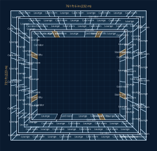
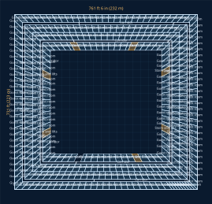

# P3-04 Guild Lodge: plan

Footprint 761 ft 6 in (232 m) × 731 ft (223 m) · structural grid 32 ft 10 in (10 m)

## Levels

| Level | Floor above deck | Height | Floor area |
|---|---|---|---|
| Level 1 · Club floor | 0 ft (0 mm) | 16 ft 5 in (5,000 mm) | 307,540 sq ft (28,571 m²) |
| Level 2 · Lounge floor | 16 ft 5 in (5,000 mm) | 14 ft 5 in (4,400 mm) | 301,961 sq ft (28,053 m²) |
| Level 3 · Guest floor 1 | 30 ft 10 in (9,400 mm) | 11 ft 10 in (3,600 mm) | 301,961 sq ft (28,053 m²) |
| Level 4 · Guest floor 2 | 42 ft 8 in (13 m) | 11 ft 10 in (3,600 mm) | 301,961 sq ft (28,053 m²) |

## Elements

| ID | Designation | Type | Name | Level(s) | Size / length | Area | Status |
|---|---|---|---|---|---|---|---|
| E001 | D5F1P3B3A2L1R1 | room | Members' dining room | L1 | 305 ft 9 in (93 m) × 148 ft 11 in (45 m) | 35,600 sq ft (3,307 m²) | proposed |
| E002 | D5F1P3B3A2L1R2 | zone | Corridor | L1 | 369 ft 9 in (113 m) × 9 ft 10 in (3,000 mm) | 3,588 sq ft (333 m²) | proposed |
| E003 | D5F1P3B3A2L1R3 | zone | Corridor | L1 | 63 ft (19 m) × 345 ft 2 in (105 m) | 3,878 sq ft (360 m²) | proposed |
| E004 | D5F1P3B3A2L1R4 | zone | Corridor | L1 | 85 ft 11 in (26 m) × 321 ft 10 in (98 m) | 3,877 sq ft (360 m²) | proposed |
| E005 | D5F1P3B3A2L1R5 | zone | Corridor | L1 | 399 ft 7 in (122 m) × 9 ft 10 in (3,000 mm) | 3,875 sq ft (360 m²) | proposed |
| E006 | D5F1P3B3A2L1R6 | zone | Corridor | L1 | 223 ft 5 in (68 m) × 184 ft 9 in (56 m) | 3,878 sq ft (360 m²) | proposed |
| E007 | D5F1P3B3A2L1R7 | zone | Corridor | L1 | 9 ft 10 in (3,000 mm) × 399 ft 7 in (122 m) | 3,875 sq ft (360 m²) | proposed |
| E008 | D5F1P3B3A2L1R8 | zone | Corridor | L1 | 9 ft 10 in (3,000 mm) × 94 ft 2 in (29 m) | 843 sq ft (78 m²) | proposed |
| E009 | D5F1P3B3A2L1R9 | zone | Corridor | L1 | 289 ft 1 in (88 m) × 9 ft 10 in (3,000 mm) | 2,793 sq ft (260 m²) | proposed |
| E010 | D5F1P3B3A2L1R10 | zone | Corridor | L1 | 54 ft 6 in (17 m) × 355 ft 4 in (108 m) | 3,877 sq ft (360 m²) | proposed |
| E011 | D5F1P3B3A2L1R11 | zone | Corridor | L1 | 239 ft 10 in (73 m) × 166 ft 4 in (51 m) | 3,875 sq ft (360 m²) | proposed |
| E012 | D5F1P3B3A2L1R12 | zone | Corridor | L1 | 309 ft 9 in (94 m) × 98 ft 1 in (30 m) | 3,878 sq ft (360 m²) | proposed |
| E013 | D5F1P3B3A2L1R13 | zone | Corridor | L1 | 9 ft 10 in (3,000 mm) × 401 ft 3 in (122 m) | 3,873 sq ft (360 m²) | proposed |
| E014 | D5F1P3B3A2L1R14 | zone | Corridor | L1 | 9 ft 10 in (3,000 mm) × 33 ft 10 in (10 m) | 241 sq ft (22 m²) | proposed |
| E015 | D5F1P3B3A2L1R15, D5F1P3B3A2L2R1, D5F1P3B3A2L3R1, D5F1P3B3A2L4R1 | core | Stairs and lifts | L1, L2, L3, L4 | 43 ft (13 m) × 32 ft 6 in (9,900 mm) | 853 sq ft (79 m²) | proposed |
| E016 | D5F1P3B3A2L1R16, D5F1P3B3A2L2R2, D5F1P3B3A2L3R2, D5F1P3B3A2L4R2 | core | Stairs and lifts | L1, L2, L3, L4 | 32 ft 6 in (9,900 mm) × 44 ft (13 m) | 853 sq ft (79 m²) | proposed |
| E017 | D5F1P3B3A2L1R17, D5F1P3B3A2L2R3, D5F1P3B3A2L3R3, D5F1P3B3A2L4R3 | core | Stairs and lifts | L1, L2, L3, L4 | 32 ft 6 in (9,900 mm) × 42 ft (13 m) | 858 sq ft (80 m²) | proposed |
| E018 | D5F1P3B3A2L1R18, D5F1P3B3A2L2R4, D5F1P3B3A2L3R4, D5F1P3B3A2L4R4 | core | Stairs and lifts | L1, L2, L3, L4 | 43 ft (13 m) × 32 ft 6 in (9,900 mm) | 853 sq ft (79 m²) | proposed |
| E019 | D5F1P3B3A2L1R19, D5F1P3B3A2L2R5, D5F1P3B3A2L3R5, D5F1P3B3A2L4R5 | core | Stairs and lifts | L1, L2, L3, L4 | 41 ft (12 m) × 32 ft 6 in (9,900 mm) | 858 sq ft (80 m²) | proposed |
| E020 | D5F1P3B3A2L1R20, D5F1P3B3A2L2R6, D5F1P3B3A2L3R6, D5F1P3B3A2L4R6 | core | Stairs and lifts | L1, L2, L3, L4 | 32 ft 6 in (9,900 mm) × 44 ft (13 m) | 853 sq ft (79 m²) | proposed |
| E021 | D5F1P3B3A2L1R21, D5F1P3B3A2L2R7, D5F1P3B3A2L3R7, D5F1P3B3A2L4R7 | core | Stairs and lifts | L1, L2, L3, L4 | 32 ft 6 in (9,900 mm) × 42 ft (13 m) | 858 sq ft (80 m²) | proposed |
| E022 | D5F1P3B3A2L1R22 | room | Lodge lobby | L1 | 64 ft 4 in (20 m) × 32 ft 2 in (9,800 mm) | 1,076 sq ft (100 m²) | proposed |
| E023 | D5F1P3B3A2L1R23 | room | Bar | L1 | 67 ft 7 in (21 m) × 32 ft 2 in (9,800 mm) | 1,282 sq ft (119 m²) | proposed |
| E024 | D5F1P3B3A2L1R24 | room | Kitchen | L1 | 73 ft 10 in (22 m) × 32 ft 2 in (9,800 mm) | 1,614 sq ft (150 m²) | proposed |
| E025 | D5F1P3B3A2L1R25 | room | Private dining room | L1 | 34 ft 1 in (10 m) × 32 ft 2 in (9,800 mm) | 427 sq ft (40 m²) | proposed |
| E026 | D5F1P3B3A2L1R26 | room | Private dining room | L1 | 32 ft 10 in (10 m) × 32 ft 2 in (9,800 mm) | 427 sq ft (40 m²) | proposed |
| E027 | D5F1P3B3A2L1R27 | room | Toilets | L1 | 38 ft 1 in (12 m) × 32 ft 2 in (9,800 mm) | 643 sq ft (60 m²) | proposed |
| E028 | D5F1P3B3A2L1R28 | room | Members' lounge | L1 | 131 ft 11 in (40 m) × 32 ft 2 in (9,800 mm) | 3,856 sq ft (358 m²) | proposed |
| E029 | D5F1P3B3A2L1R29 | room | Function room | L1 | 101 ft 8 in (31 m) × 32 ft 2 in (9,800 mm) | 3,133 sq ft (291 m²) | proposed |
| E030 | D5F1P3B3A2L1R30 | room | Members' lounge | L1 | 85 ft 11 in (26 m) × 93 ft 2 in (28 m) | 3,861 sq ft (359 m²) | proposed |
| E031 | D5F1P3B3A2L1R31 | room | Function room | L1 | 32 ft 2 in (9,800 mm) × 169 ft 7 in (52 m) | 4,826 sq ft (448 m²) | proposed |
| E032 | D5F1P3B3A2L1R32 | room | Members' lounge | L1 | 32 ft 2 in (9,800 mm) × 127 ft (39 m) | 3,856 sq ft (358 m²) | proposed |
| E033 | D5F1P3B3A2L1R33 | room | Function room | L1 | 32 ft 2 in (9,800 mm) × 157 ft 2 in (48 m) | 4,826 sq ft (448 m²) | proposed |
| E034 | D5F1P3B3A2L1R34 | room | Members' lounge | L1 | 32 ft 2 in (9,800 mm) × 138 ft 1 in (42 m) | 3,861 sq ft (359 m²) | proposed |
| E035 | D5F1P3B3A2L1R35 | room | Function room | L1 | 85 ft (26 m) × 122 ft 8 in (37 m) | 4,826 sq ft (448 m²) | proposed |
| E036 | D5F1P3B3A2L1R36 | room | Members' lounge | L1 | 142 ft 1 in (43 m) × 32 ft 2 in (9,800 mm) | 3,861 sq ft (359 m²) | proposed |
| E037 | D5F1P3B3A2L1R37 | room | Function room | L1 | 160 ft 1 in (49 m) × 32 ft 2 in (9,800 mm) | 4,821 sq ft (448 m²) | proposed |
| E038 | D5F1P3B3A2L1R38 | room | Members' lounge | L1 | 125 ft 4 in (38 m) × 32 ft 2 in (9,800 mm) | 3,861 sq ft (359 m²) | proposed |
| E039 | D5F1P3B3A2L1R39 | room | Function room | L1 | 163 ft 9 in (50 m) × 32 ft 2 in (9,800 mm) | 4,826 sq ft (448 m²) | proposed |
| E040 | D5F1P3B3A2L1R40 | room | Members' lounge | L1 | 145 ft 8 in (44 m) × 32 ft 2 in (9,800 mm) | 3,856 sq ft (358 m²) | proposed |
| E041 | D5F1P3B3A2L1R41 | room | Function room | L1 | 45 ft 7 in (14 m) × 162 ft 1 in (49 m) | 4,826 sq ft (448 m²) | proposed |
| E042 | D5F1P3B3A2L1R42 | room | Members' lounge | L1 | 32 ft 2 in (9,800 mm) × 134 ft 2 in (41 m) | 3,861 sq ft (359 m²) | proposed |
| E043 | D5F1P3B3A2L1R43 | room | Function room | L1 | 32 ft 2 in (9,800 mm) × 157 ft 2 in (48 m) | 4,831 sq ft (449 m²) | proposed |
| E044 | D5F1P3B3A2L1R44 | room | Members' lounge | L1 | 32 ft 2 in (9,800 mm) × 130 ft 7 in (40 m) | 3,856 sq ft (358 m²) | proposed |
| E045 | D5F1P3B3A2L1R45 | room | Function room | L1 | 32 ft 2 in (9,800 mm) × 196 ft 6 in (60 m) | 5,543 sq ft (515 m²) | proposed |
| E046 | D5F1P3B3A2L1R46 | room | Members' lounge | L1 | 146 ft 4 in (45 m) × 32 ft 6 in (9,900 mm) | 3,900 sq ft (362 m²) | proposed |
| E047 | D5F1P3B3A2L1R47 | room | Function room | L1 | 162 ft 9 in (50 m) × 32 ft 6 in (9,900 mm) | 4,875 sq ft (453 m²) | proposed |
| E048 | D5F1P3B3A2L1R48 | room | Members' lounge | L1 | 75 ft 2 in (23 m) × 32 ft 6 in (9,900 mm) | 2,323 sq ft (216 m²) | proposed |
| E049 | D5F1P3B3A2L1R49 | room | Function room | L1 | 81 ft 4 in (25 m) × 125 ft 8 in (38 m) | 4,875 sq ft (453 m²) | proposed |
| E050 | D5F1P3B3A2L1R50 | room | Members' lounge | L1 | 32 ft 6 in (9,900 mm) × 135 ft 6 in (41 m) | 3,900 sq ft (362 m²) | proposed |
| E051 | D5F1P3B3A2L1R51 | room | Function room | L1 | 32 ft 6 in (9,900 mm) × 157 ft 10 in (48 m) | 4,870 sq ft (452 m²) | proposed |
| E052 | D5F1P3B3A2L1R52 | room | Members' lounge | L1 | 32 ft 6 in (9,900 mm) × 132 ft 10 in (40 m) | 3,900 sq ft (362 m²) | proposed |
| E053 | D5F1P3B3A2L1R53 | room | Function room | L1 | 55 ft 5 in (17 m) × 151 ft 7 in (46 m) | 4,875 sq ft (453 m²) | proposed |
| E054 | D5F1P3B3A2L1R54 | room | Members' lounge | L1 | 144 ft (44 m) × 32 ft 6 in (9,900 mm) | 3,900 sq ft (362 m²) | proposed |
| E055 | D5F1P3B3A2L1R55 | room | Function room | L1 | 160 ft 5 in (49 m) × 32 ft 6 in (9,900 mm) | 4,875 sq ft (453 m²) | proposed |
| E056 | D5F1P3B3A2L1R56 | room | Members' lounge | L1 | 126 ft (38 m) × 32 ft 6 in (9,900 mm) | 3,900 sq ft (362 m²) | proposed |
| E057 | D5F1P3B3A2L1R57 | room | Function room | L1 | 166 ft 8 in (51 m) × 32 ft 6 in (9,900 mm) | 4,870 sq ft (452 m²) | proposed |
| E058 | D5F1P3B3A2L1R58 | room | Members' lounge | L1 | 108 ft 11 in (33 m) × 69 ft 11 in (21 m) | 3,900 sq ft (362 m²) | proposed |
| E059 | D5F1P3B3A2L1R59 | room | Function room | L1 | 32 ft 6 in (9,900 mm) × 170 ft 3 in (52 m) | 4,875 sq ft (453 m²) | proposed |
| E060 | D5F1P3B3A2L1R60 | room | Members' lounge | L1 | 32 ft 6 in (9,900 mm) × 126 ft 4 in (38 m) | 3,900 sq ft (362 m²) | proposed |
| E061 | D5F1P3B3A2L1R61 | room | Function room | L1 | 32 ft 6 in (9,900 mm) × 158 ft 2 in (48 m) | 4,870 sq ft (452 m²) | proposed |
| E062 | D5F1P3B3A2L1R62 | room | Members' lounge | L1 | 32 ft 6 in (9,900 mm) × 179 ft 2 in (55 m) | 5,030 sq ft (467 m²) | proposed |
| E063 | D5F1P3B3A2L1R63 | room | Function room | L1 | 173 ft 11 in (53 m) × 32 ft 2 in (9,800 mm) | 4,826 sq ft (448 m²) | proposed |
| E064 | D5F1P3B3A2L1R64 | room | Members' lounge | L1 | 165 ft (50 m) × 32 ft 2 in (9,800 mm) | 5,032 sq ft (467 m²) | proposed |
| E065 | D5F1P3B3A2L1R65 | room | Function room | L1 | 77 ft 5 in (24 m) × 128 ft 7 in (39 m) | 4,826 sq ft (448 m²) | proposed |
| E066 | D5F1P3B3A2L1R66 | room | Members' lounge | L1 | 32 ft 2 in (9,800 mm) × 133 ft 2 in (41 m) | 3,856 sq ft (358 m²) | proposed |
| E067 | D5F1P3B3A2L1R67 | room | Function room | L1 | 32 ft 2 in (9,800 mm) × 158 ft 10 in (48 m) | 4,826 sq ft (448 m²) | proposed |
| E068 | D5F1P3B3A2L1R68 | room | Members' lounge | L1 | 32 ft 2 in (9,800 mm) × 138 ft 5 in (42 m) | 3,861 sq ft (359 m²) | proposed |
| E069 | D5F1P3B3A2L1R69 | room | Function room | L1 | 119 ft 9 in (36 m) × 86 ft 3 in (26 m) | 4,826 sq ft (448 m²) | proposed |
| E070 | D5F1P3B3A2L1R70 | room | Members' lounge | L1 | 135 ft 2 in (41 m) × 32 ft 2 in (9,800 mm) | 3,856 sq ft (358 m²) | proposed |
| E071 | D5F1P3B3A2L1R71 | room | Function room | L1 | 158 ft 6 in (48 m) × 32 ft 2 in (9,800 mm) | 4,826 sq ft (448 m²) | proposed |
| E072 | D5F1P3B3A2L1R72 | room | Members' lounge | L1 | 134 ft 10 in (41 m) × 32 ft 2 in (9,800 mm) | 3,861 sq ft (359 m²) | proposed |
| E073 | D5F1P3B3A2L1R73 | room | Function room | L1 | 124 ft 4 in (38 m) × 81 ft 4 in (25 m) | 4,821 sq ft (448 m²) | proposed |
| E074 | D5F1P3B3A2L1R74 | room | Members' lounge | L1 | 32 ft 2 in (9,800 mm) × 139 ft 1 in (42 m) | 3,861 sq ft (359 m²) | proposed |
| E075 | D5F1P3B3A2L1R75 | room | Function room | L1 | 32 ft 2 in (9,800 mm) × 158 ft 10 in (48 m) | 4,821 sq ft (448 m²) | proposed |
| E076 | D5F1P3B3A2L1R76 | room | Members' lounge | L1 | 32 ft 2 in (9,800 mm) × 132 ft 7 in (40 m) | 3,861 sq ft (359 m²) | proposed |
| E077 | D5F1P3B3A2L1R77 | room | Function room | L1 | 32 ft 2 in (9,800 mm) × 133 ft 2 in (41 m) | 3,455 sq ft (321 m²) | proposed |
| E078 | D5F1P3B3A2L1R78 | room | Members' lounge | L1 | 132 ft 7 in (40 m) × 32 ft 6 in (9,900 mm) | 3,479 sq ft (323 m²) | proposed |
| E079 | D5F1P3B3A2L1R79 | room | Function room | L1 | 135 ft 10 in (41 m) × 32 ft 6 in (9,900 mm) | 4,140 sq ft (385 m²) | proposed |
| E080 | D5F1P3B3A2L1R80 | room | Members' lounge | L1 | 72 ft 6 in (22 m) × 117 ft 9 in (36 m) | 4,374 sq ft (406 m²) | proposed |
| E081 | D5F1P3B3A2L1R81 | room | Function room | L1 | 32 ft 6 in (9,900 mm) × 160 ft 5 in (49 m) | 4,870 sq ft (452 m²) | proposed |
| E082 | D5F1P3B3A2L1R82 | room | Members' lounge | L1 | 32 ft 6 in (9,900 mm) × 73 ft 6 in (22 m) | 2,083 sq ft (194 m²) | proposed |
| E083 | D5F1P3B3A2L1R83 | room | Function room | L1 | 72 ft 6 in (22 m) × 131 ft 11 in (40 m) | 4,870 sq ft (452 m²) | proposed |
| E084 | D5F1P3B3A2L1R84 | room | Members' lounge | L1 | 86 ft 7 in (26 m) × 32 ft 6 in (9,900 mm) | 2,083 sq ft (194 m²) | proposed |
| E085 | D5F1P3B3A2L1R85 | room | Function room | L1 | 159 ft 9 in (49 m) × 32 ft 6 in (9,900 mm) | 4,870 sq ft (452 m²) | proposed |
| E086 | D5F1P3B3A2L1R86 | room | Members' lounge | L1 | 72 ft 10 in (22 m) × 32 ft 6 in (9,900 mm) | 2,083 sq ft (194 m²) | proposed |
| E087 | D5F1P3B3A2L1R87 | room | Function room | L1 | 146 ft 8 in (45 m) × 58 ft 1 in (18 m) | 4,865 sq ft (452 m²) | proposed |
| E088 | D5F1P3B3A2L1R88 | room | Members' lounge | L1 | 32 ft 6 in (9,900 mm) × 88 ft 3 in (27 m) | 2,089 sq ft (194 m²) | proposed |
| E089 | D5F1P3B3A2L1R89 | room | Function room | L1 | 32 ft 6 in (9,900 mm) × 160 ft 5 in (49 m) | 4,870 sq ft (452 m²) | proposed |
| E090 | D5F1P3B3A2L1R90 | room | Members' lounge | L1 | 32 ft 6 in (9,900 mm) × 73 ft 6 in (22 m) | 2,083 sq ft (194 m²) | proposed |
| E091 | D5F1P3B3A2L1R91 | room | Function room | L1 | 32 ft 6 in (9,900 mm) × 131 ft 11 in (40 m) | 3,474 sq ft (323 m²) | proposed |
| E092 | D5F1P3B3A2L2R8 | zone | Corridor | L2 | 399 ft 7 in (122 m) × 9 ft 10 in (3,000 mm) | 3,877 sq ft (360 m²) | proposed |
| E093 | D5F1P3B3A2L2R9 | zone | Corridor | L2 | 299 ft 3 in (91 m) × 108 ft 11 in (33 m) | 3,878 sq ft (360 m²) | proposed |
| E094 | D5F1P3B3A2L2R10 | zone | Corridor | L2 | 9 ft 10 in (3,000 mm) × 399 ft 7 in (122 m) | 3,875 sq ft (360 m²) | proposed |
| E095 | D5F1P3B3A2L2R11 | zone | Corridor | L2 | 237 ft 10 in (72 m) × 169 ft 11 in (52 m) | 3,877 sq ft (360 m²) | proposed |
| E096 | D5F1P3B3A2L2R12 | zone | Corridor | L2 | 399 ft 3 in (122 m) × 9 ft 10 in (3,000 mm) | 3,875 sq ft (360 m²) | proposed |
| E097 | D5F1P3B3A2L2R13 | zone | Corridor | L2 | 71 ft 2 in (22 m) × 336 ft 7 in (103 m) | 3,878 sq ft (360 m²) | proposed |
| E098 | D5F1P3B3A2L2R14 | zone | Corridor | L2 | 9 ft 10 in (3,000 mm) × 330 ft 1 in (101 m) | 3,200 sq ft (297 m²) | proposed |
| E099 | D5F1P3B3A2L2R15 | zone | Corridor | L2 | 400 ft 11 in (122 m) × 9 ft 10 in (3,000 mm) | 3,875 sq ft (360 m²) | proposed |
| E100 | D5F1P3B3A2L2R16 | zone | Corridor | L2 | 151 ft 11 in (46 m) × 254 ft 3 in (78 m) | 3,877 sq ft (360 m²) | proposed |
| E101 | D5F1P3B3A2L2R17 | zone | Corridor | L2 | 142 ft 5 in (43 m) × 263 ft 9 in (80 m) | 3,877 sq ft (360 m²) | proposed |
| E102 | D5F1P3B3A2L2R18 | zone | Corridor | L2 | 400 ft 7 in (122 m) × 9 ft 10 in (3,000 mm) | 3,875 sq ft (360 m²) | proposed |
| E103 | D5F1P3B3A2L2R19 | zone | Corridor | L2 | 19 ft (5,800 mm) × 391 ft 9 in (119 m) | 3,877 sq ft (360 m²) | proposed |
| E104 | D5F1P3B3A2L2R20 | zone | Corridor | L2 | 9 ft 10 in (3,000 mm) × 130 ft 11 in (40 m) | 1,216 sq ft (113 m²) | proposed |
| E105 | D5F1P3B3A2L2R21 | room | Library lounge | L2 | 80 ft 1 in (24 m) × 32 ft 2 in (9,800 mm) | 1,609 sq ft (149 m²) | proposed |
| E106 | D5F1P3B3A2L2R22 | room | Games room | L2 | 53 ft 6 in (16 m) × 32 ft 2 in (9,800 mm) | 860 sq ft (80 m²) | proposed |
| E107 | D5F1P3B3A2L2R23 | room | Quiet lounge | L2 | 50 ft 10 in (16 m) × 32 ft 2 in (9,800 mm) | 854 sq ft (79 m²) | proposed |
| E108 | D5F1P3B3A2L2R24 | room | Toilets | L2 | 42 ft 4 in (13 m) × 32 ft 2 in (9,800 mm) | 649 sq ft (60 m²) | proposed |
| E109 | D5F1P3B3A2L2R25 | room | Card room | L2 | 49 ft 10 in (15 m) × 32 ft 2 in (9,800 mm) | 960 sq ft (89 m²) | proposed |
| E110 | D5F1P3B3A2L2R26 | room | Lounge | L2 | 133 ft 6 in (41 m) × 32 ft 2 in (9,800 mm) | 3,861 sq ft (359 m²) | proposed |
| E111 | D5F1P3B3A2L2R27 | room | Card room | L2 | 36 ft 9 in (11 m) × 32 ft 2 in (9,800 mm) | 965 sq ft (90 m²) | proposed |
| E112 | D5F1P3B3A2L2R28 | room | Lounge | L2 | 125 ft 4 in (38 m) × 32 ft 2 in (9,800 mm) | 3,861 sq ft (359 m²) | proposed |
| E113 | D5F1P3B3A2L2R29 | room | Card room | L2 | 36 ft 5 in (11 m) × 32 ft 2 in (9,800 mm) | 960 sq ft (89 m²) | proposed |
| E114 | D5F1P3B3A2L2R30 | room | Lounge | L2 | 133 ft 2 in (41 m) × 32 ft 2 in (9,800 mm) | 3,861 sq ft (359 m²) | proposed |
| E115 | D5F1P3B3A2L2R31 | room | Card room | L2 | 49 ft 10 in (15 m) × 32 ft 2 in (9,800 mm) | 965 sq ft (90 m²) | proposed |
| E116 | D5F1P3B3A2L2R32 | room | Lounge | L2 | 146 ft 8 in (45 m) × 32 ft 2 in (9,800 mm) | 3,861 sq ft (359 m²) | proposed |
| E117 | D5F1P3B3A2L2R33 | room | Card room | L2 | 37 ft 9 in (12 m) × 55 ft 5 in (17 m) | 970 sq ft (90 m²) | proposed |
| E118 | D5F1P3B3A2L2R34 | room | Lounge | L2 | 32 ft 2 in (9,800 mm) × 144 ft 4 in (44 m) | 3,856 sq ft (358 m²) | proposed |
| E119 | D5F1P3B3A2L2R35 | room | Card room | L2 | 32 ft 2 in (9,800 mm) × 47 ft 7 in (14 m) | 965 sq ft (90 m²) | proposed |
| E120 | D5F1P3B3A2L2R36 | room | Lounge | L2 | 32 ft 2 in (9,800 mm) × 130 ft 7 in (40 m) | 3,861 sq ft (359 m²) | proposed |
| E121 | D5F1P3B3A2L2R37 | room | Card room | L2 | 32 ft 2 in (9,800 mm) × 33 ft 10 in (10 m) | 970 sq ft (90 m²) | proposed |
| E122 | D5F1P3B3A2L2R38 | room | Lounge | L2 | 32 ft 2 in (9,800 mm) × 125 ft 4 in (38 m) | 3,850 sq ft (358 m²) | proposed |
| E123 | D5F1P3B3A2L2R39 | room | Card room | L2 | 32 ft 2 in (9,800 mm) × 40 ft 4 in (12 m) | 970 sq ft (90 m²) | proposed |
| E124 | D5F1P3B3A2L2R40 | room | Lounge | L2 | 32 ft 2 in (9,800 mm) × 137 ft 2 in (42 m) | 3,861 sq ft (359 m²) | proposed |
| E125 | D5F1P3B3A2L2R41 | room | Card room | L2 | 32 ft 2 in (9,800 mm) × 53 ft 10 in (16 m) | 960 sq ft (89 m²) | proposed |
| E126 | D5F1P3B3A2L2R42 | room | Lounge | L2 | 76 ft 1 in (23 m) × 103 ft (31 m) | 3,866 sq ft (359 m²) | proposed |
| E127 | D5F1P3B3A2L2R43 | room | Card room | L2 | 56 ft 9 in (17 m) × 32 ft 2 in (9,800 mm) | 960 sq ft (89 m²) | proposed |
| E128 | D5F1P3B3A2L2R44 | room | Lounge | L2 | 140 ft 5 in (43 m) × 32 ft 2 in (9,800 mm) | 3,861 sq ft (359 m²) | proposed |
| E129 | D5F1P3B3A2L2R45 | room | Card room | L2 | 43 ft 8 in (13 m) × 32 ft 2 in (9,800 mm) | 965 sq ft (90 m²) | proposed |
| E130 | D5F1P3B3A2L2R46 | room | Lounge | L2 | 127 ft (39 m) × 32 ft 2 in (9,800 mm) | 3,861 sq ft (359 m²) | proposed |
| E131 | D5F1P3B3A2L2R47 | room | Card room | L2 | 31 ft 6 in (9,600 mm) × 32 ft 2 in (9,800 mm) | 965 sq ft (90 m²) | proposed |
| E132 | D5F1P3B3A2L2R48 | room | Lounge | L2 | 126 ft 8 in (39 m) × 32 ft 2 in (9,800 mm) | 3,861 sq ft (359 m²) | proposed |
| E133 | D5F1P3B3A2L2R49 | room | Card room | L2 | 43 ft (13 m) × 32 ft 2 in (9,800 mm) | 965 sq ft (90 m²) | proposed |
| E134 | D5F1P3B3A2L2R50 | room | Lounge | L2 | 139 ft 5 in (42 m) × 32 ft 2 in (9,800 mm) | 3,856 sq ft (358 m²) | proposed |
| E135 | D5F1P3B3A2L2R51 | room | Card room | L2 | 56 ft 5 in (17 m) × 32 ft 2 in (9,800 mm) | 970 sq ft (90 m²) | proposed |
| E136 | D5F1P3B3A2L2R52 | room | Lounge | L2 | 83 ft (25 m) × 96 ft 2 in (29 m) | 3,861 sq ft (359 m²) | proposed |
| E137 | D5F1P3B3A2L2R53 | room | Card room | L2 | 32 ft 2 in (9,800 mm) × 54 ft 9 in (17 m) | 965 sq ft (90 m²) | proposed |
| E138 | D5F1P3B3A2L2R54 | room | Lounge | L2 | 32 ft 2 in (9,800 mm) × 137 ft 10 in (42 m) | 3,861 sq ft (359 m²) | proposed |
| E139 | D5F1P3B3A2L2R55 | room | Card room | L2 | 32 ft 2 in (9,800 mm) × 40 ft 8 in (12 m) | 960 sq ft (89 m²) | proposed |
| E140 | D5F1P3B3A2L2R56 | room | Lounge | L2 | 32 ft 2 in (9,800 mm) × 125 ft 8 in (38 m) | 3,861 sq ft (359 m²) | proposed |
| E141 | D5F1P3B3A2L2R57 | room | Card room | L2 | 32 ft 2 in (9,800 mm) × 33 ft 2 in (10 m) | 965 sq ft (90 m²) | proposed |
| E142 | D5F1P3B3A2L2R58 | room | Lounge | L2 | 32 ft 2 in (9,800 mm) × 129 ft 11 in (40 m) | 3,856 sq ft (358 m²) | proposed |
| E143 | D5F1P3B3A2L2R59 | room | Card room | L2 | 32 ft 2 in (9,800 mm) × 46 ft 11 in (14 m) | 970 sq ft (90 m²) | proposed |
| E144 | D5F1P3B3A2L2R60 | room | Lounge | L2 | 32 ft 2 in (9,800 mm) × 143 ft 8 in (44 m) | 3,856 sq ft (358 m²) | proposed |
| E145 | D5F1P3B3A2L2R61 | room | Card room | L2 | 32 ft 2 in (9,800 mm) × 62 ft 8 in (19 m) | 1,023 sq ft (95 m²) | proposed |
| E146 | D5F1P3B3A2L2R62 | room | Lounge | L2 | 146 ft 4 in (45 m) × 32 ft 6 in (9,900 mm) | 3,900 sq ft (362 m²) | proposed |
| E147 | D5F1P3B3A2L2R63 | room | Card room | L2 | 48 ft 7 in (15 m) × 32 ft 6 in (9,900 mm) | 975 sq ft (91 m²) | proposed |
| E148 | D5F1P3B3A2L2R64 | room | Lounge | L2 | 131 ft 3 in (40 m) × 32 ft 6 in (9,900 mm) | 3,900 sq ft (362 m²) | proposed |
| E149 | D5F1P3B3A2L2R65 | room | Card room | L2 | 33 ft 10 in (10 m) × 32 ft 6 in (9,900 mm) | 975 sq ft (91 m²) | proposed |
| E150 | D5F1P3B3A2L2R66 | room | Lounge | L2 | 126 ft (38 m) × 32 ft 6 in (9,900 mm) | 3,895 sq ft (362 m²) | proposed |
| E151 | D5F1P3B3A2L2R67 | room | Card room | L2 | 41 ft 4 in (13 m) × 32 ft 6 in (9,900 mm) | 975 sq ft (91 m²) | proposed |
| E152 | D5F1P3B3A2L2R68 | room | Lounge | L2 | 138 ft 9 in (42 m) × 32 ft 6 in (9,900 mm) | 3,900 sq ft (362 m²) | proposed |
| E153 | D5F1P3B3A2L2R69 | room | Card room | L2 | 56 ft 1 in (17 m) × 32 ft 6 in (9,900 mm) | 975 sq ft (91 m²) | proposed |
| E154 | D5F1P3B3A2L2R70 | room | Lounge | L2 | 74 ft 10 in (23 m) × 103 ft 8 in (32 m) | 3,900 sq ft (362 m²) | proposed |
| E155 | D5F1P3B3A2L2R71 | room | Card room | L2 | 32 ft 6 in (9,900 mm) × 52 ft 10 in (16 m) | 975 sq ft (91 m²) | proposed |
| E156 | D5F1P3B3A2L2R72 | room | Lounge | L2 | 32 ft 6 in (9,900 mm) × 134 ft 10 in (41 m) | 3,895 sq ft (362 m²) | proposed |
| E157 | D5F1P3B3A2L2R73 | room | Card room | L2 | 32 ft 6 in (9,900 mm) × 37 ft 1 in (11 m) | 975 sq ft (91 m²) | proposed |
| E158 | D5F1P3B3A2L2R74 | room | Lounge | L2 | 32 ft 6 in (9,900 mm) × 126 ft 4 in (38 m) | 3,900 sq ft (362 m²) | proposed |
| E159 | D5F1P3B3A2L2R75 | room | Card room | L2 | 32 ft 6 in (9,900 mm) × 38 ft 9 in (12 m) | 975 sq ft (91 m²) | proposed |
| E160 | D5F1P3B3A2L2R76 | room | Lounge | L2 | 32 ft 6 in (9,900 mm) × 136 ft 10 in (42 m) | 3,900 sq ft (362 m²) | proposed |
| E161 | D5F1P3B3A2L2R77 | room | Card room | L2 | 32 ft 6 in (9,900 mm) × 54 ft 6 in (17 m) | 975 sq ft (91 m²) | proposed |
| E162 | D5F1P3B3A2L2R78 | room | Lounge | L2 | 90 ft 3 in (27 m) × 88 ft 3 in (27 m) | 3,900 sq ft (362 m²) | proposed |
| E163 | D5F1P3B3A2L2R79 | room | Card room | L2 | 54 ft 6 in (17 m) × 32 ft 6 in (9,900 mm) | 975 sq ft (91 m²) | proposed |
| E164 | D5F1P3B3A2L2R80 | room | Lounge | L2 | 137 ft 2 in (42 m) × 32 ft 6 in (9,900 mm) | 3,900 sq ft (362 m²) | proposed |
| E165 | D5F1P3B3A2L2R81 | room | Card room | L2 | 39 ft 8 in (12 m) × 32 ft 6 in (9,900 mm) | 975 sq ft (91 m²) | proposed |
| E166 | D5F1P3B3A2L2R82 | room | Lounge | L2 | 126 ft (38 m) × 32 ft 6 in (9,900 mm) | 3,895 sq ft (362 m²) | proposed |
| E167 | D5F1P3B3A2L2R83 | room | Card room | L2 | 35 ft 5 in (11 m) × 32 ft 6 in (9,900 mm) | 975 sq ft (91 m²) | proposed |
| E168 | D5F1P3B3A2L2R84 | room | Lounge | L2 | 132 ft 10 in (40 m) × 32 ft 6 in (9,900 mm) | 3,900 sq ft (362 m²) | proposed |
| E169 | D5F1P3B3A2L2R85 | room | Card room | L2 | 50 ft 2 in (15 m) × 32 ft 6 in (9,900 mm) | 970 sq ft (90 m²) | proposed |
| E170 | D5F1P3B3A2L2R86 | room | Lounge | L2 | 131 ft 3 in (40 m) × 47 ft 11 in (15 m) | 3,906 sq ft (363 m²) | proposed |
| E171 | D5F1P3B3A2L2R87 | room | Card room | L2 | 32 ft 6 in (9,900 mm) × 59 ft 1 in (18 m) | 975 sq ft (91 m²) | proposed |
| E172 | D5F1P3B3A2L2R88 | room | Lounge | L2 | 32 ft 6 in (9,900 mm) × 141 ft 1 in (43 m) | 3,900 sq ft (362 m²) | proposed |
| E173 | D5F1P3B3A2L2R89 | room | Card room | L2 | 32 ft 6 in (9,900 mm) × 43 ft (13 m) | 970 sq ft (90 m²) | proposed |
| E174 | D5F1P3B3A2L2R90 | room | Lounge | L2 | 32 ft 6 in (9,900 mm) × 126 ft 4 in (38 m) | 3,900 sq ft (362 m²) | proposed |
| E175 | D5F1P3B3A2L2R91 | room | Card room | L2 | 32 ft 6 in (9,900 mm) × 32 ft 6 in (9,900 mm) | 975 sq ft (91 m²) | proposed |
| E176 | D5F1P3B3A2L2R92 | room | Lounge | L2 | 32 ft 6 in (9,900 mm) × 130 ft 3 in (40 m) | 3,895 sq ft (362 m²) | proposed |
| E177 | D5F1P3B3A2L2R93 | room | Card room | L2 | 32 ft 6 in (9,900 mm) × 48 ft 7 in (15 m) | 980 sq ft (91 m²) | proposed |
| E178 | D5F1P3B3A2L2R94 | room | Lounge | L2 | 32 ft 6 in (9,900 mm) × 144 ft 4 in (44 m) | 3,836 sq ft (356 m²) | proposed |
| E179 | D5F1P3B3A2L2R95 | room | Card room | L2 | 60 ft 8 in (18 m) × 32 ft 2 in (9,800 mm) | 965 sq ft (90 m²) | proposed |
| E180 | D5F1P3B3A2L2R96 | room | Lounge | L2 | 142 ft 5 in (43 m) × 32 ft 2 in (9,800 mm) | 3,861 sq ft (359 m²) | proposed |
| E181 | D5F1P3B3A2L2R97 | room | Card room | L2 | 43 ft 8 in (13 m) × 32 ft 2 in (9,800 mm) | 960 sq ft (89 m²) | proposed |
| E182 | D5F1P3B3A2L2R98 | room | Lounge | L2 | 126 ft 8 in (39 m) × 32 ft 2 in (9,800 mm) | 3,861 sq ft (359 m²) | proposed |
| E183 | D5F1P3B3A2L2R99 | room | Card room | L2 | 32 ft 10 in (10 m) × 32 ft 2 in (9,800 mm) | 965 sq ft (90 m²) | proposed |
| E184 | D5F1P3B3A2L2R100 | room | Lounge | L2 | 131 ft 3 in (40 m) × 32 ft 2 in (9,800 mm) | 3,861 sq ft (359 m²) | proposed |
| E185 | D5F1P3B3A2L2R101 | room | Card room | L2 | 49 ft 6 in (15 m) × 32 ft 2 in (9,800 mm) | 965 sq ft (90 m²) | proposed |
| E186 | D5F1P3B3A2L2R102 | room | Lounge | L2 | 127 ft (39 m) × 50 ft 10 in (16 m) | 3,861 sq ft (359 m²) | proposed |
| E187 | D5F1P3B3A2L2R103 | room | Card room | L2 | 32 ft 2 in (9,800 mm) × 58 ft 1 in (18 m) | 960 sq ft (89 m²) | proposed |
| E188 | D5F1P3B3A2L2R104 | room | Lounge | L2 | 32 ft 2 in (9,800 mm) × 139 ft 5 in (42 m) | 3,861 sq ft (359 m²) | proposed |
| E189 | D5F1P3B3A2L2R105 | room | Card room | L2 | 32 ft 2 in (9,800 mm) × 40 ft 8 in (12 m) | 970 sq ft (90 m²) | proposed |
| E190 | D5F1P3B3A2L2R106 | room | Lounge | L2 | 32 ft 2 in (9,800 mm) × 127 ft (39 m) | 3,856 sq ft (358 m²) | proposed |
| E191 | D5F1P3B3A2L2R107 | room | Card room | L2 | 32 ft 2 in (9,800 mm) × 37 ft 1 in (11 m) | 965 sq ft (90 m²) | proposed |
| E192 | D5F1P3B3A2L2R108 | room | Lounge | L2 | 32 ft 2 in (9,800 mm) × 135 ft 10 in (41 m) | 3,856 sq ft (358 m²) | proposed |
| E193 | D5F1P3B3A2L2R109 | room | Card room | L2 | 32 ft 2 in (9,800 mm) × 54 ft 9 in (17 m) | 965 sq ft (90 m²) | proposed |
| E194 | D5F1P3B3A2L2R110 | room | Lounge | L2 | 98 ft 5 in (30 m) × 79 ft 5 in (24 m) | 3,861 sq ft (359 m²) | proposed |
| E195 | D5F1P3B3A2L2R111 | room | Card room | L2 | 52 ft 10 in (16 m) × 32 ft 2 in (9,800 mm) | 965 sq ft (90 m²) | proposed |
| E196 | D5F1P3B3A2L2R112 | room | Lounge | L2 | 134 ft 6 in (41 m) × 32 ft 2 in (9,800 mm) | 3,861 sq ft (359 m²) | proposed |
| E197 | D5F1P3B3A2L2R113 | room | Card room | L2 | 36 ft 1 in (11 m) × 32 ft 2 in (9,800 mm) | 965 sq ft (90 m²) | proposed |
| E198 | D5F1P3B3A2L2R114 | room | Lounge | L2 | 126 ft 8 in (39 m) × 32 ft 2 in (9,800 mm) | 3,861 sq ft (359 m²) | proposed |
| E199 | D5F1P3B3A2L2R115 | room | Card room | L2 | 40 ft 4 in (12 m) × 32 ft 2 in (9,800 mm) | 960 sq ft (89 m²) | proposed |
| E200 | D5F1P3B3A2L2R116 | room | Lounge | L2 | 139 ft 1 in (42 m) × 32 ft 2 in (9,800 mm) | 3,866 sq ft (359 m²) | proposed |
| E201 | D5F1P3B3A2L2R117 | room | Card room | L2 | 57 ft 1 in (17 m) × 32 ft 2 in (9,800 mm) | 960 sq ft (89 m²) | proposed |
| E202 | D5F1P3B3A2L2R118 | room | Lounge | L2 | 60 ft 8 in (18 m) × 116 ft 10 in (36 m) | 3,861 sq ft (359 m²) | proposed |
| E203 | D5F1P3B3A2L2R119 | room | Card room | L2 | 32 ft 2 in (9,800 mm) × 49 ft 10 in (15 m) | 965 sq ft (90 m²) | proposed |
| E204 | D5F1P3B3A2L2R120 | room | Lounge | L2 | 32 ft 2 in (9,800 mm) × 130 ft 11 in (40 m) | 3,856 sq ft (358 m²) | proposed |
| E205 | D5F1P3B3A2L2R121 | room | Card room | L2 | 32 ft 2 in (9,800 mm) × 32 ft 6 in (9,900 mm) | 970 sq ft (90 m²) | proposed |
| E206 | D5F1P3B3A2L2R122 | room | Lounge | L2 | 32 ft 2 in (9,800 mm) × 127 ft (39 m) | 3,856 sq ft (358 m²) | proposed |
| E207 | D5F1P3B3A2L2R123 | room | Card room | L2 | 32 ft 2 in (9,800 mm) × 45 ft 3 in (14 m) | 965 sq ft (90 m²) | proposed |
| E208 | D5F1P3B3A2L2R124 | room | Lounge | L2 | 32 ft 2 in (9,800 mm) × 154 ft 6 in (47 m) | 4,177 sq ft (388 m²) | proposed |
| E209 | D5F1P3B3A2L2R125 | room | Card room | L2 | 60 ft 4 in (18 m) × 32 ft 6 in (9,900 mm) | 975 sq ft (91 m²) | proposed |
| E210 | D5F1P3B3A2L2R126 | room | Lounge | L2 | 100 ft 5 in (31 m) × 32 ft 6 in (9,900 mm) | 2,504 sq ft (233 m²) | proposed |
| E211 | D5F1P3B3A2L2R127 | room | Card room | L2 | 43 ft (13 m) × 32 ft 6 in (9,900 mm) | 970 sq ft (90 m²) | proposed |
| E212 | D5F1P3B3A2L2R128 | room | Lounge | L2 | 127 ft 11 in (39 m) × 32 ft 6 in (9,900 mm) | 3,900 sq ft (362 m²) | proposed |
| E213 | D5F1P3B3A2L2R129 | room | Card room | L2 | 72 ft 10 in (22 m) × 32 ft 6 in (9,900 mm) | 2,083 sq ft (194 m²) | proposed |
| E214 | D5F1P3B3A2L2R130 | room | Lounge | L2 | 144 ft (44 m) × 32 ft 6 in (9,900 mm) | 3,895 sq ft (362 m²) | proposed |
| E215 | D5F1P3B3A2L2R131 | room | Card room | L2 | 34 ft 5 in (10 m) × 58 ft 1 in (18 m) | 970 sq ft (90 m²) | proposed |
| E216 | D5F1P3B3A2L2R132 | room | Lounge | L2 | 32 ft 6 in (9,900 mm) × 88 ft 3 in (27 m) | 2,089 sq ft (194 m²) | proposed |
| E217 | D5F1P3B3A2L2R133 | room | Card room | L2 | 32 ft 6 in (9,900 mm) × 44 ft (13 m) | 975 sq ft (91 m²) | proposed |
| E218 | D5F1P3B3A2L2R134 | room | Lounge | L2 | 32 ft 6 in (9,900 mm) × 128 ft 3 in (39 m) | 3,895 sq ft (362 m²) | proposed |
| E219 | D5F1P3B3A2L2R135 | room | Card room | L2 | 32 ft 6 in (9,900 mm) × 73 ft 6 in (22 m) | 2,083 sq ft (194 m²) | proposed |
| E220 | D5F1P3B3A2L2R136 | room | Lounge | L2 | 44 ft 3 in (14 m) × 131 ft 11 in (40 m) | 3,890 sq ft (361 m²) | proposed |
| E221 | D5F1P3B3A2L2R137 | room | Card room | L2 | 58 ft 9 in (18 m) × 32 ft 6 in (9,900 mm) | 980 sq ft (91 m²) | proposed |
| E222 | D5F1P3B3A2L2R138 | room | Lounge | L2 | 86 ft 7 in (26 m) × 32 ft 6 in (9,900 mm) | 2,083 sq ft (194 m²) | proposed |
| E223 | D5F1P3B3A2L2R139 | room | Card room | L2 | 43 ft (13 m) × 32 ft 6 in (9,900 mm) | 970 sq ft (90 m²) | proposed |
| E224 | D5F1P3B3A2L2R140 | room | Lounge | L2 | 127 ft 11 in (39 m) × 32 ft 6 in (9,900 mm) | 3,900 sq ft (362 m²) | proposed |
| E225 | D5F1P3B3A2L2R141 | room | Card room | L2 | 72 ft 10 in (22 m) × 32 ft 6 in (9,900 mm) | 2,083 sq ft (194 m²) | proposed |
| E226 | D5F1P3B3A2L2R142 | room | Lounge | L2 | 144 ft (44 m) × 32 ft 6 in (9,900 mm) | 3,895 sq ft (362 m²) | proposed |
| E227 | D5F1P3B3A2L2R143 | room | Card room | L2 | 34 ft 5 in (10 m) × 58 ft 1 in (18 m) | 970 sq ft (90 m²) | proposed |
| E228 | D5F1P3B3A2L2R144 | room | Lounge | L2 | 32 ft 6 in (9,900 mm) × 88 ft 3 in (27 m) | 2,089 sq ft (194 m²) | proposed |
| E229 | D5F1P3B3A2L2R145 | room | Card room | L2 | 32 ft 6 in (9,900 mm) × 44 ft (13 m) | 975 sq ft (91 m²) | proposed |
| E230 | D5F1P3B3A2L2R146 | room | Lounge | L2 | 32 ft 6 in (9,900 mm) × 128 ft 3 in (39 m) | 3,895 sq ft (362 m²) | proposed |
| E231 | D5F1P3B3A2L2R147 | room | Card room | L2 | 32 ft 6 in (9,900 mm) × 73 ft 6 in (22 m) | 2,083 sq ft (194 m²) | proposed |
| E232 | D5F1P3B3A2L2R148 | room | Lounge | L2 | 32 ft 6 in (9,900 mm) × 131 ft 11 in (40 m) | 3,474 sq ft (323 m²) | proposed |
| E233 | D5F1P3B3A2L3R8, D5F1P3B3A2L4R8 | zone | Corridor | L3, L4 | 399 ft 7 in (122 m) × 9 ft 10 in (3,000 mm) | 3,877 sq ft (360 m²) | proposed |
| E234 | D5F1P3B3A2L3R9, D5F1P3B3A2L4R9 | zone | Corridor | L3, L4 | 299 ft 3 in (91 m) × 108 ft 11 in (33 m) | 3,878 sq ft (360 m²) | proposed |
| E235 | D5F1P3B3A2L3R10, D5F1P3B3A2L4R10 | zone | Corridor | L3, L4 | 9 ft 10 in (3,000 mm) × 399 ft 7 in (122 m) | 3,875 sq ft (360 m²) | proposed |
| E236 | D5F1P3B3A2L3R11, D5F1P3B3A2L4R11 | zone | Corridor | L3, L4 | 237 ft 10 in (72 m) × 169 ft 11 in (52 m) | 3,877 sq ft (360 m²) | proposed |
| E237 | D5F1P3B3A2L3R12, D5F1P3B3A2L4R12 | zone | Corridor | L3, L4 | 399 ft 3 in (122 m) × 9 ft 10 in (3,000 mm) | 3,875 sq ft (360 m²) | proposed |
| E238 | D5F1P3B3A2L3R13, D5F1P3B3A2L4R13 | zone | Corridor | L3, L4 | 71 ft 2 in (22 m) × 336 ft 7 in (103 m) | 3,878 sq ft (360 m²) | proposed |
| E239 | D5F1P3B3A2L3R14, D5F1P3B3A2L4R14 | zone | Corridor | L3, L4 | 9 ft 10 in (3,000 mm) × 330 ft 1 in (101 m) | 3,200 sq ft (297 m²) | proposed |
| E240 | D5F1P3B3A2L3R15, D5F1P3B3A2L4R15 | zone | Corridor | L3, L4 | 400 ft 11 in (122 m) × 9 ft 10 in (3,000 mm) | 3,875 sq ft (360 m²) | proposed |
| E241 | D5F1P3B3A2L3R16, D5F1P3B3A2L4R16 | zone | Corridor | L3, L4 | 151 ft 11 in (46 m) × 254 ft 3 in (78 m) | 3,877 sq ft (360 m²) | proposed |
| E242 | D5F1P3B3A2L3R17, D5F1P3B3A2L4R17 | zone | Corridor | L3, L4 | 142 ft 5 in (43 m) × 263 ft 9 in (80 m) | 3,877 sq ft (360 m²) | proposed |
| E243 | D5F1P3B3A2L3R18, D5F1P3B3A2L4R18 | zone | Corridor | L3, L4 | 400 ft 7 in (122 m) × 9 ft 10 in (3,000 mm) | 3,875 sq ft (360 m²) | proposed |
| E244 | D5F1P3B3A2L3R19, D5F1P3B3A2L4R19 | zone | Corridor | L3, L4 | 19 ft (5,800 mm) × 391 ft 9 in (119 m) | 3,877 sq ft (360 m²) | proposed |
| E245 | D5F1P3B3A2L3R20, D5F1P3B3A2L4R20 | zone | Corridor | L3, L4 | 9 ft 10 in (3,000 mm) × 130 ft 11 in (40 m) | 1,216 sq ft (113 m²) | proposed |
| E246 | D5F1P3B3A2L3R21, D5F1P3B3A2L4R21 | room | Guest room | L3, L4 | 43 ft (13 m) × 32 ft 2 in (9,800 mm) | 364 sq ft (34 m²) | proposed |
| E247 | D5F1P3B3A2L3R22, D5F1P3B3A2L4R22 | room | Guest room | L3, L4 | 42 ft (13 m) × 32 ft 2 in (9,800 mm) | 364 sq ft (34 m²) | proposed |
| E248 | D5F1P3B3A2L3R23, D5F1P3B3A2L4R23 | room | Guest room | L3, L4 | 41 ft (12 m) × 32 ft 2 in (9,800 mm) | 364 sq ft (34 m²) | proposed |
| E249 | D5F1P3B3A2L3R24, D5F1P3B3A2L4R24 | room | Guest room | L3, L4 | 40 ft (12 m) × 32 ft 2 in (9,800 mm) | 364 sq ft (34 m²) | proposed |
| E250 | D5F1P3B3A2L3R25, D5F1P3B3A2L4R25 | room | Guest room | L3, L4 | 39 ft 1 in (12 m) × 32 ft 2 in (9,800 mm) | 364 sq ft (34 m²) | proposed |
| E251 | D5F1P3B3A2L3R26, D5F1P3B3A2L4R26 | room | Guest room | L3, L4 | 38 ft 1 in (12 m) × 32 ft 2 in (9,800 mm) | 364 sq ft (34 m²) | proposed |
| E252 | D5F1P3B3A2L3R27, D5F1P3B3A2L4R27 | room | Guest room | L3, L4 | 37 ft 1 in (11 m) × 32 ft 2 in (9,800 mm) | 364 sq ft (34 m²) | proposed |
| E253 | D5F1P3B3A2L3R28, D5F1P3B3A2L4R28 | room | Guest room | L3, L4 | 36 ft 1 in (11 m) × 32 ft 2 in (9,800 mm) | 364 sq ft (34 m²) | proposed |
| E254 | D5F1P3B3A2L3R29, D5F1P3B3A2L4R29 | room | Linen room | L3, L4 | 35 ft 1 in (11 m) × 32 ft 2 in (9,800 mm) | 364 sq ft (34 m²) | proposed |
| E255 | D5F1P3B3A2L3R30, D5F1P3B3A2L4R30 | room | Guest room | L3, L4 | 46 ft 11 in (14 m) × 32 ft 2 in (9,800 mm) | 796 sq ft (74 m²) | proposed |
| E256 | D5F1P3B3A2L3R31, D5F1P3B3A2L4R31 | room | Guest room | L3, L4 | 44 ft 11 in (14 m) × 32 ft 2 in (9,800 mm) | 807 sq ft (75 m²) | proposed |
| E257 | D5F1P3B3A2L3R32, D5F1P3B3A2L4R32 | room | Guest room | L3, L4 | 42 ft 8 in (13 m) × 32 ft 2 in (9,800 mm) | 802 sq ft (74 m²) | proposed |
| E258 | D5F1P3B3A2L3R33, D5F1P3B3A2L4R33 | room | Guest room | L3, L4 | 40 ft 8 in (12 m) × 32 ft 2 in (9,800 mm) | 807 sq ft (75 m²) | proposed |
| E259 | D5F1P3B3A2L3R34, D5F1P3B3A2L4R34 | room | Guest room | L3, L4 | 38 ft 5 in (12 m) × 32 ft 2 in (9,800 mm) | 807 sq ft (75 m²) | proposed |
| E260 | D5F1P3B3A2L3R35, D5F1P3B3A2L4R35 | room | Guest room | L3, L4 | 36 ft 1 in (11 m) × 32 ft 2 in (9,800 mm) | 802 sq ft (74 m²) | proposed |
| E261 | D5F1P3B3A2L3R36, D5F1P3B3A2L4R36 | room | Guest room | L3, L4 | 34 ft 1 in (10 m) × 32 ft 2 in (9,800 mm) | 807 sq ft (75 m²) | proposed |
| E262 | D5F1P3B3A2L3R37, D5F1P3B3A2L4R37 | room | Guest room | L3, L4 | 31 ft 6 in (9,600 mm) × 32 ft 2 in (9,800 mm) | 796 sq ft (74 m²) | proposed |
| E263 | D5F1P3B3A2L3R38, D5F1P3B3A2L4R38 | room | Guest room | L3, L4 | 29 ft 6 in (9,000 mm) × 32 ft 2 in (9,800 mm) | 807 sq ft (75 m²) | proposed |
| E264 | D5F1P3B3A2L3R39, D5F1P3B3A2L4R39 | room | Guest room | L3, L4 | 27 ft 3 in (8,300 mm) × 32 ft 2 in (9,800 mm) | 807 sq ft (75 m²) | proposed |
| E265 | D5F1P3B3A2L3R40, D5F1P3B3A2L4R40 | room | Guest room | L3, L4 | 25 ft 11 in (7,900 mm) × 32 ft 2 in (9,800 mm) | 802 sq ft (74 m²) | proposed |
| E266 | D5F1P3B3A2L3R41, D5F1P3B3A2L4R41 | room | Guest room | L3, L4 | 27 ft 3 in (8,300 mm) × 32 ft 2 in (9,800 mm) | 807 sq ft (75 m²) | proposed |
| E267 | D5F1P3B3A2L3R42, D5F1P3B3A2L4R42 | room | Guest room | L3, L4 | 29 ft 2 in (8,900 mm) × 32 ft 2 in (9,800 mm) | 802 sq ft (74 m²) | proposed |
| E268 | D5F1P3B3A2L3R43, D5F1P3B3A2L4R43 | room | Guest room | L3, L4 | 31 ft 6 in (9,600 mm) × 32 ft 2 in (9,800 mm) | 802 sq ft (74 m²) | proposed |
| E269 | D5F1P3B3A2L3R44, D5F1P3B3A2L4R44 | room | Guest room | L3, L4 | 34 ft 1 in (10 m) × 32 ft 2 in (9,800 mm) | 807 sq ft (75 m²) | proposed |
| E270 | D5F1P3B3A2L3R45, D5F1P3B3A2L4R45 | room | Guest room | L3, L4 | 36 ft 1 in (11 m) × 32 ft 2 in (9,800 mm) | 802 sq ft (74 m²) | proposed |
| E271 | D5F1P3B3A2L3R46, D5F1P3B3A2L4R46 | room | Guest room | L3, L4 | 38 ft 5 in (12 m) × 32 ft 2 in (9,800 mm) | 807 sq ft (75 m²) | proposed |
| E272 | D5F1P3B3A2L3R47, D5F1P3B3A2L4R47 | room | Guest room | L3, L4 | 40 ft 4 in (12 m) × 32 ft 2 in (9,800 mm) | 802 sq ft (74 m²) | proposed |
| E273 | D5F1P3B3A2L3R48, D5F1P3B3A2L4R48 | room | Guest room | L3, L4 | 42 ft 8 in (13 m) × 32 ft 2 in (9,800 mm) | 807 sq ft (75 m²) | proposed |
| E274 | D5F1P3B3A2L3R49, D5F1P3B3A2L4R49 | room | Guest room | L3, L4 | 44 ft 11 in (14 m) × 32 ft 2 in (9,800 mm) | 807 sq ft (75 m²) | proposed |
| E275 | D5F1P3B3A2L3R50, D5F1P3B3A2L4R50 | room | Guest room | L3, L4 | 46 ft 11 in (14 m) × 32 ft 2 in (9,800 mm) | 796 sq ft (74 m²) | proposed |
| E276 | D5F1P3B3A2L3R51, D5F1P3B3A2L4R51 | room | Guest room | L3, L4 | 49 ft 6 in (15 m) × 32 ft 2 in (9,800 mm) | 807 sq ft (75 m²) | proposed |
| E277 | D5F1P3B3A2L3R52, D5F1P3B3A2L4R52 | room | Guest room | L3, L4 | 51 ft 6 in (16 m) × 32 ft 2 in (9,800 mm) | 802 sq ft (74 m²) | proposed |
| E278 | D5F1P3B3A2L3R53, D5F1P3B3A2L4R53 | room | Guest room | L3, L4 | 53 ft 10 in (16 m) × 32 ft 2 in (9,800 mm) | 807 sq ft (75 m²) | proposed |
| E279 | D5F1P3B3A2L3R54, D5F1P3B3A2L4R54 | room | Guest room | L3, L4 | 56 ft 1 in (17 m) × 32 ft 2 in (9,800 mm) | 807 sq ft (75 m²) | proposed |
| E280 | D5F1P3B3A2L3R55, D5F1P3B3A2L4R55 | room | Guest room | L3, L4 | 34 ft 5 in (10 m) × 53 ft 10 in (16 m) | 802 sq ft (74 m²) | proposed |
| E281 | D5F1P3B3A2L3R56, D5F1P3B3A2L4R56 | room | Guest room | L3, L4 | 32 ft 2 in (9,800 mm) × 54 ft 2 in (16 m) | 807 sq ft (75 m²) | proposed |
| E282 | D5F1P3B3A2L3R57, D5F1P3B3A2L4R57 | room | Guest room | L3, L4 | 32 ft 2 in (9,800 mm) × 51 ft 10 in (16 m) | 807 sq ft (75 m²) | proposed |
| E283 | D5F1P3B3A2L3R58, D5F1P3B3A2L4R58 | room | Guest room | L3, L4 | 32 ft 2 in (9,800 mm) × 49 ft 3 in (15 m) | 802 sq ft (74 m²) | proposed |
| E284 | D5F1P3B3A2L3R59, D5F1P3B3A2L4R59 | room | Guest room | L3, L4 | 32 ft 2 in (9,800 mm) × 46 ft 11 in (14 m) | 802 sq ft (74 m²) | proposed |
| E285 | D5F1P3B3A2L3R60, D5F1P3B3A2L4R60 | room | Guest room | L3, L4 | 32 ft 2 in (9,800 mm) × 44 ft 11 in (14 m) | 807 sq ft (75 m²) | proposed |
| E286 | D5F1P3B3A2L3R61, D5F1P3B3A2L4R61 | room | Guest room | L3, L4 | 32 ft 2 in (9,800 mm) × 42 ft 4 in (13 m) | 802 sq ft (74 m²) | proposed |
| E287 | D5F1P3B3A2L3R62, D5F1P3B3A2L4R62 | room | Guest room | L3, L4 | 32 ft 2 in (9,800 mm) × 40 ft (12 m) | 802 sq ft (74 m²) | proposed |
| E288 | D5F1P3B3A2L3R63, D5F1P3B3A2L4R63 | room | Guest room | L3, L4 | 32 ft 2 in (9,800 mm) × 38 ft 1 in (12 m) | 807 sq ft (75 m²) | proposed |
| E289 | D5F1P3B3A2L3R64, D5F1P3B3A2L4R64 | room | Guest room | L3, L4 | 32 ft 2 in (9,800 mm) × 35 ft 9 in (11 m) | 807 sq ft (75 m²) | proposed |
| E290 | D5F1P3B3A2L3R65, D5F1P3B3A2L4R65 | room | Guest room | L3, L4 | 32 ft 2 in (9,800 mm) × 33 ft 2 in (10 m) | 802 sq ft (74 m²) | proposed |
| E291 | D5F1P3B3A2L3R66, D5F1P3B3A2L4R66 | room | Guest room | L3, L4 | 32 ft 2 in (9,800 mm) × 30 ft 10 in (9,400 mm) | 802 sq ft (74 m²) | proposed |
| E292 | D5F1P3B3A2L3R67, D5F1P3B3A2L4R67 | room | Guest room | L3, L4 | 32 ft 2 in (9,800 mm) × 28 ft 10 in (8,800 mm) | 807 sq ft (75 m²) | proposed |
| E293 | D5F1P3B3A2L3R68, D5F1P3B3A2L4R68 | room | Guest room | L3, L4 | 32 ft 2 in (9,800 mm) × 26 ft 3 in (8,000 mm) | 802 sq ft (74 m²) | proposed |
| E294 | D5F1P3B3A2L3R69, D5F1P3B3A2L4R69 | room | Guest room | L3, L4 | 32 ft 2 in (9,800 mm) × 26 ft 3 in (8,000 mm) | 807 sq ft (75 m²) | proposed |
| E295 | D5F1P3B3A2L3R70, D5F1P3B3A2L4R70 | room | Guest room | L3, L4 | 32 ft 2 in (9,800 mm) × 28 ft 3 in (8,600 mm) | 802 sq ft (74 m²) | proposed |
| E296 | D5F1P3B3A2L3R71, D5F1P3B3A2L4R71 | room | Guest room | L3, L4 | 32 ft 2 in (9,800 mm) × 30 ft 6 in (9,300 mm) | 802 sq ft (74 m²) | proposed |
| E297 | D5F1P3B3A2L3R72, D5F1P3B3A2L4R72 | room | Guest room | L3, L4 | 32 ft 2 in (9,800 mm) × 33 ft 2 in (10 m) | 807 sq ft (75 m²) | proposed |
| E298 | D5F1P3B3A2L3R73, D5F1P3B3A2L4R73 | room | Guest room | L3, L4 | 32 ft 2 in (9,800 mm) × 35 ft 5 in (11 m) | 807 sq ft (75 m²) | proposed |
| E299 | D5F1P3B3A2L3R74, D5F1P3B3A2L4R74 | room | Guest room | L3, L4 | 32 ft 2 in (9,800 mm) × 37 ft 5 in (11 m) | 802 sq ft (74 m²) | proposed |
| E300 | D5F1P3B3A2L3R75, D5F1P3B3A2L4R75 | room | Guest room | L3, L4 | 32 ft 2 in (9,800 mm) × 39 ft 8 in (12 m) | 802 sq ft (74 m²) | proposed |
| E301 | D5F1P3B3A2L3R76, D5F1P3B3A2L4R76 | room | Guest room | L3, L4 | 32 ft 2 in (9,800 mm) × 42 ft 4 in (13 m) | 807 sq ft (75 m²) | proposed |
| E302 | D5F1P3B3A2L3R77, D5F1P3B3A2L4R77 | room | Guest room | L3, L4 | 32 ft 2 in (9,800 mm) × 44 ft 7 in (14 m) | 807 sq ft (75 m²) | proposed |
| E303 | D5F1P3B3A2L3R78, D5F1P3B3A2L4R78 | room | Guest room | L3, L4 | 32 ft 2 in (9,800 mm) × 46 ft 7 in (14 m) | 796 sq ft (74 m²) | proposed |
| E304 | D5F1P3B3A2L3R79, D5F1P3B3A2L4R79 | room | Guest room | L3, L4 | 32 ft 2 in (9,800 mm) × 49 ft 3 in (15 m) | 807 sq ft (75 m²) | proposed |
| E305 | D5F1P3B3A2L3R80, D5F1P3B3A2L4R80 | room | Guest room | L3, L4 | 32 ft 2 in (9,800 mm) × 51 ft 6 in (16 m) | 807 sq ft (75 m²) | proposed |
| E306 | D5F1P3B3A2L3R81, D5F1P3B3A2L4R81 | room | Guest room | L3, L4 | 32 ft 2 in (9,800 mm) × 53 ft 10 in (16 m) | 802 sq ft (74 m²) | proposed |
| E307 | D5F1P3B3A2L3R82, D5F1P3B3A2L4R82 | room | Guest room | L3, L4 | 32 ft 2 in (9,800 mm) × 56 ft 1 in (17 m) | 802 sq ft (74 m²) | proposed |
| E308 | D5F1P3B3A2L3R83, D5F1P3B3A2L4R83 | room | Guest room | L3, L4 | 55 ft 5 in (17 m) × 33 ft 2 in (10 m) | 812 sq ft (75 m²) | proposed |
| E309 | D5F1P3B3A2L3R84, D5F1P3B3A2L4R84 | room | Guest room | L3, L4 | 54 ft 2 in (16 m) × 32 ft 2 in (9,800 mm) | 807 sq ft (75 m²) | proposed |
| E310 | D5F1P3B3A2L3R85, D5F1P3B3A2L4R85 | room | Guest room | L3, L4 | 51 ft 6 in (16 m) × 32 ft 2 in (9,800 mm) | 796 sq ft (74 m²) | proposed |
| E311 | D5F1P3B3A2L3R86, D5F1P3B3A2L4R86 | room | Guest room | L3, L4 | 49 ft 6 in (15 m) × 32 ft 2 in (9,800 mm) | 807 sq ft (75 m²) | proposed |
| E312 | D5F1P3B3A2L3R87, D5F1P3B3A2L4R87 | room | Guest room | L3, L4 | 47 ft 3 in (14 m) × 32 ft 2 in (9,800 mm) | 802 sq ft (74 m²) | proposed |
| E313 | D5F1P3B3A2L3R88, D5F1P3B3A2L4R88 | room | Guest room | L3, L4 | 45 ft 3 in (14 m) × 32 ft 2 in (9,800 mm) | 807 sq ft (75 m²) | proposed |
| E314 | D5F1P3B3A2L3R89, D5F1P3B3A2L4R89 | room | Guest room | L3, L4 | 43 ft (13 m) × 32 ft 2 in (9,800 mm) | 802 sq ft (74 m²) | proposed |
| E315 | D5F1P3B3A2L3R90, D5F1P3B3A2L4R90 | room | Guest room | L3, L4 | 41 ft (13 m) × 32 ft 2 in (9,800 mm) | 807 sq ft (75 m²) | proposed |
| E316 | D5F1P3B3A2L3R91, D5F1P3B3A2L4R91 | room | Guest room | L3, L4 | 38 ft 9 in (12 m) × 32 ft 2 in (9,800 mm) | 807 sq ft (75 m²) | proposed |
| E317 | D5F1P3B3A2L3R92, D5F1P3B3A2L4R92 | room | Guest room | L3, L4 | 36 ft 1 in (11 m) × 32 ft 2 in (9,800 mm) | 796 sq ft (74 m²) | proposed |
| E318 | D5F1P3B3A2L3R93, D5F1P3B3A2L4R93 | room | Guest room | L3, L4 | 34 ft 1 in (10 m) × 32 ft 2 in (9,800 mm) | 807 sq ft (75 m²) | proposed |
| E319 | D5F1P3B3A2L3R94, D5F1P3B3A2L4R94 | room | Guest room | L3, L4 | 31 ft 10 in (9,700 mm) × 32 ft 2 in (9,800 mm) | 802 sq ft (74 m²) | proposed |
| E320 | D5F1P3B3A2L3R95, D5F1P3B3A2L4R95 | room | Guest room | L3, L4 | 29 ft 10 in (9,100 mm) × 32 ft 2 in (9,800 mm) | 807 sq ft (75 m²) | proposed |
| E321 | D5F1P3B3A2L3R96, D5F1P3B3A2L4R96 | room | Guest room | L3, L4 | 27 ft 7 in (8,400 mm) × 32 ft 2 in (9,800 mm) | 807 sq ft (75 m²) | proposed |
| E322 | D5F1P3B3A2L3R97, D5F1P3B3A2L4R97 | room | Guest room | L3, L4 | 25 ft 11 in (7,900 mm) × 32 ft 2 in (9,800 mm) | 802 sq ft (74 m²) | proposed |
| E323 | D5F1P3B3A2L3R98, D5F1P3B3A2L4R98 | room | Guest room | L3, L4 | 26 ft 11 in (8,200 mm) × 32 ft 2 in (9,800 mm) | 802 sq ft (74 m²) | proposed |
| E324 | D5F1P3B3A2L3R99, D5F1P3B3A2L4R99 | room | Guest room | L3, L4 | 29 ft 2 in (8,900 mm) × 32 ft 2 in (9,800 mm) | 802 sq ft (74 m²) | proposed |
| E325 | D5F1P3B3A2L3R100, D5F1P3B3A2L4R100 | room | Guest room | L3, L4 | 31 ft 6 in (9,600 mm) × 32 ft 2 in (9,800 mm) | 807 sq ft (75 m²) | proposed |
| E326 | D5F1P3B3A2L3R101, D5F1P3B3A2L4R101 | room | Guest room | L3, L4 | 33 ft 10 in (10 m) × 32 ft 2 in (9,800 mm) | 807 sq ft (75 m²) | proposed |
| E327 | D5F1P3B3A2L3R102, D5F1P3B3A2L4R102 | room | Guest room | L3, L4 | 35 ft 9 in (11 m) × 32 ft 2 in (9,800 mm) | 802 sq ft (74 m²) | proposed |
| E328 | D5F1P3B3A2L3R103, D5F1P3B3A2L4R103 | room | Guest room | L3, L4 | 38 ft 1 in (12 m) × 32 ft 2 in (9,800 mm) | 807 sq ft (75 m²) | proposed |
| E329 | D5F1P3B3A2L3R104, D5F1P3B3A2L4R104 | room | Guest room | L3, L4 | 40 ft (12 m) × 32 ft 2 in (9,800 mm) | 802 sq ft (74 m²) | proposed |
| E330 | D5F1P3B3A2L3R105, D5F1P3B3A2L4R105 | room | Guest room | L3, L4 | 42 ft 4 in (13 m) × 32 ft 2 in (9,800 mm) | 802 sq ft (74 m²) | proposed |
| E331 | D5F1P3B3A2L3R106, D5F1P3B3A2L4R106 | room | Guest room | L3, L4 | 44 ft 11 in (14 m) × 32 ft 2 in (9,800 mm) | 807 sq ft (75 m²) | proposed |
| E332 | D5F1P3B3A2L3R107, D5F1P3B3A2L4R107 | room | Guest room | L3, L4 | 46 ft 11 in (14 m) × 32 ft 2 in (9,800 mm) | 802 sq ft (74 m²) | proposed |
| E333 | D5F1P3B3A2L3R108, D5F1P3B3A2L4R108 | room | Guest room | L3, L4 | 49 ft 3 in (15 m) × 32 ft 2 in (9,800 mm) | 807 sq ft (75 m²) | proposed |
| E334 | D5F1P3B3A2L3R109, D5F1P3B3A2L4R109 | room | Guest room | L3, L4 | 51 ft 2 in (16 m) × 32 ft 2 in (9,800 mm) | 802 sq ft (74 m²) | proposed |
| E335 | D5F1P3B3A2L3R110, D5F1P3B3A2L4R110 | room | Guest room | L3, L4 | 53 ft 6 in (16 m) × 32 ft 2 in (9,800 mm) | 807 sq ft (75 m²) | proposed |
| E336 | D5F1P3B3A2L3R111, D5F1P3B3A2L4R111 | room | Guest room | L3, L4 | 55 ft 9 in (17 m) × 32 ft 2 in (9,800 mm) | 802 sq ft (74 m²) | proposed |
| E337 | D5F1P3B3A2L3R112, D5F1P3B3A2L4R112 | room | Guest room | L3, L4 | 37 ft 1 in (11 m) × 51 ft 6 in (16 m) | 807 sq ft (75 m²) | proposed |
| E338 | D5F1P3B3A2L3R113, D5F1P3B3A2L4R113 | room | Guest room | L3, L4 | 32 ft 2 in (9,800 mm) × 54 ft 6 in (17 m) | 807 sq ft (75 m²) | proposed |
| E339 | D5F1P3B3A2L3R114, D5F1P3B3A2L4R114 | room | Guest room | L3, L4 | 32 ft 2 in (9,800 mm) × 51 ft 10 in (16 m) | 802 sq ft (74 m²) | proposed |
| E340 | D5F1P3B3A2L3R115, D5F1P3B3A2L4R115 | room | Guest room | L3, L4 | 32 ft 2 in (9,800 mm) × 49 ft 6 in (15 m) | 807 sq ft (75 m²) | proposed |
| E341 | D5F1P3B3A2L3R116, D5F1P3B3A2L4R116 | room | Guest room | L3, L4 | 32 ft 2 in (9,800 mm) × 47 ft 3 in (14 m) | 802 sq ft (74 m²) | proposed |
| E342 | D5F1P3B3A2L3R117, D5F1P3B3A2L4R117 | room | Guest room | L3, L4 | 32 ft 2 in (9,800 mm) × 44 ft 11 in (14 m) | 802 sq ft (74 m²) | proposed |
| E343 | D5F1P3B3A2L3R118, D5F1P3B3A2L4R118 | room | Guest room | L3, L4 | 32 ft 2 in (9,800 mm) × 42 ft 8 in (13 m) | 807 sq ft (75 m²) | proposed |
| E344 | D5F1P3B3A2L3R119, D5F1P3B3A2L4R119 | room | Guest room | L3, L4 | 32 ft 2 in (9,800 mm) × 40 ft 4 in (12 m) | 802 sq ft (74 m²) | proposed |
| E345 | D5F1P3B3A2L3R120, D5F1P3B3A2L4R120 | room | Guest room | L3, L4 | 32 ft 2 in (9,800 mm) × 38 ft 5 in (12 m) | 807 sq ft (75 m²) | proposed |
| E346 | D5F1P3B3A2L3R121, D5F1P3B3A2L4R121 | room | Guest room | L3, L4 | 32 ft 2 in (9,800 mm) × 35 ft 9 in (11 m) | 802 sq ft (74 m²) | proposed |
| E347 | D5F1P3B3A2L3R122, D5F1P3B3A2L4R122 | room | Guest room | L3, L4 | 32 ft 2 in (9,800 mm) × 33 ft 6 in (10 m) | 807 sq ft (75 m²) | proposed |
| E348 | D5F1P3B3A2L3R123, D5F1P3B3A2L4R123 | room | Guest room | L3, L4 | 32 ft 2 in (9,800 mm) × 31 ft 2 in (9,500 mm) | 802 sq ft (74 m²) | proposed |
| E349 | D5F1P3B3A2L3R124, D5F1P3B3A2L4R124 | room | Guest room | L3, L4 | 32 ft 2 in (9,800 mm) × 28 ft 10 in (8,800 mm) | 802 sq ft (74 m²) | proposed |
| E350 | D5F1P3B3A2L3R125, D5F1P3B3A2L4R125 | room | Guest room | L3, L4 | 32 ft 2 in (9,800 mm) × 26 ft 7 in (8,100 mm) | 807 sq ft (75 m²) | proposed |
| E351 | D5F1P3B3A2L3R126, D5F1P3B3A2L4R126 | room | Guest room | L3, L4 | 32 ft 2 in (9,800 mm) × 26 ft 3 in (8,000 mm) | 807 sq ft (75 m²) | proposed |
| E352 | D5F1P3B3A2L3R127, D5F1P3B3A2L4R127 | room | Guest room | L3, L4 | 32 ft 2 in (9,800 mm) × 27 ft 11 in (8,500 mm) | 796 sq ft (74 m²) | proposed |
| E353 | D5F1P3B3A2L3R128, D5F1P3B3A2L4R128 | room | Guest room | L3, L4 | 32 ft 2 in (9,800 mm) × 30 ft 6 in (9,300 mm) | 807 sq ft (75 m²) | proposed |
| E354 | D5F1P3B3A2L3R129, D5F1P3B3A2L4R129 | room | Guest room | L3, L4 | 32 ft 2 in (9,800 mm) × 32 ft 10 in (10 m) | 807 sq ft (75 m²) | proposed |
| E355 | D5F1P3B3A2L3R130, D5F1P3B3A2L4R130 | room | Guest room | L3, L4 | 32 ft 2 in (9,800 mm) × 35 ft 1 in (11 m) | 807 sq ft (75 m²) | proposed |
| E356 | D5F1P3B3A2L3R131, D5F1P3B3A2L4R131 | room | Guest room | L3, L4 | 32 ft 2 in (9,800 mm) × 37 ft 1 in (11 m) | 796 sq ft (74 m²) | proposed |
| E357 | D5F1P3B3A2L3R132, D5F1P3B3A2L4R132 | room | Guest room | L3, L4 | 32 ft 2 in (9,800 mm) × 39 ft 8 in (12 m) | 807 sq ft (75 m²) | proposed |
| E358 | D5F1P3B3A2L3R133, D5F1P3B3A2L4R133 | room | Guest room | L3, L4 | 32 ft 2 in (9,800 mm) × 42 ft (13 m) | 807 sq ft (75 m²) | proposed |
| E359 | D5F1P3B3A2L3R134, D5F1P3B3A2L4R134 | room | Guest room | L3, L4 | 32 ft 2 in (9,800 mm) × 44 ft 3 in (14 m) | 802 sq ft (74 m²) | proposed |
| E360 | D5F1P3B3A2L3R135, D5F1P3B3A2L4R135 | room | Guest room | L3, L4 | 32 ft 2 in (9,800 mm) × 46 ft 7 in (14 m) | 802 sq ft (74 m²) | proposed |
| E361 | D5F1P3B3A2L3R136, D5F1P3B3A2L4R136 | room | Guest room | L3, L4 | 32 ft 2 in (9,800 mm) × 48 ft 11 in (15 m) | 807 sq ft (75 m²) | proposed |
| E362 | D5F1P3B3A2L3R137, D5F1P3B3A2L4R137 | room | Guest room | L3, L4 | 32 ft 2 in (9,800 mm) × 51 ft 2 in (16 m) | 802 sq ft (74 m²) | proposed |
| E363 | D5F1P3B3A2L3R138, D5F1P3B3A2L4R138 | room | Guest room | L3, L4 | 32 ft 2 in (9,800 mm) × 53 ft 10 in (16 m) | 807 sq ft (75 m²) | proposed |
| E364 | D5F1P3B3A2L3R139, D5F1P3B3A2L4R139 | room | Guest room | L3, L4 | 32 ft 2 in (9,800 mm) × 59 ft 5 in (18 m) | 912 sq ft (85 m²) | proposed |
| E365 | D5F1P3B3A2L3R140, D5F1P3B3A2L4R140 | room | Guest room | L3, L4 | 56 ft 1 in (17 m) × 32 ft 6 in (9,900 mm) | 810 sq ft (75 m²) | proposed |
| E366 | D5F1P3B3A2L3R141, D5F1P3B3A2L4R141 | room | Guest room | L3, L4 | 53 ft 10 in (16 m) × 32 ft 6 in (9,900 mm) | 815 sq ft (76 m²) | proposed |
| E367 | D5F1P3B3A2L3R142, D5F1P3B3A2L4R142 | room | Guest room | L3, L4 | 51 ft 2 in (16 m) × 32 ft 6 in (9,900 mm) | 815 sq ft (76 m²) | proposed |
| E368 | D5F1P3B3A2L3R143, D5F1P3B3A2L4R143 | room | Guest room | L3, L4 | 48 ft 3 in (15 m) × 32 ft 6 in (9,900 mm) | 810 sq ft (75 m²) | proposed |
| E369 | D5F1P3B3A2L3R144, D5F1P3B3A2L4R144 | room | Guest room | L3, L4 | 45 ft 11 in (14 m) × 32 ft 6 in (9,900 mm) | 815 sq ft (76 m²) | proposed |
| E370 | D5F1P3B3A2L3R145, D5F1P3B3A2L4R145 | room | Guest room | L3, L4 | 43 ft 4 in (13 m) × 32 ft 6 in (9,900 mm) | 810 sq ft (75 m²) | proposed |
| E371 | D5F1P3B3A2L3R146, D5F1P3B3A2L4R146 | room | Guest room | L3, L4 | 41 ft (12 m) × 32 ft 6 in (9,900 mm) | 815 sq ft (76 m²) | proposed |
| E372 | D5F1P3B3A2L3R147, D5F1P3B3A2L4R147 | room | Guest room | L3, L4 | 38 ft 5 in (12 m) × 32 ft 6 in (9,900 mm) | 810 sq ft (75 m²) | proposed |
| E373 | D5F1P3B3A2L3R148, D5F1P3B3A2L4R148 | room | Guest room | L3, L4 | 35 ft 9 in (11 m) × 32 ft 6 in (9,900 mm) | 810 sq ft (75 m²) | proposed |
| E374 | D5F1P3B3A2L3R149, D5F1P3B3A2L4R149 | room | Guest room | L3, L4 | 33 ft 6 in (10 m) × 32 ft 6 in (9,900 mm) | 815 sq ft (76 m²) | proposed |
| E375 | D5F1P3B3A2L3R150, D5F1P3B3A2L4R150 | room | Guest room | L3, L4 | 30 ft 10 in (9,400 mm) × 32 ft 6 in (9,900 mm) | 810 sq ft (75 m²) | proposed |
| E376 | D5F1P3B3A2L3R151, D5F1P3B3A2L4R151 | room | Guest room | L3, L4 | 28 ft 7 in (8,700 mm) × 32 ft 6 in (9,900 mm) | 815 sq ft (76 m²) | proposed |
| E377 | D5F1P3B3A2L3R152, D5F1P3B3A2L4R152 | room | Guest room | L3, L4 | 26 ft 3 in (8,000 mm) × 32 ft 6 in (9,900 mm) | 810 sq ft (75 m²) | proposed |
| E378 | D5F1P3B3A2L3R153, D5F1P3B3A2L4R153 | room | Guest room | L3, L4 | 26 ft 7 in (8,100 mm) × 32 ft 6 in (9,900 mm) | 810 sq ft (75 m²) | proposed |
| E379 | D5F1P3B3A2L3R154, D5F1P3B3A2L4R154 | room | Guest room | L3, L4 | 29 ft 2 in (8,900 mm) × 32 ft 6 in (9,900 mm) | 815 sq ft (76 m²) | proposed |
| E380 | D5F1P3B3A2L3R155, D5F1P3B3A2L4R155 | room | Guest room | L3, L4 | 31 ft 6 in (9,600 mm) × 32 ft 6 in (9,900 mm) | 810 sq ft (75 m²) | proposed |
| E381 | D5F1P3B3A2L3R156, D5F1P3B3A2L4R156 | room | Guest room | L3, L4 | 34 ft 1 in (10 m) × 32 ft 6 in (9,900 mm) | 815 sq ft (76 m²) | proposed |
| E382 | D5F1P3B3A2L3R157, D5F1P3B3A2L4R157 | room | Guest room | L3, L4 | 36 ft 5 in (11 m) × 32 ft 6 in (9,900 mm) | 810 sq ft (75 m²) | proposed |
| E383 | D5F1P3B3A2L3R158, D5F1P3B3A2L4R158 | room | Guest room | L3, L4 | 39 ft 1 in (12 m) × 32 ft 6 in (9,900 mm) | 810 sq ft (75 m²) | proposed |
| E384 | D5F1P3B3A2L3R159, D5F1P3B3A2L4R159 | room | Guest room | L3, L4 | 41 ft 8 in (13 m) × 32 ft 6 in (9,900 mm) | 815 sq ft (76 m²) | proposed |
| E385 | D5F1P3B3A2L3R160, D5F1P3B3A2L4R160 | room | Guest room | L3, L4 | 44 ft (13 m) × 32 ft 6 in (9,900 mm) | 810 sq ft (75 m²) | proposed |
| E386 | D5F1P3B3A2L3R161, D5F1P3B3A2L4R161 | room | Guest room | L3, L4 | 46 ft 7 in (14 m) × 32 ft 6 in (9,900 mm) | 815 sq ft (76 m²) | proposed |
| E387 | D5F1P3B3A2L3R162, D5F1P3B3A2L4R162 | room | Guest room | L3, L4 | 48 ft 11 in (15 m) × 32 ft 6 in (9,900 mm) | 810 sq ft (75 m²) | proposed |
| E388 | D5F1P3B3A2L3R163, D5F1P3B3A2L4R163 | room | Guest room | L3, L4 | 51 ft 6 in (16 m) × 32 ft 6 in (9,900 mm) | 815 sq ft (76 m²) | proposed |
| E389 | D5F1P3B3A2L3R164, D5F1P3B3A2L4R164 | room | Guest room | L3, L4 | 53 ft 10 in (16 m) × 32 ft 6 in (9,900 mm) | 810 sq ft (75 m²) | proposed |
| E390 | D5F1P3B3A2L3R165, D5F1P3B3A2L4R165 | room | Guest room | L3, L4 | 51 ft 2 in (16 m) × 37 ft 5 in (11 m) | 815 sq ft (76 m²) | proposed |
| E391 | D5F1P3B3A2L3R166, D5F1P3B3A2L4R166 | room | Guest room | L3, L4 | 32 ft 6 in (9,900 mm) × 55 ft 5 in (17 m) | 810 sq ft (75 m²) | proposed |
| E392 | D5F1P3B3A2L3R167, D5F1P3B3A2L4R167 | room | Guest room | L3, L4 | 32 ft 6 in (9,900 mm) × 52 ft 10 in (16 m) | 815 sq ft (76 m²) | proposed |
| E393 | D5F1P3B3A2L3R168, D5F1P3B3A2L4R168 | room | Guest room | L3, L4 | 32 ft 6 in (9,900 mm) × 50 ft 2 in (15 m) | 815 sq ft (76 m²) | proposed |
| E394 | D5F1P3B3A2L3R169, D5F1P3B3A2L4R169 | room | Guest room | L3, L4 | 32 ft 6 in (9,900 mm) × 47 ft 7 in (14 m) | 810 sq ft (75 m²) | proposed |
| E395 | D5F1P3B3A2L3R170, D5F1P3B3A2L4R170 | room | Guest room | L3, L4 | 32 ft 6 in (9,900 mm) × 44 ft 11 in (14 m) | 810 sq ft (75 m²) | proposed |
| E396 | D5F1P3B3A2L3R171, D5F1P3B3A2L4R171 | room | Guest room | L3, L4 | 32 ft 6 in (9,900 mm) × 42 ft 4 in (13 m) | 815 sq ft (76 m²) | proposed |
| E397 | D5F1P3B3A2L3R172, D5F1P3B3A2L4R172 | room | Guest room | L3, L4 | 32 ft 6 in (9,900 mm) × 39 ft 4 in (12 m) | 810 sq ft (75 m²) | proposed |
| E398 | D5F1P3B3A2L3R173, D5F1P3B3A2L4R173 | room | Guest room | L3, L4 | 32 ft 6 in (9,900 mm) × 37 ft 1 in (11 m) | 815 sq ft (76 m²) | proposed |
| E399 | D5F1P3B3A2L3R174, D5F1P3B3A2L4R174 | room | Guest room | L3, L4 | 32 ft 6 in (9,900 mm) × 34 ft 5 in (10 m) | 810 sq ft (75 m²) | proposed |
| E400 | D5F1P3B3A2L3R175, D5F1P3B3A2L4R175 | room | Guest room | L3, L4 | 32 ft 6 in (9,900 mm) × 31 ft 10 in (9,700 mm) | 810 sq ft (75 m²) | proposed |
| E401 | D5F1P3B3A2L3R176, D5F1P3B3A2L4R176 | room | Guest room | L3, L4 | 32 ft 6 in (9,900 mm) × 29 ft 2 in (8,900 mm) | 815 sq ft (76 m²) | proposed |
| E402 | D5F1P3B3A2L3R177, D5F1P3B3A2L4R177 | room | Guest room | L3, L4 | 32 ft 6 in (9,900 mm) × 26 ft 3 in (8,000 mm) | 810 sq ft (75 m²) | proposed |
| E403 | D5F1P3B3A2L3R178, D5F1P3B3A2L4R178 | room | Guest room | L3, L4 | 32 ft 6 in (9,900 mm) × 26 ft 3 in (8,000 mm) | 815 sq ft (76 m²) | proposed |
| E404 | D5F1P3B3A2L3R179, D5F1P3B3A2L4R179 | room | Guest room | L3, L4 | 32 ft 6 in (9,900 mm) × 28 ft 7 in (8,700 mm) | 810 sq ft (75 m²) | proposed |
| E405 | D5F1P3B3A2L3R180, D5F1P3B3A2L4R180 | room | Guest room | L3, L4 | 32 ft 6 in (9,900 mm) × 31 ft 6 in (9,600 mm) | 815 sq ft (76 m²) | proposed |
| E406 | D5F1P3B3A2L3R181, D5F1P3B3A2L4R181 | room | Guest room | L3, L4 | 32 ft 6 in (9,900 mm) × 34 ft 1 in (10 m) | 810 sq ft (75 m²) | proposed |
| E407 | D5F1P3B3A2L3R182, D5F1P3B3A2L4R182 | room | Guest room | L3, L4 | 32 ft 6 in (9,900 mm) × 36 ft 9 in (11 m) | 815 sq ft (76 m²) | proposed |
| E408 | D5F1P3B3A2L3R183, D5F1P3B3A2L4R183 | room | Guest room | L3, L4 | 32 ft 6 in (9,900 mm) × 39 ft 1 in (12 m) | 810 sq ft (75 m²) | proposed |
| E409 | D5F1P3B3A2L3R184, D5F1P3B3A2L4R184 | room | Guest room | L3, L4 | 32 ft 6 in (9,900 mm) × 41 ft 8 in (13 m) | 810 sq ft (75 m²) | proposed |
| E410 | D5F1P3B3A2L3R185, D5F1P3B3A2L4R185 | room | Guest room | L3, L4 | 32 ft 6 in (9,900 mm) × 44 ft 7 in (14 m) | 815 sq ft (76 m²) | proposed |
| E411 | D5F1P3B3A2L3R186, D5F1P3B3A2L4R186 | room | Guest room | L3, L4 | 32 ft 6 in (9,900 mm) × 47 ft 3 in (14 m) | 810 sq ft (75 m²) | proposed |
| E412 | D5F1P3B3A2L3R187, D5F1P3B3A2L4R187 | room | Guest room | L3, L4 | 32 ft 6 in (9,900 mm) × 49 ft 10 in (15 m) | 815 sq ft (76 m²) | proposed |
| E413 | D5F1P3B3A2L3R188, D5F1P3B3A2L4R188 | room | Guest room | L3, L4 | 32 ft 6 in (9,900 mm) × 52 ft 2 in (16 m) | 810 sq ft (75 m²) | proposed |
| E414 | D5F1P3B3A2L3R189, D5F1P3B3A2L4R189 | room | Guest room | L3, L4 | 32 ft 6 in (9,900 mm) × 55 ft 1 in (17 m) | 815 sq ft (76 m²) | proposed |
| E415 | D5F1P3B3A2L3R190, D5F1P3B3A2L4R190 | room | Guest room | L3, L4 | 47 ft 7 in (14 m) × 41 ft (12 m) | 810 sq ft (75 m²) | proposed |
| E416 | D5F1P3B3A2L3R191, D5F1P3B3A2L4R191 | room | Guest room | L3, L4 | 54 ft 6 in (17 m) × 32 ft 6 in (9,900 mm) | 810 sq ft (75 m²) | proposed |
| E417 | D5F1P3B3A2L3R192, D5F1P3B3A2L4R192 | room | Guest room | L3, L4 | 52 ft 2 in (16 m) × 32 ft 6 in (9,900 mm) | 821 sq ft (76 m²) | proposed |
| E418 | D5F1P3B3A2L3R193, D5F1P3B3A2L4R193 | room | Guest room | L3, L4 | 49 ft 3 in (15 m) × 32 ft 6 in (9,900 mm) | 810 sq ft (75 m²) | proposed |
| E419 | D5F1P3B3A2L3R194, D5F1P3B3A2L4R194 | room | Guest room | L3, L4 | 46 ft 11 in (14 m) × 32 ft 6 in (9,900 mm) | 815 sq ft (76 m²) | proposed |
| E420 | D5F1P3B3A2L3R195, D5F1P3B3A2L4R195 | room | Guest room | L3, L4 | 44 ft 3 in (14 m) × 32 ft 6 in (9,900 mm) | 810 sq ft (75 m²) | proposed |
| E421 | D5F1P3B3A2L3R196, D5F1P3B3A2L4R196 | room | Guest room | L3, L4 | 41 ft 8 in (13 m) × 32 ft 6 in (9,900 mm) | 810 sq ft (75 m²) | proposed |
| E422 | D5F1P3B3A2L3R197, D5F1P3B3A2L4R197 | room | Guest room | L3, L4 | 39 ft 4 in (12 m) × 32 ft 6 in (9,900 mm) | 815 sq ft (76 m²) | proposed |
| E423 | D5F1P3B3A2L3R198, D5F1P3B3A2L4R198 | room | Guest room | L3, L4 | 36 ft 9 in (11 m) × 32 ft 6 in (9,900 mm) | 810 sq ft (75 m²) | proposed |
| E424 | D5F1P3B3A2L3R199, D5F1P3B3A2L4R199 | room | Guest room | L3, L4 | 34 ft 5 in (10 m) × 32 ft 6 in (9,900 mm) | 815 sq ft (76 m²) | proposed |
| E425 | D5F1P3B3A2L3R200, D5F1P3B3A2L4R200 | room | Guest room | L3, L4 | 31 ft 10 in (9,700 mm) × 32 ft 6 in (9,900 mm) | 810 sq ft (75 m²) | proposed |
| E426 | D5F1P3B3A2L3R201, D5F1P3B3A2L4R201 | room | Guest room | L3, L4 | 29 ft 2 in (8,900 mm) × 32 ft 6 in (9,900 mm) | 810 sq ft (75 m²) | proposed |
| E427 | D5F1P3B3A2L3R202, D5F1P3B3A2L4R202 | room | Guest room | L3, L4 | 26 ft 11 in (8,200 mm) × 32 ft 6 in (9,900 mm) | 815 sq ft (76 m²) | proposed |
| E428 | D5F1P3B3A2L3R203, D5F1P3B3A2L4R203 | room | Guest room | L3, L4 | 26 ft 3 in (8,000 mm) × 32 ft 6 in (9,900 mm) | 810 sq ft (75 m²) | proposed |
| E429 | D5F1P3B3A2L3R204, D5F1P3B3A2L4R204 | room | Guest room | L3, L4 | 28 ft 3 in (8,600 mm) × 32 ft 6 in (9,900 mm) | 815 sq ft (76 m²) | proposed |
| E430 | D5F1P3B3A2L3R205, D5F1P3B3A2L4R205 | room | Guest room | L3, L4 | 30 ft 6 in (9,300 mm) × 32 ft 6 in (9,900 mm) | 810 sq ft (75 m²) | proposed |
| E431 | D5F1P3B3A2L3R206, D5F1P3B3A2L4R206 | room | Guest room | L3, L4 | 33 ft 2 in (10 m) × 32 ft 6 in (9,900 mm) | 810 sq ft (75 m²) | proposed |
| E432 | D5F1P3B3A2L3R207, D5F1P3B3A2L4R207 | room | Guest room | L3, L4 | 35 ft 9 in (11 m) × 32 ft 6 in (9,900 mm) | 815 sq ft (76 m²) | proposed |
| E433 | D5F1P3B3A2L3R208, D5F1P3B3A2L4R208 | room | Guest room | L3, L4 | 38 ft 1 in (12 m) × 32 ft 6 in (9,900 mm) | 810 sq ft (75 m²) | proposed |
| E434 | D5F1P3B3A2L3R209, D5F1P3B3A2L4R209 | room | Guest room | L3, L4 | 40 ft 8 in (12 m) × 32 ft 6 in (9,900 mm) | 815 sq ft (76 m²) | proposed |
| E435 | D5F1P3B3A2L3R210, D5F1P3B3A2L4R210 | room | Guest room | L3, L4 | 43 ft (13 m) × 32 ft 6 in (9,900 mm) | 810 sq ft (75 m²) | proposed |
| E436 | D5F1P3B3A2L3R211, D5F1P3B3A2L4R211 | room | Guest room | L3, L4 | 45 ft 7 in (14 m) × 32 ft 6 in (9,900 mm) | 810 sq ft (75 m²) | proposed |
| E437 | D5F1P3B3A2L3R212, D5F1P3B3A2L4R212 | room | Guest room | L3, L4 | 48 ft 3 in (15 m) × 32 ft 6 in (9,900 mm) | 815 sq ft (76 m²) | proposed |
| E438 | D5F1P3B3A2L3R213, D5F1P3B3A2L4R213 | room | Guest room | L3, L4 | 50 ft 6 in (15 m) × 32 ft 6 in (9,900 mm) | 810 sq ft (75 m²) | proposed |
| E439 | D5F1P3B3A2L3R214, D5F1P3B3A2L4R214 | room | Guest room | L3, L4 | 53 ft 2 in (16 m) × 32 ft 6 in (9,900 mm) | 815 sq ft (76 m²) | proposed |
| E440 | D5F1P3B3A2L3R215, D5F1P3B3A2L4R215 | room | Guest room | L3, L4 | 55 ft 5 in (17 m) × 32 ft 6 in (9,900 mm) | 810 sq ft (75 m²) | proposed |
| E441 | D5F1P3B3A2L3R216, D5F1P3B3A2L4R216 | room | Guest room | L3, L4 | 36 ft 1 in (11 m) × 52 ft 6 in (16 m) | 815 sq ft (76 m²) | proposed |
| E442 | D5F1P3B3A2L3R217, D5F1P3B3A2L4R217 | room | Guest room | L3, L4 | 32 ft 6 in (9,900 mm) × 53 ft 10 in (16 m) | 815 sq ft (76 m²) | proposed |
| E443 | D5F1P3B3A2L3R218, D5F1P3B3A2L4R218 | room | Guest room | L3, L4 | 32 ft 6 in (9,900 mm) × 50 ft 10 in (16 m) | 810 sq ft (75 m²) | proposed |
| E444 | D5F1P3B3A2L3R219, D5F1P3B3A2L4R219 | room | Guest room | L3, L4 | 32 ft 6 in (9,900 mm) × 48 ft 7 in (15 m) | 815 sq ft (76 m²) | proposed |
| E445 | D5F1P3B3A2L3R220, D5F1P3B3A2L4R220 | room | Guest room | L3, L4 | 32 ft 6 in (9,900 mm) × 45 ft 11 in (14 m) | 810 sq ft (75 m²) | proposed |
| E446 | D5F1P3B3A2L3R221, D5F1P3B3A2L4R221 | room | Guest room | L3, L4 | 32 ft 6 in (9,900 mm) × 43 ft 4 in (13 m) | 810 sq ft (75 m²) | proposed |
| E447 | D5F1P3B3A2L3R222, D5F1P3B3A2L4R222 | room | Guest room | L3, L4 | 32 ft 6 in (9,900 mm) × 40 ft 8 in (12 m) | 815 sq ft (76 m²) | proposed |
| E448 | D5F1P3B3A2L3R223, D5F1P3B3A2L4R223 | room | Guest room | L3, L4 | 32 ft 6 in (9,900 mm) × 37 ft 9 in (12 m) | 810 sq ft (75 m²) | proposed |
| E449 | D5F1P3B3A2L3R224, D5F1P3B3A2L4R224 | room | Guest room | L3, L4 | 32 ft 6 in (9,900 mm) × 35 ft 5 in (11 m) | 815 sq ft (76 m²) | proposed |
| E450 | D5F1P3B3A2L3R225, D5F1P3B3A2L4R225 | room | Guest room | L3, L4 | 32 ft 6 in (9,900 mm) × 32 ft 10 in (10 m) | 810 sq ft (75 m²) | proposed |
| E451 | D5F1P3B3A2L3R226, D5F1P3B3A2L4R226 | room | Guest room | L3, L4 | 32 ft 6 in (9,900 mm) × 30 ft 2 in (9,200 mm) | 815 sq ft (76 m²) | proposed |
| E452 | D5F1P3B3A2L3R227, D5F1P3B3A2L4R227 | room | Guest room | L3, L4 | 32 ft 6 in (9,900 mm) × 27 ft 3 in (8,300 mm) | 810 sq ft (75 m²) | proposed |
| E453 | D5F1P3B3A2L3R228, D5F1P3B3A2L4R228 | room | Guest room | L3, L4 | 32 ft 6 in (9,900 mm) × 26 ft 3 in (8,000 mm) | 815 sq ft (76 m²) | proposed |
| E454 | D5F1P3B3A2L3R229, D5F1P3B3A2L4R229 | room | Guest room | L3, L4 | 32 ft 6 in (9,900 mm) × 27 ft 7 in (8,400 mm) | 810 sq ft (75 m²) | proposed |
| E455 | D5F1P3B3A2L3R230, D5F1P3B3A2L4R230 | room | Guest room | L3, L4 | 32 ft 6 in (9,900 mm) × 30 ft 2 in (9,200 mm) | 810 sq ft (75 m²) | proposed |
| E456 | D5F1P3B3A2L3R231, D5F1P3B3A2L4R231 | room | Guest room | L3, L4 | 32 ft 6 in (9,900 mm) × 33 ft 2 in (10 m) | 815 sq ft (76 m²) | proposed |
| E457 | D5F1P3B3A2L3R232, D5F1P3B3A2L4R232 | room | Guest room | L3, L4 | 32 ft 6 in (9,900 mm) × 35 ft 9 in (11 m) | 810 sq ft (75 m²) | proposed |
| E458 | D5F1P3B3A2L3R233, D5F1P3B3A2L4R233 | room | Guest room | L3, L4 | 32 ft 6 in (9,900 mm) × 38 ft 5 in (12 m) | 815 sq ft (76 m²) | proposed |
| E459 | D5F1P3B3A2L3R234, D5F1P3B3A2L4R234 | room | Guest room | L3, L4 | 32 ft 6 in (9,900 mm) × 40 ft 8 in (12 m) | 810 sq ft (75 m²) | proposed |
| E460 | D5F1P3B3A2L3R235, D5F1P3B3A2L4R235 | room | Guest room | L3, L4 | 32 ft 6 in (9,900 mm) × 43 ft 8 in (13 m) | 815 sq ft (76 m²) | proposed |
| E461 | D5F1P3B3A2L3R236, D5F1P3B3A2L4R236 | room | Guest room | L3, L4 | 32 ft 6 in (9,900 mm) × 46 ft 3 in (14 m) | 810 sq ft (75 m²) | proposed |
| E462 | D5F1P3B3A2L3R237, D5F1P3B3A2L4R237 | room | Guest room | L3, L4 | 32 ft 6 in (9,900 mm) × 48 ft 11 in (15 m) | 810 sq ft (75 m²) | proposed |
| E463 | D5F1P3B3A2L3R238, D5F1P3B3A2L4R238 | room | Guest room | L3, L4 | 32 ft 6 in (9,900 mm) × 51 ft 6 in (16 m) | 815 sq ft (76 m²) | proposed |
| E464 | D5F1P3B3A2L3R239, D5F1P3B3A2L4R239 | room | Guest room | L3, L4 | 32 ft 6 in (9,900 mm) × 54 ft 2 in (16 m) | 815 sq ft (76 m²) | proposed |
| E465 | D5F1P3B3A2L3R240, D5F1P3B3A2L4R240 | room | Guest room | L3, L4 | 32 ft 6 in (9,900 mm) × 49 ft 6 in (15 m) | 586 sq ft (54 m²) | proposed |
| E466 | D5F1P3B3A2L3R241, D5F1P3B3A2L4R241 | room | Guest room | L3, L4 | 55 ft 9 in (17 m) × 32 ft 2 in (9,800 mm) | 802 sq ft (74 m²) | proposed |
| E467 | D5F1P3B3A2L3R242, D5F1P3B3A2L4R242 | room | Guest room | L3, L4 | 53 ft 2 in (16 m) × 32 ft 2 in (9,800 mm) | 807 sq ft (75 m²) | proposed |
| E468 | D5F1P3B3A2L3R243, D5F1P3B3A2L4R243 | room | Guest room | L3, L4 | 50 ft 2 in (15 m) × 32 ft 2 in (9,800 mm) | 802 sq ft (74 m²) | proposed |
| E469 | D5F1P3B3A2L3R244, D5F1P3B3A2L4R244 | room | Guest room | L3, L4 | 47 ft 7 in (14 m) × 32 ft 2 in (9,800 mm) | 807 sq ft (75 m²) | proposed |
| E470 | D5F1P3B3A2L3R245, D5F1P3B3A2L4R245 | room | Guest room | L3, L4 | 44 ft 7 in (14 m) × 32 ft 2 in (9,800 mm) | 802 sq ft (74 m²) | proposed |
| E471 | D5F1P3B3A2L3R246, D5F1P3B3A2L4R246 | room | Guest room | L3, L4 | 42 ft (13 m) × 32 ft 2 in (9,800 mm) | 807 sq ft (75 m²) | proposed |
| E472 | D5F1P3B3A2L3R247, D5F1P3B3A2L4R247 | room | Guest room | L3, L4 | 39 ft 1 in (12 m) × 32 ft 2 in (9,800 mm) | 802 sq ft (74 m²) | proposed |
| E473 | D5F1P3B3A2L3R248, D5F1P3B3A2L4R248 | room | Guest room | L3, L4 | 36 ft 5 in (11 m) × 32 ft 2 in (9,800 mm) | 802 sq ft (74 m²) | proposed |
| E474 | D5F1P3B3A2L3R249, D5F1P3B3A2L4R249 | room | Guest room | L3, L4 | 33 ft 10 in (10 m) × 32 ft 2 in (9,800 mm) | 807 sq ft (75 m²) | proposed |
| E475 | D5F1P3B3A2L3R250, D5F1P3B3A2L4R250 | room | Guest room | L3, L4 | 30 ft 10 in (9,400 mm) × 32 ft 2 in (9,800 mm) | 802 sq ft (74 m²) | proposed |
| E476 | D5F1P3B3A2L3R251, D5F1P3B3A2L4R251 | room | Guest room | L3, L4 | 28 ft 3 in (8,600 mm) × 32 ft 2 in (9,800 mm) | 807 sq ft (75 m²) | proposed |
| E477 | D5F1P3B3A2L3R252, D5F1P3B3A2L4R252 | room | Guest room | L3, L4 | 26 ft 3 in (8,000 mm) × 32 ft 2 in (9,800 mm) | 802 sq ft (74 m²) | proposed |
| E478 | D5F1P3B3A2L3R253, D5F1P3B3A2L4R253 | room | Guest room | L3, L4 | 27 ft 7 in (8,400 mm) × 32 ft 2 in (9,800 mm) | 807 sq ft (75 m²) | proposed |
| E479 | D5F1P3B3A2L3R254, D5F1P3B3A2L4R254 | room | Guest room | L3, L4 | 30 ft 2 in (9,200 mm) × 32 ft 2 in (9,800 mm) | 802 sq ft (74 m²) | proposed |
| E480 | D5F1P3B3A2L3R255, D5F1P3B3A2L4R255 | room | Guest room | L3, L4 | 33 ft 2 in (10 m) × 32 ft 2 in (9,800 mm) | 807 sq ft (75 m²) | proposed |
| E481 | D5F1P3B3A2L3R256, D5F1P3B3A2L4R256 | room | Guest room | L3, L4 | 35 ft 9 in (11 m) × 32 ft 2 in (9,800 mm) | 802 sq ft (74 m²) | proposed |
| E482 | D5F1P3B3A2L3R257, D5F1P3B3A2L4R257 | room | Guest room | L3, L4 | 38 ft 9 in (12 m) × 32 ft 2 in (9,800 mm) | 807 sq ft (75 m²) | proposed |
| E483 | D5F1P3B3A2L3R258, D5F1P3B3A2L4R258 | room | Guest room | L3, L4 | 41 ft 4 in (13 m) × 32 ft 2 in (9,800 mm) | 802 sq ft (74 m²) | proposed |
| E484 | D5F1P3B3A2L3R259, D5F1P3B3A2L4R259 | room | Guest room | L3, L4 | 44 ft 3 in (14 m) × 32 ft 2 in (9,800 mm) | 807 sq ft (75 m²) | proposed |
| E485 | D5F1P3B3A2L3R260, D5F1P3B3A2L4R260 | room | Guest room | L3, L4 | 46 ft 11 in (14 m) × 32 ft 2 in (9,800 mm) | 802 sq ft (74 m²) | proposed |
| E486 | D5F1P3B3A2L3R261, D5F1P3B3A2L4R261 | room | Guest room | L3, L4 | 49 ft 6 in (15 m) × 32 ft 2 in (9,800 mm) | 802 sq ft (74 m²) | proposed |
| E487 | D5F1P3B3A2L3R262, D5F1P3B3A2L4R262 | room | Guest room | L3, L4 | 52 ft 6 in (16 m) × 32 ft 2 in (9,800 mm) | 807 sq ft (75 m²) | proposed |
| E488 | D5F1P3B3A2L3R263, D5F1P3B3A2L4R263 | room | Guest room | L3, L4 | 55 ft 1 in (17 m) × 32 ft 2 in (9,800 mm) | 802 sq ft (74 m²) | proposed |
| E489 | D5F1P3B3A2L3R264, D5F1P3B3A2L4R264 | room | Guest room | L3, L4 | 37 ft 1 in (11 m) × 50 ft 10 in (16 m) | 807 sq ft (75 m²) | proposed |
| E490 | D5F1P3B3A2L3R265, D5F1P3B3A2L4R265 | room | Guest room | L3, L4 | 32 ft 2 in (9,800 mm) × 53 ft 6 in (16 m) | 802 sq ft (74 m²) | proposed |
| E491 | D5F1P3B3A2L3R266, D5F1P3B3A2L4R266 | room | Guest room | L3, L4 | 32 ft 2 in (9,800 mm) × 50 ft 6 in (15 m) | 802 sq ft (74 m²) | proposed |
| E492 | D5F1P3B3A2L3R267, D5F1P3B3A2L4R267 | room | Guest room | L3, L4 | 32 ft 2 in (9,800 mm) × 47 ft 7 in (14 m) | 807 sq ft (75 m²) | proposed |
| E493 | D5F1P3B3A2L3R268, D5F1P3B3A2L4R268 | room | Guest room | L3, L4 | 32 ft 2 in (9,800 mm) × 44 ft 7 in (14 m) | 802 sq ft (74 m²) | proposed |
| E494 | D5F1P3B3A2L3R269, D5F1P3B3A2L4R269 | room | Guest room | L3, L4 | 32 ft 2 in (9,800 mm) × 42 ft (13 m) | 807 sq ft (75 m²) | proposed |
| E495 | D5F1P3B3A2L3R270, D5F1P3B3A2L4R270 | room | Guest room | L3, L4 | 32 ft 2 in (9,800 mm) × 38 ft 9 in (12 m) | 802 sq ft (74 m²) | proposed |
| E496 | D5F1P3B3A2L3R271, D5F1P3B3A2L4R271 | room | Guest room | L3, L4 | 32 ft 2 in (9,800 mm) × 35 ft 9 in (11 m) | 802 sq ft (74 m²) | proposed |
| E497 | D5F1P3B3A2L3R272, D5F1P3B3A2L4R272 | room | Guest room | L3, L4 | 32 ft 2 in (9,800 mm) × 33 ft 2 in (10 m) | 807 sq ft (75 m²) | proposed |
| E498 | D5F1P3B3A2L3R273, D5F1P3B3A2L4R273 | room | Guest room | L3, L4 | 32 ft 2 in (9,800 mm) × 30 ft 2 in (9,200 mm) | 807 sq ft (75 m²) | proposed |
| E499 | D5F1P3B3A2L3R274, D5F1P3B3A2L4R274 | room | Guest room | L3, L4 | 32 ft 2 in (9,800 mm) × 26 ft 11 in (8,200 mm) | 802 sq ft (74 m²) | proposed |
| E500 | D5F1P3B3A2L3R275, D5F1P3B3A2L4R275 | room | Guest room | L3, L4 | 32 ft 2 in (9,800 mm) × 26 ft 3 in (8,000 mm) | 802 sq ft (74 m²) | proposed |
| E501 | D5F1P3B3A2L3R276, D5F1P3B3A2L4R276 | room | Guest room | L3, L4 | 32 ft 2 in (9,800 mm) × 28 ft 10 in (8,800 mm) | 807 sq ft (75 m²) | proposed |
| E502 | D5F1P3B3A2L3R277, D5F1P3B3A2L4R277 | room | Guest room | L3, L4 | 32 ft 2 in (9,800 mm) × 31 ft 10 in (9,700 mm) | 807 sq ft (75 m²) | proposed |
| E503 | D5F1P3B3A2L3R278, D5F1P3B3A2L4R278 | room | Guest room | L3, L4 | 32 ft 2 in (9,800 mm) × 34 ft 5 in (10 m) | 796 sq ft (74 m²) | proposed |
| E504 | D5F1P3B3A2L3R279, D5F1P3B3A2L4R279 | room | Guest room | L3, L4 | 32 ft 2 in (9,800 mm) × 37 ft 9 in (12 m) | 807 sq ft (75 m²) | proposed |
| E505 | D5F1P3B3A2L3R280, D5F1P3B3A2L4R280 | room | Guest room | L3, L4 | 32 ft 2 in (9,800 mm) × 40 ft 8 in (12 m) | 807 sq ft (75 m²) | proposed |
| E506 | D5F1P3B3A2L3R281, D5F1P3B3A2L4R281 | room | Guest room | L3, L4 | 32 ft 2 in (9,800 mm) × 43 ft 4 in (13 m) | 802 sq ft (74 m²) | proposed |
| E507 | D5F1P3B3A2L3R282, D5F1P3B3A2L4R282 | room | Guest room | L3, L4 | 32 ft 2 in (9,800 mm) × 46 ft 3 in (14 m) | 802 sq ft (74 m²) | proposed |
| E508 | D5F1P3B3A2L3R283, D5F1P3B3A2L4R283 | room | Guest room | L3, L4 | 32 ft 2 in (9,800 mm) × 49 ft 6 in (15 m) | 807 sq ft (75 m²) | proposed |
| E509 | D5F1P3B3A2L3R284, D5F1P3B3A2L4R284 | room | Guest room | L3, L4 | 32 ft 2 in (9,800 mm) × 52 ft 6 in (16 m) | 807 sq ft (75 m²) | proposed |
| E510 | D5F1P3B3A2L3R285, D5F1P3B3A2L4R285 | room | Guest room | L3, L4 | 32 ft 2 in (9,800 mm) × 55 ft 1 in (17 m) | 802 sq ft (74 m²) | proposed |
| E511 | D5F1P3B3A2L3R286, D5F1P3B3A2L4R286 | room | Guest room | L3, L4 | 51 ft 2 in (16 m) × 36 ft 9 in (11 m) | 802 sq ft (74 m²) | proposed |
| E512 | D5F1P3B3A2L3R287, D5F1P3B3A2L4R287 | room | Guest room | L3, L4 | 53 ft 10 in (16 m) × 32 ft 2 in (9,800 mm) | 807 sq ft (75 m²) | proposed |
| E513 | D5F1P3B3A2L3R288, D5F1P3B3A2L4R288 | room | Guest room | L3, L4 | 50 ft 10 in (16 m) × 32 ft 2 in (9,800 mm) | 802 sq ft (74 m²) | proposed |
| E514 | D5F1P3B3A2L3R289, D5F1P3B3A2L4R289 | room | Guest room | L3, L4 | 48 ft 3 in (15 m) × 32 ft 2 in (9,800 mm) | 807 sq ft (75 m²) | proposed |
| E515 | D5F1P3B3A2L3R290, D5F1P3B3A2L4R290 | room | Guest room | L3, L4 | 45 ft 3 in (14 m) × 32 ft 2 in (9,800 mm) | 802 sq ft (74 m²) | proposed |
| E516 | D5F1P3B3A2L3R291, D5F1P3B3A2L4R291 | room | Guest room | L3, L4 | 42 ft 8 in (13 m) × 32 ft 2 in (9,800 mm) | 807 sq ft (75 m²) | proposed |
| E517 | D5F1P3B3A2L3R292, D5F1P3B3A2L4R292 | room | Guest room | L3, L4 | 39 ft 8 in (12 m) × 32 ft 2 in (9,800 mm) | 802 sq ft (74 m²) | proposed |
| E518 | D5F1P3B3A2L3R293, D5F1P3B3A2L4R293 | room | Guest room | L3, L4 | 37 ft 1 in (11 m) × 32 ft 2 in (9,800 mm) | 807 sq ft (75 m²) | proposed |
| E519 | D5F1P3B3A2L3R294, D5F1P3B3A2L4R294 | room | Guest room | L3, L4 | 34 ft 1 in (10 m) × 32 ft 2 in (9,800 mm) | 802 sq ft (74 m²) | proposed |
| E520 | D5F1P3B3A2L3R295, D5F1P3B3A2L4R295 | room | Guest room | L3, L4 | 31 ft 6 in (9,600 mm) × 32 ft 2 in (9,800 mm) | 802 sq ft (74 m²) | proposed |
| E521 | D5F1P3B3A2L3R296, D5F1P3B3A2L4R296 | room | Guest room | L3, L4 | 28 ft 10 in (8,800 mm) × 32 ft 2 in (9,800 mm) | 807 sq ft (75 m²) | proposed |
| E522 | D5F1P3B3A2L3R297, D5F1P3B3A2L4R297 | room | Guest room | L3, L4 | 26 ft 3 in (8,000 mm) × 32 ft 2 in (9,800 mm) | 802 sq ft (74 m²) | proposed |
| E523 | D5F1P3B3A2L3R298, D5F1P3B3A2L4R298 | room | Guest room | L3, L4 | 26 ft 11 in (8,200 mm) × 32 ft 2 in (9,800 mm) | 807 sq ft (75 m²) | proposed |
| E524 | D5F1P3B3A2L3R299, D5F1P3B3A2L4R299 | room | Guest room | L3, L4 | 29 ft 6 in (9,000 mm) × 32 ft 2 in (9,800 mm) | 802 sq ft (74 m²) | proposed |
| E525 | D5F1P3B3A2L3R300, D5F1P3B3A2L4R300 | room | Guest room | L3, L4 | 32 ft 6 in (9,900 mm) × 32 ft 2 in (9,800 mm) | 807 sq ft (75 m²) | proposed |
| E526 | D5F1P3B3A2L3R301, D5F1P3B3A2L4R301 | room | Guest room | L3, L4 | 35 ft 1 in (11 m) × 32 ft 2 in (9,800 mm) | 802 sq ft (74 m²) | proposed |
| E527 | D5F1P3B3A2L3R302, D5F1P3B3A2L4R302 | room | Guest room | L3, L4 | 38 ft 1 in (12 m) × 32 ft 2 in (9,800 mm) | 807 sq ft (75 m²) | proposed |
| E528 | D5F1P3B3A2L3R303, D5F1P3B3A2L4R303 | room | Guest room | L3, L4 | 40 ft 8 in (12 m) × 32 ft 2 in (9,800 mm) | 802 sq ft (74 m²) | proposed |
| E529 | D5F1P3B3A2L3R304, D5F1P3B3A2L4R304 | room | Guest room | L3, L4 | 43 ft 8 in (13 m) × 32 ft 2 in (9,800 mm) | 807 sq ft (75 m²) | proposed |
| E530 | D5F1P3B3A2L3R305, D5F1P3B3A2L4R305 | room | Guest room | L3, L4 | 46 ft 3 in (14 m) × 32 ft 2 in (9,800 mm) | 802 sq ft (74 m²) | proposed |
| E531 | D5F1P3B3A2L3R306, D5F1P3B3A2L4R306 | room | Guest room | L3, L4 | 49 ft 3 in (15 m) × 32 ft 2 in (9,800 mm) | 807 sq ft (75 m²) | proposed |
| E532 | D5F1P3B3A2L3R307, D5F1P3B3A2L4R307 | room | Guest room | L3, L4 | 51 ft 10 in (16 m) × 32 ft 2 in (9,800 mm) | 802 sq ft (74 m²) | proposed |
| E533 | D5F1P3B3A2L3R308, D5F1P3B3A2L4R308 | room | Guest room | L3, L4 | 54 ft 6 in (17 m) × 32 ft 2 in (9,800 mm) | 796 sq ft (74 m²) | proposed |
| E534 | D5F1P3B3A2L3R309, D5F1P3B3A2L4R309 | room | Guest room | L3, L4 | 42 ft (13 m) × 46 ft 3 in (14 m) | 812 sq ft (75 m²) | proposed |
| E535 | D5F1P3B3A2L3R310, D5F1P3B3A2L4R310 | room | Guest room | L3, L4 | 32 ft 2 in (9,800 mm) × 53 ft 10 in (16 m) | 796 sq ft (74 m²) | proposed |
| E536 | D5F1P3B3A2L3R311, D5F1P3B3A2L4R311 | room | Guest room | L3, L4 | 32 ft 2 in (9,800 mm) × 51 ft 2 in (16 m) | 807 sq ft (75 m²) | proposed |
| E537 | D5F1P3B3A2L3R312, D5F1P3B3A2L4R312 | room | Guest room | L3, L4 | 32 ft 2 in (9,800 mm) × 48 ft 3 in (15 m) | 807 sq ft (75 m²) | proposed |
| E538 | D5F1P3B3A2L3R313, D5F1P3B3A2L4R313 | room | Guest room | L3, L4 | 32 ft 2 in (9,800 mm) × 45 ft 3 in (14 m) | 802 sq ft (74 m²) | proposed |
| E539 | D5F1P3B3A2L3R314, D5F1P3B3A2L4R314 | room | Guest room | L3, L4 | 32 ft 2 in (9,800 mm) × 42 ft 4 in (13 m) | 802 sq ft (74 m²) | proposed |
| E540 | D5F1P3B3A2L3R315, D5F1P3B3A2L4R315 | room | Guest room | L3, L4 | 32 ft 2 in (9,800 mm) × 39 ft 4 in (12 m) | 807 sq ft (75 m²) | proposed |
| E541 | D5F1P3B3A2L3R316, D5F1P3B3A2L4R316 | room | Guest room | L3, L4 | 32 ft 2 in (9,800 mm) × 36 ft 5 in (11 m) | 807 sq ft (75 m²) | proposed |
| E542 | D5F1P3B3A2L3R317, D5F1P3B3A2L4R317 | room | Guest room | L3, L4 | 32 ft 2 in (9,800 mm) × 33 ft 6 in (10 m) | 802 sq ft (74 m²) | proposed |
| E543 | D5F1P3B3A2L3R318, D5F1P3B3A2L4R318 | room | Guest room | L3, L4 | 32 ft 2 in (9,800 mm) × 30 ft 6 in (9,300 mm) | 802 sq ft (74 m²) | proposed |
| E544 | D5F1P3B3A2L3R319, D5F1P3B3A2L4R319 | room | Guest room | L3, L4 | 32 ft 2 in (9,800 mm) × 27 ft 7 in (8,400 mm) | 807 sq ft (75 m²) | proposed |
| E545 | D5F1P3B3A2L3R320, D5F1P3B3A2L4R320 | room | Guest room | L3, L4 | 32 ft 2 in (9,800 mm) × 26 ft 3 in (8,000 mm) | 802 sq ft (74 m²) | proposed |
| E546 | D5F1P3B3A2L3R321, D5F1P3B3A2L4R321 | room | Guest room | L3, L4 | 32 ft 2 in (9,800 mm) × 28 ft 3 in (8,600 mm) | 807 sq ft (75 m²) | proposed |
| E547 | D5F1P3B3A2L3R322, D5F1P3B3A2L4R322 | room | Guest room | L3, L4 | 32 ft 2 in (9,800 mm) × 31 ft 2 in (9,500 mm) | 802 sq ft (74 m²) | proposed |
| E548 | D5F1P3B3A2L3R323, D5F1P3B3A2L4R323 | room | Guest room | L3, L4 | 32 ft 2 in (9,800 mm) × 34 ft 1 in (10 m) | 802 sq ft (74 m²) | proposed |
| E549 | D5F1P3B3A2L3R324, D5F1P3B3A2L4R324 | room | Guest room | L3, L4 | 32 ft 2 in (9,800 mm) × 37 ft 1 in (11 m) | 807 sq ft (75 m²) | proposed |
| E550 | D5F1P3B3A2L3R325, D5F1P3B3A2L4R325 | room | Guest room | L3, L4 | 32 ft 2 in (9,800 mm) × 40 ft (12 m) | 807 sq ft (75 m²) | proposed |
| E551 | D5F1P3B3A2L3R326, D5F1P3B3A2L4R326 | room | Guest room | L3, L4 | 32 ft 2 in (9,800 mm) × 42 ft 8 in (13 m) | 796 sq ft (74 m²) | proposed |
| E552 | D5F1P3B3A2L3R327, D5F1P3B3A2L4R327 | room | Guest room | L3, L4 | 32 ft 2 in (9,800 mm) × 45 ft 11 in (14 m) | 807 sq ft (75 m²) | proposed |
| E553 | D5F1P3B3A2L3R328, D5F1P3B3A2L4R328 | room | Guest room | L3, L4 | 32 ft 2 in (9,800 mm) × 48 ft 11 in (15 m) | 807 sq ft (75 m²) | proposed |
| E554 | D5F1P3B3A2L3R329, D5F1P3B3A2L4R329 | room | Guest room | L3, L4 | 32 ft 2 in (9,800 mm) × 51 ft 10 in (16 m) | 807 sq ft (75 m²) | proposed |
| E555 | D5F1P3B3A2L3R330, D5F1P3B3A2L4R330 | room | Guest room | L3, L4 | 32 ft 2 in (9,800 mm) × 65 ft (20 m) | 1,118 sq ft (104 m²) | proposed |
| E556 | D5F1P3B3A2L3R331, D5F1P3B3A2L4R331 | room | Guest room | L3, L4 | 55 ft 9 in (17 m) × 32 ft 6 in (9,900 mm) | 810 sq ft (75 m²) | proposed |
| E557 | D5F1P3B3A2L3R332, D5F1P3B3A2L4R332 | room | Guest room | L3, L4 | 52 ft 6 in (16 m) × 32 ft 6 in (9,900 mm) | 815 sq ft (76 m²) | proposed |
| E558 | D5F1P3B3A2L3R333, D5F1P3B3A2L4R333 | room | Guest room | L3, L4 | 48 ft 11 in (15 m) × 32 ft 6 in (9,900 mm) | 810 sq ft (75 m²) | proposed |
| E559 | D5F1P3B3A2L3R334, D5F1P3B3A2L4R334 | room | Guest room | L3, L4 | 52 ft 6 in (16 m) × 32 ft 6 in (9,900 mm) | 1,044 sq ft (97 m²) | proposed |
| E560 | D5F1P3B3A2L3R335, D5F1P3B3A2L4R335 | room | Guest room | L3, L4 | 38 ft 5 in (12 m) × 32 ft 6 in (9,900 mm) | 810 sq ft (75 m²) | proposed |
| E561 | D5F1P3B3A2L3R336, D5F1P3B3A2L4R336 | room | Guest room | L3, L4 | 35 ft 1 in (11 m) × 32 ft 6 in (9,900 mm) | 810 sq ft (75 m²) | proposed |
| E562 | D5F1P3B3A2L3R337, D5F1P3B3A2L4R337 | room | Guest room | L3, L4 | 31 ft 10 in (9,700 mm) × 32 ft 6 in (9,900 mm) | 815 sq ft (76 m²) | proposed |
| E563 | D5F1P3B3A2L3R338, D5F1P3B3A2L4R338 | room | Guest room | L3, L4 | 28 ft 7 in (8,700 mm) × 32 ft 6 in (9,900 mm) | 815 sq ft (76 m²) | proposed |
| E564 | D5F1P3B3A2L3R339, D5F1P3B3A2L4R339 | room | Guest room | L3, L4 | 26 ft 7 in (8,100 mm) × 32 ft 6 in (9,900 mm) | 810 sq ft (75 m²) | proposed |
| E565 | D5F1P3B3A2L3R340, D5F1P3B3A2L4R340 | room | Guest room | L3, L4 | 27 ft 11 in (8,500 mm) × 32 ft 6 in (9,900 mm) | 810 sq ft (75 m²) | proposed |
| E566 | D5F1P3B3A2L3R341, D5F1P3B3A2L4R341 | room | Guest room | L3, L4 | 31 ft 2 in (9,500 mm) × 32 ft 6 in (9,900 mm) | 810 sq ft (75 m²) | proposed |
| E567 | D5F1P3B3A2L3R342, D5F1P3B3A2L4R342 | room | Guest room | L3, L4 | 34 ft 9 in (11 m) × 32 ft 6 in (9,900 mm) | 821 sq ft (76 m²) | proposed |
| E568 | D5F1P3B3A2L3R343, D5F1P3B3A2L4R343 | room | Guest room | L3, L4 | 25 ft 11 in (7,900 mm) × 32 ft 6 in (9,900 mm) | 453 sq ft (42 m²) | proposed |
| E569 | D5F1P3B3A2L3R344, D5F1P3B3A2L4R344 | room | Guest room | L3, L4 | 43 ft (13 m) × 32 ft 6 in (9,900 mm) | 810 sq ft (75 m²) | proposed |
| E570 | D5F1P3B3A2L3R345, D5F1P3B3A2L4R345 | room | Guest room | L3, L4 | 46 ft 3 in (14 m) × 32 ft 6 in (9,900 mm) | 810 sq ft (75 m²) | proposed |
| E571 | D5F1P3B3A2L3R346, D5F1P3B3A2L4R346 | room | Guest room | L3, L4 | 49 ft 6 in (15 m) × 32 ft 6 in (9,900 mm) | 815 sq ft (76 m²) | proposed |
| E572 | D5F1P3B3A2L3R347, D5F1P3B3A2L4R347 | room | Guest room | L3, L4 | 52 ft 6 in (16 m) × 32 ft 6 in (9,900 mm) | 810 sq ft (75 m²) | proposed |
| E573 | D5F1P3B3A2L3R348, D5F1P3B3A2L4R348 | room | Guest room | L3, L4 | 53 ft 2 in (16 m) × 34 ft 9 in (11 m) | 810 sq ft (75 m²) | proposed |
| E574 | D5F1P3B3A2L3R349, D5F1P3B3A2L4R349 | room | Guest room | L3, L4 | 32 ft 6 in (9,900 mm) × 55 ft 1 in (17 m) | 810 sq ft (75 m²) | proposed |
| E575 | D5F1P3B3A2L3R350, D5F1P3B3A2L4R350 | room | Guest room | L3, L4 | 32 ft 6 in (9,900 mm) × 51 ft 10 in (16 m) | 815 sq ft (76 m²) | proposed |
| E576 | D5F1P3B3A2L3R351, D5F1P3B3A2L4R351 | room | Guest room | L3, L4 | 32 ft 6 in (9,900 mm) × 48 ft 3 in (15 m) | 810 sq ft (75 m²) | proposed |
| E577 | D5F1P3B3A2L3R352, D5F1P3B3A2L4R352 | room | Guest room | L3, L4 | 32 ft 6 in (9,900 mm) × 34 ft 9 in (11 m) | 464 sq ft (43 m²) | proposed |
| E578 | D5F1P3B3A2L3R353, D5F1P3B3A2L4R353 | room | Guest room | L3, L4 | 32 ft 6 in (9,900 mm) × 39 ft 4 in (12 m) | 815 sq ft (76 m²) | proposed |
| E579 | D5F1P3B3A2L3R354, D5F1P3B3A2L4R354 | room | Guest room | L3, L4 | 32 ft 6 in (9,900 mm) × 35 ft 5 in (11 m) | 805 sq ft (75 m²) | proposed |
| E580 | D5F1P3B3A2L3R355, D5F1P3B3A2L4R355 | room | Guest room | L3, L4 | 32 ft 6 in (9,900 mm) × 32 ft 2 in (9,800 mm) | 815 sq ft (76 m²) | proposed |
| E581 | D5F1P3B3A2L3R356, D5F1P3B3A2L4R356 | room | Guest room | L3, L4 | 32 ft 6 in (9,900 mm) × 28 ft 7 in (8,700 mm) | 810 sq ft (75 m²) | proposed |
| E582 | D5F1P3B3A2L3R357, D5F1P3B3A2L4R357 | room | Guest room | L3, L4 | 32 ft 6 in (9,900 mm) × 26 ft 11 in (8,200 mm) | 815 sq ft (76 m²) | proposed |
| E583 | D5F1P3B3A2L3R358, D5F1P3B3A2L4R358 | room | Guest room | L3, L4 | 32 ft 6 in (9,900 mm) × 28 ft 3 in (8,600 mm) | 810 sq ft (75 m²) | proposed |
| E584 | D5F1P3B3A2L3R359, D5F1P3B3A2L4R359 | room | Guest room | L3, L4 | 32 ft 6 in (9,900 mm) × 31 ft 10 in (9,700 mm) | 815 sq ft (76 m²) | proposed |
| E585 | D5F1P3B3A2L3R360, D5F1P3B3A2L4R360 | room | Guest room | L3, L4 | 32 ft 6 in (9,900 mm) × 35 ft 1 in (11 m) | 810 sq ft (75 m²) | proposed |
| E586 | D5F1P3B3A2L3R361, D5F1P3B3A2L4R361 | room | Guest room | L3, L4 | 32 ft 6 in (9,900 mm) × 26 ft 11 in (8,200 mm) | 458 sq ft (43 m²) | proposed |
| E587 | D5F1P3B3A2L3R362, D5F1P3B3A2L4R362 | room | Guest room | L3, L4 | 32 ft 6 in (9,900 mm) × 44 ft (13 m) | 810 sq ft (75 m²) | proposed |
| E588 | D5F1P3B3A2L3R363, D5F1P3B3A2L4R363 | room | Guest room | L3, L4 | 32 ft 6 in (9,900 mm) × 47 ft 7 in (14 m) | 810 sq ft (75 m²) | proposed |
| E589 | D5F1P3B3A2L3R364, D5F1P3B3A2L4R364 | room | Guest room | L3, L4 | 32 ft 6 in (9,900 mm) × 51 ft 2 in (16 m) | 810 sq ft (75 m²) | proposed |
| E590 | D5F1P3B3A2L3R365, D5F1P3B3A2L4R365 | room | Guest room | L3, L4 | 32 ft 6 in (9,900 mm) × 54 ft 9 in (17 m) | 815 sq ft (76 m²) | proposed |
| E591 | D5F1P3B3A2L3R366, D5F1P3B3A2L4R366 | room | Guest room | L3, L4 | 49 ft 3 in (15 m) × 39 ft 1 in (12 m) | 810 sq ft (75 m²) | proposed |
| E592 | D5F1P3B3A2L3R367, D5F1P3B3A2L4R367 | room | Guest room | L3, L4 | 53 ft 6 in (16 m) × 32 ft 6 in (9,900 mm) | 815 sq ft (76 m²) | proposed |
| E593 | D5F1P3B3A2L3R368, D5F1P3B3A2L4R368 | room | Guest room | L3, L4 | 49 ft 10 in (15 m) × 32 ft 6 in (9,900 mm) | 810 sq ft (75 m²) | proposed |
| E594 | D5F1P3B3A2L3R369, D5F1P3B3A2L4R369 | room | Guest room | L3, L4 | 46 ft 7 in (14 m) × 32 ft 6 in (9,900 mm) | 810 sq ft (75 m²) | proposed |
| E595 | D5F1P3B3A2L3R370, D5F1P3B3A2L4R370 | room | Guest room | L3, L4 | 33 ft 6 in (10 m) × 32 ft 6 in (9,900 mm) | 464 sq ft (43 m²) | proposed |
| E596 | D5F1P3B3A2L3R371, D5F1P3B3A2L4R371 | room | Guest room | L3, L4 | 38 ft 5 in (12 m) × 32 ft 6 in (9,900 mm) | 810 sq ft (75 m²) | proposed |
| E597 | D5F1P3B3A2L3R372, D5F1P3B3A2L4R372 | room | Guest room | L3, L4 | 35 ft 1 in (11 m) × 32 ft 6 in (9,900 mm) | 810 sq ft (75 m²) | proposed |
| E598 | D5F1P3B3A2L3R373, D5F1P3B3A2L4R373 | room | Guest room | L3, L4 | 31 ft 10 in (9,700 mm) × 32 ft 6 in (9,900 mm) | 815 sq ft (76 m²) | proposed |
| E599 | D5F1P3B3A2L3R374, D5F1P3B3A2L4R374 | room | Guest room | L3, L4 | 28 ft 7 in (8,700 mm) × 32 ft 6 in (9,900 mm) | 815 sq ft (76 m²) | proposed |
| E600 | D5F1P3B3A2L3R375, D5F1P3B3A2L4R375 | room | Guest room | L3, L4 | 26 ft 7 in (8,100 mm) × 32 ft 6 in (9,900 mm) | 810 sq ft (75 m²) | proposed |
| E601 | D5F1P3B3A2L3R376, D5F1P3B3A2L4R376 | room | Guest room | L3, L4 | 27 ft 11 in (8,500 mm) × 32 ft 6 in (9,900 mm) | 810 sq ft (75 m²) | proposed |
| E602 | D5F1P3B3A2L3R377, D5F1P3B3A2L4R377 | room | Guest room | L3, L4 | 31 ft 2 in (9,500 mm) × 32 ft 6 in (9,900 mm) | 810 sq ft (75 m²) | proposed |
| E603 | D5F1P3B3A2L3R378, D5F1P3B3A2L4R378 | room | Guest room | L3, L4 | 34 ft 9 in (11 m) × 32 ft 6 in (9,900 mm) | 821 sq ft (76 m²) | proposed |
| E604 | D5F1P3B3A2L3R379, D5F1P3B3A2L4R379 | room | Guest room | L3, L4 | 25 ft 11 in (7,900 mm) × 32 ft 6 in (9,900 mm) | 453 sq ft (42 m²) | proposed |
| E605 | D5F1P3B3A2L3R380, D5F1P3B3A2L4R380 | room | Guest room | L3, L4 | 43 ft (13 m) × 32 ft 6 in (9,900 mm) | 810 sq ft (75 m²) | proposed |
| E606 | D5F1P3B3A2L3R381, D5F1P3B3A2L4R381 | room | Guest room | L3, L4 | 46 ft 3 in (14 m) × 32 ft 6 in (9,900 mm) | 810 sq ft (75 m²) | proposed |
| E607 | D5F1P3B3A2L3R382, D5F1P3B3A2L4R382 | room | Guest room | L3, L4 | 49 ft 6 in (15 m) × 32 ft 6 in (9,900 mm) | 815 sq ft (76 m²) | proposed |
| E608 | D5F1P3B3A2L3R383, D5F1P3B3A2L4R383 | room | Guest room | L3, L4 | 52 ft 6 in (16 m) × 32 ft 6 in (9,900 mm) | 810 sq ft (75 m²) | proposed |
| E609 | D5F1P3B3A2L3R384, D5F1P3B3A2L4R384 | room | Guest room | L3, L4 | 53 ft 2 in (16 m) × 34 ft 9 in (11 m) | 810 sq ft (75 m²) | proposed |
| E610 | D5F1P3B3A2L3R385, D5F1P3B3A2L4R385 | room | Guest room | L3, L4 | 32 ft 6 in (9,900 mm) × 55 ft 1 in (17 m) | 810 sq ft (75 m²) | proposed |
| E611 | D5F1P3B3A2L3R386, D5F1P3B3A2L4R386 | room | Guest room | L3, L4 | 32 ft 6 in (9,900 mm) × 51 ft 10 in (16 m) | 815 sq ft (76 m²) | proposed |
| E612 | D5F1P3B3A2L3R387, D5F1P3B3A2L4R387 | room | Guest room | L3, L4 | 32 ft 6 in (9,900 mm) × 48 ft 3 in (15 m) | 810 sq ft (75 m²) | proposed |
| E613 | D5F1P3B3A2L3R388, D5F1P3B3A2L4R388 | room | Guest room | L3, L4 | 32 ft 6 in (9,900 mm) × 34 ft 9 in (11 m) | 464 sq ft (43 m²) | proposed |
| E614 | D5F1P3B3A2L3R389, D5F1P3B3A2L4R389 | room | Guest room | L3, L4 | 32 ft 6 in (9,900 mm) × 39 ft 4 in (12 m) | 815 sq ft (76 m²) | proposed |
| E615 | D5F1P3B3A2L3R390, D5F1P3B3A2L4R390 | room | Guest room | L3, L4 | 32 ft 6 in (9,900 mm) × 35 ft 5 in (11 m) | 805 sq ft (75 m²) | proposed |
| E616 | D5F1P3B3A2L3R391, D5F1P3B3A2L4R391 | room | Guest room | L3, L4 | 32 ft 6 in (9,900 mm) × 32 ft 2 in (9,800 mm) | 815 sq ft (76 m²) | proposed |
| E617 | D5F1P3B3A2L3R392, D5F1P3B3A2L4R392 | room | Guest room | L3, L4 | 32 ft 6 in (9,900 mm) × 28 ft 7 in (8,700 mm) | 810 sq ft (75 m²) | proposed |
| E618 | D5F1P3B3A2L3R393, D5F1P3B3A2L4R393 | room | Guest room | L3, L4 | 32 ft 6 in (9,900 mm) × 26 ft 11 in (8,200 mm) | 815 sq ft (76 m²) | proposed |
| E619 | D5F1P3B3A2L3R394, D5F1P3B3A2L4R394 | room | Guest room | L3, L4 | 32 ft 6 in (9,900 mm) × 28 ft 3 in (8,600 mm) | 810 sq ft (75 m²) | proposed |
| E620 | D5F1P3B3A2L3R395, D5F1P3B3A2L4R395 | room | Guest room | L3, L4 | 32 ft 6 in (9,900 mm) × 31 ft 10 in (9,700 mm) | 815 sq ft (76 m²) | proposed |
| E621 | D5F1P3B3A2L3R396, D5F1P3B3A2L4R396 | room | Guest room | L3, L4 | 32 ft 6 in (9,900 mm) × 35 ft 1 in (11 m) | 810 sq ft (75 m²) | proposed |
| E622 | D5F1P3B3A2L3R397, D5F1P3B3A2L4R397 | room | Guest room | L3, L4 | 32 ft 6 in (9,900 mm) × 26 ft 11 in (8,200 mm) | 458 sq ft (43 m²) | proposed |
| E623 | D5F1P3B3A2L3R398, D5F1P3B3A2L4R398 | room | Guest room | L3, L4 | 32 ft 6 in (9,900 mm) × 44 ft (13 m) | 810 sq ft (75 m²) | proposed |
| E624 | D5F1P3B3A2L3R399, D5F1P3B3A2L4R399 | room | Guest room | L3, L4 | 32 ft 6 in (9,900 mm) × 47 ft 7 in (14 m) | 810 sq ft (75 m²) | proposed |
| E625 | D5F1P3B3A2L3R400, D5F1P3B3A2L4R400 | room | Guest room | L3, L4 | 32 ft 6 in (9,900 mm) × 51 ft 2 in (16 m) | 810 sq ft (75 m²) | proposed |
| E626 | D5F1P3B3A2L3R401, D5F1P3B3A2L4R401 | room | Guest room | L3, L4 | 32 ft 6 in (9,900 mm) × 62 ft 4 in (19 m) | 1,044 sq ft (97 m²) | proposed |

## Drawings

### Level 1 · Club floor

### Level 2 · Lounge floor

### Level 3 · Guest floor 1

### Level 4 · Guest floor 2

