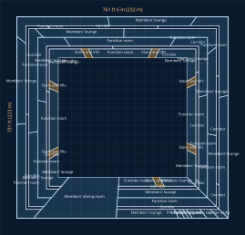

# P3-04 Guild Lodge: plan

Footprint 761 ft 6 in (232 m) × 731 ft (223 m) · structural grid 32 ft 10 in (10 m)

## Levels

| Level | Floor above deck | Height | Floor area |
|---|---|---|---|
| Level 1 · Club floor | 0 ft (0 mm) | 16 ft 5 in (5,000 mm) | 307,509 sq ft (28,568 m²) |
| Level 2 · Lounge floor | 16 ft 5 in (5,000 mm) | 14 ft 5 in (4,400 mm) | 301,961 sq ft (28,053 m²) |
| Level 3 · Guest floor 1 | 30 ft 10 in (9,400 mm) | 11 ft 10 in (3,600 mm) | 301,961 sq ft (28,053 m²) |
| Level 4 · Guest floor 2 | 42 ft 8 in (13 m) | 11 ft 10 in (3,600 mm) | 301,961 sq ft (28,053 m²) |

## Elements

| ID | Designation | Type | Name | Level(s) | Size / length | Area | Status |
|---|---|---|---|---|---|---|---|
| E001 | D5F1P3B3A2L1R1 | room | Members' dining room | L1 | 305 ft 9 in (93 m) × 148 ft 11 in (45 m) | 35,600 sq ft (3,307 m²) | proposed |
| E002 | D5F1P3B3A2L1R2 | zone | Corridor | L1 | 369 ft 9 in (113 m) × 9 ft 10 in (3,000 mm) | 3,588 sq ft (333 m²) | proposed |
| E003 | D5F1P3B3A2L1R3 | zone | Corridor | L1 | 63 ft (19 m) × 345 ft 2 in (105 m) | 3,878 sq ft (360 m²) | proposed |
| E004 | D5F1P3B3A2L1R4 | zone | Corridor | L1 | 85 ft 11 in (26 m) × 321 ft 10 in (98 m) | 3,877 sq ft (360 m²) | proposed |
| E005 | D5F1P3B3A2L1R5 | zone | Corridor | L1 | 399 ft 7 in (122 m) × 9 ft 10 in (3,000 mm) | 3,875 sq ft (360 m²) | proposed |
| E006 | D5F1P3B3A2L1R6 | zone | Corridor | L1 | 223 ft 5 in (68 m) × 184 ft 9 in (56 m) | 3,878 sq ft (360 m²) | proposed |
| E007 | D5F1P3B3A2L1R7 | zone | Corridor | L1 | 9 ft 10 in (3,000 mm) × 399 ft 7 in (122 m) | 3,875 sq ft (360 m²) | proposed |
| E008 | D5F1P3B3A2L1R8 | zone | Corridor | L1 | 9 ft 10 in (3,000 mm) × 94 ft 2 in (29 m) | 843 sq ft (78 m²) | proposed |
| E009 | D5F1P3B3A2L1R9 | zone | Corridor | L1 | 289 ft 1 in (88 m) × 9 ft 10 in (3,000 mm) | 2,793 sq ft (260 m²) | proposed |
| E010 | D5F1P3B3A2L1R10 | zone | Corridor | L1 | 54 ft 6 in (17 m) × 355 ft 4 in (108 m) | 3,877 sq ft (360 m²) | proposed |
| E011 | D5F1P3B3A2L1R11 | zone | Corridor | L1 | 239 ft 10 in (73 m) × 166 ft 4 in (51 m) | 3,875 sq ft (360 m²) | proposed |
| E012 | D5F1P3B3A2L1R12 | zone | Corridor | L1 | 309 ft 9 in (94 m) × 98 ft 1 in (30 m) | 3,878 sq ft (360 m²) | proposed |
| E013 | D5F1P3B3A2L1R13 | zone | Corridor | L1 | 9 ft 10 in (3,000 mm) × 401 ft 3 in (122 m) | 3,873 sq ft (360 m²) | proposed |
| E014 | D5F1P3B3A2L1R14 | zone | Corridor | L1 | 9 ft 10 in (3,000 mm) × 33 ft 10 in (10 m) | 241 sq ft (22 m²) | proposed |
| E015 | D5F1P3B3A2L1R15, D5F1P3B3A2L2R1, D5F1P3B3A2L3R1, D5F1P3B3A2L4R1 | core | Stairs and lifts | L1, L2, L3, L4 | 43 ft (13 m) × 32 ft 6 in (9,900 mm) | 853 sq ft (79 m²) | proposed |
| E016 | D5F1P3B3A2L1R16, D5F1P3B3A2L2R2, D5F1P3B3A2L3R2, D5F1P3B3A2L4R2 | core | Stairs and lifts | L1, L2, L3, L4 | 32 ft 6 in (9,900 mm) × 44 ft (13 m) | 853 sq ft (79 m²) | proposed |
| E017 | D5F1P3B3A2L1R17, D5F1P3B3A2L2R3, D5F1P3B3A2L3R3, D5F1P3B3A2L4R3 | core | Stairs and lifts | L1, L2, L3, L4 | 32 ft 6 in (9,900 mm) × 42 ft (13 m) | 858 sq ft (80 m²) | proposed |
| E018 | D5F1P3B3A2L1R18, D5F1P3B3A2L2R4, D5F1P3B3A2L3R4, D5F1P3B3A2L4R4 | core | Stairs and lifts | L1, L2, L3, L4 | 43 ft (13 m) × 32 ft 6 in (9,900 mm) | 853 sq ft (79 m²) | proposed |
| E019 | D5F1P3B3A2L1R19, D5F1P3B3A2L2R5, D5F1P3B3A2L3R5, D5F1P3B3A2L4R5 | core | Stairs and lifts | L1, L2, L3, L4 | 41 ft (12 m) × 32 ft 6 in (9,900 mm) | 858 sq ft (80 m²) | proposed |
| E020 | D5F1P3B3A2L1R20, D5F1P3B3A2L2R6, D5F1P3B3A2L3R6, D5F1P3B3A2L4R6 | core | Stairs and lifts | L1, L2, L3, L4 | 32 ft 6 in (9,900 mm) × 44 ft (13 m) | 853 sq ft (79 m²) | proposed |
| E021 | D5F1P3B3A2L1R21, D5F1P3B3A2L2R7, D5F1P3B3A2L3R7, D5F1P3B3A2L4R7 | core | Stairs and lifts | L1, L2, L3, L4 | 32 ft 6 in (9,900 mm) × 42 ft (13 m) | 858 sq ft (80 m²) | proposed |
| E022 | D5F1P3B3A2L1R22 | room | Lodge lobby | L1 | 64 ft 4 in (20 m) × 32 ft 2 in (9,800 mm) | 1,076 sq ft (100 m²) | proposed |
| E023 | D5F1P3B3A2L1R23 | room | Bar | L1 | 67 ft 7 in (21 m) × 32 ft 2 in (9,800 mm) | 1,282 sq ft (119 m²) | proposed |
| E024 | D5F1P3B3A2L1R24 | room | Kitchen | L1 | 73 ft 10 in (22 m) × 32 ft 2 in (9,800 mm) | 1,614 sq ft (150 m²) | proposed |
| E025 | D5F1P3B3A2L1R25 | room | Private dining room | L1 | 34 ft 1 in (10 m) × 32 ft 2 in (9,800 mm) | 427 sq ft (40 m²) | proposed |
| E026 | D5F1P3B3A2L1R26 | room | Private dining room | L1 | 32 ft 10 in (10 m) × 32 ft 2 in (9,800 mm) | 427 sq ft (40 m²) | proposed |
| E027 | D5F1P3B3A2L1R27 | room | Toilets | L1 | 38 ft 1 in (12 m) × 32 ft 2 in (9,800 mm) | 643 sq ft (60 m²) | proposed |
| E028 | D5F1P3B3A2L1R28 | room | Members' lounge | L1 | 227 ft (69 m) × 32 ft 2 in (9,800 mm) | 6,988 sq ft (649 m²) | proposed |
| E029 | D5F1P3B3A2L1R29 | room | Function room | L1 | 85 ft 11 in (26 m) × 342 ft 10 in (105 m) | 12,279 sq ft (1,141 m²) | proposed |
| E030 | D5F1P3B3A2L1R30 | room | Members' lounge | L1 | 32 ft 2 in (9,800 mm) × 319 ft 7 in (97 m) | 9,821 sq ft (912 m²) | proposed |
| E031 | D5F1P3B3A2L1R31 | room | Function room | L1 | 332 ft 8 in (101 m) × 96 ft 9 in (30 m) | 12,284 sq ft (1,141 m²) | proposed |
| E032 | D5F1P3B3A2L1R32 | room | Members' lounge | L1 | 319 ft 3 in (97 m) × 32 ft 2 in (9,800 mm) | 9,826 sq ft (913 m²) | proposed |
| E033 | D5F1P3B3A2L1R33 | room | Function room | L1 | 136 ft 10 in (42 m) × 292 ft 4 in (89 m) | 12,284 sq ft (1,141 m²) | proposed |
| E034 | D5F1P3B3A2L1R34 | room | Members' lounge | L1 | 32 ft 2 in (9,800 mm) × 445 ft 10 in (136 m) | 13,703 sq ft (1,273 m²) | proposed |
| E035 | D5F1P3B3A2L1R35 | room | Function room | L1 | 358 ft 11 in (109 m) × 32 ft 6 in (9,900 mm) | 11,099 sq ft (1,031 m²) | proposed |
| E036 | D5F1P3B3A2L1R36 | room | Members' lounge | L1 | 81 ft 4 in (25 m) × 273 ft (83 m) | 9,921 sq ft (922 m²) | proposed |
| E037 | D5F1P3B3A2L1R37 | room | Function room | L1 | 52 ft 10 in (16 m) × 379 ft 7 in (116 m) | 12,409 sq ft (1,153 m²) | proposed |
| E038 | D5F1P3B3A2L1R38 | room | Members' lounge | L1 | 320 ft 10 in (98 m) × 32 ft 6 in (9,900 mm) | 9,926 sq ft (922 m²) | proposed |
| E039 | D5F1P3B3A2L1R39 | room | Function room | L1 | 334 ft 4 in (102 m) × 93 ft 2 in (28 m) | 12,409 sq ft (1,153 m²) | proposed |
| E040 | D5F1P3B3A2L1R40 | room | Members' lounge | L1 | 32 ft 6 in (9,900 mm) × 321 ft 6 in (98 m) | 9,921 sq ft (922 m²) | proposed |
| E041 | D5F1P3B3A2L1R41 | room | Function room | L1 | 32 ft 6 in (9,900 mm) × 264 ft 5 in (81 m) | 7,955 sq ft (739 m²) | proposed |
| E042 | D5F1P3B3A2L1R42 | room | Members' lounge | L1 | 322 ft 6 in (98 m) × 32 ft 2 in (9,800 mm) | 9,826 sq ft (913 m²) | proposed |
| E043 | D5F1P3B3A2L1R43 | room | Function room | L1 | 77 ft 5 in (24 m) × 353 ft 8 in (108 m) | 12,279 sq ft (1,141 m²) | proposed |
| E044 | D5F1P3B3A2L1R44 | room | Members' lounge | L1 | 117 ft 2 in (36 m) × 235 ft 3 in (72 m) | 9,826 sq ft (913 m²) | proposed |
| E045 | D5F1P3B3A2L1R45 | room | Function room | L1 | 402 ft 11 in (123 m) × 32 ft 2 in (9,800 mm) | 12,273 sq ft (1,140 m²) | proposed |
| E046 | D5F1P3B3A2L1R46 | room | Members' lounge | L1 | 134 ft 10 in (41 m) × 217 ft 6 in (66 m) | 9,826 sq ft (913 m²) | proposed |
| E047 | D5F1P3B3A2L1R47 | room | Function room | L1 | 32 ft 2 in (9,800 mm) × 373 ft 8 in (114 m) | 11,350 sq ft (1,054 m²) | proposed |
| E048 | D5F1P3B3A2L1R48 | room | Members' lounge | L1 | 132 ft 7 in (40 m) × 32 ft 6 in (9,900 mm) | 3,479 sq ft (323 m²) | proposed |
| E049 | D5F1P3B3A2L1R49 | room | Function room | L1 | 135 ft 10 in (41 m) × 32 ft 6 in (9,900 mm) | 4,140 sq ft (385 m²) | proposed |
| E050 | D5F1P3B3A2L1R50 | room | Members' lounge | L1 | 72 ft 6 in (22 m) × 117 ft 9 in (36 m) | 4,374 sq ft (406 m²) | proposed |
| E051 | D5F1P3B3A2L1R51 | room | Function room | L1 | 32 ft 6 in (9,900 mm) × 229 ft (70 m) | 6,953 sq ft (646 m²) | proposed |
| E052 | D5F1P3B3A2L1R52 | room | Members' lounge | L1 | 132 ft 7 in (40 m) × 131 ft 11 in (40 m) | 6,953 sq ft (646 m²) | proposed |
| E053 | D5F1P3B3A2L1R53 | room | Function room | L1 | 228 ft (70 m) × 32 ft 6 in (9,900 mm) | 6,953 sq ft (646 m²) | proposed |
| E054 | D5F1P3B3A2L1R54 | room | Members' lounge | L1 | 146 ft 8 in (45 m) × 117 ft 9 in (36 m) | 6,953 sq ft (646 m²) | proposed |
| E055 | D5F1P3B3A2L1R55 | room | Function room | L1 | 32 ft 6 in (9,900 mm) × 229 ft (70 m) | 6,953 sq ft (646 m²) | proposed |
| E056 | D5F1P3B3A2L1R56 | room | Members' lounge | L1 | 32 ft 6 in (9,900 mm) × 131 ft 11 in (40 m) | 3,474 sq ft (323 m²) | proposed |
| E057 | D5F1P3B3A2L2R8 | zone | Corridor | L2 | 399 ft 7 in (122 m) × 9 ft 10 in (3,000 mm) | 3,877 sq ft (360 m²) | proposed |
| E058 | D5F1P3B3A2L2R9 | zone | Corridor | L2 | 299 ft 3 in (91 m) × 108 ft 11 in (33 m) | 3,878 sq ft (360 m²) | proposed |
| E059 | D5F1P3B3A2L2R10 | zone | Corridor | L2 | 9 ft 10 in (3,000 mm) × 399 ft 7 in (122 m) | 3,875 sq ft (360 m²) | proposed |
| E060 | D5F1P3B3A2L2R11 | zone | Corridor | L2 | 237 ft 10 in (72 m) × 169 ft 11 in (52 m) | 3,877 sq ft (360 m²) | proposed |
| E061 | D5F1P3B3A2L2R12 | zone | Corridor | L2 | 399 ft 3 in (122 m) × 9 ft 10 in (3,000 mm) | 3,875 sq ft (360 m²) | proposed |
| E062 | D5F1P3B3A2L2R13 | zone | Corridor | L2 | 71 ft 2 in (22 m) × 336 ft 7 in (103 m) | 3,878 sq ft (360 m²) | proposed |
| E063 | D5F1P3B3A2L2R14 | zone | Corridor | L2 | 9 ft 10 in (3,000 mm) × 330 ft 1 in (101 m) | 3,200 sq ft (297 m²) | proposed |
| E064 | D5F1P3B3A2L2R15 | zone | Corridor | L2 | 400 ft 11 in (122 m) × 9 ft 10 in (3,000 mm) | 3,875 sq ft (360 m²) | proposed |
| E065 | D5F1P3B3A2L2R16 | zone | Corridor | L2 | 151 ft 11 in (46 m) × 254 ft 3 in (78 m) | 3,877 sq ft (360 m²) | proposed |
| E066 | D5F1P3B3A2L2R17 | zone | Corridor | L2 | 142 ft 5 in (43 m) × 263 ft 9 in (80 m) | 3,877 sq ft (360 m²) | proposed |
| E067 | D5F1P3B3A2L2R18 | zone | Corridor | L2 | 400 ft 7 in (122 m) × 9 ft 10 in (3,000 mm) | 3,875 sq ft (360 m²) | proposed |
| E068 | D5F1P3B3A2L2R19 | zone | Corridor | L2 | 19 ft (5,800 mm) × 391 ft 9 in (119 m) | 3,877 sq ft (360 m²) | proposed |
| E069 | D5F1P3B3A2L2R20 | zone | Corridor | L2 | 9 ft 10 in (3,000 mm) × 130 ft 11 in (40 m) | 1,216 sq ft (113 m²) | proposed |
| E070 | D5F1P3B3A2L2R21 | room | Library lounge | L2 | 80 ft 1 in (24 m) × 32 ft 2 in (9,800 mm) | 1,609 sq ft (149 m²) | proposed |
| E071 | D5F1P3B3A2L2R22 | room | Games room | L2 | 53 ft 6 in (16 m) × 32 ft 2 in (9,800 mm) | 860 sq ft (80 m²) | proposed |
| E072 | D5F1P3B3A2L2R23 | room | Quiet lounge | L2 | 50 ft 10 in (16 m) × 32 ft 2 in (9,800 mm) | 854 sq ft (79 m²) | proposed |
| E073 | D5F1P3B3A2L2R24 | room | Toilets | L2 | 42 ft 4 in (13 m) × 32 ft 2 in (9,800 mm) | 649 sq ft (60 m²) | proposed |
| E074 | D5F1P3B3A2L2R25 | room | Card room | L2 | 168 ft 4 in (51 m) × 32 ft 2 in (9,800 mm) | 4,942 sq ft (459 m²) | proposed |
| E075 | D5F1P3B3A2L2R26 | room | Lounge | L2 | 472 ft 1 in (144 m) × 187 ft 8 in (57 m) | 19,779 sq ft (1,838 m²) | proposed |
| E076 | D5F1P3B3A2L2R27 | room | Card room | L2 | 32 ft 2 in (9,800 mm) × 163 ft 9 in (50 m) | 4,942 sq ft (459 m²) | proposed |
| E077 | D5F1P3B3A2L2R28 | room | Lounge | L2 | 254 ft 11 in (78 m) × 399 ft 7 in (122 m) | 19,779 sq ft (1,838 m²) | proposed |
| E078 | D5F1P3B3A2L2R29 | room | Card room | L2 | 160 ft 5 in (49 m) × 32 ft 2 in (9,800 mm) | 4,942 sq ft (459 m²) | proposed |
| E079 | D5F1P3B3A2L2R30 | room | Lounge | L2 | 359 ft 7 in (110 m) × 292 ft 4 in (89 m) | 19,779 sq ft (1,837 m²) | proposed |
| E080 | D5F1P3B3A2L2R31 | room | Card room | L2 | 32 ft 2 in (9,800 mm) × 445 ft 10 in (136 m) | 13,703 sq ft (1,273 m²) | proposed |
| E081 | D5F1P3B3A2L2R32 | room | Lounge | L2 | 646 ft (197 m) × 32 ft 6 in (9,900 mm) | 19,981 sq ft (1,856 m²) | proposed |
| E082 | D5F1P3B3A2L2R33 | room | Card room | L2 | 60 ft 8 in (18 m) × 149 ft 7 in (46 m) | 4,992 sq ft (464 m²) | proposed |
| E083 | D5F1P3B3A2L2R34 | room | Lounge | L2 | 150 ft 7 in (46 m) × 516 ft 5 in (157 m) | 19,981 sq ft (1,856 m²) | proposed |
| E084 | D5F1P3B3A2L2R35 | room | Card room | L2 | 165 ft 8 in (50 m) × 32 ft 6 in (9,900 mm) | 4,992 sq ft (464 m²) | proposed |
| E085 | D5F1P3B3A2L2R36 | room | Lounge | L2 | 385 ft 2 in (117 m) × 267 ft 9 in (82 m) | 19,981 sq ft (1,856 m²) | proposed |
| E086 | D5F1P3B3A2L2R37 | room | Card room | L2 | 32 ft 6 in (9,900 mm) × 385 ft 6 in (118 m) | 11,892 sq ft (1,105 m²) | proposed |
| E087 | D5F1P3B3A2L2R38 | room | Lounge | L2 | 612 ft 6 in (187 m) × 65 ft (20 m) | 19,779 sq ft (1,837 m²) | proposed |
| E088 | D5F1P3B3A2L2R39 | room | Card room | L2 | 32 ft 2 in (9,800 mm) × 172 ft 11 in (53 m) | 4,942 sq ft (459 m²) | proposed |
| E089 | D5F1P3B3A2L2R40 | room | Lounge | L2 | 271 ft 8 in (83 m) × 382 ft 7 in (117 m) | 19,773 sq ft (1,837 m²) | proposed |
| E090 | D5F1P3B3A2L2R41 | room | Card room | L2 | 162 ft 1 in (49 m) × 32 ft 2 in (9,800 mm) | 4,942 sq ft (459 m²) | proposed |
| E091 | D5F1P3B3A2L2R42 | room | Lounge | L2 | 195 ft 6 in (60 m) × 467 ft 10 in (143 m) | 19,773 sq ft (1,837 m²) | proposed |
| E092 | D5F1P3B3A2L2R43 | room | Card room | L2 | 32 ft 2 in (9,800 mm) × 133 ft 10 in (41 m) | 3,471 sq ft (322 m²) | proposed |
| E093 | D5F1P3B3A2L2R44 | room | Lounge | L2 | 132 ft 7 in (40 m) × 32 ft 6 in (9,900 mm) | 3,479 sq ft (323 m²) | proposed |
| E094 | D5F1P3B3A2L2R45 | room | Card room | L2 | 228 ft (70 m) × 32 ft 6 in (9,900 mm) | 6,953 sq ft (646 m²) | proposed |
| E095 | D5F1P3B3A2L2R46 | room | Lounge | L2 | 146 ft 8 in (45 m) × 117 ft 9 in (36 m) | 6,953 sq ft (646 m²) | proposed |
| E096 | D5F1P3B3A2L2R47 | room | Card room | L2 | 32 ft 6 in (9,900 mm) × 229 ft (70 m) | 6,953 sq ft (646 m²) | proposed |
| E097 | D5F1P3B3A2L2R48 | room | Lounge | L2 | 132 ft 7 in (40 m) × 131 ft 11 in (40 m) | 6,953 sq ft (646 m²) | proposed |
| E098 | D5F1P3B3A2L2R49 | room | Card room | L2 | 228 ft (70 m) × 32 ft 6 in (9,900 mm) | 6,953 sq ft (646 m²) | proposed |
| E099 | D5F1P3B3A2L2R50 | room | Lounge | L2 | 146 ft 8 in (45 m) × 117 ft 9 in (36 m) | 6,953 sq ft (646 m²) | proposed |
| E100 | D5F1P3B3A2L2R51 | room | Card room | L2 | 32 ft 6 in (9,900 mm) × 229 ft (70 m) | 6,953 sq ft (646 m²) | proposed |
| E101 | D5F1P3B3A2L2R52 | room | Lounge | L2 | 32 ft 6 in (9,900 mm) × 131 ft 11 in (40 m) | 3,474 sq ft (323 m²) | proposed |
| E102 | D5F1P3B3A2L3R8, D5F1P3B3A2L4R8 | zone | Corridor | L3, L4 | 399 ft 7 in (122 m) × 9 ft 10 in (3,000 mm) | 3,877 sq ft (360 m²) | proposed |
| E103 | D5F1P3B3A2L3R9, D5F1P3B3A2L4R9 | zone | Corridor | L3, L4 | 299 ft 3 in (91 m) × 108 ft 11 in (33 m) | 3,878 sq ft (360 m²) | proposed |
| E104 | D5F1P3B3A2L3R10, D5F1P3B3A2L4R10 | zone | Corridor | L3, L4 | 9 ft 10 in (3,000 mm) × 399 ft 7 in (122 m) | 3,875 sq ft (360 m²) | proposed |
| E105 | D5F1P3B3A2L3R11, D5F1P3B3A2L4R11 | zone | Corridor | L3, L4 | 237 ft 10 in (72 m) × 169 ft 11 in (52 m) | 3,877 sq ft (360 m²) | proposed |
| E106 | D5F1P3B3A2L3R12, D5F1P3B3A2L4R12 | zone | Corridor | L3, L4 | 399 ft 3 in (122 m) × 9 ft 10 in (3,000 mm) | 3,875 sq ft (360 m²) | proposed |
| E107 | D5F1P3B3A2L3R13, D5F1P3B3A2L4R13 | zone | Corridor | L3, L4 | 71 ft 2 in (22 m) × 336 ft 7 in (103 m) | 3,878 sq ft (360 m²) | proposed |
| E108 | D5F1P3B3A2L3R14, D5F1P3B3A2L4R14 | zone | Corridor | L3, L4 | 9 ft 10 in (3,000 mm) × 330 ft 1 in (101 m) | 3,200 sq ft (297 m²) | proposed |
| E109 | D5F1P3B3A2L3R15, D5F1P3B3A2L4R15 | zone | Corridor | L3, L4 | 400 ft 11 in (122 m) × 9 ft 10 in (3,000 mm) | 3,875 sq ft (360 m²) | proposed |
| E110 | D5F1P3B3A2L3R16, D5F1P3B3A2L4R16 | zone | Corridor | L3, L4 | 151 ft 11 in (46 m) × 254 ft 3 in (78 m) | 3,877 sq ft (360 m²) | proposed |
| E111 | D5F1P3B3A2L3R17, D5F1P3B3A2L4R17 | zone | Corridor | L3, L4 | 142 ft 5 in (43 m) × 263 ft 9 in (80 m) | 3,877 sq ft (360 m²) | proposed |
| E112 | D5F1P3B3A2L3R18, D5F1P3B3A2L4R18 | zone | Corridor | L3, L4 | 400 ft 7 in (122 m) × 9 ft 10 in (3,000 mm) | 3,875 sq ft (360 m²) | proposed |
| E113 | D5F1P3B3A2L3R19, D5F1P3B3A2L4R19 | zone | Corridor | L3, L4 | 19 ft (5,800 mm) × 391 ft 9 in (119 m) | 3,877 sq ft (360 m²) | proposed |
| E114 | D5F1P3B3A2L3R20, D5F1P3B3A2L4R20 | zone | Corridor | L3, L4 | 9 ft 10 in (3,000 mm) × 130 ft 11 in (40 m) | 1,216 sq ft (113 m²) | proposed |
| E115 | D5F1P3B3A2L3R21, D5F1P3B3A2L4R21 | room | Guest room | L3, L4 | 43 ft (13 m) × 32 ft 2 in (9,800 mm) | 364 sq ft (34 m²) | proposed |
| E116 | D5F1P3B3A2L3R22, D5F1P3B3A2L4R22 | room | Guest room | L3, L4 | 42 ft (13 m) × 32 ft 2 in (9,800 mm) | 364 sq ft (34 m²) | proposed |
| E117 | D5F1P3B3A2L3R23, D5F1P3B3A2L4R23 | room | Guest room | L3, L4 | 41 ft (12 m) × 32 ft 2 in (9,800 mm) | 364 sq ft (34 m²) | proposed |
| E118 | D5F1P3B3A2L3R24, D5F1P3B3A2L4R24 | room | Guest room | L3, L4 | 40 ft (12 m) × 32 ft 2 in (9,800 mm) | 364 sq ft (34 m²) | proposed |
| E119 | D5F1P3B3A2L3R25, D5F1P3B3A2L4R25 | room | Guest room | L3, L4 | 39 ft 1 in (12 m) × 32 ft 2 in (9,800 mm) | 364 sq ft (34 m²) | proposed |
| E120 | D5F1P3B3A2L3R26, D5F1P3B3A2L4R26 | room | Guest room | L3, L4 | 38 ft 1 in (12 m) × 32 ft 2 in (9,800 mm) | 364 sq ft (34 m²) | proposed |
| E121 | D5F1P3B3A2L3R27, D5F1P3B3A2L4R27 | room | Guest room | L3, L4 | 37 ft 1 in (11 m) × 32 ft 2 in (9,800 mm) | 364 sq ft (34 m²) | proposed |
| E122 | D5F1P3B3A2L3R28, D5F1P3B3A2L4R28 | room | Guest room | L3, L4 | 36 ft 1 in (11 m) × 32 ft 2 in (9,800 mm) | 364 sq ft (34 m²) | proposed |
| E123 | D5F1P3B3A2L3R29, D5F1P3B3A2L4R29 | room | Linen room | L3, L4 | 35 ft 1 in (11 m) × 32 ft 2 in (9,800 mm) | 364 sq ft (34 m²) | proposed |
| E124 | D5F1P3B3A2L3R30, D5F1P3B3A2L4R30 | room | Guest room | L3, L4 | 403 ft 7 in (123 m) × 32 ft 2 in (9,800 mm) | 12,426 sq ft (1,154 m²) | proposed |
| E125 | D5F1P3B3A2L3R31, D5F1P3B3A2L4R31 | room | Guest room | L3, L4 | 262 ft 6 in (80 m) × 171 ft 3 in (52 m) | 12,432 sq ft (1,155 m²) | proposed |
| E126 | D5F1P3B3A2L3R32, D5F1P3B3A2L4R32 | room | Guest room | L3, L4 | 32 ft 2 in (9,800 mm) × 404 ft 6 in (123 m) | 12,426 sq ft (1,154 m²) | proposed |
| E127 | D5F1P3B3A2L3R33, D5F1P3B3A2L4R33 | room | Guest room | L3, L4 | 242 ft 5 in (74 m) × 191 ft 3 in (58 m) | 12,432 sq ft (1,155 m²) | proposed |
| E128 | D5F1P3B3A2L3R34, D5F1P3B3A2L4R34 | room | Guest room | L3, L4 | 403 ft 7 in (123 m) × 32 ft 2 in (9,800 mm) | 12,426 sq ft (1,154 m²) | proposed |
| E129 | D5F1P3B3A2L3R35, D5F1P3B3A2L4R35 | room | Guest room | L3, L4 | 149 ft 7 in (46 m) × 283 ft 10 in (86 m) | 12,432 sq ft (1,155 m²) | proposed |
| E130 | D5F1P3B3A2L3R36, D5F1P3B3A2L4R36 | room | Guest room | L3, L4 | 32 ft 2 in (9,800 mm) × 455 ft 1 in (139 m) | 13,987 sq ft (1,299 m²) | proposed |
| E131 | D5F1P3B3A2L3R37, D5F1P3B3A2L4R37 | room | Guest room | L3, L4 | 406 ft 2 in (124 m) × 32 ft 6 in (9,900 mm) | 12,558 sq ft (1,167 m²) | proposed |
| E132 | D5F1P3B3A2L3R38, D5F1P3B3A2L4R38 | room | Guest room | L3, L4 | 277 ft 11 in (85 m) × 153 ft 10 in (47 m) | 12,553 sq ft (1,166 m²) | proposed |
| E133 | D5F1P3B3A2L3R39, D5F1P3B3A2L4R39 | room | Guest room | L3, L4 | 32 ft 6 in (9,900 mm) × 407 ft 2 in (124 m) | 12,558 sq ft (1,167 m²) | proposed |
| E134 | D5F1P3B3A2L3R40, D5F1P3B3A2L4R40 | room | Guest room | L3, L4 | 304 ft 9 in (93 m) × 127 ft (39 m) | 12,553 sq ft (1,166 m²) | proposed |
| E135 | D5F1P3B3A2L3R41, D5F1P3B3A2L4R41 | room | Guest room | L3, L4 | 376 ft 4 in (115 m) × 59 ft 5 in (18 m) | 12,558 sq ft (1,167 m²) | proposed |
| E136 | D5F1P3B3A2L3R42, D5F1P3B3A2L4R42 | room | Guest room | L3, L4 | 32 ft 6 in (9,900 mm) × 406 ft 10 in (124 m) | 12,553 sq ft (1,166 m²) | proposed |
| E137 | D5F1P3B3A2L3R43, D5F1P3B3A2L4R43 | room | Guest room | L3, L4 | 32 ft 6 in (9,900 mm) × 221 ft 5 in (68 m) | 6,484 sq ft (602 m²) | proposed |
| E138 | D5F1P3B3A2L3R44, D5F1P3B3A2L4R44 | room | Guest room | L3, L4 | 407 ft 10 in (124 m) × 32 ft 2 in (9,800 mm) | 12,426 sq ft (1,154 m²) | proposed |
| E139 | D5F1P3B3A2L3R45, D5F1P3B3A2L4R45 | room | Guest room | L3, L4 | 215 ft 3 in (66 m) × 213 ft 7 in (65 m) | 12,432 sq ft (1,155 m²) | proposed |
| E140 | D5F1P3B3A2L3R46, D5F1P3B3A2L4R46 | room | Guest room | L3, L4 | 60 ft (18 m) × 377 ft 11 in (115 m) | 12,426 sq ft (1,154 m²) | proposed |
| E141 | D5F1P3B3A2L3R47, D5F1P3B3A2L4R47 | room | Guest room | L3, L4 | 408 ft 2 in (124 m) × 32 ft 2 in (9,800 mm) | 12,426 sq ft (1,154 m²) | proposed |
| E142 | D5F1P3B3A2L3R48, D5F1P3B3A2L4R48 | room | Guest room | L3, L4 | 187 ft 8 in (57 m) × 241 ft 2 in (74 m) | 12,426 sq ft (1,154 m²) | proposed |
| E143 | D5F1P3B3A2L3R49, D5F1P3B3A2L4R49 | room | Guest room | L3, L4 | 32 ft 2 in (9,800 mm) × 347 ft 1 in (106 m) | 10,543 sq ft (980 m²) | proposed |
| E144 | D5F1P3B3A2L3R50, D5F1P3B3A2L4R50 | room | Guest room | L3, L4 | 132 ft 7 in (40 m) × 32 ft 6 in (9,900 mm) | 3,479 sq ft (323 m²) | proposed |
| E145 | D5F1P3B3A2L3R51, D5F1P3B3A2L4R51 | room | Guest room | L3, L4 | 228 ft (70 m) × 32 ft 6 in (9,900 mm) | 6,953 sq ft (646 m²) | proposed |
| E146 | D5F1P3B3A2L3R52, D5F1P3B3A2L4R52 | room | Guest room | L3, L4 | 146 ft 8 in (45 m) × 117 ft 9 in (36 m) | 6,953 sq ft (646 m²) | proposed |
| E147 | D5F1P3B3A2L3R53, D5F1P3B3A2L4R53 | room | Guest room | L3, L4 | 32 ft 6 in (9,900 mm) × 229 ft (70 m) | 6,953 sq ft (646 m²) | proposed |
| E148 | D5F1P3B3A2L3R54, D5F1P3B3A2L4R54 | room | Guest room | L3, L4 | 132 ft 7 in (40 m) × 131 ft 11 in (40 m) | 6,953 sq ft (646 m²) | proposed |
| E149 | D5F1P3B3A2L3R55, D5F1P3B3A2L4R55 | room | Guest room | L3, L4 | 228 ft (70 m) × 32 ft 6 in (9,900 mm) | 6,953 sq ft (646 m²) | proposed |
| E150 | D5F1P3B3A2L3R56, D5F1P3B3A2L4R56 | room | Guest room | L3, L4 | 146 ft 8 in (45 m) × 117 ft 9 in (36 m) | 6,953 sq ft (646 m²) | proposed |
| E151 | D5F1P3B3A2L3R57, D5F1P3B3A2L4R57 | room | Guest room | L3, L4 | 32 ft 6 in (9,900 mm) × 229 ft (70 m) | 6,953 sq ft (646 m²) | proposed |
| E152 | D5F1P3B3A2L3R58, D5F1P3B3A2L4R58 | room | Guest room | L3, L4 | 32 ft 6 in (9,900 mm) × 131 ft 11 in (40 m) | 3,474 sq ft (323 m²) | proposed |

## Drawings

### Level 1 · Club floor

### Level 2 · Lounge floor

### Level 3 · Guest floor 1

### Level 4 · Guest floor 2

