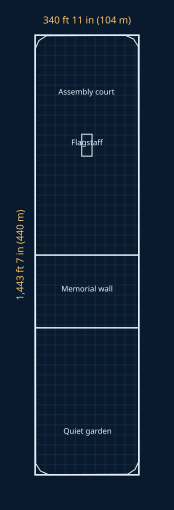

# P3-05 Guild Court: plan

Footprint 340 ft 11 in (104 m) × 1,443 ft 7 in (440 m) · structural grid 32 ft 10 in (10 m)

## Levels

| Level | Floor above deck | Height | Floor area |
|---|---|---|---|
| Level 1 · Ground | 0 ft (0 mm) | 13 ft 1 in (4,000 mm) | — |

## Elements

| ID | Designation | Type | Name | Level(s) | Size / length | Area | Status |
|---|---|---|---|---|---|---|---|
| E001 | D5F1P3B5A1R1 | zone | Assembly court | L1 | 339 ft 3 in (103 m) × 721 ft 5 in (220 m) | 242,868 sq ft (22,563 m²) | proposed |
| E002 |  | fixture | Flagstaff | L1 | 33 ft 10 in (10 m) × 72 ft 2 in (22 m) | 2,439 sq ft (227 m²) | proposed |
| E003 | D5F1P3B5A1R2 | zone | Memorial wall | L1 | 338 ft 7 in (103 m) × 238 ft 10 in (73 m) | 80,830 sq ft (7,509 m²) | proposed |
| E004 | D5F1P3B5A1R3 | zone | Quiet garden | L1 | 338 ft 11 in (103 m) × 481 ft 11 in (147 m) | 161,819 sq ft (15,033 m²) | proposed |

## Drawings

### Level 1 · Ground

