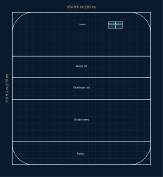

# P3-06 Rim Garden 1: plan

Footprint 654 ft 6 in (200 m) × 719 ft 2 in (219 m) · structural grid 32 ft 10 in (10 m)

## Levels

| Level | Floor above deck | Height | Floor area |
|---|---|---|---|
| Level 1 · Ground | 0 ft (0 mm) | 13 ft 1 in (4,000 mm) | 2,153 sq ft (200 m²) |

## Elements

| ID | Designation | Type | Name | Level(s) | Size / length | Area | Status |
|---|---|---|---|---|---|---|---|
| E001 | D5F1P3B2A2R1 | zone | Lawn | L1 | 653 ft 10 in (199 m) × 208 ft 4 in (64 m) | 131,710 sq ft (12,236 m²) | proposed |
| E002 | D5F1P3B2A2R2 | room | Kiosk | L1 | 32 ft 10 in (10 m) × 32 ft 10 in (10,000 mm) | 1,076 sq ft (100 m²) | proposed |
| E003 | D5F1P3B2A2R3 | room | Toilets | L1 | 32 ft 10 in (10 m) × 32 ft 10 in (10,000 mm) | 1,076 sq ft (100 m²) | proposed |
| E004 | D5F1P3B2A2R4 | zone | Water rill | L1 | 653 ft 7 in (199 m) × 100 ft 9 in (31 m) | 65,826 sq ft (6,115 m²) | proposed |
| E005 | D5F1P3B2A2R5 | zone | Overlook rail | L1 | 653 ft 10 in (199 m) × 101 ft 1 in (31 m) | 66,040 sq ft (6,135 m²) | proposed |
| E006 | D5F1P3B2A2R6 | zone | Shade trees | L1 | 653 ft 10 in (199 m) × 201 ft 5 in (61 m) | 131,652 sq ft (12,231 m²) | proposed |
| E007 | D5F1P3B2A2R7 | zone | Paths | L1 | 653 ft 7 in (199 m) × 107 ft 7 in (33 m) | 65,857 sq ft (6,118 m²) | proposed |

## Drawings

### Level 1 · Ground

