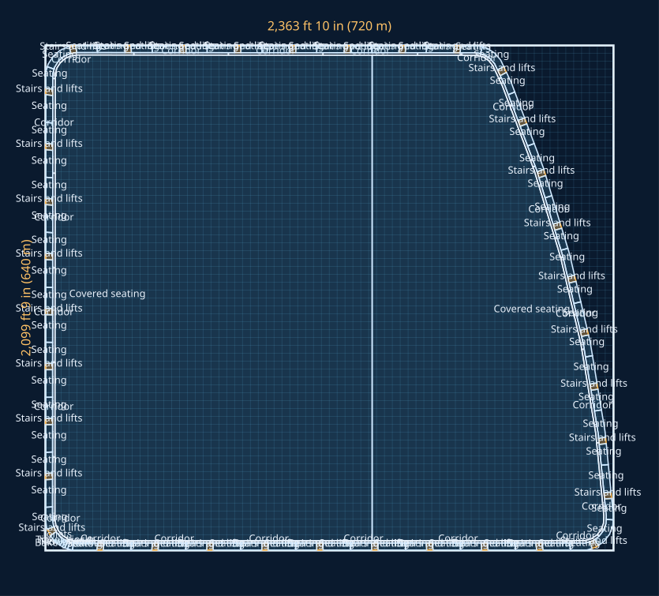

# P3-07 Plaza Pavilion 1: plan

Footprint 2,363 ft 10 in (720 m) × 2,099 ft 9 in (640 m) · structural grid 32 ft 10 in (10 m)

## Levels

| Level | Floor above deck | Height | Floor area |
|---|---|---|---|
| Level 1 · Pavilion floor | 0 ft (0 mm) | 19 ft 8 in (6,000 mm) | 4,471,747 sq ft (415,439 m²) |

## Elements

| ID | Designation | Type | Name | Level(s) | Size / length | Area | Status |
|---|---|---|---|---|---|---|---|
| E001 | D5F1P3B6A1R1 | room | Covered seating | L1 | 1,320 ft 3 in (402 m) × 2,019 ft 8 in (616 m) | 2,660,628 sq ft (247,180 m²) | proposed |
| E002 | D5F1P3B6A1R2 | room | Covered seating | L1 | 964 ft 3 in (294 m) × 2,018 ft 4 in (615 m) | 1,596,288 sq ft (148,300 m²) | proposed |
| E003 | D5F1P3B6A1R3 | core | Stairs and lifts | L1 | 37 ft 9 in (12 m) × 36 ft 5 in (11 m) | 775 sq ft (72 m²) | proposed |
| E004 | D5F1P3B6A1R4 | core | Stairs and lifts | L1 | 29 ft 6 in (9,000 mm) × 27 ft 7 in (8,400 mm) | 770 sq ft (72 m²) | proposed |
| E005 | D5F1P3B6A1R5 | core | Stairs and lifts | L1 | 29 ft 6 in (9,000 mm) × 26 ft 11 in (8,200 mm) | 775 sq ft (72 m²) | proposed |
| E006 | D5F1P3B6A1R6 | core | Stairs and lifts | L1 | 29 ft 6 in (9,000 mm) × 26 ft 3 in (8,000 mm) | 775 sq ft (72 m²) | proposed |
| E007 | D5F1P3B6A1R7 | core | Stairs and lifts | L1 | 29 ft 6 in (9,000 mm) × 27 ft 3 in (8,300 mm) | 775 sq ft (72 m²) | proposed |
| E008 | D5F1P3B6A1R8 | core | Stairs and lifts | L1 | 29 ft 6 in (9,000 mm) × 27 ft 11 in (8,500 mm) | 775 sq ft (72 m²) | proposed |
| E009 | D5F1P3B6A1R9 | core | Stairs and lifts | L1 | 29 ft 6 in (9,000 mm) × 28 ft 7 in (8,700 mm) | 770 sq ft (72 m²) | proposed |
| E010 | D5F1P3B6A1R10 | core | Stairs and lifts | L1 | 29 ft 6 in (9,000 mm) × 29 ft 6 in (9,000 mm) | 775 sq ft (72 m²) | proposed |
| E011 | D5F1P3B6A1R11 | core | Stairs and lifts | L1 | 29 ft 6 in (9,000 mm) × 30 ft 2 in (9,200 mm) | 775 sq ft (72 m²) | proposed |
| E012 | D5F1P3B6A1R12 | core | Stairs and lifts | L1 | 31 ft 2 in (9,500 mm) × 32 ft 10 in (10 m) | 777 sq ft (72 m²) | proposed |
| E013 | D5F1P3B6A1R13 | core | Stairs and lifts | L1 | 27 ft 7 in (8,400 mm) × 29 ft 10 in (9,100 mm) | 775 sq ft (72 m²) | proposed |
| E014 | D5F1P3B6A1R14 | core | Stairs and lifts | L1 | 26 ft 7 in (8,100 mm) × 29 ft 6 in (9,000 mm) | 770 sq ft (72 m²) | proposed |
| E015 | D5F1P3B6A1R15 | core | Stairs and lifts | L1 | 26 ft 11 in (8,200 mm) × 29 ft 6 in (9,000 mm) | 775 sq ft (72 m²) | proposed |
| E016 | D5F1P3B6A1R16 | core | Stairs and lifts | L1 | 27 ft 7 in (8,400 mm) × 29 ft 6 in (9,000 mm) | 775 sq ft (72 m²) | proposed |
| E017 | D5F1P3B6A1R17 | core | Stairs and lifts | L1 | 28 ft 3 in (8,600 mm) × 29 ft 6 in (9,000 mm) | 770 sq ft (72 m²) | proposed |
| E018 | D5F1P3B6A1R18 | core | Stairs and lifts | L1 | 29 ft 6 in (9,000 mm) × 29 ft 6 in (9,000 mm) | 780 sq ft (72 m²) | proposed |
| E019 | D5F1P3B6A1R19 | core | Stairs and lifts | L1 | 30 ft 2 in (9,200 mm) × 29 ft 6 in (9,000 mm) | 775 sq ft (72 m²) | proposed |
| E020 | D5F1P3B6A1R20 | core | Stairs and lifts | L1 | 37 ft 1 in (11 m) × 38 ft 1 in (12 m) | 774 sq ft (72 m²) | proposed |
| E021 | D5F1P3B6A1R21 | core | Stairs and lifts | L1 | 36 ft 9 in (11 m) × 35 ft 1 in (11 m) | 775 sq ft (72 m²) | proposed |
| E022 | D5F1P3B6A1R22 | core | Stairs and lifts | L1 | 35 ft 9 in (11 m) × 34 ft 9 in (11 m) | 782 sq ft (73 m²) | proposed |
| E023 | D5F1P3B6A1R23 | core | Stairs and lifts | L1 | 36 ft 1 in (11 m) × 33 ft 6 in (10 m) | 780 sq ft (72 m²) | proposed |
| E024 | D5F1P3B6A1R24 | core | Stairs and lifts | L1 | 34 ft 9 in (11 m) × 32 ft 10 in (10 m) | 778 sq ft (72 m²) | proposed |
| E025 | D5F1P3B6A1R25 | core | Stairs and lifts | L1 | 35 ft 1 in (11 m) × 31 ft 10 in (9,700 mm) | 785 sq ft (73 m²) | proposed |
| E026 | D5F1P3B6A1R26 | core | Stairs and lifts | L1 | 33 ft 6 in (10 m) × 30 ft 6 in (9,300 mm) | 769 sq ft (71 m²) | proposed |
| E027 | D5F1P3B6A1R27 | core | Stairs and lifts | L1 | 31 ft 10 in (9,700 mm) × 29 ft 6 in (9,000 mm) | 774 sq ft (72 m²) | proposed |
| E028 | D5F1P3B6A1R28 | core | Stairs and lifts | L1 | 31 ft 10 in (9,700 mm) × 27 ft 11 in (8,500 mm) | 775 sq ft (72 m²) | proposed |
| E029 | D5F1P3B6A1R29 | core | Stairs and lifts | L1 | 36 ft 1 in (11 m) × 37 ft 5 in (11 m) | 773 sq ft (72 m²) | proposed |
| E030 | D5F1P3B6A1R30 | core | Stairs and lifts | L1 | 29 ft 10 in (9,100 mm) × 29 ft 6 in (9,000 mm) | 775 sq ft (72 m²) | proposed |
| E031 | D5F1P3B6A1R31 | core | Stairs and lifts | L1 | 29 ft 2 in (8,900 mm) × 29 ft 6 in (9,000 mm) | 780 sq ft (72 m²) | proposed |
| E032 | D5F1P3B6A1R32 | core | Stairs and lifts | L1 | 27 ft 11 in (8,500 mm) × 29 ft 6 in (9,000 mm) | 770 sq ft (72 m²) | proposed |
| E033 | D5F1P3B6A1R33 | core | Stairs and lifts | L1 | 27 ft 3 in (8,300 mm) × 29 ft 6 in (9,000 mm) | 775 sq ft (72 m²) | proposed |
| E034 | D5F1P3B6A1R34 | core | Stairs and lifts | L1 | 26 ft 3 in (8,000 mm) × 29 ft 6 in (9,000 mm) | 770 sq ft (72 m²) | proposed |
| E035 | D5F1P3B6A1R35 | core | Stairs and lifts | L1 | 27 ft 3 in (8,300 mm) × 29 ft 6 in (9,000 mm) | 775 sq ft (72 m²) | proposed |
| E036 | D5F1P3B6A1R36 | core | Stairs and lifts | L1 | 28 ft 3 in (8,600 mm) × 29 ft 6 in (9,000 mm) | 780 sq ft (72 m²) | proposed |
| E037 | D5F1P3B6A1R37 | core | Stairs and lifts | L1 | 29 ft 2 in (8,900 mm) × 29 ft 6 in (9,000 mm) | 775 sq ft (72 m²) | proposed |
| E038 | D5F1P3B6A1R38 | core | Stairs and lifts | L1 | 29 ft 10 in (9,100 mm) × 29 ft 6 in (9,000 mm) | 775 sq ft (72 m²) | proposed |
| E039 | D5F1P3B6A1R39 | zone | Corridor | L1 | 88 ft 7 in (27 m) × 356 ft 11 in (109 m) | 3,874 sq ft (360 m²) | proposed |
| E040 | D5F1P3B6A1R40 | zone | Corridor | L1 | 9 ft 10 in (3,000 mm) × 394 ft (120 m) | 3,875 sq ft (360 m²) | proposed |
| E041 | D5F1P3B6A1R41 | zone | Corridor | L1 | 10 ft 2 in (3,100 mm) × 394 ft (120 m) | 3,875 sq ft (360 m²) | proposed |
| E042 | D5F1P3B6A1R42 | zone | Corridor | L1 | 10 ft 2 in (3,100 mm) × 394 ft 4 in (120 m) | 3,875 sq ft (360 m²) | proposed |
| E043 | D5F1P3B6A1R43 | zone | Corridor | L1 | 10 ft 2 in (3,100 mm) × 395 ft (120 m) | 3,875 sq ft (360 m²) | proposed |
| E044 | D5F1P3B6A1R44 | zone | Corridor | L1 | 337 ft 3 in (103 m) × 108 ft 7 in (33 m) | 3,875 sq ft (360 m²) | proposed |
| E045 | D5F1P3B6A1R45 | zone | Corridor | L1 | 393 ft 8 in (120 m) × 10 ft 2 in (3,100 mm) | 3,873 sq ft (360 m²) | proposed |
| E046 | D5F1P3B6A1R46 | zone | Corridor | L1 | 394 ft (120 m) × 9 ft 10 in (3,000 mm) | 3,875 sq ft (360 m²) | proposed |
| E047 | D5F1P3B6A1R47 | zone | Corridor | L1 | 394 ft 8 in (120 m) × 10 ft 2 in (3,100 mm) | 3,877 sq ft (360 m²) | proposed |
| E048 | D5F1P3B6A1R48 | zone | Corridor | L1 | 347 ft 5 in (106 m) × 107 ft 7 in (33 m) | 3,873 sq ft (360 m²) | proposed |
| E049 | D5F1P3B6A1R49 | zone | Corridor | L1 | 150 ft 7 in (46 m) × 371 ft 1 in (113 m) | 3,887 sq ft (361 m²) | proposed |
| E050 | D5F1P3B6A1R50 | zone | Corridor | L1 | 124 ft 8 in (38 m) × 379 ft 3 in (116 m) | 3,920 sq ft (364 m²) | proposed |
| E051 | D5F1P3B6A1R51 | zone | Corridor | L1 | 98 ft 1 in (30 m) × 385 ft 10 in (118 m) | 3,917 sq ft (364 m²) | proposed |
| E052 | D5F1P3B6A1R52 | zone | Corridor | L1 | 71 ft 6 in (22 m) × 390 ft 5 in (119 m) | 3,926 sq ft (365 m²) | proposed |
| E053 | D5F1P3B6A1R53 | zone | Corridor | L1 | 40 ft (12 m) × 388 ft 9 in (118 m) | 3,890 sq ft (361 m²) | proposed |
| E054 | D5F1P3B6A1R54 | zone | Corridor | L1 | 390 ft 5 in (119 m) × 35 ft 5 in (11 m) | 3,871 sq ft (360 m²) | proposed |
| E055 | D5F1P3B6A1R55 | zone | Corridor | L1 | 394 ft 8 in (120 m) × 9 ft 10 in (3,000 mm) | 3,875 sq ft (360 m²) | proposed |
| E056 | D5F1P3B6A1R56 | zone | Corridor | L1 | 394 ft (120 m) × 10 ft 2 in (3,100 mm) | 3,875 sq ft (360 m²) | proposed |
| E057 | D5F1P3B6A1R57 | zone | Corridor | L1 | 394 ft (120 m) × 9 ft 10 in (3,000 mm) | 3,875 sq ft (360 m²) | proposed |
| E058 | D5F1P3B6A1R58 | zone | Corridor | L1 | 394 ft 8 in (120 m) × 9 ft 10 in (3,000 mm) | 3,875 sq ft (360 m²) | proposed |
| E059 | D5F1P3B6A1R59 | zone | Corridor | L1 | 223 ft 1 in (68 m) × 9 ft 10 in (3,000 mm) | 2,183 sq ft (203 m²) | proposed |
| E060 | D5F1P3B6A1R60 | room | Bakery counter | L1 | 23 ft 11 in (7,300 mm) × 34 ft 1 in (10 m) | 536 sq ft (50 m²) | proposed |
| E061 | D5F1P3B6A1R61 | room | Flower stall | L1 | 20 ft 8 in (6,300 mm) × 30 ft 10 in (9,400 mm) | 323 sq ft (30 m²) | proposed |
| E062 | D5F1P3B6A1R62 | room | Newsstand | L1 | 22 ft (6,700 mm) × 31 ft 6 in (9,600 mm) | 311 sq ft (29 m²) | proposed |
| E063 | D5F1P3B6A1R63 | room | Ticket kiosk | L1 | 23 ft 7 in (7,200 mm) × 31 ft 2 in (9,500 mm) | 306 sq ft (28 m²) | proposed |
| E064 | D5F1P3B6A1R64 | room | Toilets | L1 | 56 ft 9 in (17 m) × 55 ft 9 in (17 m) | 1,507 sq ft (140 m²) | proposed |
| E065 | D5F1P3B6A1R65 | room | Seating | L1 | 35 ft 9 in (11 m) × 92 ft 6 in (28 m) | 2,584 sq ft (240 m²) | proposed |
| E066 | D5F1P3B6A1R66 | room | Seating | L1 | 29 ft 6 in (9,000 mm) × 116 ft 6 in (36 m) | 3,386 sq ft (315 m²) | proposed |
| E067 | D5F1P3B6A1R67 | room | Seating | L1 | 29 ft 10 in (9,100 mm) × 88 ft 11 in (27 m) | 2,586 sq ft (240 m²) | proposed |
| E068 | D5F1P3B6A1R68 | room | Seating | L1 | 29 ft 6 in (9,000 mm) × 115 ft 6 in (35 m) | 3,381 sq ft (314 m²) | proposed |
| E069 | D5F1P3B6A1R69 | room | Seating | L1 | 29 ft 6 in (9,000 mm) × 87 ft 11 in (27 m) | 2,582 sq ft (240 m²) | proposed |
| E070 | D5F1P3B6A1R70 | room | Seating | L1 | 29 ft 6 in (9,000 mm) × 114 ft 10 in (35 m) | 3,386 sq ft (315 m²) | proposed |
| E071 | D5F1P3B6A1R71 | room | Seating | L1 | 29 ft 10 in (9,100 mm) × 87 ft 11 in (27 m) | 2,587 sq ft (240 m²) | proposed |
| E072 | D5F1P3B6A1R72 | room | Seating | L1 | 29 ft 6 in (9,000 mm) × 115 ft 6 in (35 m) | 3,386 sq ft (315 m²) | proposed |
| E073 | D5F1P3B6A1R73 | room | Seating | L1 | 29 ft 6 in (9,000 mm) × 88 ft 7 in (27 m) | 2,582 sq ft (240 m²) | proposed |
| E074 | D5F1P3B6A1R74 | room | Seating | L1 | 29 ft 6 in (9,000 mm) × 116 ft 2 in (35 m) | 3,386 sq ft (315 m²) | proposed |
| E075 | D5F1P3B6A1R75 | room | Seating | L1 | 29 ft 10 in (9,100 mm) × 89 ft 3 in (27 m) | 2,582 sq ft (240 m²) | proposed |
| E076 | D5F1P3B6A1R76 | room | Seating | L1 | 29 ft 6 in (9,000 mm) × 116 ft 10 in (36 m) | 3,386 sq ft (315 m²) | proposed |
| E077 | D5F1P3B6A1R77 | room | Seating | L1 | 29 ft 6 in (9,000 mm) × 90 ft 3 in (28 m) | 2,587 sq ft (240 m²) | proposed |
| E078 | D5F1P3B6A1R78 | room | Seating | L1 | 29 ft 6 in (9,000 mm) × 117 ft 5 in (36 m) | 3,381 sq ft (314 m²) | proposed |
| E079 | D5F1P3B6A1R79 | room | Seating | L1 | 29 ft 10 in (9,100 mm) × 90 ft 11 in (28 m) | 2,583 sq ft (240 m²) | proposed |
| E080 | D5F1P3B6A1R80 | room | Seating | L1 | 29 ft 6 in (9,000 mm) × 118 ft 5 in (36 m) | 3,386 sq ft (315 m²) | proposed |
| E081 | D5F1P3B6A1R81 | room | Seating | L1 | 35 ft 1 in (11 m) × 93 ft 6 in (28 m) | 2,588 sq ft (240 m²) | proposed |
| E082 | D5F1P3B6A1R82 | room | Seating | L1 | 98 ft 1 in (30 m) × 93 ft 10 in (29 m) | 3,379 sq ft (314 m²) | proposed |
| E083 | D5F1P3B6A1R83 | room | Seating | L1 | 89 ft 7 in (27 m) × 29 ft 10 in (9,100 mm) | 2,582 sq ft (240 m²) | proposed |
| E084 | D5F1P3B6A1R84 | room | Seating | L1 | 116 ft 2 in (35 m) × 29 ft 6 in (9,000 mm) | 3,386 sq ft (315 m²) | proposed |
| E085 | D5F1P3B6A1R85 | room | Seating | L1 | 88 ft 7 in (27 m) × 29 ft 6 in (9,000 mm) | 2,582 sq ft (240 m²) | proposed |
| E086 | D5F1P3B6A1R86 | room | Seating | L1 | 115 ft 6 in (35 m) × 29 ft 6 in (9,000 mm) | 3,386 sq ft (315 m²) | proposed |
| E087 | D5F1P3B6A1R87 | room | Seating | L1 | 87 ft 11 in (27 m) × 29 ft 6 in (9,000 mm) | 2,591 sq ft (241 m²) | proposed |
| E088 | D5F1P3B6A1R88 | room | Seating | L1 | 114 ft 10 in (35 m) × 29 ft 10 in (9,100 mm) | 3,381 sq ft (314 m²) | proposed |
| E089 | D5F1P3B6A1R89 | room | Seating | L1 | 88 ft 3 in (27 m) × 29 ft 6 in (9,000 mm) | 2,582 sq ft (240 m²) | proposed |
| E090 | D5F1P3B6A1R90 | room | Seating | L1 | 115 ft 10 in (35 m) × 29 ft 6 in (9,000 mm) | 3,386 sq ft (315 m²) | proposed |
| E091 | D5F1P3B6A1R91 | room | Seating | L1 | 88 ft 11 in (27 m) × 29 ft 6 in (9,000 mm) | 2,582 sq ft (240 m²) | proposed |
| E092 | D5F1P3B6A1R92 | room | Seating | L1 | 116 ft 6 in (36 m) × 29 ft 10 in (9,100 mm) | 3,386 sq ft (315 m²) | proposed |
| E093 | D5F1P3B6A1R93 | room | Seating | L1 | 89 ft 11 in (27 m) × 29 ft 6 in (9,000 mm) | 2,587 sq ft (240 m²) | proposed |
| E094 | D5F1P3B6A1R94 | room | Seating | L1 | 117 ft 2 in (36 m) × 29 ft 6 in (9,000 mm) | 3,381 sq ft (314 m²) | proposed |
| E095 | D5F1P3B6A1R95 | room | Seating | L1 | 90 ft 11 in (28 m) × 29 ft 6 in (9,000 mm) | 2,582 sq ft (240 m²) | proposed |
| E096 | D5F1P3B6A1R96 | room | Seating | L1 | 118 ft 5 in (36 m) × 29 ft 10 in (9,100 mm) | 3,387 sq ft (315 m²) | proposed |
| E097 | D5F1P3B6A1R97 | room | Seating | L1 | 92 ft 10 in (28 m) × 33 ft 2 in (10 m) | 2,585 sq ft (240 m²) | proposed |
| E098 | D5F1P3B6A1R98 | room | Seating | L1 | 96 ft 9 in (30 m) × 96 ft 5 in (29 m) | 3,381 sq ft (314 m²) | proposed |
| E099 | D5F1P3B6A1R99 | room | Seating | L1 | 60 ft 8 in (18 m) × 92 ft 10 in (28 m) | 2,573 sq ft (239 m²) | proposed |
| E100 | D5F1P3B6A1R100 | room | Seating | L1 | 67 ft 11 in (21 m) × 118 ft 1 in (36 m) | 3,378 sq ft (314 m²) | proposed |
| E101 | D5F1P3B6A1R101 | room | Seating | L1 | 58 ft 5 in (18 m) × 92 ft 2 in (28 m) | 2,575 sq ft (239 m²) | proposed |
| E102 | D5F1P3B6A1R102 | room | Seating | L1 | 67 ft 7 in (21 m) × 117 ft 2 in (36 m) | 3,367 sq ft (313 m²) | proposed |
| E103 | D5F1P3B6A1R103 | room | Seating | L1 | 53 ft 10 in (16 m) × 92 ft 10 in (28 m) | 2,596 sq ft (241 m²) | proposed |
| E104 | D5F1P3B6A1R104 | room | Seating | L1 | 61 ft 4 in (19 m) × 118 ft 1 in (36 m) | 3,374 sq ft (313 m²) | proposed |
| E105 | D5F1P3B6A1R105 | room | Seating | L1 | 54 ft 2 in (16 m) × 91 ft 6 in (28 m) | 2,589 sq ft (241 m²) | proposed |
| E106 | D5F1P3B6A1R106 | room | Seating | L1 | 56 ft 1 in (17 m) × 118 ft 9 in (36 m) | 3,380 sq ft (314 m²) | proposed |
| E107 | D5F1P3B6A1R107 | room | Seating | L1 | 48 ft 11 in (15 m) × 92 ft 2 in (28 m) | 2,599 sq ft (241 m²) | proposed |
| E108 | D5F1P3B6A1R108 | room | Seating | L1 | 55 ft 1 in (17 m) × 118 ft 1 in (36 m) | 3,410 sq ft (317 m²) | proposed |
| E109 | D5F1P3B6A1R109 | room | Seating | L1 | 45 ft 3 in (14 m) × 91 ft 6 in (28 m) | 2,580 sq ft (240 m²) | proposed |
| E110 | D5F1P3B6A1R110 | room | Seating | L1 | 47 ft 11 in (15 m) × 118 ft 5 in (36 m) | 3,403 sq ft (316 m²) | proposed |
| E111 | D5F1P3B6A1R111 | room | Seating | L1 | 43 ft 4 in (13 m) × 90 ft 11 in (28 m) | 2,571 sq ft (239 m²) | proposed |
| E112 | D5F1P3B6A1R112 | room | Seating | L1 | 46 ft 7 in (14 m) × 117 ft 5 in (36 m) | 3,383 sq ft (314 m²) | proposed |
| E113 | D5F1P3B6A1R113 | room | Seating | L1 | 38 ft 1 in (12 m) × 89 ft 11 in (27 m) | 2,592 sq ft (241 m²) | proposed |
| E114 | D5F1P3B6A1R114 | room | Seating | L1 | 40 ft 8 in (12 m) × 116 ft 2 in (35 m) | 3,372 sq ft (313 m²) | proposed |
| E115 | D5F1P3B6A1R115 | room | Seating | L1 | 36 ft 9 in (11 m) × 88 ft 11 in (27 m) | 2,578 sq ft (240 m²) | proposed |
| E116 | D5F1P3B6A1R116 | room | Seating | L1 | 76 ft 9 in (23 m) × 108 ft 3 in (33 m) | 3,374 sq ft (313 m²) | proposed |
| E117 | D5F1P3B6A1R117 | room | Seating | L1 | 93 ft 6 in (28 m) × 34 ft 9 in (11 m) | 2,584 sq ft (240 m²) | proposed |
| E118 | D5F1P3B6A1R118 | room | Seating | L1 | 118 ft 5 in (36 m) × 29 ft 6 in (9,000 mm) | 3,381 sq ft (314 m²) | proposed |
| E119 | D5F1P3B6A1R119 | room | Seating | L1 | 90 ft 11 in (28 m) × 29 ft 6 in (9,000 mm) | 2,582 sq ft (240 m²) | proposed |
| E120 | D5F1P3B6A1R120 | room | Seating | L1 | 117 ft 9 in (36 m) × 29 ft 6 in (9,000 mm) | 3,386 sq ft (315 m²) | proposed |
| E121 | D5F1P3B6A1R121 | room | Seating | L1 | 89 ft 11 in (27 m) × 29 ft 6 in (9,000 mm) | 2,582 sq ft (240 m²) | proposed |
| E122 | D5F1P3B6A1R122 | room | Seating | L1 | 116 ft 10 in (36 m) × 29 ft 6 in (9,000 mm) | 3,386 sq ft (315 m²) | proposed |
| E123 | D5F1P3B6A1R123 | room | Seating | L1 | 89 ft 3 in (27 m) × 29 ft 6 in (9,000 mm) | 2,587 sq ft (240 m²) | proposed |
| E124 | D5F1P3B6A1R124 | room | Seating | L1 | 115 ft 10 in (35 m) × 29 ft 6 in (9,000 mm) | 3,381 sq ft (314 m²) | proposed |
| E125 | D5F1P3B6A1R125 | room | Seating | L1 | 88 ft 3 in (27 m) × 29 ft 6 in (9,000 mm) | 2,587 sq ft (240 m²) | proposed |
| E126 | D5F1P3B6A1R126 | room | Seating | L1 | 114 ft 10 in (35 m) × 29 ft 10 in (9,100 mm) | 3,386 sq ft (315 m²) | proposed |
| E127 | D5F1P3B6A1R127 | room | Seating | L1 | 87 ft 11 in (27 m) × 29 ft 6 in (9,000 mm) | 2,587 sq ft (240 m²) | proposed |
| E128 | D5F1P3B6A1R128 | room | Seating | L1 | 115 ft 2 in (35 m) × 29 ft 6 in (9,000 mm) | 3,381 sq ft (314 m²) | proposed |
| E129 | D5F1P3B6A1R129 | room | Seating | L1 | 88 ft 7 in (27 m) × 29 ft 6 in (9,000 mm) | 2,582 sq ft (240 m²) | proposed |
| E130 | D5F1P3B6A1R130 | room | Seating | L1 | 116 ft 2 in (35 m) × 29 ft 6 in (9,000 mm) | 3,386 sq ft (315 m²) | proposed |
| E131 | D5F1P3B6A1R131 | room | Seating | L1 | 89 ft 7 in (27 m) × 29 ft 6 in (9,000 mm) | 2,582 sq ft (240 m²) | proposed |
| E132 | D5F1P3B6A1R132 | room | Seating | L1 | 117 ft 2 in (36 m) × 29 ft 6 in (9,000 mm) | 3,381 sq ft (314 m²) | proposed |
| E133 | D5F1P3B6A1R133 | room | Seating | L1 | 90 ft 7 in (28 m) × 29 ft 6 in (9,000 mm) | 2,582 sq ft (240 m²) | proposed |
| E134 | D5F1P3B6A1R134 | room | Seating | L1 | 118 ft 1 in (36 m) × 29 ft 6 in (9,000 mm) | 3,386 sq ft (315 m²) | proposed |
| E135 | D5F1P3B6A1R135 | room | Seating | L1 | 105 ft (32 m) × 29 ft 6 in (9,000 mm) | 2,984 sq ft (277 m²) | proposed |

## Drawings

### Level 1 · Pavilion floor

