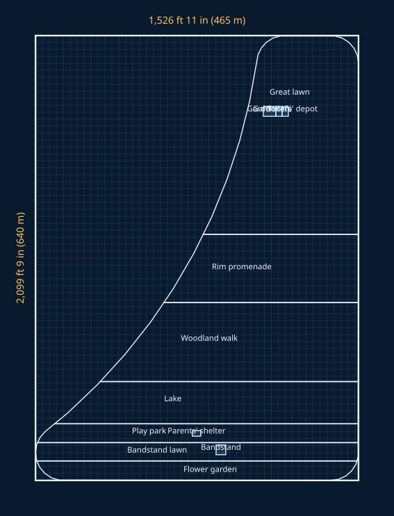

# P4-01 Atrium Rim Gardens: plan

Footprint 1,526 ft 11 in (465 m) × 2,099 ft 9 in (640 m) · structural grid 32 ft 10 in (10 m)

## Levels

| Level | Floor above deck | Height | Floor area |
|---|---|---|---|
| Level 1 · Ground | 0 ft (0 mm) | 13 ft 1 in (4,000 mm) | 8,568 sq ft (796 m²) |

## Elements

| ID | Designation | Type | Name | Level(s) | Size / length | Area | Status |
|---|---|---|---|---|---|---|---|
| E001 | D5F1P4B1A1R1 | zone | Great lawn | L1 | 734 ft 3 in (224 m) × 937 ft (286 m) | 527,594 sq ft (49,015 m²) | proposed |
| E002 | D5F1P4B1A1R2 | room | Garden café | L1 | 59 ft 1 in (18 m) × 45 ft 11 in (14 m) | 2,713 sq ft (252 m²) | proposed |
| E003 | D5F1P4B1A1R3 | room | Toilets | L1 | 29 ft 6 in (9,000 mm) × 45 ft 11 in (14 m) | 1,356 sq ft (126 m²) | proposed |
| E004 | D5F1P4B1A1R4 | room | Gardeners' depot | L1 | 29 ft 6 in (9,000 mm) × 45 ft 11 in (14 m) | 1,356 sq ft (126 m²) | proposed |
| E005 | D5F1P4B1A1R5 | zone | Rim promenade | L1 | 919 ft 3 in (280 m) × 321 ft 6 in (98 m) | 263,986 sq ft (24,525 m²) | proposed |
| E006 | D5F1P4B1A1R6 | zone | Woodland walk | L1 | 1,220 ft 2 in (372 m) × 373 ft (114 m) | 395,648 sq ft (36,757 m²) | proposed |
| E007 | D5F1P4B1A1R7 | zone | Lake | L1 | 1,435 ft 8 in (438 m) × 199 ft 6 in (61 m) | 264,013 sq ft (24,528 m²) | proposed |
| E008 | D5F1P4B1A1R8 | zone | Play park | L1 | 1,515 ft 9 in (462 m) × 88 ft 11 in (27 m) | 131,832 sq ft (12,248 m²) | proposed |
| E009 | D5F1P4B1A1R9 | room | Parents' shelter | L1 | 39 ft 4 in (12 m) × 26 ft 3 in (8,000 mm) | 1,033 sq ft (96 m²) | proposed |
| E010 | D5F1P4B1A1R10 | zone | Bandstand lawn | L1 | 1,525 ft 7 in (465 m) × 86 ft 7 in (26 m) | 131,786 sq ft (12,243 m²) | proposed |
| E011 | D5F1P4B1A1R11 | room | Bandstand | L1 | 45 ft 11 in (14 m) × 45 ft 11 in (14 m) | 2,110 sq ft (196 m²) | proposed |
| E012 | D5F1P4B1A1R12 | zone | Flower garden | L1 | 1,512 ft 10 in (461 m) × 91 ft 10 in (28 m) | 131,923 sq ft (12,256 m²) | proposed |

## Drawings

### Level 1 · Ground

