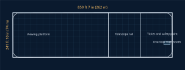

# P4-02 Atrium Overlook: plan

Footprint 859 ft 7 in (262 m) × 241 ft 10 in (74 m) · structural grid 32 ft 10 in (10 m)

## Levels

| Level | Floor above deck | Height | Floor area |
|---|---|---|---|
| Level 1 · Terrace | 0 ft (0 mm) | 13 ft 1 in (4,000 mm) | 646 sq ft (60 m²) |

## Elements

| ID | Designation | Type | Name | Level(s) | Size / length | Area | Status |
|---|---|---|---|---|---|---|---|
| E001 | D5F1P4B2A1R1 | zone | Viewing platform | L1 | 514 ft 9 in (157 m) × 240 ft 10 in (73 m) | 122,970 sq ft (11,424 m²) | proposed |
| E002 | D5F1P4B2A1R2 | zone | Telescope rail | L1 | 170 ft 7 in (52 m) × 240 ft 2 in (73 m) | 40,972 sq ft (3,806 m²) | proposed |
| E003 | D5F1P4B2A1R3 | zone | Ticket and safety point | L1 | 173 ft 7 in (53 m) × 240 ft 6 in (73 m) | 41,027 sq ft (3,812 m²) | proposed |
| E004 | D5F1P4B2A1R4 | room | Overlook staff booth | L1 | 32 ft 10 in (10 m) × 19 ft 8 in (6,000 mm) | 646 sq ft (60 m²) | proposed |

## Drawings

### Level 1 · Terrace

