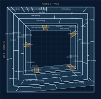
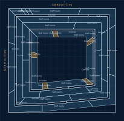

# P4-03 Rim Cafés: plan

Footprint 580 ft 9 in (177 m) × 567 ft 11 in (173 m) · structural grid 32 ft 10 in (10 m)

## Levels

| Level | Floor above deck | Height | Floor area |
|---|---|---|---|
| Level 1 · Café floor | 0 ft (0 mm) | 16 ft 5 in (5,000 mm) | 217,638 sq ft (20,219 m²) |
| Level 2 · Upper terrace floor | 16 ft 5 in (5,000 mm) | 13 ft 9 in (4,200 mm) | 217,612 sq ft (20,217 m²) |

## Elements

| ID | Designation | Type | Name | Level(s) | Size / length | Area | Status |
|---|---|---|---|---|---|---|---|
| E001 | D5F1P4B3A1L1R1 | zone | Corridor | L1 | 401 ft 7 in (122 m) × 9 ft 10 in (3,000 mm) | 3,877 sq ft (360 m²) | proposed |
| E002 | D5F1P4B3A1L1R2 | zone | Corridor | L1 | 117 ft 2 in (36 m) × 290 ft 4 in (88 m) | 3,877 sq ft (360 m²) | proposed |
| E003 | D5F1P4B3A1L1R3 | zone | Corridor | L1 | 234 ft 11 in (72 m) × 193 ft 3 in (59 m) | 3,872 sq ft (360 m²) | proposed |
| E004 | D5F1P4B3A1L1R4 | zone | Corridor | L1 | 282 ft 2 in (86 m) × 125 ft 8 in (38 m) | 3,880 sq ft (360 m²) | proposed |
| E005 | D5F1P4B3A1L1R5 | zone | Corridor | L1 | 9 ft 10 in (3,000 mm) × 378 ft 7 in (115 m) | 3,652 sq ft (339 m²) | proposed |
| E006 | D5F1P4B3A1L1R6 | zone | Corridor | L1 | 357 ft 7 in (109 m) × 54 ft 6 in (17 m) | 3,877 sq ft (360 m²) | proposed |
| E007 | D5F1P4B3A1L1R7 | zone | Corridor | L1 | 145 ft 8 in (44 m) × 276 ft 11 in (84 m) | 3,882 sq ft (361 m²) | proposed |
| E008 | D5F1P4B3A1L1R8 | zone | Corridor | L1 | 217 ft 2 in (66 m) × 188 ft 8 in (58 m) | 3,850 sq ft (358 m²) | proposed |
| E009 | D5F1P4B3A1L1R9 | zone | Corridor | L1 | 9 ft 10 in (3,000 mm) × 153 ft 3 in (47 m) | 1,455 sq ft (135 m²) | proposed |
| E010 | D5F1P4B3A1L1R10, D5F1P4B3A1L2R1 | core | Stairs and lifts | L1, L2 | 34 ft 5 in (10 m) × 33 ft 10 in (10 m) | 887 sq ft (82 m²) | proposed |
| E011 | D5F1P4B3A1L1R11, D5F1P4B3A1L2R2 | core | Stairs and lifts | L1, L2 | 33 ft 10 in (10 m) × 49 ft 6 in (15 m) | 887 sq ft (82 m²) | proposed |
| E012 | D5F1P4B3A1L1R12, D5F1P4B3A1L2R3 | core | Stairs and lifts | L1, L2 | 58 ft 1 in (18 m) × 33 ft 6 in (10 m) | 884 sq ft (82 m²) | proposed |
| E013 | D5F1P4B3A1L1R13, D5F1P4B3A1L2R4 | core | Stairs and lifts | L1, L2 | 29 ft 2 in (8,900 mm) × 36 ft 5 in (11 m) | 895 sq ft (83 m²) | proposed |
| E014 | D5F1P4B3A1L1R14, D5F1P4B3A1L2R5 | core | Stairs and lifts | L1, L2 | 33 ft 10 in (10 m) × 32 ft 2 in (9,800 mm) | 881 sq ft (82 m²) | proposed |
| E015 | D5F1P4B3A1L1R15 | room | Espresso bar | L1 | 57 ft 9 in (18 m) × 33 ft 10 in (10 m) | 859 sq ft (80 m²) | proposed |
| E016 | D5F1P4B3A1L1R16 | room | Bistro | L1 | 90 ft 3 in (28 m) × 33 ft 10 in (10 m) | 2,145 sq ft (199 m²) | proposed |
| E017 | D5F1P4B3A1L1R17 | room | Tea room | L1 | 52 ft 6 in (16 m) × 33 ft 10 in (10 m) | 1,070 sq ft (99 m²) | proposed |
| E018 | D5F1P4B3A1L1R18 | room | Wine bar | L1 | 48 ft 11 in (15 m) × 33 ft 10 in (10 m) | 1,075 sq ft (100 m²) | proposed |
| E019 | D5F1P4B3A1L1R19 | room | Shared kitchen | L1 | 74 ft 6 in (23 m) × 33 ft 10 in (10 m) | 2,145 sq ft (199 m²) | proposed |
| E020 | D5F1P4B3A1L1R20 | room | Cold store | L1 | 19 ft (5,800 mm) × 33 ft 10 in (10 m) | 432 sq ft (40 m²) | proposed |
| E021 | D5F1P4B3A1L1R21 | room | Toilets | L1 | 23 ft 4 in (7,100 mm) × 33 ft 10 in (10 m) | 637 sq ft (59 m²) | proposed |
| E022 | D5F1P4B3A1L1R22 | room | Café seating | L1 | 273 ft 4 in (83 m) × 33 ft 10 in (10 m) | 8,692 sq ft (808 m²) | proposed |
| E023 | D5F1P4B3A1L1R23 | room | Café seating | L1 | 73 ft 6 in (22 m) × 234 ft 7 in (72 m) | 8,687 sq ft (807 m²) | proposed |
| E024 | D5F1P4B3A1L1R24 | room | Café seating | L1 | 33 ft 10 in (10 m) × 274 ft 3 in (84 m) | 8,692 sq ft (808 m²) | proposed |
| E025 | D5F1P4B3A1L1R25 | room | Café seating | L1 | 261 ft 2 in (80 m) × 72 ft 10 in (22 m) | 8,707 sq ft (809 m²) | proposed |
| E026 | D5F1P4B3A1L1R26 | room | Café seating | L1 | 274 ft 11 in (84 m) × 50 ft 10 in (16 m) | 8,702 sq ft (808 m²) | proposed |
| E027 | D5F1P4B3A1L1R27 | room | Café seating | L1 | 81 ft 8 in (25 m) × 225 ft 9 in (69 m) | 8,696 sq ft (808 m²) | proposed |
| E028 | D5F1P4B3A1L1R28 | room | Café seating | L1 | 33 ft 10 in (10 m) × 350 ft 9 in (107 m) | 11,137 sq ft (1,035 m²) | proposed |
| E029 | D5F1P4B3A1L1R29 | room | Café seating | L1 | 276 ft 3 in (84 m) × 34 ft 1 in (10 m) | 8,776 sq ft (815 m²) | proposed |
| E030 | D5F1P4B3A1L1R30 | room | Café seating | L1 | 221 ft 2 in (67 m) × 84 ft 8 in (26 m) | 8,771 sq ft (815 m²) | proposed |
| E031 | D5F1P4B3A1L1R31 | room | Café seating | L1 | 34 ft 1 in (10 m) × 277 ft 7 in (85 m) | 8,771 sq ft (815 m²) | proposed |
| E032 | D5F1P4B3A1L1R32 | room | Café seating | L1 | 187 ft 4 in (57 m) × 135 ft 6 in (41 m) | 8,748 sq ft (813 m²) | proposed |
| E033 | D5F1P4B3A1L1R33 | room | Café seating | L1 | 276 ft 7 in (84 m) × 53 ft 2 in (16 m) | 8,722 sq ft (810 m²) | proposed |
| E034 | D5F1P4B3A1L1R34 | room | Café seating | L1 | 70 ft 3 in (21 m) × 233 ft 3 in (71 m) | 8,756 sq ft (813 m²) | proposed |
| E035 | D5F1P4B3A1L1R35 | room | Café seating | L1 | 34 ft 1 in (10 m) × 247 ft 5 in (75 m) | 7,831 sq ft (727 m²) | proposed |
| E036 | D5F1P4B3A1L1R36 | room | Café seating | L1 | 279 ft 2 in (85 m) × 33 ft 10 in (10 m) | 8,687 sq ft (807 m²) | proposed |
| E037 | D5F1P4B3A1L1R37 | room | Café seating | L1 | 156 ft 6 in (48 m) × 145 ft (44 m) | 8,687 sq ft (807 m²) | proposed |
| E038 | D5F1P4B3A1L1R38 | room | Café seating | L1 | 68 ft 11 in (21 m) × 244 ft 9 in (75 m) | 8,699 sq ft (808 m²) | proposed |
| E039 | D5F1P4B3A1L1R39 | room | Café seating | L1 | 272 ft 4 in (83 m) × 58 ft 1 in (18 m) | 8,771 sq ft (815 m²) | proposed |
| E040 | D5F1P4B3A1L1R40 | room | Café seating | L1 | 116 ft 10 in (36 m) × 178 ft 10 in (54 m) | 8,712 sq ft (809 m²) | proposed |
| E041 | D5F1P4B3A1L1R41 | room | Café seating | L1 | 33 ft 10 in (10 m) × 236 ft 11 in (72 m) | 7,334 sq ft (681 m²) | proposed |
| E042 | D5F1P4B3A1L1R42 | room | Café seating | L1 | 125 ft (38 m) × 33 ft 10 in (10 m) | 3,465 sq ft (322 m²) | proposed |
| E043 | D5F1P4B3A1L1R43 | room | Café seating | L1 | 194 ft 11 in (59 m) × 59 ft 9 in (18 m) | 6,924 sq ft (643 m²) | proposed |
| E044 | D5F1P4B3A1L1R44 | room | Café seating | L1 | 35 ft 1 in (11 m) × 229 ft (70 m) | 6,925 sq ft (643 m²) | proposed |
| E045 | D5F1P4B3A1L1R45 | room | Café seating | L1 | 221 ft 9 in (68 m) × 52 ft 10 in (16 m) | 6,987 sq ft (649 m²) | proposed |
| E046 | D5F1P4B3A1L1R46 | room | Café seating | L1 | 64 ft 4 in (20 m) × 176 ft 10 in (54 m) | 6,932 sq ft (644 m²) | proposed |
| E047 | D5F1P4B3A1L1R47 | room | Café seating | L1 | 33 ft 10 in (10 m) × 124 ft (38 m) | 3,465 sq ft (322 m²) | proposed |
| E048 | D5F1P4B3A1L2R6 | zone | Corridor | L2 | 401 ft 7 in (122 m) × 9 ft 10 in (3,000 mm) | 3,877 sq ft (360 m²) | proposed |
| E049 | D5F1P4B3A1L2R7 | zone | Corridor | L2 | 117 ft 2 in (36 m) × 290 ft 4 in (88 m) | 3,877 sq ft (360 m²) | proposed |
| E050 | D5F1P4B3A1L2R8 | zone | Corridor | L2 | 234 ft 11 in (72 m) × 193 ft 3 in (59 m) | 3,872 sq ft (360 m²) | proposed |
| E051 | D5F1P4B3A1L2R9 | zone | Corridor | L2 | 282 ft 2 in (86 m) × 125 ft 8 in (38 m) | 3,880 sq ft (360 m²) | proposed |
| E052 | D5F1P4B3A1L2R10 | zone | Corridor | L2 | 9 ft 10 in (3,000 mm) × 378 ft 7 in (115 m) | 3,652 sq ft (339 m²) | proposed |
| E053 | D5F1P4B3A1L2R11 | zone | Corridor | L2 | 357 ft 7 in (109 m) × 54 ft 6 in (17 m) | 3,877 sq ft (360 m²) | proposed |
| E054 | D5F1P4B3A1L2R12 | zone | Corridor | L2 | 145 ft 8 in (44 m) × 276 ft 11 in (84 m) | 3,882 sq ft (361 m²) | proposed |
| E055 | D5F1P4B3A1L2R13 | zone | Corridor | L2 | 217 ft 2 in (66 m) × 188 ft 8 in (58 m) | 3,850 sq ft (358 m²) | proposed |
| E056 | D5F1P4B3A1L2R14 | zone | Corridor | L2 | 9 ft 10 in (3,000 mm) × 153 ft 3 in (47 m) | 1,455 sq ft (135 m²) | proposed |
| E057 | D5F1P4B3A1L2R15 | room | Roof terrace | L2 | 93 ft 6 in (28 m) × 33 ft 10 in (10 m) | 2,145 sq ft (199 m²) | proposed |
| E058 | D5F1P4B3A1L2R16 | room | Private room | L2 | 44 ft (13 m) × 33 ft 10 in (10 m) | 643 sq ft (60 m²) | proposed |
| E059 | D5F1P4B3A1L2R17 | room | Staff toilets and showers | L2 | 44 ft 7 in (14 m) × 33 ft 10 in (10 m) | 754 sq ft (70 m²) | proposed |
| E060 | D5F1P4B3A1L2R18 | room | Staff rooms | L2 | 279 ft 6 in (85 m) × 33 ft 10 in (10 m) | 8,892 sq ft (826 m²) | proposed |
| E061 | D5F1P4B3A1L2R19 | room | Staff rooms | L2 | 201 ft 9 in (62 m) × 112 ft 6 in (34 m) | 8,892 sq ft (826 m²) | proposed |
| E062 | D5F1P4B3A1L2R20 | room | Staff rooms | L2 | 33 ft 10 in (10 m) × 280 ft 6 in (86 m) | 8,892 sq ft (826 m²) | proposed |
| E063 | D5F1P4B3A1L2R21 | room | Staff rooms | L2 | 147 ft 8 in (45 m) × 177 ft 2 in (54 m) | 8,915 sq ft (828 m²) | proposed |
| E064 | D5F1P4B3A1L2R22 | room | Staff rooms | L2 | 273 ft 7 in (83 m) × 58 ft 1 in (18 m) | 8,925 sq ft (829 m²) | proposed |
| E065 | D5F1P4B3A1L2R23 | room | Staff rooms | L2 | 183 ft 1 in (56 m) × 125 ft 8 in (38 m) | 8,901 sq ft (827 m²) | proposed |
| E066 | D5F1P4B3A1L2R24 | room | Staff rooms | L2 | 33 ft 10 in (10 m) × 280 ft 2 in (85 m) | 8,892 sq ft (826 m²) | proposed |
| E067 | D5F1P4B3A1L2R25 | room | Staff rooms | L2 | 33 ft 10 in (10 m) × 196 ft 2 in (60 m) | 5,865 sq ft (545 m²) | proposed |
| E068 | D5F1P4B3A1L2R26 | room | Staff rooms | L2 | 282 ft 6 in (86 m) × 34 ft 1 in (10 m) | 8,972 sq ft (834 m²) | proposed |
| E069 | D5F1P4B3A1L2R27 | room | Staff rooms | L2 | 215 ft 11 in (66 m) × 95 ft 6 in (29 m) | 8,978 sq ft (834 m²) | proposed |
| E070 | D5F1P4B3A1L2R28 | room | Staff rooms | L2 | 34 ft 1 in (10 m) × 284 ft 1 in (87 m) | 8,978 sq ft (834 m²) | proposed |
| E071 | D5F1P4B3A1L2R29 | room | Staff rooms | L2 | 209 ft 8 in (64 m) × 121 ft 5 in (37 m) | 8,916 sq ft (828 m²) | proposed |
| E072 | D5F1P4B3A1L2R30 | room | Staff rooms | L2 | 285 ft 9 in (87 m) × 52 ft 2 in (16 m) | 8,931 sq ft (830 m²) | proposed |
| E073 | D5F1P4B3A1L2R31 | room | Staff rooms | L2 | 44 ft 7 in (14 m) × 270 ft (82 m) | 8,974 sq ft (834 m²) | proposed |
| E074 | D5F1P4B3A1L2R32 | room | Staff rooms | L2 | 34 ft 1 in (10 m) × 212 ft 7 in (65 m) | 6,610 sq ft (614 m²) | proposed |
| E075 | D5F1P4B3A1L2R33 | room | Staff rooms | L2 | 285 ft 9 in (87 m) × 33 ft 10 in (10 m) | 8,886 sq ft (826 m²) | proposed |
| E076 | D5F1P4B3A1L2R34 | room | Staff rooms | L2 | 151 ft 3 in (46 m) × 155 ft 10 in (48 m) | 8,892 sq ft (826 m²) | proposed |
| E077 | D5F1P4B3A1L2R35 | room | Staff rooms | L2 | 85 ft 8 in (26 m) × 233 ft 3 in (71 m) | 8,891 sq ft (826 m²) | proposed |
| E078 | D5F1P4B3A1L2R36 | room | Staff rooms | L2 | 278 ft 10 in (85 m) × 57 ft 5 in (18 m) | 8,949 sq ft (831 m²) | proposed |
| E079 | D5F1P4B3A1L2R37 | room | Staff rooms | L2 | 94 ft 6 in (29 m) × 205 ft 9 in (63 m) | 8,893 sq ft (826 m²) | proposed |
| E080 | D5F1P4B3A1L2R38 | room | Staff rooms | L2 | 33 ft 10 in (10 m) × 204 ft 5 in (62 m) | 6,331 sq ft (588 m²) | proposed |
| E081 | D5F1P4B3A1L2R39 | room | Staff rooms | L2 | 125 ft (38 m) × 33 ft 10 in (10 m) | 3,465 sq ft (322 m²) | proposed |
| E082 | D5F1P4B3A1L2R40 | room | Staff rooms | L2 | 194 ft 11 in (59 m) × 59 ft 9 in (18 m) | 6,924 sq ft (643 m²) | proposed |
| E083 | D5F1P4B3A1L2R41 | room | Staff rooms | L2 | 35 ft 1 in (11 m) × 229 ft (70 m) | 6,925 sq ft (643 m²) | proposed |
| E084 | D5F1P4B3A1L2R42 | room | Staff rooms | L2 | 221 ft 9 in (68 m) × 52 ft 10 in (16 m) | 6,987 sq ft (649 m²) | proposed |
| E085 | D5F1P4B3A1L2R43 | room | Staff rooms | L2 | 64 ft 4 in (20 m) × 176 ft 10 in (54 m) | 6,932 sq ft (644 m²) | proposed |
| E086 | D5F1P4B3A1L2R44 | room | Staff rooms | L2 | 33 ft 10 in (10 m) × 124 ft (38 m) | 3,465 sq ft (322 m²) | proposed |

## Drawings

### Level 1 · Café floor

### Level 2 · Upper terrace floor

