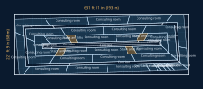

# P4-04 Plaza Clinic: plan

Footprint 631 ft 11 in (193 m) × 221 ft 9 in (68 m) · structural grid 32 ft 10 in (10 m)

## Levels

| Level | Floor above deck | Height | Floor area |
|---|---|---|---|
| Level 1 · Ground floor | 0 ft (0 mm) | 15 ft 9 in (4,800 mm) | 97,068 sq ft (9,018 m²) |
| Level 2 · Upper floor | 15 ft 9 in (4,800 mm) | 13 ft 9 in (4,200 mm) | 96,992 sq ft (9,011 m²) |

## Elements

| ID | Designation | Type | Name | Level(s) | Size / length | Area | Status |
|---|---|---|---|---|---|---|---|
| E001 | D5F1P4B4A1L1R1 | zone | Corridor | L1 | 400 ft 7 in (122 m) × 20 ft 4 in (6,200 mm) | 3,849 sq ft (358 m²) | proposed |
| E002 | D5F1P4B4A1L1R2 | zone | Corridor | L1 | 170 ft 11 in (52 m) × 149 ft 3 in (46 m) | 3,882 sq ft (361 m²) | proposed |
| E003 | D5F1P4B4A1L1R3 | zone | Corridor | L1 | 400 ft 7 in (122 m) × 20 ft 8 in (6,300 mm) | 3,936 sq ft (366 m²) | proposed |
| E004 | D5F1P4B4A1L1R4 | zone | Corridor | L1 | 68 ft 11 in (21 m) × 146 ft 4 in (45 m) | 1,832 sq ft (170 m²) | proposed |
| E005 | D5F1P4B4A1L1R5, D5F1P4B4A1L2R1 | core | Stairs and lifts | L1, L2 | 40 ft 4 in (12 m) × 26 ft 11 in (8,200 mm) | 698 sq ft (65 m²) | proposed |
| E006 | D5F1P4B4A1L1R6, D5F1P4B4A1L2R2 | core | Stairs and lifts | L1, L2 | 41 ft 4 in (13 m) × 27 ft 11 in (8,500 mm) | 693 sq ft (64 m²) | proposed |
| E007 | D5F1P4B4A1L1R7, D5F1P4B4A1L2R3 | core | Stairs and lifts | L1, L2 | 40 ft 4 in (12 m) × 26 ft 11 in (8,200 mm) | 698 sq ft (65 m²) | proposed |
| E008 | D5F1P4B4A1L1R8, D5F1P4B4A1L2R4 | core | Stairs and lifts | L1, L2 | 41 ft 4 in (13 m) × 27 ft 11 in (8,500 mm) | 693 sq ft (64 m²) | proposed |
| E009 | D5F1P4B4A1L1R9 | zone | Corridor | L1 | 398 ft (121 m) × 15 ft 9 in (4,800 mm) | 2,010 sq ft (187 m²) | proposed |
| E010 | D5F1P4B4A1L1R10 | zone | Corridor | L1 | 351 ft 5 in (107 m) × 29 ft 6 in (9,000 mm) | 2,008 sq ft (187 m²) | proposed |
| E011 | D5F1P4B4A1L1R11 | zone | Corridor | L1 | 82 ft 4 in (25 m) × 20 ft (6,100 mm) | 459 sq ft (43 m²) | proposed |
| E012 | D5F1P4B4A1L1R12 | room | Entrance and reception | L1 | 75 ft 2 in (23 m) × 27 ft 3 in (8,300 mm) | 1,289 sq ft (120 m²) | proposed |
| E013 | D5F1P4B4A1L1R13 | room | Waiting area | L1 | 82 ft 4 in (25 m) × 27 ft 7 in (8,400 mm) | 1,605 sq ft (149 m²) | proposed |
| E014 | D5F1P4B4A1L1R14 | room | Triage room | L1 | 28 ft 3 in (8,600 mm) × 26 ft 3 in (8,000 mm) | 255 sq ft (24 m²) | proposed |
| E015 | D5F1P4B4A1L1R15 | room | Triage room | L1 | 27 ft 7 in (8,400 mm) × 26 ft 7 in (8,100 mm) | 268 sq ft (25 m²) | proposed |
| E016 | D5F1P4B4A1L1R16 | room | Treatment room | L1 | 26 ft 7 in (8,100 mm) × 26 ft 7 in (8,100 mm) | 268 sq ft (25 m²) | proposed |
| E017 | D5F1P4B4A1L1R17 | room | Treatment room | L1 | 25 ft 11 in (7,900 mm) × 26 ft 7 in (8,100 mm) | 272 sq ft (25 m²) | proposed |
| E018 | D5F1P4B4A1L1R18 | room | Treatment room | L1 | 24 ft 11 in (7,600 mm) × 26 ft 7 in (8,100 mm) | 267 sq ft (25 m²) | proposed |
| E019 | D5F1P4B4A1L1R19 | room | Treatment room | L1 | 23 ft 11 in (7,300 mm) × 26 ft 7 in (8,100 mm) | 267 sq ft (25 m²) | proposed |
| E020 | D5F1P4B4A1L1R20 | room | Resuscitation bay | L1 | 28 ft 10 in (8,800 mm) × 26 ft 11 in (8,200 mm) | 435 sq ft (40 m²) | proposed |
| E021 | D5F1P4B4A1L1R21 | room | Pharmacy | L1 | 34 ft 9 in (11 m) × 27 ft 3 in (8,300 mm) | 648 sq ft (60 m²) | proposed |
| E022 | D5F1P4B4A1L1R22 | room | Ambulance bay | L1 | 40 ft 4 in (12 m) × 27 ft 7 in (8,400 mm) | 867 sq ft (81 m²) | proposed |
| E023 | D5F1P4B4A1L1R23 | room | First-aid post | L1 | 22 ft (6,700 mm) × 26 ft 11 in (8,200 mm) | 429 sq ft (40 m²) | proposed |
| E024 | D5F1P4B4A1L1R24 | room | Toilets | L1 | 28 ft 3 in (8,600 mm) × 27 ft 3 in (8,300 mm) | 644 sq ft (60 m²) | proposed |
| E025 | D5F1P4B4A1L1R25 | room | Clean utility | L1 | 12 ft 6 in (3,800 mm) × 26 ft 11 in (8,200 mm) | 262 sq ft (24 m²) | proposed |
| E026 | D5F1P4B4A1L1R26 | room | Dirty utility | L1 | 11 ft 10 in (3,600 mm) × 26 ft 11 in (8,200 mm) | 267 sq ft (25 m²) | proposed |
| E027 | D5F1P4B4A1L1R27 | room | Consulting room | L1 | 145 ft 8 in (44 m) × 30 ft 6 in (9,300 mm) | 3,728 sq ft (346 m²) | proposed |
| E028 | D5F1P4B4A1L1R28 | room | Consulting room | L1 | 156 ft 10 in (48 m) × 31 ft 2 in (9,500 mm) | 3,739 sq ft (347 m²) | proposed |
| E029 | D5F1P4B4A1L1R29 | room | Consulting room | L1 | 40 ft 4 in (12 m) × 156 ft 10 in (48 m) | 3,716 sq ft (345 m²) | proposed |
| E030 | D5F1P4B4A1L1R30 | room | Consulting room | L1 | 126 ft 4 in (38 m) × 60 ft 4 in (18 m) | 3,718 sq ft (345 m²) | proposed |
| E031 | D5F1P4B4A1L1R31 | room | Consulting room | L1 | 152 ft 7 in (47 m) × 30 ft 2 in (9,200 mm) | 3,728 sq ft (346 m²) | proposed |
| E032 | D5F1P4B4A1L1R32 | room | Consulting room | L1 | 145 ft 8 in (44 m) × 30 ft 6 in (9,300 mm) | 3,726 sq ft (346 m²) | proposed |
| E033 | D5F1P4B4A1L1R33 | room | Consulting room | L1 | 151 ft 7 in (46 m) × 30 ft 10 in (9,400 mm) | 3,723 sq ft (346 m²) | proposed |
| E034 | D5F1P4B4A1L1R34 | room | Consulting room | L1 | 91 ft 10 in (28 m) × 91 ft 6 in (28 m) | 3,721 sq ft (346 m²) | proposed |
| E035 | D5F1P4B4A1L1R35 | room | Consulting room | L1 | 35 ft 9 in (11 m) × 111 ft 11 in (34 m) | 2,599 sq ft (241 m²) | proposed |
| E036 | D5F1P4B4A1L1R36 | room | Consulting room | L1 | 160 ft 9 in (49 m) × 29 ft 10 in (9,100 mm) | 3,710 sq ft (345 m²) | proposed |
| E037 | D5F1P4B4A1L1R37 | room | Consulting room | L1 | 146 ft 8 in (45 m) × 30 ft 2 in (9,200 mm) | 3,727 sq ft (346 m²) | proposed |
| E038 | D5F1P4B4A1L1R38 | room | Consulting room | L1 | 146 ft 8 in (45 m) × 30 ft 10 in (9,400 mm) | 3,737 sq ft (347 m²) | proposed |
| E039 | D5F1P4B4A1L1R39 | room | Consulting room | L1 | 116 ft 10 in (36 m) × 62 ft (19 m) | 3,741 sq ft (348 m²) | proposed |
| E040 | D5F1P4B4A1L1R40 | room | Consulting room | L1 | 110 ft 7 in (34 m) × 69 ft 3 in (21 m) | 3,704 sq ft (344 m²) | proposed |
| E041 | D5F1P4B4A1L1R41 | room | Consulting room | L1 | 151 ft 11 in (46 m) × 29 ft 10 in (9,100 mm) | 3,701 sq ft (344 m²) | proposed |
| E042 | D5F1P4B4A1L1R42 | room | Consulting room | L1 | 146 ft 4 in (45 m) × 30 ft 6 in (9,300 mm) | 3,712 sq ft (345 m²) | proposed |
| E043 | D5F1P4B4A1L1R43 | room | Consulting room | L1 | 155 ft 10 in (48 m) × 30 ft 10 in (9,400 mm) | 3,707 sq ft (344 m²) | proposed |
| E044 | D5F1P4B4A1L1R44 | room | Consulting room | L1 | 40 ft 4 in (12 m) × 126 ft 8 in (39 m) | 2,836 sq ft (263 m²) | proposed |
| E045 | D5F1P4B4A1L1R45 | room | Consulting room | L1 | 134 ft 10 in (41 m) × 29 ft 2 in (8,900 mm) | 3,005 sq ft (279 m²) | proposed |
| E046 | D5F1P4B4A1L1R46 | room | Consulting room | L1 | 147 ft 4 in (45 m) × 30 ft 2 in (9,200 mm) | 3,717 sq ft (345 m²) | proposed |
| E047 | D5F1P4B4A1L1R47 | room | Consulting room | L1 | 94 ft 10 in (29 m) × 29 ft 2 in (8,900 mm) | 2,297 sq ft (213 m²) | proposed |
| E048 | D5F1P4B4A1L1R48 | room | Consulting room | L1 | 92 ft 6 in (28 m) × 73 ft 10 in (22 m) | 3,713 sq ft (345 m²) | proposed |
| E049 | D5F1P4B4A1L1R49 | room | Consulting room | L1 | 106 ft 11 in (33 m) × 28 ft 7 in (8,700 mm) | 2,298 sq ft (213 m²) | proposed |
| E050 | D5F1P4B4A1L1R50 | room | Consulting room | L1 | 147 ft 4 in (45 m) × 30 ft 2 in (9,200 mm) | 3,717 sq ft (345 m²) | proposed |
| E051 | D5F1P4B4A1L1R51 | room | Consulting room | L1 | 94 ft 10 in (29 m) × 29 ft 2 in (8,900 mm) | 2,297 sq ft (213 m²) | proposed |
| E052 | D5F1P4B4A1L1R52 | room | Consulting room | L1 | 92 ft 6 in (28 m) × 73 ft 2 in (22 m) | 3,010 sq ft (280 m²) | proposed |
| E053 | D5F1P4B4A1L2R5 | zone | Corridor | L2 | 400 ft 7 in (122 m) × 20 ft 4 in (6,200 mm) | 3,849 sq ft (358 m²) | proposed |
| E054 | D5F1P4B4A1L2R6 | zone | Corridor | L2 | 170 ft 11 in (52 m) × 149 ft 3 in (46 m) | 3,882 sq ft (361 m²) | proposed |
| E055 | D5F1P4B4A1L2R7 | zone | Corridor | L2 | 400 ft 7 in (122 m) × 20 ft 8 in (6,300 mm) | 3,936 sq ft (366 m²) | proposed |
| E056 | D5F1P4B4A1L2R8 | zone | Corridor | L2 | 68 ft 11 in (21 m) × 146 ft 4 in (45 m) | 1,832 sq ft (170 m²) | proposed |
| E057 | D5F1P4B4A1L2R9 | zone | Corridor | L2 | 398 ft (121 m) × 15 ft 9 in (4,800 mm) | 2,010 sq ft (187 m²) | proposed |
| E058 | D5F1P4B4A1L2R10 | zone | Corridor | L2 | 351 ft 5 in (107 m) × 29 ft 6 in (9,000 mm) | 2,008 sq ft (187 m²) | proposed |
| E059 | D5F1P4B4A1L2R11 | zone | Corridor | L2 | 82 ft 4 in (25 m) × 20 ft (6,100 mm) | 459 sq ft (43 m²) | proposed |
| E060 | D5F1P4B4A1L2R12 | room | Observation ward | L2 | 75 ft 2 in (23 m) × 27 ft 3 in (8,300 mm) | 1,289 sq ft (120 m²) | proposed |
| E061 | D5F1P4B4A1L2R13 | room | Nurses' station | L2 | 36 ft 1 in (11 m) × 26 ft 3 in (8,000 mm) | 322 sq ft (30 m²) | proposed |
| E062 | D5F1P4B4A1L2R14 | room | X-ray room | L2 | 38 ft 9 in (12 m) × 26 ft 7 in (8,100 mm) | 430 sq ft (40 m²) | proposed |
| E063 | D5F1P4B4A1L2R15 | room | Staff room | L2 | 37 ft 5 in (11 m) × 26 ft 7 in (8,100 mm) | 433 sq ft (40 m²) | proposed |
| E064 | D5F1P4B4A1L2R16 | room | Clinic manager's office | L2 | 29 ft 6 in (9,000 mm) × 26 ft 7 in (8,100 mm) | 261 sq ft (24 m²) | proposed |
| E065 | D5F1P4B4A1L2R17 | room | Staff toilets and showers | L2 | 46 ft 3 in (14 m) × 26 ft 11 in (8,200 mm) | 752 sq ft (70 m²) | proposed |
| E066 | D5F1P4B4A1L2R18 | room | Consulting room | L2 | 156 ft 2 in (48 m) × 30 ft 6 in (9,300 mm) | 3,898 sq ft (362 m²) | proposed |
| E067 | D5F1P4B4A1L2R19 | room | Consulting room | L2 | 152 ft 11 in (47 m) × 30 ft 6 in (9,300 mm) | 3,896 sq ft (362 m²) | proposed |
| E068 | D5F1P4B4A1L2R20 | room | Consulting room | L2 | 162 ft 5 in (50 m) × 31 ft 2 in (9,500 mm) | 3,879 sq ft (360 m²) | proposed |
| E069 | D5F1P4B4A1L2R21 | room | Consulting room | L2 | 50 ft 6 in (15 m) × 151 ft 11 in (46 m) | 3,910 sq ft (363 m²) | proposed |
| E070 | D5F1P4B4A1L2R22 | room | Consulting room | L2 | 128 ft 7 in (39 m) × 63 ft 8 in (19 m) | 3,898 sq ft (362 m²) | proposed |
| E071 | D5F1P4B4A1L2R23 | room | Consulting room | L2 | 158 ft 6 in (48 m) × 30 ft 6 in (9,300 mm) | 3,907 sq ft (363 m²) | proposed |
| E072 | D5F1P4B4A1L2R24 | room | Consulting room | L2 | 152 ft 11 in (47 m) × 30 ft 6 in (9,300 mm) | 3,905 sq ft (363 m²) | proposed |
| E073 | D5F1P4B4A1L2R25 | room | Consulting room | L2 | 160 ft 1 in (49 m) × 31 ft 2 in (9,500 mm) | 3,915 sq ft (364 m²) | proposed |
| E074 | D5F1P4B4A1L2R26 | room | Consulting room | L2 | 73 ft 2 in (22 m) × 121 ft 9 in (37 m) | 3,906 sq ft (363 m²) | proposed |
| E075 | D5F1P4B4A1L2R27 | room | Consulting room | L2 | 33 ft 6 in (10 m) × 83 ft (25 m) | 1,807 sq ft (168 m²) | proposed |
| E076 | D5F1P4B4A1L2R28 | room | Consulting room | L2 | 167 ft (51 m) × 29 ft 10 in (9,100 mm) | 3,884 sq ft (361 m²) | proposed |
| E077 | D5F1P4B4A1L2R29 | room | Consulting room | L2 | 153 ft 7 in (47 m) × 30 ft 6 in (9,300 mm) | 3,880 sq ft (360 m²) | proposed |
| E078 | D5F1P4B4A1L2R30 | room | Consulting room | L2 | 155 ft 6 in (47 m) × 30 ft 10 in (9,400 mm) | 3,895 sq ft (362 m²) | proposed |
| E079 | D5F1P4B4A1L2R31 | room | Consulting room | L2 | 100 ft 1 in (30 m) × 93 ft 10 in (29 m) | 3,903 sq ft (363 m²) | proposed |
| E080 | D5F1P4B4A1L2R32 | room | Consulting room | L2 | 142 ft 9 in (44 m) × 48 ft 3 in (15 m) | 3,896 sq ft (362 m²) | proposed |
| E081 | D5F1P4B4A1L2R33 | room | Consulting room | L2 | 154 ft 10 in (47 m) × 30 ft 6 in (9,300 mm) | 3,892 sq ft (362 m²) | proposed |
| E082 | D5F1P4B4A1L2R34 | room | Consulting room | L2 | 153 ft 10 in (47 m) × 30 ft 6 in (9,300 mm) | 3,879 sq ft (360 m²) | proposed |
| E083 | D5F1P4B4A1L2R35 | room | Consulting room | L2 | 127 ft 4 in (39 m) × 126 ft 8 in (39 m) | 5,284 sq ft (491 m²) | proposed |
| E084 | D5F1P4B4A1L2R36 | room | Consulting room | L2 | 134 ft 10 in (41 m) × 29 ft 2 in (8,900 mm) | 3,005 sq ft (279 m²) | proposed |
| E085 | D5F1P4B4A1L2R37 | room | Consulting room | L2 | 154 ft 6 in (47 m) × 30 ft 6 in (9,300 mm) | 3,895 sq ft (362 m²) | proposed |
| E086 | D5F1P4B4A1L2R38 | room | Consulting room | L2 | 88 ft 7 in (27 m) × 28 ft 10 in (8,800 mm) | 2,118 sq ft (197 m²) | proposed |
| E087 | D5F1P4B4A1L2R39 | room | Consulting room | L2 | 92 ft 6 in (28 m) × 74 ft 2 in (23 m) | 3,901 sq ft (362 m²) | proposed |
| E088 | D5F1P4B4A1L2R40 | room | Consulting room | L2 | 99 ft 9 in (30 m) × 28 ft 7 in (8,700 mm) | 2,127 sq ft (198 m²) | proposed |
| E089 | D5F1P4B4A1L2R41 | room | Consulting room | L2 | 154 ft 6 in (47 m) × 30 ft 6 in (9,300 mm) | 3,895 sq ft (362 m²) | proposed |
| E090 | D5F1P4B4A1L2R42 | room | Consulting room | L2 | 88 ft 7 in (27 m) × 28 ft 10 in (8,800 mm) | 2,118 sq ft (197 m²) | proposed |
| E091 | D5F1P4B4A1L2R43 | room | Consulting room | L2 | 92 ft 6 in (28 m) × 73 ft 2 in (22 m) | 3,010 sq ft (280 m²) | proposed |

## Drawings

### Level 1 · Ground floor

### Level 2 · Upper floor

