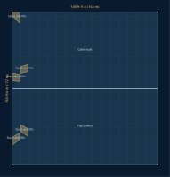
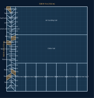
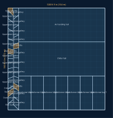

# P4-05 Atrium Plaza Utility Plant: plan

Footprint 538 ft 9 in (164 m) × 563 ft 4 in (172 m) · structural grid 32 ft 10 in (10 m)

## Levels

| Level | Floor above deck | Height | Floor area |
|---|---|---|---|
| Level B1 · Pipe and cable basement | −16 ft 5 in (5,000 mm) | 16 ft 5 in (5,000 mm) | 303,468 sq ft (28,193 m²) |
| Level 1 · Plant floor | 0 ft (0 mm) | 26 ft 3 in (8,000 mm) | 298,139 sq ft (27,698 m²) |
| Level 2 · Upper plant deck | 26 ft 3 in (8,000 mm) | 19 ft 8 in (6,000 mm) | 298,148 sq ft (27,699 m²) |

## Elements

| ID | Designation | Type | Name | Level(s) | Size / length | Area | Status |
|---|---|---|---|---|---|---|---|
| E001 | D5F1P4B5A1L1R1, D5F1P4B5A1L2R1 | room | Transformer bay 1 | L1, L2 | 68 ft 7 in (21 m) × 187 ft 8 in (57 m) | 12,868 sq ft (1,195 m²) | proposed |
| E002 | D5F1P4B5A1L1R2, D5F1P4B5A1L2R2 | room | Transformer bay 2 | L1, L2 | 68 ft 7 in (21 m) × 187 ft 8 in (57 m) | 12,868 sq ft (1,195 m²) | proposed |
| E003 | D5F1P4B5A1L1R3, D5F1P4B5A1L2R3 | room | Transformer bay 3 | L1, L2 | 68 ft 7 in (21 m) × 187 ft 8 in (57 m) | 12,868 sq ft (1,195 m²) | proposed |
| E004 | D5F1P4B5A1L1R4, D5F1P4B5A1L2R4 | room | Transformer bay 4 | L1, L2 | 68 ft 3 in (21 m) × 187 ft 8 in (57 m) | 12,806 sq ft (1,190 m²) | proposed |
| E005 | D5F1P4B5A1L1R5, D5F1P4B5A1L2R5 | room | Transformer bay 5 | L1, L2 | 68 ft 7 in (21 m) × 187 ft 8 in (57 m) | 12,868 sq ft (1,195 m²) | proposed |
| E006 | D5F1P4B5A1L1R6, D5F1P4B5A1L2R6 | room | Transformer bay 6 | L1, L2 | 68 ft 7 in (21 m) × 187 ft 8 in (57 m) | 12,868 sq ft (1,195 m²) | proposed |
| E007 | D5F1P4B5A1L1R7, D5F1P4B5A1L2R7 | room | Transformer bay 7 | L1, L2 | 68 ft 7 in (21 m) × 187 ft 8 in (57 m) | 12,868 sq ft (1,195 m²) | proposed |
| E008 | D5F1P4B5A1L1R8, D5F1P4B5A1L2R8 | room | Chiller hall | L1, L2 | 479 ft 8 in (146 m) × 188 ft (57 m) | 90,172 sq ft (8,377 m²) | proposed |
| E009 | D5F1P4B5A1L1R9, D5F1P4B5A1L2R9 | room | Air handling hall | L1, L2 | 479 ft 8 in (146 m) × 187 ft 8 in (57 m) | 90,015 sq ft (8,363 m²) | proposed |
| E010 | D5F1P4B5A1LB1R1, D5F1P4B5A1L1R10, D5F1P4B5A1L2R10 | core | Stairs and lifts | LB1, L1, L2 | 27 ft 11 in (8,500 mm) × 45 ft 7 in (14 m) | 732 sq ft (68 m²) | proposed |
| E011 | D5F1P4B5A1LB1R2, D5F1P4B5A1L1R11, D5F1P4B5A1L2R11 | core | Stairs and lifts | LB1, L1, L2 | 27 ft 11 in (8,500 mm) × 30 ft 6 in (9,300 mm) | 732 sq ft (68 m²) | proposed |
| E012 | D5F1P4B5A1LB1R3, D5F1P4B5A1L1R12, D5F1P4B5A1L2R12 | core | Stairs and lifts | LB1, L1, L2 | 29 ft 2 in (8,900 mm) × 40 ft 4 in (12 m) | 732 sq ft (68 m²) | proposed |
| E013 | D5F1P4B5A1LB1R4, D5F1P4B5A1L1R13, D5F1P4B5A1L2R13 | core | Stairs and lifts | LB1, L1, L2 | 27 ft 11 in (8,500 mm) × 33 ft 10 in (10 m) | 732 sq ft (68 m²) | proposed |
| E014 | D5F1P4B5A1LB1R5, D5F1P4B5A1L1R14, D5F1P4B5A1L2R14 | core | Stairs and lifts | LB1, L1, L2 | 27 ft 11 in (8,500 mm) × 42 ft 4 in (13 m) | 727 sq ft (68 m²) | proposed |
| E015 | D5F1P4B5A1L1R15 | room | Control room | L1 | 59 ft 1 in (18 m) × 42 ft 4 in (13 m) | 1,290 sq ft (120 m²) | proposed |
| E016 | D5F1P4B5A1L1R16 | room | Switch room | L1 | 27 ft 11 in (8,500 mm) × 77 ft 9 in (24 m) | 1,510 sq ft (140 m²) | proposed |
| E017 | D5F1P4B5A1L1R17 | room | Battery room | L1 | 27 ft 11 in (8,500 mm) × 76 ft 1 in (23 m) | 1,711 sq ft (159 m²) | proposed |
| E018 | D5F1P4B5A1L1R18 | room | Water pump room | L1 | 27 ft 11 in (8,500 mm) × 84 ft 4 in (26 m) | 2,141 sq ft (199 m²) | proposed |
| E019 | D5F1P4B5A1L1R19 | room | Water treatment room | L1 | 27 ft 11 in (8,500 mm) × 65 ft (20 m) | 1,720 sq ft (160 m²) | proposed |
| E020 | D5F1P4B5A1L1R20 | room | Workshop | L1 | 27 ft 11 in (8,500 mm) × 62 ft 4 in (19 m) | 1,500 sq ft (139 m²) | proposed |
| E021 | D5F1P4B5A1L1R21 | room | Fountain and lake pump room | L1 | 27 ft 11 in (8,500 mm) × 60 ft (18 m) | 1,290 sq ft (120 m²) | proposed |
| E022 | D5F1P4B5A1L1R22 | room | Locker room | L1 | 27 ft 11 in (8,500 mm) × 52 ft 6 in (16 m) | 961 sq ft (89 m²) | proposed |
| E023 | D5F1P4B5A1L1R23 | room | Staff toilets and showers | L1 | 27 ft 11 in (8,500 mm) × 48 ft 3 in (15 m) | 750 sq ft (70 m²) | proposed |
| E024 | D5F1P4B5A1L1R24 | room | Spares store | L1 | 27 ft 11 in (8,500 mm) × 63 ft 8 in (19 m) | 1,089 sq ft (101 m²) | proposed |
| E025 | D5F1P4B5A1L1R25 | room | Spares store | L1 | 34 ft 1 in (10 m) × 40 ft (12 m) | 860 sq ft (80 m²) | proposed |
| E026 | D5F1P4B5A1L1R26 | room | Spares store | L1 | 27 ft 11 in (8,500 mm) × 55 ft 9 in (17 m) | 860 sq ft (80 m²) | proposed |
| E027 | D5F1P4B5A1L1R27 | room | Spares store | L1 | 27 ft 11 in (8,500 mm) × 52 ft 6 in (16 m) | 855 sq ft (79 m²) | proposed |
| E028 | D5F1P4B5A1L1R28 | room | Spares store | L1 | 27 ft 11 in (8,500 mm) × 49 ft 6 in (15 m) | 860 sq ft (80 m²) | proposed |
| E029 | D5F1P4B5A1L1R29 | room | Spares store | L1 | 27 ft 11 in (8,500 mm) × 45 ft 11 in (14 m) | 851 sq ft (79 m²) | proposed |
| E030 | D5F1P4B5A1L1R30 | room | Spares store | L1 | 27 ft 11 in (8,500 mm) × 43 ft (13 m) | 860 sq ft (80 m²) | proposed |
| E031 | D5F1P4B5A1L1R31 | room | Spares store | L1 | 27 ft 11 in (8,500 mm) × 25 ft 7 in (7,800 mm) | 444 sq ft (41 m²) | proposed |
| E032 | D5F1P4B5A1L1R32 | room | Spares store | L1 | 27 ft 11 in (8,500 mm) × 35 ft 5 in (11 m) | 860 sq ft (80 m²) | proposed |
| E033 | D5F1P4B5A1L1R33 | room | Spares store | L1 | 27 ft 11 in (8,500 mm) × 32 ft 2 in (9,800 mm) | 855 sq ft (79 m²) | proposed |
| E034 | D5F1P4B5A1L1R34 | room | Spares store | L1 | 27 ft 11 in (8,500 mm) × 32 ft 6 in (9,900 mm) | 855 sq ft (79 m²) | proposed |
| E035 | D5F1P4B5A1L1R35 | room | Spares store | L1 | 27 ft 11 in (8,500 mm) × 35 ft 9 in (11 m) | 855 sq ft (79 m²) | proposed |
| E036 | D5F1P4B5A1L1R36 | room | Spares store | L1 | 27 ft 11 in (8,500 mm) × 39 ft 1 in (12 m) | 860 sq ft (80 m²) | proposed |
| E037 | D5F1P4B5A1L1R37 | room | Spares store | L1 | 27 ft 11 in (8,500 mm) × 42 ft 4 in (13 m) | 860 sq ft (80 m²) | proposed |
| E038 | D5F1P4B5A1L1R38 | room | Spares store | L1 | 27 ft 11 in (8,500 mm) × 29 ft 10 in (9,100 mm) | 444 sq ft (41 m²) | proposed |
| E039 | D5F1P4B5A1L1R39 | room | Spares store | L1 | 27 ft 11 in (8,500 mm) × 49 ft 10 in (15 m) | 855 sq ft (79 m²) | proposed |
| E040 | D5F1P4B5A1L1R40 | room | Spares store | L1 | 27 ft 11 in (8,500 mm) × 53 ft 2 in (16 m) | 860 sq ft (80 m²) | proposed |
| E041 | D5F1P4B5A1L1R41 | room | Spares store | L1 | 27 ft 11 in (8,500 mm) × 64 ft 8 in (20 m) | 1,080 sq ft (100 m²) | proposed |
| E042 | D5F1P4B5A1L2R15 | room | Filter bank room | L2 | 59 ft 1 in (18 m) × 56 ft 9 in (17 m) | 1,720 sq ft (160 m²) | proposed |
| E043 | D5F1P4B5A1L2R16 | room | Ductwork gallery | L2 | 27 ft 11 in (8,500 mm) × 61 ft 4 in (19 m) | 1,080 sq ft (100 m²) | proposed |
| E044 | D5F1P4B5A1L2R17 | room | Crew rest room | L2 | 27 ft 11 in (8,500 mm) × 32 ft 6 in (9,900 mm) | 425 sq ft (40 m²) | proposed |
| E045 | D5F1P4B5A1L2R18 | room | Upper plant gallery | L2 | 27 ft 11 in (8,500 mm) × 66 ft 7 in (20 m) | 1,478 sq ft (137 m²) | proposed |
| E046 | D5F1P4B5A1L2R19 | room | Upper plant gallery | L2 | 27 ft 11 in (8,500 mm) × 61 ft (19 m) | 1,478 sq ft (137 m²) | proposed |
| E047 | D5F1P4B5A1L2R20 | room | Upper plant gallery | L2 | 27 ft 11 in (8,500 mm) × 55 ft 9 in (17 m) | 1,478 sq ft (137 m²) | proposed |
| E048 | D5F1P4B5A1L2R21 | room | Upper plant gallery | L2 | 27 ft 11 in (8,500 mm) × 27 ft 7 in (8,400 mm) | 723 sq ft (67 m²) | proposed |
| E049 | D5F1P4B5A1L2R22 | room | Upper plant gallery | L2 | 27 ft 11 in (8,500 mm) × 61 ft 4 in (19 m) | 1,478 sq ft (137 m²) | proposed |
| E050 | D5F1P4B5A1L2R23 | room | Upper plant gallery | L2 | 27 ft 11 in (8,500 mm) × 66 ft 11 in (20 m) | 1,478 sq ft (137 m²) | proposed |
| E051 | D5F1P4B5A1L2R24 | room | Upper plant gallery | L2 | 27 ft 11 in (8,500 mm) × 72 ft 6 in (22 m) | 1,478 sq ft (137 m²) | proposed |
| E052 | D5F1P4B5A1L2R25 | room | Upper plant gallery | L2 | 27 ft 11 in (8,500 mm) × 65 ft 11 in (20 m) | 1,157 sq ft (108 m²) | proposed |
| E053 | D5F1P4B5A1L2R26 | room | Upper plant gallery | L2 | 34 ft 1 in (10 m) × 61 ft 4 in (19 m) | 1,487 sq ft (138 m²) | proposed |
| E054 | D5F1P4B5A1L2R27 | room | Upper plant gallery | L2 | 27 ft 11 in (8,500 mm) × 74 ft 6 in (23 m) | 1,473 sq ft (137 m²) | proposed |
| E055 | D5F1P4B5A1L2R28 | room | Upper plant gallery | L2 | 27 ft 11 in (8,500 mm) × 69 ft 3 in (21 m) | 1,478 sq ft (137 m²) | proposed |
| E056 | D5F1P4B5A1L2R29 | room | Upper plant gallery | L2 | 27 ft 11 in (8,500 mm) × 52 ft 6 in (16 m) | 1,153 sq ft (107 m²) | proposed |
| E057 | D5F1P4B5A1L2R30 | room | Upper plant gallery | L2 | 27 ft 11 in (8,500 mm) × 56 ft 5 in (17 m) | 1,478 sq ft (137 m²) | proposed |
| E058 | D5F1P4B5A1L2R31 | room | Upper plant gallery | L2 | 27 ft 11 in (8,500 mm) × 55 ft 9 in (17 m) | 1,478 sq ft (137 m²) | proposed |
| E059 | D5F1P4B5A1L2R32 | room | Upper plant gallery | L2 | 27 ft 11 in (8,500 mm) × 60 ft 8 in (18 m) | 1,478 sq ft (137 m²) | proposed |
| E060 | D5F1P4B5A1L2R33 | room | Upper plant gallery | L2 | 27 ft 11 in (8,500 mm) × 54 ft 2 in (16 m) | 1,157 sq ft (108 m²) | proposed |
| E061 | D5F1P4B5A1L2R34 | room | Upper plant gallery | L2 | 27 ft 11 in (8,500 mm) × 73 ft 6 in (22 m) | 1,478 sq ft (137 m²) | proposed |
| E062 | D5F1P4B5A1L2R35 | room | Upper plant gallery | L2 | 27 ft 11 in (8,500 mm) × 72 ft 10 in (22 m) | 1,318 sq ft (122 m²) | proposed |
| E063 | D5F1P4B5A1LB1R6 | room | Cable vault | LB1 | 538 ft 9 in (164 m) × 281 ft 6 in (86 m) | 151,646 sq ft (14,088 m²) | proposed |
| E064 | D5F1P4B5A1LB1R7 | room | Pipe gallery | LB1 | 538 ft 9 in (164 m) × 281 ft 10 in (86 m) | 151,823 sq ft (14,105 m²) | proposed |

## Drawings

### Level B1 · Pipe and cable basement

### Level 1 · Plant floor

### Level 2 · Upper plant deck

