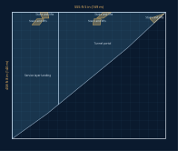
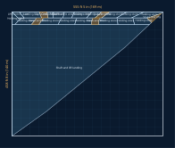
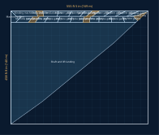

# P4-06 Atrium Plaza Service Shaft: plan

Footprint 555 ft 5 in (169 m) × 458 ft 8 in (140 m) · structural grid 32 ft 10 in (10 m)

## Levels

| Level | Floor above deck | Height | Floor area |
|---|---|---|---|
| Level B1 · Service layer landing | −19 ft 8 in (6,000 mm) | 19 ft 8 in (6,000 mm) | 133,549 sq ft (12,407 m²) |
| Level 1 · Lift landing | 0 ft (0 mm) | 29 ft 6 in (9,000 mm) | 129,430 sq ft (12,024 m²) |
| Level 2 · Winding room | 29 ft 6 in (9,000 mm) | 19 ft 8 in (6,000 mm) | 129,430 sq ft (12,024 m²) |

## Elements

| ID | Designation | Type | Name | Level(s) | Size / length | Area | Status |
|---|---|---|---|---|---|---|---|
| E001 | D5F1P4B6A1L1R1, D5F1P4B6A1L2R1 | room | Shaft and lift landing | L1, L2 | 506 ft 3 in (154 m) × 412 ft 9 in (126 m) | 109,147 sq ft (10,140 m²) | proposed |
| E002 | D5F1P4B6A1LB1R1, D5F1P4B6A1L1R2, D5F1P4B6A1L2R2 | core | Stairs and lifts | LB1, L1, L2 | 32 ft 2 in (9,800 mm) × 21 ft 8 in (6,600 mm) | 568 sq ft (53 m²) | proposed |
| E003 | D5F1P4B6A1LB1R2, D5F1P4B6A1L1R3, D5F1P4B6A1L2R3 | core | Stairs and lifts | LB1, L1, L2 | 52 ft 2 in (16 m) × 21 ft 8 in (6,600 mm) | 568 sq ft (53 m²) | proposed |
| E004 | D5F1P4B6A1LB1R3, D5F1P4B6A1L1R4, D5F1P4B6A1L2R4 | core | Stairs and lifts | LB1, L1, L2 | 52 ft 2 in (16 m) × 34 ft 1 in (10 m) | 574 sq ft (53 m²) | proposed |
| E005 | D5F1P4B6A1LB1R4, D5F1P4B6A1L1R5, D5F1P4B6A1L2R5 | core | Stairs and lifts | LB1, L1, L2 | 29 ft 10 in (9,100 mm) × 21 ft 8 in (6,600 mm) | 572 sq ft (53 m²) | proposed |
| E006 | D5F1P4B6A1LB1R5, D5F1P4B6A1L1R6, D5F1P4B6A1L2R6 | core | Stairs and lifts | LB1, L1, L2 | 43 ft (13 m) × 21 ft 8 in (6,600 mm) | 568 sq ft (53 m²) | proposed |
| E007 | D5F1P4B6A1L1R7 | room | Lift control room | L1 | 44 ft 7 in (14 m) × 21 ft 8 in (6,600 mm) | 536 sq ft (50 m²) | proposed |
| E008 | D5F1P4B6A1L1R8 | room | Loading bay | L1 | 82 ft (25 m) × 21 ft 8 in (6,600 mm) | 1,495 sq ft (139 m²) | proposed |
| E009 | D5F1P4B6A1L1R9 | room | Crew check-in | L1 | 22 ft (6,700 mm) × 21 ft 8 in (6,600 mm) | 423 sq ft (39 m²) | proposed |
| E010 | D5F1P4B6A1L1R10 | room | Tool store | L1 | 42 ft 8 in (13 m) × 21 ft 8 in (6,600 mm) | 860 sq ft (80 m²) | proposed |
| E011 | D5F1P4B6A1L1R11 | room | Staff toilets and showers | L1 | 42 ft (13 m) × 21 ft 8 in (6,600 mm) | 746 sq ft (69 m²) | proposed |
| E012 | D5F1P4B6A1L1R12 | room | Holding store | L1 | 73 ft 10 in (22 m) × 21 ft 8 in (6,600 mm) | 1,286 sq ft (119 m²) | proposed |
| E013 | D5F1P4B6A1L1R13 | room | Holding store | L1 | 55 ft 5 in (17 m) × 21 ft 8 in (6,600 mm) | 739 sq ft (69 m²) | proposed |
| E014 | D5F1P4B6A1L1R14 | room | Holding store | L1 | 91 ft 6 in (28 m) × 21 ft 8 in (6,600 mm) | 1,282 sq ft (119 m²) | proposed |
| E015 | D5F1P4B6A1L1R15 | room | Holding store | L1 | 100 ft 5 in (31 m) × 21 ft 8 in (6,600 mm) | 1,282 sq ft (119 m²) | proposed |
| E016 | D5F1P4B6A1L1R16 | room | Holding store | L1 | 115 ft 6 in (35 m) × 22 ft (6,700 mm) | 1,494 sq ft (139 m²) | proposed |
| E017 | D5F1P4B6A1L1R17 | room | Holding store | L1 | 68 ft 3 in (21 m) × 22 ft 4 in (6,800 mm) | 1,284 sq ft (119 m²) | proposed |
| E018 | D5F1P4B6A1L1R18 | room | Holding store | L1 | 62 ft 8 in (19 m) × 21 ft 8 in (6,600 mm) | 1,282 sq ft (119 m²) | proposed |
| E019 | D5F1P4B6A1L1R19 | room | Holding store | L1 | 70 ft 10 in (22 m) × 21 ft 8 in (6,600 mm) | 1,488 sq ft (138 m²) | proposed |
| E020 | D5F1P4B6A1L1R20 | room | Holding store | L1 | 65 ft 3 in (20 m) × 21 ft 8 in (6,600 mm) | 1,282 sq ft (119 m²) | proposed |
| E021 | D5F1P4B6A1L1R21 | room | Holding store | L1 | 68 ft 11 in (21 m) × 21 ft 8 in (6,600 mm) | 1,282 sq ft (119 m²) | proposed |
| E022 | D5F1P4B6A1L1R22 | room | Holding store | L1 | 82 ft 4 in (25 m) × 21 ft 8 in (6,600 mm) | 1,488 sq ft (138 m²) | proposed |
| E023 | D5F1P4B6A1L1R23 | room | Holding store | L1 | 78 ft 9 in (24 m) × 21 ft 8 in (6,600 mm) | 1,282 sq ft (119 m²) | proposed |
| E024 | D5F1P4B6A1L1R24 | room | Holding store | L1 | 31 ft 10 in (9,700 mm) × 45 ft 11 in (14 m) | 749 sq ft (70 m²) | proposed |
| E025 | D5F1P4B6A1L2R7 | room | Winding machinery | L2 | 108 ft 7 in (33 m) × 21 ft 8 in (6,600 mm) | 2,032 sq ft (189 m²) | proposed |
| E026 | D5F1P4B6A1L2R8 | room | Shaft ventilation fans | L2 | 63 ft 8 in (19 m) × 21 ft 8 in (6,600 mm) | 1,282 sq ft (119 m²) | proposed |
| E027 | D5F1P4B6A1L2R9 | room | Machine gallery | L2 | 58 ft 9 in (18 m) × 21 ft 8 in (6,600 mm) | 1,083 sq ft (101 m²) | proposed |
| E028 | D5F1P4B6A1L2R10 | room | Machine gallery | L2 | 66 ft 3 in (20 m) × 21 ft 8 in (6,600 mm) | 1,087 sq ft (101 m²) | proposed |
| E029 | D5F1P4B6A1L2R11 | room | Machine gallery | L2 | 49 ft 6 in (15 m) × 21 ft 8 in (6,600 mm) | 600 sq ft (56 m²) | proposed |
| E030 | D5F1P4B6A1L2R12 | room | Machine gallery | L2 | 81 ft 8 in (25 m) × 21 ft 8 in (6,600 mm) | 1,087 sq ft (101 m²) | proposed |
| E031 | D5F1P4B6A1L2R13 | room | Machine gallery | L2 | 89 ft 3 in (27 m) × 21 ft 8 in (6,600 mm) | 1,087 sq ft (101 m²) | proposed |
| E032 | D5F1P4B6A1L2R14 | room | Machine gallery | L2 | 96 ft 9 in (30 m) × 21 ft 8 in (6,600 mm) | 1,087 sq ft (101 m²) | proposed |
| E033 | D5F1P4B6A1L2R15 | room | Machine gallery | L2 | 85 ft 8 in (26 m) × 22 ft (6,700 mm) | 798 sq ft (74 m²) | proposed |
| E034 | D5F1P4B6A1L2R16 | room | Machine gallery | L2 | 59 ft 5 in (18 m) × 22 ft 4 in (6,800 mm) | 1,085 sq ft (101 m²) | proposed |
| E035 | D5F1P4B6A1L2R17 | room | Machine gallery | L2 | 54 ft 6 in (17 m) × 21 ft 8 in (6,600 mm) | 1,087 sq ft (101 m²) | proposed |
| E036 | D5F1P4B6A1L2R18 | room | Machine gallery | L2 | 51 ft 10 in (16 m) × 21 ft 8 in (6,600 mm) | 1,090 sq ft (101 m²) | proposed |
| E037 | D5F1P4B6A1L2R19 | room | Machine gallery | L2 | 38 ft 1 in (12 m) × 21 ft 8 in (6,600 mm) | 792 sq ft (74 m²) | proposed |
| E038 | D5F1P4B6A1L2R20 | room | Machine gallery | L2 | 55 ft 9 in (17 m) × 21 ft 8 in (6,600 mm) | 1,083 sq ft (101 m²) | proposed |
| E039 | D5F1P4B6A1L2R21 | room | Machine gallery | L2 | 59 ft 1 in (18 m) × 21 ft 8 in (6,600 mm) | 1,087 sq ft (101 m²) | proposed |
| E040 | D5F1P4B6A1L2R22 | room | Machine gallery | L2 | 62 ft 4 in (19 m) × 21 ft 8 in (6,600 mm) | 1,087 sq ft (101 m²) | proposed |
| E041 | D5F1P4B6A1L2R23 | room | Machine gallery | L2 | 51 ft 6 in (16 m) × 21 ft 8 in (6,600 mm) | 796 sq ft (74 m²) | proposed |
| E042 | D5F1P4B6A1L2R24 | room | Machine gallery | L2 | 69 ft 3 in (21 m) × 21 ft 8 in (6,600 mm) | 1,087 sq ft (101 m²) | proposed |
| E043 | D5F1P4B6A1L2R25 | room | Machine gallery | L2 | 40 ft 4 in (12 m) × 45 ft 11 in (14 m) | 945 sq ft (88 m²) | proposed |
| E044 | D5F1P4B6A1LB1R6 | room | Service layer landing | LB1 | 167 ft 8 in (51 m) × 458 ft 8 in (140 m) | 66,742 sq ft (6,200 m²) | proposed |
| E045 | D5F1P4B6A1LB1R7 | room | Tunnel portal | LB1 | 387 ft 10 in (118 m) × 334 ft 4 in (102 m) | 66,808 sq ft (6,207 m²) | proposed |

## Drawings

### Level B1 · Service layer landing

### Level 1 · Lift landing

### Level 2 · Winding room

