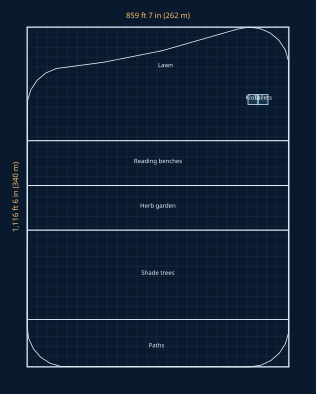

# P4-07 Rim Garden 1: plan

Footprint 859 ft 7 in (262 m) × 1,116 ft 6 in (340 m) · structural grid 32 ft 10 in (10 m)

## Levels

| Level | Floor above deck | Height | Floor area |
|---|---|---|---|
| Level 1 · Ground | 0 ft (0 mm) | 13 ft 1 in (4,000 mm) | 2,153 sq ft (200 m²) |

## Elements

| ID | Designation | Type | Name | Level(s) | Size / length | Area | Status |
|---|---|---|---|---|---|---|---|
| E001 | D5F1P4B2A2R1 | zone | Lawn | L1 | 857 ft 3 in (261 m) × 373 ft 4 in (114 m) | 251,979 sq ft (23,410 m²) | proposed |
| E002 | D5F1P4B2A2R2 | room | Kiosk | L1 | 32 ft 10 in (10 m) × 32 ft 10 in (10 m) | 1,076 sq ft (100 m²) | proposed |
| E003 | D5F1P4B2A2R3 | room | Toilets | L1 | 32 ft 10 in (10 m) × 32 ft 10 in (10 m) | 1,076 sq ft (100 m²) | proposed |
| E004 | D5F1P4B2A2R4 | zone | Reading benches | L1 | 857 ft 3 in (261 m) × 147 ft (45 m) | 126,005 sq ft (11,706 m²) | proposed |
| E005 | D5F1P4B2A2R5 | zone | Herb garden | L1 | 857 ft 7 in (261 m) × 146 ft 8 in (45 m) | 125,748 sq ft (11,682 m²) | proposed |
| E006 | D5F1P4B2A2R6 | zone | Shade trees | L1 | 858 ft 3 in (262 m) × 293 ft 8 in (90 m) | 251,921 sq ft (23,404 m²) | proposed |
| E007 | D5F1P4B2A2R7 | zone | Paths | L1 | 858 ft 3 in (262 m) × 155 ft 10 in (48 m) | 126,037 sq ft (11,709 m²) | proposed |

## Drawings

### Level 1 · Ground

