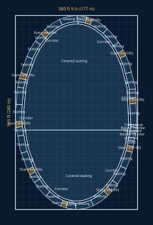

# P4-08 Plaza Pavilion 1: plan

Footprint 580 ft 9 in (177 m) × 919 ft (280 m) · structural grid 32 ft 10 in (10 m)

## Levels

| Level | Floor above deck | Height | Floor area |
|---|---|---|---|
| Level 1 · Pavilion floor | 0 ft (0 mm) | 19 ft 8 in (6,000 mm) | 387,208 sq ft (35,973 m²) |

## Elements

| ID | Designation | Type | Name | Level(s) | Size / length | Area | Status |
|---|---|---|---|---|---|---|---|
| E001 | D5F1P4B3A2R1 | room | Covered seating | L1 | 499 ft 4 in (152 m) × 502 ft 7 in (153 m) | 204,562 sq ft (19,004 m²) | proposed |
| E002 | D5F1P4B3A2R2 | room | Covered seating | L1 | 487 ft 10 in (149 m) × 336 ft 11 in (103 m) | 122,771 sq ft (11,406 m²) | proposed |
| E003 | D5F1P4B3A2R3 | core | Stairs and lifts | L1 | 34 ft 9 in (11 m) × 32 ft 6 in (9,900 mm) | 779 sq ft (72 m²) | proposed |
| E004 | D5F1P4B3A2R4 | core | Stairs and lifts | L1 | 39 ft 4 in (12 m) × 39 ft 4 in (12 m) | 772 sq ft (72 m²) | proposed |
| E005 | D5F1P4B3A2R5 | core | Stairs and lifts | L1 | 34 ft 5 in (10 m) × 35 ft 9 in (11 m) | 770 sq ft (72 m²) | proposed |
| E006 | D5F1P4B3A2R6 | core | Stairs and lifts | L1 | 38 ft 1 in (12 m) × 36 ft 5 in (11 m) | 779 sq ft (72 m²) | proposed |
| E007 | D5F1P4B3A2R7 | core | Stairs and lifts | L1 | 31 ft 10 in (9,700 mm) × 28 ft 10 in (8,800 mm) | 777 sq ft (72 m²) | proposed |
| E008 | D5F1P4B3A2R8 | core | Stairs and lifts | L1 | 35 ft 9 in (11 m) × 33 ft 2 in (10 m) | 780 sq ft (72 m²) | proposed |
| E009 | D5F1P4B3A2R9 | core | Stairs and lifts | L1 | 39 ft 4 in (12 m) × 39 ft 4 in (12 m) | 773 sq ft (72 m²) | proposed |
| E010 | D5F1P4B3A2R10 | core | Stairs and lifts | L1 | 34 ft 5 in (10 m) × 36 ft 1 in (11 m) | 774 sq ft (72 m²) | proposed |
| E011 | D5F1P4B3A2R11 | core | Stairs and lifts | L1 | 38 ft 5 in (12 m) × 36 ft 9 in (11 m) | 780 sq ft (72 m²) | proposed |
| E012 | D5F1P4B3A2R12 | core | Stairs and lifts | L1 | 30 ft 6 in (9,300 mm) × 28 ft 7 in (8,700 mm) | 773 sq ft (72 m²) | proposed |
| E013 | D5F1P4B3A2R13 | zone | Corridor | L1 | 175 ft 6 in (53 m) × 346 ft 5 in (106 m) | 3,861 sq ft (359 m²) | proposed |
| E014 | D5F1P4B3A2R14 | zone | Corridor | L1 | 303 ft 6 in (92 m) × 199 ft 6 in (61 m) | 3,905 sq ft (363 m²) | proposed |
| E015 | D5F1P4B3A2R15 | zone | Corridor | L1 | 54 ft 6 in (17 m) × 389 ft 5 in (119 m) | 3,911 sq ft (363 m²) | proposed |
| E016 | D5F1P4B3A2R16 | zone | Corridor | L1 | 250 ft 8 in (76 m) × 276 ft 11 in (84 m) | 3,912 sq ft (363 m²) | proposed |
| E017 | D5F1P4B3A2R17 | zone | Corridor | L1 | 236 ft 11 in (72 m) × 291 ft 4 in (89 m) | 3,892 sq ft (362 m²) | proposed |
| E018 | D5F1P4B3A2R18 | zone | Corridor | L1 | 23 ft 7 in (7,200 mm) × 197 ft 6 in (60 m) | 1,914 sq ft (178 m²) | proposed |
| E019 | D5F1P4B3A2R19 | room | Ticket kiosk | L1 | 31 ft 2 in (9,500 mm) × 12 ft 6 in (3,800 mm) | 309 sq ft (29 m²) | proposed |
| E020 | D5F1P4B3A2R20 | room | Bakery counter | L1 | 32 ft 10 in (10 m) × 20 ft 8 in (6,300 mm) | 537 sq ft (50 m²) | proposed |
| E021 | D5F1P4B3A2R21 | room | Newsstand | L1 | 31 ft 2 in (9,500 mm) × 13 ft 5 in (4,100 mm) | 306 sq ft (28 m²) | proposed |
| E022 | D5F1P4B3A2R22 | room | Noodle counter | L1 | 33 ft 2 in (10 m) × 25 ft 7 in (7,800 mm) | 651 sq ft (60 m²) | proposed |
| E023 | D5F1P4B3A2R23 | room | Juice bar | L1 | 31 ft 6 in (9,600 mm) × 19 ft (5,800 mm) | 428 sq ft (40 m²) | proposed |
| E024 | D5F1P4B3A2R24 | room | Toilets | L1 | 33 ft 6 in (10 m) × 31 ft 2 in (9,500 mm) | 768 sq ft (71 m²) | proposed |
| E025 | D5F1P4B3A2R25 | room | Seating | L1 | 55 ft 1 in (17 m) × 85 ft 8 in (26 m) | 2,386 sq ft (222 m²) | proposed |
| E026 | D5F1P4B3A2R26 | room | Seating | L1 | 65 ft (20 m) × 84 ft 8 in (26 m) | 2,379 sq ft (221 m²) | proposed |
| E027 | D5F1P4B3A2R27 | room | Seating | L1 | 48 ft 7 in (15 m) × 51 ft 2 in (16 m) | 1,227 sq ft (114 m²) | proposed |
| E028 | D5F1P4B3A2R28 | room | Seating | L1 | 82 ft (25 m) × 69 ft 11 in (21 m) | 2,381 sq ft (221 m²) | proposed |
| E029 | D5F1P4B3A2R29 | room | Seating | L1 | 84 ft 8 in (26 m) × 45 ft 3 in (14 m) | 2,383 sq ft (221 m²) | proposed |
| E030 | D5F1P4B3A2R30 | room | Seating | L1 | 44 ft 11 in (14 m) × 35 ft 9 in (11 m) | 1,232 sq ft (114 m²) | proposed |
| E031 | D5F1P4B3A2R31 | room | Seating | L1 | 82 ft 8 in (25 m) × 68 ft 11 in (21 m) | 2,381 sq ft (221 m²) | proposed |
| E032 | D5F1P4B3A2R32 | room | Seating | L1 | 73 ft 10 in (22 m) × 80 ft 9 in (25 m) | 2,378 sq ft (221 m²) | proposed |
| E033 | D5F1P4B3A2R33 | room | Seating | L1 | 46 ft 3 in (14 m) × 50 ft 6 in (15 m) | 1,220 sq ft (113 m²) | proposed |
| E034 | D5F1P4B3A2R34 | room | Seating | L1 | 55 ft 9 in (17 m) × 85 ft 8 in (26 m) | 2,388 sq ft (222 m²) | proposed |
| E035 | D5F1P4B3A2R35 | room | Seating | L1 | 44 ft 11 in (14 m) × 85 ft 4 in (26 m) | 2,369 sq ft (220 m²) | proposed |
| E036 | D5F1P4B3A2R36 | room | Seating | L1 | 36 ft 1 in (11 m) × 44 ft 11 in (14 m) | 1,221 sq ft (113 m²) | proposed |
| E037 | D5F1P4B3A2R37 | room | Seating | L1 | 32 ft 10 in (10 m) × 82 ft 8 in (25 m) | 2,384 sq ft (221 m²) | proposed |
| E038 | D5F1P4B3A2R38 | room | Seating | L1 | 36 ft 1 in (11 m) × 83 ft 4 in (25 m) | 2,377 sq ft (221 m²) | proposed |
| E039 | D5F1P4B3A2R39 | room | Seating | L1 | 37 ft 9 in (12 m) × 46 ft 3 in (14 m) | 1,226 sq ft (114 m²) | proposed |
| E040 | D5F1P4B3A2R40 | room | Seating | L1 | 55 ft 5 in (17 m) × 85 ft 11 in (26 m) | 2,383 sq ft (221 m²) | proposed |
| E041 | D5F1P4B3A2R41 | room | Seating | L1 | 64 ft 4 in (20 m) × 84 ft 8 in (26 m) | 2,372 sq ft (220 m²) | proposed |
| E042 | D5F1P4B3A2R42 | room | Seating | L1 | 48 ft 7 in (15 m) × 50 ft 10 in (16 m) | 1,223 sq ft (114 m²) | proposed |
| E043 | D5F1P4B3A2R43 | room | Seating | L1 | 82 ft 4 in (25 m) × 69 ft 11 in (21 m) | 2,389 sq ft (222 m²) | proposed |
| E044 | D5F1P4B3A2R44 | room | Seating | L1 | 84 ft 8 in (26 m) × 45 ft 7 in (14 m) | 2,381 sq ft (221 m²) | proposed |
| E045 | D5F1P4B3A2R45 | room | Seating | L1 | 44 ft 11 in (14 m) × 35 ft 5 in (11 m) | 1,230 sq ft (114 m²) | proposed |
| E046 | D5F1P4B3A2R46 | room | Seating | L1 | 82 ft 8 in (25 m) × 68 ft 11 in (21 m) | 2,383 sq ft (221 m²) | proposed |
| E047 | D5F1P4B3A2R47 | room | Seating | L1 | 73 ft 6 in (22 m) × 81 ft (25 m) | 2,377 sq ft (221 m²) | proposed |
| E048 | D5F1P4B3A2R48 | room | Seating | L1 | 46 ft 7 in (14 m) × 50 ft 10 in (16 m) | 1,227 sq ft (114 m²) | proposed |
| E049 | D5F1P4B3A2R49 | room | Seating | L1 | 53 ft 10 in (16 m) × 86 ft 3 in (26 m) | 2,380 sq ft (221 m²) | proposed |
| E050 | D5F1P4B3A2R50 | room | Seating | L1 | 47 ft 11 in (15 m) × 84 ft (26 m) | 2,384 sq ft (222 m²) | proposed |
| E051 | D5F1P4B3A2R51 | room | Seating | L1 | 31 ft 2 in (9,500 mm) × 44 ft 11 in (14 m) | 1,225 sq ft (114 m²) | proposed |
| E052 | D5F1P4B3A2R52 | room | Seating | L1 | 33 ft 10 in (10 m) × 103 ft (31 m) | 2,988 sq ft (278 m²) | proposed |

## Drawings

### Level 1 · Pavilion floor

