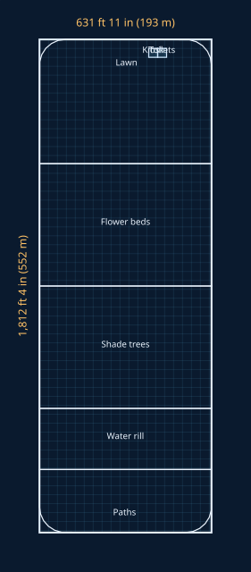

# P4-09 Rim Garden 2: plan

Footprint 631 ft 11 in (193 m) × 1,812 ft 4 in (552 m) · structural grid 32 ft 10 in (10 m)

## Levels

| Level | Floor above deck | Height | Floor area |
|---|---|---|---|
| Level 1 · Ground | 0 ft (0 mm) | 13 ft 1 in (4,000 mm) | 2,153 sq ft (200 m²) |

## Elements

| ID | Designation | Type | Name | Level(s) | Size / length | Area | Status |
|---|---|---|---|---|---|---|---|
| E001 | D5F1P4B4A2R1 | zone | Lawn | L1 | 631 ft 3 in (192 m) × 456 ft 4 in (139 m) | 283,766 sq ft (26,363 m²) | proposed |
| E002 | D5F1P4B4A2R2 | room | Kiosk | L1 | 32 ft 10 in (10 m) × 32 ft 10 in (10 m) | 1,076 sq ft (100 m²) | proposed |
| E003 | D5F1P4B4A2R3 | room | Toilets | L1 | 32 ft 10 in (10 m) × 32 ft 10 in (10 m) | 1,076 sq ft (100 m²) | proposed |
| E004 | D5F1P4B4A2R4 | zone | Flower beds | L1 | 631 ft 3 in (192 m) × 449 ft 10 in (137 m) | 283,857 sq ft (26,371 m²) | proposed |
| E005 | D5F1P4B4A2R5 | zone | Shade trees | L1 | 631 ft 3 in (192 m) × 449 ft 10 in (137 m) | 283,857 sq ft (26,371 m²) | proposed |
| E006 | D5F1P4B4A2R6 | zone | Water rill | L1 | 631 ft 3 in (192 m) × 224 ft 9 in (68 m) | 141,788 sq ft (13,173 m²) | proposed |
| E007 | D5F1P4B4A2R7 | zone | Paths | L1 | 630 ft 11 in (192 m) × 231 ft 8 in (71 m) | 141,948 sq ft (13,187 m²) | proposed |

## Drawings

### Level 1 · Ground

