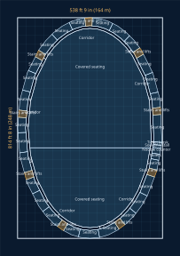

# P4-10 Plaza Pavilion 2: plan

Footprint 538 ft 9 in (164 m) × 814 ft 8 in (248 m) · structural grid 32 ft 10 in (10 m)

## Levels

| Level | Floor above deck | Height | Floor area |
|---|---|---|---|
| Level 1 · Pavilion floor | 0 ft (0 mm) | 19 ft 8 in (6,000 mm) | 316,024 sq ft (29,360 m²) |

## Elements

| ID | Designation | Type | Name | Level(s) | Size / length | Area | Status |
|---|---|---|---|---|---|---|---|
| E001 | D5F1P4B5A2R1 | room | Covered seating | L1 | 457 ft 8 in (140 m) × 440 ft 3 in (134 m) | 164,067 sq ft (15,242 m²) | proposed |
| E002 | D5F1P4B5A2R2 | room | Covered seating | L1 | 446 ft 10 in (136 m) × 294 ft 11 in (90 m) | 98,368 sq ft (9,139 m²) | proposed |
| E003 | D5F1P4B5A2R3 | core | Stairs and lifts | L1 | 37 ft 5 in (11 m) × 33 ft 2 in (10 m) | 775 sq ft (72 m²) | proposed |
| E004 | D5F1P4B5A2R4 | core | Stairs and lifts | L1 | 38 ft 9 in (12 m) × 39 ft 4 in (12 m) | 775 sq ft (72 m²) | proposed |
| E005 | D5F1P4B5A2R5 | core | Stairs and lifts | L1 | 38 ft 1 in (12 m) × 39 ft 4 in (12 m) | 780 sq ft (72 m²) | proposed |
| E006 | D5F1P4B5A2R6 | core | Stairs and lifts | L1 | 35 ft 1 in (11 m) × 34 ft 9 in (11 m) | 782 sq ft (73 m²) | proposed |
| E007 | D5F1P4B5A2R7 | core | Stairs and lifts | L1 | 31 ft 6 in (9,600 mm) × 28 ft 7 in (8,700 mm) | 763 sq ft (71 m²) | proposed |
| E008 | D5F1P4B5A2R8 | core | Stairs and lifts | L1 | 37 ft 1 in (11 m) × 38 ft 5 in (12 m) | 769 sq ft (71 m²) | proposed |
| E009 | D5F1P4B5A2R9 | core | Stairs and lifts | L1 | 28 ft 3 in (8,600 mm) × 31 ft 2 in (9,500 mm) | 766 sq ft (71 m²) | proposed |
| E010 | D5F1P4B5A2R10 | core | Stairs and lifts | L1 | 38 ft 5 in (12 m) × 38 ft 5 in (12 m) | 780 sq ft (72 m²) | proposed |
| E011 | D5F1P4B5A2R11 | core | Stairs and lifts | L1 | 30 ft 6 in (9,300 mm) × 28 ft 10 in (8,800 mm) | 769 sq ft (71 m²) | proposed |
| E012 | D5F1P4B5A2R12 | zone | Corridor | L1 | 201 ft 9 in (62 m) × 321 ft 6 in (98 m) | 3,868 sq ft (359 m²) | proposed |
| E013 | D5F1P4B5A2R13 | zone | Corridor | L1 | 262 ft 6 in (80 m) × 254 ft 3 in (78 m) | 3,866 sq ft (359 m²) | proposed |
| E014 | D5F1P4B5A2R14 | zone | Corridor | L1 | 75 ft 9 in (23 m) × 384 ft 6 in (117 m) | 3,909 sq ft (363 m²) | proposed |
| E015 | D5F1P4B5A2R15 | zone | Corridor | L1 | 325 ft 9 in (99 m) × 124 ft (38 m) | 3,871 sq ft (360 m²) | proposed |
| E016 | D5F1P4B5A2R16 | zone | Corridor | L1 | 92 ft 2 in (28 m) × 339 ft 7 in (103 m) | 3,501 sq ft (325 m²) | proposed |
| E017 | D5F1P4B5A2R17 | room | Ticket kiosk | L1 | 31 ft 6 in (9,600 mm) × 12 ft 6 in (3,800 mm) | 305 sq ft (28 m²) | proposed |
| E018 | D5F1P4B5A2R18 | room | Souvenir stall | L1 | 31 ft 2 in (9,500 mm) × 13 ft 9 in (4,200 mm) | 323 sq ft (30 m²) | proposed |
| E019 | D5F1P4B5A2R19 | room | Noodle counter | L1 | 33 ft 2 in (10 m) × 25 ft 3 in (7,700 mm) | 642 sq ft (60 m²) | proposed |
| E020 | D5F1P4B5A2R20 | room | Toilets | L1 | 32 ft 10 in (10 m) × 26 ft 7 in (8,100 mm) | 643 sq ft (60 m²) | proposed |
| E021 | D5F1P4B5A2R21 | room | Seating | L1 | 35 ft 1 in (11 m) × 42 ft 4 in (13 m) | 1,061 sq ft (99 m²) | proposed |
| E022 | D5F1P4B5A2R22 | room | Seating | L1 | 54 ft 2 in (16 m) × 79 ft 1 in (24 m) | 2,165 sq ft (201 m²) | proposed |
| E023 | D5F1P4B5A2R23 | room | Seating | L1 | 64 ft 8 in (20 m) × 77 ft 1 in (24 m) | 2,165 sq ft (201 m²) | proposed |
| E024 | D5F1P4B5A2R24 | room | Seating | L1 | 59 ft 9 in (18 m) × 60 ft 4 in (18 m) | 1,639 sq ft (152 m²) | proposed |
| E025 | D5F1P4B5A2R25 | room | Seating | L1 | 77 ft 9 in (24 m) × 55 ft 5 in (17 m) | 2,163 sq ft (201 m²) | proposed |
| E026 | D5F1P4B5A2R26 | room | Seating | L1 | 78 ft 9 in (24 m) × 34 ft 9 in (11 m) | 2,159 sq ft (201 m²) | proposed |
| E027 | D5F1P4B5A2R27 | room | Seating | L1 | 62 ft (19 m) × 48 ft 3 in (15 m) | 1,639 sq ft (152 m²) | proposed |
| E028 | D5F1P4B5A2R28 | room | Seating | L1 | 71 ft 10 in (22 m) × 72 ft 6 in (22 m) | 2,158 sq ft (200 m²) | proposed |
| E029 | D5F1P4B5A2R29 | room | Seating | L1 | 61 ft 8 in (19 m) × 78 ft 1 in (24 m) | 2,158 sq ft (200 m²) | proposed |
| E030 | D5F1P4B5A2R30 | room | Seating | L1 | 49 ft 10 in (15 m) × 62 ft (19 m) | 1,639 sq ft (152 m²) | proposed |
| E031 | D5F1P4B5A2R31 | room | Seating | L1 | 45 ft 11 in (14 m) × 77 ft 5 in (24 m) | 2,165 sq ft (201 m²) | proposed |
| E032 | D5F1P4B5A2R32 | room | Seating | L1 | 35 ft 5 in (11 m) × 75 ft 6 in (23 m) | 2,151 sq ft (200 m²) | proposed |
| E033 | D5F1P4B5A2R33 | room | Seating | L1 | 32 ft 10 in (10 m) × 57 ft 1 in (17 m) | 1,640 sq ft (152 m²) | proposed |
| E034 | D5F1P4B5A2R34 | room | Seating | L1 | 41 ft 4 in (13 m) × 77 ft 1 in (24 m) | 2,158 sq ft (200 m²) | proposed |
| E035 | D5F1P4B5A2R35 | room | Seating | L1 | 49 ft 3 in (15 m) × 79 ft 1 in (24 m) | 2,152 sq ft (200 m²) | proposed |
| E036 | D5F1P4B5A2R36 | room | Seating | L1 | 51 ft 6 in (16 m) × 62 ft 4 in (19 m) | 1,636 sq ft (152 m²) | proposed |
| E037 | D5F1P4B5A2R37 | room | Seating | L1 | 69 ft 7 in (21 m) × 74 ft 2 in (23 m) | 2,156 sq ft (200 m²) | proposed |
| E038 | D5F1P4B5A2R38 | room | Seating | L1 | 76 ft 1 in (23 m) × 65 ft 3 in (20 m) | 2,161 sq ft (201 m²) | proposed |
| E039 | D5F1P4B5A2R39 | room | Seating | L1 | 61 ft (19 m) × 42 ft 8 in (13 m) | 1,645 sq ft (153 m²) | proposed |
| E040 | D5F1P4B5A2R40 | room | Seating | L1 | 77 ft 1 in (24 m) × 47 ft 3 in (14 m) | 2,164 sq ft (201 m²) | proposed |
| E041 | D5F1P4B5A2R41 | room | Seating | L1 | 75 ft 6 in (23 m) × 66 ft 7 in (20 m) | 2,159 sq ft (201 m²) | proposed |
| E042 | D5F1P4B5A2R42 | room | Seating | L1 | 58 ft 5 in (18 m) × 61 ft 4 in (19 m) | 1,644 sq ft (153 m²) | proposed |
| E043 | D5F1P4B5A2R43 | room | Seating | L1 | 59 ft 5 in (18 m) × 77 ft 9 in (24 m) | 2,145 sq ft (199 m²) | proposed |
| E044 | D5F1P4B5A2R44 | room | Seating | L1 | 47 ft 11 in (15 m) × 78 ft 9 in (24 m) | 2,151 sq ft (200 m²) | proposed |
| E045 | D5F1P4B5A2R45 | room | Seating | L1 | 37 ft 9 in (12 m) × 59 ft 5 in (18 m) | 1,640 sq ft (152 m²) | proposed |
| E046 | D5F1P4B5A2R46 | room | Seating | L1 | 33 ft 10 in (10 m) × 103 ft (31 m) | 2,963 sq ft (275 m²) | proposed |

## Drawings

### Level 1 · Pavilion floor

