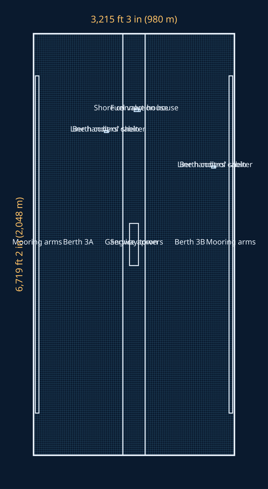

# P1-05 Cruiser Gate 3 Berths: plan

Footprint 3,215 ft 3 in (980 m) × 6,719 ft 2 in (2,048 m) · structural grid 32 ft 10 in (10 m)

## Levels

| Level | Floor above deck | Height | Floor area |
|---|---|---|---|
| Level 1 · Berth floor | 0 ft (0 mm) | 13 ft 1 in (4,000 mm) | 8,181 sq ft (760 m²) |

## Elements

| ID | Designation | Type | Name | Level(s) | Size / length | Area | Status |
|---|---|---|---|---|---|---|---|
| E001 | D5F4P1B13A1R1 | zone | Berth 3A | L1 | 1,429 ft 2 in (436 m) × 6,719 ft 2 in (2,048 m) | 9,602,580 sq ft (892,109 m²) | proposed |
| E002 | D5F4P1B13A1R2 | room | Berth control cabin | L1 | 43 ft 8 in (13 m) × 32 ft 10 in (10 m) | 1,432 sq ft (133 m²) | proposed |
| E003 | D5F4P1B13A1R3 | room | Line handlers' shelter | L1 | 22 ft (6,700 mm) × 32 ft 10 in (10 m) | 721 sq ft (67 m²) | proposed |
| E004 |  | fixture | Mooring arms | L1 | 57 ft 1 in (17 m) × 5,375 ft 4 in (1,638 m) | 306,859 sq ft (28,508 m²) | proposed |
| E005 | D5F4P1B13A1R4 | zone | Service apron | L1 | 356 ft 11 in (109 m) × 6,719 ft 2 in (2,048 m) | 2,398,441 sq ft (222,822 m²) | proposed |
| E006 | D5F4P1B13A1R5 | room | Shore connection house | L1 | 65 ft 7 in (20 m) × 39 ft 4 in (12 m) | 2,583 sq ft (240 m²) | proposed |
| E007 | D5F4P1B13A1R6 | room | Fuel valve house | L1 | 32 ft 10 in (10 m) × 39 ft 4 in (12 m) | 1,292 sq ft (120 m²) | proposed |
| E008 |  | fixture | Gangway towers | L1 | 143 ft 1 in (44 m) × 671 ft 11 in (205 m) | 96,114 sq ft (8,929 m²) | proposed |
| E009 | D5F4P1B13A1R7 | zone | Berth 3B | L1 | 1,429 ft 2 in (436 m) × 6,719 ft 2 in (2,048 m) | 9,602,580 sq ft (892,109 m²) | proposed |
| E010 | D5F4P1B13A1R8 | room | Berth control cabin | L1 | 44 ft (13 m) × 32 ft 10 in (10 m) | 1,442 sq ft (134 m²) | proposed |
| E011 | D5F4P1B13A1R9 | room | Line handlers' shelter | L1 | 21 ft 8 in (6,600 mm) × 32 ft 10 in (10 m) | 710 sq ft (66 m²) | proposed |
| E012 |  | fixture | Mooring arms | L1 | 57 ft 1 in (17 m) × 5,375 ft 4 in (1,638 m) | 306,859 sq ft (28,508 m²) | proposed |

## Drawings

### Level 1 · Berth floor

