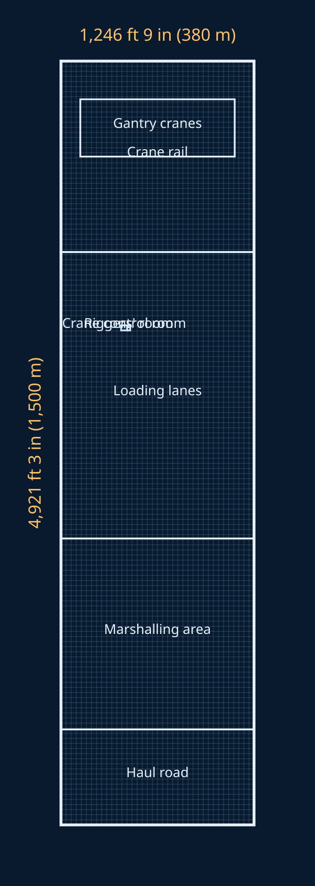

# P1-07 Supply Quay A: plan

Footprint 1,246 ft 9 in (380 m) × 4,921 ft 3 in (1,500 m) · structural grid 32 ft 10 in (10 m)

## Levels

| Level | Floor above deck | Height | Floor area |
|---|---|---|---|
| Level 1 · Quay floor | 0 ft (0 mm) | 13 ft 1 in (4,000 mm) | 1,938 sq ft (180 m²) |

## Elements

| ID | Designation | Type | Name | Level(s) | Size / length | Area | Status |
|---|---|---|---|---|---|---|---|
| E001 | D5F4P1B2A3R1 | zone | Crane rail | L1 | 1,246 ft 9 in (380 m) × 1,230 ft 4 in (375 m) | 1,533,857 sq ft (142,500 m²) | proposed |
| E002 |  | fixture | Gantry cranes | L1 | 997 ft 5 in (304 m) × 369 ft 1 in (112 m) | 368,126 sq ft (34,200 m²) | proposed |
| E003 | D5F4P1B2A3R2 | zone | Loading lanes | L1 | 1,246 ft 9 in (380 m) × 1,845 ft 6 in (562 m) | 2,300,786 sq ft (213,750 m²) | proposed |
| E004 | D5F4P1B2A3R3 | room | Crane control room | L1 | 39 ft 4 in (12 m) × 32 ft 10 in (10 m) | 1,292 sq ft (120 m²) | proposed |
| E005 | D5F4P1B2A3R4 | room | Riggers' room | L1 | 19 ft 8 in (6,000 mm) × 32 ft 10 in (10 m) | 646 sq ft (60 m²) | proposed |
| E006 | D5F4P1B2A3R5 | zone | Marshalling area | L1 | 1,246 ft 9 in (380 m) × 1,230 ft 4 in (375 m) | 1,533,857 sq ft (142,500 m²) | proposed |
| E007 | D5F4P1B2A3R6 | zone | Haul road | L1 | 1,246 ft 9 in (380 m) × 615 ft 2 in (188 m) | 766,929 sq ft (71,250 m²) | proposed |

## Drawings

### Level 1 · Quay floor

