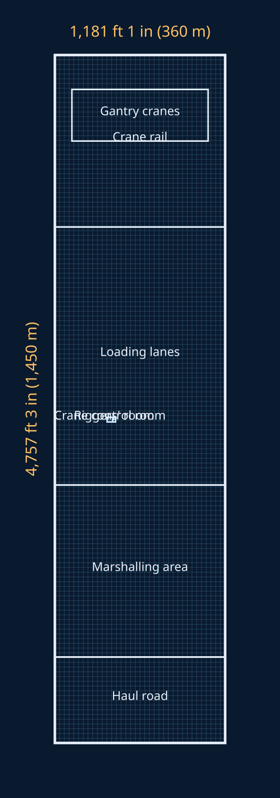

# P1-08 Supply Quay B: plan

Footprint 1,181 ft 1 in (360 m) × 4,757 ft 3 in (1,450 m) · structural grid 32 ft 10 in (10 m)

## Levels

| Level | Floor above deck | Height | Floor area |
|---|---|---|---|
| Level 1 · Quay floor | 0 ft (0 mm) | 13 ft 1 in (4,000 mm) | 1,938 sq ft (180 m²) |

## Elements

| ID | Designation | Type | Name | Level(s) | Size / length | Area | Status |
|---|---|---|---|---|---|---|---|
| E001 | D5F4P1B13A3R1 | zone | Crane rail | L1 | 1,181 ft 1 in (360 m) × 1,189 ft 4 in (362 m) | 1,404,690 sq ft (130,500 m²) | proposed |
| E002 |  | fixture | Gantry cranes | L1 | 944 ft 11 in (288 m) × 356 ft 11 in (109 m) | 337,281 sq ft (31,334 m²) | proposed |
| E003 | D5F4P1B13A3R2 | zone | Loading lanes | L1 | 1,181 ft 1 in (360 m) × 1,784 ft 1 in (544 m) | 2,107,229 sq ft (195,768 m²) | proposed |
| E004 | D5F4P1B13A3R3 | room | Crane control room | L1 | 39 ft 4 in (12 m) × 32 ft 10 in (10 m) | 1,292 sq ft (120 m²) | proposed |
| E005 | D5F4P1B13A3R4 | room | Riggers' room | L1 | 19 ft 8 in (6,000 mm) × 32 ft 10 in (10 m) | 646 sq ft (60 m²) | proposed |
| E006 | D5F4P1B13A3R5 | zone | Marshalling area | L1 | 1,181 ft 1 in (360 m) × 1,189 ft 4 in (362 m) | 1,404,690 sq ft (130,500 m²) | proposed |
| E007 | D5F4P1B13A3R6 | zone | Haul road | L1 | 1,181 ft 1 in (360 m) × 594 ft 6 in (181 m) | 702,151 sq ft (65,232 m²) | proposed |

## Drawings

### Level 1 · Quay floor

