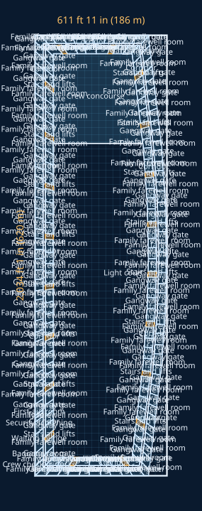
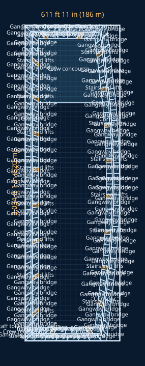

# P1-10 Gangway Hall: plan

Footprint 611 ft 11 in (186 m) × 2,034 ft 1 in (620 m) · structural grid 32 ft 10 in (10 m)

## Levels

| Level | Floor above deck | Height | Floor area |
|---|---|---|---|
| Level 1 · Concourse floor | 0 ft (0 mm) | 23 ft (7,000 mm) | 503,630 sq ft (46,789 m²) |
| Level 2 · Gangway floor | 23 ft (7,000 mm) | 16 ft 5 in (5,000 mm) | 503,689 sq ft (46,794 m²) |

## Elements

| ID | Designation | Type | Name | Level(s) | Size / length | Area | Status |
|---|---|---|---|---|---|---|---|
| E001 | D5F4P1B5A1L1R1, D5F4P1B5A1L2R1 | room | Crew concourse | L1, L2 | 414 ft 8 in (126 m) × 414 ft 1 in (126 m) | 161,447 sq ft (14,999 m²) | proposed |
| E002 | D5F4P1B5A1L1R2 | zone | Light court | L1 | 441 ft 3 in (134 m) × 1,449 ft 6 in (442 m) | 607,999 sq ft (56,485 m²) | proposed |
| E003 | D5F4P1B5A1L1R3 | zone | Corridor | L1 | 9 ft 10 in (3,000 mm) × 401 ft 7 in (122 m) | 3,875 sq ft (360 m²) | proposed |
| E004 | D5F4P1B5A1L1R4 | zone | Corridor | L1 | 9 ft 10 in (3,000 mm) × 397 ft 8 in (121 m) | 3,875 sq ft (360 m²) | proposed |
| E005 | D5F4P1B5A1L1R5 | zone | Corridor | L1 | 9 ft 10 in (3,000 mm) × 395 ft 8 in (121 m) | 3,875 sq ft (360 m²) | proposed |
| E006 | D5F4P1B5A1L1R6 | zone | Corridor | L1 | 9 ft 10 in (3,000 mm) × 397 ft 8 in (121 m) | 3,875 sq ft (360 m²) | proposed |
| E007 | D5F4P1B5A1L1R7 | zone | Corridor | L1 | 29 ft 2 in (8,900 mm) × 381 ft 11 in (116 m) | 3,875 sq ft (360 m²) | proposed |
| E008 | D5F4P1B5A1L1R8 | zone | Corridor | L1 | 401 ft 11 in (122 m) × 9 ft 10 in (3,000 mm) | 3,875 sq ft (360 m²) | proposed |
| E009 | D5F4P1B5A1L1R9 | zone | Corridor | L1 | 83 ft 8 in (26 m) × 365 ft 2 in (111 m) | 3,889 sq ft (361 m²) | proposed |
| E010 | D5F4P1B5A1L1R10 | zone | Corridor | L1 | 41 ft 8 in (13 m) × 394 ft (120 m) | 3,822 sq ft (355 m²) | proposed |
| E011 | D5F4P1B5A1L1R11 | zone | Corridor | L1 | 15 ft 9 in (4,800 mm) × 393 ft 8 in (120 m) | 3,873 sq ft (360 m²) | proposed |
| E012 | D5F4P1B5A1L1R12 | zone | Corridor | L1 | 37 ft 1 in (11 m) × 394 ft (120 m) | 3,829 sq ft (356 m²) | proposed |
| E013 | D5F4P1B5A1L1R13 | zone | Corridor | L1 | 55 ft 9 in (17 m) × 396 ft 8 in (121 m) | 3,859 sq ft (358 m²) | proposed |
| E014 | D5F4P1B5A1L1R14 | zone | Corridor | L1 | 383 ft 2 in (117 m) × 30 ft 2 in (9,200 mm) | 3,878 sq ft (360 m²) | proposed |
| E015 | D5F4P1B5A1L1R15 | zone | Corridor | L1 | 81 ft (25 m) × 9 ft 10 in (3,000 mm) | 717 sq ft (67 m²) | proposed |
| E016 | D5F4P1B5A1L1R16, D5F4P1B5A1L2R2 | core | Stairs and lifts | L1, L2 | 37 ft 9 in (12 m) × 59 ft 5 in (18 m) | 990 sq ft (92 m²) | proposed |
| E017 | D5F4P1B5A1L1R17, D5F4P1B5A1L2R3 | core | Stairs and lifts | L1, L2 | 37 ft 9 in (12 m) × 50 ft 6 in (15 m) | 996 sq ft (93 m²) | proposed |
| E018 | D5F4P1B5A1L1R18, D5F4P1B5A1L2R4 | core | Stairs and lifts | L1, L2 | 37 ft 9 in (12 m) × 41 ft 4 in (13 m) | 996 sq ft (93 m²) | proposed |
| E019 | D5F4P1B5A1L1R19, D5F4P1B5A1L2R5 | core | Stairs and lifts | L1, L2 | 37 ft 9 in (12 m) × 31 ft 10 in (9,700 mm) | 990 sq ft (92 m²) | proposed |
| E020 | D5F4P1B5A1L1R20, D5F4P1B5A1L2R6 | core | Stairs and lifts | L1, L2 | 37 ft 9 in (12 m) × 29 ft 6 in (9,000 mm) | 984 sq ft (91 m²) | proposed |
| E021 | D5F4P1B5A1L1R21, D5F4P1B5A1L2R7 | core | Stairs and lifts | L1, L2 | 37 ft 9 in (12 m) × 38 ft 9 in (12 m) | 984 sq ft (91 m²) | proposed |
| E022 | D5F4P1B5A1L1R22, D5F4P1B5A1L2R8 | core | Stairs and lifts | L1, L2 | 37 ft 9 in (12 m) × 47 ft 11 in (15 m) | 984 sq ft (91 m²) | proposed |
| E023 | D5F4P1B5A1L1R23, D5F4P1B5A1L2R9 | core | Stairs and lifts | L1, L2 | 37 ft 9 in (12 m) × 57 ft 1 in (17 m) | 990 sq ft (92 m²) | proposed |
| E024 | D5F4P1B5A1L1R24, D5F4P1B5A1L2R10 | core | Stairs and lifts | L1, L2 | 53 ft 6 in (16 m) × 37 ft 9 in (12 m) | 990 sq ft (92 m²) | proposed |
| E025 | D5F4P1B5A1L1R25, D5F4P1B5A1L2R11 | core | Stairs and lifts | L1, L2 | 40 ft (12 m) × 37 ft 9 in (12 m) | 990 sq ft (92 m²) | proposed |
| E026 | D5F4P1B5A1L1R26, D5F4P1B5A1L2R12 | core | Stairs and lifts | L1, L2 | 37 ft 9 in (12 m) × 54 ft 9 in (17 m) | 992 sq ft (92 m²) | proposed |
| E027 | D5F4P1B5A1L1R27, D5F4P1B5A1L2R13 | core | Stairs and lifts | L1, L2 | 39 ft 8 in (12 m) × 37 ft 5 in (11 m) | 992 sq ft (92 m²) | proposed |
| E028 | D5F4P1B5A1L1R28, D5F4P1B5A1L2R14 | core | Stairs and lifts | L1, L2 | 39 ft 8 in (12 m) × 28 ft 10 in (8,800 mm) | 995 sq ft (92 m²) | proposed |
| E029 | D5F4P1B5A1L1R29, D5F4P1B5A1L2R15 | core | Stairs and lifts | L1, L2 | 38 ft 5 in (12 m) × 27 ft 3 in (8,300 mm) | 991 sq ft (92 m²) | proposed |
| E030 | D5F4P1B5A1L1R30, D5F4P1B5A1L2R16 | core | Stairs and lifts | L1, L2 | 38 ft 5 in (12 m) × 26 ft 7 in (8,100 mm) | 984 sq ft (91 m²) | proposed |
| E031 | D5F4P1B5A1L1R31, D5F4P1B5A1L2R17 | core | Stairs and lifts | L1, L2 | 39 ft 4 in (12 m) × 28 ft 7 in (8,700 mm) | 990 sq ft (92 m²) | proposed |
| E032 | D5F4P1B5A1L1R32, D5F4P1B5A1L2R18 | core | Stairs and lifts | L1, L2 | 40 ft 4 in (12 m) × 33 ft 2 in (10 m) | 993 sq ft (92 m²) | proposed |
| E033 | D5F4P1B5A1L1R33, D5F4P1B5A1L2R19 | core | Stairs and lifts | L1, L2 | 38 ft 1 in (12 m) × 50 ft 6 in (15 m) | 988 sq ft (92 m²) | proposed |
| E034 | D5F4P1B5A1L1R34, D5F4P1B5A1L2R20 | core | Stairs and lifts | L1, L2 | 50 ft 2 in (15 m) × 37 ft 9 in (12 m) | 996 sq ft (93 m²) | proposed |
| E035 | D5F4P1B5A1L1R35, D5F4P1B5A1L2R21 | core | Stairs and lifts | L1, L2 | 43 ft 8 in (13 m) × 37 ft 9 in (12 m) | 990 sq ft (92 m²) | proposed |
| E036 | D5F4P1B5A1L1R36 | room | Crew check-in desks | L1 | 37 ft 9 in (12 m) × 79 ft 9 in (24 m) | 1,615 sq ft (150 m²) | proposed |
| E037 | D5F4P1B5A1L1R37 | room | Baggage room | L1 | 37 ft 9 in (12 m) × 92 ft 2 in (28 m) | 2,154 sq ft (200 m²) | proposed |
| E038 | D5F4P1B5A1L1R38 | room | Waiting lounge | L1 | 37 ft 9 in (12 m) × 118 ft 1 in (36 m) | 3,231 sq ft (300 m²) | proposed |
| E039 | D5F4P1B5A1L1R39 | room | Security screening | L1 | 37 ft 9 in (12 m) × 86 ft 7 in (26 m) | 2,148 sq ft (200 m²) | proposed |
| E040 | D5F4P1B5A1L1R40 | room | Toilets | L1 | 37 ft 9 in (12 m) × 45 ft 3 in (14 m) | 644 sq ft (60 m²) | proposed |
| E041 | D5F4P1B5A1L1R41 | room | First-aid room | L1 | 37 ft 9 in (12 m) × 41 ft (12 m) | 501 sq ft (47 m²) | proposed |
| E042 | D5F4P1B5A1L1R42 | room | Gangway gate | L1 | 37 ft 9 in (12 m) × 77 ft 9 in (24 m) | 1,937 sq ft (180 m²) | proposed |
| E043 | D5F4P1B5A1L1R43 | room | Family farewell room | L1 | 37 ft 9 in (12 m) × 67 ft 3 in (20 m) | 1,615 sq ft (150 m²) | proposed |
| E044 | D5F4P1B5A1L1R44 | room | Gangway gate | L1 | 37 ft 9 in (12 m) × 74 ft 2 in (23 m) | 1,937 sq ft (180 m²) | proposed |
| E045 | D5F4P1B5A1L1R45 | room | Family farewell room | L1 | 37 ft 9 in (12 m) × 64 ft (20 m) | 1,615 sq ft (150 m²) | proposed |
| E046 | D5F4P1B5A1L1R46 | room | Gangway gate | L1 | 37 ft 9 in (12 m) × 70 ft 6 in (22 m) | 1,937 sq ft (180 m²) | proposed |
| E047 | D5F4P1B5A1L1R47 | room | Family farewell room | L1 | 37 ft 9 in (12 m) × 60 ft (18 m) | 1,609 sq ft (149 m²) | proposed |
| E048 | D5F4P1B5A1L1R48 | room | Gangway gate | L1 | 37 ft 9 in (12 m) × 67 ft 3 in (20 m) | 1,943 sq ft (181 m²) | proposed |
| E049 | D5F4P1B5A1L1R49 | room | Family farewell room | L1 | 37 ft 9 in (12 m) × 56 ft 9 in (17 m) | 1,615 sq ft (150 m²) | proposed |
| E050 | D5F4P1B5A1L1R50 | room | Gangway gate | L1 | 37 ft 9 in (12 m) × 63 ft 8 in (19 m) | 1,937 sq ft (180 m²) | proposed |
| E051 | D5F4P1B5A1L1R51 | room | Family farewell room | L1 | 37 ft 9 in (12 m) × 53 ft 6 in (16 m) | 1,615 sq ft (150 m²) | proposed |
| E052 | D5F4P1B5A1L1R52 | room | Gangway gate | L1 | 37 ft 9 in (12 m) × 60 ft (18 m) | 1,937 sq ft (180 m²) | proposed |
| E053 | D5F4P1B5A1L1R53 | room | Family farewell room | L1 | 37 ft 9 in (12 m) × 49 ft 6 in (15 m) | 1,615 sq ft (150 m²) | proposed |
| E054 | D5F4P1B5A1L1R54 | room | Gangway gate | L1 | 37 ft 9 in (12 m) × 56 ft 5 in (17 m) | 1,937 sq ft (180 m²) | proposed |
| E055 | D5F4P1B5A1L1R55 | room | Family farewell room | L1 | 37 ft 9 in (12 m) × 46 ft 3 in (14 m) | 1,615 sq ft (150 m²) | proposed |
| E056 | D5F4P1B5A1L1R56 | room | Gangway gate | L1 | 37 ft 9 in (12 m) × 52 ft 10 in (16 m) | 1,931 sq ft (179 m²) | proposed |
| E057 | D5F4P1B5A1L1R57 | room | Family farewell room | L1 | 37 ft 9 in (12 m) × 43 ft 8 in (13 m) | 1,615 sq ft (150 m²) | proposed |
| E058 | D5F4P1B5A1L1R58 | room | Gangway gate | L1 | 37 ft 9 in (12 m) × 53 ft 6 in (16 m) | 1,943 sq ft (181 m²) | proposed |
| E059 | D5F4P1B5A1L1R59 | room | Family farewell room | L1 | 37 ft 9 in (12 m) × 46 ft 7 in (14 m) | 1,615 sq ft (150 m²) | proposed |
| E060 | D5F4P1B5A1L1R60 | room | Gangway gate | L1 | 37 ft 9 in (12 m) × 56 ft 9 in (17 m) | 1,931 sq ft (179 m²) | proposed |
| E061 | D5F4P1B5A1L1R61 | room | Family farewell room | L1 | 37 ft 9 in (12 m) × 50 ft 2 in (15 m) | 1,615 sq ft (150 m²) | proposed |
| E062 | D5F4P1B5A1L1R62 | room | Gangway gate | L1 | 37 ft 9 in (12 m) × 60 ft 8 in (18 m) | 1,943 sq ft (181 m²) | proposed |
| E063 | D5F4P1B5A1L1R63 | room | Family farewell room | L1 | 37 ft 9 in (12 m) × 53 ft 6 in (16 m) | 1,609 sq ft (150 m²) | proposed |
| E064 | D5F4P1B5A1L1R64 | room | Gangway gate | L1 | 37 ft 9 in (12 m) × 64 ft (20 m) | 1,937 sq ft (180 m²) | proposed |
| E065 | D5F4P1B5A1L1R65 | room | Family farewell room | L1 | 37 ft 9 in (12 m) × 57 ft 5 in (18 m) | 1,615 sq ft (150 m²) | proposed |
| E066 | D5F4P1B5A1L1R66 | room | Gangway gate | L1 | 37 ft 9 in (12 m) × 67 ft 7 in (21 m) | 1,937 sq ft (180 m²) | proposed |
| E067 | D5F4P1B5A1L1R67 | room | Family farewell room | L1 | 37 ft 9 in (12 m) × 60 ft 8 in (18 m) | 1,615 sq ft (150 m²) | proposed |
| E068 | D5F4P1B5A1L1R68 | room | Gangway gate | L1 | 37 ft 9 in (12 m) × 71 ft 2 in (22 m) | 1,937 sq ft (180 m²) | proposed |
| E069 | D5F4P1B5A1L1R69 | room | Family farewell room | L1 | 37 ft 9 in (12 m) × 64 ft 8 in (20 m) | 1,615 sq ft (150 m²) | proposed |
| E070 | D5F4P1B5A1L1R70 | room | Gangway gate | L1 | 37 ft 9 in (12 m) × 74 ft 10 in (23 m) | 1,937 sq ft (180 m²) | proposed |
| E071 | D5F4P1B5A1L1R71 | room | Family farewell room | L1 | 37 ft 9 in (12 m) × 67 ft 11 in (21 m) | 1,615 sq ft (150 m²) | proposed |
| E072 | D5F4P1B5A1L1R72 | room | Gangway gate | L1 | 37 ft 9 in (12 m) × 78 ft 1 in (24 m) | 1,931 sq ft (179 m²) | proposed |
| E073 | D5F4P1B5A1L1R73 | room | Family farewell room | L1 | 37 ft 9 in (12 m) × 71 ft 6 in (22 m) | 1,615 sq ft (150 m²) | proposed |
| E074 | D5F4P1B5A1L1R74 | room | Gangway gate | L1 | 37 ft 9 in (12 m) × 82 ft (25 m) | 1,943 sq ft (181 m²) | proposed |
| E075 | D5F4P1B5A1L1R75 | room | Family farewell room | L1 | 37 ft 9 in (12 m) × 75 ft 2 in (23 m) | 1,615 sq ft (150 m²) | proposed |
| E076 | D5F4P1B5A1L1R76 | room | Gangway gate | L1 | 37 ft 9 in (12 m) × 85 ft 4 in (26 m) | 1,931 sq ft (179 m²) | proposed |
| E077 | D5F4P1B5A1L1R77 | room | Family farewell room | L1 | 37 ft 9 in (12 m) × 78 ft 9 in (24 m) | 1,615 sq ft (150 m²) | proposed |
| E078 | D5F4P1B5A1L1R78 | room | Gangway gate | L1 | 58 ft 5 in (18 m) × 66 ft 3 in (20 m) | 1,937 sq ft (180 m²) | proposed |
| E079 | D5F4P1B5A1L1R79 | room | Family farewell room | L1 | 74 ft 2 in (23 m) × 37 ft 9 in (12 m) | 1,615 sq ft (150 m²) | proposed |
| E080 | D5F4P1B5A1L1R80 | room | Gangway gate | L1 | 75 ft 9 in (23 m) × 37 ft 9 in (12 m) | 1,937 sq ft (180 m²) | proposed |
| E081 | D5F4P1B5A1L1R81 | room | Family farewell room | L1 | 60 ft 4 in (18 m) × 37 ft 9 in (12 m) | 1,615 sq ft (150 m²) | proposed |
| E082 | D5F4P1B5A1L1R82 | room | Gangway gate | L1 | 62 ft 4 in (19 m) × 37 ft 9 in (12 m) | 1,943 sq ft (181 m²) | proposed |
| E083 | D5F4P1B5A1L1R83 | room | Family farewell room | L1 | 46 ft 11 in (14 m) × 37 ft 9 in (12 m) | 1,615 sq ft (150 m²) | proposed |
| E084 | D5F4P1B5A1L1R84 | room | Gangway gate | L1 | 55 ft 1 in (17 m) × 37 ft 9 in (12 m) | 1,937 sq ft (180 m²) | proposed |
| E085 | D5F4P1B5A1L1R85 | room | Family farewell room | L1 | 52 ft 6 in (16 m) × 37 ft 9 in (12 m) | 1,615 sq ft (150 m²) | proposed |
| E086 | D5F4P1B5A1L1R86 | room | Gangway gate | L1 | 67 ft 7 in (21 m) × 37 ft 9 in (12 m) | 1,931 sq ft (179 m²) | proposed |
| E087 | D5F4P1B5A1L1R87 | room | Family farewell room | L1 | 65 ft 11 in (20 m) × 37 ft 9 in (12 m) | 1,615 sq ft (150 m²) | proposed |
| E088 | D5F4P1B5A1L1R88 | room | Gangway gate | L1 | 79 ft 1 in (24 m) × 40 ft (12 m) | 1,939 sq ft (180 m²) | proposed |
| E089 | D5F4P1B5A1L1R89 | room | Family farewell room | L1 | 38 ft 9 in (12 m) × 78 ft 5 in (24 m) | 1,611 sq ft (150 m²) | proposed |
| E090 | D5F4P1B5A1L1R90 | room | Gangway gate | L1 | 40 ft (12 m) × 83 ft 8 in (26 m) | 1,931 sq ft (179 m²) | proposed |
| E091 | D5F4P1B5A1L1R91 | room | Family farewell room | L1 | 39 ft 4 in (12 m) × 71 ft 10 in (22 m) | 1,606 sq ft (149 m²) | proposed |
| E092 | D5F4P1B5A1L1R92 | room | Gangway gate | L1 | 40 ft 8 in (12 m) × 77 ft 1 in (24 m) | 1,924 sq ft (179 m²) | proposed |
| E093 | D5F4P1B5A1L1R93 | room | Family farewell room | L1 | 40 ft 4 in (12 m) × 65 ft 7 in (20 m) | 1,621 sq ft (151 m²) | proposed |
| E094 | D5F4P1B5A1L1R94 | room | Gangway gate | L1 | 42 ft (13 m) × 70 ft 6 in (22 m) | 1,941 sq ft (180 m²) | proposed |
| E095 | D5F4P1B5A1L1R95 | room | Family farewell room | L1 | 41 ft (12 m) × 59 ft 1 in (18 m) | 1,615 sq ft (150 m²) | proposed |
| E096 | D5F4P1B5A1L1R96 | room | Gangway gate | L1 | 42 ft 8 in (13 m) × 64 ft 4 in (20 m) | 1,941 sq ft (180 m²) | proposed |
| E097 | D5F4P1B5A1L1R97 | room | Family farewell room | L1 | 42 ft (13 m) × 52 ft 6 in (16 m) | 1,619 sq ft (150 m²) | proposed |
| E098 | D5F4P1B5A1L1R98 | room | Gangway gate | L1 | 43 ft 4 in (13 m) × 58 ft 1 in (18 m) | 1,948 sq ft (181 m²) | proposed |
| E099 | D5F4P1B5A1L1R99 | room | Family farewell room | L1 | 41 ft 8 in (13 m) × 46 ft 11 in (14 m) | 1,616 sq ft (150 m²) | proposed |
| E100 | D5F4P1B5A1L1R100 | room | Gangway gate | L1 | 41 ft 4 in (13 m) × 54 ft 6 in (17 m) | 1,943 sq ft (181 m²) | proposed |
| E101 | D5F4P1B5A1L1R101 | room | Family farewell room | L1 | 40 ft 8 in (12 m) × 45 ft 7 in (14 m) | 1,611 sq ft (150 m²) | proposed |
| E102 | D5F4P1B5A1L1R102 | room | Gangway gate | L1 | 41 ft 4 in (13 m) × 54 ft 2 in (16 m) | 1,939 sq ft (180 m²) | proposed |
| E103 | D5F4P1B5A1L1R103 | room | Family farewell room | L1 | 40 ft 8 in (12 m) × 44 ft 11 in (14 m) | 1,616 sq ft (150 m²) | proposed |
| E104 | D5F4P1B5A1L1R104 | room | Gangway gate | L1 | 41 ft 4 in (13 m) × 53 ft 2 in (16 m) | 1,938 sq ft (180 m²) | proposed |
| E105 | D5F4P1B5A1L1R105 | room | Family farewell room | L1 | 38 ft 9 in (12 m) × 44 ft 7 in (14 m) | 1,617 sq ft (150 m²) | proposed |
| E106 | D5F4P1B5A1L1R106 | room | Gangway gate | L1 | 39 ft 1 in (12 m) × 52 ft 10 in (16 m) | 1,939 sq ft (180 m²) | proposed |
| E107 | D5F4P1B5A1L1R107 | room | Family farewell room | L1 | 38 ft 9 in (12 m) × 44 ft (13 m) | 1,617 sq ft (150 m²) | proposed |
| E108 | D5F4P1B5A1L1R108 | room | Gangway gate | L1 | 39 ft 1 in (12 m) × 51 ft 10 in (16 m) | 1,932 sq ft (179 m²) | proposed |
| E109 | D5F4P1B5A1L1R109 | room | Family farewell room | L1 | 39 ft 1 in (12 m) × 43 ft (13 m) | 1,616 sq ft (150 m²) | proposed |
| E110 | D5F4P1B5A1L1R110 | room | Gangway gate | L1 | 38 ft 9 in (12 m) × 51 ft 6 in (16 m) | 1,937 sq ft (180 m²) | proposed |
| E111 | D5F4P1B5A1L1R111 | room | Family farewell room | L1 | 38 ft 9 in (12 m) × 43 ft 4 in (13 m) | 1,616 sq ft (150 m²) | proposed |
| E112 | D5F4P1B5A1L1R112 | room | Gangway gate | L1 | 39 ft 1 in (12 m) × 52 ft 2 in (16 m) | 1,938 sq ft (180 m²) | proposed |
| E113 | D5F4P1B5A1L1R113 | room | Family farewell room | L1 | 39 ft 1 in (12 m) × 44 ft (13 m) | 1,617 sq ft (150 m²) | proposed |
| E114 | D5F4P1B5A1L1R114 | room | Gangway gate | L1 | 39 ft 1 in (12 m) × 52 ft 10 in (16 m) | 1,939 sq ft (180 m²) | proposed |
| E115 | D5F4P1B5A1L1R115 | room | Family farewell room | L1 | 39 ft 4 in (12 m) × 44 ft 7 in (14 m) | 1,619 sq ft (150 m²) | proposed |
| E116 | D5F4P1B5A1L1R116 | room | Gangway gate | L1 | 41 ft 4 in (13 m) × 53 ft 2 in (16 m) | 1,933 sq ft (180 m²) | proposed |
| E117 | D5F4P1B5A1L1R117 | room | Family farewell room | L1 | 40 ft 8 in (12 m) × 45 ft 3 in (14 m) | 1,616 sq ft (150 m²) | proposed |
| E118 | D5F4P1B5A1L1R118 | room | Gangway gate | L1 | 41 ft 4 in (13 m) × 54 ft 2 in (16 m) | 1,939 sq ft (180 m²) | proposed |
| E119 | D5F4P1B5A1L1R119 | room | Family farewell room | L1 | 40 ft 8 in (12 m) × 45 ft 7 in (14 m) | 1,612 sq ft (150 m²) | proposed |
| E120 | D5F4P1B5A1L1R120 | room | Gangway gate | L1 | 41 ft 4 in (13 m) × 54 ft 9 in (17 m) | 1,942 sq ft (180 m²) | proposed |
| E121 | D5F4P1B5A1L1R121 | room | Family farewell room | L1 | 42 ft 4 in (13 m) × 47 ft 7 in (14 m) | 1,615 sq ft (150 m²) | proposed |
| E122 | D5F4P1B5A1L1R122 | room | Gangway gate | L1 | 43 ft (13 m) × 59 ft 1 in (18 m) | 1,927 sq ft (179 m²) | proposed |
| E123 | D5F4P1B5A1L1R123 | room | Family farewell room | L1 | 41 ft 8 in (13 m) × 53 ft 10 in (16 m) | 1,612 sq ft (150 m²) | proposed |
| E124 | D5F4P1B5A1L1R124 | room | Gangway gate | L1 | 42 ft 4 in (13 m) × 65 ft 7 in (20 m) | 1,938 sq ft (180 m²) | proposed |
| E125 | D5F4P1B5A1L1R125 | room | Family farewell room | L1 | 41 ft (12 m) × 60 ft 4 in (18 m) | 1,617 sq ft (150 m²) | proposed |
| E126 | D5F4P1B5A1L1R126 | room | Gangway gate | L1 | 41 ft 8 in (13 m) × 72 ft 2 in (22 m) | 1,945 sq ft (181 m²) | proposed |
| E127 | D5F4P1B5A1L1R127 | room | Family farewell room | L1 | 40 ft 4 in (12 m) × 66 ft 11 in (20 m) | 1,623 sq ft (151 m²) | proposed |
| E128 | D5F4P1B5A1L1R128 | room | Gangway gate | L1 | 40 ft 8 in (12 m) × 78 ft 9 in (24 m) | 1,938 sq ft (180 m²) | proposed |
| E129 | D5F4P1B5A1L1R129 | room | Family farewell room | L1 | 39 ft 4 in (12 m) × 73 ft 6 in (22 m) | 1,614 sq ft (150 m²) | proposed |
| E130 | D5F4P1B5A1L1R130 | room | Gangway gate | L1 | 40 ft (12 m) × 85 ft 4 in (26 m) | 1,938 sq ft (180 m²) | proposed |
| E131 | D5F4P1B5A1L1R131 | room | Family farewell room | L1 | 52 ft 10 in (16 m) × 62 ft (19 m) | 1,611 sq ft (150 m²) | proposed |
| E132 | D5F4P1B5A1L1R132 | room | Gangway gate | L1 | 78 ft 9 in (24 m) × 37 ft 9 in (12 m) | 1,937 sq ft (180 m²) | proposed |
| E133 | D5F4P1B5A1L1R133 | room | Family farewell room | L1 | 63 ft 4 in (19 m) × 37 ft 9 in (12 m) | 1,615 sq ft (150 m²) | proposed |
| E134 | D5F4P1B5A1L1R134 | room | Gangway gate | L1 | 65 ft (20 m) × 37 ft 9 in (12 m) | 1,937 sq ft (180 m²) | proposed |
| E135 | D5F4P1B5A1L1R135 | room | Family farewell room | L1 | 49 ft 6 in (15 m) × 37 ft 9 in (12 m) | 1,615 sq ft (150 m²) | proposed |
| E136 | D5F4P1B5A1L1R136 | room | Gangway gate | L1 | 55 ft 1 in (17 m) × 37 ft 9 in (12 m) | 1,937 sq ft (180 m²) | proposed |
| E137 | D5F4P1B5A1L1R137 | room | Family farewell room | L1 | 49 ft 10 in (15 m) × 37 ft 9 in (12 m) | 1,615 sq ft (150 m²) | proposed |
| E138 | D5F4P1B5A1L1R138 | room | Gangway gate | L1 | 65 ft (20 m) × 37 ft 9 in (12 m) | 1,931 sq ft (179 m²) | proposed |
| E139 | D5F4P1B5A1L1R139 | room | Family farewell room | L1 | 63 ft 4 in (19 m) × 37 ft 9 in (12 m) | 1,615 sq ft (150 m²) | proposed |
| E140 | D5F4P1B5A1L1R140 | room | Gangway gate | L1 | 78 ft 9 in (24 m) × 37 ft 9 in (12 m) | 1,937 sq ft (180 m²) | proposed |
| E141 | D5F4P1B5A1L1R141 | room | Family farewell room | L1 | 79 ft 9 in (24 m) × 37 ft 9 in (12 m) | 1,708 sq ft (159 m²) | proposed |
| E142 | D5F4P1B5A1L1R142 | room | Gangway gate | L1 | 37 ft 9 in (12 m) × 87 ft 11 in (27 m) | 1,937 sq ft (180 m²) | proposed |
| E143 | D5F4P1B5A1L1R143 | room | Family farewell room | L1 | 37 ft 9 in (12 m) × 85 ft 4 in (26 m) | 1,919 sq ft (178 m²) | proposed |
| E144 | D5F4P1B5A1L1R144 | room | Gangway gate | L1 | 37 ft 9 in (12 m) × 83 ft (25 m) | 1,937 sq ft (180 m²) | proposed |
| E145 | D5F4P1B5A1L1R145 | room | Family farewell room | L1 | 37 ft 9 in (12 m) × 72 ft 6 in (22 m) | 1,615 sq ft (150 m²) | proposed |
| E146 | D5F4P1B5A1L1R146 | room | Gangway gate | L1 | 37 ft 9 in (12 m) × 79 ft 1 in (24 m) | 1,931 sq ft (179 m²) | proposed |
| E147 | D5F4P1B5A1L1R147 | room | Family farewell room | L1 | 37 ft 9 in (12 m) × 84 ft 8 in (26 m) | 2,222 sq ft (206 m²) | proposed |
| E148 | D5F4P1B5A1L1R148 | room | Gangway gate | L1 | 37 ft 9 in (12 m) × 73 ft 10 in (22 m) | 1,937 sq ft (180 m²) | proposed |
| E149 | D5F4P1B5A1L1R149 | room | Family farewell room | L1 | 37 ft 9 in (12 m) × 63 ft 4 in (19 m) | 1,615 sq ft (150 m²) | proposed |
| E150 | D5F4P1B5A1L1R150 | room | Gangway gate | L1 | 37 ft 9 in (12 m) × 69 ft 11 in (21 m) | 1,931 sq ft (179 m²) | proposed |
| E151 | D5F4P1B5A1L1R151 | room | Family farewell room | L1 | 37 ft 9 in (12 m) × 75 ft 6 in (23 m) | 2,222 sq ft (206 m²) | proposed |
| E152 | D5F4P1B5A1L1R152 | room | Gangway gate | L1 | 37 ft 9 in (12 m) × 64 ft 8 in (20 m) | 1,931 sq ft (179 m²) | proposed |
| E153 | D5F4P1B5A1L1R153 | room | Family farewell room | L1 | 37 ft 9 in (12 m) × 54 ft 6 in (17 m) | 1,615 sq ft (150 m²) | proposed |
| E154 | D5F4P1B5A1L1R154 | room | Gangway gate | L1 | 37 ft 9 in (12 m) × 61 ft (19 m) | 1,937 sq ft (180 m²) | proposed |
| E155 | D5F4P1B5A1L1R155 | room | Family farewell room | L1 | 37 ft 9 in (12 m) × 66 ft 3 in (20 m) | 2,222 sq ft (206 m²) | proposed |
| E156 | D5F4P1B5A1L1R156 | room | Gangway gate | L1 | 37 ft 9 in (12 m) × 55 ft 5 in (17 m) | 1,937 sq ft (180 m²) | proposed |
| E157 | D5F4P1B5A1L1R157 | room | Family farewell room | L1 | 37 ft 9 in (12 m) × 45 ft 3 in (14 m) | 1,615 sq ft (150 m²) | proposed |
| E158 | D5F4P1B5A1L1R158 | room | Gangway gate | L1 | 37 ft 9 in (12 m) × 52 ft 6 in (16 m) | 1,937 sq ft (180 m²) | proposed |
| E159 | D5F4P1B5A1L1R159 | room | Family farewell room | L1 | 37 ft 9 in (12 m) × 60 ft 8 in (18 m) | 2,222 sq ft (206 m²) | proposed |
| E160 | D5F4P1B5A1L1R160 | room | Gangway gate | L1 | 37 ft 9 in (12 m) × 56 ft 5 in (17 m) | 1,943 sq ft (181 m²) | proposed |
| E161 | D5F4P1B5A1L1R161 | room | Family farewell room | L1 | 37 ft 9 in (12 m) × 49 ft 6 in (15 m) | 1,615 sq ft (150 m²) | proposed |
| E162 | D5F4P1B5A1L1R162 | room | Gangway gate | L1 | 37 ft 9 in (12 m) × 60 ft (18 m) | 1,937 sq ft (180 m²) | proposed |
| E163 | D5F4P1B5A1L1R163 | room | Family farewell room | L1 | 37 ft 9 in (12 m) × 69 ft 11 in (21 m) | 2,222 sq ft (206 m²) | proposed |
| E164 | D5F4P1B5A1L1R164 | room | Gangway gate | L1 | 37 ft 9 in (12 m) × 65 ft 7 in (20 m) | 1,943 sq ft (181 m²) | proposed |
| E165 | D5F4P1B5A1L1R165 | room | Family farewell room | L1 | 37 ft 9 in (12 m) × 58 ft 9 in (18 m) | 1,615 sq ft (150 m²) | proposed |
| E166 | D5F4P1B5A1L1R166 | room | Gangway gate | L1 | 37 ft 9 in (12 m) × 69 ft 3 in (21 m) | 1,937 sq ft (180 m²) | proposed |
| E167 | D5F4P1B5A1L1R167 | room | Family farewell room | L1 | 37 ft 9 in (12 m) × 79 ft 1 in (24 m) | 2,222 sq ft (206 m²) | proposed |
| E168 | D5F4P1B5A1L1R168 | room | Gangway gate | L1 | 37 ft 9 in (12 m) × 74 ft 10 in (23 m) | 1,943 sq ft (181 m²) | proposed |
| E169 | D5F4P1B5A1L1R169 | room | Family farewell room | L1 | 37 ft 9 in (12 m) × 67 ft 11 in (21 m) | 1,609 sq ft (149 m²) | proposed |
| E170 | D5F4P1B5A1L1R170 | room | Gangway gate | L1 | 37 ft 9 in (12 m) × 78 ft 5 in (24 m) | 1,937 sq ft (180 m²) | proposed |
| E171 | D5F4P1B5A1L1R171 | room | Family farewell room | L1 | 37 ft 9 in (12 m) × 87 ft 11 in (27 m) | 2,222 sq ft (206 m²) | proposed |
| E172 | D5F4P1B5A1L1R172 | room | Gangway gate | L1 | 37 ft 9 in (12 m) × 84 ft (26 m) | 1,943 sq ft (181 m²) | proposed |
| E173 | D5F4P1B5A1L1R173 | room | Family farewell room | L1 | 37 ft 9 in (12 m) × 77 ft 1 in (24 m) | 1,609 sq ft (150 m²) | proposed |
| E174 | D5F4P1B5A1L1R174 | room | Gangway gate | L1 | 37 ft 9 in (12 m) × 87 ft 7 in (27 m) | 1,937 sq ft (180 m²) | proposed |
| E175 | D5F4P1B5A1L1R175 | room | Family farewell room | L1 | 79 ft 5 in (24 m) × 50 ft 6 in (15 m) | 2,222 sq ft (206 m²) | proposed |
| E176 | D5F4P1B5A1L1R176 | room | Gangway gate | L1 | 71 ft 10 in (22 m) × 37 ft 9 in (12 m) | 1,937 sq ft (180 m²) | proposed |
| E177 | D5F4P1B5A1L1R177 | room | Family farewell room | L1 | 54 ft 9 in (17 m) × 37 ft 9 in (12 m) | 1,609 sq ft (150 m²) | proposed |
| E178 | D5F4P1B5A1L1R178 | room | Gangway gate | L1 | 56 ft 1 in (17 m) × 37 ft 9 in (12 m) | 1,943 sq ft (181 m²) | proposed |
| E179 | D5F4P1B5A1L1R179 | room | Family farewell room | L1 | 65 ft (20 m) × 37 ft 9 in (12 m) | 2,216 sq ft (206 m²) | proposed |
| E180 | D5F4P1B5A1L1R180 | room | Gangway gate | L1 | 72 ft 2 in (22 m) × 37 ft 9 in (12 m) | 1,943 sq ft (181 m²) | proposed |
| E181 | D5F4P1B5A1L1R181 | room | Family farewell room | L1 | 71 ft 10 in (22 m) × 37 ft 9 in (12 m) | 1,615 sq ft (150 m²) | proposed |
| E182 | D5F4P1B5A1L1R182 | room | Gangway gate | L1 | 43 ft (13 m) × 83 ft (25 m) | 1,933 sq ft (180 m²) | proposed |
| E183 | D5F4P1B5A1L1R183 | room | Family farewell room | L1 | 41 ft (12 m) × 90 ft 7 in (28 m) | 2,214 sq ft (206 m²) | proposed |
| E184 | D5F4P1B5A1L1R184 | room | Gangway gate | L1 | 41 ft (12 m) × 76 ft 9 in (23 m) | 1,939 sq ft (180 m²) | proposed |
| E185 | D5F4P1B5A1L1R185 | room | Family farewell room | L1 | 40 ft 4 in (12 m) × 64 ft 8 in (20 m) | 1,611 sq ft (150 m²) | proposed |
| E186 | D5F4P1B5A1L1R186 | room | Gangway gate | L1 | 41 ft 8 in (13 m) × 69 ft 7 in (21 m) | 1,929 sq ft (179 m²) | proposed |
| E187 | D5F4P1B5A1L1R187 | room | Family farewell room | L1 | 43 ft 4 in (13 m) × 72 ft 10 in (22 m) | 2,219 sq ft (206 m²) | proposed |
| E188 | D5F4P1B5A1L1R188 | room | Gangway gate | L1 | 43 ft 4 in (13 m) × 59 ft 5 in (18 m) | 1,944 sq ft (181 m²) | proposed |
| E189 | D5F4P1B5A1L1R189 | room | Family farewell room | L1 | 42 ft 4 in (13 m) × 47 ft 3 in (14 m) | 1,620 sq ft (150 m²) | proposed |
| E190 | D5F4P1B5A1L1R190 | room | Gangway gate | L1 | 41 ft 4 in (13 m) × 54 ft 6 in (17 m) | 1,935 sq ft (180 m²) | proposed |
| E191 | D5F4P1B5A1L1R191 | room | Family farewell room | L1 | 41 ft 8 in (13 m) × 61 ft 8 in (19 m) | 2,218 sq ft (206 m²) | proposed |
| E192 | D5F4P1B5A1L1R192 | room | Gangway gate | L1 | 41 ft 4 in (13 m) × 53 ft 6 in (16 m) | 1,934 sq ft (180 m²) | proposed |
| E193 | D5F4P1B5A1L1R193 | room | Family farewell room | L1 | 41 ft (12 m) × 44 ft 11 in (14 m) | 1,622 sq ft (151 m²) | proposed |
| E194 | D5F4P1B5A1L1R194 | room | Gangway gate | L1 | 39 ft 8 in (12 m) × 53 ft 2 in (16 m) | 1,941 sq ft (180 m²) | proposed |
| E195 | D5F4P1B5A1L1R195 | room | Family farewell room | L1 | 39 ft 4 in (12 m) × 60 ft (18 m) | 2,218 sq ft (206 m²) | proposed |
| E196 | D5F4P1B5A1L1R196 | room | Gangway gate | L1 | 39 ft 1 in (12 m) × 52 ft 2 in (16 m) | 1,938 sq ft (180 m²) | proposed |
| E197 | D5F4P1B5A1L1R197 | room | Family farewell room | L1 | 38 ft 9 in (12 m) × 43 ft 4 in (13 m) | 1,616 sq ft (150 m²) | proposed |
| E198 | D5F4P1B5A1L1R198 | room | Gangway gate | L1 | 38 ft 9 in (12 m) × 51 ft 6 in (16 m) | 1,937 sq ft (180 m²) | proposed |
| E199 | D5F4P1B5A1L1R199 | room | Family farewell room | L1 | 39 ft 4 in (12 m) × 59 ft 1 in (18 m) | 2,222 sq ft (206 m²) | proposed |
| E200 | D5F4P1B5A1L1R200 | room | Gangway gate | L1 | 39 ft 1 in (12 m) × 52 ft 2 in (16 m) | 1,938 sq ft (180 m²) | proposed |
| E201 | D5F4P1B5A1L1R201 | room | Family farewell room | L1 | 38 ft 9 in (12 m) × 44 ft (13 m) | 1,617 sq ft (150 m²) | proposed |
| E202 | D5F4P1B5A1L1R202 | room | Gangway gate | L1 | 39 ft 1 in (12 m) × 52 ft 10 in (16 m) | 1,939 sq ft (180 m²) | proposed |
| E203 | D5F4P1B5A1L1R203 | room | Family farewell room | L1 | 41 ft 8 in (13 m) × 60 ft 8 in (18 m) | 2,216 sq ft (206 m²) | proposed |
| E204 | D5F4P1B5A1L1R204 | room | Gangway gate | L1 | 41 ft 4 in (13 m) × 53 ft 10 in (16 m) | 1,933 sq ft (180 m²) | proposed |
| E205 | D5F4P1B5A1L1R205 | room | Family farewell room | L1 | 40 ft 8 in (12 m) × 45 ft 7 in (14 m) | 1,611 sq ft (150 m²) | proposed |
| E206 | D5F4P1B5A1L1R206 | room | Gangway gate | L1 | 41 ft 4 in (13 m) × 54 ft 6 in (17 m) | 1,941 sq ft (180 m²) | proposed |
| E207 | D5F4P1B5A1L1R207 | room | Family farewell room | L1 | 43 ft (13 m) × 63 ft (19 m) | 2,218 sq ft (206 m²) | proposed |
| E208 | D5F4P1B5A1L1R208 | room | Gangway gate | L1 | 43 ft (13 m) × 61 ft (19 m) | 1,937 sq ft (180 m²) | proposed |
| E209 | D5F4P1B5A1L1R209 | room | Family farewell room | L1 | 41 ft 4 in (13 m) × 56 ft 1 in (17 m) | 1,615 sq ft (150 m²) | proposed |
| E210 | D5F4P1B5A1L1R210 | room | Gangway gate | L1 | 42 ft (13 m) × 67 ft 11 in (21 m) | 1,930 sq ft (179 m²) | proposed |
| E211 | D5F4P1B5A1L1R211 | room | Family farewell room | L1 | 42 ft 4 in (13 m) × 79 ft 9 in (24 m) | 2,216 sq ft (206 m²) | proposed |
| E212 | D5F4P1B5A1L1R212 | room | Gangway gate | L1 | 40 ft 8 in (12 m) × 78 ft 5 in (24 m) | 1,932 sq ft (179 m²) | proposed |
| E213 | D5F4P1B5A1L1R213 | room | Family farewell room | L1 | 39 ft 4 in (12 m) × 73 ft 6 in (22 m) | 1,614 sq ft (150 m²) | proposed |
| E214 | D5F4P1B5A1L1R214 | room | Gangway gate | L1 | 40 ft (12 m) × 85 ft 4 in (26 m) | 1,936 sq ft (180 m²) | proposed |
| E215 | D5F4P1B5A1L1R215 | room | Family farewell room | L1 | 73 ft 10 in (22 m) × 54 ft 2 in (16 m) | 2,225 sq ft (207 m²) | proposed |
| E216 | D5F4P1B5A1L1R216 | room | Gangway gate | L1 | 67 ft 11 in (21 m) × 37 ft 9 in (12 m) | 1,931 sq ft (179 m²) | proposed |
| E217 | D5F4P1B5A1L1R217 | room | Family farewell room | L1 | 51 ft 2 in (16 m) × 37 ft 9 in (12 m) | 1,615 sq ft (150 m²) | proposed |
| E218 | D5F4P1B5A1L1R218 | room | Gangway gate | L1 | 55 ft 9 in (17 m) × 37 ft 9 in (12 m) | 1,937 sq ft (180 m²) | proposed |
| E219 | D5F4P1B5A1L1R219 | room | Family farewell room | L1 | 68 ft 7 in (21 m) × 37 ft 9 in (12 m) | 2,222 sq ft (206 m²) | proposed |
| E220 | D5F4P1B5A1L1R220 | room | Gangway gate | L1 | 75 ft 6 in (23 m) × 37 ft 9 in (12 m) | 1,937 sq ft (180 m²) | proposed |
| E221 | D5F4P1B5A1L1R221 | room | Family farewell room | L1 | 84 ft (26 m) × 37 ft 9 in (12 m) | 1,919 sq ft (178 m²) | proposed |
| E222 | D5F4P1B5A1L2R22 | zone | Corridor | L2 | 9 ft 10 in (3,000 mm) × 401 ft 7 in (122 m) | 3,875 sq ft (360 m²) | proposed |
| E223 | D5F4P1B5A1L2R23 | zone | Corridor | L2 | 9 ft 10 in (3,000 mm) × 397 ft 8 in (121 m) | 3,875 sq ft (360 m²) | proposed |
| E224 | D5F4P1B5A1L2R24 | zone | Corridor | L2 | 9 ft 10 in (3,000 mm) × 395 ft 8 in (121 m) | 3,875 sq ft (360 m²) | proposed |
| E225 | D5F4P1B5A1L2R25 | zone | Corridor | L2 | 9 ft 10 in (3,000 mm) × 397 ft 8 in (121 m) | 3,875 sq ft (360 m²) | proposed |
| E226 | D5F4P1B5A1L2R26 | zone | Corridor | L2 | 29 ft 2 in (8,900 mm) × 381 ft 11 in (116 m) | 3,875 sq ft (360 m²) | proposed |
| E227 | D5F4P1B5A1L2R27 | zone | Corridor | L2 | 401 ft 11 in (122 m) × 9 ft 10 in (3,000 mm) | 3,875 sq ft (360 m²) | proposed |
| E228 | D5F4P1B5A1L2R28 | zone | Corridor | L2 | 83 ft 8 in (26 m) × 365 ft 2 in (111 m) | 3,889 sq ft (361 m²) | proposed |
| E229 | D5F4P1B5A1L2R29 | zone | Corridor | L2 | 41 ft 8 in (13 m) × 394 ft (120 m) | 3,822 sq ft (355 m²) | proposed |
| E230 | D5F4P1B5A1L2R30 | zone | Corridor | L2 | 15 ft 9 in (4,800 mm) × 393 ft 8 in (120 m) | 3,873 sq ft (360 m²) | proposed |
| E231 | D5F4P1B5A1L2R31 | zone | Corridor | L2 | 37 ft 1 in (11 m) × 394 ft (120 m) | 3,829 sq ft (356 m²) | proposed |
| E232 | D5F4P1B5A1L2R32 | zone | Corridor | L2 | 55 ft 9 in (17 m) × 396 ft 8 in (121 m) | 3,859 sq ft (358 m²) | proposed |
| E233 | D5F4P1B5A1L2R33 | zone | Corridor | L2 | 383 ft 2 in (117 m) × 30 ft 2 in (9,200 mm) | 3,878 sq ft (360 m²) | proposed |
| E234 | D5F4P1B5A1L2R34 | zone | Corridor | L2 | 81 ft (25 m) × 9 ft 10 in (3,000 mm) | 717 sq ft (67 m²) | proposed |
| E235 | D5F4P1B5A1L2R35 | room | Gangway control room | L2 | 37 ft 9 in (12 m) × 54 ft 6 in (17 m) | 644 sq ft (60 m²) | proposed |
| E236 | D5F4P1B5A1L2R36 | room | Crew records office | L2 | 37 ft 9 in (12 m) × 59 ft 5 in (18 m) | 860 sq ft (80 m²) | proposed |
| E237 | D5F4P1B5A1L2R37 | room | Tea point | L2 | 37 ft 9 in (12 m) × 49 ft 3 in (15 m) | 501 sq ft (47 m²) | proposed |
| E238 | D5F4P1B5A1L2R38 | room | Staff toilets and showers | L2 | 37 ft 9 in (12 m) × 55 ft 5 in (17 m) | 755 sq ft (70 m²) | proposed |
| E239 | D5F4P1B5A1L2R39 | room | Gangway bridge | L2 | 37 ft 9 in (12 m) × 102 ft (31 m) | 2,581 sq ft (240 m²) | proposed |
| E240 | D5F4P1B5A1L2R40 | room | Gangway bridge | L2 | 37 ft 9 in (12 m) × 99 ft 5 in (30 m) | 2,581 sq ft (240 m²) | proposed |
| E241 | D5F4P1B5A1L2R41 | room | Gangway bridge | L2 | 37 ft 9 in (12 m) × 97 ft 1 in (30 m) | 2,587 sq ft (240 m²) | proposed |
| E242 | D5F4P1B5A1L2R42 | room | Gangway bridge | L2 | 37 ft 9 in (12 m) × 94 ft 6 in (29 m) | 2,587 sq ft (240 m²) | proposed |
| E243 | D5F4P1B5A1L2R43 | room | Gangway bridge | L2 | 37 ft 9 in (12 m) × 91 ft 6 in (28 m) | 2,575 sq ft (239 m²) | proposed |
| E244 | D5F4P1B5A1L2R44 | room | Gangway bridge | L2 | 37 ft 9 in (12 m) × 89 ft 3 in (27 m) | 2,587 sq ft (240 m²) | proposed |
| E245 | D5F4P1B5A1L2R45 | room | Gangway bridge | L2 | 37 ft 9 in (12 m) × 86 ft 7 in (26 m) | 2,587 sq ft (240 m²) | proposed |
| E246 | D5F4P1B5A1L2R46 | room | Gangway bridge | L2 | 37 ft 9 in (12 m) × 84 ft (26 m) | 2,581 sq ft (240 m²) | proposed |
| E247 | D5F4P1B5A1L2R47 | room | Gangway bridge | L2 | 37 ft 9 in (12 m) × 81 ft 4 in (25 m) | 2,581 sq ft (240 m²) | proposed |
| E248 | D5F4P1B5A1L2R48 | room | Gangway bridge | L2 | 37 ft 9 in (12 m) × 78 ft 9 in (24 m) | 2,581 sq ft (240 m²) | proposed |
| E249 | D5F4P1B5A1L2R49 | room | Gangway bridge | L2 | 37 ft 9 in (12 m) × 76 ft 5 in (23 m) | 2,587 sq ft (240 m²) | proposed |
| E250 | D5F4P1B5A1L2R50 | room | Gangway bridge | L2 | 37 ft 9 in (12 m) × 73 ft 10 in (22 m) | 2,587 sq ft (240 m²) | proposed |
| E251 | D5F4P1B5A1L2R51 | room | Gangway bridge | L2 | 37 ft 9 in (12 m) × 70 ft 10 in (22 m) | 2,575 sq ft (239 m²) | proposed |
| E252 | D5F4P1B5A1L2R52 | room | Gangway bridge | L2 | 37 ft 9 in (12 m) × 69 ft 11 in (21 m) | 2,587 sq ft (240 m²) | proposed |
| E253 | D5F4P1B5A1L2R53 | room | Gangway bridge | L2 | 37 ft 9 in (12 m) × 71 ft 2 in (22 m) | 2,587 sq ft (240 m²) | proposed |
| E254 | D5F4P1B5A1L2R54 | room | Gangway bridge | L2 | 37 ft 9 in (12 m) × 73 ft 6 in (22 m) | 2,581 sq ft (240 m²) | proposed |
| E255 | D5F4P1B5A1L2R55 | room | Gangway bridge | L2 | 37 ft 9 in (12 m) × 76 ft 1 in (23 m) | 2,581 sq ft (240 m²) | proposed |
| E256 | D5F4P1B5A1L2R56 | room | Gangway bridge | L2 | 37 ft 9 in (12 m) × 79 ft 1 in (24 m) | 2,587 sq ft (240 m²) | proposed |
| E257 | D5F4P1B5A1L2R57 | room | Gangway bridge | L2 | 37 ft 9 in (12 m) × 81 ft 4 in (25 m) | 2,581 sq ft (240 m²) | proposed |
| E258 | D5F4P1B5A1L2R58 | room | Gangway bridge | L2 | 37 ft 9 in (12 m) × 84 ft (26 m) | 2,587 sq ft (240 m²) | proposed |
| E259 | D5F4P1B5A1L2R59 | room | Gangway bridge | L2 | 37 ft 9 in (12 m) × 86 ft 7 in (26 m) | 2,581 sq ft (240 m²) | proposed |
| E260 | D5F4P1B5A1L2R60 | room | Gangway bridge | L2 | 37 ft 9 in (12 m) × 89 ft 3 in (27 m) | 2,581 sq ft (240 m²) | proposed |
| E261 | D5F4P1B5A1L2R61 | room | Gangway bridge | L2 | 37 ft 9 in (12 m) × 91 ft 10 in (28 m) | 2,587 sq ft (240 m²) | proposed |
| E262 | D5F4P1B5A1L2R62 | room | Gangway bridge | L2 | 37 ft 9 in (12 m) × 94 ft 2 in (29 m) | 2,581 sq ft (240 m²) | proposed |
| E263 | D5F4P1B5A1L2R63 | room | Gangway bridge | L2 | 37 ft 9 in (12 m) × 96 ft 9 in (30 m) | 2,581 sq ft (240 m²) | proposed |
| E264 | D5F4P1B5A1L2R64 | room | Gangway bridge | L2 | 37 ft 9 in (12 m) × 99 ft 9 in (30 m) | 2,587 sq ft (240 m²) | proposed |
| E265 | D5F4P1B5A1L2R65 | room | Gangway bridge | L2 | 37 ft 9 in (12 m) × 102 ft (31 m) | 2,581 sq ft (240 m²) | proposed |
| E266 | D5F4P1B5A1L2R66 | room | Gangway bridge | L2 | 37 ft 9 in (12 m) × 104 ft 8 in (32 m) | 2,587 sq ft (240 m²) | proposed |
| E267 | D5F4P1B5A1L2R67 | room | Gangway bridge | L2 | 95 ft 6 in (29 m) × 43 ft 8 in (13 m) | 2,581 sq ft (240 m²) | proposed |
| E268 | D5F4P1B5A1L2R68 | room | Gangway bridge | L2 | 92 ft 2 in (28 m) × 37 ft 9 in (12 m) | 2,587 sq ft (240 m²) | proposed |
| E269 | D5F4P1B5A1L2R69 | room | Gangway bridge | L2 | 82 ft (25 m) × 37 ft 9 in (12 m) | 2,581 sq ft (240 m²) | proposed |
| E270 | D5F4P1B5A1L2R70 | room | Gangway bridge | L2 | 73 ft 2 in (22 m) × 37 ft 9 in (12 m) | 2,581 sq ft (240 m²) | proposed |
| E271 | D5F4P1B5A1L2R71 | room | Gangway bridge | L2 | 74 ft 6 in (23 m) × 37 ft 9 in (12 m) | 2,581 sq ft (240 m²) | proposed |
| E272 | D5F4P1B5A1L2R72 | room | Gangway bridge | L2 | 84 ft 8 in (26 m) × 37 ft 9 in (12 m) | 2,587 sq ft (240 m²) | proposed |
| E273 | D5F4P1B5A1L2R73 | room | Gangway bridge | L2 | 94 ft 6 in (29 m) × 37 ft 9 in (12 m) | 2,587 sq ft (240 m²) | proposed |
| E274 | D5F4P1B5A1L2R74 | room | Gangway bridge | L2 | 55 ft 9 in (17 m) × 86 ft 7 in (26 m) | 2,579 sq ft (240 m²) | proposed |
| E275 | D5F4P1B5A1L2R75 | room | Gangway bridge | L2 | 42 ft 4 in (13 m) × 99 ft 9 in (30 m) | 2,578 sq ft (240 m²) | proposed |
| E276 | D5F4P1B5A1L2R76 | room | Gangway bridge | L2 | 42 ft 8 in (13 m) × 95 ft 2 in (29 m) | 2,581 sq ft (240 m²) | proposed |
| E277 | D5F4P1B5A1L2R77 | room | Gangway bridge | L2 | 43 ft 8 in (13 m) × 90 ft 3 in (28 m) | 2,589 sq ft (241 m²) | proposed |
| E278 | D5F4P1B5A1L2R78 | room | Gangway bridge | L2 | 44 ft (13 m) × 85 ft 8 in (26 m) | 2,582 sq ft (240 m²) | proposed |
| E279 | D5F4P1B5A1L2R79 | room | Gangway bridge | L2 | 44 ft 7 in (14 m) × 81 ft (25 m) | 2,585 sq ft (240 m²) | proposed |
| E280 | D5F4P1B5A1L2R80 | room | Gangway bridge | L2 | 45 ft 3 in (14 m) × 76 ft 1 in (23 m) | 2,585 sq ft (240 m²) | proposed |
| E281 | D5F4P1B5A1L2R81 | room | Gangway bridge | L2 | 44 ft (13 m) × 72 ft 10 in (22 m) | 2,596 sq ft (241 m²) | proposed |
| E282 | D5F4P1B5A1L2R82 | room | Gangway bridge | L2 | 42 ft 8 in (13 m) × 71 ft 2 in (22 m) | 2,589 sq ft (241 m²) | proposed |
| E283 | D5F4P1B5A1L2R83 | room | Gangway bridge | L2 | 42 ft 8 in (13 m) × 70 ft 10 in (22 m) | 2,593 sq ft (241 m²) | proposed |
| E284 | D5F4P1B5A1L2R84 | room | Gangway bridge | L2 | 42 ft 8 in (13 m) × 70 ft 3 in (21 m) | 2,579 sq ft (240 m²) | proposed |
| E285 | D5F4P1B5A1L2R85 | room | Gangway bridge | L2 | 40 ft (12 m) × 70 ft 3 in (21 m) | 2,591 sq ft (241 m²) | proposed |
| E286 | D5F4P1B5A1L2R86 | room | Gangway bridge | L2 | 39 ft 8 in (12 m) × 69 ft 7 in (21 m) | 2,583 sq ft (240 m²) | proposed |
| E287 | D5F4P1B5A1L2R87 | room | Gangway bridge | L2 | 39 ft 4 in (12 m) × 69 ft 3 in (21 m) | 2,582 sq ft (240 m²) | proposed |
| E288 | D5F4P1B5A1L2R88 | room | Gangway bridge | L2 | 39 ft 4 in (12 m) × 68 ft 11 in (21 m) | 2,588 sq ft (240 m²) | proposed |
| E289 | D5F4P1B5A1L2R89 | room | Gangway bridge | L2 | 39 ft 4 in (12 m) × 68 ft 7 in (21 m) | 2,581 sq ft (240 m²) | proposed |
| E290 | D5F4P1B5A1L2R90 | room | Gangway bridge | L2 | 39 ft 4 in (12 m) × 69 ft 3 in (21 m) | 2,582 sq ft (240 m²) | proposed |
| E291 | D5F4P1B5A1L2R91 | room | Gangway bridge | L2 | 39 ft 8 in (12 m) × 69 ft 11 in (21 m) | 2,584 sq ft (240 m²) | proposed |
| E292 | D5F4P1B5A1L2R92 | room | Gangway bridge | L2 | 40 ft 8 in (12 m) × 70 ft 3 in (21 m) | 2,587 sq ft (240 m²) | proposed |
| E293 | D5F4P1B5A1L2R93 | room | Gangway bridge | L2 | 42 ft 8 in (13 m) × 70 ft 6 in (22 m) | 2,586 sq ft (240 m²) | proposed |
| E294 | D5F4P1B5A1L2R94 | room | Gangway bridge | L2 | 42 ft 8 in (13 m) × 71 ft 2 in (22 m) | 2,595 sq ft (241 m²) | proposed |
| E295 | D5F4P1B5A1L2R95 | room | Gangway bridge | L2 | 42 ft 8 in (13 m) × 71 ft 6 in (22 m) | 2,591 sq ft (241 m²) | proposed |
| E296 | D5F4P1B5A1L2R96 | room | Gangway bridge | L2 | 44 ft 7 in (14 m) × 73 ft 6 in (22 m) | 2,594 sq ft (241 m²) | proposed |
| E297 | D5F4P1B5A1L2R97 | room | Gangway bridge | L2 | 44 ft 11 in (14 m) × 77 ft 1 in (24 m) | 2,580 sq ft (240 m²) | proposed |
| E298 | D5F4P1B5A1L2R98 | room | Gangway bridge | L2 | 44 ft 7 in (14 m) × 81 ft 8 in (25 m) | 2,586 sq ft (240 m²) | proposed |
| E299 | D5F4P1B5A1L2R99 | room | Gangway bridge | L2 | 44 ft (13 m) × 86 ft 7 in (26 m) | 2,587 sq ft (240 m²) | proposed |
| E300 | D5F4P1B5A1L2R100 | room | Gangway bridge | L2 | 43 ft 4 in (13 m) × 91 ft 2 in (28 m) | 2,582 sq ft (240 m²) | proposed |
| E301 | D5F4P1B5A1L2R101 | room | Gangway bridge | L2 | 42 ft 8 in (13 m) × 96 ft 2 in (29 m) | 2,582 sq ft (240 m²) | proposed |
| E302 | D5F4P1B5A1L2R102 | room | Gangway bridge | L2 | 42 ft (13 m) × 100 ft 9 in (31 m) | 2,570 sq ft (239 m²) | proposed |
| E303 | D5F4P1B5A1L2R103 | room | Gangway bridge | L2 | 67 ft 7 in (21 m) × 72 ft 10 in (22 m) | 2,587 sq ft (240 m²) | proposed |
| E304 | D5F4P1B5A1L2R104 | room | Gangway bridge | L2 | 92 ft 2 in (28 m) × 37 ft 9 in (12 m) | 2,581 sq ft (240 m²) | proposed |
| E305 | D5F4P1B5A1L2R105 | room | Gangway bridge | L2 | 82 ft 4 in (25 m) × 37 ft 9 in (12 m) | 2,587 sq ft (240 m²) | proposed |
| E306 | D5F4P1B5A1L2R106 | room | Gangway bridge | L2 | 73 ft 2 in (22 m) × 37 ft 9 in (12 m) | 2,581 sq ft (240 m²) | proposed |
| E307 | D5F4P1B5A1L2R107 | room | Gangway bridge | L2 | 74 ft 2 in (23 m) × 37 ft 9 in (12 m) | 2,581 sq ft (240 m²) | proposed |
| E308 | D5F4P1B5A1L2R108 | room | Gangway bridge | L2 | 84 ft 4 in (26 m) × 37 ft 9 in (12 m) | 2,587 sq ft (240 m²) | proposed |
| E309 | D5F4P1B5A1L2R109 | room | Gangway bridge | L2 | 94 ft 2 in (29 m) × 37 ft 9 in (12 m) | 2,581 sq ft (240 m²) | proposed |
| E310 | D5F4P1B5A1L2R110 | room | Gangway bridge | L2 | 82 ft 4 in (25 m) × 37 ft 9 in (12 m) | 1,813 sq ft (168 m²) | proposed |
| E311 | D5F4P1B5A1L2R111 | room | Gangway bridge | L2 | 37 ft 9 in (12 m) × 105 ft (32 m) | 2,587 sq ft (240 m²) | proposed |
| E312 | D5F4P1B5A1L2R112 | room | Gangway bridge | L2 | 37 ft 9 in (12 m) × 67 ft 11 in (21 m) | 1,269 sq ft (118 m²) | proposed |
| E313 | D5F4P1B5A1L2R113 | room | Gangway bridge | L2 | 37 ft 9 in (12 m) × 99 ft 9 in (30 m) | 2,581 sq ft (240 m²) | proposed |
| E314 | D5F4P1B5A1L2R114 | room | Gangway bridge | L2 | 37 ft 9 in (12 m) × 97 ft 1 in (30 m) | 2,587 sq ft (240 m²) | proposed |
| E315 | D5F4P1B5A1L2R115 | room | Gangway bridge | L2 | 37 ft 9 in (12 m) × 93 ft 2 in (28 m) | 2,538 sq ft (236 m²) | proposed |
| E316 | D5F4P1B5A1L2R116 | room | Gangway bridge | L2 | 37 ft 9 in (12 m) × 90 ft 7 in (28 m) | 2,581 sq ft (240 m²) | proposed |
| E317 | D5F4P1B5A1L2R117 | room | Gangway bridge | L2 | 37 ft 9 in (12 m) × 87 ft 11 in (27 m) | 2,587 sq ft (240 m²) | proposed |
| E318 | D5F4P1B5A1L2R118 | room | Gangway bridge | L2 | 37 ft 9 in (12 m) × 84 ft (26 m) | 2,538 sq ft (236 m²) | proposed |
| E319 | D5F4P1B5A1L2R119 | room | Gangway bridge | L2 | 37 ft 9 in (12 m) × 81 ft 4 in (25 m) | 2,581 sq ft (240 m²) | proposed |
| E320 | D5F4P1B5A1L2R120 | room | Gangway bridge | L2 | 37 ft 9 in (12 m) × 78 ft 9 in (24 m) | 2,587 sq ft (240 m²) | proposed |
| E321 | D5F4P1B5A1L2R121 | room | Gangway bridge | L2 | 37 ft 9 in (12 m) × 74 ft 10 in (23 m) | 2,538 sq ft (236 m²) | proposed |
| E322 | D5F4P1B5A1L2R122 | room | Gangway bridge | L2 | 37 ft 9 in (12 m) × 72 ft 2 in (22 m) | 2,581 sq ft (240 m²) | proposed |
| E323 | D5F4P1B5A1L2R123 | room | Gangway bridge | L2 | 37 ft 9 in (12 m) × 69 ft 11 in (21 m) | 2,587 sq ft (240 m²) | proposed |
| E324 | D5F4P1B5A1L2R124 | room | Gangway bridge | L2 | 37 ft 9 in (12 m) × 68 ft 11 in (21 m) | 2,544 sq ft (236 m²) | proposed |
| E325 | D5F4P1B5A1L2R125 | room | Gangway bridge | L2 | 37 ft 9 in (12 m) × 73 ft 10 in (22 m) | 2,587 sq ft (240 m²) | proposed |
| E326 | D5F4P1B5A1L2R126 | room | Gangway bridge | L2 | 37 ft 9 in (12 m) × 76 ft 5 in (23 m) | 2,581 sq ft (240 m²) | proposed |
| E327 | D5F4P1B5A1L2R127 | room | Gangway bridge | L2 | 37 ft 9 in (12 m) × 78 ft 5 in (24 m) | 2,550 sq ft (237 m²) | proposed |
| E328 | D5F4P1B5A1L2R128 | room | Gangway bridge | L2 | 37 ft 9 in (12 m) × 83 ft (25 m) | 2,587 sq ft (240 m²) | proposed |
| E329 | D5F4P1B5A1L2R129 | room | Gangway bridge | L2 | 37 ft 9 in (12 m) × 85 ft 8 in (26 m) | 2,581 sq ft (240 m²) | proposed |
| E330 | D5F4P1B5A1L2R130 | room | Gangway bridge | L2 | 37 ft 9 in (12 m) × 87 ft 7 in (27 m) | 2,550 sq ft (237 m²) | proposed |
| E331 | D5F4P1B5A1L2R131 | room | Gangway bridge | L2 | 37 ft 9 in (12 m) × 92 ft 2 in (28 m) | 2,587 sq ft (240 m²) | proposed |
| E332 | D5F4P1B5A1L2R132 | room | Gangway bridge | L2 | 37 ft 9 in (12 m) × 94 ft 10 in (29 m) | 2,581 sq ft (240 m²) | proposed |
| E333 | D5F4P1B5A1L2R133 | room | Gangway bridge | L2 | 37 ft 9 in (12 m) × 96 ft 5 in (29 m) | 2,544 sq ft (236 m²) | proposed |
| E334 | D5F4P1B5A1L2R134 | room | Gangway bridge | L2 | 37 ft 9 in (12 m) × 101 ft 5 in (31 m) | 2,587 sq ft (240 m²) | proposed |
| E335 | D5F4P1B5A1L2R135 | room | Gangway bridge | L2 | 37 ft 9 in (12 m) × 104 ft (32 m) | 2,581 sq ft (240 m²) | proposed |
| E336 | D5F4P1B5A1L2R136 | room | Gangway bridge | L2 | 79 ft 5 in (24 m) × 59 ft 1 in (18 m) | 2,544 sq ft (236 m²) | proposed |
| E337 | D5F4P1B5A1L2R137 | room | Gangway bridge | L2 | 87 ft 3 in (27 m) × 37 ft 9 in (12 m) | 2,581 sq ft (240 m²) | proposed |
| E338 | D5F4P1B5A1L2R138 | room | Gangway bridge | L2 | 75 ft 2 in (23 m) × 37 ft 9 in (12 m) | 2,581 sq ft (240 m²) | proposed |
| E339 | D5F4P1B5A1L2R139 | room | Gangway bridge | L2 | 73 ft 6 in (22 m) × 37 ft 9 in (12 m) | 2,544 sq ft (236 m²) | proposed |
| E340 | D5F4P1B5A1L2R140 | room | Gangway bridge | L2 | 90 ft 7 in (28 m) × 37 ft 9 in (12 m) | 2,581 sq ft (240 m²) | proposed |
| E341 | D5F4P1B5A1L2R141 | room | Gangway bridge | L2 | 65 ft 7 in (20 m) × 74 ft 10 in (23 m) | 2,595 sq ft (241 m²) | proposed |
| E342 | D5F4P1B5A1L2R142 | room | Gangway bridge | L2 | 42 ft (13 m) × 99 ft 1 in (30 m) | 2,533 sq ft (235 m²) | proposed |
| E343 | D5F4P1B5A1L2R143 | room | Gangway bridge | L2 | 43 ft 4 in (13 m) × 93 ft 2 in (28 m) | 2,596 sq ft (241 m²) | proposed |
| E344 | D5F4P1B5A1L2R144 | room | Gangway bridge | L2 | 43 ft 8 in (13 m) × 87 ft 11 in (27 m) | 2,578 sq ft (240 m²) | proposed |
| E345 | D5F4P1B5A1L2R145 | room | Gangway bridge | L2 | 44 ft 3 in (14 m) × 81 ft 8 in (25 m) | 2,545 sq ft (236 m²) | proposed |
| E346 | D5F4P1B5A1L2R146 | room | Gangway bridge | L2 | 45 ft 3 in (14 m) × 75 ft 9 in (23 m) | 2,582 sq ft (240 m²) | proposed |
| E347 | D5F4P1B5A1L2R147 | room | Gangway bridge | L2 | 43 ft 4 in (13 m) × 72 ft 6 in (22 m) | 2,586 sq ft (240 m²) | proposed |
| E348 | D5F4P1B5A1L2R148 | room | Gangway bridge | L2 | 42 ft 4 in (13 m) × 70 ft 3 in (21 m) | 2,541 sq ft (236 m²) | proposed |
| E349 | D5F4P1B5A1L2R149 | room | Gangway bridge | L2 | 42 ft 8 in (13 m) × 70 ft 6 in (22 m) | 2,586 sq ft (240 m²) | proposed |
| E350 | D5F4P1B5A1L2R150 | room | Gangway bridge | L2 | 41 ft 4 in (13 m) × 70 ft 3 in (21 m) | 2,588 sq ft (240 m²) | proposed |
| E351 | D5F4P1B5A1L2R151 | room | Gangway bridge | L2 | 39 ft 8 in (12 m) × 68 ft 7 in (21 m) | 2,540 sq ft (236 m²) | proposed |
| E352 | D5F4P1B5A1L2R152 | room | Gangway bridge | L2 | 39 ft 4 in (12 m) × 69 ft 3 in (21 m) | 2,588 sq ft (240 m²) | proposed |
| E353 | D5F4P1B5A1L2R153 | room | Gangway bridge | L2 | 39 ft 4 in (12 m) × 68 ft 7 in (21 m) | 2,581 sq ft (240 m²) | proposed |
| E354 | D5F4P1B5A1L2R154 | room | Gangway bridge | L2 | 39 ft 4 in (12 m) × 67 ft 7 in (21 m) | 2,544 sq ft (236 m²) | proposed |
| E355 | D5F4P1B5A1L2R155 | room | Gangway bridge | L2 | 39 ft 4 in (12 m) × 69 ft 7 in (21 m) | 2,589 sq ft (241 m²) | proposed |
| E356 | D5F4P1B5A1L2R156 | room | Gangway bridge | L2 | 39 ft 8 in (12 m) × 69 ft 11 in (21 m) | 2,584 sq ft (240 m²) | proposed |
| E357 | D5F4P1B5A1L2R157 | room | Gangway bridge | L2 | 41 ft 8 in (13 m) × 69 ft 3 in (21 m) | 2,537 sq ft (236 m²) | proposed |
| E358 | D5F4P1B5A1L2R158 | room | Gangway bridge | L2 | 42 ft 8 in (13 m) × 70 ft 10 in (22 m) | 2,577 sq ft (239 m²) | proposed |
| E359 | D5F4P1B5A1L2R159 | room | Gangway bridge | L2 | 42 ft 4 in (13 m) × 71 ft 6 in (22 m) | 2,574 sq ft (239 m²) | proposed |
| E360 | D5F4P1B5A1L2R160 | room | Gangway bridge | L2 | 43 ft 8 in (13 m) × 71 ft 6 in (22 m) | 2,541 sq ft (236 m²) | proposed |
| E361 | D5F4P1B5A1L2R161 | room | Gangway bridge | L2 | 44 ft 11 in (14 m) × 78 ft 9 in (24 m) | 2,589 sq ft (241 m²) | proposed |
| E362 | D5F4P1B5A1L2R162 | room | Gangway bridge | L2 | 44 ft 3 in (14 m) × 83 ft 8 in (26 m) | 2,580 sq ft (240 m²) | proposed |
| E363 | D5F4P1B5A1L2R163 | room | Gangway bridge | L2 | 43 ft 4 in (13 m) × 87 ft 11 in (27 m) | 2,537 sq ft (236 m²) | proposed |
| E364 | D5F4P1B5A1L2R164 | room | Gangway bridge | L2 | 42 ft 8 in (13 m) × 95 ft 10 in (29 m) | 2,575 sq ft (239 m²) | proposed |
| E365 | D5F4P1B5A1L2R165 | room | Gangway bridge | L2 | 42 ft 4 in (13 m) × 101 ft 5 in (31 m) | 2,596 sq ft (241 m²) | proposed |
| E366 | D5F4P1B5A1L2R166 | room | Gangway bridge | L2 | 74 ft 10 in (23 m) × 62 ft 4 in (19 m) | 2,542 sq ft (236 m²) | proposed |
| E367 | D5F4P1B5A1L2R167 | room | Gangway bridge | L2 | 83 ft 8 in (26 m) × 37 ft 9 in (12 m) | 2,581 sq ft (240 m²) | proposed |
| E368 | D5F4P1B5A1L2R168 | room | Gangway bridge | L2 | 74 ft 6 in (23 m) × 37 ft 9 in (12 m) | 2,581 sq ft (240 m²) | proposed |
| E369 | D5F4P1B5A1L2R169 | room | Gangway bridge | L2 | 76 ft 5 in (23 m) × 37 ft 9 in (12 m) | 2,544 sq ft (236 m²) | proposed |
| E370 | D5F4P1B5A1L2R170 | room | Gangway bridge | L2 | 94 ft 2 in (29 m) × 37 ft 9 in (12 m) | 2,581 sq ft (240 m²) | proposed |
| E371 | D5F4P1B5A1L2R171 | room | Gangway bridge | L2 | 68 ft 7 in (21 m) × 37 ft 9 in (12 m) | 1,275 sq ft (118 m²) | proposed |

## Drawings

### Level 1 · Concourse floor

### Level 2 · Gangway floor

