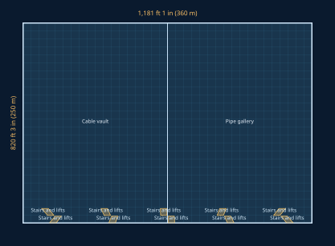
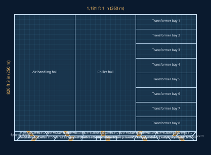
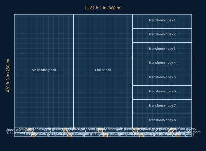

# P1-15 Berth Utility Plant: plan

Footprint 1,181 ft 1 in (360 m) × 820 ft 3 in (250 m) · structural grid 32 ft 10 in (10 m)

## Levels

| Level | Floor above deck | Height | Floor area |
|---|---|---|---|
| Level B1 · Pipe and cable basement | −16 ft 5 in (5,000 mm) | 16 ft 5 in (5,000 mm) | 968,752 sq ft (90,000 m²) |
| Level 1 · Plant floor | 0 ft (0 mm) | 26 ft 3 in (8,000 mm) | 957,741 sq ft (88,977 m²) |
| Level 2 · Upper plant deck | 26 ft 3 in (8,000 mm) | 19 ft 8 in (6,000 mm) | 957,741 sq ft (88,977 m²) |

## Elements

| ID | Designation | Type | Name | Level(s) | Size / length | Area | Status |
|---|---|---|---|---|---|---|---|
| E001 | D5F4P1B13A4L1R1, D5F4P1B13A4L2R1 | room | Transformer bay 1 | L1, L2 | 393 ft 8 in (120 m) × 95 ft 2 in (29 m) | 37,458 sq ft (3,480 m²) | proposed |
| E002 | D5F4P1B13A4L1R2, D5F4P1B13A4L2R2 | room | Transformer bay 2 | L1, L2 | 393 ft 8 in (120 m) × 95 ft 2 in (29 m) | 37,458 sq ft (3,480 m²) | proposed |
| E003 | D5F4P1B13A4L1R3, D5F4P1B13A4L2R3 | room | Transformer bay 3 | L1, L2 | 393 ft 8 in (120 m) × 95 ft 2 in (29 m) | 37,458 sq ft (3,480 m²) | proposed |
| E004 | D5F4P1B13A4L1R4, D5F4P1B13A4L2R4 | room | Transformer bay 4 | L1, L2 | 393 ft 8 in (120 m) × 95 ft 2 in (29 m) | 37,458 sq ft (3,480 m²) | proposed |
| E005 | D5F4P1B13A4L1R5, D5F4P1B13A4L2R5 | room | Transformer bay 5 | L1, L2 | 393 ft 8 in (120 m) × 95 ft 2 in (29 m) | 37,458 sq ft (3,480 m²) | proposed |
| E006 | D5F4P1B13A4L1R6, D5F4P1B13A4L2R6 | room | Transformer bay 6 | L1, L2 | 393 ft 8 in (120 m) × 95 ft 2 in (29 m) | 37,458 sq ft (3,480 m²) | proposed |
| E007 | D5F4P1B13A4L1R7, D5F4P1B13A4L2R7 | room | Transformer bay 7 | L1, L2 | 393 ft 8 in (120 m) × 95 ft 2 in (29 m) | 37,458 sq ft (3,480 m²) | proposed |
| E008 | D5F4P1B13A4L1R8, D5F4P1B13A4L2R8 | room | Transformer bay 8 | L1, L2 | 393 ft 8 in (120 m) × 95 ft 2 in (29 m) | 37,458 sq ft (3,480 m²) | proposed |
| E009 | D5F4P1B13A4L1R9, D5F4P1B13A4L2R9 | room | Chiller hall | L1, L2 | 393 ft 8 in (120 m) × 761 ft 2 in (232 m) | 299,667 sq ft (27,840 m²) | proposed |
| E010 | D5F4P1B13A4L1R10, D5F4P1B13A4L2R10 | room | Air handling hall | L1, L2 | 393 ft 8 in (120 m) × 761 ft 2 in (232 m) | 299,667 sq ft (27,840 m²) | proposed |
| E011 | D5F4P1B13A4LB1R1, D5F4P1B13A4L1R11, D5F4P1B13A4L2R11 | core | Stairs and lifts | LB1, L1, L2 | 49 ft 10 in (15 m) × 27 ft 11 in (8,500 mm) | 732 sq ft (68 m²) | proposed |
| E012 | D5F4P1B13A4LB1R2, D5F4P1B13A4L1R12, D5F4P1B13A4L2R12 | core | Stairs and lifts | LB1, L1, L2 | 38 ft 9 in (12 m) × 27 ft 11 in (8,500 mm) | 732 sq ft (68 m²) | proposed |
| E013 | D5F4P1B13A4LB1R3, D5F4P1B13A4L1R13, D5F4P1B13A4L2R13 | core | Stairs and lifts | LB1, L1, L2 | 26 ft 11 in (8,200 mm) × 27 ft 11 in (8,500 mm) | 732 sq ft (68 m²) | proposed |
| E014 | D5F4P1B13A4LB1R4, D5F4P1B13A4L1R14, D5F4P1B13A4L2R14 | core | Stairs and lifts | LB1, L1, L2 | 37 ft 1 in (11 m) × 27 ft 11 in (8,500 mm) | 732 sq ft (68 m²) | proposed |
| E015 | D5F4P1B13A4LB1R5, D5F4P1B13A4L1R15, D5F4P1B13A4L2R15 | core | Stairs and lifts | LB1, L1, L2 | 48 ft 7 in (15 m) × 27 ft 11 in (8,500 mm) | 732 sq ft (68 m²) | proposed |
| E016 | D5F4P1B13A4LB1R6, D5F4P1B13A4L1R16, D5F4P1B13A4L2R16 | core | Stairs and lifts | LB1, L1, L2 | 49 ft 10 in (15 m) × 27 ft 11 in (8,500 mm) | 732 sq ft (68 m²) | proposed |
| E017 | D5F4P1B13A4LB1R7, D5F4P1B13A4L1R17, D5F4P1B13A4L2R17 | core | Stairs and lifts | LB1, L1, L2 | 38 ft 9 in (12 m) × 27 ft 11 in (8,500 mm) | 732 sq ft (68 m²) | proposed |
| E018 | D5F4P1B13A4LB1R8, D5F4P1B13A4L1R18, D5F4P1B13A4L2R18 | core | Stairs and lifts | LB1, L1, L2 | 26 ft 11 in (8,200 mm) × 27 ft 11 in (8,500 mm) | 732 sq ft (68 m²) | proposed |
| E019 | D5F4P1B13A4LB1R9, D5F4P1B13A4L1R19, D5F4P1B13A4L2R19 | core | Stairs and lifts | LB1, L1, L2 | 37 ft 1 in (11 m) × 27 ft 11 in (8,500 mm) | 732 sq ft (68 m²) | proposed |
| E020 | D5F4P1B13A4LB1R10, D5F4P1B13A4L1R20, D5F4P1B13A4L2R20 | core | Stairs and lifts | LB1, L1, L2 | 48 ft 7 in (15 m) × 27 ft 11 in (8,500 mm) | 732 sq ft (68 m²) | proposed |
| E021 | D5F4P1B13A4L1R21 | room | Control room | L1 | 42 ft 8 in (13 m) × 59 ft 1 in (18 m) | 1,290 sq ft (120 m²) | proposed |
| E022 | D5F4P1B13A4L1R22 | room | Switch room | L1 | 85 ft (26 m) × 27 ft 11 in (8,500 mm) | 1,651 sq ft (153 m²) | proposed |
| E023 | D5F4P1B13A4L1R23 | room | Battery room | L1 | 83 ft (25 m) × 27 ft 11 in (8,500 mm) | 1,715 sq ft (159 m²) | proposed |
| E024 | D5F4P1B13A4L1R24 | room | Water pump room | L1 | 95 ft 2 in (29 m) × 27 ft 11 in (8,500 mm) | 2,141 sq ft (199 m²) | proposed |
| E025 | D5F4P1B13A4L1R25 | room | Water treatment room | L1 | 87 ft 3 in (27 m) × 27 ft 11 in (8,500 mm) | 2,017 sq ft (187 m²) | proposed |
| E026 | D5F4P1B13A4L1R26 | room | Workshop | L1 | 64 ft 4 in (20 m) × 27 ft 11 in (8,500 mm) | 1,500 sq ft (139 m²) | proposed |
| E027 | D5F4P1B13A4L1R27 | room | Shore power hall | L1 | 121 ft 5 in (37 m) × 27 ft 11 in (8,500 mm) | 3,211 sq ft (298 m²) | proposed |
| E028 | D5F4P1B13A4L1R28 | room | Water and air pump room | L1 | 44 ft (13 m) × 27 ft 11 in (8,500 mm) | 1,162 sq ft (108 m²) | proposed |
| E029 | D5F4P1B13A4L1R29 | room | Locker room | L1 | 35 ft 1 in (11 m) × 27 ft 11 in (8,500 mm) | 961 sq ft (89 m²) | proposed |
| E030 | D5F4P1B13A4L1R30 | room | Staff toilets and showers | L1 | 28 ft 10 in (8,800 mm) × 27 ft 11 in (8,500 mm) | 750 sq ft (70 m²) | proposed |
| E031 | D5F4P1B13A4L1R31 | room | Spares store | L1 | 96 ft 9 in (30 m) × 27 ft 11 in (8,500 mm) | 2,562 sq ft (238 m²) | proposed |
| E032 | D5F4P1B13A4L1R32 | room | Spares store | L1 | 65 ft 11 in (20 m) × 27 ft 11 in (8,500 mm) | 1,597 sq ft (148 m²) | proposed |
| E033 | D5F4P1B13A4L1R33 | room | Spares store | L1 | 105 ft 4 in (32 m) × 27 ft 11 in (8,500 mm) | 2,557 sq ft (238 m²) | proposed |
| E034 | D5F4P1B13A4L1R34 | room | Spares store | L1 | 137 ft 6 in (42 m) × 27 ft 11 in (8,500 mm) | 3,312 sq ft (308 m²) | proposed |
| E035 | D5F4P1B13A4L1R35 | room | Spares store | L1 | 117 ft 2 in (36 m) × 27 ft 11 in (8,500 mm) | 2,562 sq ft (238 m²) | proposed |
| E036 | D5F4P1B13A4L1R36 | room | Spares store | L1 | 100 ft 5 in (31 m) × 59 ft 1 in (18 m) | 3,321 sq ft (309 m²) | proposed |
| E037 | D5F4P1B13A4L1R37 | room | Spares store | L1 | 112 ft 6 in (34 m) × 27 ft 11 in (8,500 mm) | 2,557 sq ft (238 m²) | proposed |
| E038 | D5F4P1B13A4L1R38 | room | Spares store | L1 | 134 ft 10 in (41 m) × 27 ft 11 in (8,500 mm) | 3,317 sq ft (308 m²) | proposed |
| E039 | D5F4P1B13A4L1R39 | room | Spares store | L1 | 101 ft 1 in (31 m) × 27 ft 11 in (8,500 mm) | 2,557 sq ft (238 m²) | proposed |
| E040 | D5F4P1B13A4L1R40 | room | Spares store | L1 | 123 ft (38 m) × 27 ft 11 in (8,500 mm) | 3,317 sq ft (308 m²) | proposed |
| E041 | D5F4P1B13A4L1R41 | room | Spares store | L1 | 93 ft 10 in (29 m) × 27 ft 11 in (8,500 mm) | 2,557 sq ft (238 m²) | proposed |
| E042 | D5F4P1B13A4L1R42 | room | Spares store | L1 | 126 ft (38 m) × 27 ft 11 in (8,500 mm) | 3,312 sq ft (308 m²) | proposed |
| E043 | D5F4P1B13A4L1R43 | room | Spares store | L1 | 105 ft 4 in (32 m) × 27 ft 11 in (8,500 mm) | 2,557 sq ft (238 m²) | proposed |
| E044 | D5F4P1B13A4L1R44 | room | Spares store | L1 | 137 ft 6 in (42 m) × 27 ft 11 in (8,500 mm) | 3,312 sq ft (308 m²) | proposed |
| E045 | D5F4P1B13A4L1R45 | room | Spares store | L1 | 130 ft 11 in (40 m) × 27 ft 11 in (8,500 mm) | 2,942 sq ft (273 m²) | proposed |
| E046 | D5F4P1B13A4L2R21 | room | Filter bank room | L2 | 57 ft 9 in (18 m) × 59 ft 1 in (18 m) | 1,720 sq ft (160 m²) | proposed |
| E047 | D5F4P1B13A4L2R22 | room | Ductwork gallery | L2 | 69 ft 3 in (21 m) × 27 ft 11 in (8,500 mm) | 1,221 sq ft (113 m²) | proposed |
| E048 | D5F4P1B13A4L2R23 | room | Crew rest room | L2 | 38 ft 1 in (12 m) × 27 ft 11 in (8,500 mm) | 430 sq ft (40 m²) | proposed |
| E049 | D5F4P1B13A4L2R24 | room | Upper plant gallery | L2 | 141 ft 5 in (43 m) × 27 ft 11 in (8,500 mm) | 3,404 sq ft (316 m²) | proposed |
| E050 | D5F4P1B13A4L2R25 | room | Upper plant gallery | L2 | 87 ft 11 in (27 m) × 27 ft 11 in (8,500 mm) | 2,040 sq ft (190 m²) | proposed |
| E051 | D5F4P1B13A4L2R26 | room | Upper plant gallery | L2 | 130 ft 7 in (40 m) × 27 ft 11 in (8,500 mm) | 3,399 sq ft (316 m²) | proposed |
| E052 | D5F4P1B13A4L2R27 | room | Upper plant gallery | L2 | 92 ft 2 in (28 m) × 27 ft 11 in (8,500 mm) | 2,475 sq ft (230 m²) | proposed |
| E053 | D5F4P1B13A4L2R28 | room | Upper plant gallery | L2 | 124 ft 8 in (38 m) × 27 ft 11 in (8,500 mm) | 3,399 sq ft (316 m²) | proposed |
| E054 | D5F4P1B13A4L2R29 | room | Upper plant gallery | L2 | 96 ft 5 in (29 m) × 27 ft 11 in (8,500 mm) | 2,470 sq ft (230 m²) | proposed |
| E055 | D5F4P1B13A4L2R30 | room | Upper plant gallery | L2 | 136 ft 6 in (42 m) × 27 ft 11 in (8,500 mm) | 3,404 sq ft (316 m²) | proposed |
| E056 | D5F4P1B13A4L2R31 | room | Upper plant gallery | L2 | 107 ft 11 in (33 m) × 27 ft 11 in (8,500 mm) | 2,466 sq ft (229 m²) | proposed |
| E057 | D5F4P1B13A4L2R32 | room | Upper plant gallery | L2 | 130 ft 11 in (40 m) × 31 ft 10 in (9,700 mm) | 3,408 sq ft (317 m²) | proposed |
| E058 | D5F4P1B13A4L2R33 | room | Upper plant gallery | L2 | 100 ft 5 in (31 m) × 29 ft 6 in (9,000 mm) | 2,475 sq ft (230 m²) | proposed |
| E059 | D5F4P1B13A4L2R34 | room | Upper plant gallery | L2 | 142 ft 1 in (43 m) × 27 ft 11 in (8,500 mm) | 3,404 sq ft (316 m²) | proposed |
| E060 | D5F4P1B13A4L2R35 | room | Upper plant gallery | L2 | 103 ft 8 in (32 m) × 27 ft 11 in (8,500 mm) | 2,470 sq ft (230 m²) | proposed |
| E061 | D5F4P1B13A4L2R36 | room | Upper plant gallery | L2 | 130 ft 7 in (40 m) × 27 ft 11 in (8,500 mm) | 3,399 sq ft (316 m²) | proposed |
| E062 | D5F4P1B13A4L2R37 | room | Upper plant gallery | L2 | 92 ft 2 in (28 m) × 27 ft 11 in (8,500 mm) | 2,475 sq ft (230 m²) | proposed |
| E063 | D5F4P1B13A4L2R38 | room | Upper plant gallery | L2 | 124 ft 8 in (38 m) × 27 ft 11 in (8,500 mm) | 3,399 sq ft (316 m²) | proposed |
| E064 | D5F4P1B13A4L2R39 | room | Upper plant gallery | L2 | 96 ft 5 in (29 m) × 27 ft 11 in (8,500 mm) | 2,470 sq ft (230 m²) | proposed |
| E065 | D5F4P1B13A4L2R40 | room | Upper plant gallery | L2 | 136 ft 6 in (42 m) × 27 ft 11 in (8,500 mm) | 3,404 sq ft (316 m²) | proposed |
| E066 | D5F4P1B13A4L2R41 | room | Upper plant gallery | L2 | 107 ft 11 in (33 m) × 27 ft 11 in (8,500 mm) | 2,466 sq ft (229 m²) | proposed |
| E067 | D5F4P1B13A4L2R42 | room | Upper plant gallery | L2 | 130 ft 11 in (40 m) × 27 ft 11 in (8,500 mm) | 2,942 sq ft (273 m²) | proposed |
| E068 | D5F4P1B13A4LB1R11 | room | Cable vault | LB1 | 590 ft 7 in (180 m) × 820 ft 3 in (250 m) | 484,376 sq ft (45,000 m²) | proposed |
| E069 | D5F4P1B13A4LB1R12 | room | Pipe gallery | LB1 | 590 ft 7 in (180 m) × 820 ft 3 in (250 m) | 484,376 sq ft (45,000 m²) | proposed |

## Drawings

### Level B1 · Pipe and cable basement

### Level 1 · Plant floor

### Level 2 · Upper plant deck

