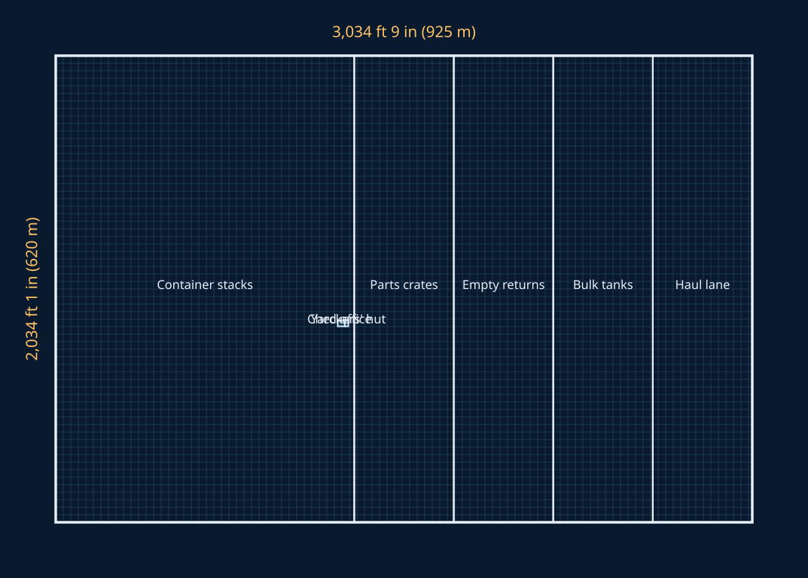

# P1-18 Quay Yard 2: plan

Footprint 3,034 ft 9 in (925 m) × 2,034 ft 1 in (620 m) · structural grid 32 ft 10 in (10 m)

## Levels

| Level | Floor above deck | Height | Floor area |
|---|---|---|---|
| Level 1 · Yard | 0 ft (0 mm) | 13 ft 1 in (4,000 mm) | 1,206 sq ft (112 m²) |

## Elements

| ID | Designation | Type | Name | Level(s) | Size / length | Area | Status |
|---|---|---|---|---|---|---|---|
| E001 | D5F4P1B3A1R1 | zone | Container stacks | L1 | 1,300 ft 6 in (396 m) × 2,034 ft 1 in (620 m) | 2,645,425 sq ft (245,768 m²) | proposed |
| E002 | D5F4P1B3A1R2 | room | Yard office | L1 | 30 ft 10 in (9,400 mm) × 26 ft 3 in (8,000 mm) | 809 sq ft (75 m²) | proposed |
| E003 | D5F4P1B3A1R3 | room | Checkers' hut | L1 | 15 ft 1 in (4,600 mm) × 26 ft 3 in (8,000 mm) | 396 sq ft (37 m²) | proposed |
| E004 | D5F4P1B3A1R4 | zone | Parts crates | L1 | 433 ft 9 in (132 m) × 2,034 ft 1 in (620 m) | 882,253 sq ft (81,964 m²) | proposed |
| E005 | D5F4P1B3A1R5 | zone | Empty returns | L1 | 433 ft 5 in (132 m) × 2,034 ft 1 in (620 m) | 881,586 sq ft (81,902 m²) | proposed |
| E006 | D5F4P1B3A1R6 | zone | Bulk tanks | L1 | 433 ft 9 in (132 m) × 2,034 ft 1 in (620 m) | 882,253 sq ft (81,964 m²) | proposed |
| E007 | D5F4P1B3A1R7 | zone | Haul lane | L1 | 433 ft 5 in (132 m) × 2,034 ft 1 in (620 m) | 881,586 sq ft (81,902 m²) | proposed |

## Drawings

### Level 1 · Yard

