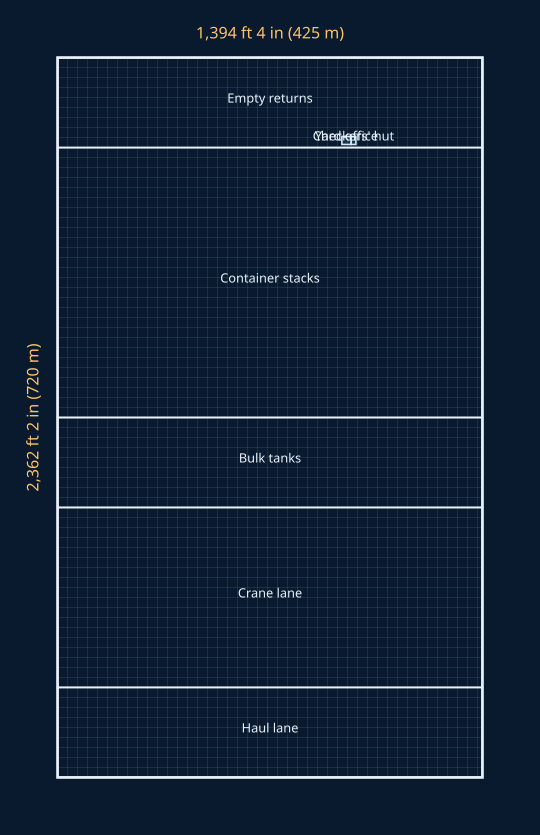

# P1-19 Quay Yard 3: plan

Footprint 1,394 ft 4 in (425 m) × 2,362 ft 2 in (720 m) · structural grid 32 ft 10 in (10 m)

## Levels

| Level | Floor above deck | Height | Floor area |
|---|---|---|---|
| Level 1 · Yard | 0 ft (0 mm) | 13 ft 1 in (4,000 mm) | 1,206 sq ft (112 m²) |

## Elements

| ID | Designation | Type | Name | Level(s) | Size / length | Area | Status |
|---|---|---|---|---|---|---|---|
| E001 | D5F4P1B6A1R1 | zone | Empty returns | L1 | 1,394 ft 4 in (425 m) × 295 ft 3 in (90 m) | 411,720 sq ft (38,250 m²) | proposed |
| E002 | D5F4P1B6A1R2 | room | Yard office | L1 | 30 ft 6 in (9,300 mm) × 26 ft 3 in (8,000 mm) | 801 sq ft (74 m²) | proposed |
| E003 | D5F4P1B6A1R3 | room | Checkers' hut | L1 | 15 ft 5 in (4,700 mm) × 26 ft 3 in (8,000 mm) | 405 sq ft (38 m²) | proposed |
| E004 | D5F4P1B6A1R4 | zone | Container stacks | L1 | 1,394 ft 4 in (425 m) × 885 ft 10 in (270 m) | 1,235,159 sq ft (114,750 m²) | proposed |
| E005 | D5F4P1B6A1R5 | zone | Bulk tanks | L1 | 1,394 ft 4 in (425 m) × 295 ft 3 in (90 m) | 411,720 sq ft (38,250 m²) | proposed |
| E006 | D5F4P1B6A1R6 | zone | Crane lane | L1 | 1,394 ft 4 in (425 m) × 590 ft 7 in (180 m) | 823,439 sq ft (76,500 m²) | proposed |
| E007 | D5F4P1B6A1R7 | zone | Haul lane | L1 | 1,394 ft 4 in (425 m) × 295 ft 3 in (90 m) | 411,720 sq ft (38,250 m²) | proposed |

## Drawings

### Level 1 · Yard

